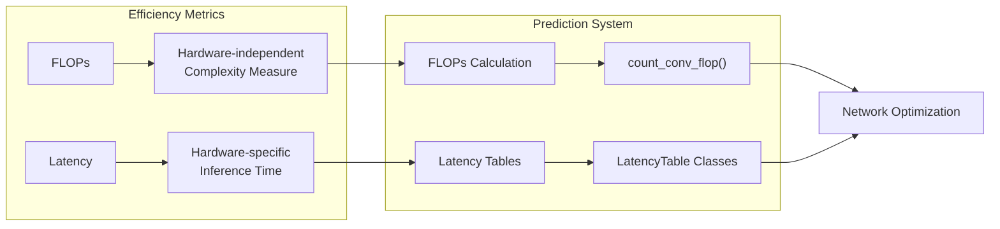
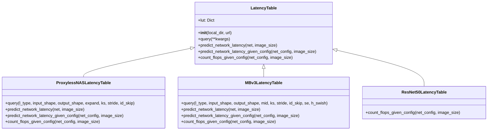
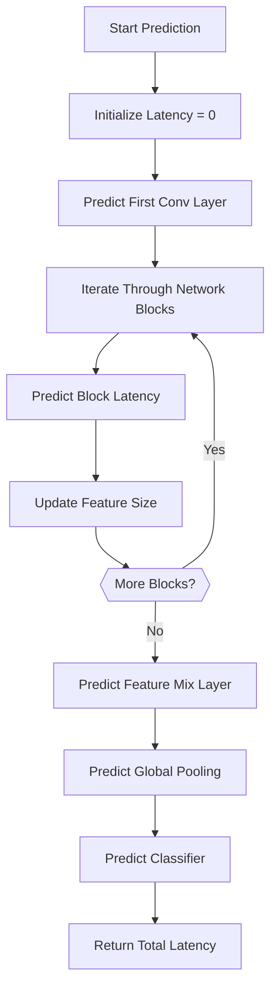
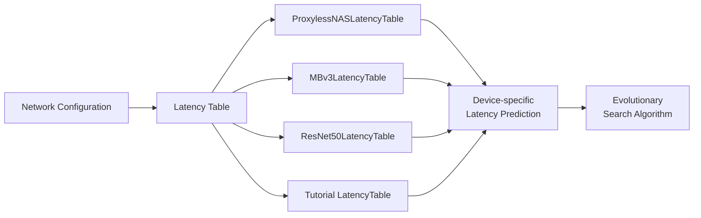
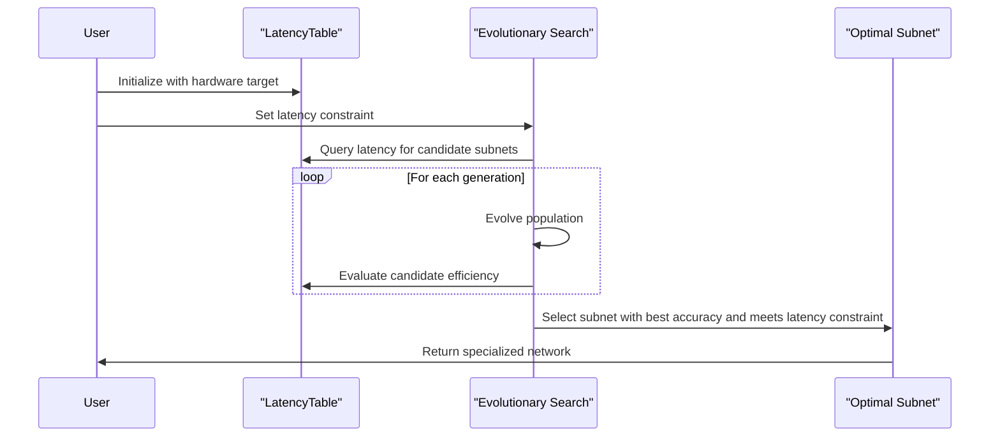
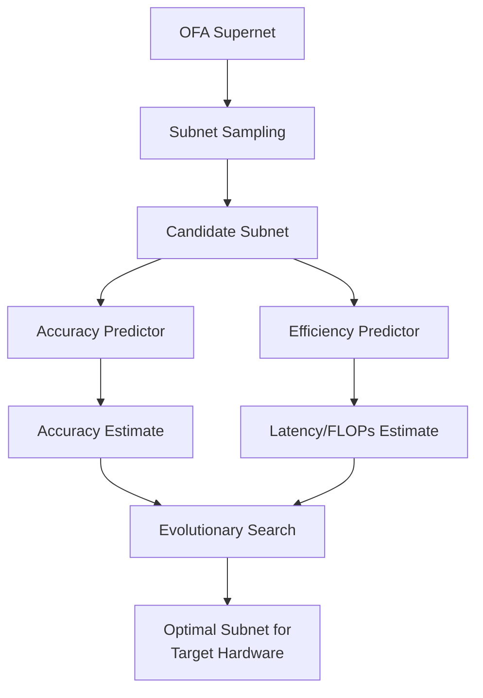

<!-- source: DeepWiki mcp.deepwiki.com · repo mit-han-lab/once-for-all · page 4.2 Efficiency Prediction · fetched 2026-10-30 -->

# Efficiency Prediction

<details>
<summary>Relevant source files</summary>

The following files were used as context for generating this wiki page:

- [ofa/nas/efficiency_predictor/latency_lookup_table.py](ofa/nas/efficiency_predictor/latency_lookup_table.py)
- [ofa/tutorial/latency_table.py](ofa/tutorial/latency_table.py)

</details>


This document describes the efficiency prediction system within the Once for All (OFA) framework. This system enables the framework to estimate the computational efficiency (latency and FLOPs) of neural network architectures without requiring actual deployment on target hardware. Efficiency prediction is a critical component for hardware-aware network specialization, as it provides rapid feedback for the [Evolutionary Search](#4.3) process to find optimal sub-networks.

## 1. Efficiency Metrics

The OFA framework supports two key metrics for quantifying computational efficiency:

1. **Latency**: The inference time of a network on specific hardware platforms, measured in milliseconds (ms)
2. **FLOPs**: Floating-point operations, a hardware-independent metric for computational complexity

### Diagram: Efficiency Metrics in Network Optimization



Sources: [ofa/nas/efficiency_predictor/latency_lookup_table.py:16-21](), [ofa/nas/efficiency_predictor/latency_lookup_table.py:24-57]()

## 2. Latency Prediction System

The latency prediction system uses pre-computed lookup tables to estimate the inference time of neural networks on specific hardware platforms.

### 2.1 Latency Table Architecture

The core of the latency prediction system is the `LatencyTable` class hierarchy:



Sources: [ofa/nas/efficiency_predictor/latency_lookup_table.py:24-57](), [ofa/nas/efficiency_predictor/latency_lookup_table.py:60-200](), [ofa/nas/efficiency_predictor/latency_lookup_table.py:261-494](), [ofa/nas/efficiency_predictor/latency_lookup_table.py:497-567]()

### 2.2 Lookup Table Data Structure

The latency lookup tables are stored as YAML files containing pre-measured latency values for different network operations. These tables can be loaded from local storage or downloaded from remote URLs.

| Component Type | Input Parameters | Example Key Format |
|----------------|------------------|-------------------|
| Conv layer | Input/output shapes | "Conv-input:224x224x3-output:112x112x24" |
| MBConv block | Input/output shapes, expansion ratio, kernel size, stride, etc. | "expanded_conv-input:112x112x24-output:56x56x32-expand:6-kernel:3-stride:2-idskip:0" |
| Feature mix layer | Input/output shapes | "Conv_1-input:7x7x320-output:7x7x1280" |

Sources: [ofa/nas/efficiency_predictor/latency_lookup_table.py:24-45](), [ofa/tutorial/latency_table.py:5-18]()

### 2.3 Latency Prediction Process

The latency prediction process traverses the network architecture and accumulates latency estimates for each component:



Sources: [ofa/nas/efficiency_predictor/latency_lookup_table.py:102-146](), [ofa/nas/efficiency_predictor/latency_lookup_table.py:293-348](), [ofa/tutorial/latency_table.py:59-114]()

## 3. FLOPs Calculation

Floating-point operations (FLOPs) are calculated for each network component using the `count_conv_flop` function:

```python
def count_conv_flop(out_size, in_channels, out_channels, kernel_size, groups):
    out_h = out_w = out_size
    delta_ops = (
        in_channels * out_channels * kernel_size * kernel_size * out_h * out_w / groups
    )
    return delta_ops
```

For entire networks, the FLOPs are calculated by traversing the network architecture and accumulating the FLOPs for each component. The result is typically reported in millions of FLOPs (MFLOPs).

Sources: [ofa/nas/efficiency_predictor/latency_lookup_table.py:16-21](), [ofa/nas/efficiency_predictor/latency_lookup_table.py:202-258](), [ofa/nas/efficiency_predictor/latency_lookup_table.py:423-494]()

## 4. Network-Level Efficiency Prediction

The framework provides two approaches for predicting network efficiency:

1. **Object-based prediction**: Using an actual network object
   ```python
   latency = latency_table.predict_network_latency(network, image_size=224)
   ```

2. **Config-based prediction**: Using a network configuration dictionary
   ```python
   latency = latency_table.predict_network_latency_given_config(net_config, image_size=224)
   flops = latency_table.count_flops_given_config(net_config, image_size=224)
   ```

Both approaches follow a similar process of traversing the network's layers and blocks, querying the latency table for each component, and accumulating the results.

Sources: [ofa/nas/efficiency_predictor/latency_lookup_table.py:102-146](), [ofa/nas/efficiency_predictor/latency_lookup_table.py:148-200](), [ofa/nas/efficiency_predictor/latency_lookup_table.py:293-348](), [ofa/nas/efficiency_predictor/latency_lookup_table.py:351-421]()

## 5. Specialized Latency Tables

The OFA framework includes specialized latency table implementations for different network architectures:

### 5.1 ProxylessNAS Latency Table

Tailored for ProxylessNAS-based networks, handling basic mobile-optimized architectures.

### 5.2 MBv3 Latency Table

Extended for MobileNetV3-style networks, including additional parameters for squeeze-and-excitation (SE) layers and h-swish activation functions.

### 5.3 ResNet50 Latency Table

Specialized for ResNet50-based architectures, focusing primarily on FLOPs calculation.

### 5.4 Tutorial Latency Table

A simplified implementation used in tutorials, with support for querying latency from pre-built lookup tables for various mobile devices.



Sources: [ofa/nas/efficiency_predictor/latency_lookup_table.py:60-200](), [ofa/nas/efficiency_predictor/latency_lookup_table.py:261-494](), [ofa/nas/efficiency_predictor/latency_lookup_table.py:497-567](), [ofa/tutorial/latency_table.py:5-114](), [ofa/tutorial/latency_table.py:195-208]()

## 6. Usage in Network Specialization

Efficiency prediction is a key component in the network specialization process of the OFA framework:



The efficiency prediction system enables the [Evolutionary Search](#4.3) algorithm to efficiently navigate the architecture space by providing rapid estimates of network latency without requiring actual hardware deployment.

Sources: [ofa/tutorial/latency_table.py:117-192](), [ofa/nas/efficiency_predictor/latency_lookup_table.py:148-200]()

## 7. Integration with the OFA Framework

The efficiency prediction system integrates with other components of the OFA framework to enable hardware-aware network specialization:



By combining accuracy prediction (covered in [Accuracy Prediction](#4.1)) with efficiency prediction, the OFA framework can find optimal trade-offs between model performance and computational efficiency for specific hardware targets.

Sources: [ofa/tutorial/latency_table.py:117-192](), [ofa/nas/efficiency_predictor/latency_lookup_table.py:24-57]()

## 8. Creating Custom Latency Tables

For new hardware targets, users can create custom latency tables by:

1. Measuring the latency of individual operations on the target hardware
2. Creating a YAML lookup table mapping operation configurations to latency values
3. Implementing a specialized `LatencyTable` subclass if needed
4. Using the custom latency table in the evolutionary search process

This process enables the OFA framework to be extended to new hardware platforms without modifying the core architecture.

Sources: [ofa/nas/efficiency_predictor/latency_lookup_table.py:24-57](), [ofa/tutorial/latency_table.py:5-18]()

## Summary

The efficiency prediction system in the OFA framework provides a rapid, accurate method for estimating the computational efficiency of neural network architectures without requiring actual deployment on target hardware. This capability is essential for hardware-aware network specialization, enabling the framework to find optimal sub-networks that meet specific efficiency constraints while maximizing accuracy.

---

