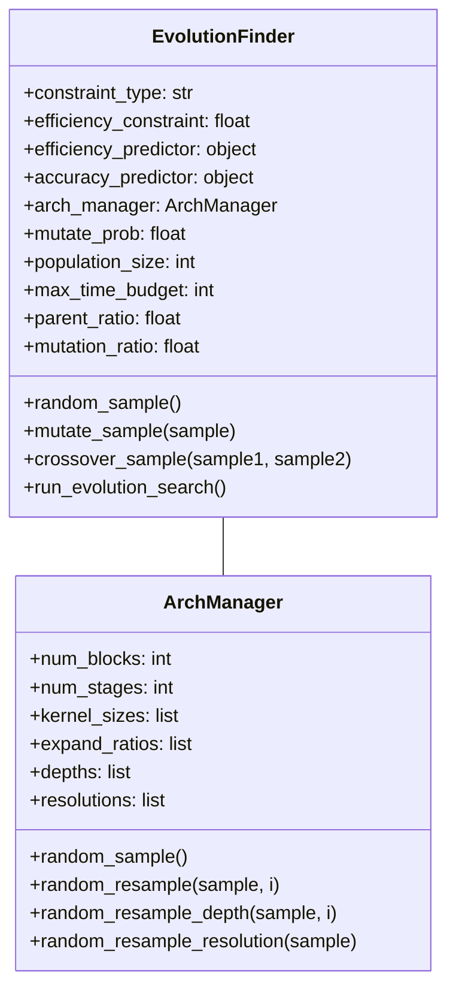
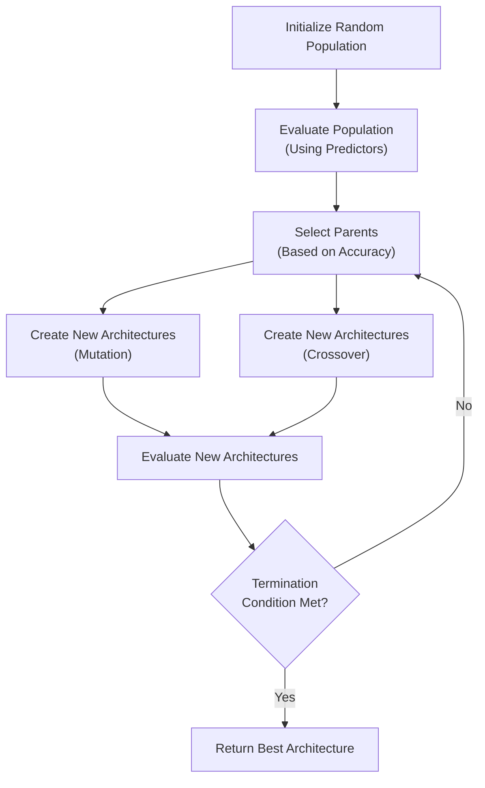
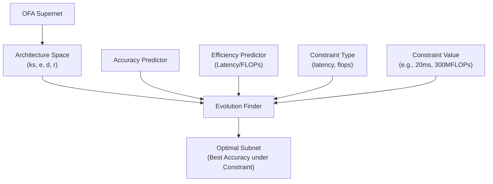

<!-- source: DeepWiki mcp.deepwiki.com · repo mit-han-lab/once-for-all · page 4.3 Evolutionary Search · fetched 2026-10-30 -->

# Evolutionary Search

<details>
<summary>Relevant source files</summary>

The following files were used as context for generating this wiki page:

- [figures/ofa_search_cost.png](figures/ofa_search_cost.png)
- [figures/predictor_based_search.png](figures/predictor_based_search.png)
- [figures/select_subnets.png](figures/select_subnets.png)
- [ofa/tutorial/__init__.py](ofa/tutorial/__init__.py)
- [ofa/tutorial/evolution_finder.py](ofa/tutorial/evolution_finder.py)
- [ofa/tutorial/flops_table.py](ofa/tutorial/flops_table.py)
- [ofa/tutorial/imagenet_eval_helper.py](ofa/tutorial/imagenet_eval_helper.py)

</details>


This document explains the Evolutionary Search component of the Once for All (OFA) framework, which efficiently finds optimal subnets from the OFA supernet without requiring retraining. For information about accuracy prediction or efficiency prediction, refer to the [Accuracy Prediction](#4.1) and [Efficiency Prediction](#4.2) pages respectively.

## Purpose and Overview

Evolutionary Search in OFA applies genetic algorithm principles to search for optimal neural network architectures that maximize accuracy while meeting specific efficiency constraints (such as latency or FLOPs). The search leverages pre-trained accuracy and efficiency predictors to evaluate candidate architectures without actually training them, making it orders of magnitude faster than traditional Neural Architecture Search (NAS) methods.

## Architecture Space

The evolutionary search operates within the architecture space defined by the OFA framework:

| Parameter | Available Options |
|-----------|-------------------|
| Kernel sizes | 3×3, 5×5, 7×7 |
| Expand ratios | 3, 4, 6 |
| Depths | 2, 3, 4 blocks per stage |
| Resolutions | 160, 176, 192, 208, 224 |

This creates a vast search space with millions of potential subnet architectures that can be derived from the OFA supernet.

Sources: [ofa/tutorial/evolution_finder.py:9-17]()

## System Components

### EvolutionFinder

The `EvolutionFinder` class is the core component that implements the evolutionary search algorithm.



Key parameters of `EvolutionFinder`:
- `constraint_type`: Type of efficiency constraint (e.g., "flops", "note10")
- `efficiency_constraint`: Value of the constraint
- `efficiency_predictor`: Predictor for architecture efficiency
- `accuracy_predictor`: Predictor for architecture accuracy
- `population_size`: Size of the population (default: 100)
- `max_time_budget`: Maximum search iterations (default: 500)
- `mutation_ratio`: Proportion of new candidates created through mutation (default: 0.5)

Sources: [ofa/tutorial/evolution_finder.py:53-89]()

### ArchManager

The `ArchManager` class manages the architecture space and provides methods for sampling and mutation.

Key methods:
- `random_sample`: Generates a random architecture
- `random_resample`: Resamples a specific block in an architecture
- `random_resample_depth`: Resamples the depth of a specific stage
- `random_resample_resolution`: Resamples the resolution

Sources: [ofa/tutorial/evolution_finder.py:9-52]()

## Evolutionary Search Workflow

### The Evolution Process



The algorithm follows these steps:
1. Initialize a random population of architectures that satisfy the efficiency constraint
2. Evaluate each architecture using accuracy and efficiency predictors
3. Select the best architectures (parents) based on accuracy
4. Create new architectures through mutation and crossover operations
5. Evaluate the new architectures
6. Repeat steps 3-5 until the termination condition is met
7. Return the best architecture found

Sources: [ofa/tutorial/evolution_finder.py:176-242]()

### Predictor-based Search System



The search process leverages two predictors:
- **Accuracy Predictor**: Estimates the accuracy of a subnet without training
- **Efficiency Predictor**: Estimates the latency or FLOPs of a subnet

This predictor-based approach enables rapid evaluation of candidate architectures, allowing the search to explore a large number of architectures efficiently.

Sources: [ofa/tutorial/evolution_finder.py:176-242](), [figures/predictor_based_search.png]()

## Implementation Details

### Mutation Operation

The mutation operation randomly modifies aspects of an architecture (kernel size, expand ratio, depth, or resolution) with probability `mutate_prob`:

```python
def mutate_sample(self, sample):
    constraint = self.efficiency_constraint
    while True:
        new_sample = copy.deepcopy(sample)
        
        # Randomly mutate resolution
        if random.random() < self.mutate_prob:
            self.arch_manager.random_resample_resolution(new_sample)
        
        # Randomly mutate kernel size and expand ratio
        for i in range(self.num_blocks):
            if random.random() < self.mutate_prob:
                self.arch_manager.random_resample(new_sample, i)
        
        # Randomly mutate depth
        for i in range(self.num_stages):
            if random.random() < self.mutate_prob:
                self.arch_manager.random_resample_depth(new_sample, i)
        
        # Only accept if meets efficiency constraint
        efficiency = self.efficiency_predictor.predict_efficiency(new_sample)
        if efficiency <= constraint:
            return new_sample, efficiency
```

Only architectures that meet the efficiency constraint are accepted.

Sources: [ofa/tutorial/evolution_finder.py:140-158]()

### Crossover Operation

The crossover operation combines two parent architectures to create a new one:

```python
def crossover_sample(self, sample1, sample2):
    constraint = self.efficiency_constraint
    while True:
        new_sample = copy.deepcopy(sample1)
        for key in new_sample.keys():
            if not isinstance(new_sample[key], list):
                continue
            for i in range(len(new_sample[key])):
                new_sample[key][i] = random.choice(
                    [sample1[key][i], sample2[key][i]]
                )
        
        # Only accept if meets efficiency constraint
        efficiency = self.efficiency_predictor.predict_efficiency(new_sample)
        if efficiency <= constraint:
            return new_sample, efficiency
```

For each parameter (kernel size, expand ratio, etc.), the value is randomly chosen from one of the two parents.

Sources: [ofa/tutorial/evolution_finder.py:160-174]()

## Usage Example

Here's an example of how to use the Evolutionary Search in OFA:

```python
from ofa.tutorial import AccuracyPredictor, LatencyTable, EvolutionFinder

# Initialize predictors
accuracy_predictor = AccuracyPredictor(
    pretrained=True,
    device='cuda:0'
)
latency_predictor = LatencyTable(
    device='cuda:0',
    batch_size=1
)

# Initialize evolution finder
finder = EvolutionFinder(
    constraint_type='latency',
    efficiency_constraint=20,  # 20ms constraint
    efficiency_predictor=latency_predictor,
    accuracy_predictor=accuracy_predictor
)

# Run evolutionary search
best_valids, best_info = finder.run_evolution_search()

# Extract best architecture
best_accuracy = best_info[0]
best_architecture = best_info[1]
best_efficiency = best_info[2]
```

Sources: [ofa/tutorial/evolution_finder.py:53-89](), [ofa/tutorial/evolution_finder.py:176-242]()

## Search Cost Comparison

Evolutionary Search in OFA offers a significant reduction in search cost compared to traditional NAS methods:

| Method | Search Cost | Search Time |
|--------|-------------|-------------|
| Traditional NAS | Thousands of GPU days | Weeks |
| OFA Evolutionary Search | <1 GPU hour | Minutes |

This dramatic reduction in search cost is achieved by:
1. Leveraging the OFA supernet instead of training from scratch
2. Using predictors to evaluate architectures instead of training them
3. Efficiently exploring the architecture space through evolution

Sources: [figures/ofa_search_cost.png]()

## Conclusion

Evolutionary Search in OFA provides an efficient way to find optimal neural network architectures for different deployment scenarios. By combining genetic algorithms with accuracy and efficiency predictors, it can rapidly explore the architecture space and find subnets that achieve a good balance between accuracy and efficiency without requiring any training.

Sources: [ofa/tutorial/evolution_finder.py](), [ofa/tutorial/__init__.py]()

---

