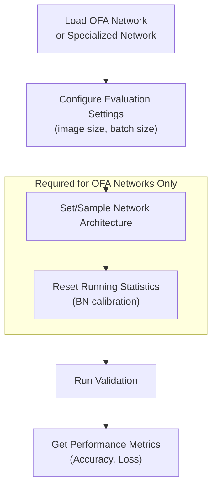
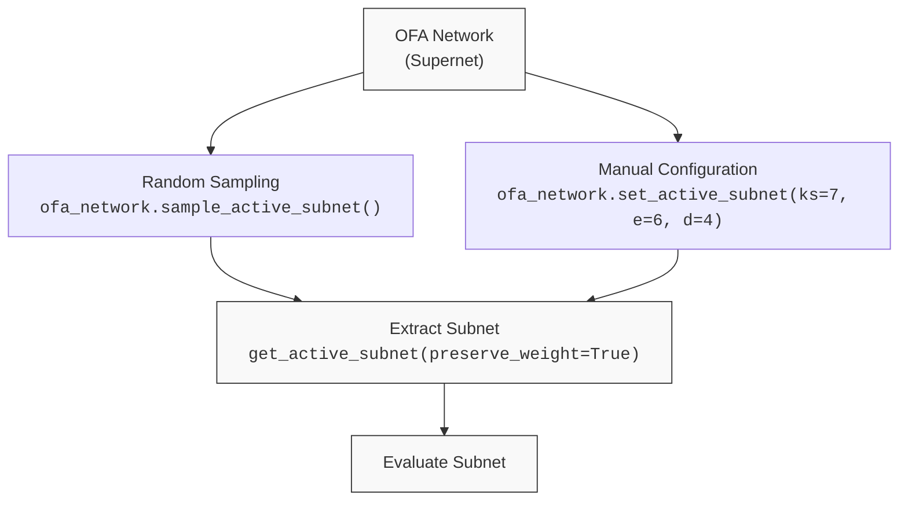
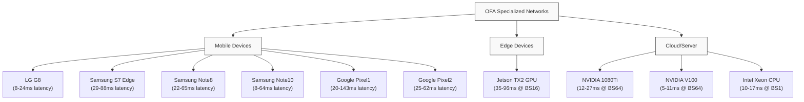
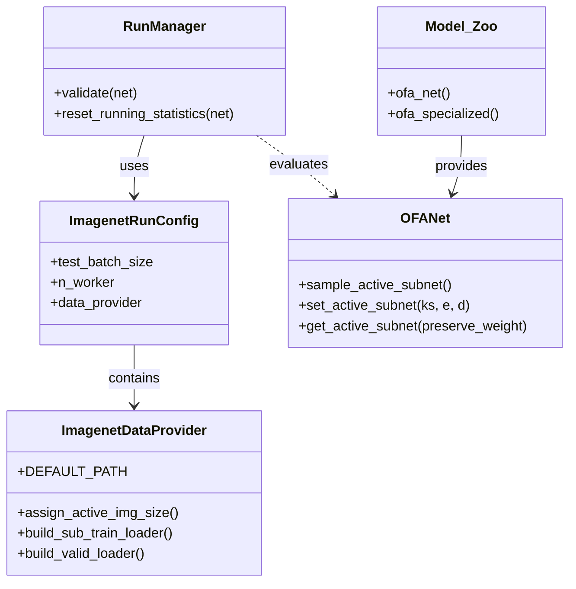

<!-- source: DeepWiki mcp.deepwiki.com · repo mit-han-lab/once-for-all · page 5 Evaluation · fetched 2026-10-30 -->

# Evaluation

<details>
<summary>Relevant source files</summary>

The following files were used as context for generating this wiki page:

- [README.md](README.md)
- [eval_ofa_net.py](eval_ofa_net.py)
- [figures/ofa-tutorial.jpg](figures/ofa-tutorial.jpg)
- [tutorial/README.md](tutorial/README.md)

</details>


## Purpose and Scope

This document covers how to evaluate Once-for-All (OFA) networks and specialized sub-networks against standard metrics. It provides instructions for both command-line evaluation and programmatic evaluation of network performance.

For information about training OFA networks, see [Training System](#3), and for information about specializing networks for deployment, see [Network Specialization](#4).

## Evaluation Workflow

The OFA framework provides streamlined tools for evaluating both the main supernet and specialized sub-networks derived from it. The evaluation workflow typically follows these steps:



## Evaluating OFA Networks

OFA networks can be evaluated in two ways: using the provided command-line script or programmatically in Python.

### Command-Line Evaluation

The repository provides a command-line tool `eval_ofa_net.py` for quick evaluation:

```bash
python eval_ofa_net.py --path 'Path to ImageNet' --net ofa_mbv3_d234_e346_k357_w1.0
```

Available network options include:

| OFA Network | Design Space | Resolution | Width | Depth | Expand Ratio | Kernel Size |
|-------------|--------------|------------|-------|-------|--------------|-------------|
| ofa_resnet50 | ResNet50D | 128-224 | 0.65, 0.8, 1.0 | 0, 1, 2 | 0.2, 0.25, 0.35 | 3 |
| ofa_mbv3_d234_e346_k357_w1.0 | MobileNetV3 | 128-224 | 1.0 | 2, 3, 4 | 3, 4, 6 | 3, 5, 7 |
| ofa_mbv3_d234_e346_k357_w1.2 | MobileNetV3 | 160-224 | 1.2 | 2, 3, 4 | 3, 4, 6 | 3, 5, 7 |
| ofa_proxyless_d234_e346_k357_w1.3 | ProxylessNAS | 128-224 | 1.3 | 2, 3, 4 | 3, 4, 6 | 3, 5, 7 |

The script supports additional parameters:

- `-g, --gpu`: GPU IDs to use (default: "all")
- `-b, --batch-size`: Batch size per device (default: 100)
- `-j, --workers`: Number of data loading workers (default: 20)

Sources: [eval_ofa_net.py:14-39]()

### Programmatic Evaluation

For more control over the evaluation process, you can evaluate OFA networks programmatically:

```python
from ofa.model_zoo import ofa_net
from ofa.imagenet_classification.run_manager import ImagenetRunConfig, RunManager
from ofa.imagenet_classification.data_providers.imagenet import ImagenetDataProvider

# 1. Load the OFA network
ofa_network = ofa_net('ofa_mbv3_d234_e346_k357_w1.0', pretrained=True)

# 2. Configure the evaluation settings
run_config = ImagenetRunConfig(test_batch_size=100, n_worker=20)
run_config.data_provider.assign_active_img_size(224)  # Set image size

# 3. Either sample a random subnet
ofa_network.sample_active_subnet()
subnet = ofa_network.get_active_subnet(preserve_weight=True)

# Or manually set a specific subnet configuration
# ofa_network.set_active_subnet(ks=7, e=6, d=4)
# subnet = ofa_network.get_active_subnet(preserve_weight=True)

# 4. Create run manager and reset BN statistics
run_manager = RunManager(".tmp/eval_subnet", subnet, run_config, init=False)
run_manager.reset_running_statistics(net=subnet)

# 5. Run validation
loss, (top1, top5) = run_manager.validate(net=subnet)
print("Results: loss=%.5f,\t top1=%.1f,\t top5=%.1f" % (loss, top1, top5))
```

Sources: [eval_ofa_net.py:51-72](), [README.md:47-66]()

### Subnet Sampling vs. Manual Configuration

The OFA framework supports two approaches to evaluate sub-networks:



- **Random Sampling**: Randomly samples a subnet from the OFA network architecture space
- **Manual Configuration**: Allows you to specify exact parameters for the subnet:
  - `ks`: Kernel sizes
  - `e`: Expansion ratios
  - `d`: Network depths
  - `w`: Width multipliers (for some networks)

## Evaluating Specialized Networks

OFA specialized networks are pre-trained subnets optimized for specific hardware platforms or performance constraints. They can be evaluated using:

### Command-Line Evaluation

```bash
python eval_specialized_net.py --path 'Path to ImageNet' --net flops@595M_top1@80.0_finetune@75
```

### Programmatic Evaluation

```python
from ofa.model_zoo import ofa_specialized
from ofa.imagenet_classification.run_manager import ImagenetRunConfig, RunManager

# 1. Load the specialized network
net, image_size = ofa_specialized('flops@595M_top1@80.0_finetune@75', pretrained=True)

# 2. Configure evaluation
run_config = ImagenetRunConfig(test_batch_size=100, n_worker=20)
run_config.data_provider.assign_active_img_size(image_size)

# 3. Create run manager
run_manager = RunManager(".tmp/eval_specialized", net, run_config, init=False)

# 4. Run validation
loss, (top1, top5) = run_manager.validate(net=net)
print("Results: loss=%.5f,\t top1=%.1f,\t top5=%.1f" % (loss, top1, top5))
```

Sources: [README.md:75-87]()

## Evaluation Metrics and Hardware Targets

The OFA framework evaluates networks using the following primary metrics:

1. **Accuracy**
   - Top-1 Accuracy: Percentage of samples where the model's highest prediction matches the ground truth
   - Top-5 Accuracy: Percentage of samples where the correct label is among the model's top 5 predictions

2. **Efficiency Metrics**
   - FLOPs (Floating Point Operations): Computational complexity measure
   - Latency: Actual runtime performance on specific hardware platforms
   - Model Size: Number of parameters in millions

The OFA framework has specialized models optimized for various hardware platforms:



Sources: [README.md:102-161]()

## Evaluation System Architecture

The evaluation system consists of several key components that work together:



The evaluation system uses `RunManager` as the central component to handle the validation process. It works with the `ImagenetRunConfig` to configure the evaluation parameters and uses the data provider to load the ImageNet dataset for evaluation.

Sources: [eval_ofa_net.py:9-13](), [eval_ofa_net.py:51-72]()

## Performance Results

The OFA framework has pre-trained specialized models with a range of performance characteristics. The table below shows a small sample of the available models (see the repository README for the complete list):

| Model Name | Top-1 (%) | Top-5 (%) | #Params | #MACs | Latency |
|------------|-----------|-----------|---------|-------|---------|
| ofa-595M   | 80.0      | 94.9      | 9.1M    | 595M  | - |
| ofa-lg-16  | 74.7      | 92.0      | 5.8M    | 151M  | 16ms (LG G8) |
| ofa-note10-30 | 78.4   | 94.2      | 7.5M    | 339M  | 30ms (Note10) |
| ofa-v100-11 | 76.1     | 92.7      | 6.2M    | 352M  | 11ms (V100) |

Sources: [README.md:102-161]()

## Tips for Effective Evaluation

1. **Reset Running Statistics**: Always reset batch normalization statistics when evaluating a new subnet configuration: `run_manager.reset_running_statistics(net=subnet)`

2. **Image Size Selection**: Different image sizes affect both accuracy and efficiency. The OFA networks support various image sizes (typically 128-224px)

3. **Batch Size Considerations**: Larger batch sizes improve evaluation speed but require more GPU memory

4. **Hardware-Specific Evaluation**: For accurate latency measurements, evaluate models on the target deployment hardware

Sources: [eval_ofa_net.py:62-66](), [README.md:68-74]()

---

