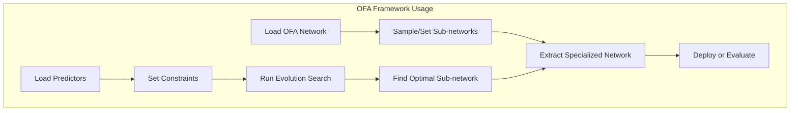
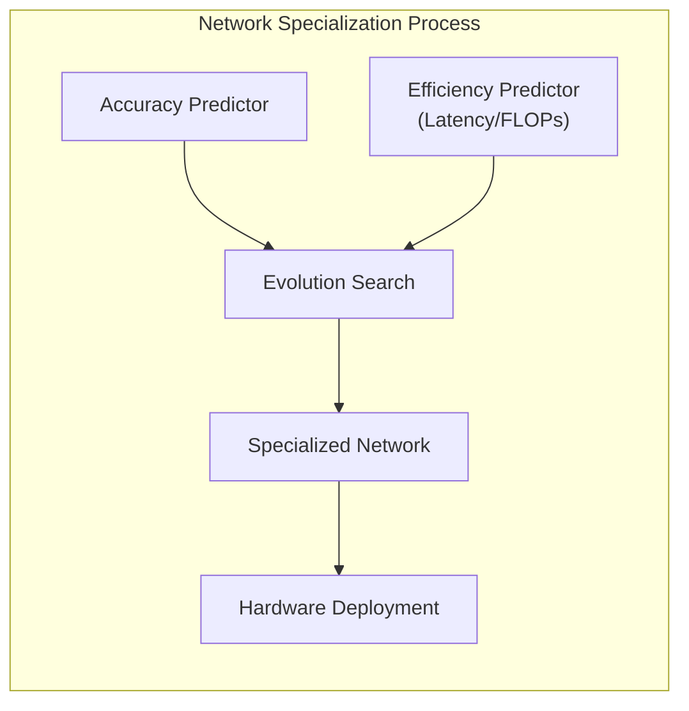

<!-- source: DeepWiki mcp.deepwiki.com · repo mit-han-lab/once-for-all · page 6 Tutorials · fetched 2026-10-30 -->

# Tutorials

<details>
<summary>Relevant source files</summary>

The following files were used as context for generating this wiki page:

- [README.md](README.md)
- [figures/ofa-tutorial.jpg](figures/ofa-tutorial.jpg)
- [tutorial/README.md](tutorial/README.md)
- [tutorial/ofa.ipynb](tutorial/ofa.ipynb)

</details>


This page provides guides and examples for using the Once-for-All (OFA) network framework. The tutorials demonstrate how to utilize pre-trained OFA networks for efficient deployment across different hardware platforms and how to generate new specialized networks within minutes without retraining.

## Introduction

The OFA tutorials are designed to help you understand and implement the "train once, specialize for many" paradigm of the OFA framework. These tutorials cover:

1. Using pre-trained OFA networks and specialized sub-networks
2. Generating new specialized neural networks for different hardware constraints
3. Evaluating the performance of specialized networks on ImageNet

For detailed information about the OFA architecture and concepts, see [Key Concepts](#1.1).

## Getting Started

To get started with the OFA tutorials, you have two options:

1. Run tutorials on Google Colab
2. Set up locally on your machine

### Google Colab

The easiest way to get started is to use the pre-configured Google Colab notebook:

[](https://colab.research.google.com/github/mit-han-lab/once-for-all/blob/master/tutorial/ofa.ipynb)

### Local Setup

To run the tutorials locally:

1. Install required packages:
```bash
pip install torch torchvision numpy thop ofa tqdm matplotlib
```

2. Clone the repository:
```bash
git clone https://github.com/mit-han-lab/once-for-all.git
```

3. Navigate to the tutorial directory and start a Jupyter notebook:
```bash
cd once-for-all/tutorial
jupyter notebook
```

4. Open the `ofa.ipynb` notebook

Sources: [tutorial/README.md:20-43](https://github.com/mit-han-lab/once-for-all/blob/master/tutorial/README.md#L20-L43)

## Basic OFA Tutorial

This tutorial demonstrates how to use pre-trained OFA networks and how to generate new specialized networks. Below is an overview of the key components and workflow:



### Loading OFA Networks

To load a pre-trained OFA network:

```python
from ofa.model_zoo import ofa_net
ofa_network = ofa_net('ofa_mbv3_d234_e346_k357_w1.0', pretrained=True)
```

This loads a MobileNetV3-based OFA network with:
- Elastic depth (2, 3, 4)
- Elastic expand ratio (3, 4, 6)
- Elastic kernel size (3, 5, 7)
- Width multiplier 1.0

Sources: [tutorial/ofa.ipynb:49-57](https://github.com/mit-han-lab/once-for-all/blob/master/tutorial/ofa.ipynb#L49-L57), [README.md:46-62](https://github.com/mit-han-lab/once-for-all/blob/master/README.md#L46-L62)

### Sampling and Setting Sub-networks

You can either randomly sample a sub-network from the OFA network or manually set the sub-network configuration:

```python
# Randomly sample sub-networks
ofa_network.sample_active_subnet()
random_subnet = ofa_network.get_active_subnet(preserve_weight=True)

# Manually set the sub-network
ofa_network.set_active_subnet(ks=7, e=6, d=4)
manual_subnet = ofa_network.get_active_subnet(preserve_weight=True)
```

These operations allow you to explore the vast architecture space contained within a single OFA network.

Sources: [README.md:54-61](https://github.com/mit-han-lab/once-for-all/blob/master/README.md#L54-L61)

## Working with Specialized Networks

### Using Pre-trained Specialized Networks

OFA provides pre-trained specialized networks for various hardware platforms:

```python
from ofa.model_zoo import ofa_specialized
net, image_size = ofa_specialized('flops@595M_top1@80.0_finetune@75', pretrained=True)
```

The specialized networks are optimized for specific hardware platforms or FLOPs constraints.

Sources: [README.md:77-82](https://github.com/mit-han-lab/once-for-all/blob/master/README.md#L77-L82)

### Hardware-aware Network Specialization

One of the key features of OFA is the ability to specialize networks for specific hardware platforms. The tutorial demonstrates how to generate specialized networks for different hardware constraints:



This process involves:
1. An accuracy predictor that predicts the ImageNet accuracy of sub-networks
2. An efficiency predictor that estimates latency or FLOPs
3. An evolutionary search algorithm that finds the optimal sub-network

Sources: [tutorial/ofa.ipynb:365-377](https://github.com/mit-han-lab/once-for-all/blob/master/tutorial/ofa.ipynb#L365-L377)

#### Latency-Constrained Deployment

For latency-constrained deployment, the tutorial demonstrates how to use a latency predictor for a specific hardware platform (e.g., Samsung Note10):

```python
from ofa.tutorial import AccuracyPredictor, LatencyTable, EvolutionFinder

# Set up predictors
accuracy_predictor = AccuracyPredictor(pretrained=True)
latency_table = LatencyTable(device='note10')

# Define search parameters
latency_constraint = 25  # ms
```

The evolution search then finds the best sub-network that meets the latency constraint while maximizing accuracy.

Sources: [tutorial/ofa.ipynb:377-461](https://github.com/mit-han-lab/once-for-all/blob/master/tutorial/ofa.ipynb#L377-L461)

#### FLOPs-Constrained Deployment

Similarly, for FLOPs-constrained deployment:

```python
from ofa.tutorial import FLOPsTable

# Set up FLOPs lookup table
flops_lookup_table = FLOPsTable(device='cpu', batch_size=1)

# Define search parameters
flops_constraint = 400  # M
```

This allows finding networks that meet a specific FLOPs constraint, which is useful when the target hardware doesn't have latency measurements available.

Sources: [tutorial/ofa.ipynb:664-703](https://github.com/mit-han-lab/once-for-all/blob/master/tutorial/ofa.ipynb#L664-L703)

## ResNet50 Example

For users interested in working with ResNet50-based OFA networks, a separate tutorial is available. The ResNet50 variant supports:

| OFA Network | Design Space | Resolution | Width Multiplier | Depth | Expand Ratio | Kernel Size |
|-------------|--------------|------------|------------------|-------|--------------|-------------|
| ofa_resnet50 | ResNet50D | 128 - 224 | 0.65, 0.8, 1.0 | 0, 1, 2 | 0.2, 0.25, 0.35 | 3 |

To use the ResNet50 example:

```python
from ofa.model_zoo import ofa_net
ofa_network = ofa_net('ofa_resnet50', pretrained=True)
```

For a detailed walkthrough, see the ResNet50 notebook at [tutorial/ofa_resnet50_example.ipynb]().

Sources: [README.md:69-71](https://github.com/mit-han-lab/once-for-all/blob/master/README.md#L69-L71), [README.md:43-44](https://github.com/mit-han-lab/once-for-all/blob/master/README.md#L43-L44)

## Evaluation

The tutorials also demonstrate how to evaluate the performance of specialized networks:

```python
# Evaluate a specialized network from the model zoo
from ofa.tutorial import evaluate_ofa_specialized
net_id = evaluate_ofa_specialized(imagenet_data_path, data_loader)

# Evaluate a customized sub-network
from ofa.tutorial import evaluate_ofa_subnet
top1 = evaluate_ofa_subnet(
    ofa_network,
    imagenet_data_path,
    net_config,
    data_loader,
    batch_size=250
)
```

The evaluation metrics include Top-1 accuracy on ImageNet and latency on the target hardware platform.

Sources: [tutorial/ofa.ipynb:310-356](https://github.com/mit-han-lab/once-for-all/blob/master/tutorial/ofa.ipynb#L310-L356), [README.md:64-67](https://github.com/mit-han-lab/once-for-all/blob/master/README.md#L64-L67)

## Summary

The OFA tutorials provide a practical introduction to using the Once-for-All network framework. They demonstrate how to:

1. Load and use pre-trained OFA networks
2. Sample and configure sub-networks
3. Generate specialized networks for different hardware platforms
4. Evaluate the performance of these networks

The key advantage of the OFA approach is the ability to generate specialized networks for different hardware platforms without retraining, which can save significant time and computational resources compared to traditional neural architecture search approaches.

Sources: [tutorial/README.md:7-20](https://github.com/mit-han-lab/once-for-all/blob/master/tutorial/README.md#L7-L20), [tutorial/ofa.ipynb:7-19](https://github.com/mit-han-lab/once-for-all/blob/master/tutorial/ofa.ipynb#L7-L19)

---

