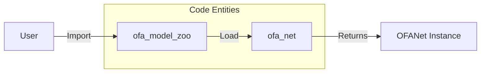
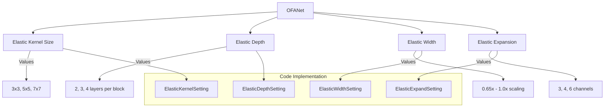
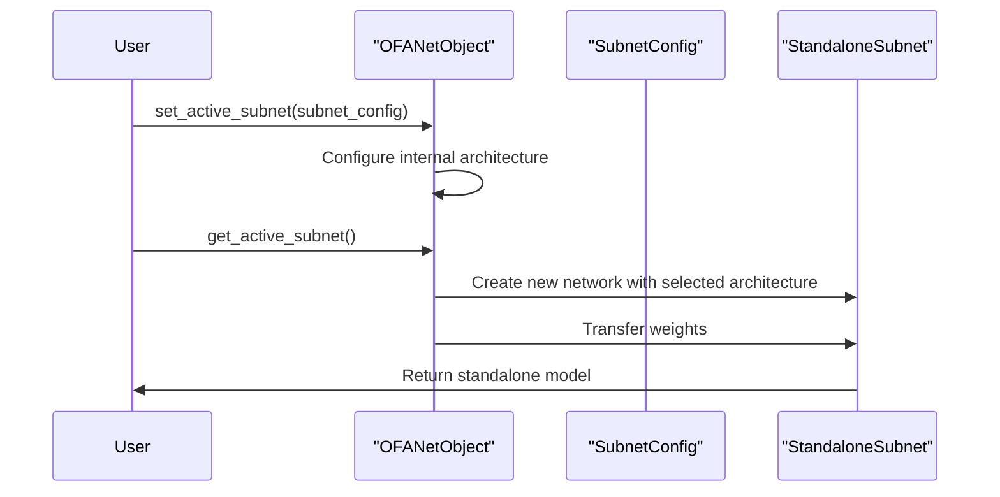
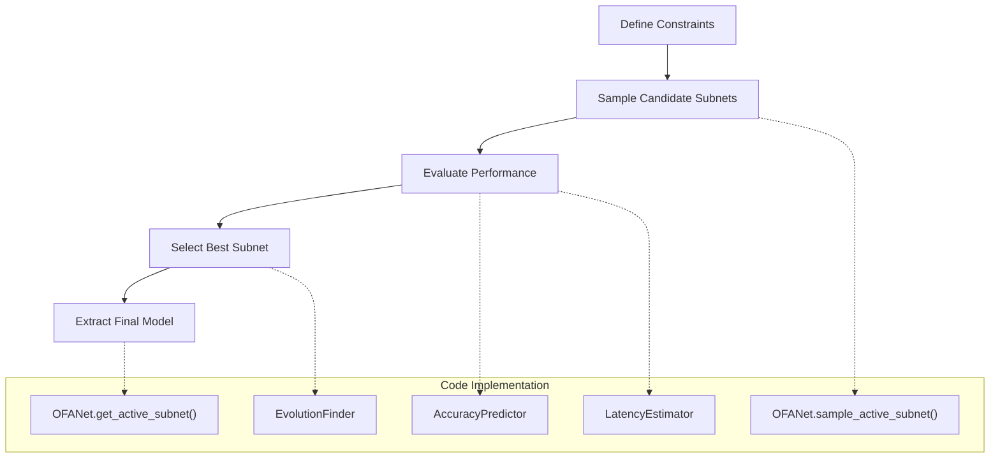

<!-- source: DeepWiki mcp.deepwiki.com · repo mit-han-lab/once-for-all · page 6.1 Basic OFA Tutorial · fetched 2026-10-30 -->

# Basic OFA Tutorial

<details>
<summary>Relevant source files</summary>

The following files were used as context for generating this wiki page:

- [tutorial/ofa.ipynb](tutorial/ofa.ipynb)

</details>


This tutorial provides a step-by-step guide for using the Once-for-All (OFA) neural networks. We'll cover how to load pre-trained OFA models, extract subnets, run inference, and perform basic subnet search. This tutorial focuses on practical usage rather than training new OFA networks. For information about training your own OFA networks, see [Training System](#3) and [Progressive Shrinking Training](#3.1).

## 1. Prerequisites

Before starting this tutorial, ensure you have:
- Python 3.6+
- PyTorch 1.0+
- The OFA codebase cloned from GitHub

```bash
git clone https://github.com/mit-han-lab/once-for-all.git
cd once-for-all
pip install -r requirements.txt
```

Sources: [requirements.txt]()

## 2. Loading Pre-trained OFA Networks

OFA provides several pre-trained networks in its model zoo. Here's how to load them:

### Diagram: OFA Network Loading Process



Sources: [ofa/model_zoo/ofa_net.py]()

### Example: Loading OFA MobileNetV3

```python
from ofa.model_zoo import ofa_net

# Load the OFA MobileNetV3 network
ofa_network = ofa_net('ofa_mbv3_d234_e346_k357_w1.0', pretrained=True)
print(ofa_network)
```

Available OFA networks include:

| Network Name | Description | Architecture |
|--------------|-------------|-------------|
| ofa_mbv3_d234_e346_k357_w1.0 | OFA MobileNetV3 | Depth: 2-4, Expansion: 3-4-6, Kernel: 3-5-7, Width: 1.0 |
| ofa_proxyless_d234_e346_k357_w1.3 | OFA ProxylessNAS | Depth: 2-4, Expansion: 3-4-6, Kernel: 3-5-7, Width: 1.3 |
| ofa_resnet50 | OFA ResNet50 | Depth: variable, Width: variable |

Sources: [ofa/model_zoo/ofa_net.py](), [ofa/imagenet_classification/networks/ofa_mbv3.py]()

## 3. Working with Elastic Dimensions

OFA networks feature several elastic dimensions that can be configured:

### Diagram: OFA Elastic Dimensions



Sources: [ofa/utils/layers.py](), [ofa/imagenet_classification/elastic_nn/modules/dynamic_layers.py]()

## 4. Sampling and Setting Subnets

### 4.1 Randomly Sampling a Subnet

You can randomly sample a subnet from the OFA network:

```python
# Sample a random subnet from the OFA network
subnet = ofa_network.sample_active_subnet()
print(subnet)
```

### 4.2 Setting a Specific Subnet

You can also set a specific subnet configuration:

```python
# Define a specific subnet configuration
subnet_config = {
    'depth': [2, 3, 4],  # Depth of each stage
    'kernel_size': [3, 5, 7],  # Kernel sizes for each layer
    'exp_ratio': [4, 6],  # Expansion ratios
    'width_mult': 1.0,  # Width multiplier
}

# Set the active subnet
ofa_network.set_active_subnet(**subnet_config)
```

### 4.3 Extracting the Active Subnet

After setting a subnet configuration, you can extract the subnet as a standalone model:

```python
# Extract the subnet as a standalone model
subnet_model = ofa_network.get_active_subnet()
```

### Diagram: Subnet Extraction Process



Sources: [ofa/model_zoo/ofa_net.py](), [ofa/imagenet_classification/networks/ofa_mbv3.py]()

## 5. Running Inference

Once you have a subnet, you can use it for inference:

```python
import torch
from torchvision import transforms

# Prepare image preprocessing
preprocess = transforms.Compose([
    transforms.Resize(256),
    transforms.CenterCrop(224),
    transforms.ToTensor(),
    transforms.Normalize(mean=[0.485, 0.456, 0.406], std=[0.229, 0.224, 0.225]),
])

# Load an image (example)
from PIL import Image
img = Image.open('example_image.jpg')
input_tensor = preprocess(img)
input_batch = input_tensor.unsqueeze(0)  # Add batch dimension

# Set the model to evaluation mode
subnet_model.eval()

# Run inference
with torch.no_grad():
    output = subnet_model(input_batch)
    
# Process the output (get top prediction)
probabilities = torch.nn.functional.softmax(output[0], dim=0)
top_prob, top_class = torch.topk(probabilities, 1)
```

Sources: [ofa/imagenet_classification/run_manager/run_config.py]()

## 6. Basic Subnet Search

OFA allows you to search for the best subnet that meets certain constraints. Here's a simple approach:

### Diagram: Basic Subnet Search Workflow



### 6.1 Simple Random Search

For a basic approach, you can randomly sample subnets and pick the one with the best accuracy:

```python
import random

# Number of samples to try
num_samples = 100
best_accuracy = 0
best_config = None

# Load accuracy predictor (if available)
# from ofa.imagenet_classification.elastic_nn.training.progressive_shrinking import AccuracyPredictor
# accuracy_predictor = AccuracyPredictor('path_to_predictor')

# Simple random search
for _ in range(num_samples):
    # Sample a random subnet
    subnet_config = ofa_network.sample_active_subnet()
    
    # Evaluate subnet (you would use the accuracy predictor in practice)
    # predicted_accuracy = accuracy_predictor.predict_accuracy(subnet_config)
    predicted_accuracy = random.uniform(0, 1)  # Placeholder for demonstration
    
    # Keep track of the best configuration
    if predicted_accuracy > best_accuracy:
        best_accuracy = predicted_accuracy
        best_config = subnet_config

# Set the best subnet
ofa_network.set_active_subnet(**best_config)
best_subnet = ofa_network.get_active_subnet()
```

### 6.2 Using the Evolution Finder

For more advanced searches, OFA provides an `EvolutionFinder` class:

```python
from ofa.imagenet_classification.elastic_nn.modules.dynamic_op import DynamicSeparableConv2d
from ofa.imagenet_classification.elastic_nn.training.progressive_shrinking import AccuracyPredictor
from ofa.utils import LatencyEstimator, download_url
from ofa.imagenet_classification.networks import OFAMobileNetV3

# Load OFA network
ofa_network = ofa_net('ofa_mbv3_d234_e346_k357_w1.0', pretrained=True)

# Load accuracy predictor
accuracy_predictor = AccuracyPredictor(
    pretrained=True,
    device='cuda' if torch.cuda.is_available() else 'cpu'
)

# Load latency estimator
latency_estimator = LatencyEstimator(
    'mobilenet_v3_large', 'cuda' if torch.cuda.is_available() else 'cpu'
)

# Define target latency
target_latency = 20  # ms

# Run evolutionary search
finder = EvolutionFinder(
    accuracy_predictor=accuracy_predictor,
    latency_estimator=latency_estimator,
    target_latency=target_latency
)
best_config = finder.run_evolution_search(ofa_network)

# Set the best subnet
ofa_network.set_active_subnet(**best_config)
best_subnet = ofa_network.get_active_subnet()
```

Sources: [ofa/utils/pytorch_utils.py](), [ofa/imagenet_classification/elastic_nn/training/progressive_shrinking.py](), [ofa/imagenet_classification/utils/latency_utils.py]()

## 7. Exporting Subnets

After finding the optimal subnet, you might want to export it for deployment:

```python
# Export to ONNX
import torch.onnx

# Set to evaluation mode
subnet_model.eval()

# Create dummy input
dummy_input = torch.randn(1, 3, 224, 224)

# Export
torch.onnx.export(
    subnet_model,
    dummy_input,
    "subnet_model.onnx",
    verbose=True,
    input_names=["input"],
    output_names=["output"],
    opset_version=11
)
```

## 8. Complete Example

Here's a complete example that ties everything together:

```python
import torch
from ofa.model_zoo import ofa_net
from ofa.utils import download_url

# Load OFA network
ofa_network = ofa_net('ofa_mbv3_d234_e346_k357_w1.0', pretrained=True)

# Define a specific subnet configuration for a mobile device
mobile_config = {
    'depth': [2, 2, 3],  # Smaller depth for reduced computation
    'kernel_size': [3, 5, 3],  # Mix of kernel sizes
    'exp_ratio': [4, 4],  # Moderate expansion ratio
    'width_mult': 0.75,  # Reduced width for smaller model
}

# Set the active subnet
ofa_network.set_active_subnet(**mobile_config)

# Extract the subnet
mobile_subnet = ofa_network.get_active_subnet()

# Prepare for inference
mobile_subnet.eval()

# Create a dummy input and run inference
dummy_input = torch.randn(1, 3, 224, 224)
with torch.no_grad():
    output = mobile_subnet(dummy_input)
    
print(f"Output shape: {output.shape}")
print(f"Prediction: {torch.argmax(output)}")
```

Sources: [ofa/model_zoo/ofa_net.py](), [ofa/imagenet_classification/networks/ofa_mbv3.py]()

## 9. Next Steps

After mastering the basics in this tutorial, you might want to explore:

- Training your own OFA networks with [Progressive Shrinking Training](#3.1)
- Working with specialized ResNet50 models in the [ResNet50 Example](#6.2)
- Deploying OFA models to specific hardware targets using the full [Network Specialization](#4) pipeline
- Building custom accuracy and efficiency predictors with [Accuracy Prediction](#4.1) and [Efficiency Prediction](#4.2)

Sources: [ofa/imagenet_classification/elastic_nn/training/progressive_shrinking.py](), [ofa/utils/pytorch_utils.py]()

---

