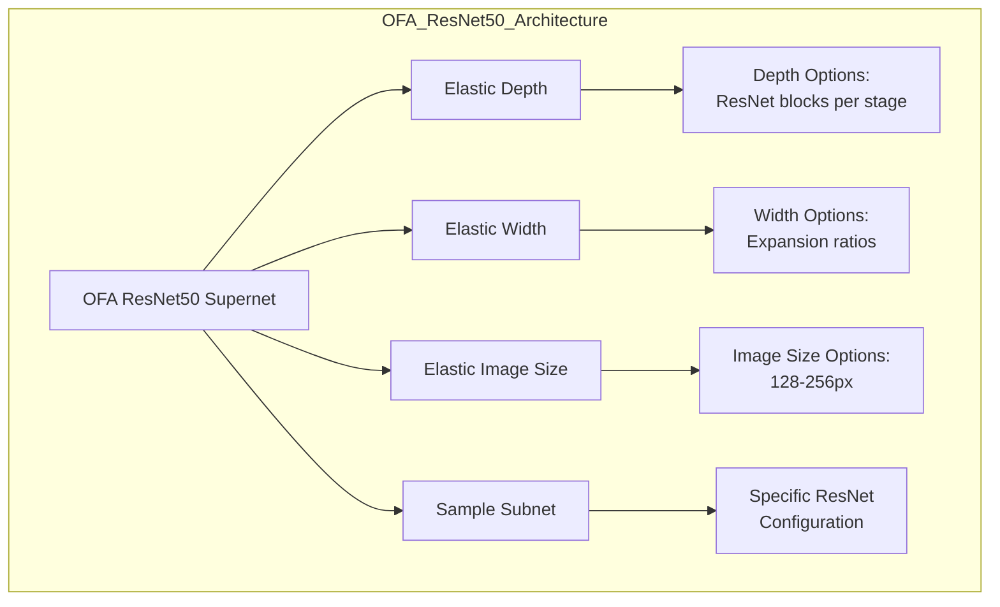
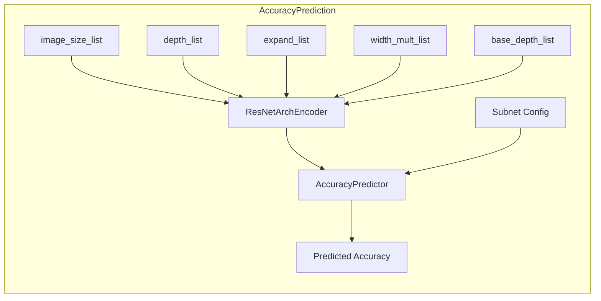
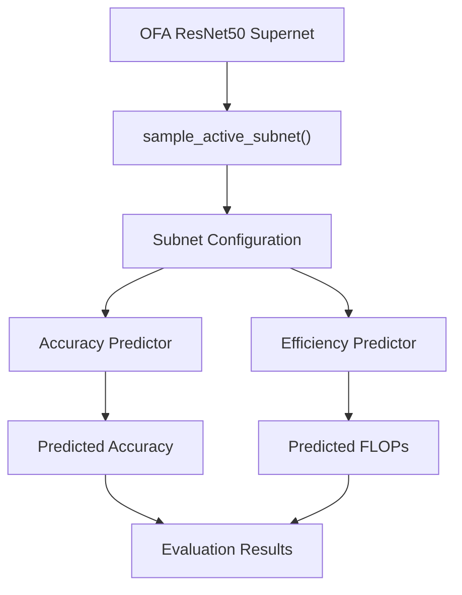
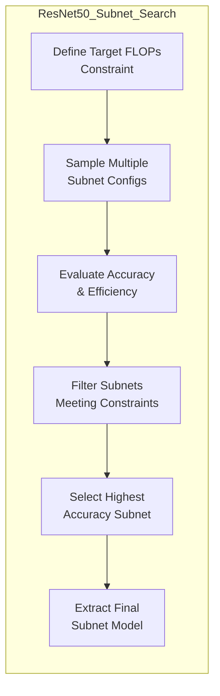

<!-- source: DeepWiki mcp.deepwiki.com · repo mit-han-lab/once-for-all · page 6.2 ResNet50 Example · fetched 2026-10-30 -->

# ResNet50 Example

<details>
<summary>Relevant source files</summary>

The following files were used as context for generating this wiki page:

- [figures/ofa_resnst50_results.png](figures/ofa_resnst50_results.png)
- [tutorial/ofa_resnet50_example.ipynb](tutorial/ofa_resnet50_example.ipynb)

</details>


## Purpose and Scope

This tutorial demonstrates how to use the Once-for-All (OFA) ResNet50 architecture to sample specialized neural network models with different accuracy-efficiency trade-offs. You'll learn to load the pretrained OFA ResNet50 model, use accuracy and efficiency predictors, and explore the architecture space to find suitable models for your specific requirements. For a more general introduction to OFA concepts, see [Key Concepts](#1.1), or for other OFA models like MobileNetV3, see [OFA Networks](#2.1).

## OFA ResNet50 Architecture

The OFA ResNet50 is a highly flexible neural network based on the classic ResNet50 architecture, but with elastic parameters that allow it to generate many different subnet configurations.



Sources: [tutorial/ofa_resnet50_example.ipynb:11-13]()

## Loading the OFA ResNet50 Model

To begin working with OFA ResNet50, you need to load the pretrained model:

```python
from ofa.model_zoo import ofa_net
ofa_network = ofa_net('ofa_resnet50', pretrained=True)
```

This loads the entire OFA ResNet50 supernet with all its elastic parameters, ready for subnet sampling and evaluation.

Sources: [tutorial/ofa_resnet50_example.ipynb:11-13]()

## Setting Up Predictors

### Accuracy Predictor

The accuracy predictor allows you to estimate the ImageNet validation accuracy of a subnet without actually evaluating it on the dataset, which saves significant time during architecture search.



To set up the accuracy predictor:

```python
from ofa.nas.accuracy_predictor import AccuracyPredictor, ResNetArchEncoder
from ofa.utils import download_url

# Define image size options
image_size_list = [128, 144, 160, 176, 192, 224, 240, 256]

# Create architecture encoder
arch_encoder = ResNetArchEncoder(
    image_size_list=image_size_list, 
    depth_list=ofa_network.depth_list, 
    expand_list=ofa_network.expand_ratio_list,
    width_mult_list=ofa_network.width_mult_list, 
    base_depth_list=ofa_network.BASE_DEPTH_LIST
)

# Download and load the predictor
acc_predictor_checkpoint_path = download_url(
    'https://raw.githubusercontent.com/han-cai/files/master/ofa/ofa_resnet50_acc_predictor.pth',
    model_dir='~/.ofa/',
)

# Initialize the predictor
device = 'cuda:0' if torch.cuda.is_available() else 'cpu'
acc_predictor = AccuracyPredictor(
    arch_encoder, 400, 3,
    checkpoint_path=acc_predictor_checkpoint_path, 
    device=device
)
```

The `AccuracyPredictor` is a neural network that has been trained to predict the accuracy of different ResNet50 subnet configurations. It uses an `arch_encoder` that transforms architecture parameters into a format the predictor can process.

Sources: [tutorial/ofa_resnet50_example.ipynb:54-73]()

### Efficiency Predictor

The efficiency predictor estimates the computational cost of a subnet configuration in terms of FLOPs (Floating Point Operations):

```python
from ofa.nas.efficiency_predictor import ResNet50FLOPsModel

efficiency_predictor = ResNet50FLOPsModel(ofa_network)
```

This allows you to quickly evaluate how computationally expensive a subnet would be without having to run benchmarks.

Sources: [tutorial/ofa_resnet50_example.ipynb:87-90]()

## Subnet Sampling and Evaluation

Once you have the OFA supernet and predictors set up, you can sample different subnet configurations and evaluate their accuracy-efficiency trade-offs:



Example workflow:

```python
import random

for i in range(10):
    # Sample a random subnet configuration
    subnet_config = ofa_network.sample_active_subnet()
    
    # Choose a random image size
    image_size = random.choice(image_size_list)
    subnet_config.update({'image_size': image_size})
    
    # Predict accuracy and efficiency
    predicted_acc = acc_predictor.predict_acc([subnet_config])
    predicted_efficiency = efficiency_predictor.get_efficiency(subnet_config)
    
    print(i, '\t', predicted_acc, '\t', '%.1fM MACs' % predicted_efficiency)
```

This code samples 10 different subnet configurations with random parameters, then predicts their accuracy and computational cost.

Sources: [tutorial/ofa_resnet50_example.ipynb:121-131]()

## Understanding Subnet Configurations

The subnet configuration contains several parameters that define the architecture:

| Parameter | Description | Range in OFA ResNet50 |
|-----------|-------------|----------------------|
| `depth` | Number of blocks in each stage | Varies by stage |
| `expand_ratio` | Channel expansion ratios | Depends on OFA's configuration |
| `width_mult` | Width multiplier for the entire network | From OFA's width_mult_list |
| `image_size` | Input image resolution | 128, 144, 160, 176, 192, 224, 240, 256 |

When the `sample_active_subnet()` method is called, it randomly selects values for these parameters from the available options in the OFA supernet.

Sources: [tutorial/ofa_resnet50_example.ipynb:125-127]()

## Practical Example: Finding an Optimal Subnet

A common use case is finding a subnet that meets specific efficiency constraints while maximizing accuracy:



With the OFA ResNet50, you can modify the earlier example to find a subnet that meets your specific requirements:

```python
# Target: Subnets with less than 2 GFLOPs
target_flops = 2000  # 2000M = 2G FLOPs
best_acc = 0
best_subnet = None

# Sample multiple subnets
for i in range(100):
    subnet_config = ofa_network.sample_active_subnet()
    image_size = random.choice(image_size_list)
    subnet_config.update({'image_size': image_size})
    
    predicted_efficiency = efficiency_predictor.get_efficiency(subnet_config)
    
    # Only evaluate accuracy if efficiency meets our target
    if predicted_efficiency < target_flops:
        predicted_acc = acc_predictor.predict_acc([subnet_config])
        
        if predicted_acc > best_acc:
            best_acc = predicted_acc
            best_subnet = subnet_config
            
# Extract the best subnet
if best_subnet:
    ofa_network.set_active_subnet(**best_subnet)
    final_model = ofa_network.get_active_subnet()
    # Ready for deployment
```

## Interpreting Results

The output from the subnet sampling process provides:

1. Predicted accuracy: The estimated top-1 validation accuracy on ImageNet
2. Computational cost: Million Multiply-Accumulate Operations (MACs)

In the example output from the notebook, we can see a range of accuracy-efficiency trade-offs:

| Subnet | Predicted Accuracy | Computational Cost |
|--------|-------------------|-------------------|
| 0 | 0.8015 | 1367.1M MACs |
| 1 | 0.8080 | 1677.4M MACs |
| ... | ... | ... |
| 9 | 0.7812 | 959.9M MACs |

This demonstrates the flexibility of OFA ResNet50 - by adjusting the architecture parameters, you can get models ranging from ~78% to ~82% accuracy with vastly different computational requirements.

Sources: [tutorial/ofa_resnet50_example.ipynb:102-117]()

## Conclusion

The OFA ResNet50 provides a powerful way to generate efficient neural networks customized for specific accuracy and computational constraints. By using the accuracy and efficiency predictors, you can quickly explore the large architecture space without needing to train or benchmark each possible configuration.

For more advanced usage, such as customizing the evolutionary search process, see [Evolutionary Search](#4.3).

---

