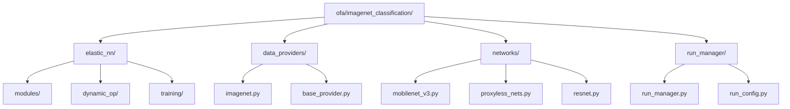
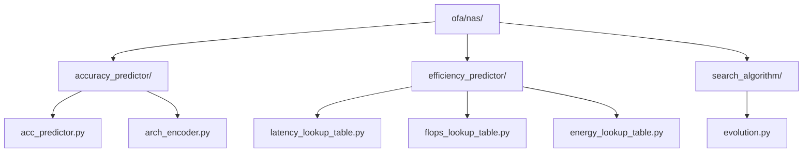
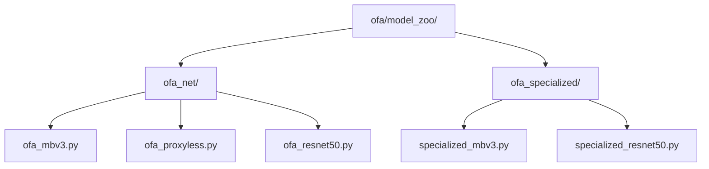
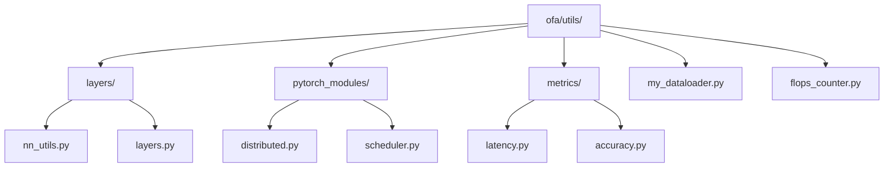
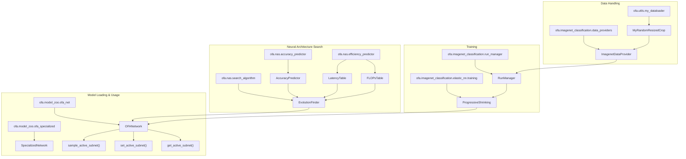
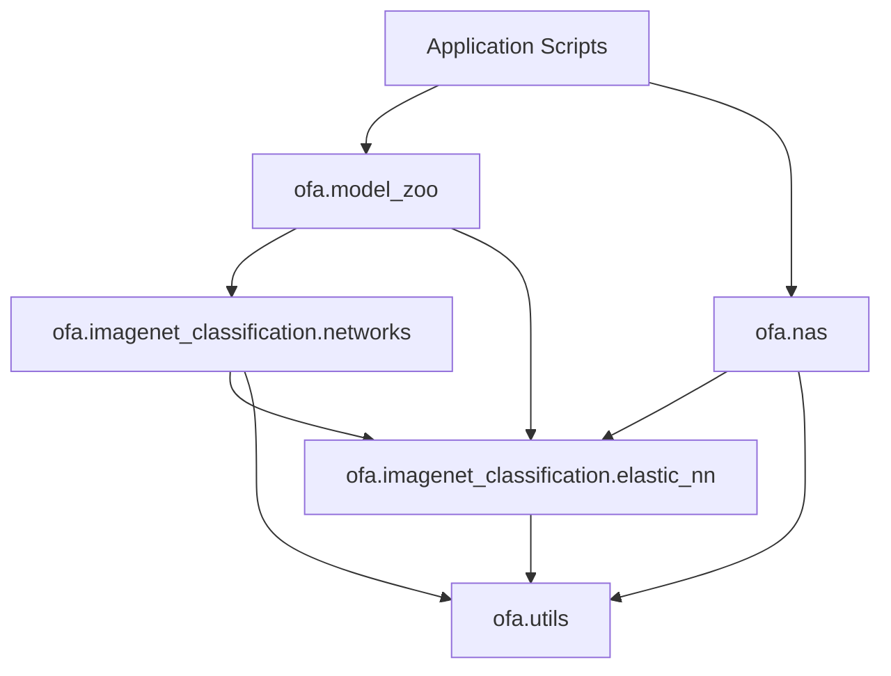

<!-- source: DeepWiki mcp.deepwiki.com · repo mit-han-lab/once-for-all · page 7 Package Structure · fetched 2026-10-30 -->

# Package Structure

Relevant source files

The following files were used as context for generating this wiki page:

- [ofa/__init__.py](ofa/__init__.py)
- [ofa/imagenet_classification/__init__.py](ofa/imagenet_classification/__init__.py)
- [ofa/imagenet_classification/elastic_nn/__init__.py](ofa/imagenet_classification/elastic_nn/__init__.py)
- [ofa/nas/__init__.py](ofa/nas/__init__.py)

This document provides an overview of the Once-for-All (OFA) codebase organization, describing its package hierarchy and the relationships between key components. It helps developers understand where specific functionality is implemented and how the different modules interact with each other. For information about the conceptual overview of OFA, see [Overview](#1).

## Top-Level Package Organization

The Once-for-All codebase follows a modular structure organized around the main functional components of the framework.

```mermaid
graph TD
    A["ofa/ (Root Package)"] --> B["ofa/imagenet_classification/"]
    A --> C["ofa/nas/"]
    A --> D["ofa/model_zoo/"]
    A --> E["ofa/utils/"]
    
    B --> B1["ofa/imagenet_classification/data_providers/"]
    B --> B2["ofa/imagenet_classification/elastic_nn/"]
    B --> B3["ofa/imagenet_classification/networks/"]
    B --> B4["ofa/imagenet_classification/run_manager/"]
    
    C --> C1["ofa/nas/accuracy_predictor/"]
    C --> C2["ofa/nas/efficiency_predictor/"]
    C --> C3["ofa/nas/search_algorithm/"]
    
    D --> D1["ofa/model_zoo/ofa_net/"]
    D --> D2["ofa/model_zoo/ofa_specialized/"]
    
    E --> E1["ofa/utils/layers/"]
    E --> E2["ofa/utils/pytorch_modules/"]
    E --> E3["ofa/utils/metrics/"]
```

Sources: [ofa/__init__.py](), [ofa/imagenet_classification/__init__.py](), [ofa/imagenet_classification/elastic_nn/__init__.py](), [ofa/nas/__init__.py]()

## Main Module Functionalities

### imagenet_classification

The `imagenet_classification` package contains components related to classification tasks on ImageNet, including network architectures, data providers, and elastic neural network modules.

Sources: [ofa/imagenet_classification/__init__.py](), [ofa/imagenet_classification/elastic_nn/__init__.py]()

### nas (Neural Architecture Search)

The `nas` package contains components for neural architecture search, including accuracy predictors, efficiency predictors, and search algorithms.

Sources: [ofa/nas/__init__.py]()

### model_zoo

The `model_zoo` package provides pre-trained models and interfaces for loading and using OFA networks and specialized networks.

### utils

The `utils` package provides utility functions and modules used throughout the OFA framework.

## Key Components and Their Relationships

The following diagram illustrates the relationships between key components in the OFA framework:

Sources: [ofa/__init__.py](), [ofa/imagenet_classification/__init__.py](), [ofa/nas/__init__.py]()

## File Organization and Naming Conventions

The OFA codebase follows these general file organization patterns:

1. Each functional component is organized in its own subdirectory
2. Implementation classes are typically defined in Python files with descriptive names
3. Related components are grouped into modules with `__init__.py` files
4. Entry points for training and evaluation are provided as standalone Python scripts in the root directory

Below is a table of key files and their purposes:

| File/Directory | Purpose |
|----------------|---------|
| `ofa/imagenet_classification/elastic_nn/` | Contains elastic neural network components that enable architecture adaptability |
| `ofa/imagenet_classification/data_providers/` | Implements data loading and preprocessing for ImageNet |
| `ofa/imagenet_classification/run_manager/` | Manages training runs and evaluation |
| `ofa/nas/accuracy_predictor/` | Implements models to predict accuracy without full training |
| `ofa/nas/efficiency_predictor/` | Contains lookup tables and models to predict efficiency metrics |
| `ofa/nas/search_algorithm/` | Implements search algorithms including evolutionary search |
| `ofa/model_zoo/` | Houses pre-trained models and interfaces for using them |
| `ofa/utils/` | Contains utility functions and modules used throughout the framework |

Sources: [ofa/__init__.py](), [ofa/imagenet_classification/__init__.py](), [ofa/imagenet_classification/elastic_nn/__init__.py](), [ofa/nas/__init__.py]()

## Package Import Structure

The following diagram shows the typical import dependencies between OFA packages:

The import structure follows these principles:
- Top-level scripts import from `model_zoo` and `nas` packages
- `model_zoo` depends on network implementations and elastic networks
- `nas` depends on elastic networks and utilities
- Lower-level packages like `utils` have few or no dependencies on other OFA packages

Sources: [ofa/__init__.py](), [ofa/imagenet_classification/__init__.py](), [ofa/nas/__init__.py]()

## Entry Points

The main entry points to the OFA codebase are:

1. Training scripts in the root directory (e.g., `train_ofa_net.py`)
2. Evaluation scripts in the root directory (e.g., `eval_ofa_net.py`)
3. Specialized subnet search scripts (e.g., `elastic_nn_search.py`)
4. Model zoo interfaces for loading pre-trained models

These entry points provide the primary ways to interact with the OFA framework for training, evaluation, and deployment.

Sources: [ofa/__init__.py]()

---

