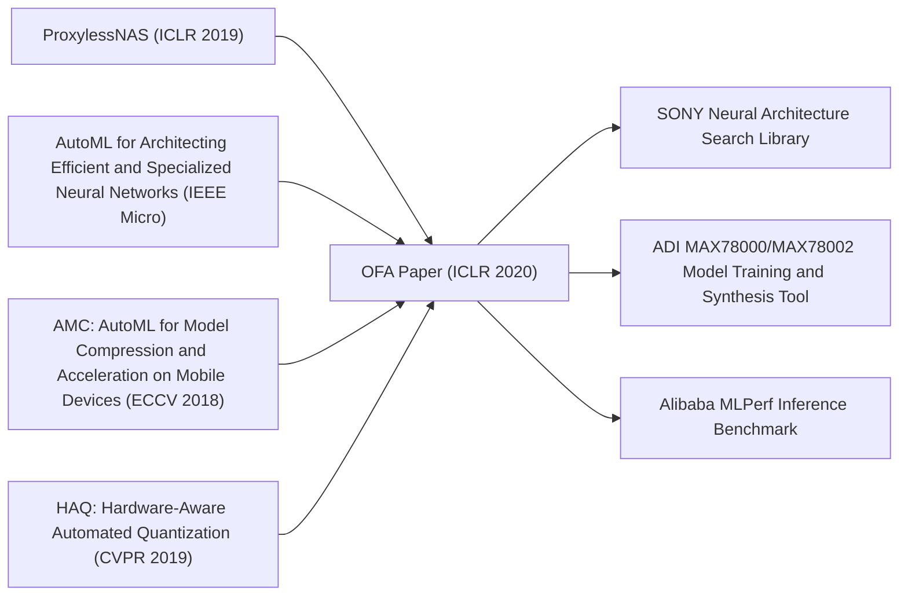
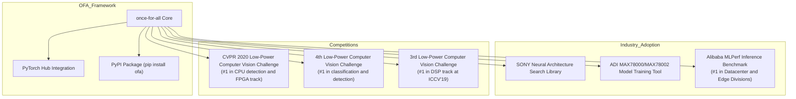
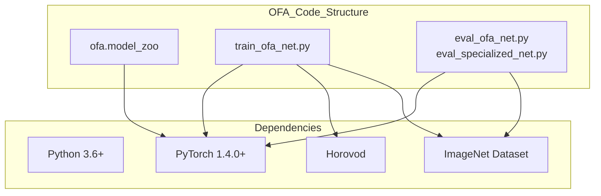

<!-- source: DeepWiki mcp.deepwiki.com · repo mit-han-lab/once-for-all · page 8 License and References · fetched 2026-10-30 -->

# License and References

<details>
<summary>Relevant source files</summary>

The following files were used as context for generating this wiki page:

- [.gitignore](.gitignore)
- [LICENSE](LICENSE)
- [README.md](README.md)
- [figures/ofa-tutorial.jpg](figures/ofa-tutorial.jpg)
- [tutorial/README.md](tutorial/README.md)

</details>


This document covers the license information, academic citations, and related resources for the Once-for-All (OFA) neural network framework. For implementation details, see [Package Structure](#7) and for usage information see [Getting Started](#1.2).

## License Information

The Once-for-All codebase is released under the MIT License, which provides considerable freedom for academic and commercial use.

```
MIT License

Copyright (c) 2021 Han Cai

Permission is hereby granted, free of charge, to any person obtaining a copy
of this software and associated documentation files (the "Software"), to deal
in the Software without restriction, including without limitation the rights
to use, copy, modify, merge, publish, distribute, sublicense, and/or sell
copies of the Software, and to permit persons to whom the Software is
furnished to do so, subject to the following conditions:

The above copyright notice and this permission notice shall be included in all
copies or substantial portions of the Software.

THE SOFTWARE IS PROVIDED "AS IS", WITHOUT WARRANTY OF ANY KIND, EXPRESS OR
IMPLIED, INCLUDING BUT NOT LIMITED TO THE WARRANTIES OF MERCHANTABILITY,
FITNESS FOR A PARTICULAR PURPOSE AND NONINFRINGEMENT. IN NO EVENT SHALL THE
AUTHORS OR COPYRIGHT HOLDERS BE LIABLE FOR ANY CLAIM, DAMAGES OR OTHER
LIABILITY, WHETHER IN AN ACTION OF CONTRACT, TORT OR OTHERWISE, ARISING FROM,
OUT OF OR IN CONNECTION WITH THE SOFTWARE OR THE USE OR OTHER DEALINGS IN THE
SOFTWARE.
```

Sources: [LICENSE:1-21]()

## Main Publication

The Once-for-All network was published in the International Conference on Learning Representations (ICLR) 2020. When using the OFA framework in academic work, please cite:

```
@inproceedings{
  cai2020once,
  title={Once for All: Train One Network and Specialize it for Efficient Deployment},
  author={Han Cai and Chuang Gan and Tianzhe Wang and Zhekai Zhang and Song Han},
  booktitle={International Conference on Learning Representations},
  year={2020},
  url={https://arxiv.org/pdf/1908.09791.pdf}
}
```

Sources: [README.md:1-11](), [tutorial/README.md:8-19]()

## Citation Network

The following diagram illustrates the relationship between OFA and its related publications in neural architecture search and efficient deep learning:



Sources: [README.md:12-18](), [README.md:191-198]()

## OFA Framework Extensions and Adoption

This diagram shows how the OFA framework has been extended and adopted:



Sources: [README.md:12-30]()

## Additional Resources

The OFA framework is accompanied by several supplementary resources for better understanding and implementation:

| Resource Type | Description | Link Reference |
|---------------|-------------|----------------|
| Research Paper | Original ICLR 2020 publication | arXiv:1908.09791 |
| Presentation Slides | Visual explanation of OFA concepts | Referenced in README.md |
| Introduction Video | Video overview of OFA | Referenced in README.md |
| Hands-on Tutorial | Jupyter notebook with practical OFA examples | [ badge, files in tutorial/ folder |
| Code Repository | GitHub repository with implementation | https://github.com/mit-han-lab/once-for-all |
| PyTorch Hub | Pre-trained models accessible through PyTorch Hub | Referenced in README.md |
| ResNet50 Example | Tutorial specific to OFA-ResNet50 | Referenced in README.md |

Sources: [README.md:1-45](), [tutorial/README.md:1-46]()

## Related Publications

The Once-for-All network builds upon several important works in the field of efficient deep learning and neural architecture search:

1. **ProxylessNAS: Direct Neural Architecture Search on Target Task and Hardware** (ICLR 2019)  
   This work introduced direct neural architecture search on target hardware platforms without proxy tasks.

2. **AutoML for Architecting Efficient and Specialized Neural Networks** (IEEE Micro)  
   This paper discusses automated machine learning techniques for creating efficient neural networks.

3. **AMC: AutoML for Model Compression and Acceleration on Mobile Devices** (ECCV 2018)  
   This research proposed automated model compression techniques for mobile deployment.

4. **HAQ: Hardware-Aware Automated Quantization** (CVPR 2019, oral presentation)  
   This paper introduced hardware-aware quantization for efficient model deployment.

Sources: [README.md:191-198]()

## Code Structure and Dependencies



Sources: [README.md:185-189]()

## Usage Attribution Requirements

When using the OFA framework for academic or industrial purposes, please ensure proper attribution by:

1. **Academic Work**: Citing the original paper using the BibTeX citation provided in the Main Publication section.

2. **Industrial Applications**: Acknowledging the MIT license and including the copyright notice in your documentation.

3. **Derivative Works**: Including the MIT license text and the original copyright notice in all copies or substantial portions of the software.

The OFA code can be installed easily via pip:

```
pip install ofa
```

And the code repository can be cloned using:

```
git clone https://github.com/mit-han-lab/once-for-all.git
```

For a full hands-on tutorial, please refer to the tutorial folder in the repository.

Sources: [LICENSE:1-21](), [README.md:25-26](), [tutorial/README.md:25-35]()