# Page: Overview

# Overview

<details>
<summary>Relevant source files</summary>

The following files were used as context for generating this wiki page:

- [README.md](README.md)
- [figures/cnn_imagenet_new.png](figures/cnn_imagenet_new.png)
- [figures/diverse_hardware.png](figures/diverse_hardware.png)
- [figures/imagenet_80_acc.png](figures/imagenet_80_acc.png)
- [figures/ofa-tutorial.jpg](figures/ofa-tutorial.jpg)
- [figures/overview.png](figures/overview.png)
- [tutorial/README.md](tutorial/README.md)

</details>


Once-for-All (OFA) is a neural network framework designed to solve the challenge of deploying neural networks across diverse hardware platforms with varying resource constraints. It introduces a novel approach: train a single "supernet" once, then extract specialized sub-networks for efficient deployment on target devices.

This page provides a high-level overview of the OFA framework, its architecture, and core concepts. For information about using specific OFA networks, see [OFA Networks](#2.1). For details on the training system, see [Training System](#3).

## What is Once-for-All?

Once-for-All addresses a fundamental challenge in deep learning deployment: the need to create optimized models for different hardware platforms (mobile phones, edge devices, cloud servers) with different computational constraints. Traditional approaches require training separate models for each target platform, which is computationally expensive and time-consuming.

OFA introduces a different paradigm:
1. Train a single large elastic neural network (the "supernet") once
2. Extract specialized sub-networks for different hardware platforms
3. Fine-tune if necessary for the target hardware

The OFA approach dramatically reduces the training cost while maintaining high accuracy across diverse deployment scenarios.

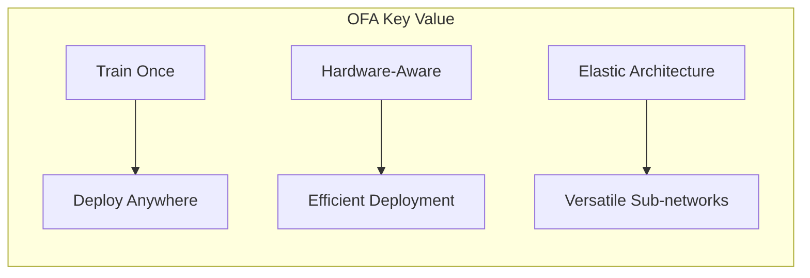

Sources: [README.md:32-42]()

## System Architecture

The OFA framework consists of four main components that work together to enable the "train once, deploy anywhere" capability:

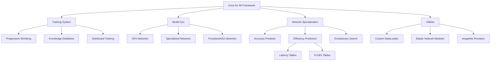

Sources: [README.md:1-42]()

### 1. Training System
The training system implements the progressive shrinking methodology, which is the key to creating a flexible supernet that can be specialized for different deployment scenarios. It also includes knowledge distillation techniques and supports distributed training on multiple servers.

### 2. Model Zoo
The model zoo provides a collection of pre-trained networks that can be loaded and used for inference or further specialization. It includes OFA networks (supernets) and specialized networks optimized for specific hardware platforms.

### 3. Network Specialization
The network specialization system enables finding optimal sub-networks for target hardware platforms. It includes accuracy predictors, efficiency predictors (latency, FLOPs), and evolutionary search algorithms.

### 4. Utilities
The utilities module includes custom data loading pipelines, elastic network modules, and ImageNet dataset providers.

## OFA Workflow

The OFA workflow follows three main phases: training, specialization, and deployment.

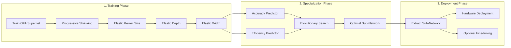

Sources: [README.md:32-42](), [README.md:47-62]()

## Key Concepts

### Elastic Architecture

The core innovation of OFA is the elastic architecture, which allows a single network to support multiple sub-networks with different configurations.

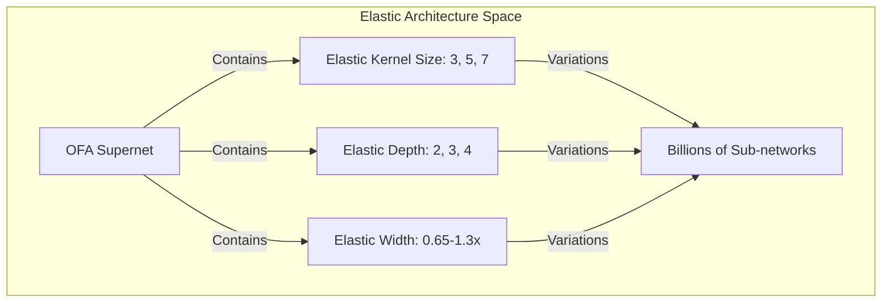

The elastic architecture supports variation in:
- **Kernel Size**: The size of the convolutional kernels (e.g., 3×3, 5×5, 7×7)
- **Depth**: The number of layers in the network
- **Width**: The number of channels in each layer
- **Resolution**: The input image size

Sources: [README.md:68-73]()

### Progressive Shrinking

Progressive shrinking is the training methodology that enables creating a flexible supernet. The training starts with the full-sized network and progressively enables the training of smaller sub-networks.

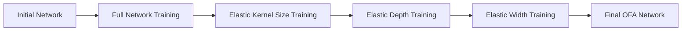

Sources: [README.md:163-169]()

### Network Specialization

Network specialization is the process of finding the optimal sub-network configuration for a target hardware platform. This is done using:

1. **Accuracy Predictor**: Predicts the accuracy of a sub-network without actually training it
2. **Efficiency Predictor**: Predicts the latency, energy consumption, or FLOPs of a sub-network on a target device
3. **Evolutionary Search**: Searches for the optimal sub-network configuration based on the accuracy and efficiency predictions

Sources: [README.md:75-88]()

## Code Organization

The OFA codebase is organized into several key modules:

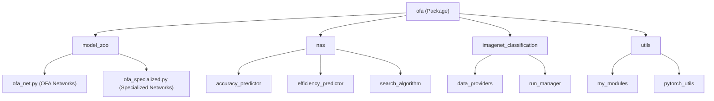

Sources: [README.md:47-62]()

## Key Interfaces

The main interfaces for using OFA include:

### Loading and Using OFA Networks

```python
# Load an OFA network
from ofa.model_zoo import ofa_net
ofa_network = ofa_net('ofa_mbv3_d234_e346_k357_w1.0', pretrained=True)
    
# Randomly sample sub-networks from OFA network
ofa_network.sample_active_subnet()
random_subnet = ofa_network.get_active_subnet(preserve_weight=True)
    
# Manually set the sub-network
ofa_network.set_active_subnet(ks=7, e=6, d=4)
manual_subnet = ofa_network.get_active_subnet(preserve_weight=True)
```

Sources: [README.md:47-62]()

### Loading Specialized Networks

```python
# Load a specialized network
from ofa.model_zoo import ofa_specialized
net, image_size = ofa_specialized('flops@595M_top1@80.0_finetune@75', pretrained=True)
```

Sources: [README.md:75-88]()

## OFA Network Design Space

OFA provides several network design spaces, each offering different trade-offs between accuracy and efficiency:

| OFA Network | Design Space | Resolution | Width Multiplier | Depth | Expand Ratio | Kernel Size |
|-------------|:------------:|:----------:|:---------------:|:-----:|:------------:|:-----------:|
| ofa_resnet50 | ResNet50D | 128 - 224 | 0.65, 0.8, 1.0 | 0, 1, 2 | 0.2, 0.25, 0.35 | 3 |
| ofa_mbv3_d234_e346_k357_w1.0 | MobileNetV3 | 128 - 224 | 1.0 | 2, 3, 4 | 3, 4, 6 | 3, 5, 7 |
| ofa_mbv3_d234_e346_k357_w1.2 | MobileNetV3 | 160 - 224 | 1.2 | 2, 3, 4 | 3, 4, 6 | 3, 5, 7 |
| ofa_proxyless_d234_e346_k357_w1.3 | ProxylessNAS | 128 - 224 | 1.3 | 2, 3, 4 | 3, 4, 6 | 3, 5, 7 |

Sources: [README.md:68-73]()

## Data Flow During Inference and Search

The following sequence diagram illustrates the data flow during inference and automated search:

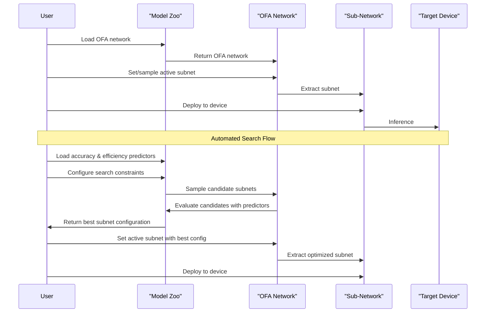

Sources: [README.md:47-62](), [README.md:75-88]()

## Summary

Once-for-All (OFA) provides a novel solution to the challenge of deploying neural networks across diverse hardware platforms. By training a single elastic supernet once and then extracting specialized sub-networks for different target devices, OFA significantly reduces the training cost while maintaining high accuracy. The framework includes tools for training, specialization, and deployment, making it a comprehensive solution for efficient neural network deployment.

Sources: [README.md:1-42]()

---

# Page: Key Concepts

# Key Concepts

<details>
<summary>Relevant source files</summary>

The following files were used as context for generating this wiki page:

- [README.md](README.md)
- [figures/ofa-tutorial.jpg](figures/ofa-tutorial.jpg)
- [figures/ofa_resnst50_results.png](figures/ofa_resnst50_results.png)
- [figures/ofa_search_cost.png](figures/ofa_search_cost.png)
- [figures/predictor_based_search.png](figures/predictor_based_search.png)
- [figures/select_subnets.png](figures/select_subnets.png)
- [tutorial/README.md](tutorial/README.md)

</details>


This page explains the core concepts of the Once-for-All (OFA) neural network framework. It covers the fundamental architecture design, training methodology, and specialized deployment process that enable OFA's "train once, specialize for many" paradigm. For practical implementation details, see [Getting Started](#1.2).

## Core Concept Overview

The Once-for-All (OFA) framework addresses the challenge of deploying deep neural networks across diverse hardware platforms with different computational constraints. Rather than training separate models for each target device, OFA trains a single versatile neural network (supernet) that can be specialized into various sub-networks to meet specific deployment requirements without additional training.

**Supernet and Sub-networks Relationship**

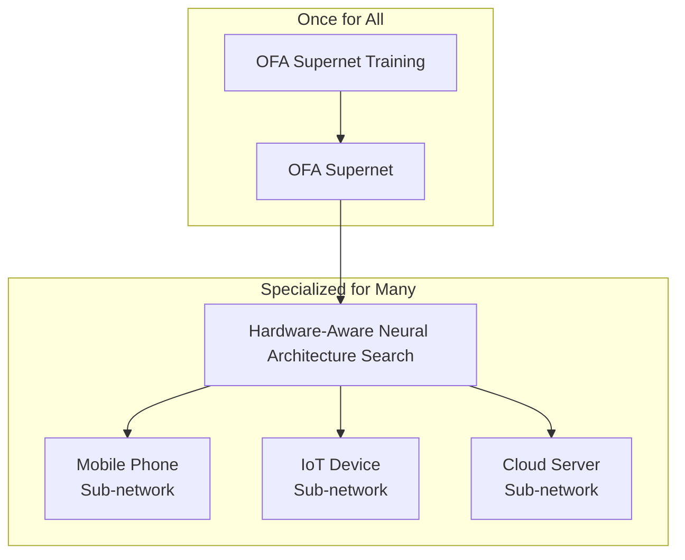

Sources: [README.md:32-36]()

## OFA Supernet

The OFA supernet is a comprehensive neural network that contains all possible sub-networks that can be derived for deployment. The supernet is trained through a specialized procedure that ensures all sub-networks perform well independently while sharing parameters with the full network.

### Architecture Space

The architecture space defines the range of possible architectures that can be derived from the OFA supernet. It includes several dimensions of flexibility:

- **Elastic Kernel Size**: Different kernel sizes for convolution layers (e.g., 3×3, 5×5, 7×7)
- **Elastic Depth**: Varying network depths (number of layers)
- **Elastic Width**: Different channel widths (e.g., 0.65×, 0.8×, 1.0× of full width)
- **Elastic Resolution**: Support for different input resolutions (e.g., 128×128, 160×160, 224×224)

**OFA Architecture Space Dimensions**

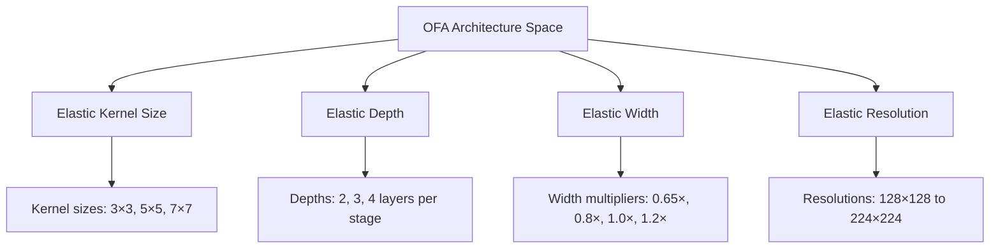

The table below shows examples of design spaces for different OFA network architectures:

| OFA Network | Design Space | Resolution | Width Multiplier | Depth | Expand Ratio | Kernel Size |
|-------------|:------------:|:----------:|:----------------:|:-----:|:------------:|:-----------:|
| ofa_resnet50 | ResNet50D | 128 - 224 | 0.65, 0.8, 1.0 | 0, 1, 2 | 0.2, 0.25, 0.35 | 3 |
| ofa_mbv3_d234_e346_k357_w1.0 | MobileNetV3 | 128 - 224 | 1.0 | 2, 3, 4 | 3, 4, 6 | 3, 5, 7 |
| ofa_mbv3_d234_e346_k357_w1.2 | MobileNetV3 | 160 - 224 | 1.2 | 2, 3, 4 | 3, 4, 6 | 3, 5, 7 |
| ofa_proxyless_d234_e346_k357_w1.3 | ProxylessNAS | 128 - 224 | 1.3 | 2, 3, 4 | 3, 4, 6 | 3, 5, 7 |

Sources: [README.md:68-73]()

## Progressive Shrinking Training

Progressive shrinking is the key training methodology for OFA networks. Instead of training all sub-networks simultaneously, the training process follows a progressive schedule:

1. **Train the full network**: Start by training the largest model with maximum kernel size, depth, and width
2. **Elastic Kernel Size Training**: Train the network to support multiple kernel sizes
3. **Elastic Depth Training**: Train the network to support multiple depths
4. **Elastic Width Training**: Train the network to support multiple channel widths

This progressive approach ensures that smaller sub-networks benefit from the knowledge of larger ones through weight sharing and knowledge distillation.

**Progressive Shrinking Training Process**

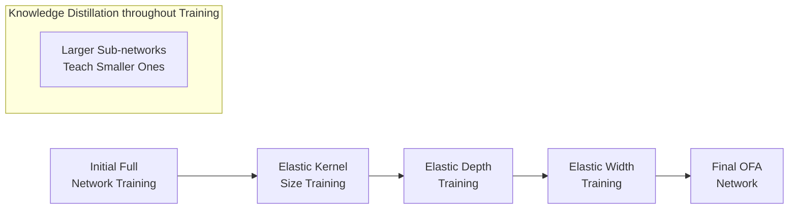

The progressive shrinking training is implemented through specialized training scripts that handle the different stages of training for different elastic dimensions.

Sources: [README.md:163-169]()

## Specialized Deployment

Once the OFA supernet is trained, it can be specialized for different deployment scenarios without retraining. This process involves:

**OFA Deployment Workflow**

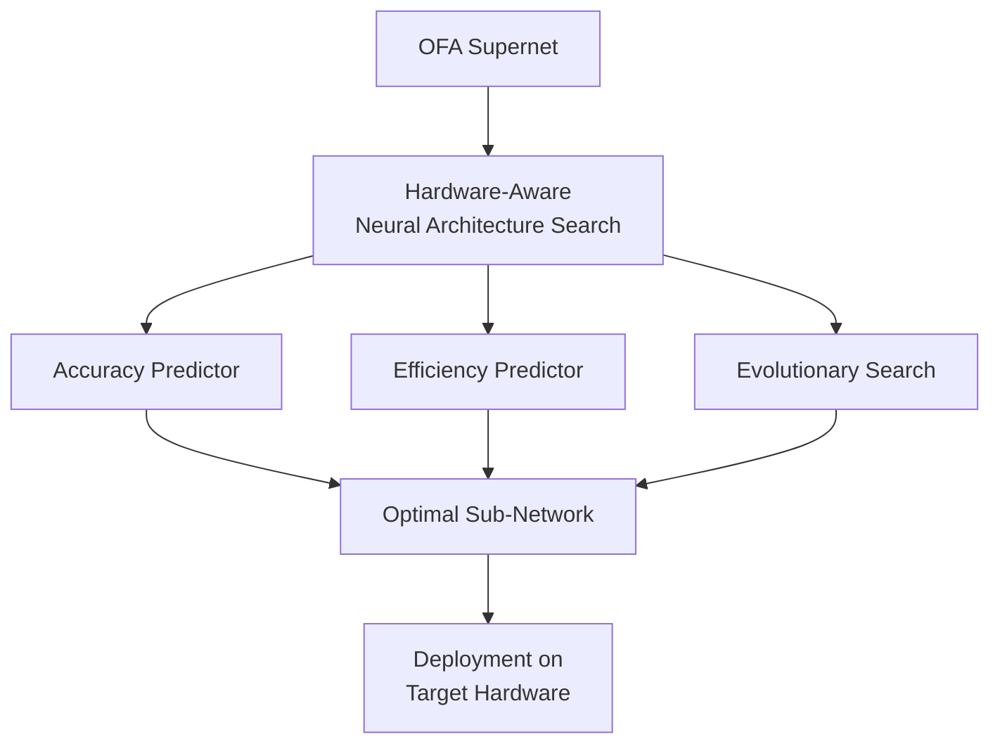

Sources: [README.md:42-44](), [figures/predictor_based_search.png]()

### Accuracy Predictor

The accuracy predictor estimates the accuracy of sub-networks without actually evaluating them on the validation set, which would be computationally expensive. It enables efficient exploration of the architecture space by quickly identifying promising sub-networks.

### Efficiency Predictor

The efficiency predictor estimates performance metrics such as latency, energy consumption, or FLOPs of sub-networks on target hardware platforms, enabling hardware-aware optimization. The framework includes pre-built latency tables for various devices.

### Evolutionary Search

Evolutionary search is used to find the optimal sub-network from the architecture space based on the accuracy and efficiency predictions. It explores the space efficiently by evolving a population of sub-networks toward better solutions that meet specified constraints.

**Predictor-Based Neural Architecture Search**

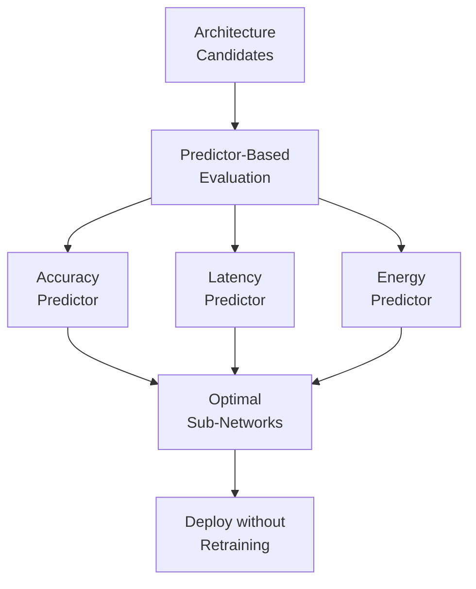

The speed difference between traditional neural architecture search (NAS) and OFA's approach is dramatic. As shown in the figures, OFA can find customized models in minutes compared to days or weeks for traditional NAS methods.

Sources: [figures/ofa_search_cost.png](), [figures/predictor_based_search.png]()

## Code Structure and Interfaces

The OFA framework provides several key interfaces and classes that implement the concepts described above.

**OFA Framework Code Structure**

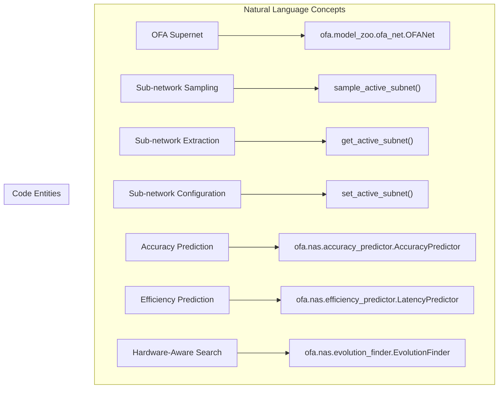

### Key Interfaces

The OFA framework provides several key interfaces for working with OFA networks:

#### Loading OFA Networks

```python
from ofa.model_zoo import ofa_net
ofa_network = ofa_net(net_id, pretrained=True)
```

#### Working with Sub-Networks

```python
# Randomly sample sub-networks from OFA network
ofa_network.sample_active_subnet()
random_subnet = ofa_network.get_active_subnet(preserve_weight=True)
    
# Manually set the sub-network
ofa_network.set_active_subnet(ks=7, e=6, d=4)
manual_subnet = ofa_network.get_active_subnet(preserve_weight=True)
```

#### Loading Specialized Networks

```python
from ofa.model_zoo import ofa_specialized
net, image_size = ofa_specialized(net_id, pretrained=True)
```

**Network Specialization System**

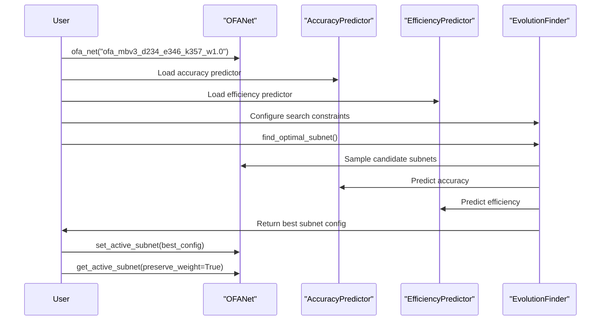

Sources: [README.md:46-62](), [README.md:74-87]()

## Example Operation Workflow

The following workflow depicts how one might use OFA in practice:

1. Load an OFA supernet from the model zoo
2. Use the accuracy and efficiency predictors to evaluate potential sub-networks
3. Apply evolutionary search to find the optimal sub-network for your hardware constraints
4. Extract the specialized sub-network using `get_active_subnet()`
5. Deploy the specialized sub-network to the target hardware

**OFA Operation Workflow**

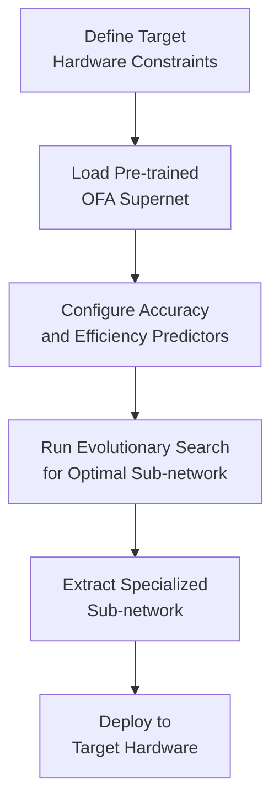

This workflow enables rapid adaptation to different hardware platforms without the computational cost of training separate models for each target device.

Sources: [README.md:46-62](), [figures/select_subnets.png]()

## Conclusion

The Once-for-All (OFA) framework represents a significant advancement in efficient deep learning deployment by introducing:

1. A versatile supernet that encompasses a large architecture space
2. Progressive shrinking training methodology that ensures all sub-networks perform well
3. Fast specialized deployment through accuracy prediction, efficiency prediction, and evolutionary search

Through these key concepts, OFA achieves its goal of "train once, specialize for many" - training a single neural network that can be specialized for efficient deployment across diverse hardware platforms.

Sources: [README.md:32-36]()

---

# Page: Getting Started

# Getting Started

<details>
<summary>Relevant source files</summary>

The following files were used as context for generating this wiki page:

- [README.md](README.md)
- [build.sh](build.sh)
- [figures/ofa-tutorial.jpg](figures/ofa-tutorial.jpg)
- [requirements.txt](requirements.txt)
- [setup.py](setup.py)
- [tutorial/README.md](tutorial/README.md)

</details>


This page provides instructions for setting up and installing the Once-for-All (OFA) framework. OFA enables you to train one neural network and specialize it for efficient deployment across different hardware platforms and constraints. For information about the core concepts behind OFA, see [Key Concepts](#1.1).

## System Requirements

Before installing OFA, ensure your system meets the following requirements:

- Python 3.6+
- PyTorch 1.4.0+
- For training OFA networks: Horovod and ImageNet dataset
- For inference only: Basic PyTorch installation is sufficient

Sources: [README.md:186-189]()

## Installation Options

### Option 1: Installation via pip

The simplest way to install OFA is through pip:

```bash
pip install ofa
```

This will install the entire OFA codebase with its dependencies.

Sources: [README.md:26]()

### Option 2: Installation from source

For the latest version or if you plan to modify the code, install from source:

```bash
git clone https://github.com/mit-han-lab/once-for-all.git
cd once-for-all
pip install -e .
```

### Dependencies

The main dependencies for OFA include:

```
torch
torchvision
filelock
gdown
```

Sources: [requirements.txt:1-4](), [setup.py:31-33]()

## Installation and Usage Workflow

Below is a diagram illustrating the installation and basic usage workflow of OFA:

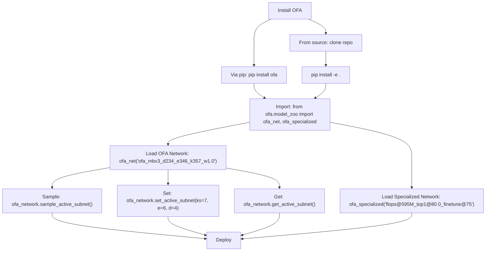

Sources: [README.md:26](), [setup.py:41-61]()

## Basic Usage

### Loading Pre-trained OFA Networks

```python
from ofa.model_zoo import ofa_net

# Load a pre-trained OFA network
ofa_network = ofa_net('ofa_mbv3_d234_e346_k357_w1.0', pretrained=True)
```

The OFA framework provides several pre-trained networks with different architecture spaces:

| OFA Network | Design Space | Resolution | Width Multiplier | Depth | Expand Ratio | Kernel Size |
|-------------|--------------|------------|------------------|-------|--------------|-------------|
| ofa_resnet50 | ResNet50D | 128 - 224 | 0.65, 0.8, 1.0 | 0, 1, 2 | 0.2, 0.25, 0.35 | 3 |
| ofa_mbv3_d234_e346_k357_w1.0 | MobileNetV3 | 128 - 224 | 1.0 | 2, 3, 4 | 3, 4, 6 | 3, 5, 7 |
| ofa_mbv3_d234_e346_k357_w1.2 | MobileNetV3 | 160 - 224 | 1.2 | 2, 3, 4 | 3, 4, 6 | 3, 5, 7 |
| ofa_proxyless_d234_e346_k357_w1.3 | ProxylessNAS | 128 - 224 | 1.3 | 2, 3, 4 | 3, 4, 6 | 3, 5, 7 |

Sources: [README.md:48-54](), [README.md:68-73]()

### Working with Sub-networks

The power of OFA lies in its ability to generate specialized sub-networks:

```python
# Randomly sample a sub-network
ofa_network.sample_active_subnet()
random_subnet = ofa_network.get_active_subnet(preserve_weight=True)

# Manually specify a sub-network
ofa_network.set_active_subnet(ks=7, e=6, d=4)
manual_subnet = ofa_network.get_active_subnet(preserve_weight=True)
```

Sources: [README.md:55-61]()

### Evaluating OFA Networks

To evaluate the performance of an OFA network on ImageNet:

```bash
python eval_ofa_net.py --path 'Your path to imagenet' --net ofa_mbv3_d234_e346_k357_w1.0
```

Sources: [README.md:66]()

### Using Specialized Networks

OFA also provides pre-specialized networks optimized for specific constraints:

```python
from ofa.model_zoo import ofa_specialized

# Load a specialized network (optimized for specific constraints)
net, image_size = ofa_specialized('flops@595M_top1@80.0_finetune@75', pretrained=True)
```

To evaluate a specialized network:

```bash
python eval_specialized_net.py --path 'Your path to imagenet' --net flops@595M_top1@80.0_finetune@75
```

Sources: [README.md:78-82](), [README.md:87]()

## OFA Framework Architecture

The following diagram shows the main components of the OFA framework and their relationships:

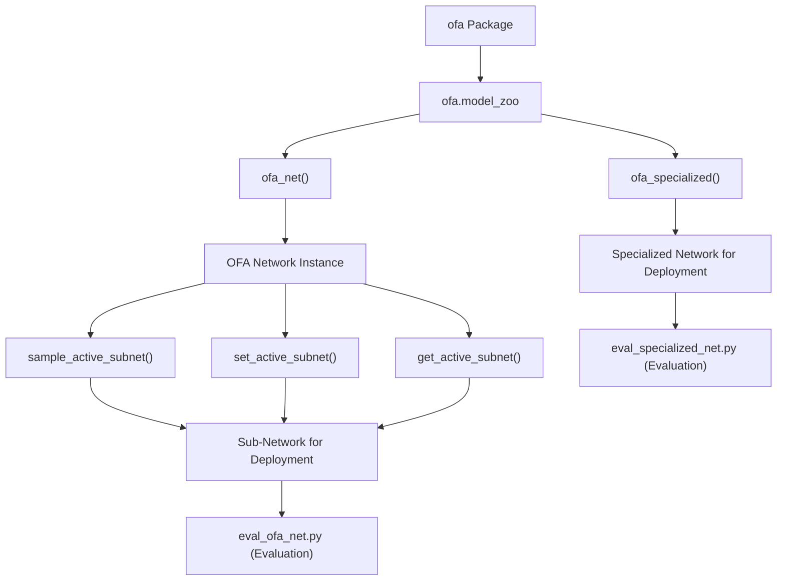

Sources: [README.md:48-61](), [README.md:78-82]()

## Network Selection and Deployment Process

This sequence diagram shows the typical workflow from network selection to deployment:

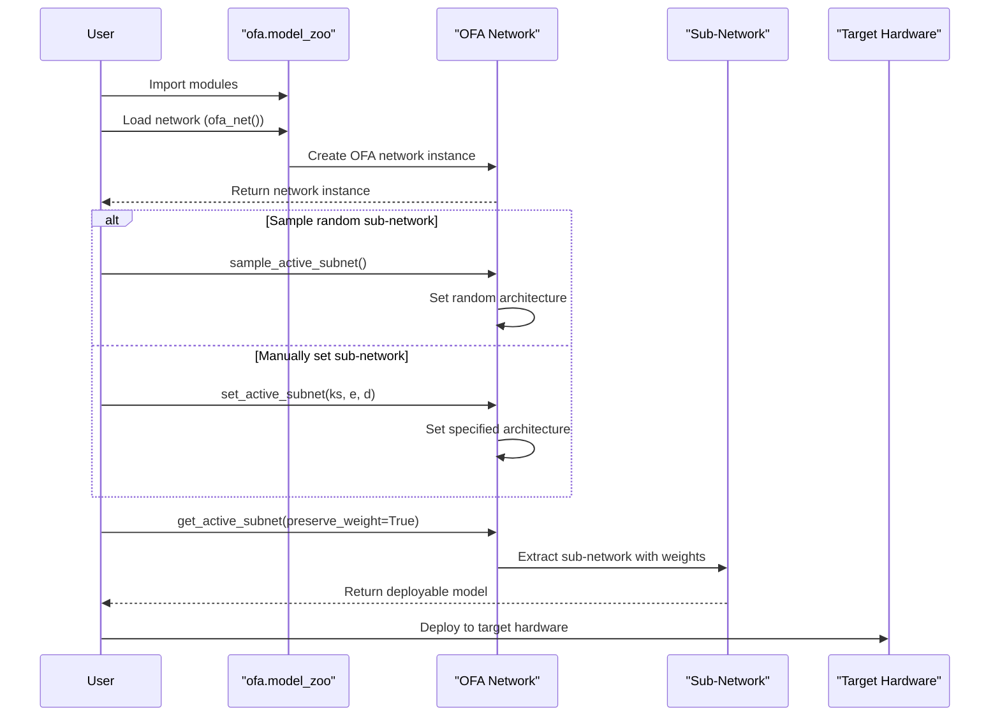

Sources: [README.md:48-61]()

## Interactive Tutorial

OFA provides an interactive tutorial in the form of a Jupyter notebook:

```bash
git clone https://github.com/mit-han-lab/once-for-all.git
cd once-for-all/tutorial
jupyter notebook ofa.ipynb
```

You can also use the notebook directly in Google Colab by visiting the OFA repository.

Sources: [tutorial/README.md:3-5](), [tutorial/README.md:37-43]()

## Next Steps

- For a hands-on tutorial of OFA, see the [Basic OFA Tutorial](#6.1)
- For a specific example using ResNet50, check out the [ResNet50 Example](#6.2)
- To learn more about the OFA model zoo, see [Model Zoo](#2)
- For understanding OFA's training system, refer to [Training System](#3)
- For specializing the OFA supernet into efficient sub-networks, see [Network Specialization](#4)

---

# Page: Model Zoo

# Model Zoo

<details>
<summary>Relevant source files</summary>

The following files were used as context for generating this wiki page:

- [README.md](README.md)
- [figures/ofa-tutorial.jpg](figures/ofa-tutorial.jpg)
- [ofa/model_zoo.py](ofa/model_zoo.py)
- [tutorial/README.md](tutorial/README.md)

</details>


## Purpose and Overview

The Model Zoo in the Once-for-All (OFA) framework provides access to pre-trained neural network models that can be directly deployed or further specialized for specific hardware targets. This page documents how to access and use these models, including OFA supernets, specialized subnets, and ProxylessNAS networks.

For information about training your own OFA networks, see [Training System](#3).

Sources: [README.md:46-62](), [ofa/model_zoo.py:1-24]()

## Model Zoo Architecture

The Model Zoo serves as a central repository for accessing different types of neural networks in the OFA ecosystem:

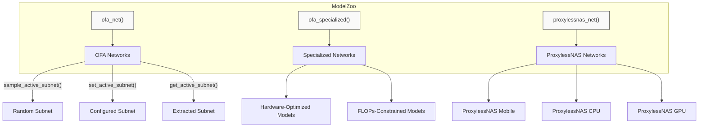

The Model Zoo exposes three main functions for accessing different types of networks:
- `ofa_net()` - Loads OFA supernets that can generate many subnets
- `ofa_specialized()` - Loads pre-optimized specialized networks for specific hardware/constraints
- `proxylessnas_net()` - Loads ProxylessNAS networks (predecessor to OFA)

Sources: [ofa/model_zoo.py:17-24]()

## OFA Networks

OFA Networks are elastic neural networks that contain many possible subnetworks with different architectures. These supernets can be configured to generate efficient subnetworks for various deployment scenarios.

### Available OFA Networks

| Network ID | Architecture | Resolution | Width Multiplier | Depth Range | Expand Ratio Range | Kernel Size Range |
|------------|--------------|------------|------------------|-------------|-------------------|------------------|
| ofa_mbv3_d234_e346_k357_w1.0 | MobileNetV3 | 128-224 | 1.0 | 2, 3, 4 | 3, 4, 6 | 3, 5, 7 |
| ofa_mbv3_d234_e346_k357_w1.2 | MobileNetV3 | 160-224 | 1.2 | 2, 3, 4 | 3, 4, 6 | 3, 5, 7 |
| ofa_proxyless_d234_e346_k357_w1.3 | ProxylessNAS | 128-224 | 1.3 | 2, 3, 4 | 3, 4, 6 | 3, 5, 7 |
| ofa_resnet50 | ResNet50D | 128-224 | 0.65, 0.8, 1.0 | 0, 1, 2 | 0.2, 0.25, 0.35 | 3 |

Sources: [README.md:69-73](), [ofa/model_zoo.py:61-108]()

### OFA Network Implementation

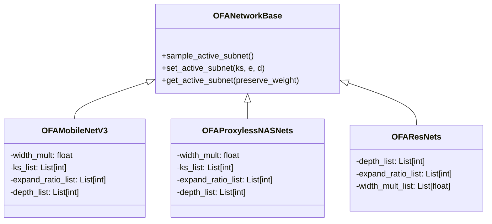

Sources: [ofa/model_zoo.py:61-108](), [README.md:46-62]()

### Using OFA Networks

OFA networks can be loaded using the `ofa_net()` function:

```python
from ofa.model_zoo import ofa_net

# Load an OFA network with pre-trained weights
ofa_network = ofa_net('ofa_mbv3_d234_e346_k357_w1.0', pretrained=True)

# Randomly sample a subnet from the OFA network
ofa_network.sample_active_subnet()
random_subnet = ofa_network.get_active_subnet(preserve_weight=True)

# Manually configure a subnet
ofa_network.set_active_subnet(ks=7, e=6, d=4)
manual_subnet = ofa_network.get_active_subnet(preserve_weight=True)
```

Sources: [README.md:47-62]()

## Specialized Networks

Specialized networks are pre-extracted subnets from OFA networks, optimized for specific hardware platforms or performance constraints. These networks are ready to deploy without further configuration.

### Specialized Network Categories

```mermaid
graph TD
    subgraph "OFA Specialized Networks"
        A["FLOPs-constrained Models"]
        B["Device-specific Models"]
        C["ResNet50 Models"]
    end
    
    B --> D["Mobile Devices"]
    B --> E["GPU Devices"]
    B --> F["CPU Devices"]
    
    D --> G["LG G8"]
    D --> H["Samsung S7 Edge"]
    D --> I["Samsung Note8"]
    D --> J["Samsung Note10"]
    D --> K["Google Pixel1"]
    D --> L["Google Pixel2"]
    
    E --> M["NVIDIA 1080ti"]
    E --> N["NVIDIA V100"]
    E --> O["NVIDIA Jetson TX2"]
    
    F --> P["Intel Xeon w/ MKL-DNN"]
    
    C --> Q["ResNet50D Models at<br>various complexities"]
```

Sources: [README.md:101-161]()

### Available Specialized Networks

The OFA framework provides over 40 specialized networks optimized for different platforms and constraints. Some examples include:

| Model ID | Hardware Target | Top-1 Accuracy (%) | Parameters | MACs |
|----------|-----------------|-------------------|------------|------|
| flops@595M_top1@80.0_finetune@75 | FLOPs constraint | 80.0 | 9.1M | 595M |
| LG-G8_lat@24ms_top1@76.4_finetune@25 | LG G8 | 76.4 | 5.8M | 230M |
| s7edge_lat@88ms_top1@76.3_finetune@25 | Samsung S7 Edge | 76.3 | 6.4M | 219M |
| note10_lat@64ms_top1@80.2_finetune@75 | Samsung Note10 | 80.2 | 9.1M | 743M |
| pixel1_lat@143ms_top1@80.1_finetune@75 | Google Pixel1 | 80.1 | 9.2M | 642M |
| 1080ti_gpu64@27ms_top1@76.4_finetune@25 | NVIDIA 1080ti GPU | 76.4 | 6.5M | 397M |
| cpu_lat@17ms_top1@75.7_finetune@25 | Intel Xeon CPU | 75.7 | 4.9M | 365M |
| resnet50D_MAC@4.1B_top1@79.8 | ResNet50D Space | 79.8 | 30.9M | 4.1B |

For a complete list of available specialized networks, refer to the repository README.

Sources: [README.md:101-161]()

### Using Specialized Networks

Specialized networks can be loaded using the `ofa_specialized()` function:

```python
from ofa.model_zoo import ofa_specialized

# Load a specialized network optimized for a specific hardware target
net, image_size = ofa_specialized('flops@595M_top1@80.0_finetune@75', pretrained=True)

# The function returns both the network and the recommended image size
```

Sources: [README.md:75-87](), [ofa/model_zoo.py:27-58]()

## ProxylessNAS Networks

The Model Zoo also provides access to ProxylessNAS networks, which are the predecessors to OFA networks.

### Available ProxylessNAS Networks

The following ProxylessNAS networks are available:

| Network | Function |
|---------|----------|
| ProxylessNAS Mobile | `proxylessnas_mobile()` |
| ProxylessNAS CPU | `proxylessnas_cpu()` |
| ProxylessNAS GPU | `proxylessnas_gpu()` |

Sources: [ofa/model_zoo.py:111-136]()

### Using ProxylessNAS Networks

ProxylessNAS networks can be loaded using specialized functions:

```python
from ofa.model_zoo import proxylessnas_mobile, proxylessnas_cpu, proxylessnas_gpu

# Load ProxylessNAS Mobile
mobile_net = proxylessnas_mobile(pretrained=True)

# Load ProxylessNAS CPU
cpu_net = proxylessnas_cpu(pretrained=True)

# Load ProxylessNAS GPU
gpu_net = proxylessnas_gpu(pretrained=True)
```

Sources: [ofa/model_zoo.py:127-136]()

## Model Loading Mechanism

The Model Zoo uses a consistent loading mechanism for all network types, downloading pre-trained weights from online repositories:

```mermaid
sequenceDiagram
    participant User
    participant ModelZoo as Model Zoo Functions
    participant Network as Network Classes
    participant Storage as Local Storage
    participant Remote as Remote Repository
    
    User->>ModelZoo: Request network (e.g., ofa_net())
    ModelZoo->>Network: Create network instance
    ModelZoo->>Storage: Check if weights exist locally
    
    alt Weights not found locally
        Storage-->>ModelZoo: Not found
        ModelZoo->>Remote: Request weights download
        Remote-->>Storage: Download weights
    else Weights found locally
        Storage-->>ModelZoo: Found
    end
    
    ModelZoo->>Storage: Load weights
    Storage-->>ModelZoo: Return weights
    ModelZoo->>Network: Load state_dict
    ModelZoo-->>User: Return initialized network
```

Sources: [ofa/model_zoo.py:27-58](), [ofa/model_zoo.py:61-108]()

## Model Zoo Integration

The Model Zoo integrates with other components of the OFA system to enable comprehensive neural network development and deployment:

```mermaid
graph TD
    subgraph "Once-for-All Framework"
        A["Training System"]
        B["Model Zoo"]
        C["Network Specialization"]
        D["Evaluation"]
    end
    
    A -->|"Produces"| B
    B -->|"Provides models for"| D
    B -->|"Provides supernets for"| C
    C -->|"Generates optimized<br>subnets for"| B
    
    E["Users"] -->|"Load models from"| B
    E -->|"Train models with"| A
    E -->|"Specialize models with"| C
    E -->|"Evaluate models with"| D
    
    classDef highlight fill:#f9f9f9,stroke:#333,stroke-width:1px;
    class B highlight;
```

For more information on the training system, see [Training System](#3).
For more information on network specialization, see [Network Specialization](#4).

Sources: [README.md:31-45]()

---

# Page: OFA Networks

# OFA Networks

<details>
<summary>Relevant source files</summary>

The following files were used as context for generating this wiki page:

- [README.md](README.md)
- [figures/ofa-tutorial.jpg](figures/ofa-tutorial.jpg)
- [ofa/model_zoo.py](ofa/model_zoo.py)
- [tutorial/README.md](tutorial/README.md)

</details>


This document details the available Once-for-All (OFA) network architectures and their configurations within the Once-for-All framework. For information about specialized networks derived from OFA networks, see [Specialized Networks](#2.2). For details on how to train OFA networks, see [Training System](#3).

## Introduction to OFA Networks

OFA networks are supernets that encapsulate an entire design space of neural network architectures. Each OFA network contains weight-sharing sub-networks that can be extracted by specifying the architectural configurations. The key idea is to train a single OFA network once and then extract specialized sub-networks for different deployment scenarios without requiring retraining.

```mermaid
flowchart TD
    subgraph "OFANetwork"
        A["OFA Supernet"]
        B["Sub-network 1"] 
        C["Sub-network 2"]
        D["Sub-network 3"]
        E["..."]
        
        A -->|"extract with\nconfigurations"| B
        A -->|"extract with\nconfigurations"| C
        A -->|"extract with\nconfigurations"| D
        A -->|"extract with\nconfigurations"| E
    end
    
    F["Mobile Device"] --- B
    G["Edge Device"] --- C
    H["Cloud Server"] --- D
```

Sources: [README.md:32-33](), [README.md:46-62]()

## Available OFA Network Architectures

OFA provides three main network architectures, each with different design spaces and characteristics:

### 1. OFA MobileNetV3

Based on MobileNetV3, this architecture offers a design space with various kernel sizes, expand ratios, depths, and width multipliers.

Available pre-trained variants:
- `ofa_mbv3_d234_e346_k357_w1.0`: MobileNetV3 with width multiplier 1.0
- `ofa_mbv3_d234_e346_k357_w1.2`: MobileNetV3 with width multiplier 1.2

### 2. OFA ProxylessNAS

Based on ProxylessNAS, this architecture is optimized for various deployment platforms.

Available pre-trained variant:
- `ofa_proxyless_d234_e346_k357_w1.3`: ProxylessNAS with width multiplier 1.3

### 3. OFA ResNet50

Based on ResNet50, this architecture provides a design space with different depths, expand ratios, and width multipliers.

Available pre-trained variant:
- `ofa_resnet50`: ResNet50 with variable depth, expand ratio, and width multiplier

```mermaid
classDiagram
    class OFABase {
        +sample_active_subnet()
        +set_active_subnet()
        +get_active_subnet()
    }
    
    class OFAMobileNetV3 {
        -width_mult
        -ks_list
        -expand_ratio_list
        -depth_list
    }
    
    class OFAProxylessNASNets {
        -width_mult
        -ks_list
        -expand_ratio_list
        -depth_list
    }
    
    class OFAResNets {
        -depth_list
        -expand_ratio_list
        -width_mult_list
    }
    
    OFABase <|-- OFAMobileNetV3
    OFABase <|-- OFAProxylessNASNets
    OFABase <|-- OFAResNets
```

Sources: [ofa/model_zoo.py:61-108](), [README.md:69-73]()

## OFA Networks Design Space

Each OFA network architecture encompasses a large design space defined by several dimensions:

| OFA Network | Design Space | Resolution | Width Multiplier | Depth | Expand Ratio | Kernel Size |
|-------------|--------------|------------|------------------|-------|--------------|-------------|
| ofa_resnet50 | ResNet50D | 128 - 224 | 0.65, 0.8, 1.0 | 0, 1, 2 | 0.2, 0.25, 0.35 | 3 |
| ofa_mbv3_d234_e346_k357_w1.0 | MobileNetV3 | 128 - 224 | 1.0 | 2, 3, 4 | 3, 4, 6 | 3, 5, 7 |
| ofa_mbv3_d234_e346_k357_w1.2 | MobileNetV3 | 160 - 224 | 1.2 | 2, 3, 4 | 3, 4, 6 | 3, 5, 7 |
| ofa_proxyless_d234_e346_k357_w1.3 | ProxylessNAS | 128 - 224 | 1.3 | 2, 3, 4 | 3, 4, 6 | 3, 5, 7 |

These dimensions create a vast space of possible sub-networks that can be extracted from each OFA network.

Sources: [README.md:69-73]()

## Elastic Dimensions in OFA Networks

OFA networks support multiple elastic dimensions that can be adjusted to create different sub-networks:

```mermaid
flowchart TD
    subgraph "Elastic Dimensions"
        A["Kernel Size (k)"] 
        B["Network Depth (d)"]
        C["Expand Ratio (e)"]
        D["Width Multiplier (w)"]
    end
    
    E["OFA Supernet"] --- A
    E --- B
    E --- C
    E --- D
    
    A -->|"Example: k=3"| F["Small Receptive Field\nLower Latency"]
    A -->|"Example: k=7"| G["Large Receptive Field\nHigher Accuracy"]
    
    B -->|"Example: d=2"| H["Shallow Network\nLower Latency"]
    B -->|"Example: d=4"| I["Deep Network\nHigher Accuracy"]
    
    C -->|"Example: e=3"| J["Small Expansion\nLower Latency"]
    C -->|"Example: e=6"| K["Large Expansion\nHigher Accuracy"]
    
    D -->|"Example: w=0.65"| L["Narrow Network\nLower Latency"]
    D -->|"Example: w=1.0"| M["Wide Network\nHigher Accuracy"]
```

Sources: [ofa/model_zoo.py:65-94](), [README.md:69-73]()

## Using OFA Networks

### Loading Pre-trained OFA Networks

```python
from ofa.model_zoo import ofa_net

# Load a pre-trained OFA network
ofa_network = ofa_net('ofa_mbv3_d234_e346_k357_w1.0', pretrained=True)
```

### Working with OFA Networks

OFA networks provide three key methods for manipulating sub-networks:

1. `sample_active_subnet()`: Randomly sample a sub-network configuration
2. `set_active_subnet(ks, e, d)`: Manually set a specific sub-network configuration
3. `get_active_subnet(preserve_weight=True)`: Extract the currently active sub-network

Example usage:

```python
# Randomly sample sub-networks from OFA network
ofa_network.sample_active_subnet()
random_subnet = ofa_network.get_active_subnet(preserve_weight=True)
    
# Manually set the sub-network
ofa_network.set_active_subnet(ks=7, e=6, d=4)
manual_subnet = ofa_network.get_active_subnet(preserve_weight=True)
```

```mermaid
sequenceDiagram
    participant User
    participant OFANetwork
    participant Subnet
    
    User->>OFANetwork: ofa_net('ofa_mbv3_d234_e346_k357_w1.0', pretrained=True)
    User->>OFANetwork: sample_active_subnet()
    User->>OFANetwork: get_active_subnet(preserve_weight=True)
    OFANetwork->>Subnet: Extract subnet with weights
    Subnet->>User: Return subnet
    
    User->>OFANetwork: set_active_subnet(ks=7, e=6, d=4)
    User->>OFANetwork: get_active_subnet(preserve_weight=True)
    OFANetwork->>Subnet: Extract subnet with weights
    Subnet->>User: Return subnet
```

Sources: [README.md:46-62](), [ofa/model_zoo.py:61-108]()

## Implementation Details

OFA network implementations are defined in the elastic_nn.networks module, with the following main classes:

- `OFAMobileNetV3`: Implementation of the OFA MobileNetV3 architecture
- `OFAProxylessNASNets`: Implementation of the OFA ProxylessNAS architecture
- `OFAResNets`: Implementation of the OFA ResNet50 architecture

The `ofa_net` function in `model_zoo.py` provides a convenient way to load these networks with pre-trained weights.

Sources: [ofa/model_zoo.py:10-15](), [ofa/model_zoo.py:61-108]()

## Network Performance Comparison

OFA networks can achieve comparable or better performance than their fixed counterparts while offering flexibility across different deployment scenarios:

- OFA MobileNetV3 networks can reach 80% top-1 accuracy on ImageNet under mobile settings
- OFA networks consistently outperform MobileNetV3 on diverse hardware platforms
- OFA ResNet50 networks can achieve comparable accuracy to standard ResNet50 while offering flexible configurations

For detailed performance numbers and benchmarks, see [Evaluation](#5).

Sources: [README.md:35-41]()

---

# Page: Specialized Networks

# Specialized Networks

<details>
<summary>Relevant source files</summary>

The following files were used as context for generating this wiki page:

- [README.md](README.md)
- [figures/ofa-tutorial.jpg](figures/ofa-tutorial.jpg)
- [ofa/model_zoo.py](ofa/model_zoo.py)
- [tutorial/README.md](tutorial/README.md)

</details>


## Purpose and Scope

This document explains Specialized Networks in the Once-for-All (OFA) framework - pre-trained neural networks that have been optimized for specific hardware platforms or performance constraints. These networks are derived from the OFA supernet and represent specific sub-networks that achieve optimal performance on target hardware. For information about the parent OFA Networks, see [OFA Networks](#2.1).

## Overview

Specialized Networks are a key outcome of the OFA framework's "train once, specialize for many" approach. While the OFA supernet contains a vast array of possible sub-networks, Specialized Networks represent specific configurations that have been optimized for particular deployment scenarios.

```mermaid
flowchart TD
    subgraph "OFA Approach"
        A["OFA Supernet"]
        B["Specialized Networks"]
        
        A --> |"Specialization Process"| B
        
        subgraph "Specialization Targets"
            C["FLOPs Constraints"]
            D["Device Latency Targets"]
            E["Hardware Platforms"]
        end
        
        B --> C
        B --> D
        B --> E
    end
```

Sources: [README.md:32-37](), [README.md:75-83]()

## Using Specialized Networks

Specialized Networks can be easily loaded and used through the `ofa_specialized` function in the model zoo:

```mermaid
sequenceDiagram
    participant User
    participant "ofa_specialized()" as OFA
    participant "Remote Repository" as Repo
    
    User->>OFA: Call with network ID
    Note over User,OFA: net, image_size = ofa_specialized('flops@595M_top1@80.0_finetune@75')
    OFA->>Repo: Download network configuration
    Repo-->>OFA: Return net.config
    OFA->>Repo: Download run configuration
    Repo-->>OFA: Return run.config with image_size
    OFA->>Repo: Download pretrained weights
    Repo-->>OFA: Return model weights
    OFA->>User: Return specialized network and optimal image size
```

### Loading a Specialized Network

The `ofa_specialized` function retrieves both the network and the appropriate image size for inference:

```python
from ofa.model_zoo import ofa_specialized
net, image_size = ofa_specialized(net_id, pretrained=True)
```

Where `net_id` follows naming patterns that indicate the network's optimization target and performance:
- FLOPs-based: `flops@595M_top1@80.0_finetune@75`
- Device-based: `note10_lat@30ms_top1@78.4_finetune@75`

Sources: [ofa/model_zoo.py:27-58](), [README.md:75-83]()

### Evaluating a Specialized Network

Specialized networks can be evaluated using the provided script:

```bash
python eval_specialized_net.py --path 'Your path to imagenet' --net flops@595M_top1@80.0_finetune@75
```

Sources: [README.md:86-87]()

## Implementation Details

The `ofa_specialized` function in the model zoo handles downloading and instantiating specialized networks:

```mermaid
flowchart TD
    A["ofa_specialized()"] --> B["Download net.config"]
    A --> C["Download run.config"]
    A --> D["Download pretrained weights"]
    
    B --> E["get_net_by_name()"]
    E --> F["build_from_config()"]
    
    C --> G["Extract image_size"]
    
    D --> H["net.load_state_dict()"]
    
    F --> I["Instantiated Network"]
    G --> J["Optimal Image Size"]
    H --> I
    
    I --> K["Return Network"]
    J --> L["Return Image Size"]
```

The function performs these key operations:
1. Downloads the network configuration (`net.config`)
2. Builds the network using the appropriate constructor
3. Retrieves the optimal image size from the run configuration
4. Loads the pre-trained weights
5. Returns both the network and the recommended image size

Sources: [ofa/model_zoo.py:27-58]()

## Available Specialized Networks

The OFA framework provides a large collection of specialized networks optimized for different targets. These networks are categorized by their optimization criteria:

### FLOPs-Optimized Networks

| Model Name | FLOPs | Top-1 Accuracy (%) |
|------------|-------|-------------------|
| ofa-595M   | 595M  | 80.0              |
| ofa-482M   | 482M  | 79.6              |
| ofa-389M   | 389M  | 79.1              |

### Device-Optimized Networks

Networks optimized for specific devices with latency constraints:

#### Samsung Note10

| Model Name | Latency | Top-1 Accuracy (%) |
|------------|---------|-------------------|
| ofa-note10-64 | 64ms | 80.2              |
| ofa-note10-50 | 50ms | 79.7              |
| ofa-note10-41 | 41ms | 79.3              |
| ofa-note10-30 | 30ms | 78.4              |
| ofa-note10-22 | 22ms | 76.6              |
| ofa-note10-16 | 16ms | 75.5              |
| ofa-note10-11 | 11ms | 73.6              |
| ofa-note10-08 | 8ms  | 71.4              |

#### Google Pixel1

| Model Name | Latency | Top-1 Accuracy (%) |
|------------|---------|-------------------|
| ofa-pixel1-143 | 143ms | 80.1            |
| ofa-pixel1-132 | 132ms | 79.8            |
| ofa-pixel1-79 | 79ms | 78.7              |
| ofa-pixel1-58 | 58ms | 76.9              |
| ofa-pixel1-40 | 40ms | 74.9              |
| ofa-pixel1-28 | 28ms | 73.3              |
| ofa-pixel1-20 | 20ms | 71.4              |

### Hardware-Optimized Networks

Networks optimized for specific hardware platforms:

#### GPUs (Batch Size 64)

| Model Name | Hardware | Latency | Top-1 Accuracy (%) |
|------------|----------|---------|-------------------|
| ofa-1080ti-27 | 1080ti | 27ms | 76.4              |
| ofa-1080ti-22 | 1080ti | 22ms | 75.3              |
| ofa-v100-11 | V100 | 11ms | 76.1                  |
| ofa-v100-09 | V100 | 9ms | 75.3                   |

#### CPU (Batch Size 1)

| Model Name | Latency | Top-1 Accuracy (%) |
|------------|---------|-------------------|
| ofa-cpu-17 | 17ms | 75.7                 |
| ofa-cpu-15 | 15ms | 74.6                 |
| ofa-cpu-11 | 11ms | 72.0                 |
| ofa-cpu-10 | 10ms | 71.1                 |

Sources: [README.md:90-161]()

## Relationship to the OFA Framework

Specialized Networks represent the practical deployment outcome of the OFA approach:

```mermaid
flowchart LR
    subgraph "OFA Training"
        A["Progressive Shrinking"]
        B["OFA Supernet"]
        A --> B
    end
    
    subgraph "Network Specialization"
        C["Evolutionary Search"]
        D["Hardware Constraints"]
        E["Accuracy Targets"]
        F["Specialized Networks"]
        
        C --> F
        D --> C
        E --> C
    end
    
    B --> C
    F --> G["Deployment"]
    
    subgraph "Deployment Targets"
        G --> H["Mobile Devices"]
        G --> I["Cloud Servers"]
        G --> J["Edge Devices"]
    end
```

The specialized networks are the result of:
1. Training the OFA supernet using progressive shrinking
2. Using evolutionary search to find optimal sub-networks for specific hardware constraints
3. Extracting these sub-networks with their weights for efficient deployment

Sources: [README.md:32-37](), [README.md:90-161]()

## Conclusion

Specialized Networks provide ready-to-use models optimized for various deployment scenarios, allowing developers to quickly deploy efficient networks without performing the specialization process themselves. These networks represent different performance-accuracy trade-offs for diverse hardware platforms, from mobile devices to cloud servers.

---

# Page: Training System

# Training System

<details>
<summary>Relevant source files</summary>

The following files were used as context for generating this wiki page:

- [README.md](README.md)
- [figures/ofa-tutorial.jpg](figures/ofa-tutorial.jpg)
- [train_ofa_net.py](train_ofa_net.py)
- [tutorial/README.md](tutorial/README.md)

</details>


The Training System is a core component of the Once for All (OFA) framework responsible for training elastic neural networks that can be specialized for efficient deployment across diverse hardware platforms. This document explains the architecture and implementation of the OFA training system, focusing on the progressive shrinking methodology and distributed training approach.

For information about using pre-trained OFA networks, see [Model Zoo](#2).

## Overview

The OFA Training System implements the "train once, specialize for deployment" paradigm by training a single supernet that encompasses a broad architecture space. The system enables training across multiple dimensions of network flexibility, including:

- Elastic kernel sizes
- Elastic network depths
- Elastic channel widths (expansion ratios)

```mermaid
flowchart TD
    A["Training System"] --> B["Progressive Shrinking"]
    A --> C["Knowledge Distillation"]
    A --> D["Distributed Training"]
    
    B --> B1["Elastic Kernel Training"]
    B --> B2["Elastic Depth Training"]
    B --> B3["Elastic Width Training"]
    
    C --> C1["Teacher Model"]
    C --> C2["Student Network"]
    
    D --> D1["Horovod Integration"]
    D --> D2["Multi-GPU Synchronization"]
```

Sources: [train_ofa_net.py](), [README.md:162-169]()

## Progressive Shrinking Training Methodology

Progressive shrinking is the core training methodology of OFA. Instead of training all possible subnet configurations simultaneously, OFA progressively trains the network in stages:

```mermaid
flowchart LR
    A["Full Network Training"] --> B["Elastic Kernel Size Training"]
    B --> C["Elastic Depth Training"]
    C --> D["Elastic Width/Expansion Training"]
    D --> E["Final OFA Network"]
    
    B -.-> F["Kernel Space: 3,5,7"]
    C -.-> G["Depth Space: 2,3,4"]
    D -.-> H["Expansion Space: 3,4,6"]
```

Sources: [train_ofa_net.py:254-313]()

The progressive shrinking process follows these steps:

1. **Initial Training**: Begin with the largest network in the search space
2. **Kernel Size Shrinking**: Train the network to support multiple kernel sizes (e.g., 3×3, 5×5, 7×7)
3. **Depth Shrinking**: Introduce depth flexibility to support different layer counts
4. **Width Shrinking**: Introduce width flexibility to support different channel counts

This approach ensures knowledge transfer from larger sub-networks to smaller ones, significantly improving the performance of resource-constrained models.

## Training Tasks

The training system supports three main tasks corresponding to the different elastic dimensions:

| Task | Configuration | Architecture Space | Training Phases |
|------|--------------|-------------------|----------------|
| Kernel | Dynamic batch size: 1<br>Epochs: 120<br>Base LR: 3e-2 | Kernel sizes: 3,5,7<br>Expand ratio: 6<br>Depth: 4 | Single phase |
| Depth | Dynamic batch size: 2<br>Epochs: 25-120<br>Base LR: 2.5e-3 to 7.5e-3 | Phase 1: Depths 3,4<br>Phase 2: Depths 2,3,4 | Two phases |
| Expand | Dynamic batch size: 4<br>Epochs: 25-120<br>Base LR: 2.5e-3 to 7.5e-3 | Phase 1: Expand 4,6<br>Phase 2: Expand 3,4,6 | Two phases |

Sources: [train_ofa_net.py:42-91]()

## Knowledge Distillation

The training system employs knowledge distillation to transfer knowledge from a large pre-trained teacher model to the elastic student network:

```mermaid
sequenceDiagram
    participant Teacher as "Teacher Model (MobileNetV3Large)"
    participant OFA as "OFA Network"
    participant Loss as "Distillation Loss"
    
    Note over Teacher,OFA: Initialization
    
    Teacher->>Teacher: Load pretrained weights
    OFA->>OFA: Sample active subnet
    
    Note over Teacher,Loss: Training Loop
    
    Teacher->>Teacher: Generate soft targets
    OFA->>OFA: Forward pass
    OFA->>Loss: Predictions
    Teacher->>Loss: Soft targets
    Loss->>OFA: Gradient with KD loss
    OFA->>OFA: Update parameters
```

Sources: [train_ofa_net.py:207-238]()

Key knowledge distillation components:
- Teacher model: MobileNetV3Large with fixed parameters (depth=4, kernel size=7, expand ratio=6)
- KD ratio: Controls the weight of the distillation loss
- KD type: Determines the type of distillation loss (e.g., cross-entropy)

## Distributed Training Architecture

OFA implements distributed training using Horovod, which enables efficient scaling across multiple GPUs and servers:

```mermaid
flowchart TD
    A["train_ofa_net.py"] --> B["Initialize Horovod"]
    B --> C["Set GPU Device"]
    C --> D["Create OFA Network"]
    D --> E["Setup DistributedRunManager"]
    E --> F["Broadcast Model"]
    F --> G["Progressive Training"]
    G --> H["Validate"]
    H --> G
    
    subgraph "Each GPU Worker"
    I["Local Gradient Computation"] --> J["Synchronize Gradients"]
    J --> K["Update Model"]
    end
    
    G --> I
```

Sources: [train_ofa_net.py:134-138](), [train_ofa_net.py:222-232]()

The distributed training system includes:
- Horovod initialization to coordinate multiple processes
- GPU device assignment for each process
- Gradient synchronization across workers
- Linear learning rate scaling based on the number of GPUs
- Optional gradient compression for efficient communication

## Training Configuration

The training system provides extensive configuration options:

| Category | Parameters | Description |
|----------|------------|-------------|
| Learning Rate | Base LR, warmup epochs, scheduler | Cosine LR schedule with optional warmup |
| Optimization | SGD with momentum (0.9), weight decay (3e-5) | Standard optimization settings |
| Architecture Space | Kernel sizes, expansion ratios, depths | Defines the search space of the OFA network |
| Data Augmentation | Image sizes (128-224), distortion, scaling | Multi-size training with augmentation |
| Batch Size | Base batch size (64), dynamic batch steps | Controls memory usage and training stability |
| Knowledge Distillation | KD ratio (1.0), KD type (ce) | Controls the influence of the teacher model |

Sources: [train_ofa_net.py:92-130]()

## Training Workflow

The OFA training workflow consists of the following steps:

```mermaid
sequenceDiagram
    participant User
    participant RunManager as "DistributedRunManager"
    participant OFANetwork
    participant Validator
    
    User->>RunManager: Initialize with configuration
    RunManager->>OFANetwork: Build OFA network
    
    alt Kernel Training
        User->>OFANetwork: Load pretrained backbone
        User->>RunManager: Train with elastic kernels
    else Depth Training
        User->>OFANetwork: Load kernel-elastic network
        User->>RunManager: Train with elastic depths (Phase 1)
        User->>RunManager: Train with elastic depths (Phase 2)
    else Expansion Training
        User->>OFANetwork: Load depth-elastic network
        User->>RunManager: Train with elastic expansion (Phase 1)
        User->>RunManager: Train with elastic expansion (Phase 2)
    end
    
    RunManager->>Validator: Validate network
    Validator->>User: Return validation metrics
```

Sources: [train_ofa_net.py:254-313]()

## Validation System

During training, the system periodically validates the OFA network across different architectural configurations:

```mermaid
flowchart LR
    A["Validation Process"] --> B["Image Size Sampling"]
    A --> C["Kernel Size Sampling"]
    A --> D["Expansion Ratio Sampling"]
    A --> E["Depth Sampling"]
    
    B --> B1["Multiple Resolutions (160px, 224px)"]
    C --> C1["Min and Max Kernel Sizes"]
    D --> D1["Min and Max Expansion Ratios"]
    E --> E1["Min and Max Network Depths"]
    
    B1 & C1 & D1 & E1 --> F["Subnet Validation"]
    F --> G["Accuracy Metrics"]
```

Sources: [train_ofa_net.py:246-253]()

The validation system tests the model on key combinations of:
- Different image sizes (typically 160px and 224px)
- Minimum and maximum kernel sizes from the elastic space
- Minimum and maximum expansion ratios from the elastic space
- Minimum and maximum depths from the elastic space

This comprehensive validation ensures the OFA network maintains accuracy across the entire architectural search space.

## Running Distributed Training

The OFA training system can be launched using either MPI or Horovod commands:

```bash
# Using MPI
mpirun -np 32 -H <server1_ip>:8,<server2_ip>:8,<server3_ip>:8,<server4_ip>:8 \
    -bind-to none -map-by slot \
    -x NCCL_DEBUG=INFO -x LD_LIBRARY_PATH -x PATH \
    python train_ofa_net.py

# Using Horovod
horovodrun -np 32 -H <server1_ip>:8,<server2_ip>:8,<server3_ip>:8,<server4_ip>:8 \
    python train_ofa_net.py
```

Sources: [README.md:164-174]()

Key command-line arguments include:
- `--task`: Specifies the training task (kernel, depth, expand)
- `--phase`: For depth and expand tasks, specifies training phase (1 or 2)
- `--resume`: Resumes training from a checkpoint

The training system automatically downloads appropriate pre-trained models for each training phase to ensure a smooth progressive training process.

Sources: [train_ofa_net.py:27-41]()

---

# Page: Progressive Shrinking Training

# Progressive Shrinking Training

<details>
<summary>Relevant source files</summary>

The following files were used as context for generating this wiki page:

- [ofa/imagenet_classification/elastic_nn/training/progressive_shrinking.py](ofa/imagenet_classification/elastic_nn/training/progressive_shrinking.py)
- [ofa/imagenet_classification/elastic_nn/utils.py](ofa/imagenet_classification/elastic_nn/utils.py)
- [train_ofa_net.py](train_ofa_net.py)

</details>


Progressive Shrinking (PS) is the core training methodology used in the Once-for-All (OFA) framework to train elastic neural networks that can be specialized for various deployment scenarios. This page documents the technical details of Progressive Shrinking, its workflow, and implementation specifics.

For information about the general OFA architecture, see [Overview](#1). For details on using pre-trained OFA networks, see [Model Zoo](#2).

## Purpose and Scope

Progressive Shrinking is designed to efficiently train a single supernet that contains numerous subnetworks (subnet) with varying architectures. Instead of training all possible architectural configurations from scratch, Progressive Shrinking gradually expands the searchable dimensions of the network (kernel size, depth, width), allowing the supernet to converge while accommodating all possible subnet configurations.

Sources: [ofa/imagenet_classification/elastic_nn/training/progressive_shrinking.py:1-30](), [train_ofa_net.py:1-26]()

## Progressive Shrinking Methodology

Progressive Shrinking follows a specific sequence of training stages to gradually expand the architectural search space:

```mermaid
flowchart TB
    A["Train Large Supernet"] --> B["Elastic Kernel Size Training"]
    B --> C["Elastic Depth Training"]
    C --> D["Elastic Width Training"]
    D --> E["Final OFA Network"]
    
    B --- F["Search Space: Kernel Sizes (3,5,7)"]
    C --- G["Search Space: Network Depths"]
    D --- H["Search Space: Channel Widths"]
    
    E --> I["Specialized Deployment"]
```

The training process starts with a large supernet and progressively introduces flexibility in:
1. **Kernel Size** - Allowing different convolutional kernel sizes (e.g., 3×3, 5×5, 7×7)
2. **Network Depth** - Allowing varying depths for each stage of the network
3. **Channel Width** - Allowing different expansion ratios for channels

Each stage builds upon the previous one, gradually increasing the network's flexibility while preserving performance.

Sources: [train_ofa_net.py:27-91](), [ofa/imagenet_classification/elastic_nn/training/progressive_shrinking.py:287-387]()

## Training Stages Implementation

Progressive Shrinking is implemented through three main training functions, each responsible for a different dimension of elasticity:

```mermaid
classDiagram
    class BaseTraining {
        +train(run_manager, args, validate_func)
        +train_one_epoch(run_manager, args, epoch, warmup_epochs, warmup_lr)
        +validate(run_manager, epoch, is_test, ...)
    }
    
    class ElasticKernelTraining {
        +train(run_manager, args, validate_func)
    }
    
    class ElasticDepthTraining {
        +train_elastic_depth(train_func, run_manager, args, validate_func_dict)
    }
    
    class ElasticExpandTraining {
        +train_elastic_expand(train_func, run_manager, args, validate_func_dict)
    }
    
    BaseTraining <|-- ElasticKernelTraining
    BaseTraining <|-- ElasticDepthTraining
    BaseTraining <|-- ElasticExpandTraining
```

### 1. Elastic Kernel Size Training

Starts with a trained network and introduces varying kernel sizes:
- Kernel sizes: 3×3, 5×5, 7×7
- Enables the network to adapt to different kernel sizes without retraining

### 2. Elastic Depth Training

Adds depth flexibility to the kernel-elastic network:
- Implemented in two phases
- Phase 1: Supports depths [3, 4]
- Phase 2: Expands to depths [2, 3, 4]
- Allows dropping layers while maintaining performance

### 3. Elastic Width Training

Adds channel width flexibility to the depth and kernel-elastic network:
- Also implemented in two phases
- Phase 1: Supports expansion ratios [4, 6]
- Phase 2: Expands to expansion ratios [3, 4, 6]
- Enables adapting channel width for different compute requirements

Sources: [train_ofa_net.py:42-91](), [ofa/imagenet_classification/elastic_nn/training/progressive_shrinking.py:287-387]()

## Training Workflow

The training workflow is orchestrated by the main script that selects appropriate training functions based on the current stage:

```mermaid
sequenceDiagram
    participant User
    participant TrainScript as "train_ofa_net.py"
    participant PSTraining as "Progressive Shrinking"
    participant OFANet as "OFA Network"
    participant RunManager as "Run Manager"
    
    User->>TrainScript: Start training with task (kernel/depth/expand)
    TrainScript->>OFANet: Initialize network with elastic properties
    TrainScript->>RunManager: Configure training parameters
    
    alt Kernel Size Training
        TrainScript->>PSTraining: train()
    else Depth Training
        TrainScript->>PSTraining: train_elastic_depth()
    else Width Training
        TrainScript->>PSTraining: train_elastic_expand()
    end
    
    PSTraining->>OFANet: Sample random subnet
    PSTraining->>RunManager: Train for one epoch
    PSTraining->>OFANet: Validate performance
    
    PSTraining-->>TrainScript: Return trained supernet
    TrainScript-->>User: Provide OFA network
```

Each training stage follows these steps:
1. Load a pre-trained model if available
2. Configure the elastic search space for the current dimension
3. Train the network using progressive shrinking
4. Validate performance across different subnet configurations
5. Save the model for the next stage or final deployment

Sources: [train_ofa_net.py:131-313](), [ofa/imagenet_classification/elastic_nn/training/progressive_shrinking.py:234-278]()

## Subnet Sampling and Training

During progressive shrinking, the network learns to handle multiple architectural configurations by randomly sampling and training different subnets:

```mermaid
flowchart TD
    A["Training Iteration"] --> B["Sample Random Subnet"]
    B --> C{"Set Subnet Configuration"}
    C --> D["Kernel Size"]
    C --> E["Network Depth"]
    C --> F["Expansion Ratio"]
    C --> G["Image Size"]
    
    D --> H["Forward Pass"]
    E --> H
    F --> H
    G --> H
    
    H --> I["Compute Loss"]
    I --> J["Apply Knowledge Distillation"]
    J --> K["Backward Pass"]
    K --> L["Update Weights"]
```

Key aspects of the subnet sampling process:
1. Each training iteration samples a random subnet configuration
2. Different dimensions are constrained according to the current training stage
3. Multiple subnets are sampled within each batch for efficiency (dynamic batch size)
4. A consistent random seed ensures reproducibility for each subnet

Sources: [ofa/imagenet_classification/elastic_nn/training/progressive_shrinking.py:115-231]()

## Validation During Progressive Shrinking

Validation is a critical component that ensures the supernet maintains performance across different subnet configurations:

```mermaid
flowchart LR
    A["Validation"] --> B["Generate Subnet Settings"]
    B --> C["For Each Subnet Configuration"]
    C --> D["Set Active Subnet"]
    D --> E["Reset Running Statistics"]
    E --> F["Evaluate Performance"]
    F --> G["Aggregate Results"]
```

The validation process:
1. Generates subnet configurations to test based on the current training stage
2. Sets the network to each configuration
3. Resets batch normalization statistics for the specific subnet
4. Evaluates performance on the validation dataset
5. Aggregates results across all tested configurations

Sources: [ofa/imagenet_classification/elastic_nn/training/progressive_shrinking.py:33-112](), [ofa/imagenet_classification/elastic_nn/utils.py:16-84]()

## Knowledge Distillation in Progressive Shrinking

Knowledge distillation is a key technique used in Progressive Shrinking to transfer knowledge from larger to smaller networks:

| Component | Description |
|-----------|-------------|
| Teacher Model | Pre-trained large network (MobileNetV3Large) |
| Student Model | Randomly sampled subnet from the OFA network |
| Distillation Loss | Cross-entropy or MSE between teacher and student outputs |
| Combined Loss | `kd_ratio * kd_loss + ce_loss` where ce_loss is standard cross-entropy |

The knowledge distillation workflow:
1. Teacher model generates soft labels for the input batch
2. Student model (sampled subnet) makes predictions
3. Loss combines classification loss and distillation loss
4. Gradients update only the student model parameters

This approach helps smaller subnets achieve performance closer to the larger teacher model.

Sources: [train_ofa_net.py:127-129](), [ofa/imagenet_classification/elastic_nn/training/progressive_shrinking.py:157-206]()

## Implementation Details

### Task Configuration Parameters

Progressive Shrinking uses different hyperparameters for each training task:

| Task | Phases | Learning Rate | Epochs | Search Space Parameters |
|------|--------|--------------|--------|------------------------|
| Kernel | 1 | 3e-2 | 120 | ks_list="3,5,7", expand_list="6", depth_list="4" |
| Depth | 2 | 2.5e-3 / 7.5e-3 | 25 / 120 | Phase 1: depth_list="3,4"<br>Phase 2: depth_list="2,3,4" |
| Expand | 2 | 2.5e-3 / 7.5e-3 | 25 / 120 | Phase 1: expand_list="4,6"<br>Phase 2: expand_list="3,4,6" |

The dynamic batch size also varies by task to balance memory usage and training efficiency.

Sources: [train_ofa_net.py:42-91]()

### Running Statistics Reset

A crucial implementation detail is resetting batch normalization statistics for each subnet configuration:

```python
# Reset running statistics for the specific subnet configuration
run_manager.reset_running_statistics(dynamic_net)
```

This ensures that each subnet has appropriate batch normalization statistics, which is essential for maintaining performance across different architectural configurations.

Sources: [ofa/imagenet_classification/elastic_nn/training/progressive_shrinking.py:98](), [ofa/imagenet_classification/elastic_nn/utils.py:16-84]()

## Conclusion

Progressive Shrinking is a sophisticated training methodology that enables the Once-for-All framework to train a single supernet containing numerous deployable subnets. By progressively introducing flexibility in kernel size, depth, and width, the approach efficiently trains a network that can be specialized for various deployment scenarios without the need for retraining.

For details on how to deploy the trained OFA networks, see [Network Specialization](#4).

---

# Page: Custom Data Loading

# Custom Data Loading

<details>
<summary>Relevant source files</summary>

The following files were used as context for generating this wiki page:

- [ofa/imagenet_classification/data_providers/imagenet.py](ofa/imagenet_classification/data_providers/imagenet.py)
- [ofa/utils/__init__.py](ofa/utils/__init__.py)
- [ofa/utils/my_dataloader/__init__.py](ofa/utils/my_dataloader/__init__.py)
- [ofa/utils/my_dataloader/my_data_loader.py](ofa/utils/my_dataloader/my_data_loader.py)
- [ofa/utils/my_dataloader/my_data_worker.py](ofa/utils/my_dataloader/my_data_worker.py)

</details>


## Purpose and Scope

This document explains the custom data loading system in the Once-for-All (OFA) framework. The system extends PyTorch's default data loading mechanisms to support key OFA features, particularly handling multiple image sizes during training for elastic resolution search. This page covers the internals of the custom data loader, how it differs from PyTorch's default implementations, and how it's used within the OFA training pipeline.

For information about the general training system, see [Training System](#3). For specifics on the Progressive Shrinking training methodology, see [Progressive Shrinking Training](#3.1).

## Overview

The OFA custom data loading system includes specialized versions of PyTorch's data loading components, modified to handle dynamic image resizing required for training elastic networks. The primary innovation is support for randomized image sizes during training, which is critical for the once-for-all training approach.

### Key Components

```mermaid
graph TD
    subgraph "OFA Custom Data Loading System"
        A["MyDataLoader"] --> B["_SingleProcessDataLoaderIter"]
        A --> C["_MultiProcessingDataLoaderIter"]
        
        C --> D["worker_loop()"]
        D --> E["MyRandomResizedCrop"]
        
        F["ImagenetDataProvider"] --> A
        F --> E
        F --> G["MyDistributedSampler"]
    end
    
    H["PyTorch DataLoader"] -.-> A
    
    classDef main font-weight:bold;
    class A,E main;
```

Sources:
- [ofa/utils/my_dataloader/my_data_loader.py:67-315]()
- [ofa/utils/my_dataloader/my_data_worker.py:128-242]()
- [ofa/imagenet_classification/data_providers/imagenet.py:19-310]()

## MyDataLoader: Extended DataLoader

The `MyDataLoader` class is a custom implementation that extends the functionality of PyTorch's `DataLoader` to support OFA-specific requirements.

```mermaid
classDiagram
    class MyDataLoader {
        +__init__(dataset, batch_size, shuffle, etc)
        +__iter__()
        +_auto_collation
        +_index_sampler
        +__len__()
    }
    
    class _BaseDataLoaderIter {
        +__init__(loader)
        +_next_index()
        +_next_data()
        +__next__()
    }
    
    class _SingleProcessDataLoaderIter {
        +__init__(loader)
        +_next_data()
    }
    
    class _MultiProcessingDataLoaderIter {
        +__init__(loader)
        +_try_get_data()
        +_get_data()
        +_next_data()
        +_try_put_index()
        +_process_data()
        +_shutdown_worker()
    }
    
    MyDataLoader --> _SingleProcessDataLoaderIter : "Creates for\nsingle process"
    MyDataLoader --> _MultiProcessingDataLoaderIter : "Creates for\nmulti-process"
    _BaseDataLoaderIter <|-- _SingleProcessDataLoaderIter
    _BaseDataLoaderIter <|-- _MultiProcessingDataLoaderIter
```

Sources:
- [ofa/utils/my_dataloader/my_data_loader.py:67-373]()
- [ofa/utils/my_dataloader/my_data_loader.py:374-452]()
- [ofa/utils/my_dataloader/my_data_loader.py:455-973]()

### Core Functionality

The `MyDataLoader` provides the same interface as PyTorch's `DataLoader` but adds integration points for OFA-specific features:

1. **Dynamic Image Size Support**: Works with `MyRandomResizedCrop` to support different image resolutions
2. **Multi-processing Support**: Includes customized worker processes that handle OFA-specific data augmentation
3. **Compatibility**: Maintains the same API as the standard PyTorch DataLoader

Sources:
- [ofa/utils/my_dataloader/my_data_loader.py:67-126]()
- [ofa/imagenet_classification/data_providers/imagenet.py:44-62]()

## Multi-Process Data Loading Architecture

The custom data loader uses a multi-processing architecture similar to PyTorch's default implementation but with OFA-specific modifications.

```mermaid
flowchart TD
    A["Main Process"] --> B["MyDataLoader"]
    B --> C{"num_workers > 0?"}
    
    C -->|"Yes"| D["_MultiProcessingDataLoaderIter"]
    C -->|"No"| E["_SingleProcessDataLoaderIter"]
    
    D --> F["Worker Processes (worker_loop)"]
    F --> G["Sample Image Size"]
    G --> H["Fetch Data"]
    H --> I["Data Queue"]
    I --> J["Pin Memory Thread (optional)"]
    J --> K["Data Output"]
    
    E --> L["Direct Data Fetching"]
    L --> M["Data Output"]
    
    A --> N["Sample Active Subnet"]
    N --> O["Forward Pass"]
    K --> O
    M --> O
```

Sources:
- [ofa/utils/my_dataloader/my_data_loader.py:330-334]()
- [ofa/utils/my_dataloader/my_data_loader.py:736-830]()
- [ofa/utils/my_dataloader/my_data_worker.py:128-242]()

### Worker Loop Implementation

The worker loop is responsible for fetching data in each worker process. The OFA custom implementation adds an important feature:

```
MyRandomResizedCrop.sample_image_size(idx)
```

This line in the worker loop samples a random image size for each batch, which is essential for training networks with elastic resolution support.

Sources:
- [ofa/utils/my_dataloader/my_data_worker.py:210]()
- [ofa/utils/my_dataloader/my_data_worker.py:128-242]()

## MyRandomResizedCrop: Elastic Resolution Support

One of the key components in OFA's custom data loading system is `MyRandomResizedCrop`, which extends PyTorch's `RandomResizedCrop` to support randomly selecting from multiple image sizes during training.

```mermaid
graph TD
    subgraph "MyRandomResizedCrop"
        A["IMAGE_SIZE_LIST"] -->|"Define"| B["Available Image Sizes"]
        C["ACTIVE_SIZE"] -->|"Controls"| D["Current Resolution"]
        E["SYNC_DISTRIBUTED"] -->|"Ensures"| F["Consistent Sizes Across Workers"]
        G["sample_image_size()"] -->|"Randomly Selects"| H["Batch Resolution"]
        I["__call__()"] -->|"Processes"| J["Image with Chosen Size"]
    end
    
    K["MyDataLoader Worker"] -->|"Calls"| G
    L["ImagenetDataProvider"] -->|"Configures"| A
    L -->|"Sets"| C
```

Sources:
- [ofa/imagenet_classification/data_providers/imagenet.py:47-50]()
- [ofa/imagenet_classification/data_providers/imagenet.py:204-216]()
- [ofa/utils/my_dataloader/my_data_worker.py:210]()

### Key Features

1. **Multiple Image Size Support**: Maintains a list of image sizes that can be used during training
2. **Dynamic Size Selection**: Randomly samples from the image size list for each batch
3. **Distributed Training Support**: Can synchronize image sizes across workers in distributed training
4. **Continuous Size Selection**: Option for continuous size sampling (rather than discrete sizes)

Sources:
- [ofa/imagenet_classification/data_providers/imagenet.py:204-216]()
- [ofa/utils/my_dataloader/my_data_worker.py:210]()

## Integration with Data Providers

The custom data loading system is integrated with OFA's data providers, particularly the `ImagenetDataProvider` class, which uses these components to create data loaders suitable for training OFA networks.

```mermaid
sequenceDiagram
    participant User
    participant Provider as ImagenetDataProvider
    participant Loader as MyDataLoader
    participant Worker as Worker Processes
    participant Network as OFA Network
    
    User->>Provider: Create with image_size=[160,176,...,224]
    Provider->>Provider: Configure MyRandomResizedCrop
    Provider->>Loader: Create for training data
    
    loop For each batch
        Loader->>Worker: Fetch batch of data
        Worker->>Worker: Sample image size
        Worker->>Worker: Resize and augment images
        Worker->>Loader: Return processed batch
        Loader->>User: Yield batch
        User->>Network: Feed batch to network
    end
    
    User->>Provider: assign_active_img_size(new_size)
    Provider->>Provider: Update active_img_size
    Provider->>Provider: Update validation transforms
```

Sources:
- [ofa/imagenet_classification/data_providers/imagenet.py:22-150]()
- [ofa/imagenet_classification/data_providers/imagenet.py:257-265]()

### DataProvider Configuration

The `ImagenetDataProvider` has special handling for when `image_size` is a list instead of a single integer:

1. When `image_size` is a list, it sets up `MyRandomResizedCrop` with this list of sizes
2. It uses `MyDataLoader` instead of the standard PyTorch DataLoader
3. It provides the `assign_active_img_size` method to change the active image size during training or evaluation

Sources:
- [ofa/imagenet_classification/data_providers/imagenet.py:44-62]()
- [ofa/imagenet_classification/data_providers/imagenet.py:257-265]()

## Usage Example

The following table illustrates how to use the custom data loading components:

| Task | Code Example |
|------|--------------|
| **Setup for multiple image sizes** | `data_provider = ImagenetDataProvider(image_size=[160, 176, 192, 208, 224])` |
| **Create sub-dataset for BN calibration** | `data_provider.build_sub_train_loader(n_images=2000, batch_size=32)` |
| **Change active image size** | `data_provider.assign_active_img_size(192)` |

The code below shows a simplified example of how the custom data loading system is used in practice:

```python
# Initialize data provider with multiple image sizes
data_provider = ImagenetDataProvider(
    train_batch_size=256,
    test_batch_size=512,
    image_size=[160, 176, 192, 208, 224],  # List enables elastic resolution
    n_worker=32
)

# Train with dynamic image sizes (handled automatically by MyDataLoader and MyRandomResizedCrop)
for epoch in range(num_epochs):
    for images, labels in data_provider.train:
        # Images could have different resolutions in different batches
        # The network needs to handle this (elastic resolution)
        output = model(images)
        # ... rest of training loop

# Switch to specific image size for evaluation
data_provider.assign_active_img_size(224)
```

Sources:
- [ofa/imagenet_classification/data_providers/imagenet.py:22-62]()
- [ofa/imagenet_classification/data_providers/imagenet.py:257-265]()
- [ofa/imagenet_classification/data_providers/imagenet.py:267-310]()

## Data Flow During Training

```mermaid
flowchart TD
    A["Training Script"] -->|"Creates"| B["ImagenetDataProvider"]
    B -->|"Configures"| C["MyRandomResizedCrop\nIMAGE_SIZE_LIST=[160,176,...,224]"]
    B -->|"Creates"| D["MyDataLoader"]
    
    D -->|"iter()"| E["_MultiProcessingDataLoaderIter"]
    E -->|"Starts"| F["Worker Processes"]
    
    F -->|"For each batch"| G["worker_loop()"]
    G -->|"Calls"| H["MyRandomResizedCrop.sample_image_size()"]
    H -->|"Updates"| I["Current batch resolution"]
    
    G -->|"Loads"| J["Images at sampled resolution"]
    J -->|"Returns to"| E
    E -->|"Yields"| K["Batch with varying resolution"]
    
    K -->|"Fed to"| L["OFA Network with\nelastic resolution support"]
```

Sources:
- [ofa/utils/my_dataloader/my_data_worker.py:128-242]()
- [ofa/utils/my_dataloader/my_data_worker.py:210]()
- [ofa/imagenet_classification/data_providers/imagenet.py:44-62]()

## Summary

The OFA custom data loading system extends PyTorch's data loading capabilities to support:

1. **Dynamic Resolution Training**: Essential for elastic resolution in OFA networks
2. **Efficient Multi-process Loading**: Preserves PyTorch's efficient data loading architecture while adding OFA-specific features
3. **Seamless Integration**: Works with other OFA components like elastic network architectures

This system is a critical component that enables the training of OFA networks with elastic resolution, a key aspect of the Once-for-All approach to neural network deployment.

Sources:
- [ofa/utils/my_dataloader/my_data_loader.py:67-126]()
- [ofa/utils/my_dataloader/my_data_worker.py:128-242]()
- [ofa/imagenet_classification/data_providers/imagenet.py:22-62]()

---

# Page: Network Specialization

# Network Specialization

<details>
<summary>Relevant source files</summary>

The following files were used as context for generating this wiki page:

- [README.md](README.md)
- [figures/ofa-tutorial.jpg](figures/ofa-tutorial.jpg)
- [ofa/tutorial/__init__.py](ofa/tutorial/__init__.py)
- [ofa/tutorial/evolution_finder.py](ofa/tutorial/evolution_finder.py)
- [ofa/tutorial/flops_table.py](ofa/tutorial/flops_table.py)
- [ofa/tutorial/imagenet_eval_helper.py](ofa/tutorial/imagenet_eval_helper.py)
- [tutorial/README.md](tutorial/README.md)

</details>


Network Specialization is the process of extracting optimized sub-networks from the Once-for-All (OFA) supernet that meet specific deployment constraints while maximizing accuracy. This document explains how the specialization system works, its components, and how to use it to obtain efficient neural networks tailored for specific hardware platforms and resource constraints.

For information about the OFA model zoo and pre-trained networks, see [Model Zoo](#2).

## Overview

The core philosophy of OFA is "train once, specialize for many deployment scenarios." After training a single OFA supernet, Network Specialization enables you to derive hardware-aware sub-networks optimized for different efficiency constraints such as:

- Latency on specific devices (e.g., mobile phones, GPUs)
- FLOPs (computational complexity)
- Energy consumption
- Memory usage

The specialization process uses evolutionary search guided by accuracy and efficiency predictors to find optimal sub-networks within the vast architecture space of the OFA supernet.

```mermaid
flowchart TB
    subgraph "Network Specialization System"
        A["OFA Supernet"] --> B["Specialization Process"]
        B --> C["Specialized Sub-network"]
        D["Accuracy Predictor"] --> B
        E["Efficiency Predictor"] --> B
        F["Evolutionary Search"] --> B
        G["Hardware Constraints"] --> B
    end
    
    C --> H["Mobile Deployment"]
    C --> I["Cloud Deployment"]
    C --> J["Edge Deployment"]
```

Sources: [README.md:32-36](), [ofa/tutorial/evolution_finder.py:53-86]()

## Key Components

The Network Specialization system consists of three main components:

1. **Accuracy Predictor**: Predicts the accuracy of candidate sub-networks without actual evaluation
2. **Efficiency Predictors**: Predict the efficiency metrics (latency or FLOPs) of sub-networks
3. **Evolution Finder**: Implements evolutionary search to find optimal sub-networks

```mermaid
classDiagram
    class EvolutionFinder {
        +constraint_type
        +efficiency_constraint
        +efficiency_predictor
        +accuracy_predictor
        +run_evolution_search()
        +mutate_sample()
        +crossover_sample()
    }
    
    class AccuracyPredictor {
        +predict_accuracy()
    }
    
    class EfficiencyPredictor {
        +predict_efficiency()
    }
    
    class FLOPsTable {
        +build_lut()
        +predict_efficiency()
    }
    
    class LatencyTable {
        +build_lut()
        +predict_efficiency()
    }
    
    EfficiencyPredictor <|-- FLOPsTable
    EfficiencyPredictor <|-- LatencyTable
    EvolutionFinder --> AccuracyPredictor : uses
    EvolutionFinder --> EfficiencyPredictor : uses
```

Sources: [ofa/tutorial/__init__.py:1-5](), [ofa/tutorial/evolution_finder.py:53-86]()

## Specialization Workflow

The Network Specialization process follows these steps:

1. **Define constraints**: Specify the target hardware and efficiency constraints
2. **Initialize search**: Set up the accuracy and efficiency predictors
3. **Run evolutionary search**: Find sub-networks that maximize accuracy within constraints
4. **Extract specialized network**: Extract the best sub-network from the OFA supernet

```mermaid
sequenceDiagram
    participant User
    participant EF as EvolutionFinder
    participant AP as AccuracyPredictor
    participant EP as EfficiencyPredictor
    participant OFA as OFA Network
    
    User->>EF: Set constraint (e.g., latency < 20ms)
    User->>EF: Initialize with predictors
    
    loop Evolution (max_time_budget iterations)
        EF->>EF: Generate population of samples
        EF->>EP: Predict efficiency for samples
        EF->>EF: Filter samples meeting constraints
        EF->>AP: Predict accuracy for valid samples
        EF->>EF: Select best parents
        EF->>EF: Mutate and crossover to generate new samples
    end
    
    EF->>User: Return best architecture config
    User->>OFA: Set active subnet with config
    OFA->>User: Return specialized sub-network
```

Sources: [ofa/tutorial/evolution_finder.py:176-242](), [README.md:46-62]()

## Evolutionary Search

The evolutionary search is implemented in the `EvolutionFinder` class, which explores the architecture space to find optimal sub-networks. The search process involves:

1. **Population initialization**: Randomly sample architectures that meet constraints
2. **Parent selection**: Select the top-performing architectures based on accuracy
3. **Mutation**: Introduce random changes to architectures
4. **Crossover**: Combine traits from different architectures
5. **Evaluation**: Predict performance and keep the best architectures

Key parameters include:
- `population_size`: Number of architectures in each generation
- `max_time_budget`: Maximum number of iterations
- `parent_ratio`: Fraction of population to select as parents
- `mutation_ratio`: Fraction of population to generate via mutation

```mermaid
flowchart TD
    A["Initialize Random Population"] --> B["Evaluate Architectures"]
    B --> C["Select Top Parents"]
    C --> D["Generate New Architectures"]
    D --> E{{"Mutation (50%)"}}
    D --> F{{"Crossover (50%)"}}
    E --> G["New Population"]
    F --> G
    G --> B
    B --> H["Return Best Architecture"]
```

Sources: [ofa/tutorial/evolution_finder.py:176-242](), [ofa/tutorial/evolution_finder.py:53-175]()

## Efficiency Predictors

The Network Specialization system uses efficiency predictors to evaluate candidate architectures without actual deployment:

### FLOPs Predictor

The `FLOPsTable` class predicts the computational complexity (FLOPs) of a network. It works by:

1. Building a lookup table of FLOPs for different network components
2. Using this table to efficiently estimate the total FLOPs of a network configuration

### Latency Predictor

The `LatencyTable` class predicts the inference time of a network on specific hardware platforms. It:

1. Measures the latency of individual operations on the target hardware
2. Builds a lookup table to predict latency of full networks

Both predictors enable rapid evaluation of thousands of candidate architectures during search without the need for actual deployment or measurement.

```mermaid
flowchart LR
    A["Architecture Sample"] --> B["Efficiency Predictor"]
    B --> C["Predicted FLOPs/Latency"]
    
    subgraph "Efficiency Predictor"
        D["Lookup Operation Costs"] --> E["Sum Contributions"]
    end
    
    F["Build Lookup Table"] --> G["Measure Operations"] --> H["Store in Table"]
    H --> D
```

Sources: [ofa/tutorial/flops_table.py:17-486](), [ofa/tutorial/evolution_finder.py:156-158]()

## Specialization Examples

The OFA framework provides pre-specialized networks for various hardware platforms with different latency constraints:

| Device | Latency | Top-1 Accuracy | Network ID |
|--------|---------|----------------|------------|
| Note10 | 8ms | 71.4% | note10_lat@8ms_top1@71.4_finetune@25 |
| Note10 | 16ms | 75.5% | note10_lat@16ms_top1@75.5_finetune@25 |
| Pixel2 | 25ms | 71.5% | pixel2_lat@25ms_top1@71.5_finetune@25 |
| V100 GPU | 5ms | 71.6% | v100_gpu64@5ms_top1@71.6_finetune@25 |
| FLOPs | 389M | 79.1% | flops@389M_top1@79.1_finetune@75 |

These networks can be loaded directly from the model zoo:

```python
from ofa.model_zoo import ofa_specialized
net, image_size = ofa_specialized('note10_lat@16ms_top1@75.5_finetune@25', pretrained=True)
```

You can also perform your own specialization by:

1. Loading an OFA network
2. Creating accuracy and efficiency predictors
3. Initializing the EvolutionFinder with your constraints
4. Running the evolutionary search
5. Extracting the specialized sub-network

```python
from ofa.model_zoo import ofa_net
from ofa.tutorial import AccuracyPredictor, LatencyTable, EvolutionFinder

# 1. Load OFA network
ofa_network = ofa_net('ofa_mbv3_d234_e346_k357_w1.0', pretrained=True)

# 2. Create predictors
accuracy_predictor = AccuracyPredictor()
latency_predictor = LatencyTable(device='note10')

# 3. Initialize finder with your constraints
finder = EvolutionFinder(
    constraint_type='latency',
    efficiency_constraint=20,  # 20ms latency constraint
    efficiency_predictor=latency_predictor,
    accuracy_predictor=accuracy_predictor,
)

# 4. Run search
best_valids, best_info = finder.run_evolution_search()

# 5. Extract the specialized sub-network
ofa_network.set_active_subnet(
    ks=best_info[1]['ks'],
    e=best_info[1]['e'],
    d=best_info[1]['d']
)
specialized_network = ofa_network.get_active_subnet(preserve_weight=True)
```

Sources: [README.md:75-83](), [README.md:103-128](), [ofa/tutorial/imagenet_eval_helper.py:116-257]()

## Evaluation of Specialized Networks

The framework provides utilities to evaluate the specialized networks on ImageNet:

```python
from ofa.tutorial import evaluate_ofa_subnet, evaluate_ofa_specialized

# Evaluate a specialized network from the model zoo
evaluate_ofa_specialized(path='path/to/imagenet', batch_size=128)

# Evaluate a custom sub-network
evaluate_ofa_subnet(
    ofa_net=ofa_network, 
    path='path/to/imagenet',
    net_config=best_info[1],  # Configuration found by EvolutionFinder
    data_loader=data_loader,
    batch_size=128
)
```

When evaluating networks, the system performs:
1. Calibration of batch normalization statistics
2. Validation on the ImageNet validation set

Sources: [ofa/tutorial/imagenet_eval_helper.py:16-114](), [README.md:64-67](), [README.md:86-88]()

## Architecture Space and Constraints

The OFA architecture space is defined by several dimensions:

- **Kernel Size (ks)**: Size of convolution kernels (3×3, 5×5, 7×7)
- **Depth (d)**: Number of blocks in each stage
- **Expansion Ratio (e)**: Width of bottleneck layers
- **Resolution (r)**: Input image resolution

During specialization, the EvolutionFinder explores this space while respecting platform-specific constraints like latency or FLOPs.

```mermaid
flowchart LR
    A["OFA Supernet"] --> B["Architecture Space"]
    
    subgraph "Architecture Space"
        C["Kernel Size (3, 5, 7)"]
        D["Depth (2, 3, 4)"]
        E["Expansion Ratio (3, 4, 6)"]
        F["Resolution (160-224)"]
    end
    
    B --> G["Evolutionary Search"]
    H["Hardware Constraints"] --> G
    G --> I["Specialized Sub-network"]
```

Sources: [ofa/tutorial/evolution_finder.py:9-50](), [README.md:68-74]()

## Conclusion

Network Specialization is a critical component of the OFA framework, enabling the extraction of hardware-aware, efficient sub-networks from a single trained supernet. By using predictors and evolutionary search, it enables rapid specialization for various deployment scenarios without the need for retraining.

The key advantages of this approach are:
1. Eliminating the need to train separate models for each target device
2. Efficiently navigating the vast architecture space to find optimal sub-networks
3. Providing a systematic way to balance accuracy and efficiency trade-offs
4. Supporting a wide range of hardware platforms and constraints

For more details on specific components of the specialization system, see:
- [Accuracy Prediction](#4.1)
- [Efficiency Prediction](#4.2)
- [Evolutionary Search](#4.3)

---

# Page: Accuracy Prediction

# Accuracy Prediction

<details>
<summary>Relevant source files</summary>

The following files were used as context for generating this wiki page:

- [ofa/tutorial/__init__.py](ofa/tutorial/__init__.py)
- [ofa/tutorial/accuracy_predictor.py](ofa/tutorial/accuracy_predictor.py)
- [ofa/tutorial/evolution_finder.py](ofa/tutorial/evolution_finder.py)
- [ofa/tutorial/flops_table.py](ofa/tutorial/flops_table.py)
- [ofa/tutorial/imagenet_eval_helper.py](ofa/tutorial/imagenet_eval_helper.py)

</details>


## Purpose and Scope

The Accuracy Prediction system in the Once-for-All (OFA) framework provides an efficient method to estimate the accuracy of sub-networks without expensive training. This capability is crucial for architecture search, allowing rapid evaluation of thousands of candidate architectures derived from the OFA supernet. This document describes the accuracy predictor's implementation, feature representation, and integration with the evolutionary search system. For information about efficiency prediction (latency and FLOPs), see [Efficiency Prediction](#4.2).

## System Overview

The Accuracy Prediction system uses a multi-layer perceptron (MLP) to estimate the ImageNet validation accuracy of different sub-network architectures sampled from the OFA supernet. This prediction is based on a compact encoding of the network's architecture parameters.

```mermaid
flowchart LR
    A["OFA Subnet\nConfiguration"] --> B["Feature\nEncoding"]
    B --> C["Accuracy\nPredictor MLP"]
    C --> D["Predicted\nTop-1 Accuracy"]
    
    subgraph "AccuracyPredictor Class"
        B
        C
    end
```

Sources: [ofa/tutorial/accuracy_predictor.py:24-64]()

## Accuracy Predictor Architecture

The Accuracy Predictor employs a simple yet effective MLP with three hidden layers. The model maps a 128-dimensional architecture encoding to a single scalar value representing the predicted Top-1 accuracy on ImageNet.

```mermaid
flowchart LR
    A["Input\n(128-dim)"] --> B["Linear(128, 400)\n+ ReLU"]
    B --> C["Linear(400, 400)\n+ ReLU"]
    C --> D["Linear(400, 400)\n+ ReLU"]
    D --> E["Linear(400, 1)"]
    E --> F["Predicted\nAccuracy"]
```

Sources: [ofa/tutorial/accuracy_predictor.py:28-36]()

## Feature Encoding

The accuracy predictor converts OFA subnet configurations to a fixed-length 128-dimensional feature vector. This encoding represents three key architectural aspects:

1. Kernel sizes (ks) - 60 dimensions
2. Expansion ratios (e) - 60 dimensions
3. Resolution (r) - 8 dimensions

The encoding maps discrete architectural choices to one-hot vectors, creating a representation that captures the entire network architecture in a format suitable for the predictor.

```mermaid
flowchart TD
    A["Subnet Config\n{ks, e, d, r}"] --> B["Process Depths (d)\nZero out inactive blocks"]
    B --> C["One-hot encode\nkernel sizes (60-dim)"]
    C --> D["One-hot encode\nexpansion ratios (60-dim)"]
    D --> E["One-hot encode\nresolution (8-dim)"]
    E --> F["Concatenate to form\n128-dim feature vector"]
```

Sources: [ofa/tutorial/accuracy_predictor.py:67-91]()

## Encoding Details

The feature vector is constructed from the following components:

| Component | Size | Description |
|-----------|------|-------------|
| Kernel Size | 60 | One-hot encoding of kernel sizes (3, 5, 7) for each of the 20 blocks |
| Expansion Ratio | 60 | One-hot encoding of expansion ratios (3, 4, 6) for each of the 20 blocks |
| Resolution | 8 | One-hot encoding of input resolution (112 to 224, step 16) |

For blocks that are inactive due to depth constraints, both kernel size and expansion ratio values are set to 0.

Sources: [ofa/tutorial/accuracy_predictor.py:67-91]()

## Usage

The `AccuracyPredictor` class provides a simple interface for predicting the accuracy of subnet configurations:

1. Initialize the predictor (optionally loading pretrained weights)
2. Convert subnet configurations to feature vectors
3. Use the predictor to estimate the accuracy of candidate architectures

```mermaid
sequenceDiagram
    participant User
    participant AccuracyPredictor as "AccuracyPredictor"
    participant MLP as "Neural Network Model"
    
    User->>AccuracyPredictor: Initialize(pretrained=True)
    AccuracyPredictor->>AccuracyPredictor: Download pretrained weights
    User->>AccuracyPredictor: predict_accuracy(population)
    
    loop For each subnet in population
        AccuracyPredictor->>AccuracyPredictor: spec2feats(ks, e, d, r)
        AccuracyPredictor->>MLP: forward(features)
        MLP->>AccuracyPredictor: predicted_accuracy
    end
    
    AccuracyPredictor->>User: Return predicted accuracies
```

Sources: [ofa/tutorial/accuracy_predictor.py:49-64]()

## Integration with Evolutionary Search

The accuracy predictor is a key component in the evolutionary architecture search process. The `EvolutionFinder` class uses both the accuracy predictor and an efficiency predictor to evaluate candidate architectures during the search for optimal sub-networks.

```mermaid
flowchart TD
    A["EvolutionFinder"] --> B["Initialize Population\nwith Random Subnets"]
    B --> C["Evaluate Population"]
    C --> D["Select Parents"]
    D --> E["Create New Generation\nvia Mutation & Crossover"]
    E --> F["Evaluate New Generation"]
    F --> G["Update Population"]
    G -->|"Repeat for\nmax_time_budget"| D
    
    subgraph "Evaluation Process"
        C1["AccuracyPredictor"] --> C
        C2["EfficiencyPredictor"] --> C
    end
```

Sources: [ofa/tutorial/evolution_finder.py:53-242]()

## Search Workflow

During evolutionary search, the accuracy predictor enables rapid evaluation of many architectures:

1. The search begins with a random population of subnet configurations that satisfy efficiency constraints
2. For each generation:
   - Evaluate current population using the accuracy predictor
   - Select best performing configurations as parents
   - Generate new population through mutation and crossover
   - Ensure new candidates meet efficiency constraints
   - Repeat until the maximum iterations are reached

The evolutionary search aims to maximize predicted accuracy while satisfying hardware-specific constraints (FLOPs or latency).

```mermaid
sequenceDiagram
    participant EF as "EvolutionFinder"
    participant AM as "ArchManager"
    participant AP as "AccuracyPredictor"
    participant EP as "EfficiencyPredictor"
    
    EF->>AM: random_sample()
    AM->>EF: sample
    EF->>EP: predict_efficiency(sample)
    EP->>EF: efficiency
    
    loop For max_time_budget iterations
        EF->>AP: predict_accuracy(population)
        AP->>EF: accuracies
        EF->>EF: Select parents
        
        loop Create new generation
            EF->>EF: mutate_sample/crossover_sample
            EF->>EP: predict_efficiency(new_sample)
            EP->>EF: efficiency
        end
        
        EF->>AP: predict_accuracy(new_generation)
        AP->>EF: accuracies
        EF->>EF: Update population
    end
    
    EF->>EF: Return best_subnet
```

Sources: [ofa/tutorial/evolution_finder.py:176-242]()

## Technical Implementation

The Accuracy Predictor is implemented as a PyTorch module that can run on either CPU or GPU. The pretrained model is automatically downloaded from a remote repository when initialized with `pretrained=True`.

| Method | Description |
|--------|-------------|
| `__init__(pretrained=True, device="cuda:0")` | Initializes the predictor and loads weights |
| `predict_accuracy(population)` | Predicts accuracy for a list of subnet configurations |
| `spec2feats(ks_list, ex_list, d_list, r)` | Converts network specification to features |

Sources: [ofa/tutorial/accuracy_predictor.py:24-91]()

## Pretrained Model

The accuracy predictor uses a pretrained model that was trained to approximate the true validation accuracy of different sub-networks. The model weights are stored at a remote URL and automatically downloaded during initialization.

```
https://raw.githubusercontent.com/han-cai/files/master/ofa/acc_predictor.pth
```

Sources: [ofa/tutorial/accuracy_predictor.py:37-44]()

---

# Page: Efficiency Prediction

# Efficiency Prediction

<details>
<summary>Relevant source files</summary>

The following files were used as context for generating this wiki page:

- [ofa/nas/efficiency_predictor/latency_lookup_table.py](ofa/nas/efficiency_predictor/latency_lookup_table.py)
- [ofa/tutorial/latency_table.py](ofa/tutorial/latency_table.py)

</details>


This document describes the efficiency prediction system within the Once for All (OFA) framework. This system enables the framework to estimate the computational efficiency (latency and FLOPs) of neural network architectures without requiring actual deployment on target hardware. Efficiency prediction is a critical component for hardware-aware network specialization, as it provides rapid feedback for the [Evolutionary Search](#4.3) process to find optimal sub-networks.

## 1. Efficiency Metrics

The OFA framework supports two key metrics for quantifying computational efficiency:

1. **Latency**: The inference time of a network on specific hardware platforms, measured in milliseconds (ms)
2. **FLOPs**: Floating-point operations, a hardware-independent metric for computational complexity

### Diagram: Efficiency Metrics in Network Optimization

```mermaid
flowchart LR
    subgraph "Efficiency Metrics"
        A["FLOPs"] --> C["Hardware-independent\nComplexity Measure"]
        B["Latency"] --> D["Hardware-specific\nInference Time"]
    end
    
    subgraph "Prediction System"
        E["FLOPs Calculation"] --> G["count_conv_flop()"]
        F["Latency Tables"] --> H["LatencyTable Classes"]
    end
    
    C --> E
    D --> F
    
    G --> I["Network Optimization"]
    H --> I
```

Sources: [ofa/nas/efficiency_predictor/latency_lookup_table.py:16-21](), [ofa/nas/efficiency_predictor/latency_lookup_table.py:24-57]()

## 2. Latency Prediction System

The latency prediction system uses pre-computed lookup tables to estimate the inference time of neural networks on specific hardware platforms.

### 2.1 Latency Table Architecture

The core of the latency prediction system is the `LatencyTable` class hierarchy:

```mermaid
classDiagram
    class LatencyTable {
        +lut: Dict
        +__init__(local_dir, url)
        +query(**kwargs)
        +predict_network_latency(net, image_size)
        +predict_network_latency_given_config(net_config, image_size)
        +count_flops_given_config(net_config, image_size)
    }
    
    class ProxylessNASLatencyTable {
        +query(l_type, input_shape, output_shape, expand, ks, stride, id_skip)
        +predict_network_latency(net, image_size)
        +predict_network_latency_given_config(net_config, image_size)
        +count_flops_given_config(net_config, image_size)
    }
    
    class MBv3LatencyTable {
        +query(l_type, input_shape, output_shape, mid, ks, stride, id_skip, se, h_swish)
        +predict_network_latency(net, image_size)
        +predict_network_latency_given_config(net_config, image_size)
        +count_flops_given_config(net_config, image_size)
    }
    
    class ResNet50LatencyTable {
        +count_flops_given_config(net_config, image_size)
    }
    
    LatencyTable <|-- ProxylessNASLatencyTable
    LatencyTable <|-- MBv3LatencyTable
    LatencyTable <|-- ResNet50LatencyTable
```

Sources: [ofa/nas/efficiency_predictor/latency_lookup_table.py:24-57](), [ofa/nas/efficiency_predictor/latency_lookup_table.py:60-200](), [ofa/nas/efficiency_predictor/latency_lookup_table.py:261-494](), [ofa/nas/efficiency_predictor/latency_lookup_table.py:497-567]()

### 2.2 Lookup Table Data Structure

The latency lookup tables are stored as YAML files containing pre-measured latency values for different network operations. These tables can be loaded from local storage or downloaded from remote URLs.

| Component Type | Input Parameters | Example Key Format |
|----------------|------------------|-------------------|
| Conv layer | Input/output shapes | "Conv-input:224x224x3-output:112x112x24" |
| MBConv block | Input/output shapes, expansion ratio, kernel size, stride, etc. | "expanded_conv-input:112x112x24-output:56x56x32-expand:6-kernel:3-stride:2-idskip:0" |
| Feature mix layer | Input/output shapes | "Conv_1-input:7x7x320-output:7x7x1280" |

Sources: [ofa/nas/efficiency_predictor/latency_lookup_table.py:24-45](), [ofa/tutorial/latency_table.py:5-18]()

### 2.3 Latency Prediction Process

The latency prediction process traverses the network architecture and accumulates latency estimates for each component:

```mermaid
flowchart TD
    A["Start Prediction"] --> B["Initialize Latency = 0"]
    B --> C["Predict First Conv Layer"]
    C --> D["Iterate Through Network Blocks"]
    D --> E["Predict Block Latency"]
    E --> F["Update Feature Size"]
    F --> G{{"More Blocks?"}}
    G -->|"Yes"| D
    G -->|"No"| H["Predict Feature Mix Layer"]
    H --> I["Predict Global Pooling"]
    I --> J["Predict Classifier"]
    J --> K["Return Total Latency"]
```

Sources: [ofa/nas/efficiency_predictor/latency_lookup_table.py:102-146](), [ofa/nas/efficiency_predictor/latency_lookup_table.py:293-348](), [ofa/tutorial/latency_table.py:59-114]()

## 3. FLOPs Calculation

Floating-point operations (FLOPs) are calculated for each network component using the `count_conv_flop` function:

```python
def count_conv_flop(out_size, in_channels, out_channels, kernel_size, groups):
    out_h = out_w = out_size
    delta_ops = (
        in_channels * out_channels * kernel_size * kernel_size * out_h * out_w / groups
    )
    return delta_ops
```

For entire networks, the FLOPs are calculated by traversing the network architecture and accumulating the FLOPs for each component. The result is typically reported in millions of FLOPs (MFLOPs).

Sources: [ofa/nas/efficiency_predictor/latency_lookup_table.py:16-21](), [ofa/nas/efficiency_predictor/latency_lookup_table.py:202-258](), [ofa/nas/efficiency_predictor/latency_lookup_table.py:423-494]()

## 4. Network-Level Efficiency Prediction

The framework provides two approaches for predicting network efficiency:

1. **Object-based prediction**: Using an actual network object
   ```python
   latency = latency_table.predict_network_latency(network, image_size=224)
   ```

2. **Config-based prediction**: Using a network configuration dictionary
   ```python
   latency = latency_table.predict_network_latency_given_config(net_config, image_size=224)
   flops = latency_table.count_flops_given_config(net_config, image_size=224)
   ```

Both approaches follow a similar process of traversing the network's layers and blocks, querying the latency table for each component, and accumulating the results.

Sources: [ofa/nas/efficiency_predictor/latency_lookup_table.py:102-146](), [ofa/nas/efficiency_predictor/latency_lookup_table.py:148-200](), [ofa/nas/efficiency_predictor/latency_lookup_table.py:293-348](), [ofa/nas/efficiency_predictor/latency_lookup_table.py:351-421]()

## 5. Specialized Latency Tables

The OFA framework includes specialized latency table implementations for different network architectures:

### 5.1 ProxylessNAS Latency Table

Tailored for ProxylessNAS-based networks, handling basic mobile-optimized architectures.

### 5.2 MBv3 Latency Table

Extended for MobileNetV3-style networks, including additional parameters for squeeze-and-excitation (SE) layers and h-swish activation functions.

### 5.3 ResNet50 Latency Table

Specialized for ResNet50-based architectures, focusing primarily on FLOPs calculation.

### 5.4 Tutorial Latency Table

A simplified implementation used in tutorials, with support for querying latency from pre-built lookup tables for various mobile devices.

```mermaid
flowchart LR
    A["Network Configuration"] --> B["Latency Table"]
    B --> C["ProxylessNASLatencyTable"]
    B --> D["MBv3LatencyTable"]
    B --> E["ResNet50LatencyTable"]
    B --> F["Tutorial LatencyTable"]
    
    C --> G["Device-specific\nLatency Prediction"]
    D --> G
    E --> G
    F --> G
    
    G --> H["Evolutionary\nSearch Algorithm"]
```

Sources: [ofa/nas/efficiency_predictor/latency_lookup_table.py:60-200](), [ofa/nas/efficiency_predictor/latency_lookup_table.py:261-494](), [ofa/nas/efficiency_predictor/latency_lookup_table.py:497-567](), [ofa/tutorial/latency_table.py:5-114](), [ofa/tutorial/latency_table.py:195-208]()

## 6. Usage in Network Specialization

Efficiency prediction is a key component in the network specialization process of the OFA framework:

```mermaid
sequenceDiagram
    participant User
    participant LT as "LatencyTable"
    participant ES as "Evolutionary Search"
    participant OP as "Optimal Subnet"
    
    User->>LT: Initialize with hardware target
    User->>ES: Set latency constraint
    ES->>LT: Query latency for candidate subnets
    loop For each generation
        ES->>ES: Evolve population
        ES->>LT: Evaluate candidate efficiency
    end
    ES->>OP: Select subnet with best accuracy and meets latency constraint
    OP->>User: Return specialized network
```

The efficiency prediction system enables the [Evolutionary Search](#4.3) algorithm to efficiently navigate the architecture space by providing rapid estimates of network latency without requiring actual hardware deployment.

Sources: [ofa/tutorial/latency_table.py:117-192](), [ofa/nas/efficiency_predictor/latency_lookup_table.py:148-200]()

## 7. Integration with the OFA Framework

The efficiency prediction system integrates with other components of the OFA framework to enable hardware-aware network specialization:

```mermaid
flowchart TD
    A["OFA Supernet"] --> B["Subnet Sampling"]
    B --> C["Candidate Subnet"]
    
    C --> D["Accuracy Predictor"]
    C --> E["Efficiency Predictor"]
    
    D --> F["Accuracy Estimate"]
    E --> G["Latency/FLOPs Estimate"]
    
    F --> H["Evolutionary Search"]
    G --> H
    
    H --> I["Optimal Subnet for\nTarget Hardware"]
```

By combining accuracy prediction (covered in [Accuracy Prediction](#4.1)) with efficiency prediction, the OFA framework can find optimal trade-offs between model performance and computational efficiency for specific hardware targets.

Sources: [ofa/tutorial/latency_table.py:117-192](), [ofa/nas/efficiency_predictor/latency_lookup_table.py:24-57]()

## 8. Creating Custom Latency Tables

For new hardware targets, users can create custom latency tables by:

1. Measuring the latency of individual operations on the target hardware
2. Creating a YAML lookup table mapping operation configurations to latency values
3. Implementing a specialized `LatencyTable` subclass if needed
4. Using the custom latency table in the evolutionary search process

This process enables the OFA framework to be extended to new hardware platforms without modifying the core architecture.

Sources: [ofa/nas/efficiency_predictor/latency_lookup_table.py:24-57](), [ofa/tutorial/latency_table.py:5-18]()

## Summary

The efficiency prediction system in the OFA framework provides a rapid, accurate method for estimating the computational efficiency of neural network architectures without requiring actual deployment on target hardware. This capability is essential for hardware-aware network specialization, enabling the framework to find optimal sub-networks that meet specific efficiency constraints while maximizing accuracy.

---

# Page: Evolutionary Search

# Evolutionary Search

<details>
<summary>Relevant source files</summary>

The following files were used as context for generating this wiki page:

- [figures/ofa_search_cost.png](figures/ofa_search_cost.png)
- [figures/predictor_based_search.png](figures/predictor_based_search.png)
- [figures/select_subnets.png](figures/select_subnets.png)
- [ofa/tutorial/__init__.py](ofa/tutorial/__init__.py)
- [ofa/tutorial/evolution_finder.py](ofa/tutorial/evolution_finder.py)
- [ofa/tutorial/flops_table.py](ofa/tutorial/flops_table.py)
- [ofa/tutorial/imagenet_eval_helper.py](ofa/tutorial/imagenet_eval_helper.py)

</details>


This document explains the Evolutionary Search component of the Once for All (OFA) framework, which efficiently finds optimal subnets from the OFA supernet without requiring retraining. For information about accuracy prediction or efficiency prediction, refer to the [Accuracy Prediction](#4.1) and [Efficiency Prediction](#4.2) pages respectively.

## Purpose and Overview

Evolutionary Search in OFA applies genetic algorithm principles to search for optimal neural network architectures that maximize accuracy while meeting specific efficiency constraints (such as latency or FLOPs). The search leverages pre-trained accuracy and efficiency predictors to evaluate candidate architectures without actually training them, making it orders of magnitude faster than traditional Neural Architecture Search (NAS) methods.

## Architecture Space

The evolutionary search operates within the architecture space defined by the OFA framework:

| Parameter | Available Options |
|-----------|-------------------|
| Kernel sizes | 3×3, 5×5, 7×7 |
| Expand ratios | 3, 4, 6 |
| Depths | 2, 3, 4 blocks per stage |
| Resolutions | 160, 176, 192, 208, 224 |

This creates a vast search space with millions of potential subnet architectures that can be derived from the OFA supernet.

Sources: [ofa/tutorial/evolution_finder.py:9-17]()

## System Components

### EvolutionFinder

The `EvolutionFinder` class is the core component that implements the evolutionary search algorithm.

```mermaid
classDiagram
    class EvolutionFinder {
        +constraint_type: str
        +efficiency_constraint: float
        +efficiency_predictor: object
        +accuracy_predictor: object
        +arch_manager: ArchManager
        +mutate_prob: float
        +population_size: int
        +max_time_budget: int
        +parent_ratio: float
        +mutation_ratio: float
        +random_sample()
        +mutate_sample(sample)
        +crossover_sample(sample1, sample2)
        +run_evolution_search()
    }

    class ArchManager {
        +num_blocks: int
        +num_stages: int
        +kernel_sizes: list
        +expand_ratios: list
        +depths: list
        +resolutions: list
        +random_sample()
        +random_resample(sample, i)
        +random_resample_depth(sample, i)
        +random_resample_resolution(sample)
    }

    EvolutionFinder -- ArchManager
```

Key parameters of `EvolutionFinder`:
- `constraint_type`: Type of efficiency constraint (e.g., "flops", "note10")
- `efficiency_constraint`: Value of the constraint
- `efficiency_predictor`: Predictor for architecture efficiency
- `accuracy_predictor`: Predictor for architecture accuracy
- `population_size`: Size of the population (default: 100)
- `max_time_budget`: Maximum search iterations (default: 500)
- `mutation_ratio`: Proportion of new candidates created through mutation (default: 0.5)

Sources: [ofa/tutorial/evolution_finder.py:53-89]()

### ArchManager

The `ArchManager` class manages the architecture space and provides methods for sampling and mutation.

Key methods:
- `random_sample`: Generates a random architecture
- `random_resample`: Resamples a specific block in an architecture
- `random_resample_depth`: Resamples the depth of a specific stage
- `random_resample_resolution`: Resamples the resolution

Sources: [ofa/tutorial/evolution_finder.py:9-52]()

## Evolutionary Search Workflow

### The Evolution Process

```mermaid
flowchart TB
    Start["Initialize Random Population"] --> Evaluate["Evaluate Population\n(Using Predictors)"]
    Evaluate --> Select["Select Parents\n(Based on Accuracy)"]
    Select --> Mutate["Create New Architectures\n(Mutation)"]
    Select --> Crossover["Create New Architectures\n(Crossover)"]
    Mutate --> EvaluateNew["Evaluate New Architectures"]
    Crossover --> EvaluateNew
    EvaluateNew --> Check{"Termination\nCondition Met?"}
    Check -->|"No"| Select
    Check -->|"Yes"| Return["Return Best Architecture"]
```

The algorithm follows these steps:
1. Initialize a random population of architectures that satisfy the efficiency constraint
2. Evaluate each architecture using accuracy and efficiency predictors
3. Select the best architectures (parents) based on accuracy
4. Create new architectures through mutation and crossover operations
5. Evaluate the new architectures
6. Repeat steps 3-5 until the termination condition is met
7. Return the best architecture found

Sources: [ofa/tutorial/evolution_finder.py:176-242]()

### Predictor-based Search System

```mermaid
flowchart TB
    OFASupernet["OFA Supernet"] --> ArchitectureSpace["Architecture Space\n(ks, e, d, r)"]
    
    ArchitectureSpace --> EvolutionSearch["Evolution Finder"]
    
    AccuracyPredictor["Accuracy Predictor"] --> EvolutionSearch
    EfficiencyPredictor["Efficiency Predictor\n(Latency/FLOPs)"] --> EvolutionSearch
    
    ConstraintType["Constraint Type\n(latency, flops)"] --> EvolutionSearch
    ConstraintValue["Constraint Value\n(e.g., 20ms, 300MFLOPs)"] --> EvolutionSearch
    
    EvolutionSearch --> OptimalSubnet["Optimal Subnet\n(Best Accuracy under Constraint)"]
```

The search process leverages two predictors:
- **Accuracy Predictor**: Estimates the accuracy of a subnet without training
- **Efficiency Predictor**: Estimates the latency or FLOPs of a subnet

This predictor-based approach enables rapid evaluation of candidate architectures, allowing the search to explore a large number of architectures efficiently.

Sources: [ofa/tutorial/evolution_finder.py:176-242](), [figures/predictor_based_search.png]()

## Implementation Details

### Mutation Operation

The mutation operation randomly modifies aspects of an architecture (kernel size, expand ratio, depth, or resolution) with probability `mutate_prob`:

```python
def mutate_sample(self, sample):
    constraint = self.efficiency_constraint
    while True:
        new_sample = copy.deepcopy(sample)
        
        # Randomly mutate resolution
        if random.random() < self.mutate_prob:
            self.arch_manager.random_resample_resolution(new_sample)
        
        # Randomly mutate kernel size and expand ratio
        for i in range(self.num_blocks):
            if random.random() < self.mutate_prob:
                self.arch_manager.random_resample(new_sample, i)
        
        # Randomly mutate depth
        for i in range(self.num_stages):
            if random.random() < self.mutate_prob:
                self.arch_manager.random_resample_depth(new_sample, i)
        
        # Only accept if meets efficiency constraint
        efficiency = self.efficiency_predictor.predict_efficiency(new_sample)
        if efficiency <= constraint:
            return new_sample, efficiency
```

Only architectures that meet the efficiency constraint are accepted.

Sources: [ofa/tutorial/evolution_finder.py:140-158]()

### Crossover Operation

The crossover operation combines two parent architectures to create a new one:

```python
def crossover_sample(self, sample1, sample2):
    constraint = self.efficiency_constraint
    while True:
        new_sample = copy.deepcopy(sample1)
        for key in new_sample.keys():
            if not isinstance(new_sample[key], list):
                continue
            for i in range(len(new_sample[key])):
                new_sample[key][i] = random.choice(
                    [sample1[key][i], sample2[key][i]]
                )
        
        # Only accept if meets efficiency constraint
        efficiency = self.efficiency_predictor.predict_efficiency(new_sample)
        if efficiency <= constraint:
            return new_sample, efficiency
```

For each parameter (kernel size, expand ratio, etc.), the value is randomly chosen from one of the two parents.

Sources: [ofa/tutorial/evolution_finder.py:160-174]()

## Usage Example

Here's an example of how to use the Evolutionary Search in OFA:

```python
from ofa.tutorial import AccuracyPredictor, LatencyTable, EvolutionFinder

# Initialize predictors
accuracy_predictor = AccuracyPredictor(
    pretrained=True,
    device='cuda:0'
)
latency_predictor = LatencyTable(
    device='cuda:0',
    batch_size=1
)

# Initialize evolution finder
finder = EvolutionFinder(
    constraint_type='latency',
    efficiency_constraint=20,  # 20ms constraint
    efficiency_predictor=latency_predictor,
    accuracy_predictor=accuracy_predictor
)

# Run evolutionary search
best_valids, best_info = finder.run_evolution_search()

# Extract best architecture
best_accuracy = best_info[0]
best_architecture = best_info[1]
best_efficiency = best_info[2]
```

Sources: [ofa/tutorial/evolution_finder.py:53-89](), [ofa/tutorial/evolution_finder.py:176-242]()

## Search Cost Comparison

Evolutionary Search in OFA offers a significant reduction in search cost compared to traditional NAS methods:

| Method | Search Cost | Search Time |
|--------|-------------|-------------|
| Traditional NAS | Thousands of GPU days | Weeks |
| OFA Evolutionary Search | <1 GPU hour | Minutes |

This dramatic reduction in search cost is achieved by:
1. Leveraging the OFA supernet instead of training from scratch
2. Using predictors to evaluate architectures instead of training them
3. Efficiently exploring the architecture space through evolution

Sources: [figures/ofa_search_cost.png]()

## Conclusion

Evolutionary Search in OFA provides an efficient way to find optimal neural network architectures for different deployment scenarios. By combining genetic algorithms with accuracy and efficiency predictors, it can rapidly explore the architecture space and find subnets that achieve a good balance between accuracy and efficiency without requiring any training.

Sources: [ofa/tutorial/evolution_finder.py](), [ofa/tutorial/__init__.py]()

---

# Page: Evaluation

# Evaluation

<details>
<summary>Relevant source files</summary>

The following files were used as context for generating this wiki page:

- [README.md](README.md)
- [eval_ofa_net.py](eval_ofa_net.py)
- [figures/ofa-tutorial.jpg](figures/ofa-tutorial.jpg)
- [tutorial/README.md](tutorial/README.md)

</details>


## Purpose and Scope

This document covers how to evaluate Once-for-All (OFA) networks and specialized sub-networks against standard metrics. It provides instructions for both command-line evaluation and programmatic evaluation of network performance.

For information about training OFA networks, see [Training System](#3), and for information about specializing networks for deployment, see [Network Specialization](#4).

## Evaluation Workflow

The OFA framework provides streamlined tools for evaluating both the main supernet and specialized sub-networks derived from it. The evaluation workflow typically follows these steps:

```mermaid
flowchart TD
    A["Load OFA Network<br>or Specialized Network"] --> B["Configure Evaluation Settings<br>(image size, batch size)"]
    B --> C["Set/Sample Network Architecture"]
    C --> D["Reset Running Statistics<br>(BN calibration)"]
    D --> E["Run Validation"]
    E --> F["Get Performance Metrics<br>(Accuracy, Loss)"]

    subgraph "Required for OFA Networks Only"
        C
        D
    end
```

## Evaluating OFA Networks

OFA networks can be evaluated in two ways: using the provided command-line script or programmatically in Python.

### Command-Line Evaluation

The repository provides a command-line tool `eval_ofa_net.py` for quick evaluation:

```bash
python eval_ofa_net.py --path 'Path to ImageNet' --net ofa_mbv3_d234_e346_k357_w1.0
```

Available network options include:

| OFA Network | Design Space | Resolution | Width | Depth | Expand Ratio | Kernel Size |
|-------------|--------------|------------|-------|-------|--------------|-------------|
| ofa_resnet50 | ResNet50D | 128-224 | 0.65, 0.8, 1.0 | 0, 1, 2 | 0.2, 0.25, 0.35 | 3 |
| ofa_mbv3_d234_e346_k357_w1.0 | MobileNetV3 | 128-224 | 1.0 | 2, 3, 4 | 3, 4, 6 | 3, 5, 7 |
| ofa_mbv3_d234_e346_k357_w1.2 | MobileNetV3 | 160-224 | 1.2 | 2, 3, 4 | 3, 4, 6 | 3, 5, 7 |
| ofa_proxyless_d234_e346_k357_w1.3 | ProxylessNAS | 128-224 | 1.3 | 2, 3, 4 | 3, 4, 6 | 3, 5, 7 |

The script supports additional parameters:

- `-g, --gpu`: GPU IDs to use (default: "all")
- `-b, --batch-size`: Batch size per device (default: 100)
- `-j, --workers`: Number of data loading workers (default: 20)

Sources: [eval_ofa_net.py:14-39]()

### Programmatic Evaluation

For more control over the evaluation process, you can evaluate OFA networks programmatically:

```python
from ofa.model_zoo import ofa_net
from ofa.imagenet_classification.run_manager import ImagenetRunConfig, RunManager
from ofa.imagenet_classification.data_providers.imagenet import ImagenetDataProvider

# 1. Load the OFA network
ofa_network = ofa_net('ofa_mbv3_d234_e346_k357_w1.0', pretrained=True)

# 2. Configure the evaluation settings
run_config = ImagenetRunConfig(test_batch_size=100, n_worker=20)
run_config.data_provider.assign_active_img_size(224)  # Set image size

# 3. Either sample a random subnet
ofa_network.sample_active_subnet()
subnet = ofa_network.get_active_subnet(preserve_weight=True)

# Or manually set a specific subnet configuration
# ofa_network.set_active_subnet(ks=7, e=6, d=4)
# subnet = ofa_network.get_active_subnet(preserve_weight=True)

# 4. Create run manager and reset BN statistics
run_manager = RunManager(".tmp/eval_subnet", subnet, run_config, init=False)
run_manager.reset_running_statistics(net=subnet)

# 5. Run validation
loss, (top1, top5) = run_manager.validate(net=subnet)
print("Results: loss=%.5f,\t top1=%.1f,\t top5=%.1f" % (loss, top1, top5))
```

Sources: [eval_ofa_net.py:51-72](), [README.md:47-66]()

### Subnet Sampling vs. Manual Configuration

The OFA framework supports two approaches to evaluate sub-networks:

```mermaid
graph TD
    A["OFA Network<br>(Supernet)"] --> B["Random Sampling<br><code>ofa_network.sample_active_subnet()</code>"]
    A --> C["Manual Configuration<br><code>ofa_network.set_active_subnet(ks=7, e=6, d=4)</code>"]
    
    B --> D["Extract Subnet<br><code>get_active_subnet(preserve_weight=True)</code>"]
    C --> D
    
    D --> E["Evaluate Subnet"]
    
    style A fill:#f9f9f9,stroke:#333
    style D fill:#f9f9f9,stroke:#333
    style E fill:#f9f9f9,stroke:#333
```

- **Random Sampling**: Randomly samples a subnet from the OFA network architecture space
- **Manual Configuration**: Allows you to specify exact parameters for the subnet:
  - `ks`: Kernel sizes
  - `e`: Expansion ratios
  - `d`: Network depths
  - `w`: Width multipliers (for some networks)

## Evaluating Specialized Networks

OFA specialized networks are pre-trained subnets optimized for specific hardware platforms or performance constraints. They can be evaluated using:

### Command-Line Evaluation

```bash
python eval_specialized_net.py --path 'Path to ImageNet' --net flops@595M_top1@80.0_finetune@75
```

### Programmatic Evaluation

```python
from ofa.model_zoo import ofa_specialized
from ofa.imagenet_classification.run_manager import ImagenetRunConfig, RunManager

# 1. Load the specialized network
net, image_size = ofa_specialized('flops@595M_top1@80.0_finetune@75', pretrained=True)

# 2. Configure evaluation
run_config = ImagenetRunConfig(test_batch_size=100, n_worker=20)
run_config.data_provider.assign_active_img_size(image_size)

# 3. Create run manager
run_manager = RunManager(".tmp/eval_specialized", net, run_config, init=False)

# 4. Run validation
loss, (top1, top5) = run_manager.validate(net=net)
print("Results: loss=%.5f,\t top1=%.1f,\t top5=%.1f" % (loss, top1, top5))
```

Sources: [README.md:75-87]()

## Evaluation Metrics and Hardware Targets

The OFA framework evaluates networks using the following primary metrics:

1. **Accuracy**
   - Top-1 Accuracy: Percentage of samples where the model's highest prediction matches the ground truth
   - Top-5 Accuracy: Percentage of samples where the correct label is among the model's top 5 predictions

2. **Efficiency Metrics**
   - FLOPs (Floating Point Operations): Computational complexity measure
   - Latency: Actual runtime performance on specific hardware platforms
   - Model Size: Number of parameters in millions

The OFA framework has specialized models optimized for various hardware platforms:

```mermaid
graph TD
    A["OFA Specialized Networks"] --> B["Mobile Devices"]
    A --> C["Edge Devices"]
    A --> D["Cloud/Server"]
    
    B --> B1["LG G8<br>(8-24ms latency)"]
    B --> B2["Samsung S7 Edge<br>(29-88ms latency)"]
    B --> B3["Samsung Note8<br>(22-65ms latency)"] 
    B --> B4["Samsung Note10<br>(8-64ms latency)"]
    B --> B5["Google Pixel1<br>(20-143ms latency)"]
    B --> B6["Google Pixel2<br>(25-62ms latency)"]
    
    C --> C1["Jetson TX2 GPU<br>(35-96ms @ BS16)"]
    
    D --> D1["NVIDIA 1080Ti<br>(12-27ms @ BS64)"] 
    D --> D2["NVIDIA V100<br>(5-11ms @ BS64)"]
    D --> D3["Intel Xeon CPU<br>(10-17ms @ BS1)"]
    
    style A fill:#f9f9f9,stroke:#333
    style B fill:#f9f9f9,stroke:#333
    style C fill:#f9f9f9,stroke:#333
    style D fill:#f9f9f9,stroke:#333
```

Sources: [README.md:102-161]()

## Evaluation System Architecture

The evaluation system consists of several key components that work together:

```mermaid
classDiagram
    class RunManager {
        +validate(net)
        +reset_running_statistics(net)
    }
    
    class ImagenetRunConfig {
        +test_batch_size
        +n_worker
        +data_provider
    }
    
    class ImagenetDataProvider {
        +DEFAULT_PATH
        +assign_active_img_size()
        +build_sub_train_loader()
        +build_valid_loader()
    }
    
    class OFANet {
        +sample_active_subnet()
        +set_active_subnet(ks, e, d)
        +get_active_subnet(preserve_weight)
    }
    
    class Model_Zoo {
        +ofa_net()
        +ofa_specialized()
    }
    
    Model_Zoo --> OFANet : provides
    RunManager --> ImagenetRunConfig : uses
    ImagenetRunConfig --> ImagenetDataProvider : contains
    RunManager ..> OFANet : evaluates
```

The evaluation system uses `RunManager` as the central component to handle the validation process. It works with the `ImagenetRunConfig` to configure the evaluation parameters and uses the data provider to load the ImageNet dataset for evaluation.

Sources: [eval_ofa_net.py:9-13](), [eval_ofa_net.py:51-72]()

## Performance Results

The OFA framework has pre-trained specialized models with a range of performance characteristics. The table below shows a small sample of the available models (see the repository README for the complete list):

| Model Name | Top-1 (%) | Top-5 (%) | #Params | #MACs | Latency |
|------------|-----------|-----------|---------|-------|---------|
| ofa-595M   | 80.0      | 94.9      | 9.1M    | 595M  | - |
| ofa-lg-16  | 74.7      | 92.0      | 5.8M    | 151M  | 16ms (LG G8) |
| ofa-note10-30 | 78.4   | 94.2      | 7.5M    | 339M  | 30ms (Note10) |
| ofa-v100-11 | 76.1     | 92.7      | 6.2M    | 352M  | 11ms (V100) |

Sources: [README.md:102-161]()

## Tips for Effective Evaluation

1. **Reset Running Statistics**: Always reset batch normalization statistics when evaluating a new subnet configuration: `run_manager.reset_running_statistics(net=subnet)`

2. **Image Size Selection**: Different image sizes affect both accuracy and efficiency. The OFA networks support various image sizes (typically 128-224px)

3. **Batch Size Considerations**: Larger batch sizes improve evaluation speed but require more GPU memory

4. **Hardware-Specific Evaluation**: For accurate latency measurements, evaluate models on the target deployment hardware

Sources: [eval_ofa_net.py:62-66](), [README.md:68-74]()

---

# Page: Tutorials

# Tutorials

<details>
<summary>Relevant source files</summary>

The following files were used as context for generating this wiki page:

- [README.md](README.md)
- [figures/ofa-tutorial.jpg](figures/ofa-tutorial.jpg)
- [tutorial/README.md](tutorial/README.md)
- [tutorial/ofa.ipynb](tutorial/ofa.ipynb)

</details>


This page provides guides and examples for using the Once-for-All (OFA) network framework. The tutorials demonstrate how to utilize pre-trained OFA networks for efficient deployment across different hardware platforms and how to generate new specialized networks within minutes without retraining.

## Introduction

The OFA tutorials are designed to help you understand and implement the "train once, specialize for many" paradigm of the OFA framework. These tutorials cover:

1. Using pre-trained OFA networks and specialized sub-networks
2. Generating new specialized neural networks for different hardware constraints
3. Evaluating the performance of specialized networks on ImageNet

For detailed information about the OFA architecture and concepts, see [Key Concepts](#1.1).

## Getting Started

To get started with the OFA tutorials, you have two options:

1. Run tutorials on Google Colab
2. Set up locally on your machine

### Google Colab

The easiest way to get started is to use the pre-configured Google Colab notebook:

[](https://colab.research.google.com/github/mit-han-lab/once-for-all/blob/master/tutorial/ofa.ipynb)

### Local Setup

To run the tutorials locally:

1. Install required packages:
```bash
pip install torch torchvision numpy thop ofa tqdm matplotlib
```

2. Clone the repository:
```bash
git clone https://github.com/mit-han-lab/once-for-all.git
```

3. Navigate to the tutorial directory and start a Jupyter notebook:
```bash
cd once-for-all/tutorial
jupyter notebook
```

4. Open the `ofa.ipynb` notebook

Sources: [tutorial/README.md:20-43](https://github.com/mit-han-lab/once-for-all/blob/master/tutorial/README.md#L20-L43)

## Basic OFA Tutorial

This tutorial demonstrates how to use pre-trained OFA networks and how to generate new specialized networks. Below is an overview of the key components and workflow:

```mermaid
flowchart TB
    subgraph "OFA Framework Usage"
        A["Load OFA Network"] --> B["Sample/Set Sub-networks"]
        B --> C["Extract Specialized Network"]
        C --> D["Deploy or Evaluate"]
        
        E["Load Predictors"] --> F["Set Constraints"]
        F --> G["Run Evolution Search"]
        G --> H["Find Optimal Sub-network"]
        H --> C
    end
```

### Loading OFA Networks

To load a pre-trained OFA network:

```python
from ofa.model_zoo import ofa_net
ofa_network = ofa_net('ofa_mbv3_d234_e346_k357_w1.0', pretrained=True)
```

This loads a MobileNetV3-based OFA network with:
- Elastic depth (2, 3, 4)
- Elastic expand ratio (3, 4, 6)
- Elastic kernel size (3, 5, 7)
- Width multiplier 1.0

Sources: [tutorial/ofa.ipynb:49-57](https://github.com/mit-han-lab/once-for-all/blob/master/tutorial/ofa.ipynb#L49-L57), [README.md:46-62](https://github.com/mit-han-lab/once-for-all/blob/master/README.md#L46-L62)

### Sampling and Setting Sub-networks

You can either randomly sample a sub-network from the OFA network or manually set the sub-network configuration:

```python
# Randomly sample sub-networks
ofa_network.sample_active_subnet()
random_subnet = ofa_network.get_active_subnet(preserve_weight=True)

# Manually set the sub-network
ofa_network.set_active_subnet(ks=7, e=6, d=4)
manual_subnet = ofa_network.get_active_subnet(preserve_weight=True)
```

These operations allow you to explore the vast architecture space contained within a single OFA network.

Sources: [README.md:54-61](https://github.com/mit-han-lab/once-for-all/blob/master/README.md#L54-L61)

## Working with Specialized Networks

### Using Pre-trained Specialized Networks

OFA provides pre-trained specialized networks for various hardware platforms:

```python
from ofa.model_zoo import ofa_specialized
net, image_size = ofa_specialized('flops@595M_top1@80.0_finetune@75', pretrained=True)
```

The specialized networks are optimized for specific hardware platforms or FLOPs constraints.

Sources: [README.md:77-82](https://github.com/mit-han-lab/once-for-all/blob/master/README.md#L77-L82)

### Hardware-aware Network Specialization

One of the key features of OFA is the ability to specialize networks for specific hardware platforms. The tutorial demonstrates how to generate specialized networks for different hardware constraints:

```mermaid
flowchart LR
    subgraph "Network Specialization Process"
        A["Accuracy Predictor"] --> C["Evolution Search"]
        B["Efficiency Predictor\n(Latency/FLOPs)"] --> C
        C --> D["Specialized Network"]
        D --> E["Hardware Deployment"]
    end
```

This process involves:
1. An accuracy predictor that predicts the ImageNet accuracy of sub-networks
2. An efficiency predictor that estimates latency or FLOPs
3. An evolutionary search algorithm that finds the optimal sub-network

Sources: [tutorial/ofa.ipynb:365-377](https://github.com/mit-han-lab/once-for-all/blob/master/tutorial/ofa.ipynb#L365-L377)

#### Latency-Constrained Deployment

For latency-constrained deployment, the tutorial demonstrates how to use a latency predictor for a specific hardware platform (e.g., Samsung Note10):

```python
from ofa.tutorial import AccuracyPredictor, LatencyTable, EvolutionFinder

# Set up predictors
accuracy_predictor = AccuracyPredictor(pretrained=True)
latency_table = LatencyTable(device='note10')

# Define search parameters
latency_constraint = 25  # ms
```

The evolution search then finds the best sub-network that meets the latency constraint while maximizing accuracy.

Sources: [tutorial/ofa.ipynb:377-461](https://github.com/mit-han-lab/once-for-all/blob/master/tutorial/ofa.ipynb#L377-L461)

#### FLOPs-Constrained Deployment

Similarly, for FLOPs-constrained deployment:

```python
from ofa.tutorial import FLOPsTable

# Set up FLOPs lookup table
flops_lookup_table = FLOPsTable(device='cpu', batch_size=1)

# Define search parameters
flops_constraint = 400  # M
```

This allows finding networks that meet a specific FLOPs constraint, which is useful when the target hardware doesn't have latency measurements available.

Sources: [tutorial/ofa.ipynb:664-703](https://github.com/mit-han-lab/once-for-all/blob/master/tutorial/ofa.ipynb#L664-L703)

## ResNet50 Example

For users interested in working with ResNet50-based OFA networks, a separate tutorial is available. The ResNet50 variant supports:

| OFA Network | Design Space | Resolution | Width Multiplier | Depth | Expand Ratio | Kernel Size |
|-------------|--------------|------------|------------------|-------|--------------|-------------|
| ofa_resnet50 | ResNet50D | 128 - 224 | 0.65, 0.8, 1.0 | 0, 1, 2 | 0.2, 0.25, 0.35 | 3 |

To use the ResNet50 example:

```python
from ofa.model_zoo import ofa_net
ofa_network = ofa_net('ofa_resnet50', pretrained=True)
```

For a detailed walkthrough, see the ResNet50 notebook at [tutorial/ofa_resnet50_example.ipynb]().

Sources: [README.md:69-71](https://github.com/mit-han-lab/once-for-all/blob/master/README.md#L69-L71), [README.md:43-44](https://github.com/mit-han-lab/once-for-all/blob/master/README.md#L43-L44)

## Evaluation

The tutorials also demonstrate how to evaluate the performance of specialized networks:

```python
# Evaluate a specialized network from the model zoo
from ofa.tutorial import evaluate_ofa_specialized
net_id = evaluate_ofa_specialized(imagenet_data_path, data_loader)

# Evaluate a customized sub-network
from ofa.tutorial import evaluate_ofa_subnet
top1 = evaluate_ofa_subnet(
    ofa_network,
    imagenet_data_path,
    net_config,
    data_loader,
    batch_size=250
)
```

The evaluation metrics include Top-1 accuracy on ImageNet and latency on the target hardware platform.

Sources: [tutorial/ofa.ipynb:310-356](https://github.com/mit-han-lab/once-for-all/blob/master/tutorial/ofa.ipynb#L310-L356), [README.md:64-67](https://github.com/mit-han-lab/once-for-all/blob/master/README.md#L64-L67)

## Summary

The OFA tutorials provide a practical introduction to using the Once-for-All network framework. They demonstrate how to:

1. Load and use pre-trained OFA networks
2. Sample and configure sub-networks
3. Generate specialized networks for different hardware platforms
4. Evaluate the performance of these networks

The key advantage of the OFA approach is the ability to generate specialized networks for different hardware platforms without retraining, which can save significant time and computational resources compared to traditional neural architecture search approaches.

Sources: [tutorial/README.md:7-20](https://github.com/mit-han-lab/once-for-all/blob/master/tutorial/README.md#L7-L20), [tutorial/ofa.ipynb:7-19](https://github.com/mit-han-lab/once-for-all/blob/master/tutorial/ofa.ipynb#L7-L19)

---

# Page: Basic OFA Tutorial

# Basic OFA Tutorial

<details>
<summary>Relevant source files</summary>

The following files were used as context for generating this wiki page:

- [tutorial/ofa.ipynb](tutorial/ofa.ipynb)

</details>


This tutorial provides a step-by-step guide for using the Once-for-All (OFA) neural networks. We'll cover how to load pre-trained OFA models, extract subnets, run inference, and perform basic subnet search. This tutorial focuses on practical usage rather than training new OFA networks. For information about training your own OFA networks, see [Training System](#3) and [Progressive Shrinking Training](#3.1).

## 1. Prerequisites

Before starting this tutorial, ensure you have:
- Python 3.6+
- PyTorch 1.0+
- The OFA codebase cloned from GitHub

```bash
git clone https://github.com/mit-han-lab/once-for-all.git
cd once-for-all
pip install -r requirements.txt
```

Sources: [requirements.txt]()

## 2. Loading Pre-trained OFA Networks

OFA provides several pre-trained networks in its model zoo. Here's how to load them:

### Diagram: OFA Network Loading Process

```mermaid
flowchart LR
    A["User"] -->|"Import"| B["ofa_model_zoo"]
    B -->|"Load"| C["ofa_net"]
    C -->|"Returns"| D["OFANet Instance"]
    
    subgraph "Code Entities"
        B
        C
    end
```

Sources: [ofa/model_zoo/ofa_net.py]()

### Example: Loading OFA MobileNetV3

```python
from ofa.model_zoo import ofa_net

# Load the OFA MobileNetV3 network
ofa_network = ofa_net('ofa_mbv3_d234_e346_k357_w1.0', pretrained=True)
print(ofa_network)
```

Available OFA networks include:

| Network Name | Description | Architecture |
|--------------|-------------|-------------|
| ofa_mbv3_d234_e346_k357_w1.0 | OFA MobileNetV3 | Depth: 2-4, Expansion: 3-4-6, Kernel: 3-5-7, Width: 1.0 |
| ofa_proxyless_d234_e346_k357_w1.3 | OFA ProxylessNAS | Depth: 2-4, Expansion: 3-4-6, Kernel: 3-5-7, Width: 1.3 |
| ofa_resnet50 | OFA ResNet50 | Depth: variable, Width: variable |

Sources: [ofa/model_zoo/ofa_net.py](), [ofa/imagenet_classification/networks/ofa_mbv3.py]()

## 3. Working with Elastic Dimensions

OFA networks feature several elastic dimensions that can be configured:

### Diagram: OFA Elastic Dimensions

```mermaid
graph TD
    A["OFANet"] --> B["Elastic Kernel Size"]
    A --> C["Elastic Depth"]
    A --> D["Elastic Width"]
    A --> E["Elastic Expansion"]
    
    B -->|"Values"| B1["3x3, 5x5, 7x7"]
    C -->|"Values"| C1["2, 3, 4 layers per block"]
    D -->|"Values"| D1["0.65x - 1.0x scaling"]
    E -->|"Values"| E1["3, 4, 6 channels"]
    
    subgraph "Code Implementation"
        F["ElasticKernelSetting"]
        G["ElasticDepthSetting"]
        H["ElasticWidthSetting"]
        I["ElasticExpandSetting"]
    end
    
    B --> F
    C --> G
    D --> H
    E --> I
```

Sources: [ofa/utils/layers.py](), [ofa/imagenet_classification/elastic_nn/modules/dynamic_layers.py]()

## 4. Sampling and Setting Subnets

### 4.1 Randomly Sampling a Subnet

You can randomly sample a subnet from the OFA network:

```python
# Sample a random subnet from the OFA network
subnet = ofa_network.sample_active_subnet()
print(subnet)
```

### 4.2 Setting a Specific Subnet

You can also set a specific subnet configuration:

```python
# Define a specific subnet configuration
subnet_config = {
    'depth': [2, 3, 4],  # Depth of each stage
    'kernel_size': [3, 5, 7],  # Kernel sizes for each layer
    'exp_ratio': [4, 6],  # Expansion ratios
    'width_mult': 1.0,  # Width multiplier
}

# Set the active subnet
ofa_network.set_active_subnet(**subnet_config)
```

### 4.3 Extracting the Active Subnet

After setting a subnet configuration, you can extract the subnet as a standalone model:

```python
# Extract the subnet as a standalone model
subnet_model = ofa_network.get_active_subnet()
```

### Diagram: Subnet Extraction Process

```mermaid
sequenceDiagram
    participant User
    participant OFANet as "OFANetObject"
    participant Config as "SubnetConfig"
    participant Subnet as "StandaloneSubnet"
    
    User->>OFANet: set_active_subnet(subnet_config)
    OFANet->>OFANet: Configure internal architecture
    User->>OFANet: get_active_subnet()
    OFANet->>Subnet: Create new network with selected architecture
    OFANet->>Subnet: Transfer weights
    Subnet->>User: Return standalone model
```

Sources: [ofa/model_zoo/ofa_net.py](), [ofa/imagenet_classification/networks/ofa_mbv3.py]()

## 5. Running Inference

Once you have a subnet, you can use it for inference:

```python
import torch
from torchvision import transforms

# Prepare image preprocessing
preprocess = transforms.Compose([
    transforms.Resize(256),
    transforms.CenterCrop(224),
    transforms.ToTensor(),
    transforms.Normalize(mean=[0.485, 0.456, 0.406], std=[0.229, 0.224, 0.225]),
])

# Load an image (example)
from PIL import Image
img = Image.open('example_image.jpg')
input_tensor = preprocess(img)
input_batch = input_tensor.unsqueeze(0)  # Add batch dimension

# Set the model to evaluation mode
subnet_model.eval()

# Run inference
with torch.no_grad():
    output = subnet_model(input_batch)
    
# Process the output (get top prediction)
probabilities = torch.nn.functional.softmax(output[0], dim=0)
top_prob, top_class = torch.topk(probabilities, 1)
```

Sources: [ofa/imagenet_classification/run_manager/run_config.py]()

## 6. Basic Subnet Search

OFA allows you to search for the best subnet that meets certain constraints. Here's a simple approach:

### Diagram: Basic Subnet Search Workflow

```mermaid
flowchart TD
    A["Define Constraints"] --> B["Sample Candidate Subnets"]
    B --> C["Evaluate Performance"]
    C --> D["Select Best Subnet"]
    D --> E["Extract Final Model"]
    
    subgraph "Code Implementation"
        F["EvolutionFinder"]
        G["AccuracyPredictor"]
        H["LatencyEstimator"]
        I["OFANet.sample_active_subnet()"]
        J["OFANet.get_active_subnet()"]
    end
    
    B -.-> I
    C -.-> G
    C -.-> H
    D -.-> F
    E -.-> J
```

### 6.1 Simple Random Search

For a basic approach, you can randomly sample subnets and pick the one with the best accuracy:

```python
import random

# Number of samples to try
num_samples = 100
best_accuracy = 0
best_config = None

# Load accuracy predictor (if available)
# from ofa.imagenet_classification.elastic_nn.training.progressive_shrinking import AccuracyPredictor
# accuracy_predictor = AccuracyPredictor('path_to_predictor')

# Simple random search
for _ in range(num_samples):
    # Sample a random subnet
    subnet_config = ofa_network.sample_active_subnet()
    
    # Evaluate subnet (you would use the accuracy predictor in practice)
    # predicted_accuracy = accuracy_predictor.predict_accuracy(subnet_config)
    predicted_accuracy = random.uniform(0, 1)  # Placeholder for demonstration
    
    # Keep track of the best configuration
    if predicted_accuracy > best_accuracy:
        best_accuracy = predicted_accuracy
        best_config = subnet_config

# Set the best subnet
ofa_network.set_active_subnet(**best_config)
best_subnet = ofa_network.get_active_subnet()
```

### 6.2 Using the Evolution Finder

For more advanced searches, OFA provides an `EvolutionFinder` class:

```python
from ofa.imagenet_classification.elastic_nn.modules.dynamic_op import DynamicSeparableConv2d
from ofa.imagenet_classification.elastic_nn.training.progressive_shrinking import AccuracyPredictor
from ofa.utils import LatencyEstimator, download_url
from ofa.imagenet_classification.networks import OFAMobileNetV3

# Load OFA network
ofa_network = ofa_net('ofa_mbv3_d234_e346_k357_w1.0', pretrained=True)

# Load accuracy predictor
accuracy_predictor = AccuracyPredictor(
    pretrained=True,
    device='cuda' if torch.cuda.is_available() else 'cpu'
)

# Load latency estimator
latency_estimator = LatencyEstimator(
    'mobilenet_v3_large', 'cuda' if torch.cuda.is_available() else 'cpu'
)

# Define target latency
target_latency = 20  # ms

# Run evolutionary search
finder = EvolutionFinder(
    accuracy_predictor=accuracy_predictor,
    latency_estimator=latency_estimator,
    target_latency=target_latency
)
best_config = finder.run_evolution_search(ofa_network)

# Set the best subnet
ofa_network.set_active_subnet(**best_config)
best_subnet = ofa_network.get_active_subnet()
```

Sources: [ofa/utils/pytorch_utils.py](), [ofa/imagenet_classification/elastic_nn/training/progressive_shrinking.py](), [ofa/imagenet_classification/utils/latency_utils.py]()

## 7. Exporting Subnets

After finding the optimal subnet, you might want to export it for deployment:

```python
# Export to ONNX
import torch.onnx

# Set to evaluation mode
subnet_model.eval()

# Create dummy input
dummy_input = torch.randn(1, 3, 224, 224)

# Export
torch.onnx.export(
    subnet_model,
    dummy_input,
    "subnet_model.onnx",
    verbose=True,
    input_names=["input"],
    output_names=["output"],
    opset_version=11
)
```

## 8. Complete Example

Here's a complete example that ties everything together:

```python
import torch
from ofa.model_zoo import ofa_net
from ofa.utils import download_url

# Load OFA network
ofa_network = ofa_net('ofa_mbv3_d234_e346_k357_w1.0', pretrained=True)

# Define a specific subnet configuration for a mobile device
mobile_config = {
    'depth': [2, 2, 3],  # Smaller depth for reduced computation
    'kernel_size': [3, 5, 3],  # Mix of kernel sizes
    'exp_ratio': [4, 4],  # Moderate expansion ratio
    'width_mult': 0.75,  # Reduced width for smaller model
}

# Set the active subnet
ofa_network.set_active_subnet(**mobile_config)

# Extract the subnet
mobile_subnet = ofa_network.get_active_subnet()

# Prepare for inference
mobile_subnet.eval()

# Create a dummy input and run inference
dummy_input = torch.randn(1, 3, 224, 224)
with torch.no_grad():
    output = mobile_subnet(dummy_input)
    
print(f"Output shape: {output.shape}")
print(f"Prediction: {torch.argmax(output)}")
```

Sources: [ofa/model_zoo/ofa_net.py](), [ofa/imagenet_classification/networks/ofa_mbv3.py]()

## 9. Next Steps

After mastering the basics in this tutorial, you might want to explore:

- Training your own OFA networks with [Progressive Shrinking Training](#3.1)
- Working with specialized ResNet50 models in the [ResNet50 Example](#6.2)
- Deploying OFA models to specific hardware targets using the full [Network Specialization](#4) pipeline
- Building custom accuracy and efficiency predictors with [Accuracy Prediction](#4.1) and [Efficiency Prediction](#4.2)

Sources: [ofa/imagenet_classification/elastic_nn/training/progressive_shrinking.py](), [ofa/utils/pytorch_utils.py]()

---

# Page: ResNet50 Example

# ResNet50 Example

<details>
<summary>Relevant source files</summary>

The following files were used as context for generating this wiki page:

- [figures/ofa_resnst50_results.png](figures/ofa_resnst50_results.png)
- [tutorial/ofa_resnet50_example.ipynb](tutorial/ofa_resnet50_example.ipynb)

</details>


## Purpose and Scope

This tutorial demonstrates how to use the Once-for-All (OFA) ResNet50 architecture to sample specialized neural network models with different accuracy-efficiency trade-offs. You'll learn to load the pretrained OFA ResNet50 model, use accuracy and efficiency predictors, and explore the architecture space to find suitable models for your specific requirements. For a more general introduction to OFA concepts, see [Key Concepts](#1.1), or for other OFA models like MobileNetV3, see [OFA Networks](#2.1).

## OFA ResNet50 Architecture

The OFA ResNet50 is a highly flexible neural network based on the classic ResNet50 architecture, but with elastic parameters that allow it to generate many different subnet configurations.

```mermaid
flowchart TD
    subgraph "OFA_ResNet50_Architecture"
        A["OFA ResNet50 Supernet"] --> B["Elastic Depth"]
        A --> C["Elastic Width"]
        A --> D["Elastic Image Size"]
        
        B --> B1["Depth Options:<br>ResNet blocks per stage"]
        C --> C1["Width Options:<br>Expansion ratios"]
        D --> D1["Image Size Options:<br>128-256px"]
        
        E["Sample Subnet"] --> F["Specific ResNet<br>Configuration"]
        
        A --> E
    end
```

Sources: [tutorial/ofa_resnet50_example.ipynb:11-13]()

## Loading the OFA ResNet50 Model

To begin working with OFA ResNet50, you need to load the pretrained model:

```python
from ofa.model_zoo import ofa_net
ofa_network = ofa_net('ofa_resnet50', pretrained=True)
```

This loads the entire OFA ResNet50 supernet with all its elastic parameters, ready for subnet sampling and evaluation.

Sources: [tutorial/ofa_resnet50_example.ipynb:11-13]()

## Setting Up Predictors

### Accuracy Predictor

The accuracy predictor allows you to estimate the ImageNet validation accuracy of a subnet without actually evaluating it on the dataset, which saves significant time during architecture search.

```mermaid
flowchart LR
    subgraph "AccuracyPrediction"
        A["ResNetArchEncoder"] --> B["AccuracyPredictor"]
        C["Subnet Config"] --> B
        B --> D["Predicted Accuracy"]
        
        E["image_size_list"] --> A
        F["depth_list"] --> A
        G["expand_list"] --> A
        H["width_mult_list"] --> A
        I["base_depth_list"] --> A
    end
```

To set up the accuracy predictor:

```python
from ofa.nas.accuracy_predictor import AccuracyPredictor, ResNetArchEncoder
from ofa.utils import download_url

# Define image size options
image_size_list = [128, 144, 160, 176, 192, 224, 240, 256]

# Create architecture encoder
arch_encoder = ResNetArchEncoder(
    image_size_list=image_size_list, 
    depth_list=ofa_network.depth_list, 
    expand_list=ofa_network.expand_ratio_list,
    width_mult_list=ofa_network.width_mult_list, 
    base_depth_list=ofa_network.BASE_DEPTH_LIST
)

# Download and load the predictor
acc_predictor_checkpoint_path = download_url(
    'https://raw.githubusercontent.com/han-cai/files/master/ofa/ofa_resnet50_acc_predictor.pth',
    model_dir='~/.ofa/',
)

# Initialize the predictor
device = 'cuda:0' if torch.cuda.is_available() else 'cpu'
acc_predictor = AccuracyPredictor(
    arch_encoder, 400, 3,
    checkpoint_path=acc_predictor_checkpoint_path, 
    device=device
)
```

The `AccuracyPredictor` is a neural network that has been trained to predict the accuracy of different ResNet50 subnet configurations. It uses an `arch_encoder` that transforms architecture parameters into a format the predictor can process.

Sources: [tutorial/ofa_resnet50_example.ipynb:54-73]()

### Efficiency Predictor

The efficiency predictor estimates the computational cost of a subnet configuration in terms of FLOPs (Floating Point Operations):

```python
from ofa.nas.efficiency_predictor import ResNet50FLOPsModel

efficiency_predictor = ResNet50FLOPsModel(ofa_network)
```

This allows you to quickly evaluate how computationally expensive a subnet would be without having to run benchmarks.

Sources: [tutorial/ofa_resnet50_example.ipynb:87-90]()

## Subnet Sampling and Evaluation

Once you have the OFA supernet and predictors set up, you can sample different subnet configurations and evaluate their accuracy-efficiency trade-offs:

```mermaid
flowchart TD
    A["OFA ResNet50 Supernet"] --> B["sample_active_subnet()"]
    B --> C["Subnet Configuration"]
    C --> D["Accuracy Predictor"]
    C --> E["Efficiency Predictor"]
    D --> F["Predicted Accuracy"]
    E --> G["Predicted FLOPs"]
    F --> H["Evaluation Results"]
    G --> H
```

Example workflow:

```python
import random

for i in range(10):
    # Sample a random subnet configuration
    subnet_config = ofa_network.sample_active_subnet()
    
    # Choose a random image size
    image_size = random.choice(image_size_list)
    subnet_config.update({'image_size': image_size})
    
    # Predict accuracy and efficiency
    predicted_acc = acc_predictor.predict_acc([subnet_config])
    predicted_efficiency = efficiency_predictor.get_efficiency(subnet_config)
    
    print(i, '\t', predicted_acc, '\t', '%.1fM MACs' % predicted_efficiency)
```

This code samples 10 different subnet configurations with random parameters, then predicts their accuracy and computational cost.

Sources: [tutorial/ofa_resnet50_example.ipynb:121-131]()

## Understanding Subnet Configurations

The subnet configuration contains several parameters that define the architecture:

| Parameter | Description | Range in OFA ResNet50 |
|-----------|-------------|----------------------|
| `depth` | Number of blocks in each stage | Varies by stage |
| `expand_ratio` | Channel expansion ratios | Depends on OFA's configuration |
| `width_mult` | Width multiplier for the entire network | From OFA's width_mult_list |
| `image_size` | Input image resolution | 128, 144, 160, 176, 192, 224, 240, 256 |

When the `sample_active_subnet()` method is called, it randomly selects values for these parameters from the available options in the OFA supernet.

Sources: [tutorial/ofa_resnet50_example.ipynb:125-127]()

## Practical Example: Finding an Optimal Subnet

A common use case is finding a subnet that meets specific efficiency constraints while maximizing accuracy:

```mermaid
flowchart LR
    subgraph "ResNet50_Subnet_Search"
        A["Define Target FLOPs<br>Constraint"] --> B["Sample Multiple<br>Subnet Configs"]
        B --> C["Evaluate Accuracy<br>& Efficiency"]
        C --> D["Filter Subnets<br>Meeting Constraints"]
        D --> E["Select Highest<br>Accuracy Subnet"]
        E --> F["Extract Final<br>Subnet Model"]
    end
```

With the OFA ResNet50, you can modify the earlier example to find a subnet that meets your specific requirements:

```python
# Target: Subnets with less than 2 GFLOPs
target_flops = 2000  # 2000M = 2G FLOPs
best_acc = 0
best_subnet = None

# Sample multiple subnets
for i in range(100):
    subnet_config = ofa_network.sample_active_subnet()
    image_size = random.choice(image_size_list)
    subnet_config.update({'image_size': image_size})
    
    predicted_efficiency = efficiency_predictor.get_efficiency(subnet_config)
    
    # Only evaluate accuracy if efficiency meets our target
    if predicted_efficiency < target_flops:
        predicted_acc = acc_predictor.predict_acc([subnet_config])
        
        if predicted_acc > best_acc:
            best_acc = predicted_acc
            best_subnet = subnet_config
            
# Extract the best subnet
if best_subnet:
    ofa_network.set_active_subnet(**best_subnet)
    final_model = ofa_network.get_active_subnet()
    # Ready for deployment
```

## Interpreting Results

The output from the subnet sampling process provides:

1. Predicted accuracy: The estimated top-1 validation accuracy on ImageNet
2. Computational cost: Million Multiply-Accumulate Operations (MACs)

In the example output from the notebook, we can see a range of accuracy-efficiency trade-offs:

| Subnet | Predicted Accuracy | Computational Cost |
|--------|-------------------|-------------------|
| 0 | 0.8015 | 1367.1M MACs |
| 1 | 0.8080 | 1677.4M MACs |
| ... | ... | ... |
| 9 | 0.7812 | 959.9M MACs |

This demonstrates the flexibility of OFA ResNet50 - by adjusting the architecture parameters, you can get models ranging from ~78% to ~82% accuracy with vastly different computational requirements.

Sources: [tutorial/ofa_resnet50_example.ipynb:102-117]()

## Conclusion

The OFA ResNet50 provides a powerful way to generate efficient neural networks customized for specific accuracy and computational constraints. By using the accuracy and efficiency predictors, you can quickly explore the large architecture space without needing to train or benchmark each possible configuration.

For more advanced usage, such as customizing the evolutionary search process, see [Evolutionary Search](#4.3).

---

# Page: Package Structure

# Package Structure

<details>
<summary>Relevant source files</summary>

The following files were used as context for generating this wiki page:

- [ofa/__init__.py](ofa/__init__.py)
- [ofa/imagenet_classification/__init__.py](ofa/imagenet_classification/__init__.py)
- [ofa/imagenet_classification/elastic_nn/__init__.py](ofa/imagenet_classification/elastic_nn/__init__.py)
- [ofa/nas/__init__.py](ofa/nas/__init__.py)

</details>


This document provides an overview of the Once-for-All (OFA) codebase organization, describing its package hierarchy and the relationships between key components. It helps developers understand where specific functionality is implemented and how the different modules interact with each other. For information about the conceptual overview of OFA, see [Overview](#1).

## Top-Level Package Organization

The Once-for-All codebase follows a modular structure organized around the main functional components of the framework.

```mermaid
graph TD
    A["ofa/ (Root Package)"] --> B["ofa/imagenet_classification/"]
    A --> C["ofa/nas/"]
    A --> D["ofa/model_zoo/"]
    A --> E["ofa/utils/"]
    
    B --> B1["ofa/imagenet_classification/data_providers/"]
    B --> B2["ofa/imagenet_classification/elastic_nn/"]
    B --> B3["ofa/imagenet_classification/networks/"]
    B --> B4["ofa/imagenet_classification/run_manager/"]
    
    C --> C1["ofa/nas/accuracy_predictor/"]
    C --> C2["ofa/nas/efficiency_predictor/"]
    C --> C3["ofa/nas/search_algorithm/"]
    
    D --> D1["ofa/model_zoo/ofa_net/"]
    D --> D2["ofa/model_zoo/ofa_specialized/"]
    
    E --> E1["ofa/utils/layers/"]
    E --> E2["ofa/utils/pytorch_modules/"]
    E --> E3["ofa/utils/metrics/"]
```

Sources: [ofa/__init__.py](), [ofa/imagenet_classification/__init__.py](), [ofa/imagenet_classification/elastic_nn/__init__.py](), [ofa/nas/__init__.py]()

## Main Module Functionalities

### imagenet_classification

The `imagenet_classification` package contains components related to classification tasks on ImageNet, including network architectures, data providers, and elastic neural network modules.

```mermaid
graph TD
    A["ofa/imagenet_classification/"] --> B["elastic_nn/"]
    A --> C["data_providers/"]
    A --> D["networks/"]
    A --> E["run_manager/"]
    
    B --> B1["modules/"]
    B --> B2["dynamic_op/"]
    B --> B3["training/"]
    
    C --> C1["imagenet.py"]
    C --> C2["base_provider.py"]
    
    D --> D1["mobilenet_v3.py"]
    D --> D2["proxyless_nets.py"]
    D --> D3["resnet.py"]
    
    E --> E1["run_manager.py"]
    E --> E2["run_config.py"]
```

Sources: [ofa/imagenet_classification/__init__.py](), [ofa/imagenet_classification/elastic_nn/__init__.py]()

### nas (Neural Architecture Search)

The `nas` package contains components for neural architecture search, including accuracy predictors, efficiency predictors, and search algorithms.

```mermaid
graph TD
    A["ofa/nas/"] --> B["accuracy_predictor/"]
    A --> C["efficiency_predictor/"]
    A --> D["search_algorithm/"]
    
    B --> B1["acc_predictor.py"]
    B --> B2["arch_encoder.py"]
    
    C --> C1["latency_lookup_table.py"]
    C --> C2["flops_lookup_table.py"]
    C --> C3["energy_lookup_table.py"]
    
    D --> D1["evolution.py"]
```

Sources: [ofa/nas/__init__.py]()

### model_zoo

The `model_zoo` package provides pre-trained models and interfaces for loading and using OFA networks and specialized networks.

```mermaid
graph TD
    A["ofa/model_zoo/"] --> B["ofa_net/"]
    A --> C["ofa_specialized/"]
    
    B --> B1["ofa_mbv3.py"]
    B --> B2["ofa_proxyless.py"]
    B --> B3["ofa_resnet50.py"]
    
    C --> C1["specialized_mbv3.py"]
    C --> C2["specialized_resnet50.py"]
```

### utils

The `utils` package provides utility functions and modules used throughout the OFA framework.

```mermaid
graph TD
    A["ofa/utils/"] --> B["layers/"]
    A --> C["pytorch_modules/"]
    A --> D["metrics/"]
    A --> E["my_dataloader.py"]
    A --> F["flops_counter.py"]
    
    B --> B1["nn_utils.py"]
    B --> B2["layers.py"]
    
    C --> C1["distributed.py"]
    C --> C2["scheduler.py"]
    
    D --> D1["latency.py"]
    D --> D2["accuracy.py"]
```

## Key Components and Their Relationships

The following diagram illustrates the relationships between key components in the OFA framework:

```mermaid
flowchart TD
    subgraph "Model Loading & Usage"
        A["ofa.model_zoo.ofa_net"] --> B["OFANetwork"]
        A2["ofa.model_zoo.ofa_specialized"] --> B2["SpecializedNetwork"]
        B --> C["sample_active_subnet()"]
        B --> D["set_active_subnet()"]
        B --> E["get_active_subnet()"]
    end
    
    subgraph "Neural Architecture Search"
        F["ofa.nas.accuracy_predictor"] --> G["AccuracyPredictor"]
        H["ofa.nas.efficiency_predictor"] --> I["LatencyTable"]
        H --> J["FLOPsTable"]
        K["ofa.nas.search_algorithm"] --> L["EvolutionFinder"]
    end
    
    subgraph "Training"
        M["ofa.imagenet_classification.elastic_nn.training"] --> N["ProgressiveShrinking"]
        O["ofa.imagenet_classification.run_manager"] --> P["RunManager"]
    end
    
    subgraph "Data Handling"
        Q["ofa.imagenet_classification.data_providers"] --> R["ImagenetDataProvider"]
        S["ofa.utils.my_dataloader"] --> T["MyRandomResizedCrop"]
    end
    
    G --> L
    I --> L
    J --> L
    L --> B
    N --> B
    P --> N
    R --> P
    T --> R
```

Sources: [ofa/__init__.py](), [ofa/imagenet_classification/__init__.py](), [ofa/nas/__init__.py]()

## File Organization and Naming Conventions

The OFA codebase follows these general file organization patterns:

1. Each functional component is organized in its own subdirectory
2. Implementation classes are typically defined in Python files with descriptive names
3. Related components are grouped into modules with `__init__.py` files
4. Entry points for training and evaluation are provided as standalone Python scripts in the root directory

Below is a table of key files and their purposes:

| File/Directory | Purpose |
|----------------|---------|
| `ofa/imagenet_classification/elastic_nn/` | Contains elastic neural network components that enable architecture adaptability |
| `ofa/imagenet_classification/data_providers/` | Implements data loading and preprocessing for ImageNet |
| `ofa/imagenet_classification/run_manager/` | Manages training runs and evaluation |
| `ofa/nas/accuracy_predictor/` | Implements models to predict accuracy without full training |
| `ofa/nas/efficiency_predictor/` | Contains lookup tables and models to predict efficiency metrics |
| `ofa/nas/search_algorithm/` | Implements search algorithms including evolutionary search |
| `ofa/model_zoo/` | Houses pre-trained models and interfaces for using them |
| `ofa/utils/` | Contains utility functions and modules used throughout the framework |

Sources: [ofa/__init__.py](), [ofa/imagenet_classification/__init__.py](), [ofa/imagenet_classification/elastic_nn/__init__.py](), [ofa/nas/__init__.py]()

## Package Import Structure

The following diagram shows the typical import dependencies between OFA packages:

```mermaid
graph TD
    A["Application Scripts"] --> B["ofa.model_zoo"]
    A --> C["ofa.nas"]
    B --> D["ofa.imagenet_classification.networks"]
    B --> E["ofa.imagenet_classification.elastic_nn"]
    C --> E
    C --> F["ofa.utils"]
    D --> E
    D --> F
    E --> F
```

The import structure follows these principles:
- Top-level scripts import from `model_zoo` and `nas` packages
- `model_zoo` depends on network implementations and elastic networks
- `nas` depends on elastic networks and utilities
- Lower-level packages like `utils` have few or no dependencies on other OFA packages

Sources: [ofa/__init__.py](), [ofa/imagenet_classification/__init__.py](), [ofa/nas/__init__.py]()

## Entry Points

The main entry points to the OFA codebase are:

1. Training scripts in the root directory (e.g., `train_ofa_net.py`)
2. Evaluation scripts in the root directory (e.g., `eval_ofa_net.py`)
3. Specialized subnet search scripts (e.g., `elastic_nn_search.py`)
4. Model zoo interfaces for loading pre-trained models

These entry points provide the primary ways to interact with the OFA framework for training, evaluation, and deployment.

Sources: [ofa/__init__.py]()

---

# Page: License and References

# License and References

<details>
<summary>Relevant source files</summary>

The following files were used as context for generating this wiki page:

- [.gitignore](.gitignore)
- [LICENSE](LICENSE)
- [README.md](README.md)
- [figures/ofa-tutorial.jpg](figures/ofa-tutorial.jpg)
- [tutorial/README.md](tutorial/README.md)

</details>


This document covers the license information, academic citations, and related resources for the Once-for-All (OFA) neural network framework. For implementation details, see [Package Structure](#7) and for usage information see [Getting Started](#1.2).

## License Information

The Once-for-All codebase is released under the MIT License, which provides considerable freedom for academic and commercial use.

```
MIT License

Copyright (c) 2021 Han Cai

Permission is hereby granted, free of charge, to any person obtaining a copy
of this software and associated documentation files (the "Software"), to deal
in the Software without restriction, including without limitation the rights
to use, copy, modify, merge, publish, distribute, sublicense, and/or sell
copies of the Software, and to permit persons to whom the Software is
furnished to do so, subject to the following conditions:

The above copyright notice and this permission notice shall be included in all
copies or substantial portions of the Software.

THE SOFTWARE IS PROVIDED "AS IS", WITHOUT WARRANTY OF ANY KIND, EXPRESS OR
IMPLIED, INCLUDING BUT NOT LIMITED TO THE WARRANTIES OF MERCHANTABILITY,
FITNESS FOR A PARTICULAR PURPOSE AND NONINFRINGEMENT. IN NO EVENT SHALL THE
AUTHORS OR COPYRIGHT HOLDERS BE LIABLE FOR ANY CLAIM, DAMAGES OR OTHER
LIABILITY, WHETHER IN AN ACTION OF CONTRACT, TORT OR OTHERWISE, ARISING FROM,
OUT OF OR IN CONNECTION WITH THE SOFTWARE OR THE USE OR OTHER DEALINGS IN THE
SOFTWARE.
```

Sources: [LICENSE:1-21]()

## Main Publication

The Once-for-All network was published in the International Conference on Learning Representations (ICLR) 2020. When using the OFA framework in academic work, please cite:

```
@inproceedings{
  cai2020once,
  title={Once for All: Train One Network and Specialize it for Efficient Deployment},
  author={Han Cai and Chuang Gan and Tianzhe Wang and Zhekai Zhang and Song Han},
  booktitle={International Conference on Learning Representations},
  year={2020},
  url={https://arxiv.org/pdf/1908.09791.pdf}
}
```

Sources: [README.md:1-11](), [tutorial/README.md:8-19]()

## Citation Network

The following diagram illustrates the relationship between OFA and its related publications in neural architecture search and efficient deep learning:

```mermaid
graph LR
    OFA["OFA Paper (ICLR 2020)"]
    
    ProxylessNAS["ProxylessNAS (ICLR 2019)"]
    AutoML["AutoML for Architecting Efficient and Specialized Neural Networks (IEEE Micro)"]
    AMC["AMC: AutoML for Model Compression and Acceleration on Mobile Devices (ECCV 2018)"]
    HAQ["HAQ: Hardware-Aware Automated Quantization (CVPR 2019)"]
    
    ProxylessNAS --> OFA
    AutoML --> OFA
    AMC --> OFA
    HAQ --> OFA
    
    Industry1["SONY Neural Architecture Search Library"]
    Industry2["ADI MAX78000/MAX78002 Model Training and Synthesis Tool"]
    Industry3["Alibaba MLPerf Inference Benchmark"]
    
    OFA --> Industry1
    OFA --> Industry2
    OFA --> Industry3
```

Sources: [README.md:12-18](), [README.md:191-198]()

## OFA Framework Extensions and Adoption

This diagram shows how the OFA framework has been extended and adopted:

```mermaid
graph TD
    subgraph "OFA_Framework"
        Core["once-for-all Core"]
        Hub["PyTorch Hub Integration"]
        PyPI["PyPI Package (pip install ofa)"]
    end
    
    subgraph "Industry_Adoption"
        Sony["SONY Neural Architecture Search Library"]
        ADI["ADI MAX78000/MAX78002 Model Training Tool"]
        Alibaba["Alibaba MLPerf Inference Benchmark\n(#1 in Datacenter and Edge Divisions)"]
    end
    
    subgraph "Competitions"
        CVPR2020["CVPR 2020 Low-Power Computer Vision Challenge\n(#1 in CPU detection and FPGA track)"]
        LPCV2019a["4th Low-Power Computer Vision Challenge\n(#1 in classification and detection)"]
        LPCV2019b["3rd Low-Power Computer Vision Challenge\n(#1 in DSP track at ICCV'19)"]
    end
    
    Core --> Hub
    Core --> PyPI
    
    Core --> Sony
    Core --> ADI
    Core --> Alibaba
    
    Core --> CVPR2020
    Core --> LPCV2019a
    Core --> LPCV2019b
```

Sources: [README.md:12-30]()

## Additional Resources

The OFA framework is accompanied by several supplementary resources for better understanding and implementation:

| Resource Type | Description | Link Reference |
|---------------|-------------|----------------|
| Research Paper | Original ICLR 2020 publication | arXiv:1908.09791 |
| Presentation Slides | Visual explanation of OFA concepts | Referenced in README.md |
| Introduction Video | Video overview of OFA | Referenced in README.md |
| Hands-on Tutorial | Jupyter notebook with practical OFA examples | [ badge, files in tutorial/ folder |
| Code Repository | GitHub repository with implementation | https://github.com/mit-han-lab/once-for-all |
| PyTorch Hub | Pre-trained models accessible through PyTorch Hub | Referenced in README.md |
| ResNet50 Example | Tutorial specific to OFA-ResNet50 | Referenced in README.md |

Sources: [README.md:1-45](), [tutorial/README.md:1-46]()

## Related Publications

The Once-for-All network builds upon several important works in the field of efficient deep learning and neural architecture search:

1. **ProxylessNAS: Direct Neural Architecture Search on Target Task and Hardware** (ICLR 2019)  
   This work introduced direct neural architecture search on target hardware platforms without proxy tasks.

2. **AutoML for Architecting Efficient and Specialized Neural Networks** (IEEE Micro)  
   This paper discusses automated machine learning techniques for creating efficient neural networks.

3. **AMC: AutoML for Model Compression and Acceleration on Mobile Devices** (ECCV 2018)  
   This research proposed automated model compression techniques for mobile deployment.

4. **HAQ: Hardware-Aware Automated Quantization** (CVPR 2019, oral presentation)  
   This paper introduced hardware-aware quantization for efficient model deployment.

Sources: [README.md:191-198]()

## Code Structure and Dependencies

```mermaid
graph TD
    subgraph "OFA_Code_Structure"
        Model["ofa.model_zoo"]
        Training["train_ofa_net.py"]
        Eval["eval_ofa_net.py\neval_specialized_net.py"]
    end
    
    subgraph "Dependencies"
        Python["Python 3.6+"]
        PyTorch["PyTorch 1.4.0+"]
        ImageNet["ImageNet Dataset"]
        Horovod["Horovod"]
    end
    
    Model --> PyTorch
    Training --> PyTorch
    Training --> Horovod
    Training --> ImageNet
    Eval --> PyTorch
    Eval --> ImageNet
```

Sources: [README.md:185-189]()

## Usage Attribution Requirements

When using the OFA framework for academic or industrial purposes, please ensure proper attribution by:

1. **Academic Work**: Citing the original paper using the BibTeX citation provided in the Main Publication section.

2. **Industrial Applications**: Acknowledging the MIT license and including the copyright notice in your documentation.

3. **Derivative Works**: Including the MIT license text and the original copyright notice in all copies or substantial portions of the software.

The OFA code can be installed easily via pip:

```
pip install ofa
```

And the code repository can be cloned using:

```
git clone https://github.com/mit-han-lab/once-for-all.git
```

For a full hands-on tutorial, please refer to the tutorial folder in the repository.

Sources: [LICENSE:1-21](), [README.md:25-26](), [tutorial/README.md:25-35]()