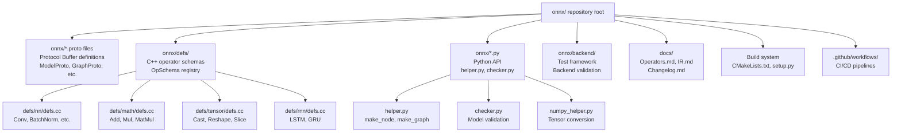
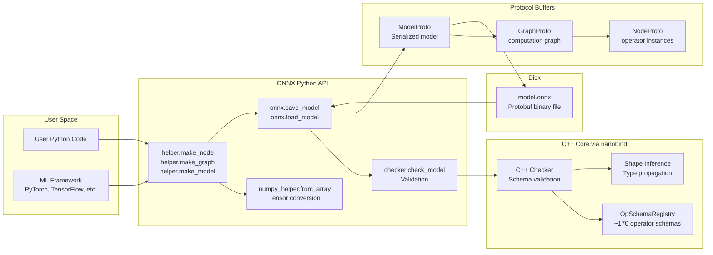
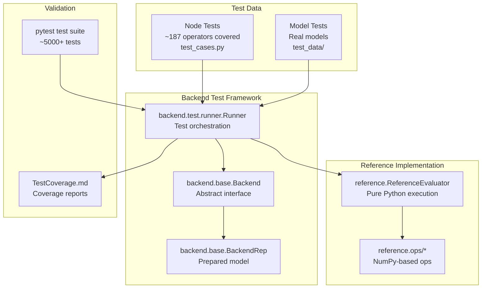

<!-- source: DeepWiki mcp.deepwiki.com · repo onnx/onnx · page 1 Introduction to ONNX · fetched 2026-10-21 -->

# Introduction to ONNX

<details>
<summary>Relevant source files</summary>

The following files were used as context for generating this wiki page:

- [.github/workflows/main.yml](.github/workflows/main.yml)
- [CMakeLists.txt](CMakeLists.txt)
- [README.md](README.md)
- [VERSION_NUMBER](VERSION_NUMBER)
- [cmake/ONNXConfig.cmake.in](cmake/ONNXConfig.cmake.in)
- [cmake/Utils.cmake](cmake/Utils.cmake)
- [cmake/external/googletest.cmake](cmake/external/googletest.cmake)
- [cmake/summary.cmake](cmake/summary.cmake)
- [cmake/unittest.cmake](cmake/unittest.cmake)
- [docs/Changelog.md](docs/Changelog.md)
- [docs/IR.md](docs/IR.md)
- [docs/ImplementingAnOnnxBackend.md](docs/ImplementingAnOnnxBackend.md)
- [docs/OnnxBackendTest.md](docs/OnnxBackendTest.md)
- [docs/OnnxReleases.md](docs/OnnxReleases.md)
- [docs/Operators.md](docs/Operators.md)
- [docs/TestCoverage.md](docs/TestCoverage.md)
- [docs/Versioning.md](docs/Versioning.md)
- [onnx/backend/test/case/node/cast.py](onnx/backend/test/case/node/cast.py)
- [onnx/backend/test/case/node/castlike.py](onnx/backend/test/case/node/castlike.py)
- [onnx/common/version.h](onnx/common/version.h)
- [onnx/defs/controlflow/defs.cc](onnx/defs/controlflow/defs.cc)
- [onnx/defs/controlflow/old.cc](onnx/defs/controlflow/old.cc)
- [onnx/defs/data_type_utils.cc](onnx/defs/data_type_utils.cc)
- [onnx/defs/data_type_utils.h](onnx/defs/data_type_utils.h)
- [onnx/defs/math/defs.cc](onnx/defs/math/defs.cc)
- [onnx/defs/math/old.cc](onnx/defs/math/old.cc)
- [onnx/defs/nn/defs.cc](onnx/defs/nn/defs.cc)
- [onnx/defs/nn/old.cc](onnx/defs/nn/old.cc)
- [onnx/defs/operator_sets.h](onnx/defs/operator_sets.h)
- [onnx/defs/reduction/defs.cc](onnx/defs/reduction/defs.cc)
- [onnx/defs/rnn/defs.cc](onnx/defs/rnn/defs.cc)
- [onnx/defs/rnn/old.cc](onnx/defs/rnn/old.cc)
- [onnx/defs/tensor/defs.cc](onnx/defs/tensor/defs.cc)
- [onnx/defs/tensor/old.cc](onnx/defs/tensor/old.cc)
- [onnx/gen_proto.py](onnx/gen_proto.py)
- [onnx/helper.py](onnx/helper.py)
- [onnx/numpy_helper.py](onnx/numpy_helper.py)
- [onnx/onnx-ml.proto](onnx/onnx-ml.proto)
- [onnx/onnx-ml.proto3](onnx/onnx-ml.proto3)
- [onnx/onnx.in.proto](onnx/onnx.in.proto)
- [onnx/onnx.proto](onnx/onnx.proto)
- [onnx/onnx.proto3](onnx/onnx.proto3)
- [onnx/reference/ops/op_range.py](onnx/reference/ops/op_range.py)
- [onnx/test/cmake/CMakeLists.txt](onnx/test/cmake/CMakeLists.txt)
- [onnx/test/cmake/main.cc](onnx/test/cmake/main.cc)
- [onnx/test/cpp/checker_test.cc](onnx/test/cpp/checker_test.cc)
- [onnx/test/cpp/function_get_test.cc](onnx/test/cpp/function_get_test.cc)
- [onnx/test/cpp/test_main.cc](onnx/test/cpp/test_main.cc)
- [onnx/test/helper_test.py](onnx/test/helper_test.py)
- [onnx/test/numpy_helper_test.py](onnx/test/numpy_helper_test.py)
- [onnx/test/shape_inference_test.py](onnx/test/shape_inference_test.py)
- [setup.py](setup.py)
- [workflow_scripts/protobuf/build_protobuf_unix.sh](workflow_scripts/protobuf/build_protobuf_unix.sh)
- [workflow_scripts/protobuf/build_protobuf_win.ps1](workflow_scripts/protobuf/build_protobuf_win.ps1)

</details>


## Purpose and Scope

This document provides a high-level introduction to ONNX (Open Neural Network Exchange) and the structure of this repository located at https://github.com/onnx/onnx. It explains what ONNX is, the key components that make up the codebase, and how they fit together to enable neural network model interchange.

This page focuses on the overall architecture and orientation. For installation instructions and first steps, see [Getting Started with ONNX](#1.1). For detailed explanations of core terminology like models, graphs, and operators, see [Core Concepts and Terminology](#1.2).

**Sources:** [README.md:1-122](), [docs/IR.md:1-50]()

## What is ONNX?

ONNX is an open source format for representing machine learning models. It provides:

1. **An extensible computation graph model** - defines how neural networks are represented as directed graphs
2. **Standard data types** - defines tensors, sequences, maps, and other data structures  
3. **Built-in operators** - defines ~170 standard operators (e.g., Conv, MatMul, Add) across two domains:
   - `ai.onnx` - Standard operators for deep learning (currently at opset version 26)
   - `ai.onnx.ml` - Traditional machine learning operators (currently at opset version 5)

The ONNX format enables interoperability between different ML frameworks. Models can be trained in one framework (e.g., PyTorch) and exported to ONNX for inference in another runtime (e.g., ONNX Runtime, TensorRT).

**Sources:** [README.md:17-21](), [docs/IR.md:27-36](), [docs/Operators.md:11-215]()

## Repository Organization



**Sources:** [README.md:24-52](), [CMakeLists.txt:1-560](), [onnx/defs/tensor/defs.cc:1-20](), [onnx/defs/math/defs.cc:1-20](), [onnx/defs/nn/defs.cc:1-20]()

## Core System Components

The ONNX repository consists of several major systems that work together:

### Protocol Buffer Layer (Serialization Format)

| Component | File Path | Purpose |
|-----------|-----------|---------|
| Base Protocol Definition | [onnx/onnx.in.proto:1-800]() | Template for generating protocol buffers |
| Generated Protocols | [onnx/onnx.proto:1-1000](), [onnx/onnx-ml.proto:1-1000]() | Generated protobuf files (ML vs non-ML variants) |
| Generator Script | [onnx/gen_proto.py]() | Generates .proto files with conditional compilation |
| Key Message Types | `ModelProto`, `GraphProto`, `NodeProto`, `TensorProto` | Core data structures in protobuf |

The protobuf definitions are the canonical serialization format. Models on disk are serialized `ModelProto` messages.

### C++ Core (Operator Registry and Schema System)

| Component | File Path | Purpose |
|-----------|-----------|---------|
| OpSchema Class | [onnx/defs/schema.h]() | Defines operator signature, types, inference functions |
| Operator Definitions | [onnx/defs/*/defs.cc:*-*]() | ~170 operator schemas defined via `ONNX_OPERATOR_SET_SCHEMA` macro |
| Schema Registry | [onnx/defs/operator_sets.h:1-100]() | Global registry of all operator schemas by domain/version |
| Shape Inference | [onnx/shape_inference/*.cc]() | Type and shape propagation system |
| Checker | [onnx/checker.cc]() | Validates models against schema rules |

Each operator is defined using the `ONNX_OPERATOR_SET_SCHEMA` macro which registers an `OpSchema` with inputs, outputs, type constraints, and inference functions.

### Python API (User-Facing Interface)

| Component | File Path | Purpose |
|-----------|-----------|---------|
| Public API | [onnx/__init__.py]() | Top-level exports: `load_model`, `save_model`, `checker.check_model` |
| Helper Functions | [onnx/helper.py:135-700]() | `make_node`, `make_graph`, `make_model`, `make_tensor` |
| Type Conversion | [onnx/numpy_helper.py:1-500]() | `from_array`, `to_array` - NumPy ↔ TensorProto |
| Checker | [onnx/checker.py]() | Python wrapper around C++ validation |
| C++ Bindings | [onnx/cpp2py_export.cc]() | nanobind exports C++ functionality to Python |

The Python API provides both model construction (via `helper.py`) and model manipulation (loading, saving, checking).

### Build System

| Component | File Path | Purpose |
|-----------|-----------|---------|
| CMake Build | [CMakeLists.txt:1-560]() | C++ compilation, protoc invocation, library creation |
| Python Setup | [setup.py:1-400]() | Python package building, wheel creation, dependency management |
| Protocol Generation | [CMakeLists.txt:304-395]() | `RELATIVE_PROTOBUF_GENERATE_CPP` function generates C++/Python from .proto |
| Conditional Compilation | `ONNX_ML`, `ONNX_NAMESPACE` | Environment variables control build variants |

The build system generates protocol buffer code, compiles C++ libraries (`onnx`, `onnx_proto`), and creates Python bindings (`onnx_cpp2py_export`).

**Sources:** [CMakeLists.txt:1-560](), [setup.py:1-300](), [onnx/onnx.proto:1-100](), [onnx/helper.py:1-200](), [onnx/defs/schema.h]()

## System Architecture: From User Code to ONNX Format



**Workflow Description:**

1. **Model Construction**: Users call `helper.make_node()`, `helper.make_graph()`, and `helper.make_model()` to construct ONNX models programmatically, or export from frameworks like PyTorch.

2. **Tensor Conversion**: NumPy arrays are converted to `TensorProto` messages via `numpy_helper.from_array()`.

3. **Validation**: `checker.check_model()` validates the model against operator schemas in `OpSchemaRegistry`, checking types, shapes, and constraints.

4. **Serialization**: `onnx.save_model()` serializes the in-memory `ModelProto` to a `.onnx` file on disk.

5. **Deserialization**: `onnx.load_model()` reads a `.onnx` file and reconstructs the `ModelProto` in memory.

**Sources:** [onnx/helper.py:135-500](), [onnx/__init__.py](), [onnx/numpy_helper.py:1-300](), [onnx/checker.py](), [onnx/cpp2py_export.cc]()

## Key Code Entities and Entry Points

### For Model Creation

```python
# Entry point: onnx.helper module
import onnx
from onnx import helper, TensorProto

# Create a node (operator instance)
node = helper.make_node(
    'Conv',  # op_type from OpSchema registry
    inputs=['X', 'W'],
    outputs=['Y'],
    kernel_shape=[3, 3]
)

# Create a graph
graph = helper.make_graph(
    [node],
    'simple_graph',
    inputs=[...],
    outputs=[...]
)

# Create a model
model = helper.make_model(graph, producer_name='example')
```

- `helper.make_node()` creates `NodeProto` messages - [onnx/helper.py:135-200]()
- `helper.make_graph()` creates `GraphProto` messages - [onnx/helper.py:250-350]()
- `helper.make_model()` creates `ModelProto` messages - [onnx/helper.py:400-500]()

### For Model Validation

```python
# Entry point: onnx.checker module
import onnx

model = onnx.load_model('model.onnx')
onnx.checker.check_model(model)  # Validates against schemas
```

- `checker.check_model()` - Python wrapper - [onnx/checker.py]()
- C++ `check_model()` - Core validation - [onnx/checker.cc]()
- Uses `OpSchemaRegistry::Schema()` to look up operator definitions

### For Operator Definition (C++ Development)

```cpp
// Entry point: ONNX_OPERATOR_SET_SCHEMA macro
// Example from onnx/defs/math/defs.cc

ONNX_OPERATOR_SET_SCHEMA(
    Add,
    14,
    OpSchema()
        .SetDoc("Performs element-wise binary addition...")
        .Input(0, "A", "First operand.", "T")
        .Input(1, "B", "Second operand.", "T")
        .Output(0, "C", "Result", "T")
        .TypeConstraint("T", OpSchema::all_numeric_types_ir4(), "...")
        .TypeAndShapeInferenceFunction([](InferenceContext& ctx) {
            // Shape inference logic
        })
);
```

- Defined in [onnx/defs/math/defs.cc:100-110]()
- Registers into `OpSchemaRegistry` - [onnx/defs/operator_sets.h:1-100]()
- `OpSchema` class - [onnx/defs/schema.h]()

**Sources:** [onnx/helper.py:135-700](), [onnx/checker.py](), [onnx/defs/math/defs.cc:100-170](), [onnx/defs/schema.h]()

## Documentation and Specification

| Document | Location | Content |
|----------|----------|---------|
| IR Specification | [docs/IR.md:1-1000]() | Normative semantics of ONNX format |
| Operator Documentation | [docs/Operators.md:1-150000]() | Auto-generated from `OpSchema` definitions |
| ML Operator Documentation | [docs/Operators-ml.md]() | Traditional ML operators (TreeEnsemble, SVM, etc.) |
| Changelog | [docs/Changelog.md:1-100000]() | Version history of all operators |
| Versioning | [docs/Versioning.md:1-500]() | Opset version strategy and IR versioning |

The operator documentation is **automatically generated** from C++ operator schemas using [onnx/defs/gen_doc.py](). When operator schemas change, running this script updates the Markdown documentation.

**Sources:** [docs/Operators.md:1-10](), [docs/IR.md:1-50](), [docs/Versioning.md:1-100]()

## Testing and Validation



The backend test framework (`onnx/backend/test/`) allows any ONNX runtime to validate its implementation by running standardized test cases against the abstract `Backend` interface.

**Sources:** [onnx/backend/test/runner/__init__.py](), [onnx/backend/base.py](), [docs/TestCoverage.md:1-100](), [README.md:96-108]()

## Version Information

Current ONNX Version: **1.22.0** (from [VERSION_NUMBER:1]())

| Component | Version |
|-----------|---------|
| IR Version | 13 |
| ai.onnx Opset | 26 |
| ai.onnx.ml Opset | 5 |
| Supported Python | 3.10 - 3.14 (including free-threaded 3.13t, 3.14t) |

Version mapping is defined in [onnx/helper.py:46-80]() (`VERSION_TABLE`). This table maps release versions to IR versions and opset versions for each domain.

**Sources:** [VERSION_NUMBER:1](), [onnx/helper.py:46-80](), [docs/Versioning.md:1-200]()

## Build Variants and Configuration

The ONNX build supports multiple configurations controlled by environment variables and CMake options:

| Variable | Values | Effect |
|----------|--------|--------|
| `ONNX_ML` | 0 or 1 (default: 1) | Enable/disable traditional ML operators (ai.onnx.ml domain) |
| `ONNX_NAMESPACE` | string (default: "onnx") | C++ namespace for generated code |
| `ONNX_USE_LITE_PROTO` | 0 or 1 | Use protobuf-lite instead of full protobuf |
| `ONNX_VERIFY_PROTO3` | 0 or 1 | Verify proto3 compatibility |
| `ONNX_BUILD_TESTS` | 0 or 1 | Build C++ test suite |
| `ONNX_HARDENING` | 0 or 1 | Enable compiler hardening flags |

These are read by [CMakeLists.txt:63-79]() and [setup.py:42-53]() to conditionally compile different features.

**Sources:** [CMakeLists.txt:63-79](), [setup.py:42-53](), [README.md:79-122]()

## Navigating This Wiki

This wiki is organized into several major sections:

- **Section 1 (Introduction)**: You are here. See [Getting Started](#1.1) for installation and [Core Concepts](#1.2) for terminology.
- **Section 2 (Model Representation)**: Protocol buffer schema, IR structure, and model format details.
- **Section 3 (Operator System)**: The ~170 operator definitions, schema registry, and shape inference.
- **Section 4 (Python API)**: Helper functions, validation, I/O, and model manipulation.
- **Section 5 (Testing)**: Backend test framework for validating ONNX runtimes.
- **Section 6 (Build System)**: CMake configuration, protobuf generation, and Python packaging.
- **Section 7 (CI/CD)**: Continuous integration, release process, and quality automation.
- **Section 8 (Developer Guide)**: How to add new operators, contribute, and generate documentation.

Each section provides progressively more detail about specific subsystems.

**Sources:** Table of Contents provided in context

---

