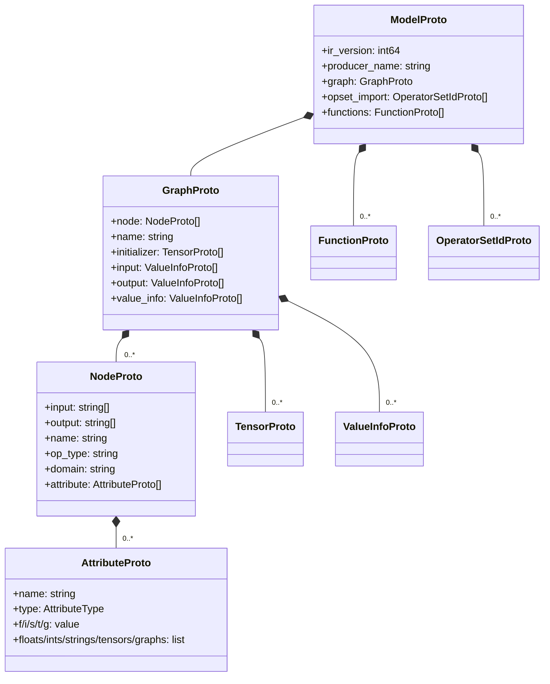
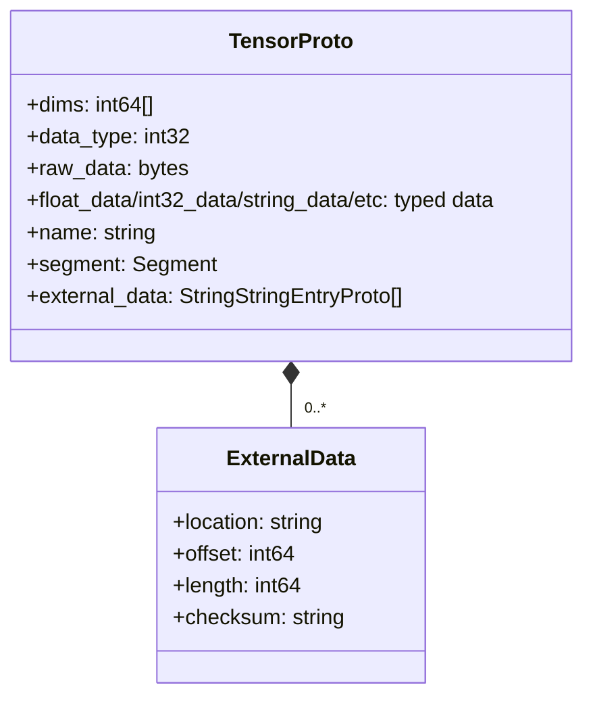
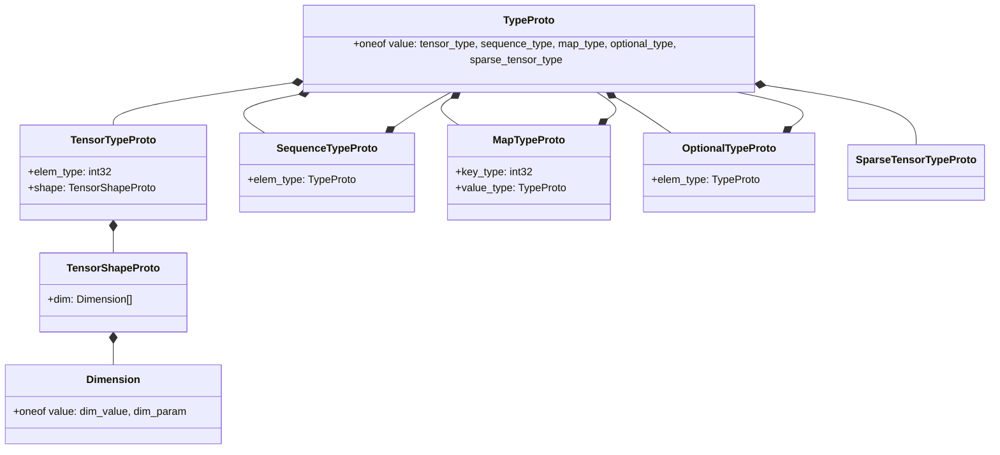
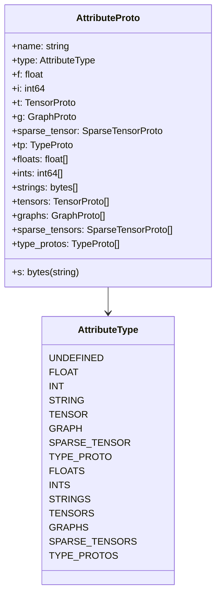
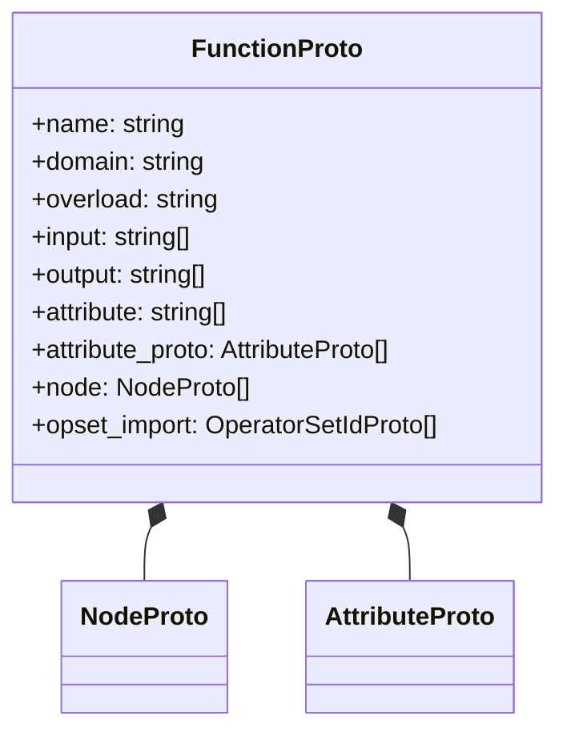
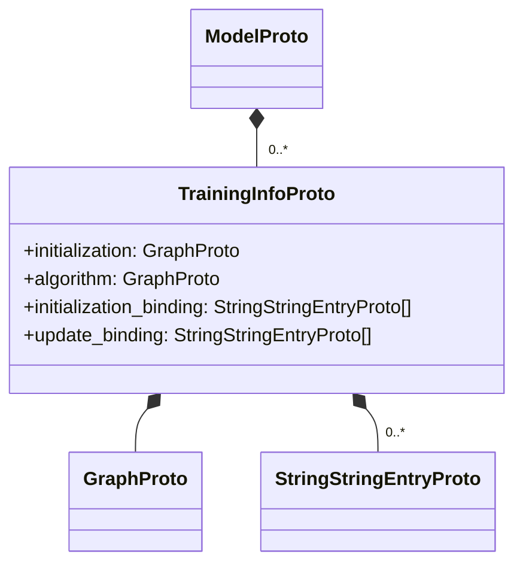

<!-- source: DeepWiki mcp.deepwiki.com · repo onnx/onnx · page 1.2 Core Concepts and Terminology · fetched 2026-10-21 -->

# Core Concepts and Terminology

Relevant source files

The following files were used as context for generating this wiki page:

- [VERSION_NUMBER](VERSION_NUMBER)
- [docs/Changelog.md](docs/Changelog.md)
- [docs/IR.md](docs/IR.md)
- [docs/OnnxReleases.md](docs/OnnxReleases.md)
- [docs/Operators.md](docs/Operators.md)
- [docs/TestCoverage.md](docs/TestCoverage.md)
- [docs/Versioning.md](docs/Versioning.md)
- [onnx/backend/test/case/node/cast.py](onnx/backend/test/case/node/cast.py)
- [onnx/backend/test/case/node/castlike.py](onnx/backend/test/case/node/castlike.py)
- [onnx/checker.cc](onnx/checker.cc)
- [onnx/checker.h](onnx/checker.h)
- [onnx/common/model_helpers.cc](onnx/common/model_helpers.cc)
- [onnx/common/status.cc](onnx/common/status.cc)
- [onnx/common/status.h](onnx/common/status.h)
- [onnx/common/version.h](onnx/common/version.h)
- [onnx/cpp2py_export.cc](onnx/cpp2py_export.cc)
- [onnx/defs/controlflow/defs.cc](onnx/defs/controlflow/defs.cc)
- [onnx/defs/controlflow/old.cc](onnx/defs/controlflow/old.cc)
- [onnx/defs/data_type_utils.cc](onnx/defs/data_type_utils.cc)
- [onnx/defs/data_type_utils.h](onnx/defs/data_type_utils.h)
- [onnx/defs/function.cc](onnx/defs/function.cc)
- [onnx/defs/function.h](onnx/defs/function.h)
- [onnx/defs/math/defs.cc](onnx/defs/math/defs.cc)
- [onnx/defs/math/old.cc](onnx/defs/math/old.cc)
- [onnx/defs/nn/defs.cc](onnx/defs/nn/defs.cc)
- [onnx/defs/nn/old.cc](onnx/defs/nn/old.cc)
- [onnx/defs/operator_sets.h](onnx/defs/operator_sets.h)
- [onnx/defs/reduction/defs.cc](onnx/defs/reduction/defs.cc)
- [onnx/defs/rnn/defs.cc](onnx/defs/rnn/defs.cc)
- [onnx/defs/rnn/old.cc](onnx/defs/rnn/old.cc)
- [onnx/defs/schema.cc](onnx/defs/schema.cc)
- [onnx/defs/schema.h](onnx/defs/schema.h)
- [onnx/defs/shape_inference.cc](onnx/defs/shape_inference.cc)
- [onnx/defs/shape_inference.h](onnx/defs/shape_inference.h)
- [onnx/defs/tensor/defs.cc](onnx/defs/tensor/defs.cc)
- [onnx/defs/tensor/old.cc](onnx/defs/tensor/old.cc)
- [onnx/helper.py](onnx/helper.py)
- [onnx/numpy_helper.py](onnx/numpy_helper.py)
- [onnx/onnx-ml.proto](onnx/onnx-ml.proto)
- [onnx/onnx-ml.proto3](onnx/onnx-ml.proto3)
- [onnx/onnx.in.proto](onnx/onnx.in.proto)
- [onnx/onnx.proto](onnx/onnx.proto)
- [onnx/onnx.proto3](onnx/onnx.proto3)
- [onnx/reference/ops/op_range.py](onnx/reference/ops/op_range.py)
- [onnx/shape_inference/implementation.cc](onnx/shape_inference/implementation.cc)
- [onnx/shape_inference/implementation.h](onnx/shape_inference/implementation.h)
- [onnx/test/helper_test.py](onnx/test/helper_test.py)
- [onnx/test/numpy_helper_test.py](onnx/test/numpy_helper_test.py)
- [onnx/test/shape_inference_test.py](onnx/test/shape_inference_test.py)

This document explains the fundamental concepts and terminology used in the ONNX framework. It provides an overview of the core components that make up the ONNX Intermediate Representation (IR) and how they relate to each other. For information about working with ONNX models programmatically, see [Python API](#5).

## ONNX Intermediate Representation (IR)

The ONNX Intermediate Representation (IR) is the foundation of ONNX, providing a standard format for representing deep learning and machine learning models. The IR consists of three core components:

1. **An extensible computation graph model**
2. **Definitions of standard data types**
3. **Definitions of built-in operators**

The IR is designed to be both framework-agnostic and hardware-agnostic, allowing models to be exchanged between different frameworks and deployed on various hardware platforms.

Sources: [docs/IR.md:8-35](). [onnx/onnx.proto:15-23]().

## Model Hierarchy

ONNX models follow a hierarchical structure with three primary components:

### ModelProto

The `ModelProto` is the top-level container for an ONNX model. It includes:

- **ir_version**: The version of the ONNX IR used by the model
- **opset_import**: The operator sets imported by the model
- **producer_name/producer_version**: The tool/framework that generated the model
- **domain**: The model namespace (typically using reverse domain name)
- **model_version**: The version of the model
- **graph**: The main computational graph
- **functions**: Model-local function definitions
- **metadata_props**: Additional metadata as key-value pairs

Sources: [onnx/onnx.proto:438-514](). [docs/IR.md:70-89]().

### GraphProto

The `GraphProto` represents a computation graph and includes:

- **node**: A list of nodes (the operations in the graph), sorted topologically
- **name**: The name of the graph
- **initializer**: Named tensor values used as constants
- **input**: The input parameters of the graph
- **output**: The output parameters of the graph
- **value_info**: Type and shape information for values

Sources: [onnx/onnx.proto:553-589](). [docs/IR.md:224-240]().

### NodeProto

The `NodeProto` represents a computation node (operation) in the graph:

- **input**: Names of the values used as inputs
- **output**: Names of the outputs produced by this node
- **name**: An optional identifier for the node
- **op_type**: The symbolic identifier of the operator to execute
- **domain**: The domain of the operator set (default is "ai.onnx")
- **attribute**: Named attributes that configure the operator

Sources: [onnx/onnx.proto:205-237](). [docs/IR.md:278-297]().

## Values and Tensors

### Value Representation

In ONNX, values are represented by their names in the graph, and their types and shapes are defined separately. Values can be graph inputs, outputs, initializers, or intermediate results produced by nodes.

The `ValueInfoProto` provides information about a value:
- **name**: The name of the value
- **type**: The type information, including shape for tensors
- **doc_string**: Optional documentation

Sources: [onnx/onnx.proto:193-204](). [docs/IR.md:241-249]().

### Tensors

Tensors are the primary data container in ONNX:

A `TensorProto` includes:
- **dims**: The shape of the tensor
- **data_type**: The data type (FLOAT, INT32, etc.)
- **raw_data/\*_data**: The actual data values
- **name**: An optional name
- **external_data**: For tensors stored externally

Sources: [onnx/onnx.proto:596-764](). [docs/IR.md:398-417]().

## Data Types

ONNX supports various data types for tensors and other values:

| Category | Types | Description |
|----------|-------|-------------|
| Floating Point | float16, float32, float64, bfloat16, float8e4m3fn, etc. | IEEE 754-2008 floating-point values |
| Integer | int4, int8, int16, int32, int64, uint4, uint8, uint16, uint32, uint64 | Signed and unsigned integers of various sizes |
| String | string | UTF-8 strings |
| Boolean | bool | Boolean values |
| Complex | complex64, complex128 | Complex numbers with float32/float64 components |
| Other | | Sequences, maps, optional types, sparse tensors |

Sources: [onnx/onnx.proto:597-642](). [docs/IR.md:423-426]().

## Type System

ONNX has a rich type system that extends beyond simple tensor types:

This type system allows representing:
- **Tensor types**: Multidimensional arrays with a specific element type
- **Sequence types**: Sequences of elements of a specific type
- **Map types**: Key-value mappings
- **Optional types**: Values that may be present or absent
- **Sparse tensor types**: Memory-efficient representation of tensors with many zeros

Sources: [onnx/onnx.proto:812-856](). [docs/IR.md:388-394]().

## Operators and Attributes

### Operators

Operators define the computations performed in an ONNX graph. Each operator:
- Has an `op_type` (e.g., "Conv", "MatMul")
- Belongs to a `domain` (default is "ai.onnx")
- Takes inputs and produces outputs
- May have attributes that configure its behavior

Operators are defined in operator sets, which are imported by models using `opset_import`. Each operator set has a domain and version.

Sources: [docs/IR.md:158-170](). [onnx/onnx.proto:220-226]().

### Attributes

Attributes configure operators and may contain:

An `AttributeProto` includes:
- **name**: The name of the attribute
- **type**: The type of the attribute
- **value field**: One of various typed value fields (f, i, s, t, etc.)

Sources: [onnx/onnx.proto:126-189](). [docs/IR.md:325-351]().

## Functions

Functions allow defining complex operators in terms of more primitive ones:

A `FunctionProto`:
- Has a signature (inputs, outputs, attributes) like an operator
- Contains a body graph built from other operators
- Can be used as a fallback implementation for an operator
- Is uniquely identified by (domain, name, overload)

Sources: [docs/IR.md:178-222](). [onnx/onnx.proto:190-206]().

## Versioning

ONNX employs a comprehensive versioning system:

| Component | Description |
|-----------|-------------|
| IR Version | The version of the ONNX IR specification (e.g., IR_VERSION_2023_5_5) |
| Operator Set Version | The version of an operator set (identified by domain and version) |
| Model Version | The version of a specific model |
| Operator Version | The version of an operator within an operator set |

When new IR versions are released, they may introduce new features or changes:
- IR Version 7 added support for training models
- IR Version 8 added support for sparse tensors and optional types
- IR Version 9 added support for default attribute values in functions

Sources: [onnx/onnx.proto:50-118](). [docs/IR.md:49-61]().

## Training Information (Optional)

Starting from IR version 7, ONNX supports training models with `TrainingInfoProto`:

Training information includes:
- **initialization**: Graph for initializing model parameters
- **algorithm**: Graph for the training algorithm step
- **initialization_binding**: Binds initialization outputs to initializers
- **update_binding**: Binds algorithm outputs to update initializers

Sources: [onnx/onnx.proto:315-431](). [docs/IR.md:107-110]().

## Namespaces

Names in ONNX are organized into several namespaces, and within each namespace, names must be unique:

| Namespace | Description |
|-----------|-------------|
| Attribute | Names of attributes for a specific operator |
| Value | Names of values (node inputs/outputs, graph inputs/outputs) |
| Node | Names of graph nodes |
| Graph | Names of graphs within a domain |
| Operator | Names of operators within a domain |
| Shape | Names of tensor shape variables |

Sources: [docs/IR.md:262-276]().

## Serialization Format

ONNX models are serialized using Protocol Buffers (protobuf), which provides:
- A compact binary representation
- Compatibility between different languages
- A well-defined schema through `.proto` files

ONNX uses a subset of protobuf features that are compatible with both protobuf v2 and v3 to maximize framework compatibility.

Sources: [onnx/onnx.proto:9-12](). [docs/IR.md:32-43]().

---

