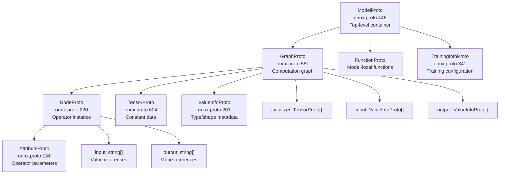
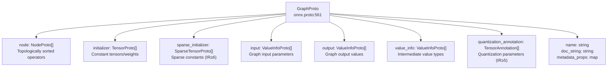
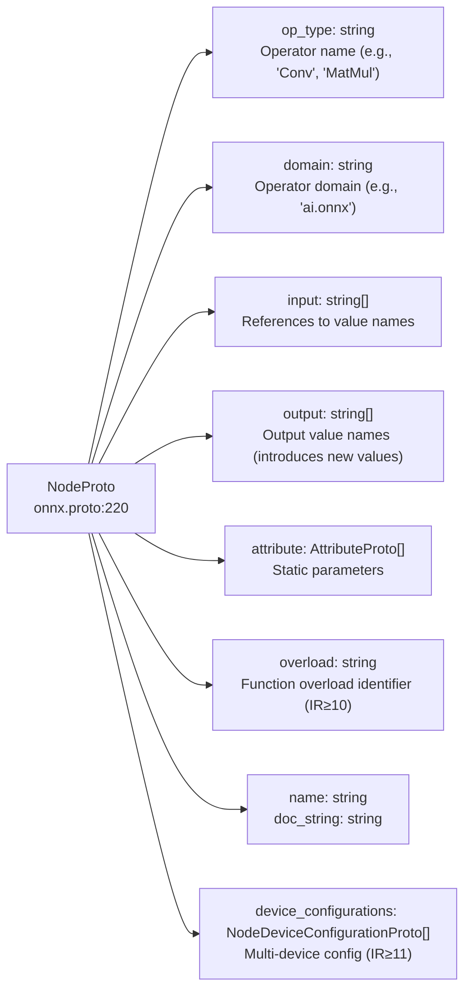
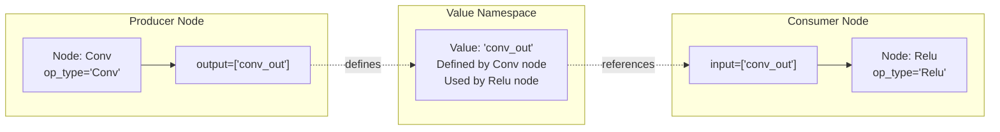
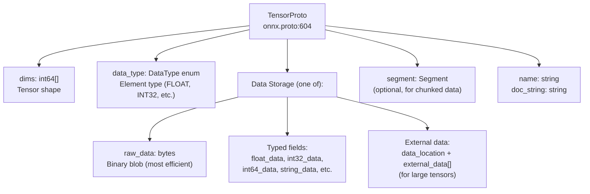
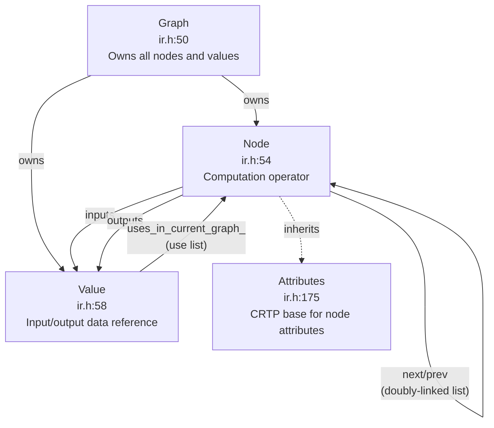
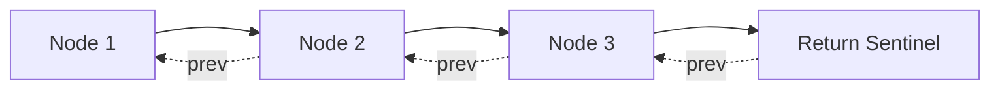
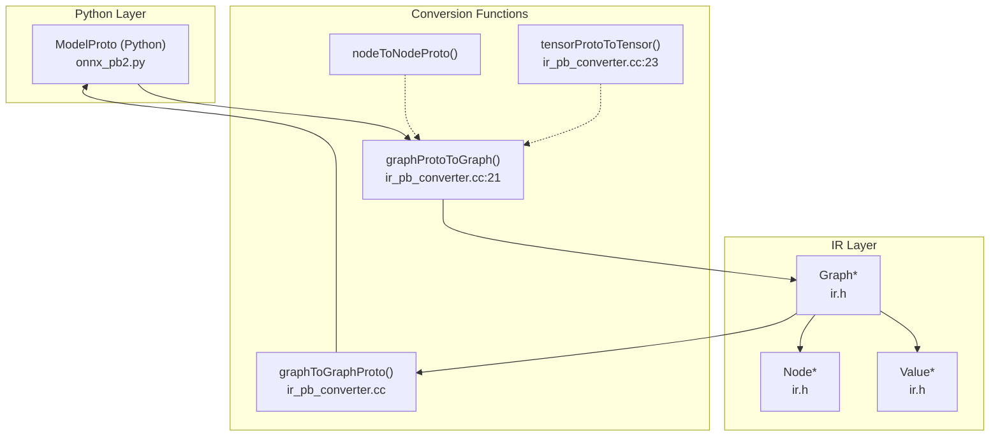
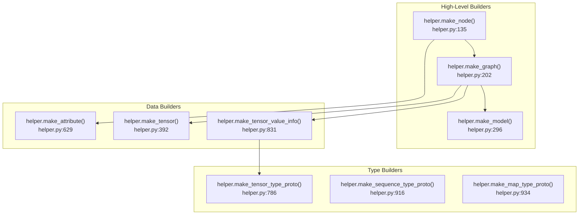

<!-- source: DeepWiki mcp.deepwiki.com · repo onnx/onnx · page 2 ONNX Model Representation · fetched 2026-10-21 -->

# ONNX Model Representation

<details>
<summary>Relevant source files</summary>

The following files were used as context for generating this wiki page:

- [VERSION_NUMBER](VERSION_NUMBER)
- [docs/IR.md](docs/IR.md)
- [docs/OnnxReleases.md](docs/OnnxReleases.md)
- [docs/Versioning.md](docs/Versioning.md)
- [onnx/common/assertions.cc](onnx/common/assertions.cc)
- [onnx/common/assertions.h](onnx/common/assertions.h)
- [onnx/common/graph_node_list.h](onnx/common/graph_node_list.h)
- [onnx/common/interned_strings.cc](onnx/common/interned_strings.cc)
- [onnx/common/ir.h](onnx/common/ir.h)
- [onnx/common/ir_pb_converter.cc](onnx/common/ir_pb_converter.cc)
- [onnx/common/ir_pb_converter.h](onnx/common/ir_pb_converter.h)
- [onnx/common/tensor.h](onnx/common/tensor.h)
- [onnx/common/version.h](onnx/common/version.h)
- [onnx/defs/data_type_utils.cc](onnx/defs/data_type_utils.cc)
- [onnx/defs/data_type_utils.h](onnx/defs/data_type_utils.h)
- [onnx/helper.py](onnx/helper.py)
- [onnx/numpy_helper.py](onnx/numpy_helper.py)
- [onnx/onnx-ml.proto](onnx/onnx-ml.proto)
- [onnx/onnx-ml.proto3](onnx/onnx-ml.proto3)
- [onnx/onnx.in.proto](onnx/onnx.in.proto)
- [onnx/onnx.proto](onnx/onnx.proto)
- [onnx/onnx.proto3](onnx/onnx.proto3)
- [onnx/reference/ops/op_range.py](onnx/reference/ops/op_range.py)
- [onnx/test/helper_test.py](onnx/test/helper_test.py)
- [onnx/test/numpy_helper_test.py](onnx/test/numpy_helper_test.py)

</details>


## Purpose and Scope

This document explains how ONNX models are represented in the system, covering both the serialized protobuf format used for storage and the in-memory intermediate representation (IR) used for manipulation. It provides an overview of the complete model structure, from the top-level `ModelProto` down to individual tensors and attributes.

For detailed information about specific components:
- For protobuf schema details, see [Protocol Buffer Schema](#2.1)
- For in-memory IR implementation, see [In-Memory IR (Intermediate Representation)](#2.2)
- For operator versioning mechanisms, see [Operator Versioning and Domains](#2.3)
- For model extensions like training and external data, see [Model Extensions and Features](#2.4)
- For operator definitions and schemas, see [ONNX Operator System](#3)
- For Python APIs to construct models, see [Python API](#4)

## Dual Representation Model

ONNX models exist in two parallel representations that serve different purposes:

1. **Serialized Protobuf Representation** - Used for storage, transmission, and interchange between frameworks
2. **In-Memory IR Representation** - Used for graph manipulation, optimization, and analysis

### Representation Duality Diagram

```mermaid
graph TB
    subgraph "Serialized Format (On Disk)"
        PBFile["ModelProto (.onnx file)<br/>onnx/onnx.proto"]
        PBClasses["Generated Protobuf Classes<br/>onnx_pb2.py, onnx.pb.h"]
    end
    
    subgraph "In-Memory Format (Runtime)"
        IRGraph["Graph Class<br/>onnx/common/ir.h:Graph"]
        IRNode["Node Class<br/>onnx/common/ir.h:Node"]
        IRValue["Value Class<br/>onnx/common/ir.h:Value"]
    end
    
    subgraph "Conversion Layer"
        ToGraph["graphProtoToGraph()<br/>ir_pb_converter.cc:21"]
        ToProto["graphToGraphProto()<br/>ir_pb_converter.cc"]
    end
    
    PBFile --> PBClasses
    PBClasses --> ToGraph
    ToGraph --> IRGraph
    IRGraph --> IRNode
    IRGraph --> IRValue
    
    IRGraph --> ToProto
    ToProto --> PBClasses
    PBClasses --> PBFile
```



**Sources:** [onnx/common/ir_pb_converter.cc:21](), [onnx/common/ir.h:50-58](), [onnx/onnx.proto:1-127]()

The protobuf representation is the canonical serialization format defined in `.proto` files, while the IR representation provides efficient graph manipulation capabilities. The conversion layer in `ir_pb_converter.cc` maintains bidirectional conversion between these formats.

## Model Hierarchy Structure

ONNX models follow a hierarchical structure where each level contains specific information about the computation graph.

### Complete Model Hierarchy



**Sources:** [onnx/onnx.proto:446-523](), [onnx/onnx.proto:561-599](), [onnx/onnx.proto:220-246](), [docs/IR.md:69-91]()

### Model Components Table

| Component | Type | Description | Location |
|-----------|------|-------------|----------|
| `ModelProto` | Message | Top-level model container with metadata and graph | [onnx.proto:446-523]() |
| `GraphProto` | Message | Computation graph with nodes, initializers, and I/O | [onnx.proto:561-599]() |
| `NodeProto` | Message | Individual operator invocation with inputs/outputs | [onnx.proto:220-246]() |
| `TensorProto` | Message | N-dimensional array with data and shape | [onnx.proto:604-859]() |
| `ValueInfoProto` | Message | Type and shape information for values | [onnx.proto:201-212]() |
| `AttributeProto` | Message | Static operator parameters (constants) | [onnx.proto:134-197]() |
| `FunctionProto` | Message | Model-local function definitions | [docs/IR.md:178-221]() |
| `TypeProto` | Message | Type specification for tensors, sequences, maps | [onnx.proto:1190-1294]() |

**Sources:** [onnx/onnx.proto:446-859](), [docs/IR.md:69-297]()

## ModelProto Structure

The `ModelProto` is the root object representing an entire ONNX model.

### ModelProto Fields

```mermaid
graph LR
    ModelProto["ModelProto"]
    
    ModelProto --> ir_version["ir_version: int64<br/>IR specification version"]
    ModelProto --> opset["opset_import: OperatorSetIdProto[]<br/>Required operator sets"]
    ModelProto --> producer["producer_name: string<br/>producer_version: string"]
    ModelProto --> domain_ver["domain: string<br/>model_version: int64"]
    ModelProto --> graph["graph: GraphProto<br/>Main computation graph"]
    ModelProto --> metadata["metadata_props: map<br/>Optional metadata"]
    ModelProto --> functions["functions: FunctionProto[]<br/>Model-local functions"]
    ModelProto --> training["training_info: TrainingInfoProto[]<br/>Training extensions"]
    ModelProto --> config["configuration: DeviceConfigurationProto[]<br/>Multi-device config (IR≥11)"]
```

**Sources:** [onnx/onnx.proto:446-523](), [docs/IR.md:69-91]()

### Version Information

ONNX models track three distinct version numbers:

| Version Type | Field | Description |
|--------------|-------|-------------|
| **IR Version** | `ir_version` | The version of ONNX IR specification (currently 13) |
| **Opset Version** | `opset_import[].version` | Version of operator sets imported by the model |
| **Model Version** | `model_version` | User-defined version of the trained model |

The IR version is defined as an enum in the proto file, with the current version being `IR_VERSION = 0x000000000000000D` (13).

**Sources:** [onnx/onnx.proto:50-126](), [onnx/helper.py:46-80](), [docs/Versioning.md:1-60]()

The `VERSION_TABLE` in `helper.py` maps release versions to IR versions and opset versions:

```python
# Example from helper.py:46-80
VERSION_TABLE = [
    ("1.0", 3, 1, 1),           # Release, IR, ai.onnx, ai.onnx.ml
    ("1.21.0", 13, 26, 5, 1),   # Latest: IR=13, opset=26
]
```

**Sources:** [onnx/helper.py:46-80](), [onnx/common/version.h:10]()

## GraphProto Structure

The `GraphProto` represents a computation graph as a Directed Acyclic Graph (DAG) of nodes.

### GraphProto Components



**Sources:** [onnx/onnx.proto:561-599](), [docs/IR.md:222-260]()

### Graph Semantics

Key constraints on graphs:

1. **Topological Order**: Nodes MUST be in topological order - a node's inputs must be defined before the node appears
2. **Single Static Assignment (SSA)**: All node output names MUST be unique within a graph
3. **Acyclic**: Node dependencies MUST NOT create cycles
4. **Initializers**: Can share names with graph inputs to provide default values

**Sources:** [docs/IR.md:257-316]()

## NodeProto Structure

A `NodeProto` represents a single operator invocation in the computation graph.

### NodeProto Anatomy



**Sources:** [onnx/onnx.proto:220-246](), [docs/IR.md:278-316]()

### Node Input/Output Model

Nodes connect to each other through named values:



**Sources:** [docs/IR.md:299-310](), [onnx/onnx.proto:221-222]()

## TensorProto Structure

The `TensorProto` message stores multi-dimensional arrays used as constants (initializers) or external data references.

### TensorProto Data Storage



**Sources:** [onnx/onnx.proto:604-859](), [onnx/numpy_helper.py:172-252]()

### TensorProto Data Types

ONNX supports a comprehensive set of data types defined in `TensorProto.DataType` enum:

| Category | Types |
|----------|-------|
| **Floating Point** | FLOAT, DOUBLE, FLOAT16, BFLOAT16 |
| **8-bit Floats** | FLOAT8E4M3FN, FLOAT8E4M3FNUZ, FLOAT8E5M2, FLOAT8E5M2FNUZ, FLOAT8E8M0 (IR≥12) |
| **4-bit Floats** | FLOAT4E2M1 (IR≥11) |
| **Integers** | INT8, INT16, INT32, INT64, UINT8, UINT16, UINT32, UINT64 |
| **Sub-byte Integers** | INT2, UINT2 (IR≥13), INT4, UINT4 (IR≥10) |
| **Complex** | COMPLEX64, COMPLEX128 |
| **Other** | STRING, BOOL |

**Sources:** [onnx/onnx.proto:605-660](), [docs/IR.md:50-126]()

Sub-byte types (2-bit, 4-bit) are packed into bytes with specific bit-packing conventions defined in the specification.

**Sources:** [onnx/helper.py:364-390](), [onnx/numpy_helper.py:95-169]()

## In-Memory IR Representation

The C++ in-memory IR provides an efficient graph representation for manipulation and optimization.

### IR Class Hierarchy



**Sources:** [onnx/common/ir.h:46-58](), [onnx/common/ir.h:175-274]()

### Key IR Classes

| Class | File Location | Purpose |
|-------|---------------|---------|
| `Graph` | [ir.h:737-1159]() | Owns all nodes and values; maintains topological order |
| `Node` | [ir.h:399-735]() | Represents operator invocation; maintains attributes |
| `Value` | [ir.h:296-397]() | Represents data flowing between nodes; tracks uses |
| `Attributes<T>` | [ir.h:175-274]() | CRTP base providing attribute accessors |
| `Tensor` | [tensor.h:22-157]() | Stores tensor data in IR |
| `Dimension` | [ir.h:75-84]() | Represents symbolic or concrete dimension |

**Sources:** [onnx/common/ir.h:46-1159](), [onnx/common/tensor.h:22-157]()

### Graph Ownership Model

The IR uses a simple ownership model:

1. **Graph** owns all `Node` and `Value` objects
2. Nodes are stored in a doubly-linked intrusive list maintaining topological order
3. Values track their uses through a `uses_in_current_graph_` list
4. All pointers within the graph are raw pointers (no shared_ptr)
5. Destroying the Graph invalidates all Node and Value pointers

**Sources:** [onnx/common/ir.h:46-50]()

### Topological Order Maintenance

Nodes maintain topological invariants through linked list operations:



Methods like `insertBefore()`, `insertAfter()`, `moveBefore()`, and `moveAfter()` maintain the topological sort invariant.

**Sources:** [onnx/common/ir.h:575-697]()

## Protobuf-IR Conversion

The conversion layer provides bidirectional mapping between protobuf and IR representations.

### Conversion Architecture



**Sources:** [onnx/common/ir_pb_converter.cc:1-780](), [onnx/common/ir_pb_converter.h:15-43]()

### Conversion Functions

| Function | Signature | Purpose |
|----------|-----------|---------|
| `graphProtoToGraph` | `GraphProto → unique_ptr<Graph>` | Convert protobuf graph to IR |
| `graphToGraphProto` | `Graph* → GraphProto` | Convert IR graph to protobuf |
| `tensorProtoToTensor` | `TensorProto → Tensor` | Convert tensor representation |
| `attributeProtoToNode` | `AttributeProto → Node attr` | Extract node attributes |

**Sources:** [onnx/common/ir_pb_converter.cc:21-780](), [onnx/common/ir_pb_converter.h:15-43]()

The conversion maintains:
- Topological order of nodes
- SSA property of value names  
- Attribute data and types
- Tensor data (with format-specific handling)
- Graph metadata

## Python Helper API

The Python `helper` module provides high-level functions for constructing ONNX models programmatically.

### Model Construction Functions



**Sources:** [onnx/helper.py:135-957]()

### Core Helper Functions Table

| Function | Purpose | Returns |
|----------|---------|---------|
| `make_model(graph, **kwargs)` | Create ModelProto from graph | `ModelProto` |
| `make_graph(nodes, name, inputs, outputs, ...)` | Create GraphProto | `GraphProto` |
| `make_node(op_type, inputs, outputs, **attrs)` | Create NodeProto | `NodeProto` |
| `make_tensor(name, data_type, dims, vals, raw=False)` | Create TensorProto | `TensorProto` |
| `make_tensor_value_info(name, elem_type, shape)` | Create ValueInfoProto | `ValueInfoProto` |
| `make_attribute(key, value, doc_string=None)` | Create AttributeProto | `AttributeProto` |
| `make_tensor_type_proto(elem_type, shape)` | Create TypeProto for tensor | `TypeProto` |

**Sources:** [onnx/helper.py:135-957]()

### Example Usage Pattern

```python
# From helper.py usage pattern
import onnx
from onnx import helper, TensorProto

# Create nodes
node1 = helper.make_node('Relu', ['X'], ['Y'])
node2 = helper.make_node('Add', ['Y', 'Z'], ['Out'])

# Create graph
graph = helper.make_graph(
    [node1, node2],
    'example_graph',
    [helper.make_tensor_value_info('X', TensorProto.FLOAT, [1, 2])],
    [helper.make_tensor_value_info('Out', TensorProto.FLOAT, [1, 2])]
)

# Create model
model = helper.make_model(graph, producer_name='example')
```

**Sources:** [onnx/helper.py:135-329](), [onnx/test/helper_test.py:321-394]()

## Numpy Integration

The `numpy_helper` module provides conversion between ONNX tensors and NumPy arrays.

### Numpy Conversion Functions

| Function | Signature | Purpose |
|----------|-----------|---------|
| `to_array(tensor, base_dir="")` | `TensorProto → ndarray` | Convert ONNX tensor to NumPy |
| `from_array(arr, name=None)` | `ndarray → TensorProto` | Convert NumPy to ONNX tensor |
| `to_list(sequence)` | `SequenceProto → list` | Convert ONNX sequence |
| `from_list(lst, name=None, dtype=None)` | `list → SequenceProto` | Create ONNX sequence |
| `to_dict(map_proto)` | `MapProto → dict` | Convert ONNX map |
| `from_dict(dict, name=None)` | `dict → MapProto` | Create ONNX map |

**Sources:** [onnx/numpy_helper.py:172-252](), [onnx/numpy_helper.py:254-384]()

### Data Type Mapping

The numpy_helper maintains mappings between ONNX and NumPy data types, including support for extended types through `ml_dtypes`:

```python
# From numpy_helper usage
import numpy as np
import ml_dtypes
from onnx import numpy_helper, TensorProto

# ONNX FLOAT8E4M3FN maps to ml_dtypes.float8_e4m3fn
# ONNX BFLOAT16 maps to ml_dtypes.bfloat16
# ONNX INT4/UINT4 are packed into uint8 arrays
```

**Sources:** [onnx/numpy_helper.py:1-252](), [onnx/helper.py:2094-2179]()

## Summary

ONNX model representation consists of:

1. **Dual Format**: Serialized protobuf for storage/interchange and in-memory IR for manipulation
2. **Hierarchical Structure**: `ModelProto` → `GraphProto` → `NodeProto` with supporting types
3. **Version Management**: IR version, opset versions, and model version tracked independently
4. **Conversion Layer**: Bidirectional mapping between protobuf and IR representations
5. **Python API**: High-level helpers for programmatic model construction
6. **Numpy Integration**: Seamless conversion between ONNX tensors and NumPy arrays

The system provides a complete, type-safe representation suitable for both long-term storage and efficient runtime manipulation.

**Sources:** [onnx/onnx.proto:1-859](), [onnx/common/ir.h:46-1159](), [onnx/helper.py:1-957](), [docs/IR.md:1-345](), [onnx/common/ir_pb_converter.cc:1-780]()

---

