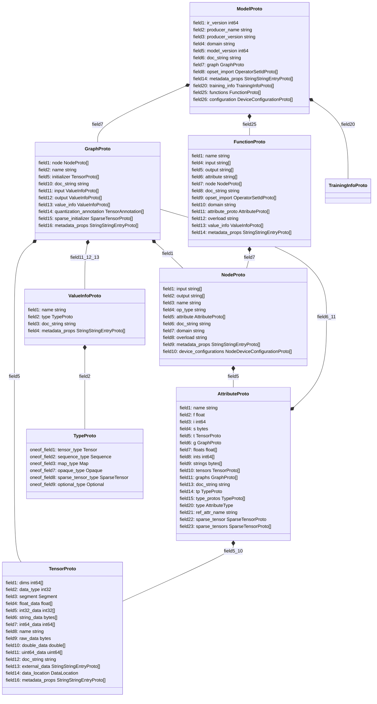
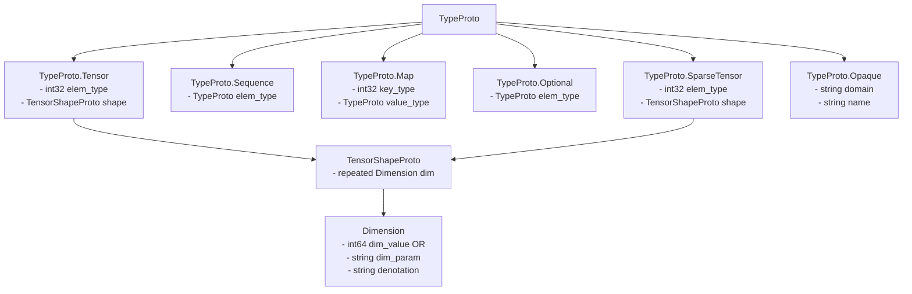
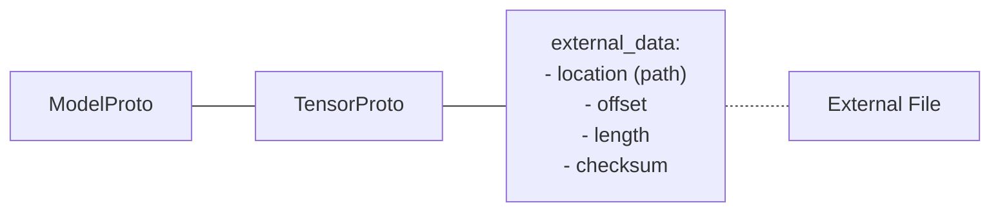
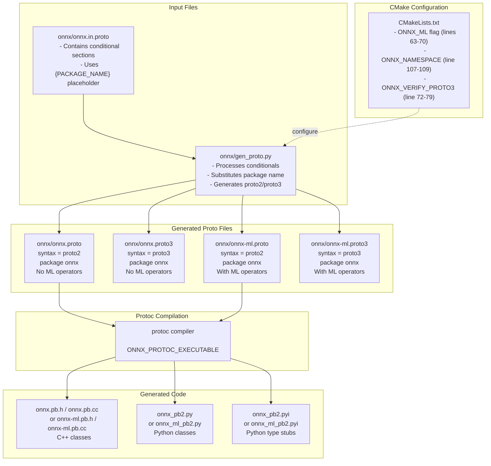
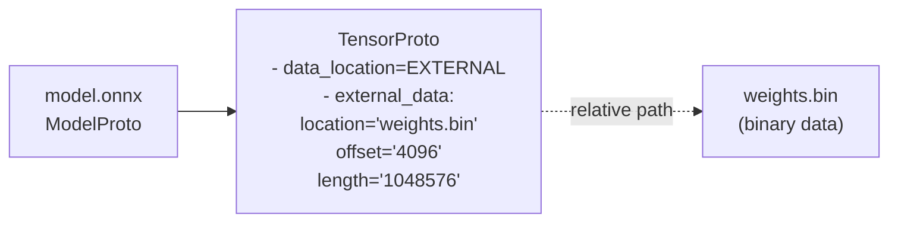

<!-- source: DeepWiki mcp.deepwiki.com · repo onnx/onnx · page 2.1 Protocol Buffer Schema · fetched 2026-10-21 -->

# Protocol Buffer Schema

<details>
<summary>Relevant source files</summary>

The following files were used as context for generating this wiki page:

- [.github/workflows/main.yml](.github/workflows/main.yml)
- [CMakeLists.txt](CMakeLists.txt)
- [README.md](README.md)
- [VERSION_NUMBER](VERSION_NUMBER)
- [cmake/ONNXConfig.cmake.in](cmake/ONNXConfig.cmake.in)
- [cmake/Utils.cmake](cmake/Utils.cmake)
- [cmake/external/googletest.cmake](cmake/external/googletest.cmake)
- [cmake/summary.cmake](cmake/summary.cmake)
- [cmake/unittest.cmake](cmake/unittest.cmake)
- [docs/IR.md](docs/IR.md)
- [docs/ImplementingAnOnnxBackend.md](docs/ImplementingAnOnnxBackend.md)
- [docs/OnnxBackendTest.md](docs/OnnxBackendTest.md)
- [docs/OnnxReleases.md](docs/OnnxReleases.md)
- [docs/Versioning.md](docs/Versioning.md)
- [onnx/common/version.h](onnx/common/version.h)
- [onnx/defs/data_type_utils.cc](onnx/defs/data_type_utils.cc)
- [onnx/defs/data_type_utils.h](onnx/defs/data_type_utils.h)
- [onnx/gen_proto.py](onnx/gen_proto.py)
- [onnx/helper.py](onnx/helper.py)
- [onnx/numpy_helper.py](onnx/numpy_helper.py)
- [onnx/onnx-ml.proto](onnx/onnx-ml.proto)
- [onnx/onnx-ml.proto3](onnx/onnx-ml.proto3)
- [onnx/onnx.in.proto](onnx/onnx.in.proto)
- [onnx/onnx.proto](onnx/onnx.proto)
- [onnx/onnx.proto3](onnx/onnx.proto3)
- [onnx/reference/ops/op_range.py](onnx/reference/ops/op_range.py)
- [onnx/test/cmake/CMakeLists.txt](onnx/test/cmake/CMakeLists.txt)
- [onnx/test/cmake/main.cc](onnx/test/cmake/main.cc)
- [onnx/test/cpp/checker_test.cc](onnx/test/cpp/checker_test.cc)
- [onnx/test/cpp/function_get_test.cc](onnx/test/cpp/function_get_test.cc)
- [onnx/test/cpp/test_main.cc](onnx/test/cpp/test_main.cc)
- [onnx/test/helper_test.py](onnx/test/helper_test.py)
- [onnx/test/numpy_helper_test.py](onnx/test/numpy_helper_test.py)
- [setup.py](setup.py)
- [workflow_scripts/protobuf/build_protobuf_unix.sh](workflow_scripts/protobuf/build_protobuf_unix.sh)
- [workflow_scripts/protobuf/build_protobuf_win.ps1](workflow_scripts/protobuf/build_protobuf_win.ps1)

</details>


This page documents the Protocol Buffer (protobuf) schema that defines the serialization format of ONNX models. The schema consists of message definitions in `.proto` files that specify how models, graphs, operators, tensors, and other components are serialized to disk. This is distinct from the in-memory representation covered in page 2.2.

The protobuf schema is the authoritative definition of the ONNX file format. All ONNX files on disk conform to this schema, and all ONNX libraries must be able to parse models serialized in this format.

## Schema Files and Build Process

ONNX uses Protocol Buffers for serialization, maintaining compatibility with both proto2 and proto3. The schema is defined in template files that are processed during the build to generate final `.proto` files:

**Template File:**
- [onnx/onnx.in.proto]() - Master template with conditional compilation directives

**Generated Proto Files:**
- [onnx/onnx.proto]() - proto2 syntax, standard ONNX operators only
- [onnx/onnx.proto3]() - proto3 syntax, standard ONNX operators only  
- [onnx/onnx-ml.proto]() - proto2 syntax, includes ML operators
- [onnx/onnx-ml.proto3]() - proto3 syntax, includes ML operators

The build process uses [onnx/gen_proto.py]() to process the template file. This script:
1. Processes conditional compilation directives (`#if ONNX-ML`, `#else`, `#endif`)
2. Substitutes package names based on the `ONNX_NAMESPACE` configuration
3. Generates proto2 and proto3 variants
4. Produces ML-enabled and ML-disabled variants

The `ONNX_ML` CMake option controls whether ML operators are included ([CMakeLists.txt:63-70]()).

Sources: [onnx/onnx.in.proto:1-25](), [onnx/gen_proto.py:36-60](), [CMakeLists.txt:63-70]()

### Protobuf Message Hierarchy

The following diagram shows the core message types and their containment relationships, using actual protobuf field names:



Sources: [onnx/onnx.proto:446-523](), [onnx/onnx.proto:561-599](), [onnx/onnx.proto:220-246](), [onnx/onnx.proto:134-198](), [onnx/onnx.proto:604-786](), [onnx/onnx.proto:201-212](), [onnx/onnx.proto:834-922](), [onnx/onnx.proto:924-1011]()

## Core Message Types

The ONNX protobuf schema defines several core message types that form the building blocks of the ONNX IR. These message types are defined in [onnx/onnx.proto]() and related files.

### ModelProto

`ModelProto` is the top-level container for an ONNX model. It contains metadata about the model as well as its computational graph.

| Field | Type | Field Number | Description |
|-------|------|--------------|-------------|
| `ir_version` | `int64` | 1 | The ONNX IR version (MUST be present) |
| `opset_import` | `repeated OperatorSetIdProto` | 8 | Operator sets imported by the model |
| `producer_name` | `string` | 2 | Name of the tool that generated the model |
| `producer_version` | `string` | 3 | Version of the generating tool |
| `domain` | `string` | 4 | Reverse DNS domain name of the model |
| `model_version` | `int64` | 5 | Version of the model itself |
| `doc_string` | `string` | 6 | Human-readable documentation (Markdown allowed) |
| `graph` | `GraphProto` | 7 | The main computational graph |
| `metadata_props` | `repeated StringStringEntryProto` | 14 | Named metadata key-value pairs |
| `training_info` | `repeated TrainingInfoProto` | 20 | Training-specific information (IR version >= 7) |
| `functions` | `repeated FunctionProto` | 25 | Model-local function definitions (IR version >= 8) |
| `configuration` | `repeated DeviceConfigurationProto` | 26 | Multi-device configurations (IR version >= 11) |

All models MUST have at least one entry in `opset_import` specifying the version of the ONNX operator set being used. The `ir_version` field MUST be present and indicates which version of the ONNX IR specification the model follows.

Sources: [onnx/onnx.proto:446-523]()

### GraphProto

`GraphProto` defines a computational graph as a directed acyclic graph (DAG) of nodes. Each graph contains nodes, inputs, outputs, and initializers. The nodes MUST be topologically sorted.

| Field | Type | Field Number | Description |
|-------|------|--------------|-------------|
| `node` | `repeated NodeProto` | 1 | Nodes in topological order |
| `name` | `string` | 2 | Name of the graph |
| `initializer` | `repeated TensorProto` | 5 | Named tensor constants |
| `sparse_initializer` | `repeated SparseTensorProto` | 15 | Sparse tensor constants (IR version >= 6) |
| `doc_string` | `string` | 10 | Human-readable documentation (Markdown allowed) |
| `input` | `repeated ValueInfoProto` | 11 | Graph input parameters |
| `output` | `repeated ValueInfoProto` | 12 | Graph output parameters |
| `value_info` | `repeated ValueInfoProto` | 13 | Type/shape info for intermediate values |
| `quantization_annotation` | `repeated TensorAnnotation` | 14 | Quantization parameter mappings (IR version >= 5) |
| `metadata_props` | `repeated StringStringEntryProto` | 16 | Named metadata key-value pairs (IR version >= 10) |

**Important constraints:**
- All `node` outputs MUST be unique (SSA form)
- `initializer` names MUST be unique across both `initializer` and `sparse_initializer`
- For IR version >= 4, initializers MAY appear in the `input` list to allow optional overriding
- Main graphs MUST define types and shapes for all inputs and outputs

Sources: [onnx/onnx.proto:561-599]()

### NodeProto

`NodeProto` represents a single computational node in a graph, which typically corresponds to a single operation (like convolution, addition, etc.).

| Field | Type | Field Number | Description |
|-------|------|--------------|-------------|
| `input` | `repeated string` | 1 | Names of input values (namespace: Value) |
| `output` | `repeated string` | 2 | Names of output values (namespace: Value) |
| `name` | `string` | 3 | Optional node identifier (namespace: Node) |
| `op_type` | `string` | 4 | Operator type to execute (namespace: Operator) |
| `domain` | `string` | 7 | Operator set domain (namespace: Domain) |
| `overload` | `string` | 8 | Overload identifier for model-local functions (IR version >= 10) |
| `attribute` | `repeated AttributeProto` | 5 | Named attributes for the operator |
| `doc_string` | `string` | 6 | Human-readable documentation (Markdown allowed) |
| `metadata_props` | `repeated StringStringEntryProto` | 9 | Named metadata (IR version >= 10) |
| `device_configurations` | `repeated NodeDeviceConfigurationProto` | 10 | Multi-device annotations (IR version >= 11) |

**Important notes:**
- Input/output names reference values defined elsewhere in the graph
- Empty string in `input` list indicates an optional input
- Empty string in `output` list indicates an optional output
- The `op_type` and `domain` together identify which operator schema to use
- All attribute names MUST be unique within a node

Sources: [onnx/onnx.proto:220-246]()

### AttributeProto

`AttributeProto` represents attributes (parameters) for operators. Attributes are used to pass constant values to operators, as opposed to inputs which can vary at runtime.

| Field | Type | Field Number | Description |
|-------|------|--------------|-------------|
| `name` | `string` | 1 | Attribute name (MUST be present) |
| `ref_attr_name` | `string` | 21 | Reference to parent function attribute |
| `doc_string` | `string` | 13 | Human-readable documentation |
| `type` | `AttributeType` | 20 | Type discriminator (MUST be present for IR >= 2) |
| `f` | `float` | 2 | Singular float value |
| `i` | `int64` | 3 | Singular int64 value |
| `s` | `bytes` | 4 | Singular UTF-8 string |
| `t` | `TensorProto` | 5 | Singular tensor value |
| `g` | `GraphProto` | 6 | Singular graph (subgraph) |
| `sparse_tensor` | `SparseTensorProto` | 22 | Singular sparse tensor (IR version >= 6) |
| `tp` | `TypeProto` | 14 | Singular type proto (IR version >= 8) |
| `floats` | `repeated float` | 7 | List of floats |
| `ints` | `repeated int64` | 8 | List of ints |
| `strings` | `repeated bytes` | 9 | List of UTF-8 strings |
| `tensors` | `repeated TensorProto` | 10 | List of tensors |
| `graphs` | `repeated GraphProto` | 11 | List of graphs |
| `sparse_tensors` | `repeated SparseTensorProto` | 23 | List of sparse tensors |
| `type_protos` | `repeated TypeProto` | 15 | List of type protos |

The `AttributeType` enum defines valid types:
```
UNDEFINED = 0, FLOAT = 1, INT = 2, STRING = 3, TENSOR = 4, GRAPH = 5,
FLOATS = 6, INTS = 7, STRINGS = 8, TENSORS = 9, GRAPHS = 10,
SPARSE_TENSOR = 11, SPARSE_TENSORS = 12, TYPE_PROTO = 13, TYPE_PROTOS = 14
```

**Important constraints:**
- Exactly ONE value field must be set (enforces union semantics)
- The `type` field MUST match the value field in use
- `ref_attr_name` is ONLY valid in function bodies, not main graphs
- When `ref_attr_name` is set, no value fields should be set

Sources: [onnx/onnx.proto:134-198](), [onnx/checker.cc:428-516]()

### TensorProto

`TensorProto` represents a tensor (multi-dimensional array) in ONNX. It can store data inline or reference external data.

| Field | Type | Field Number | Description |
|-------|------|--------------|-------------|
| `dims` | `repeated int64` | 1 | Shape of the tensor (row-major order) |
| `data_type` | `int32` | 2 | Element data type (MUST be valid DataType, MUST NOT be UNDEFINED) |
| `segment` | `Segment` | 3 | Optional segment info for chunked storage |
| `float_data` | `repeated float` | 4 | FLOAT/COMPLEX64 values (packed) |
| `int32_data` | `repeated int32` | 5 | INT32/INT16/INT8/UINT16/UINT8/BOOL/FLOAT16/BFLOAT16/FLOAT8/UINT4/INT4/UINT2/INT2/FLOAT4 values (packed) |
| `string_data` | `repeated bytes` | 6 | STRING values (UTF-8, no trailing null) |
| `int64_data` | `repeated int64` | 7 | INT64 values (packed) |
| `name` | `string` | 8 | Optional tensor name |
| `doc_string` | `string` | 12 | Human-readable documentation |
| `raw_data` | `bytes` | 9 | Raw bytes in little-endian, IEEE 754 format |
| `external_data` | `repeated StringStringEntryProto` | 13 | External file location metadata |
| `data_location` | `DataLocation` | 14 | DEFAULT (inline) or EXTERNAL |
| `double_data` | `repeated double` | 10 | DOUBLE/COMPLEX128 values (packed) |
| `uint64_data` | `repeated uint64` | 11 | UINT32/UINT64 values (packed) |
| `metadata_props` | `repeated StringStringEntryProto` | 16 | Named metadata (IR version >= 10) |

**Data storage rules:**
- For non-empty tensors, exactly ONE data field must be set (`float_data`, `int32_data`, `raw_data`, etc.)
- STRING data MUST use `string_data`, not `raw_data`
- If `data_location` is EXTERNAL, no data fields should be set; use `external_data` instead
- For 4-bit types (UINT4/INT4/FLOAT4), two elements are packed per byte (LSB first, MSB second)
- For 2-bit types (UINT2/INT2), four elements are packed per byte (LSB to MSB)
- COMPLEX64/COMPLEX128 store real and imaginary components interleaved

The `DataType` enum (field 2) includes:
```
FLOAT=1, UINT8=2, INT8=3, UINT16=4, INT16=5, INT32=6, INT64=7, STRING=8, BOOL=9,
FLOAT16=10, DOUBLE=11, UINT32=12, UINT64=13, COMPLEX64=14, COMPLEX128=15,
BFLOAT16=16, FLOAT8E4M3FN=17, FLOAT8E4M3FNUZ=18, FLOAT8E5M2=19, FLOAT8E5M2FNUZ=20,
UINT4=21, INT4=22, FLOAT4E2M1=23, FLOAT8E8M0=24, UINT2=25, INT2=26
```

Sources: [onnx/onnx.proto:604-786](), [onnx/checker.cc:78-206]()

### ValueInfoProto

`ValueInfoProto` defines information about a value, including its name, type, and shape.

| Field | Type | Field Number | Description |
|-------|------|--------------|-------------|
| `name` | `string` | 1 | Value name (MUST be present, namespace: Value) |
| `type` | `TypeProto` | 2 | Type and shape information (MUST be present for main graph I/O) |
| `doc_string` | `string` | 3 | Human-readable documentation (Markdown allowed) |
| `metadata_props` | `repeated StringStringEntryProto` | 4 | Named metadata (IR version >= 10) |

**Important notes:**
- For main graphs, `type` MUST be present for all inputs and outputs
- For subgraphs (e.g., in control flow ops), `type` MAY be absent
- The `name` field identifies the value and must be unique within its namespace

Sources: [onnx/onnx.proto:201-212](), [onnx/checker.cc:37-76]()

## Type System

ONNX defines a hierarchical type system in the protobuf schema that allows for representing various kinds of data used in machine learning models.

### TypeProto Structure



Sources: [onnx/onnx.proto:834-922](), [onnx/onnx.proto:815-829]()

### TypeProto

`TypeProto` is a union type (using protobuf `oneof`) that can represent various kinds of types used in ONNX. The active variant is indicated by the `value_case()` accessor.

| Variant | Type | Field Number | Description |
|---------|------|--------------|-------------|
| `tensor_type` | `Tensor` | 1 | Dense tensor type |
| `sequence_type` | `Sequence` | 2 | Sequence (list) type |
| `map_type` | `Map` | 3 | Map (dictionary) type |
| `opaque_type` | `Opaque` | 7 | Opaque type (ONNX-ML only) |
| `sparse_tensor_type` | `SparseTensor` | 8 | Sparse tensor type (IR version >= 8) |
| `optional_type` | `Optional` | 9 | Optional type (IR version >= 8) |

**TypeProto.Tensor:**
- `elem_type` (int32, field 1): Element data type (MUST NOT be UNDEFINED, MUST be valid)
- `shape` (TensorShapeProto, field 2): Optional shape information

**TypeProto.Sequence:**
- `elem_type` (TypeProto, field 1): Type of sequence elements (MUST be present)

**TypeProto.Map:**
- `key_type` (int32, field 1): Key data type (MUST be INT8/16/32/64, UINT8/16/32/64, or STRING)
- `value_type` (TypeProto, field 2): Value type

**TypeProto.Optional:**
- `elem_type` (TypeProto, field 1): Type of optional value (MUST be present)

**TypeProto.SparseTensor:**
- `elem_type` (int32, field 1): Element data type
- `shape` (TensorShapeProto, field 2): Shape of dense tensor

Sources: [onnx/onnx.proto:834-922](), [onnx/checker.cc:37-76]()

### TensorShapeProto

`TensorShapeProto` describes the shape of a tensor with support for symbolic dimensions.

| Field | Type | Field Number | Description |
|-------|------|--------------|-------------|
| `dim` | `repeated Dimension` | 1 | Dimensions of the tensor |

**Dimension:**
- `dim_value` (int64, field 1): Concrete dimension size (oneof with `dim_param`)
- `dim_param` (string, field 2): Symbolic dimension parameter (oneof with `dim_value`)
- `denotation` (string, field 3): Optional semantic annotation (e.g., "DATA_BATCH", "DATA_CHANNEL")

A dimension can be either:
1. A concrete value (`dim_value`) representing a fixed size
2. A symbolic parameter (`dim_param`) representing a dimension that may vary

The `denotation` field enables dimension type annotations for operations that need to know axis semantics (e.g., batch vs. spatial dimensions).

Sources: [onnx/onnx.proto:815-829]()

### Tensor Element Types

ONNX supports a wide range of element types for tensors, defined in the `TensorProto.DataType` enum:

| Enum Value | Name | Bits | Description |
|------------|------|------|-------------|
| 1 | FLOAT | 32 | IEEE 754 single-precision floating point |
| 2 | UINT8 | 8 | Unsigned 8-bit integer |
| 3 | INT8 | 8 | Signed 8-bit integer |
| 4 | UINT16 | 16 | Unsigned 16-bit integer |
| 5 | INT16 | 16 | Signed 16-bit integer |
| 6 | INT32 | 32 | Signed 32-bit integer |
| 7 | INT64 | 64 | Signed 64-bit integer |
| 8 | STRING | - | UTF-8 string |
| 9 | BOOL | 8 | Boolean (stored as byte: 0x00 or 0x01) |
| 10 | FLOAT16 | 16 | IEEE 754 half-precision (1 sign, 5 exponent, 10 mantissa) |
| 11 | DOUBLE | 64 | IEEE 754 double-precision floating point |
| 12 | UINT32 | 32 | Unsigned 32-bit integer |
| 13 | UINT64 | 64 | Unsigned 64-bit integer |
| 14 | COMPLEX64 | 64 | Complex number with float32 real/imaginary |
| 15 | COMPLEX128 | 128 | Complex number with float64 real/imaginary |
| 16 | BFLOAT16 | 16 | Brain float (1 sign, 8 exponent, 7 mantissa) |
| 17 | FLOAT8E4M3FN | 8 | 8-bit float (4-bit mantissa, 3-bit exponent, NaN, no Inf) (IR >= 9) |
| 18 | FLOAT8E4M3FNUZ | 8 | 8-bit float (4-bit mantissa, 3-bit exponent, NaN, no Inf/neg-zero) (IR >= 9) |
| 19 | FLOAT8E5M2 | 8 | 8-bit float (2-bit mantissa, 5-bit exponent, IEEE 754-like) (IR >= 9) |
| 20 | FLOAT8E5M2FNUZ | 8 | 8-bit float (2-bit mantissa, 5-bit exponent, NaN, no Inf/neg-zero) (IR >= 9) |
| 21 | UINT4 | 4 | Unsigned 4-bit integer [0, 15] (IR >= 10) |
| 22 | INT4 | 4 | Signed 4-bit integer [-8, 7] using two's complement (IR >= 10) |
| 23 | FLOAT4E2M1 | 4 | 4-bit floating point (IR >= 11) |
| 24 | FLOAT8E8M0 | 8 | 8-bit float for microscaling (MX) formats (IR >= 12) |
| 25 | UINT2 | 2 | Unsigned 2-bit integer [0, 3] (IR >= 13) |
| 26 | INT2 | 2 | Signed 2-bit integer [-2, 1] using two's complement (IR >= 13) |

**Packing for sub-byte types:**
- 4-bit types: Two elements per byte (first element in LSB 4 bits, second in MSB 4 bits)
- 2-bit types: Four elements per byte (packed LSB to MSB)

Sources: [onnx/onnx.proto:605-660](), [onnx/defs/data_type_utils.cc:419-451]()

## Additional Message Types

### FunctionProto

`FunctionProto` defines a model-local function that can be called from nodes in the graph. Functions provide a way to define reusable subgraphs.

| Field | Type | Field Number | Description |
|-------|------|--------------|-------------|
| `name` | `string` | 1 | Function name (MUST be present) |
| `input` | `repeated string` | 4 | Input parameter names |
| `output` | `repeated string` | 5 | Output parameter names |
| `attribute` | `repeated string` | 6 | Attribute parameter names (without default values) |
| `attribute_proto` | `repeated AttributeProto` | 11 | Attributes with default values (IR >= 9) |
| `node` | `repeated NodeProto` | 7 | Function body nodes (topologically sorted) |
| `doc_string` | `string` | 8 | Documentation |
| `opset_import` | `repeated OperatorSetIdProto` | 9 | Operator sets used by function |
| `domain` | `string` | 10 | Function domain (MUST be present for IR >= 8) |
| `overload` | `string` | 12 | Overload identifier (IR >= 10) |
| `value_info` | `repeated ValueInfoProto` | 13 | Type info for values (IR >= 10) |
| `metadata_props` | `repeated StringStringEntryProto` | 14 | Named metadata (IR >= 10) |

The tuple `(domain, name, overload)` uniquely identifies a function within a model (IR version >= 10).

Sources: [onnx/onnx.proto:924-1011](), [docs/IR.md:178-220]()

### TrainingInfoProto

`TrainingInfoProto` stores training-specific information including initialization and training algorithm graphs (added in IR version 7).

| Field | Type | Field Number | Description |
|-------|------|--------------|-------------|
| `initialization` | `GraphProto` | 1 | Graph to initialize training state |
| `algorithm` | `GraphProto` | 2 | Training algorithm step graph |
| `initialization_binding` | `repeated StringStringEntryProto` | 3 | Bindings from initialization outputs to initializers |
| `update_binding` | `repeated StringStringEntryProto` | 4 | Bindings from algorithm outputs to initializers |

The `initialization` graph computes initial values for trainable parameters. The `algorithm` graph defines one training iteration step. Bindings map graph outputs to initializers that should be updated.

Sources: [onnx/onnx.proto:341-438](), [docs/IR.md:323-340]()

### OperatorSetIdProto

`OperatorSetIdProto` identifies an operator set by domain and version.

| Field | Type | Field Number | Description |
|-------|------|--------------|-------------|
| `domain` | `string` | 1 | Operator set domain (empty string = ONNX default domain) |
| `version` | `int64` | 2 | Operator set version number |

All models MUST import at least the default ONNX operator set. The version determines which operator schemas are available.

Sources: [onnx/onnx.proto:1013-1024](), [docs/IR.md:121-133]()

### SparseTensorProto

`SparseTensorProto` represents sparse tensors efficiently by storing only non-zero values (added in IR version 6).

| Field | Type | Field Number | Description |
|-------|------|--------------|-------------|
| `values` | `TensorProto` | 1 | Non-zero values (rank-1 tensor of size NNZ) |
| `indices` | `TensorProto` | 2 | Indices of non-zero values (INT64 tensor) |
| `dims` | `repeated int64` | 3 | Shape of underlying dense tensor |

The `indices` tensor can be:
1. Rank-1 tensor [NNZ]: Linearized indices
2. Rank-2 tensor [NNZ, rank]: COO format with one index tuple per non-zero value

Indices MUST be in ascending order (linearized or lexicographic order).

Sources: [onnx/onnx.proto:789-810](), [onnx/checker.cc:378-424]()

### SequenceProto, MapProto, OptionalProto

These message types represent runtime values (not types) for sequences, maps, and optional values.

**SequenceProto:**
- `elem_type` (SequenceProto.DataType, field 1): Type of elements (TENSOR, SPARSE_TENSOR, SEQUENCE, MAP)
- `tensor_values` / `sparse_tensor_values` / `sequence_values` / `map_values`: Repeated elements

**MapProto:**
- `key_type` (int32, field 1): Key data type (MUST be INT8/16/32/64, UINT8/16/32/64, or STRING)
- `keys` / `string_keys`: Key values
- `values` (SequenceProto, field 4): Map values as a sequence

**OptionalProto:**
- `elem_type` (OptionalProto.DataType, field 1): Type of optional value
- `tensor_value` / `sparse_tensor_value` / `sequence_value` / `map_value`: Optional value (if present)

Sources: [onnx/onnx.proto:1026-1101](), [onnx/checker.cc:208-304]()

### StringStringEntryProto

`StringStringEntryProto` is a helper message that represents a key-value pair, used to simulate maps in a proto2/proto3-compatible way.

| Field | Type | Field Number | Description |
|-------|------|--------------|-------------|
| `key` | `string` | 1 | Key |
| `value` | `string` | 2 | Value |

This pattern is used throughout ONNX for:
- `metadata_props` in ModelProto, GraphProto, NodeProto, ValueInfoProto, etc.
- `external_data` in TensorProto
- `initialization_binding` and `update_binding` in TrainingInfoProto

Sources: [onnx/onnx.proto:539-542]()

### Multi-Device Configuration (IR >= 11)

**DeviceConfigurationProto:**
- `name` (string, field 1): Configuration name (MUST be present)
- `num_devices` (int32, field 2): Number of devices (MUST be present)
- `device` (repeated string, field 3): Optional device names (length MUST match `num_devices`)

**NodeDeviceConfigurationProto:**
- `configuration_id` (string, field 1): References a DeviceConfigurationProto name
- `sharding_spec` (repeated ShardingSpecProto, field 2): Per-tensor sharding specs
- `pipeline_stage` (int32, field 3): Pipeline stage identifier

**ShardingSpecProto:**
- `tensor_name` (string, field 1): Input/output tensor name being sharded
- `device` (repeated int64, field 2): Device indices for sharding
- `index_to_device_group_map` (repeated IntIntListEntryProto, field 3): Device grouping
- `sharded_dim` (repeated ShardedDimProto, field 4): Per-dimension sharding

Sources: [onnx/onnx.proto:525-535](), [onnx/onnx.proto:255-320]()

### External Data Handling

For large models, tensor data can be stored externally and referenced from the model file:



The `external_data` field in `TensorProto` can contain key-value pairs that describe:
- `location`: Path to the external file (relative to the model file)
- `offset`: Byte offset in the file
- `length`: Length of the data in bytes
- `checksum`: Optional SHA1 digest for verification

Sources: [onnx/onnx.proto:726-743]()

### Sparse Tensor Representation

`SparseTensorProto` allows efficient representation of sparse tensors (tensors with many zero values):

- `values`: A tensor containing the non-zero values
- `indices`: A tensor specifying the indices of the non-zero values
- `dims`: The shape of the underlying dense tensor

Sources: [onnx/onnx.proto:766-788]()

## Versioning and Compatibility

The ONNX IR evolves over time, with new features and improvements added in each version. The `Version` enum in the protobuf schema tracks these changes.

```mermaid
graph TD
    subgraph "IR Versions Timeline"
        IR1["IR_VERSION_2017_10_10 (1)
        Initial version"]
        IR2["IR_VERSION_2017_10_30 (2)
        Added type discriminator"]
        IR3["IR_VERSION_2017_11_3 (3)
        Added operator versioning"]
        IR4["IR_VERSION_2019_1_22 (4)
        Relaxed initializer constraints
        Added BFLOAT16"]
        IR5["IR_VERSION_2019_3_18 (5)
        Added tensor annotations"]
        IR6["IR_VERSION_2019_9_19 (6)
        Added sparse tensor support"]
        IR7["IR_VERSION_2020_5_8 (7)
        Added training support"]
        IR8["IR_VERSION_2021_7_30 (8)
        Added Optional type
        Added SparseTensor type"]
        IR9["IR_VERSION_2023_5_5 (9)
        Added attributes to functions
        Added FLOAT8 types"]
        IR10["IR_VERSION_2024_3_25 (10)
        Added UINT4, INT4"]
        IR11["IR_VERSION (11)
        Added FLOAT4E2M1
        Added multi-device support"]
    end
    
    IR1 --> IR2 --> IR3 --> IR4 --> IR5 --> IR6 --> IR7 --> IR8 --> IR9 --> IR10 --> IR11
```



Sources: [onnx/onnx.proto:50-118]()

### IR Version History

Each IR version adds new features and capabilities:

1. **IR_VERSION_2017_10_10 (1)**: Initial version
2. **IR_VERSION_2017_10_30 (2)**: Added type discriminator to AttributeProto
3. **IR_VERSION_2017_11_3 (3)**: Added operator versioning and domains
4. **IR_VERSION_2019_1_22 (4)**: Relaxed initializer constraints, added BFLOAT16
5. **IR_VERSION_2019_3_18 (5)**: Added tensor annotations for quantization
6. **IR_VERSION_2019_9_19 (6)**: Added sparse tensor support
7. **IR_VERSION_2020_5_8 (7)**: Added training support
8. **IR_VERSION_2021_7_30 (8)**: Added Optional and SparseTensor types
9. **IR_VERSION_2023_5_5 (9)**: Added attributes to functions, FLOAT8 types
10. **IR_VERSION_2024_3_25 (10)**: Added UINT4, INT4 types
11. **IR_VERSION (11)**: Added FLOAT4E2M1, multi-device support

Sources: [onnx/onnx.proto:50-118]()

### Proto2/Proto3 Compatibility

ONNX maintains strict compatibility between protobuf v2 and v3 by using only features available in both versions. This design choice enables ONNX models to be read by any protobuf implementation.

**Compatibility Constraints:**

| Feature | Proto2 | Proto3 | ONNX Strategy |
|---------|--------|--------|---------------|
| `map` type | No | Yes | Use `repeated StringStringEntryProto` |
| `optional` keyword | Yes | Implicit | Use `optional` explicitly in proto2 |
| Field presence | Yes | No (scalar) | Document field requirements separately |
| Default values | Yes | No | Handle defaults in code, not schema |
| Enums | Yes | Yes | Use explicit enum values (not zero for first) |

**Design Patterns for Compatibility:**

1. **Key-Value Pairs Instead of Maps:**
   ```protobuf
   message StringStringEntryProto {
     optional string key = 1;
     optional string value = 2;
   }
   // Used as: repeated StringStringEntryProto metadata_props = 14;
   ```

2. **Explicit Type Discriminators:**
   The `AttributeProto.type` field explicitly indicates which value field is in use, rather than relying on proto3's implicit field presence detection.

3. **Enum Zero Reserved:**
   The `Version` enum uses `_START_VERSION = 0` as a reserved value, ensuring the actual IR version values are non-zero and explicitly serialized.

Sources: [onnx/onnx.in.proto:30-42](), [onnx/onnx.proto:539-542](), [onnx/onnx.proto:50-126](), [onnx/onnx.proto:134-198]()

## Schema Generation Pipeline

The ONNX protobuf schema generation pipeline transforms the template file into multiple output files:



**Key Build Functions:**

The `RELATIVE_PROTOBUF_GENERATE_CPP` function in [CMakeLists.txt:304-395]() orchestrates the generation:
1. Calls `gen_proto.py` with appropriate flags (`-m` for ML, `-l` for lite proto, `-p` for package name)
2. Invokes `protoc` to generate C++ code with `--cpp_out`
3. Invokes `protoc` to generate Python code with `--python_out` and optionally `pyi_out`

The generated files contain a warning header:
```
// WARNING: This file is automatically generated!  Please edit onnx.in.proto.
```

Sources: [onnx/gen_proto.py:19-25](), [onnx/gen_proto.py:41-60](), [CMakeLists.txt:304-395](), [CMakeLists.txt:346-364](), [CMakeLists.txt:373-391]()

## External Data Handling

For large models, tensor data can be stored in external files and referenced from the model file.

### External Data Fields in TensorProto

The `external_data` field in `TensorProto` contains `StringStringEntryProto` entries with the following recognized keys:

| Key | Required | Description |
|-----|----------|-------------|
| `location` | Yes | POSIX filesystem path relative to model directory |
| `offset` | No | Byte offset where data begins (as string-encoded integer) |
| `length` | No | Number of bytes containing data (as string-encoded integer) |
| `checksum` | No | SHA1 digest of the external file for verification |

**Important rules:**
- When `data_location` is EXTERNAL, the `external_data` field MUST have a "location" entry
- When `data_location` is EXTERNAL, no inline data fields (`float_data`, `raw_data`, etc.) should be set
- Offset values SHOULD be multiples of 4096 (page size) to enable memory-mapped I/O
- The location path is resolved relative to the directory containing the model file



Sources: [onnx/onnx.proto:749-757](), [onnx/checker.cc:105-126]()

## Model Validation

The checker validates protobuf structures to ensure they conform to ONNX specifications.

### Validation Functions

The checker validates each protobuf message type:

| Function | Purpose |
|----------|---------|
| `check_model()` | Validates entire ModelProto |
| `check_graph()` | Validates GraphProto (SSA, topology, types) |
| `check_node()` | Validates NodeProto (schema, attributes) |
| `check_attribute()` | Validates AttributeProto (type consistency) |
| `check_tensor()` | Validates TensorProto (data fields, external data) |
| `check_sparse_tensor()` | Validates SparseTensorProto (indices, values) |
| `check_value_info()` | Validates ValueInfoProto (required fields) |
| `check_function()` | Validates FunctionProto (opset imports, SSA) |

**Key validation rules:**
- ModelProto MUST have `ir_version` and at least one `opset_import`
- GraphProto nodes MUST be in topological order
- All node output names MUST be unique (SSA form)
- TensorProto MUST have exactly one data field (or external data) for non-empty tensors
- AttributeProto MUST have `name` and `type` fields (IR >= 2)
- NodeProto MUST have non-empty `op_type`

Sources: [onnx/checker.h:146-157](), [onnx/checker.cc:530-707](), [docs/IR.md:15-23]()

## Conclusion

The ONNX protobuf schema provides a comprehensive and extensible way to represent machine learning models. Through careful design and versioning, it enables cross-platform compatibility and a shared standard for the machine learning ecosystem. The schema continues to evolve with new data types and features to support the advancing needs of the AI community.

---

