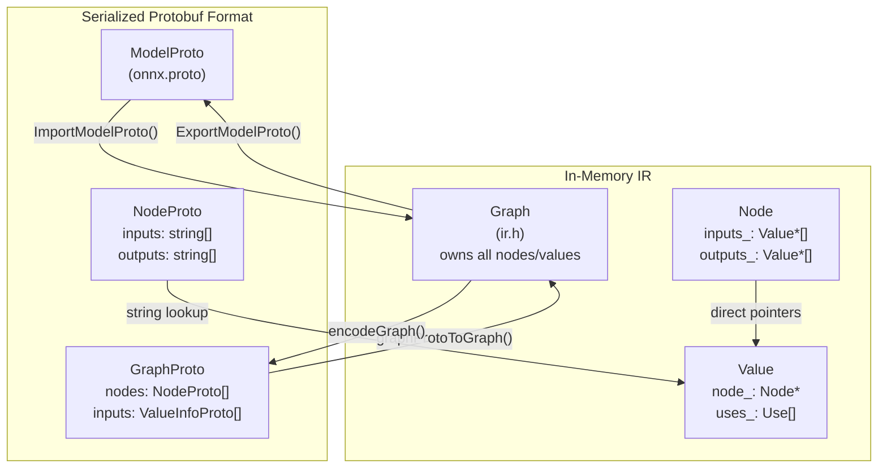
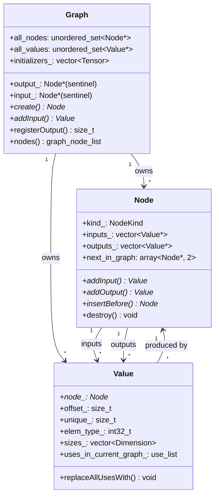
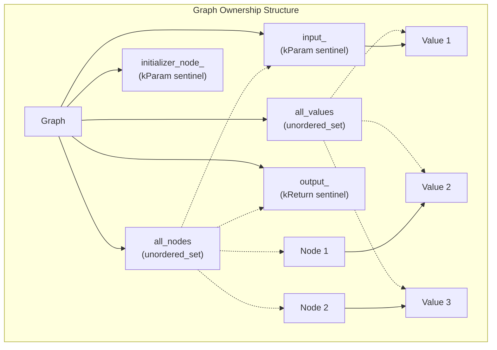
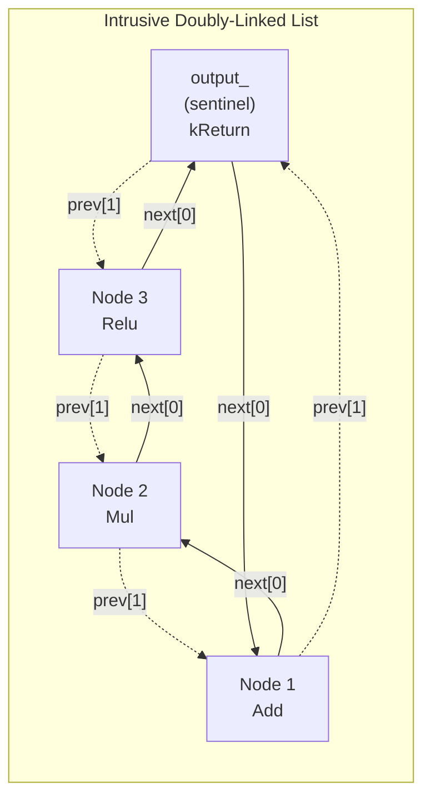
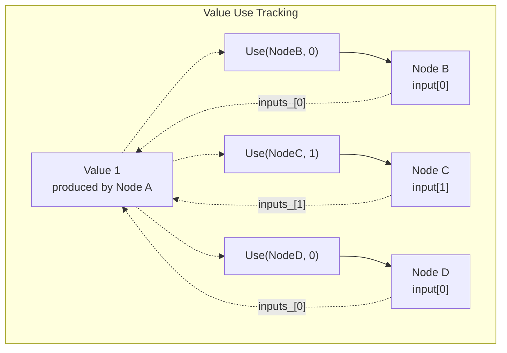
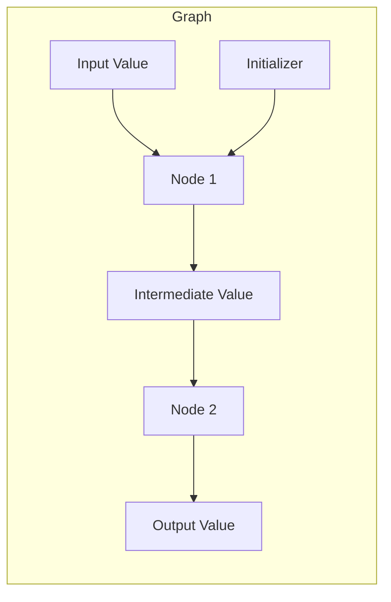

<!-- source: DeepWiki mcp.deepwiki.com · repo onnx/onnx · page 2.2 In-Memory IR (Intermediate Representation) · fetched 2026-10-21 -->

# In-Memory IR (Intermediate Representation)

<details>
<summary>Relevant source files</summary>

The following files were used as context for generating this wiki page:

- [onnx/checker.cc](onnx/checker.cc)
- [onnx/checker.h](onnx/checker.h)
- [onnx/common/assertions.cc](onnx/common/assertions.cc)
- [onnx/common/assertions.h](onnx/common/assertions.h)
- [onnx/common/graph_node_list.h](onnx/common/graph_node_list.h)
- [onnx/common/interned_strings.cc](onnx/common/interned_strings.cc)
- [onnx/common/ir.h](onnx/common/ir.h)
- [onnx/common/ir_pb_converter.cc](onnx/common/ir_pb_converter.cc)
- [onnx/common/ir_pb_converter.h](onnx/common/ir_pb_converter.h)
- [onnx/common/model_helpers.cc](onnx/common/model_helpers.cc)
- [onnx/common/status.cc](onnx/common/status.cc)
- [onnx/common/status.h](onnx/common/status.h)
- [onnx/common/tensor.h](onnx/common/tensor.h)
- [onnx/cpp2py_export.cc](onnx/cpp2py_export.cc)
- [onnx/defs/function.cc](onnx/defs/function.cc)
- [onnx/defs/function.h](onnx/defs/function.h)
- [onnx/defs/schema.cc](onnx/defs/schema.cc)
- [onnx/defs/schema.h](onnx/defs/schema.h)
- [onnx/defs/shape_inference.cc](onnx/defs/shape_inference.cc)
- [onnx/defs/shape_inference.h](onnx/defs/shape_inference.h)
- [onnx/shape_inference/implementation.cc](onnx/shape_inference/implementation.cc)
- [onnx/shape_inference/implementation.h](onnx/shape_inference/implementation.h)

</details>


> **Note**: This page is marked as EXPERIMENTAL in the source code. The APIs described here are subject to change.

ONNX provides an in-memory C++ representation for programmatic manipulation of models, defined primarily in [onnx/common/ir.h](). This in-memory IR differs from the protobuf representation (see [Protobuf Schema Definition](#2.1)) in that it is optimized for graph transformations, analysis, and construction rather than serialization.

The in-memory IR is used internally by:
- ONNX's shape inference system
- ONNX's version converter
- Graph optimization passes
- Custom tools that need to manipulate ONNX models programmatically

For information about operator definitions, see [Operator System](#3).

Sources: [onnx/common/ir.h:1-9]()

## Purpose and Design Philosophy

The in-memory IR serves several purposes that the protobuf representation does not:

| Aspect | Protobuf (ModelProto) | In-Memory IR (Graph) |
|--------|----------------------|----------------------|
| **Primary Use** | Serialization, storage, network transport | Graph manipulation, analysis, construction |
| **String References** | Values referenced by string names | Values are pointer-based objects |
| **Topological Order** | Implicit via node ordering | Explicitly maintained via intrusive linked list |
| **Memory Ownership** | Managed by protobuf library | Graph owns all nodes and values |
| **Mutation Support** | Inefficient (requires full copy) | Efficient (pointers support in-place updates) |
| **Use Tracking** | Not available | Values track their uses |

Sources: [onnx/common/ir.h:49-53]()

## Relationship Between Protobuf and In-Memory IR

**Diagram: Conversion Between Representations**



Sources: [onnx/common/ir_pb_converter.h:42-44](), [onnx/common/ir_pb_converter.cc:243-403](), [onnx/common/ir_pb_converter.cc:618-692]()

## Core Classes Overview

The in-memory IR consists of three primary classes:

**Diagram: Core IR Classes and Relationships**



Sources: [onnx/common/ir.h:49-62](), [onnx/common/ir.h:888-1198](), [onnx/common/ir.h:403-829](), [onnx/common/ir.h:304-401]()

## Graph Class: Ownership and Structure

The `Graph` class owns all nodes and values in the computation graph. It uses a simple ownership model where destroying the graph invalidates all pointers to nodes and values within it.

### Key Members

| Member | Type | Purpose |
|--------|------|---------|
| `all_nodes` | `unordered_set<const Node*>` | Tracks all allocated nodes for cleanup |
| `all_values` | `unordered_set<const Value*>` | Tracks all allocated values for cleanup |
| `output_` | `Node*` | Sentinel node representing graph outputs |
| `input_` | `Node*` | Sentinel node representing graph inputs |
| `initializer_node_` | `Node*` | Sentinel node for initializers (IR >= 4) |
| `initializers_` | `vector<Tensor>` | Constant tensor data |
| `opset_versions_` | `vector<OpSetID>` | Operator set versions used |

**Diagram: Graph Memory Layout**



Sources: [onnx/common/ir.h:888-912](), [onnx/common/ir.h:956]()

### Sentinel Nodes

The `Graph` uses three sentinel nodes with special purposes:

1. **`input_` (kParam)**: Graph inputs are outputs of this sentinel node
2. **`output_` (kReturn)**: Graph outputs are inputs to this sentinel node  
3. **`initializer_node_` (kParam)**: Initializers that don't exist in inputs (IR >= 4)

The `output_` sentinel also serves as the head of the intrusive linked list containing all nodes in topological order.

Sources: [onnx/common/ir.h:908-911]()

### Graph Creation and Manipulation

Key methods for graph construction:

| Method | Purpose |
|--------|---------|
| `create(NodeKind, num_outputs)` | Allocates a new node with specified outputs |
| `appendNode(Node*)` | Adds node at end of topological order |
| `prependNode(Node*)` | Adds node at beginning of topological order |
| `addInput()` | Creates a new graph input |
| `registerOutput(Value*)` | Registers a value as graph output |
| `addInitializer(Tensor&)` | Adds a constant initializer |
| `addInitializerAndCreateValue(Tensor&)` | Adds initializer and creates corresponding Value (IR >= 4) |

Sources: [onnx/common/ir.h:1092-1162]()

## Node Class: Operations and Topological Ordering

The `Node` class represents a single computation in the graph. Each node has a `kind` (the operator type), inputs, outputs, and attributes.

### Intrusive Linked List Structure

Nodes maintain topological order using an intrusive doubly-linked list. Each node has:

```cpp
std::array<Node*, 2> next_in_graph{nullptr, nullptr};
// next_in_graph[0] is next pointer (kNextDirection)
// next_in_graph[1] is prev pointer (kPrevDirection)
```

This structure allows efficient forward and reverse iteration without extra allocations.

**Diagram: Node Topological Order via Intrusive List**



Sources: [onnx/common/ir.h:421-433](), [onnx/common/graph_node_list.h:14-38]()

### Topological Invariant

**Critical Concept**: The graph always maintains a valid topological ordering via the `next_in_graph` links. All graph transformations must preserve this invariant.

From [onnx/common/ir.h:579-589]():

> **Note [Topological invariant]**
> 
> We always maintain an up-to-date topological ordering of all nodes via the next()/prev() links. All transformations to graphs must preserve this topological ordering: for example, it is only valid to 'addInput' with an input which is topologically before the current node.

This means:
- When you call `node->addInput(value)`, `value` must already be produced by a node that appears earlier in the topological order
- Node insertion methods (`insertBefore`, `insertAfter`, `moveBefore`, `moveAfter`) automatically maintain this invariant
- The `destroy()` method removes a node from the list while maintaining links

Sources: [onnx/common/ir.h:579-589]()

### Node Input/Output Management

| Method | Purpose |
|--------|---------|
| `addInput(Value*)` | Adds input at end, registers use with the Value |
| `replaceInput(i, Value*)` | Replaces input at index i |
| `removeInput(i)` | Removes input (O(n) operation) |
| `addOutput()` | Creates and returns a new output Value |
| `replaceAllUsesWith(Node*)` | Redirects all outputs to another node |

When a node adds an input value, it registers a `Use` with that value:

```cpp
Value* addInput(Value* node) {
  ONNX_ASSERT(graph_ == node->owningGraph())
  node->uses_in_current_graph_.emplace_back(this, inputs_.size());
  inputs_.push_back(node);
  return node;
}
```

Sources: [onnx/common/ir.h:597-633]()

### Node Attributes

Nodes inherit from `Attributes<Node>` using CRTP (Curiously Recurring Template Pattern), providing type-safe attribute access:

| Attribute Type | Accessor Methods | Example |
|----------------|------------------|---------|
| Float | `f_()`, `f()` | `node->f_(Symbol("alpha"), 0.5)` |
| Int | `i_()`, `i()` | `node->i_(Symbol("axis"), 1)` |
| String | `s_()`, `s()` | `node->s_(Symbol("mode"), "linear")` |
| Tensor | `t_()`, `t()` | `node->t_(Symbol("value"), tensor)` |
| Graph | `g_()`, `g()` | `node->g_(Symbol("body"), subgraph)` |

All setter methods return `Node*` for method chaining:
```cpp
Node* n = g->create(kSelect)
           ->i_(kOffset, 3)
           ->f_(kValue, 3.5)
           ->s_(kMode, "bilinear");
```

Sources: [onnx/common/ir.h:178-236](), [onnx/common/ir.h:403-404]()

## Value Class: Edges and Use Tracking

The `Value` class represents edges in the computation graph. Each value is produced by exactly one node at a specific output index and may be consumed by multiple nodes.

### Value Properties

| Member | Type | Purpose |
|--------|------|---------|
| `node_` | `Node*` | The node that produces this value |
| `offset_` | `size_t` | Output index at the producing node |
| `unique_` | `size_t` | Unique identifier within graph |
| `unique_name_` | `string` | Optional name (for graph I/O) |
| `elem_type_` | `int32_t` | Tensor element type (TensorProto_DataType) |
| `sizes_` | `vector<Dimension>` | Shape information |
| `uses_in_current_graph_` | `use_list` | All nodes that use this value |

**Diagram: Value Use Tracking**



Sources: [onnx/common/ir.h:304-318]()

### Use Structure

A `Use` represents one consumption of a value:

```cpp
struct Use {
  Use(Node* user, size_t offset) : user(user), offset(offset) {}
  Node* user;    // The node consuming the value
  size_t offset; // Index in user's input list
};
```

When you call `value->uses()`, you get a list of all `Use` objects, allowing you to find all consumers of that value.

Sources: [onnx/common/ir.h:287-291]()

### Value Replacement

The `replaceAllUsesWith()` method updates all consuming nodes to use a different value:

```cpp
// Given: %3 = f(%1, %2)
//        %4 = g(%3)
//        %5 = h(%3, %3)
// Execute: %3.replaceAllUsesWith(%6)
// Result: %3 = f(%1, %2)  [%3 is dead, no uses]
//         %4 = g(%6)
//         %5 = h(%6, %6)
```

This is implemented by iterating over all uses and calling `replaceInput()` on each consuming node.

Sources: [onnx/common/ir.h:382-391]()

### Dimension Representation

Shape information is stored as `vector<Dimension>`:

```cpp
struct Dimension {
  bool is_unknown;  // True if dimension is unknown
  bool is_int;      // True if dimension is integer (vs symbolic)
  int64_t dim;      // Dimension value (if is_int)
  string param;     // Symbolic name (if !is_int)
};
```

This supports three cases:
1. **Known dimension**: `is_int=true`, `dim=64`
2. **Symbolic dimension**: `is_int=false`, `param="batch_size"`
3. **Unknown dimension**: `is_unknown=true`

Sources: [onnx/common/ir.h:83-92]()

## IR Data Flow

The IR represents a directed acyclic graph (DAG) of computation. Values flow through this graph, being transformed by nodes along the way.



A node takes values as inputs, performs a computation based on its operation type and attributes, and produces values as outputs. Values can be graph inputs, graph outputs, or intermediate values produced by nodes.

Sources: [docs/IR.md:64-67](), [docs/IR.md:224-255]()

## IR Versioning

ONNX uses versioning for both the IR and operator sets:

- IR versions are simple monotonically increasing numbers (e.g., IR_VERSION_2019_1_22)
- Each new version may add features or fix issues
- Models must specify which IR version they target
- Operator sets have their own versioning
- Models must import the operator sets they use

```cpp
// From onnx.proto
enum Version {
  // ... older versions omitted
  IR_VERSION_2017_10_10 = 0x0000000000000001;
  IR_VERSION_2017_10_30 = 0x0000000000000002;
  // ... more versions omitted
  IR_VERSION = 0x000000000000000B;  // Current version
}
```

Sources: [onnx/onnx.proto:44-117](), [docs/IR.md:49-61]()

## Type System

ONNX defines a rich type system for values in the graph:

- Primitive types: `float`, `int`, `string`, `bool`, etc.
- Tensor types: Tensors of primitive types with shape information
- Complex types: Sequences, maps, optional values, and sparse tensors

The type system is implemented in `data_type_utils.h` and `data_type_utils.cc`.

```cpp
// From data_type_utils.h
namespace ONNX_NAMESPACE {
  // String pointer as unique TypeProto identifier.
  using DataType = const std::string*;

  namespace Utils {
    class DataTypeUtils final {
      // Methods for working with types
      static DataType ToType(const std::string& type_str);
      static DataType ToType(const TypeProto& type_proto);
      static const TypeProto& ToTypeProto(const DataType& data_type);
      // ... other methods omitted
    };
  }
}
```

Sources: [onnx/defs/data_type_utils.h:15-68](), [onnx/defs/data_type_utils.cc:87-369]()

## Shape Inference

ONNX provides a shape inference mechanism that can determine the shapes of intermediate values in a graph based on the shapes of inputs and the behavior of operators. Shape inference is critical for optimizing memory usage and detecting errors before runtime.

While the IR itself does not directly implement shape inference, it provides the data structures that shape inference operates on. Shape inference functions are associated with operator schemas and applied to nodes in the graph.

Sources: [docs/ShapeInference.md:1-22]()

## Summary

The ONNX IR defines a flexible and extensible representation for machine learning models. It consists of a serialized format based on Protocol Buffers and an in-memory representation for programmatic manipulation. The key components of the IR (ModelProto, GraphProto, NodeProto) provide a way to describe the structure, computation, and data flow of a model.

Sources: [docs/IR.md](), [onnx/onnx.proto](), [onnx/common/ir.h](), [onnx/common/ir_pb_converter.cc]()

---

