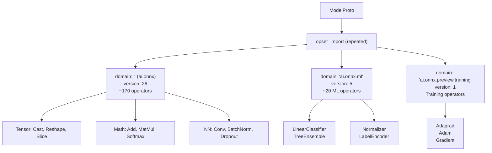
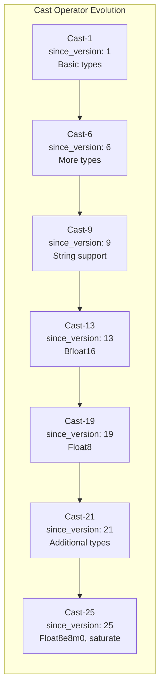
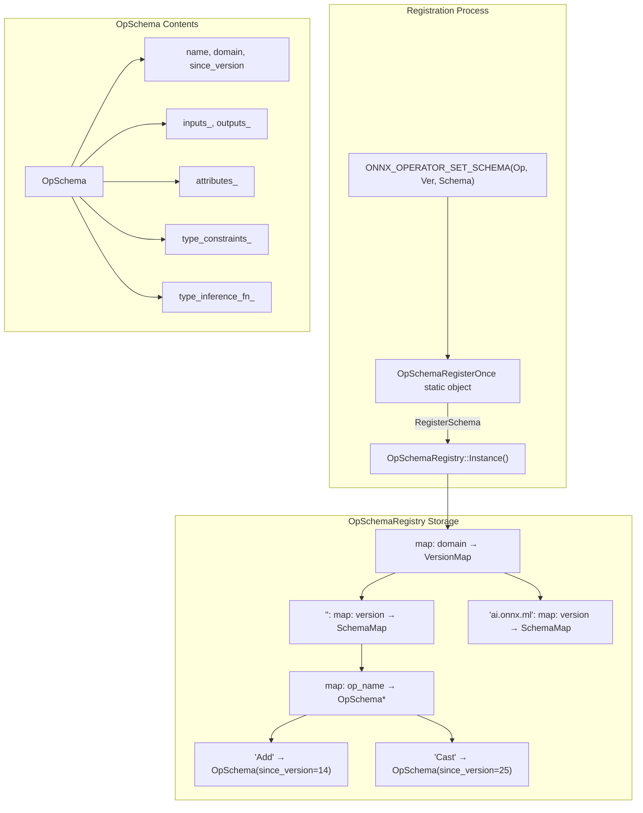
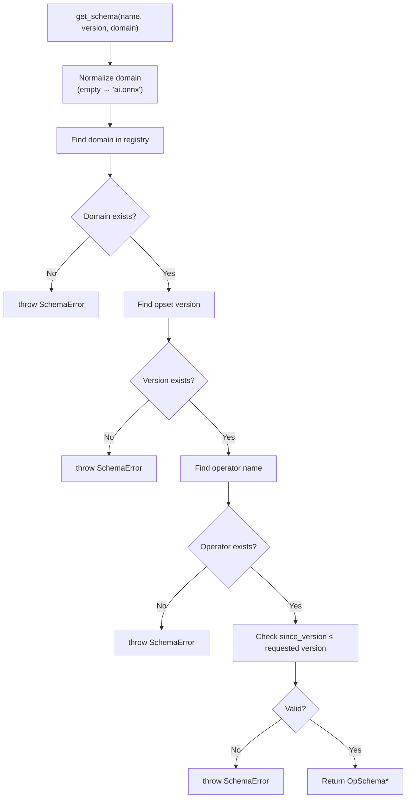
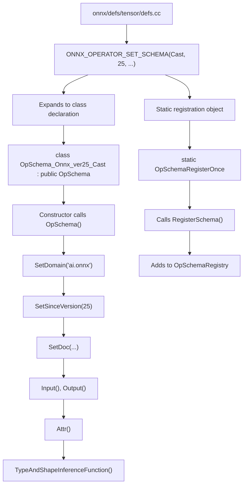
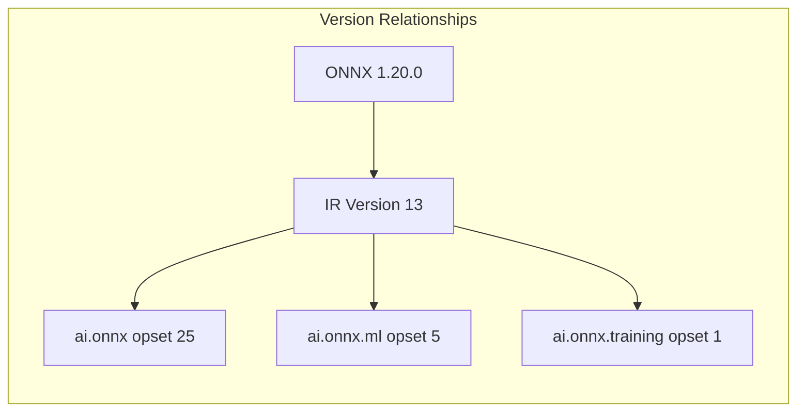
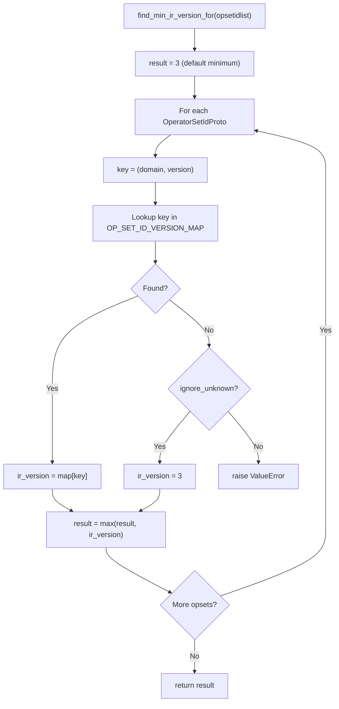
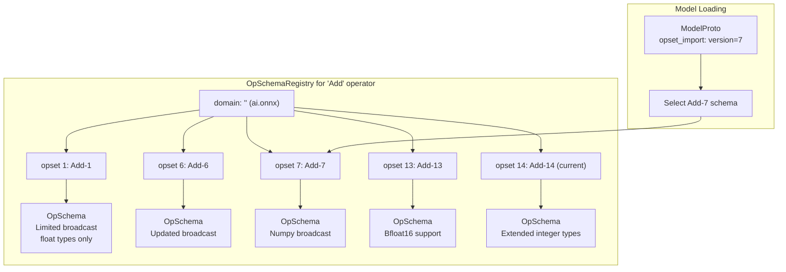
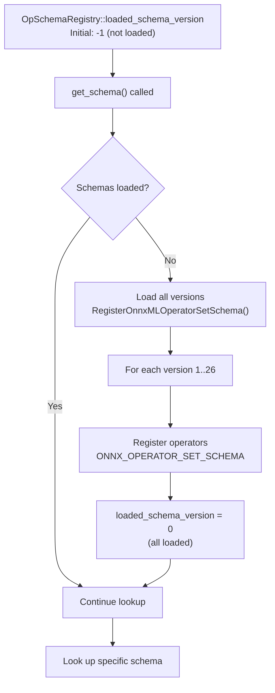

<!-- source: DeepWiki mcp.deepwiki.com · repo onnx/onnx · page 2.3 Operator Versioning and Domains · fetched 2026-10-21 -->

# Operator Versioning and Domains

<details>
<summary>Relevant source files</summary>

The following files were used as context for generating this wiki page:

- [VERSION_NUMBER](VERSION_NUMBER)
- [docs/Changelog.md](docs/Changelog.md)
- [docs/IR.md](docs/IR.md)
- [docs/OnnxReleases.md](docs/OnnxReleases.md)
- [docs/Operators.md](docs/Operators.md)
- [docs/TestCoverage.md](docs/TestCoverage.md)
- [docs/Versioning.md](docs/Versioning.md)
- [onnx/backend/test/case/node/cast.py](onnx/backend/test/case/node/cast.py)
- [onnx/backend/test/case/node/castlike.py](onnx/backend/test/case/node/castlike.py)
- [onnx/checker.cc](onnx/checker.cc)
- [onnx/checker.h](onnx/checker.h)
- [onnx/common/model_helpers.cc](onnx/common/model_helpers.cc)
- [onnx/common/status.cc](onnx/common/status.cc)
- [onnx/common/status.h](onnx/common/status.h)
- [onnx/common/version.h](onnx/common/version.h)
- [onnx/cpp2py_export.cc](onnx/cpp2py_export.cc)
- [onnx/defs/controlflow/defs.cc](onnx/defs/controlflow/defs.cc)
- [onnx/defs/controlflow/old.cc](onnx/defs/controlflow/old.cc)
- [onnx/defs/data_type_utils.cc](onnx/defs/data_type_utils.cc)
- [onnx/defs/data_type_utils.h](onnx/defs/data_type_utils.h)
- [onnx/defs/function.cc](onnx/defs/function.cc)
- [onnx/defs/function.h](onnx/defs/function.h)
- [onnx/defs/math/defs.cc](onnx/defs/math/defs.cc)
- [onnx/defs/math/old.cc](onnx/defs/math/old.cc)
- [onnx/defs/nn/defs.cc](onnx/defs/nn/defs.cc)
- [onnx/defs/nn/old.cc](onnx/defs/nn/old.cc)
- [onnx/defs/operator_sets.h](onnx/defs/operator_sets.h)
- [onnx/defs/reduction/defs.cc](onnx/defs/reduction/defs.cc)
- [onnx/defs/rnn/defs.cc](onnx/defs/rnn/defs.cc)
- [onnx/defs/rnn/old.cc](onnx/defs/rnn/old.cc)
- [onnx/defs/schema.cc](onnx/defs/schema.cc)
- [onnx/defs/schema.h](onnx/defs/schema.h)
- [onnx/defs/shape_inference.cc](onnx/defs/shape_inference.cc)
- [onnx/defs/shape_inference.h](onnx/defs/shape_inference.h)
- [onnx/defs/tensor/defs.cc](onnx/defs/tensor/defs.cc)
- [onnx/defs/tensor/old.cc](onnx/defs/tensor/old.cc)
- [onnx/helper.py](onnx/helper.py)
- [onnx/numpy_helper.py](onnx/numpy_helper.py)
- [onnx/onnx-ml.proto](onnx/onnx-ml.proto)
- [onnx/onnx-ml.proto3](onnx/onnx-ml.proto3)
- [onnx/onnx.in.proto](onnx/onnx.in.proto)
- [onnx/onnx.proto](onnx/onnx.proto)
- [onnx/onnx.proto3](onnx/onnx.proto3)
- [onnx/reference/ops/op_range.py](onnx/reference/ops/op_range.py)
- [onnx/shape_inference/implementation.cc](onnx/shape_inference/implementation.cc)
- [onnx/shape_inference/implementation.h](onnx/shape_inference/implementation.h)
- [onnx/test/helper_test.py](onnx/test/helper_test.py)
- [onnx/test/numpy_helper_test.py](onnx/test/numpy_helper_test.py)
- [onnx/test/shape_inference_test.py](onnx/test/shape_inference_test.py)

</details>


## Purpose and Scope

This document describes ONNX's operator versioning system and domain organization. It covers how operators evolve across opset versions, how domains partition the operator namespace, and how the `OpSchema` registry manages multiple versions of operators for backward compatibility.

For information about defining new operators and their schemas, see [Adding New Operators](#8.1). For details on the shape inference system that uses these schemas, see [Type and Shape Inference](#3.3).

## Overview

ONNX operators evolve over time through a versioning system that maintains backward compatibility. Each operator:
- Belongs to a **domain** (namespace for operator collections)
- Has a **since_version** indicating when it was introduced or last modified
- Is registered in the `OpSchemaRegistry` with its complete specification
- Can have multiple versions coexisting in the registry

Models specify which operator versions they use through `opset_import` declarations in the `ModelProto`, allowing runtimes to load the correct operator definitions.

## Operator Domains

### Standard Domains

ONNX partitions operators into domains to organize functionality:



**Sources:** [onnx/defs/schema.h:1-800](), [onnx/helper.py:46-104](), [docs/Operators.md:11-224]()

### Domain Constants

The domain system is defined through constants:

| Constant | Value | Description |
|----------|-------|-------------|
| `ONNX_DOMAIN` | `""` (empty string) | Default domain for standard operators (ai.onnx) |
| `ONNX_ML_DOMAIN` | `"ai.onnx.ml"` | Traditional machine learning operators |
| `AI_ONNX_PREVIEW_TRAINING_DOMAIN` | `"ai.onnx.preview.training"` | Training-specific operators |

The empty string domain is used for backward compatibility and is equivalent to `"ai.onnx"`.

**Sources:** [onnx/defs/schema.h:1-50](), [onnx/test/shape_inference_test.py:33-39]()

## Opset Versioning System

### Version Structure

Each operator schema has a `since_version` field indicating when it was introduced or last changed. When an operator changes, a new version is registered while old versions remain available:



**Sources:** [docs/Operators.md:33](), [docs/Changelog.md:370-410](), [onnx/defs/tensor/defs.cc:23-76]()

### Opset Import Declaration

Models declare which operator versions they use via `OperatorSetIdProto`:

```mermaid
graph TB
    ModelProto["ModelProto"]
    OpsetImport1["OperatorSetIdProto<br/>domain: ''<br/>version: 18"]
    OpsetImport2["OperatorSetIdProto<br/>domain: 'ai.onnx.ml'<br/>version: 3"]
    
    ModelProto -->|opset_import[0]| OpsetImport1
    ModelProto -->|opset_import[1]| OpsetImport2
    
    OpsetImport1 --> Schema1["OpSchema: Add-13"]
    OpsetImport1 --> Schema2["OpSchema: Cast-13"]
    OpsetImport1 --> Schema3["OpSchema: Reshape-14"]
    
    OpsetImport2 --> Schema4["OpSchema: LinearClassifier-1"]
    OpsetImport2 --> Schema5["OpSchema: TreeEnsemble-3"]
```

**Sources:** [onnx/onnx.proto:450-473](), [onnx/helper.py:184-199]()

## OpSchema Registry Architecture

### Schema Registration

The `OpSchema` class defines an operator's interface, and `OpSchemaRegistry` stores all versions:



**Sources:** [onnx/defs/schema.h:147-650](), [onnx/defs/schema.cc:39-112]()

### Key Data Structures

The registry uses a three-level map structure:

| Level | Key Type | Value Type | Purpose |
|-------|----------|------------|---------|
| 1 | `std::string` (domain) | `DomainToVersionRange` | Maps domain to version info |
| 2 | `int` (opset version) | `OpName_Domain_Version_Schema_Map` | Maps version to operators |
| 3 | `std::string` (operator name) | `OpSchema*` | Maps operator name to schema |

**Sources:** [onnx/defs/schema.cc:240-350]()

### Schema Lookup

Version resolution follows this algorithm:



**Sources:** [onnx/defs/schema.cc:532-600](), [onnx/cpp2py_export.cc:350-420]()

## Operator Definition and Registration

### Registration Macro

Operators are registered using the `ONNX_OPERATOR_SET_SCHEMA` macro:



**Sources:** [onnx/defs/schema.h:840-1070](), [onnx/defs/tensor/defs.cc:23-76]()

### Maintaining Old Versions

Old operator versions are preserved in `old.cc` files:

| File | Purpose | Versions |
|------|---------|----------|
| `onnx/defs/tensor/old.cc` | Older tensor operator versions | Versions 1-24 |
| `onnx/defs/math/old.cc` | Older math operator versions | Versions 1-21 |
| `onnx/defs/nn/old.cc` | Older neural network operator versions | Versions 1-21 |
| `onnx/defs/rnn/old.cc` | Older RNN operator versions | Versions 1-21 |

This separation keeps the main definition files focused on the latest version while preserving backward compatibility.

**Sources:** [onnx/defs/tensor/old.cc:1-50](), [onnx/defs/math/old.cc:1-50]()

## Version Mapping and IR Compatibility

### Version Table

The `VERSION_TABLE` in `helper.py` defines the relationship between ONNX releases, IR versions, and opset versions:



Each row in `VERSION_TABLE` specifies:
- **Release version**: ONNX package version (e.g., "1.20.0")
- **IR version**: Model format version (e.g., 13)
- **ai.onnx opset version**: Standard operators version (e.g., 25)
- **ai.onnx.ml opset version**: ML operators version (e.g., 5)
- **ai.onnx.training opset version**: Training operators version (optional, e.g., 1)

**Sources:** [onnx/helper.py:46-104]()

### IR Version Determination

The function `find_min_ir_version_for()` determines the minimum IR version needed for a model:



**Sources:** [onnx/helper.py:107-133]()

## Backward Compatibility Strategy

### Multi-Version Support

The registry maintains all operator versions simultaneously:



**Sources:** [docs/Changelog.md:50-448](), [onnx/defs/schema.cc:532-600]()

### Deprecation Process

When operators become deprecated:

1. **Mark in schema**: Set deprecation status in `OpSchema`
2. **Keep in registry**: Schema remains available for existing models
3. **Document in changelog**: Note deprecation in `Changelog.md`
4. **Update documentation**: Mark as deprecated in `Operators.md`

Example: The `Scatter` operator was deprecated in favor of `ScatterElements`:

**Sources:** [docs/Operators.md:132](), [docs/Changelog.md:1000-1100]()

## Schema Loading and Initialization

### Conditional Loading

The registry supports loading schemas on-demand or all at once:



**Sources:** [onnx/defs/schema.cc:32-58](), [onnx/defs/operator_sets.h:1-100]()

### Python Bindings

Python access to schemas is provided through `cpp2py_export.cc`:

| Python Function | C++ Implementation | Purpose |
|----------------|-------------------|---------|
| `defs.get_schema(name, version, domain)` | `OpSchemaRegistry::Schema()` | Get single operator schema |
| `defs.get_all_schemas()` | `OpSchemaRegistry::get_all_schemas()` | Get all registered schemas |
| `defs.has_schema(name, domain)` | `OpSchemaRegistry::has_schema()` | Check if schema exists |

**Sources:** [onnx/cpp2py_export.cc:350-520](), [onnx/test/shape_inference_test.py:55-88]()

## Testing and Validation

### Version-Parameterized Tests

The test suite validates all operator versions using parameterized tests:

```python
@parameterized.expand(all_versions_for("Cast"))
def test_cast(self, _, version):
    graph = self._make_graph(
        [("x", TensorProto.FLOAT, (2, 4, 3))],
        [make_node("Cast", ["x"], ["y"], to=TensorProto.UINT8)],
        [],
    )
    self._assert_inferred(
        graph,
        [make_tensor_value_info("y", TensorProto.UINT8, (2, 4, 3))],
        opset_imports=[helper.make_opsetid(ONNX_DOMAIN, version)],
    )
```

The `all_versions_for()` helper generates test cases for each version of an operator by querying the registry.

**Sources:** [onnx/test/shape_inference_test.py:55-428]()

### Schema Consistency Checks

During registration, the system validates:
- No duplicate registrations at the same (domain, version, name)
- `since_version` matches the opset version
- Type constraints are properly defined
- Input/output specifications are complete

**Sources:** [onnx/defs/schema.cc:39-112]()

## Summary

The ONNX operator versioning and domain system provides:

1. **Namespace Organization**: Domains partition operators by functionality (standard, ML, training)
2. **Version Evolution**: Each operator can evolve through multiple versions while maintaining backward compatibility
3. **Registry System**: `OpSchemaRegistry` maintains all operator versions indexed by (domain, version, name)
4. **Model Compatibility**: Models declare required operator versions via `opset_import`, enabling version resolution
5. **IR Versioning**: Version mapping tables link ONNX releases to IR versions and opset versions
6. **Backward Compatibility**: Old operator versions remain in the registry, preserved in `old.cc` files

This architecture enables ONNX to evolve operators over time while ensuring existing models continue to work correctly.

**Sources:** [onnx/defs/schema.h:1-1070](), [onnx/defs/schema.cc:1-900](), [onnx/helper.py:46-133](), [docs/IR.md:1-500]()

---

