<!-- source: DeepWiki mcp.deepwiki.com · repo onnx/onnx · page 2.4 Model Extensions and Features · fetched 2026-10-21 -->

# Model Extensions and Features

<details>
<summary>Relevant source files</summary>

The following files were used as context for generating this wiki page:

- [VERSION_NUMBER](VERSION_NUMBER)
- [docs/IR.md](docs/IR.md)
- [docs/OnnxReleases.md](docs/OnnxReleases.md)
- [docs/Versioning.md](docs/Versioning.md)
- [onnx/__init__.py](onnx/__init__.py)
- [onnx/checker.py](onnx/checker.py)
- [onnx/common/version.h](onnx/common/version.h)
- [onnx/compose.py](onnx/compose.py)
- [onnx/defs/data_type_utils.cc](onnx/defs/data_type_utils.cc)
- [onnx/defs/data_type_utils.h](onnx/defs/data_type_utils.h)
- [onnx/external_data_helper.py](onnx/external_data_helper.py)
- [onnx/helper.py](onnx/helper.py)
- [onnx/model_container.py](onnx/model_container.py)
- [onnx/numpy_helper.py](onnx/numpy_helper.py)
- [onnx/onnx-ml.proto](onnx/onnx-ml.proto)
- [onnx/onnx-ml.proto3](onnx/onnx-ml.proto3)
- [onnx/onnx.in.proto](onnx/onnx.in.proto)
- [onnx/onnx.proto](onnx/onnx.proto)
- [onnx/onnx.proto3](onnx/onnx.proto3)
- [onnx/onnx_cpp2py_export/checker.pyi](onnx/onnx_cpp2py_export/checker.pyi)
- [onnx/reference/ops/op_range.py](onnx/reference/ops/op_range.py)
- [onnx/serialization.py](onnx/serialization.py)
- [onnx/test/basic_test.py](onnx/test/basic_test.py)
- [onnx/test/checker_test.py](onnx/test/checker_test.py)
- [onnx/test/compose_test.py](onnx/test/compose_test.py)
- [onnx/test/helper_test.py](onnx/test/helper_test.py)
- [onnx/test/numpy_helper_test.py](onnx/test/numpy_helper_test.py)
- [onnx/test/serialization_test.py](onnx/test/serialization_test.py)
- [onnx/test/test_external_data.py](onnx/test/test_external_data.py)

</details>


This document describes advanced features and extensions of the ONNX model format beyond the basic computation graph: **external data storage** for large tensors, **model metadata** for documentation and attribution, **training extensions** for trainable models, and **multi-device support** for distributed execution.

For information about basic model structure and inference graphs, see [ONNX Model Representation](#2). For operator versioning, see [Operator Versioning and Domains](#2.3).

## Overview

ONNX models support several optional extensions that enable advanced use cases:

- **External Data Storage** (IR version ≥ 3): Store large tensor data in separate files to overcome the 2GB protobuf size limit
- **Model Metadata** (IR version ≥ 10): Attach key-value metadata to models, graphs, nodes, and tensors for documentation and tooling
- **Training Extensions** (IR version ≥ 7): Define trainable models with initialization and training algorithm graphs
- **Multi-Device Execution** (IR version ≥ 11): Specify how computation should be distributed across multiple devices

These features are optional. Implementations can ignore extensions they do not support while still processing the core model graph.

**Sources:** [docs/IR.md:1-91](), [onnx/onnx.proto:1-127](), [onnx/__init__.py:64-72]()

## External Data Storage

### Overview and Motivation

ONNX models are serialized using Protocol Buffers, which has a 2GB file size limit. For large models with billions of parameters, tensor data must be stored externally. The external data feature allows `TensorProto` objects to reference data stored in separate files rather than embedding it directly in the protobuf message.

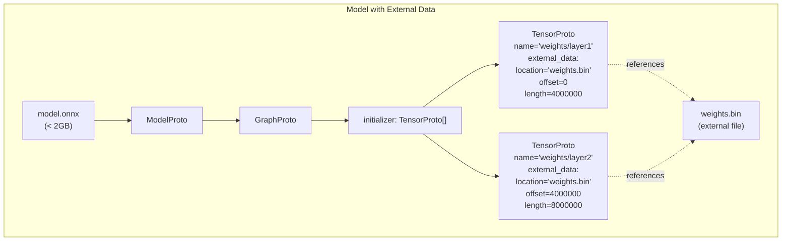

**Key concepts:**
- Tensors with external data have `raw_data` field empty
- `external_data` field contains key-value pairs specifying file location and offsets
- Multiple tensors can share the same external file using different offsets
- External files are located relative to the model file directory

**Sources:** [onnx/external_data_helper.py:1-46](), [docs/IR.md:603-677](), [onnx/checker.py:36]()

### TensorProto External Data Fields

The `TensorProto.external_data` field contains a list of `StringStringEntryProto` with the following standard keys:

| Key | Required | Description |
|-----|----------|-------------|
| `location` | **Yes** | Relative file path from model directory |
| `offset` | No | Byte offset into file (default: 0) |
| `length` | No | Number of bytes to read (default: read to end) |
| `checksum` | No | SHA1 digest for data integrity validation |
| `basepath` | No | Alternative base directory path |

**Example external_data encoding:**
```
external_data {
  key: "location"
  value: "model_data/weights.bin"
}
external_data {
  key: "offset"
  value: "0"
}
external_data {
  key: "length"
  value: "4194304"
}
external_data {
  key: "checksum"
  value: "5d41402abc4b2a76b9719d911017c592"
}
```

**Sources:** [onnx/external_data_helper.py:28-44](), [onnx/onnx.proto:720-749]()

### Python API for External Data

Diagram: **External Data API Functions**

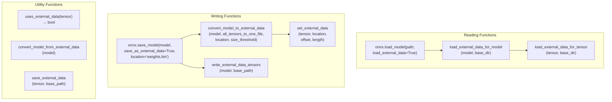

**Sources:** [onnx/__init__.py:64-87](), [onnx/external_data_helper.py:46-240]()

#### Loading External Data

The `load_model` function automatically loads external data when `load_external_data=True` (default):

```python
# Automatic loading
model = onnx.load_model("model.onnx")  # Loads external data from same directory

# Manual loading for different directory
model = onnx.load_model("model.onnx", load_external_data=False)
onnx.load_external_data_for_model(model, "/path/to/data/")
```

**Function signatures:**
- `load_external_data_for_model(model: ModelProto, base_dir: str)` - Loads all external data in model
- `load_external_data_for_tensor(tensor: TensorProto, base_dir: str)` - Loads single tensor's data
- `uses_external_data(tensor: TensorProto) → bool` - Checks if tensor uses external storage

**Sources:** [onnx/__init__.py:204-233](), [onnx/external_data_helper.py:46-113]()

#### Saving External Data

When saving large models, use `save_as_external_data=True` to automatically convert tensors to external storage:

```python
# Save with automatic external data conversion
onnx.save_model(
    model,
    "model.onnx",
    save_as_external_data=True,
    all_tensors_to_one_file=True,      # All tensors in one file
    location="weights.bin",             # External file name
    size_threshold=1024,                # Only tensors >= 1KB
    convert_attribute=False             # Don't convert attribute tensors
)
```

**Parameters for `save_model`:**

| Parameter | Type | Default | Description |
|-----------|------|---------|-------------|
| `save_as_external_data` | `bool` | `False` | Enable external data conversion |
| `all_tensors_to_one_file` | `bool` | `True` | Use single external file vs. one per tensor |
| `location` | `str` | model name | External file name (relative path) |
| `size_threshold` | `int` | `1024` | Minimum tensor size in bytes to externalize |
| `convert_attribute` | `bool` | `False` | Also convert tensors in node attributes |

**Sources:** [onnx/__init__.py:293-343](), [onnx/external_data_helper.py:114-178]()

#### Manual Conversion

For more control, use `convert_model_to_external_data` directly:

```python
# Convert model in-place
onnx.convert_model_to_external_data(
    model,
    all_tensors_to_one_file=True,
    location="model_data.bin",
    size_threshold=0,  # Convert all tensors
    convert_attribute=True
)

# Then save
onnx.save_model(model, "model.onnx")
```

To convert back to embedded data:

```python
# Load external data and embed it
onnx.load_external_data_for_model(model, base_dir)
onnx.convert_model_from_external_data(model)
```

**Sources:** [onnx/external_data_helper.py:179-240](), [onnx/__init__.py:83-87]()

### External Data File Organization

There are two main strategies for organizing external data files:

#### Strategy 1: Single External File

All tensors stored in one file with different offsets. This is the default and recommended approach.

```
model_directory/
├── model.onnx              # Model with metadata
└── weights.bin             # All tensor data
```

**Advantages:**
- Simple file management
- Efficient for sequential reading
- Easier to transfer/backup

**Implementation:**
```python
onnx.save_model(model, "model.onnx", 
                save_as_external_data=True,
                all_tensors_to_one_file=True)
```

#### Strategy 2: Multiple External Files

Each tensor in its own file, named by tensor name.

```
model_directory/
├── model.onnx
├── weights_layer1.bin
├── weights_layer2.bin
└── weights_layer3.bin
```

**Advantages:**
- Can selectively load/update individual tensors
- Easier parallel file I/O

**Implementation:**
```python
onnx.save_model(model, "model.onnx",
                save_as_external_data=True,
                all_tensors_to_one_file=False)
```

**Sources:** [onnx/external_data_helper.py:114-178](), [onnx/test/test_external_data.py:40-100]()

### Security Considerations

The external data feature includes several security validations:

**Path traversal prevention:**
- Validates that external data paths don't contain `..` or absolute paths
- Enforced by `_sanitize_path` function
- Prevents accessing files outside model directory

**Validation functions:**
- `check_model(model)` validates external data references
- Ensures all referenced files can be resolved
- Checks that offset + length don't exceed file size

**Example security check:**
```python
# This raises an error (path traversal attempt)
set_external_data(tensor, location="../../../etc/passwd")  # ValueError

# This is safe (relative path within directory)
set_external_data(tensor, location="data/weights.bin")  # OK
```

**Sources:** [onnx/external_data_helper.py:242-285](), [onnx/checker.py:121-148]()

## Model Metadata

### Metadata Properties Overview

ONNX models support attaching arbitrary key-value metadata to multiple proto types. The `metadata_props` field was introduced in **IR version 10** and is available on:

- `ModelProto` - Model-level metadata
- `GraphProto` - Graph-level metadata  
- `FunctionProto` - Function-level metadata
- `NodeProto` - Node-level metadata
- `TensorProto` - Tensor-level metadata
- `ValueInfoProto` - Value-level metadata

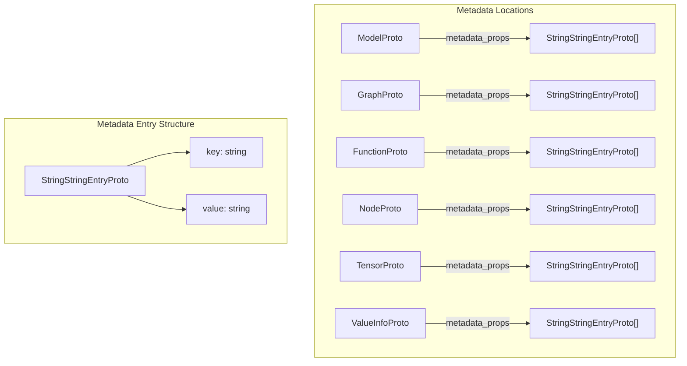

**Sources:** [onnx/onnx.proto:489-596](), [onnx/helper.py:342-361]()

### Standard Model Metadata

The ONNX specification defines standard optional metadata properties for models:

| Property | Description | Example |
|----------|-------------|---------|
| `model_author` | Comma-separated list of author names | "Jane Smith, John Doe" |
| `model_license` | License name or URL | "Apache-2.0" or "https://..." |

Additional custom metadata can be added for tooling-specific purposes. Keys should be distinct within each proto instance.

**Sources:** [docs/IR.md:113-120](), [onnx/helper.py:342-361]()

### Python API for Metadata

#### Setting Metadata

Use `set_metadata_props` or `set_model_props` to set metadata:

```python
# Set model-level metadata
model = onnx.helper.make_model(graph)
onnx.helper.set_model_props(model, {
    "model_author": "Jane Doe, AI Team",
    "model_license": "MIT",
    "custom_tool": "MyConverter v2.0"
})

# Or use set_metadata_props (more general)
onnx.helper.set_metadata_props(node, {
    "optimization_hint": "fuse_with_next",
    "device_preference": "GPU"
})
```

**Function behavior:**
- Clears existing metadata before setting new values
- Keys and values must be strings
- Keys should be distinct (no duplicates)

**Sources:** [onnx/helper.py:342-361](), [onnx/test/helper_test.py:395-410]()

#### Reading Metadata

Metadata is stored as repeated `StringStringEntryProto` fields:

```python
# Read model metadata
for prop in model.metadata_props:
    print(f"{prop.key}: {prop.value}")

# Convert to dict
metadata_dict = {prop.key: prop.value for prop in model.metadata_props}
```

#### Validation

The checker ensures metadata keys are unique:

```python
# This passes
onnx.checker.check_model(model)

# Adding duplicate key raises ValidationError
dupe = model.metadata_props.add()
dupe.key = "model_author"
dupe.value = "Different Author"
onnx.checker.check_model(model)  # ValidationError: duplicate key
```

**Sources:** [onnx/test/helper_test.py:395-410](), [onnx/checker.py:121-148]()

## Training Extensions

### TrainingInfoProto Structure

The training extension is represented by `TrainingInfoProto` messages stored in the `ModelProto.training_info` field. Each `TrainingInfoProto` defines a single training iteration consisting of two phases: initialization and algorithm execution.

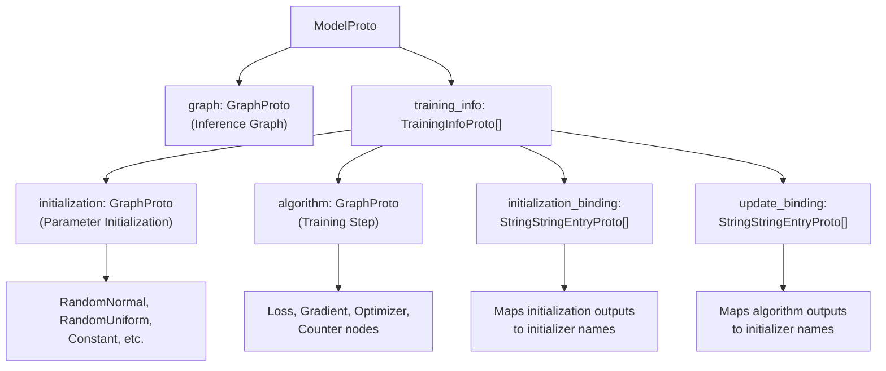

**Sources:** [onnx/onnx.proto:322-438](), [onnx/onnx.in.proto:321-437]()

### Initialization Graph

The `initialization` field contains a `GraphProto` that computes initial values for trainable parameters. This graph has no inputs and produces outputs that are bound to initializers through `initialization_binding`.

| Field | Type | Description |
|-------|------|-------------|
| `initialization` | `GraphProto` | Graph to compute initial tensor values |
| `initialization_binding` | `StringStringEntryProto[]` | Maps graph outputs to initializer names |

Common use cases:
- Randomizing weights using `RandomNormal` or `RandomUniform` operators
- Setting initial optimizer state (e.g., momentum to zero)
- Resetting training iteration counters

**Example initialization_binding:**
```
key: "weights/W1"  → value: "init_output_0"
key: "momentum/m1" → value: "init_output_1"
```

**Sources:** [onnx/onnx.proto:341-395](), [docs/IR.md:88-110]()

### Algorithm Graph

The `algorithm` field contains a `GraphProto` representing one training step. This graph is conceptually combined with the inference graph to form the complete training computation.

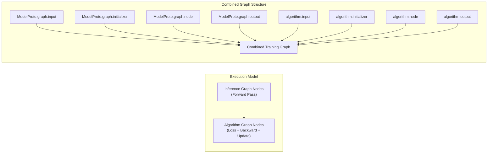

The algorithm graph typically contains:
- **Loss computation nodes** - calculate training loss from inference outputs
- **Gradient nodes** - compute gradients with respect to trainable parameters
- **Optimizer nodes** - apply gradient updates (SGD, Adam, etc.)
- **State update nodes** - increment iteration counters, update learning rate schedules

**Sources:** [onnx/onnx.proto:356-387](), [onnx/onnx-ml.proto:359-388]()

### Update Bindings and Mutable Variables

The `update_binding` field specifies which initializers should be updated after executing the algorithm graph. This implements the variable assignment semantics needed for training.

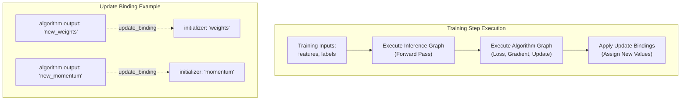

**Update binding constraints:**
1. Keys must be unique across all `update_binding` entries (single assignment)
2. Keys must reference initializers in `ModelProto.graph.initializer` or `TrainingInfoProto.algorithm.initializer`
3. Values must reference outputs from `algorithm` or `ModelProto.graph.output`
4. Mutable variables are initialized from their corresponding initializer values

**Sources:** [onnx/onnx.proto:397-437](), [onnx/onnx.in.proto:396-437]()

### Training Execution Semantics

The complete training workflow involves three operations:

| Operation | Purpose | Frequency |
|-----------|---------|-----------|
| **Initialize** | Reset model to untrained state | Once at start, or between training runs |
| **Train Step** | Execute one gradient descent iteration | Every training batch |
| **Inference** | Run forward pass without training | During evaluation |

**Initialize:**
```
1. Set all initializers to their default values
2. For each TrainingInfoProto in training_info:
   a. Execute initialization graph
   b. Apply initialization_binding to update initializers
```

**Train Step:**
```
1. For each TrainingInfoProto in training_info:
   a. Execute combined inference + algorithm graph
   b. Apply update_binding to update initializers
```

**Sources:** [onnx/onnx.proto:328-340](), [docs/IR.md:106-110]()

## Multi-Device Support

### Device Configuration Overview

Multi-device support enables ONNX models to specify how computation should be distributed across multiple devices (GPUs, TPUs, or other accelerators). This is introduced in **IR version 11** through several protobuf messages.

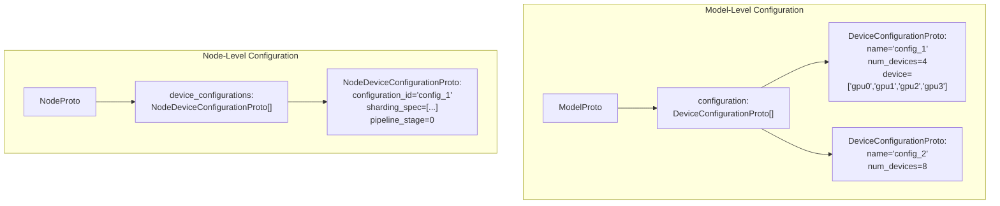

**Sources:** [onnx/onnx.proto:520-535](), [onnx/onnx.proto:244-264]()

### DeviceConfigurationProto

Models can define multiple device configurations, each describing a specific multi-device setup. A configuration is identified by a unique name.

| Field | Type | Required | Description |
|-------|------|----------|-------------|
| `name` | `string` | **Yes** | Unique identifier for this configuration |
| `num_devices` | `int32` | **Yes** | Total number of devices in this configuration |
| `device` | `string[]` | Optional | Names of devices (length must equal `num_devices` if provided) |

**Example:**
```
DeviceConfigurationProto {
  name: "data_parallel_4gpu"
  num_devices: 4
  device: ["cuda:0", "cuda:1", "cuda:2", "cuda:3"]
}
```

**Sources:** [onnx/onnx.proto:525-535](), [onnx/onnx-ml.proto:526-535]()

### NodeDeviceConfigurationProto

Individual nodes can specify how they should be executed across devices by including `NodeDeviceConfigurationProto` messages in their `device_configurations` field.

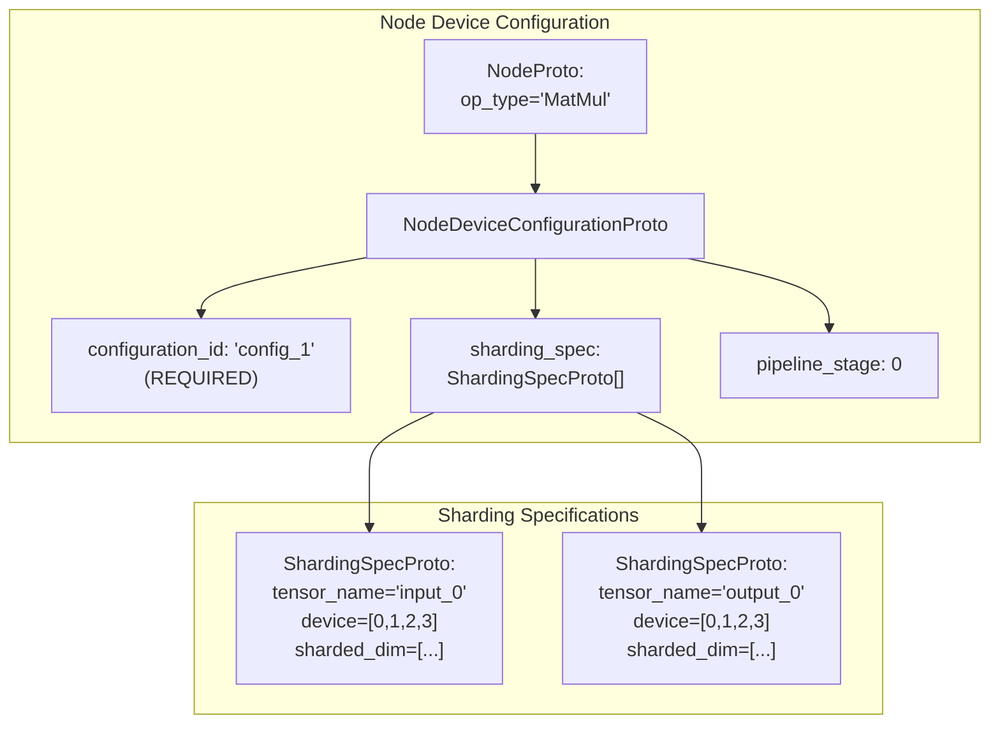

| Field | Type | Required | Description |
|-------|------|----------|-------------|
| `configuration_id` | `string` | **Yes** | Must match a `DeviceConfigurationProto.name` |
| `sharding_spec` | `ShardingSpecProto[]` | Optional | Describes how inputs/outputs are sharded |
| `pipeline_stage` | `int32` | Optional | Pipeline stage for pipeline parallelism |

**Sources:** [onnx/onnx.proto:255-264](), [onnx/onnx.in.proto:254-263]()

### Tensor Sharding Specifications

The `ShardingSpecProto` describes how a specific tensor (node input or output) is distributed across devices. This enables data parallelism, model parallelism, and hybrid strategies.

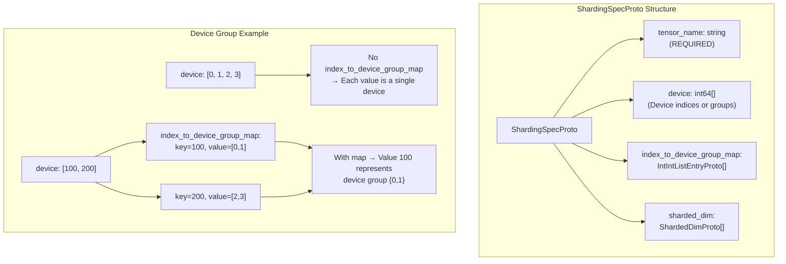

| Field | Type | Required | Description |
|-------|------|----------|-------------|
| `tensor_name` | `string` | **Yes** | Name of input or output tensor being sharded |
| `device` | `int64[]` | Optional | Device indices or device group identifiers |
| `index_to_device_group_map` | `IntIntListEntryProto[]` | Optional | Maps device group IDs to actual device sets |
| `sharded_dim` | `ShardedDimProto[]` | Optional | Sharding specification for each tensor dimension |

**Sources:** [onnx/onnx.proto:266-292](), [onnx/onnx.in.proto:265-289]()

### Dimension Sharding

Each dimension of a tensor can be independently sharded using `ShardedDimProto` and `SimpleShardedDimProto`.

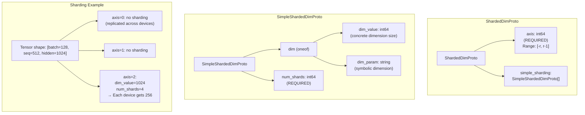

**Key properties:**
- **axis**: Which dimension to shard (supports negative indexing)
- **dim_value** or **dim_param**: The size of the dimension (can be symbolic)
- **num_shards**: How many pieces to split the dimension into (must be constant)
- Multiple `SimpleShardedDimProto` entries can handle reshape operations that fuse axes

**Sources:** [onnx/onnx.proto:292-321](), [onnx/onnx.in.proto:291-319]()

## Integration with Model Structure

Both training and multi-device features integrate cleanly with the base ONNX model structure:

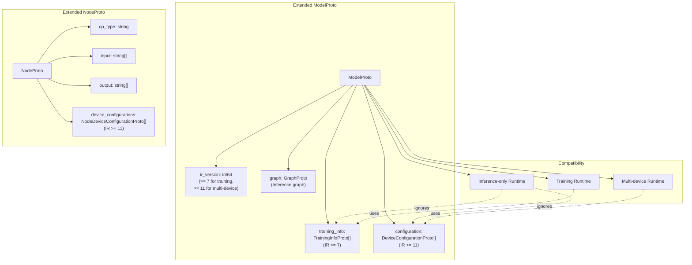

**Sources:** [onnx/onnx.proto:446-523](), [onnx/onnx.proto:220-246](), [docs/IR.md:76-91]()

## Validation and Checking

The ONNX checker validates training and multi-device annotations to ensure correctness.

### Training Validation Rules

| Rule | Location |
|------|----------|
| Initialization graph outputs must match `initialization_binding` keys | Graph validation |
| Algorithm graph outputs must match `update_binding` values | Graph validation |
| `update_binding` keys must reference existing initializers | Checker context |
| Keys in `update_binding` must be unique (single assignment) | Binding validation |
| Combined inference + algorithm graph must be valid ONNX | Graph topology check |

### Multi-Device Validation Rules

| Rule | Location |
|------|----------|
| `DeviceConfigurationProto.name` must be present and unique | Model validation |
| `DeviceConfigurationProto.num_devices` must be present | Model validation |
| If `device` array provided, length must equal `num_devices` | Array length check |
| `NodeDeviceConfigurationProto.configuration_id` must be present | Node validation |
| `configuration_id` must match an existing configuration name | Reference validation |
| `ShardingSpecProto.tensor_name` must be present | Sharding validation |
| `tensor_name` must reference a node input or output | Name resolution |
| `ShardedDimProto.axis` must be present | Dimension validation |
| `SimpleShardedDimProto.num_shards` must be present | Sharding spec validation |

**Checker implementation:**

The checker validates these constraints through multiple passes:

1. **Model-level checks** - Validate `training_info` and `configuration` fields
2. **Node-level checks** - Validate `device_configurations` references
3. **Graph combination** - Verify inference + algorithm graphs are compatible
4. **Binding validation** - Ensure bindings reference valid names

**Sources:** [onnx/checker.cc:767-793](), [onnx/checker.h:153-190](), [docs/IR.md:286-313]()

## Protobuf Message Reference

### TrainingInfoProto Fields

```
message TrainingInfoProto {
  optional GraphProto initialization = 1;
  optional GraphProto algorithm = 2;
  repeated StringStringEntryProto initialization_binding = 3;
  repeated StringStringEntryProto update_binding = 4;
}
```

### DeviceConfigurationProto Fields

```
message DeviceConfigurationProto {
  optional string name = 1;              // REQUIRED
  optional int32 num_devices = 2;        // REQUIRED
  repeated string device = 3;            // Optional names
}
```

### NodeDeviceConfigurationProto Fields

```
message NodeDeviceConfigurationProto {
  optional string configuration_id = 1;   // REQUIRED
  repeated ShardingSpecProto sharding_spec = 2;
  optional int32 pipeline_stage = 3;
}
```

### ShardingSpecProto Fields

```
message ShardingSpecProto {
  optional string tensor_name = 1;        // REQUIRED
  repeated int64 device = 2;
  repeated IntIntListEntryProto index_to_device_group_map = 3;
  repeated ShardedDimProto sharded_dim = 4;
}
```

### ShardedDimProto Fields

```
message ShardedDimProto {
  optional int64 axis = 1;                // REQUIRED
  repeated SimpleShardedDimProto simple_sharding = 2;
}
```

### SimpleShardedDimProto Fields

```
message SimpleShardedDimProto {
  oneof dim {
    int64 dim_value = 1;
    string dim_param = 2;
  }
  optional int64 num_shards = 3;         // REQUIRED
}
```

**Sources:** [onnx/onnx.proto:322-438](), [onnx/onnx.proto:525-535](), [onnx/onnx.proto:255-321]()

---

