<!-- source: DeepWiki mcp.deepwiki.com · repo onnx/onnx · page 3 ONNX Operator System · fetched 2026-10-21 -->

# ONNX Operator System

<details>
<summary>Relevant source files</summary>

The following files were used as context for generating this wiki page:

- [docs/Changelog.md](docs/Changelog.md)
- [docs/Operators.md](docs/Operators.md)
- [docs/TestCoverage.md](docs/TestCoverage.md)
- [onnx/backend/test/case/node/cast.py](onnx/backend/test/case/node/cast.py)
- [onnx/backend/test/case/node/castlike.py](onnx/backend/test/case/node/castlike.py)
- [onnx/checker.cc](onnx/checker.cc)
- [onnx/checker.h](onnx/checker.h)
- [onnx/common/model_helpers.cc](onnx/common/model_helpers.cc)
- [onnx/common/status.cc](onnx/common/status.cc)
- [onnx/common/status.h](onnx/common/status.h)
- [onnx/cpp2py_export.cc](onnx/cpp2py_export.cc)
- [onnx/defs/controlflow/defs.cc](onnx/defs/controlflow/defs.cc)
- [onnx/defs/controlflow/old.cc](onnx/defs/controlflow/old.cc)
- [onnx/defs/function.cc](onnx/defs/function.cc)
- [onnx/defs/function.h](onnx/defs/function.h)
- [onnx/defs/math/defs.cc](onnx/defs/math/defs.cc)
- [onnx/defs/math/old.cc](onnx/defs/math/old.cc)
- [onnx/defs/nn/defs.cc](onnx/defs/nn/defs.cc)
- [onnx/defs/nn/old.cc](onnx/defs/nn/old.cc)
- [onnx/defs/operator_sets.h](onnx/defs/operator_sets.h)
- [onnx/defs/reduction/defs.cc](onnx/defs/reduction/defs.cc)
- [onnx/defs/rnn/defs.cc](onnx/defs/rnn/defs.cc)
- [onnx/defs/rnn/old.cc](onnx/defs/rnn/old.cc)
- [onnx/defs/schema.cc](onnx/defs/schema.cc)
- [onnx/defs/schema.h](onnx/defs/schema.h)
- [onnx/defs/shape_inference.cc](onnx/defs/shape_inference.cc)
- [onnx/defs/shape_inference.h](onnx/defs/shape_inference.h)
- [onnx/defs/tensor/defs.cc](onnx/defs/tensor/defs.cc)
- [onnx/defs/tensor/old.cc](onnx/defs/tensor/old.cc)
- [onnx/shape_inference/implementation.cc](onnx/shape_inference/implementation.cc)
- [onnx/shape_inference/implementation.h](onnx/shape_inference/implementation.h)
- [onnx/test/shape_inference_test.py](onnx/test/shape_inference_test.py)

</details>


## Purpose and Scope

The ONNX Operator System is the core component of ONNX that defines the semantics, type constraints, and inference behavior for all operators in the standard. This page documents the operator schema registry, operator definitions across different categories, the type and shape inference system, data propagation mechanisms, function bodies, and versioning.

For information about:
- The protocol buffer representation of models and operators, see [ONNX Model Representation](#2)
- Python APIs for accessing operator schemas, see [Schema Access and Introspection](#4.5)
- Testing operator implementations, see [Testing ONNX Models and Backends](#5)
- Contributing new operators, see [Adding New Operators](#8.1)

---

## System Overview

The operator system consists of approximately 170+ operators organized into distinct categories. Each operator is defined through an `OpSchema` that specifies inputs, outputs, attributes, type constraints, and inference functions. The system supports multiple opset versions (currently 26 for standard operators, 5 for ML operators) with backward compatibility.

### High-Level Architecture

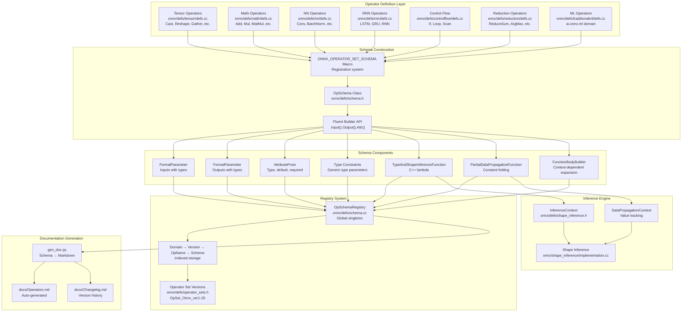

**Sources:** [onnx/defs/schema.h:147-528](), [onnx/defs/schema.cc:1-500](), [onnx/defs/tensor/defs.cc:1-100](), [onnx/defs/math/defs.cc:1-100](), [onnx/defs/nn/defs.cc:1-100](), [onnx/defs/operator_sets.h:1-200]()

---

## OpSchema Class

The `OpSchema` class is the central data structure that defines an operator. It is defined in [onnx/defs/schema.h:147-528]() and provides a fluent API for building operator definitions.

### Core Components

| Component | Type | Purpose |
|-----------|------|---------|
| `name_` | `std::string` | Operator name (e.g., "Conv", "Add") |
| `domain_` | `std::string` | Domain (e.g., "", "ai.onnx.ml") |
| `since_version_` | `int` | First opset version |
| `inputs_` | `std::vector<FormalParameter>` | Input specifications |
| `outputs_` | `std::vector<FormalParameter>` | Output specifications |
| `attributes_` | `std::vector<Attribute>` | Attribute definitions |
| `type_constraints_` | `TypeConstraintMap` | Generic type parameters |
| `type_inference_function_` | `InferenceFunction` | Shape/type inference |
| `data_propagation_function_` | `DataPropagationFunction` | Partial evaluation |

### FormalParameter Structure

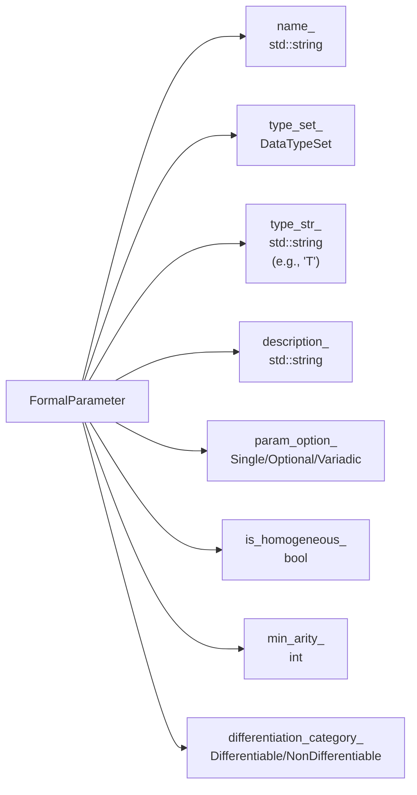

**Sources:** [onnx/defs/schema.h:184-228]()

### OpSchema Builder Pattern

Operators are defined using a fluent builder API with the `ONNX_OPERATOR_SET_SCHEMA` macro:

**Example from Cast operator:**

```cpp
// From onnx/defs/tensor/defs.cc:23-76
ONNX_OPERATOR_SET_SCHEMA(
    Cast,
    25,
    OpSchema()
        .SetDoc(Cast_ver25_doc)
        .Attr("to", "The data type to which...", AttributeProto::INT)
        .Input(0, "input", "Input tensor...", "T1", OpSchema::Single, true, 1, OpSchema::Differentiable)
        .Output(0, "output", "Output tensor...", "T2", OpSchema::Single, true, 1, OpSchema::Differentiable)
        .TypeConstraint("T1", OpSchema::all_non_complex_tensor_types_ir13(), "...")
        .TypeConstraint("T2", OpSchema::all_non_complex_tensor_types_ir13(), "...")
        .TypeAndShapeInferenceFunction([](InferenceContext& ctx) {
            propagateElemTypeFromAttributeToOutput(ctx, "to", 0);
            if (hasNInputShapes(ctx, 1)) {
                propagateShapeFromInputToOutput(ctx, 0, 0);
            }
        })
);
```

**Sources:** [onnx/defs/tensor/defs.cc:23-76]()

---

## Operator Categories and File Organization

Operators are organized into category-specific source files. Each category contains related operator definitions.

### Operator Category Mapping

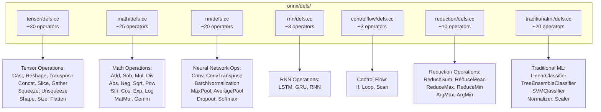

**Sources:** [onnx/defs/tensor/defs.cc:1-1000](), [onnx/defs/math/defs.cc:1-500](), [onnx/defs/nn/defs.cc:1-400](), [onnx/defs/rnn/defs.cc:1-200](), [onnx/defs/controlflow/defs.cc:1-200](), [onnx/defs/reduction/defs.cc:1-100]()

### Old Version Files

Each category has an `old.cc` file containing deprecated operator versions for backward compatibility:

- [onnx/defs/tensor/old.cc:1-10000]() - Old tensor operator versions
- [onnx/defs/math/old.cc:1-5000]() - Old math operator versions  
- [onnx/defs/nn/old.cc:1-5000]() - Old NN operator versions
- [onnx/defs/controlflow/old.cc:1-3000]() - Old control flow versions

**Sources:** [onnx/defs/tensor/old.cc:1-100](), [onnx/defs/math/old.cc:1-100](), [onnx/defs/nn/old.cc:1-100]()

---

## Schema Registry System

The `OpSchemaRegistry` is a singleton that manages all operator schemas indexed by domain, version, and operator name.

### Registry Architecture

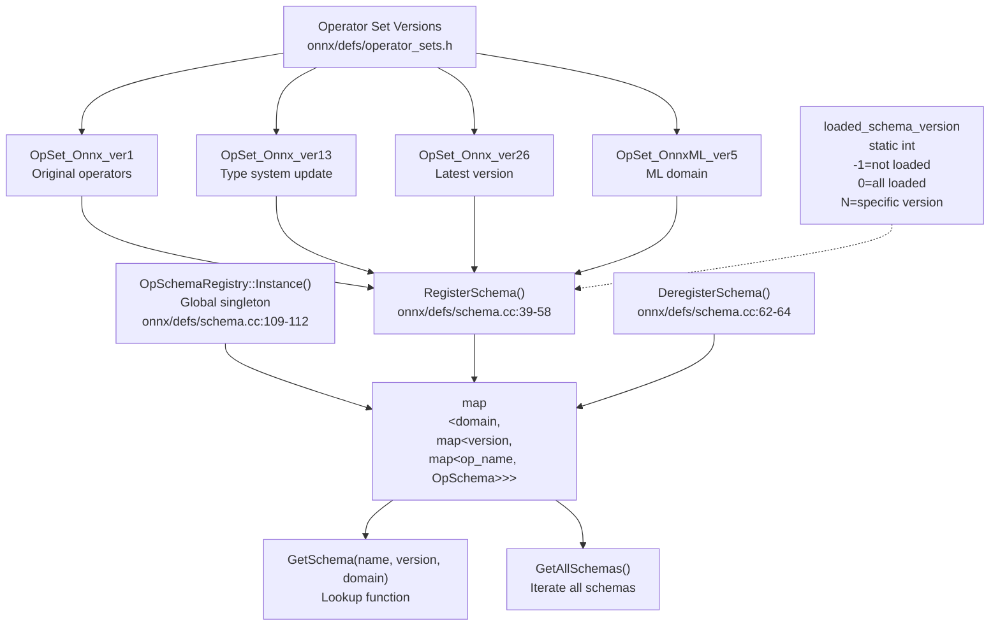

**Sources:** [onnx/defs/schema.cc:109-200](), [onnx/defs/operator_sets.h:1-300]()

### Schema Registration Flow

The registration process uses macros to create schema objects at static initialization time:

| Step | Macro/Function | Purpose |
|------|----------------|---------|
| 1 | `ONNX_OPERATOR_SET_SCHEMA(name, version, ...)` | Define schema inline |
| 2 | Creates class `ONNX_OPERATOR_SET_SCHEMA_CLASS_NAME(domain, ver, name)` | Generate unique class |
| 3 | `OpSchemaRegisterOnce::OpSchemaRegisterImpl()` | Register with singleton |
| 4 | Store in `OpSchemaRegistry::map_` | Index by domain/version/name |

**Example registration:**

From [onnx/defs/math/defs.cc:100-105]():
```cpp
ONNX_OPERATOR_SET_SCHEMA(
    Add,
    14,
    OpSchema().FillUsing(MathDocGenerator("addition"))
              .PartialDataPropagationFunction([](DataPropagationContext& ctx) {
                  MathOpDataPropagator(ctx, "Add");
              }));
```

This expands to create a class and register it with the `OpSchemaRegistry`.

**Sources:** [onnx/defs/schema.cc:39-58](), [onnx/defs/schema.h:550-650]()

---

## Type Constraints

Type constraints define generic type parameters and their allowed data types. They enable type polymorphism while maintaining type safety.

### Type Constraint System

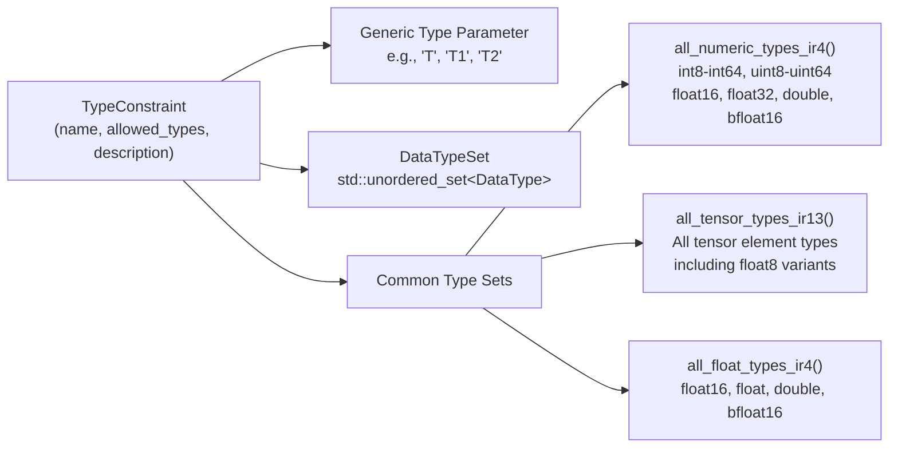

**Example from Add operator:**

From [onnx/defs/math/defs.cc:87-88]():
```cpp
.TypeConstraint(
    "T", 
    OpSchema::all_numeric_types_ir4(), 
    "Constrain input and output types to all numeric tensors.")
```

### Homogeneous Type Constraints

When a type parameter appears multiple times (e.g., inputs A and B both use "T"), the checker enforces that all uses have the same concrete type at runtime.

**Sources:** [onnx/defs/schema.h:122-126](), [onnx/defs/schema.cc:114-147]()

---

## Shape and Type Inference

The shape inference system computes output shapes and types based on input shapes, types, and operator semantics. This is critical for model optimization and validation.

### Inference Architecture

```mermaid
graph TB
    subgraph "Inference Context"
        InfCtx["InferenceContext<br/>onnx/defs/shape_inference.h:83-425"]
        NumInputs["getNumInputs()"]
        NumOutputs["getNumOutputs()"]
        InputType["getInputType(i)<br/>const TypeProto*"]
        OutputType["getOutputType(i)<br/>TypeProto*"]
        InputData["getInputData(i)<br/>const TensorProto*"]
        GetAttr["getAttribute(name)<br/>const AttributeProto*"]
    end
    
    subgraph "Type Inference Functions"
        InfFunc["TypeAndShapeInferenceFunction<br/>std::function&lt;void(InferenceContext&)&gt;"]
        CommonInf["Common Inference Functions<br/>onnx/defs/shape_inference.cc"]
        PropElem["propagateElemTypeFromInputToOutput(ctx, in, out)"]
        PropShape["propagateShapeFromInputToOutput(ctx, in, out)"]
        BidiCastBroadcast["bidirectionalBroadcastShapeInference(...)"]
        ConvPoolShape["convPoolShapeInference(...)"]
    end
    
    subgraph "Shape Inference Implementation"
        ShapeInfImpl["onnx/shape_inference/implementation.cc"]
        InferShapes["InferShapes(model, options)<br/>Entry point"]
        GraphInferencer["GraphInferencerImpl<br/>Per-graph inference"]
        SymbolTable["SymbolTableImpl<br/>Track symbolic dimensions"]
        MergeShapes["MergeShapes()<br/>Combine inferred with existing"]
    end
    
    subgraph "Helper Functions"
        HasNInputShapes["hasNInputShapes(ctx, n)<br/>Check shape availability"]
        HasInputShape["hasInputShape(ctx, i)<br/>Check single input"]
        GetInputShape["getInputShape(ctx, i)<br/>TensorShapeProto&"]
        UpdateOutputShape["updateOutputShape(ctx, i, dims)<br/>Set output shape"]
        GetShapeInput["getShapeInput(ctx, i)<br/>Shape from data input"]
    end
    
    InfCtx --> NumInputs
    InfCtx --> NumOutputs
    InfCtx --> InputType
    InfCtx --> OutputType
    InfCtx --> InputData
    InfCtx --> GetAttr
    
    InfFunc --> InfCtx
    CommonInf --> PropElem
    CommonInf --> PropShape
    CommonInf --> BidiCastBroadcast
    CommonInf --> ConvPoolShape
    
    InferShapes --> GraphInferencer
    GraphInferencer --> SymbolTable
    GraphInferencer --> InfFunc
    InfFunc --> CommonInf
    InfFunc --> Helper
    CommonInf --> Helper
    
    Helper --> HasNInputShapes
    Helper --> HasInputShape
    Helper --> GetInputShape
    Helper --> UpdateOutputShape
    Helper --> GetShapeInput
    
    GraphInferencer --> MergeShapes
```

**Sources:** [onnx/defs/shape_inference.h:83-425](), [onnx/shape_inference/implementation.cc:1-1000](), [onnx/defs/shape_inference.cc:1-500]()

### Inference Function Examples

**Simple element-wise operation (Abs):**

From [onnx/defs/math/defs.cc:197-208]():
```cpp
.TypeAndShapeInferenceFunction(propagateShapeAndTypeFromFirstInput)
```

**Broadcasting operation (Add):**

From [onnx/defs/math/defs.cc:89-96]():
```cpp
.TypeAndShapeInferenceFunction([](InferenceContext& ctx) {
    propagateElemTypeFromInputToOutput(ctx, 0, 0);
    if (hasNInputShapes(ctx, 2))
        bidirectionalBroadcastShapeInference(
            ctx.getInputType(0)->tensor_type().shape(),
            ctx.getInputType(1)->tensor_type().shape(),
            *ctx.getOutputType(0)->mutable_tensor_type()->mutable_shape());
})
```

**Convolution operation:**

From [onnx/defs/nn/defs.cc:304-315]():
```cpp
.TypeAndShapeInferenceFunction([use_dilation](InferenceContext& ctx) {
    propagateElemTypeFromInputToOutput(ctx, 0, 0);
    if (ctx.getNumOutputs() > 1) {
        // MaxPool with two outputs case
        auto* output_type = ctx.getOutputType(1);
        if (output_type->value_case() == TypeProto::kTensorType ||
            output_type->value_case() == TypeProto::VALUE_NOT_SET) {
            output_type->mutable_tensor_type()->set_elem_type(TensorProto::INT64);
        }
    }
    convPoolShapeInference(ctx, use_dilation, true, 0, 1);
})
```

**Sources:** [onnx/defs/math/defs.cc:189-208](), [onnx/defs/math/defs.cc:89-96](), [onnx/defs/nn/defs.cc:304-315]()

### Symbolic Shape Inference

The system supports symbolic dimensions (dimension parameters) for dynamic shapes:

| Feature | Purpose | Example |
|---------|---------|---------|
| `dim_param` | Named symbolic dimension | `batch_size`, `seq_length` |
| `SymbolTable` | Track and create symbols | Creates unique symbols like `unk__0` |
| Symbol merging | Unify equivalent symbols | If two branches produce same shape |

**Sources:** [onnx/shape_inference/implementation.h:30-65](), [onnx/defs/shape_inference.h:36-46]()

---

## Data Propagation

Data propagation enables partial evaluation of constant expressions during inference. This allows computing shapes that depend on data values.

### Data Propagation System

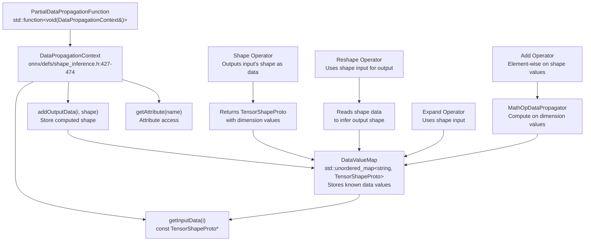

**Sources:** [onnx/defs/shape_inference.h:427-474](), [onnx/shape_inference/implementation.h:23-28]()

### Data Propagation Example

**Shape operator** ([onnx/defs/tensor/defs.cc:447-465]()):
```cpp
.PartialDataPropagationFunction([](DataPropagationContext& ctx) {
    if (hasInputShape(ctx, 0)) {
        auto& input_shape = ctx.getInputType(0)->tensor_type().shape();
        int64_t rank = static_cast<int64_t>(input_shape.dim_size());
        int64_t start = getAttribute(ctx, "start", 0);
        int64_t end = getAttribute(ctx, "end", rank);
        // ... compute slice of shape ...
        TensorShapeProto output_shape;
        for (int64_t d = start; d < end; ++d) {
            *output_shape.add_dim() = input_shape.dim(static_cast<int>(d));
        }
        ctx.addOutputData(0, std::move(output_shape));
    }
})
```

**Math operators** ([onnx/defs/math/defs.cc:20-46]()):
```cpp
static void MathOpDataPropagator(DataPropagationContext& ctx, const std::string& op_type) {
    const auto* const input_0 = ctx.getInputData(0);
    const auto* const input_1 = ctx.getInputData(1);
    if (input_0 == nullptr || input_1 == nullptr) {
        return;
    }
    // ... perform element-wise operation on dimension values ...
    TensorShapeProto tsp;
    for (int i = 0; i < size_out; ++i) {
        if (input_dim_0.has_dim_value() && input_dim_1.has_dim_value()) {
            tsp.mutable_dim()->Add()->set_dim_value(
                MathOpTwoIntegers(op_type, input_dim_0.dim_value(), input_dim_1.dim_value()));
        }
    }
    ctx.addOutputData(0, std::move(tsp));
}
```

**Sources:** [onnx/defs/tensor/defs.cc:447-465](), [onnx/defs/math/defs.cc:20-46]()

---

## Function Bodies

Some operators are defined as composite operations using function bodies rather than requiring native implementation. Function bodies can be static or context-dependent.

### Function Body System

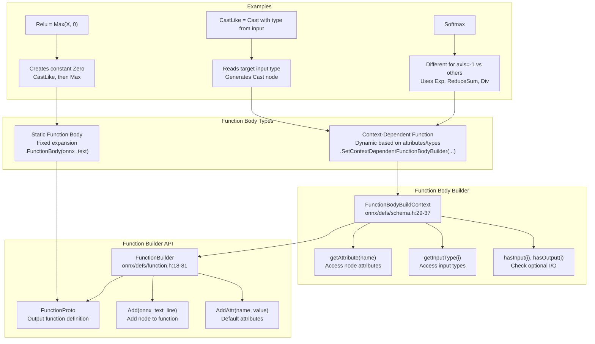

**Sources:** [onnx/defs/schema.h:29-95](), [onnx/defs/function.h:18-81]()

### Static Function Body Example

**Relu operator** ([onnx/defs/math/defs.cc:280-307]()):
```cpp
ONNX_OPERATOR_SET_SCHEMA(
    Relu,
    14,
    OpSchema()
        .SetDoc(Relu_ver14_doc)
        .Input(0, "X", "Input tensor", "T", OpSchema::Single, true, 1, OpSchema::Differentiable)
        .Output(0, "Y", "Output tensor", "T", OpSchema::Single, true, 1, OpSchema::Differentiable)
        .TypeConstraint("T", {...}, "...")
        .FunctionBody(
            R"ONNX(
          {
            Zero = Constant <value = float {0.0}>()
            ZeroCast = CastLike (Zero, X)
            Y = Max (X, ZeroCast)
          }
        )ONNX",
            18)
        .TypeAndShapeInferenceFunction(propagateShapeAndTypeFromFirstInput));
```

### Context-Dependent Function Body Example

**CastLike operator** ([onnx/defs/tensor/defs.cc:129-152]()):
```cpp
.SetContextDependentFunctionBodyBuilder(
    [](const FunctionBodyBuildContext& ctx, const OpSchema& schema, FunctionProto& functionProto) -> bool {
        auto target_type = ctx.getInputType(1);
        if ((target_type == nullptr) || (!target_type->has_tensor_type())) {
            // Cannot create function body without knowing target type
            return false;
        }
        auto target_elt_type = target_type->tensor_type().elem_type();
        FunctionBuilder builder(functionProto);
        builder.Add(MakeString(
            "output = Cast <to= ",
            static_cast<int64_t>(target_elt_type),
            ", saturate: int = @saturate> (input)").c_str());
        schema.BuildFunction(functionProto);
        return true;
    })
```

**Sources:** [onnx/defs/math/defs.cc:280-307](), [onnx/defs/tensor/defs.cc:129-152]()

---

## Operator Versioning

ONNX uses opset versioning to maintain backward compatibility while allowing operator evolution. Each operator tracks its `since_version` and older versions are preserved.

### Versioning System

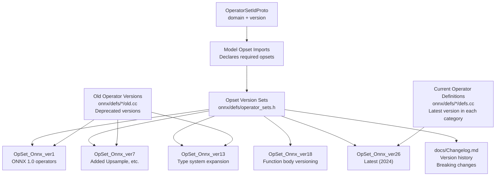

**Sources:** [onnx/defs/operator_sets.h:1-500](), [docs/Changelog.md:1-100]()

### Version Management Strategy

| Aspect | Approach |
|--------|----------|
| **New operator** | Add to current defs.cc with `since_version=N` |
| **Operator update** | Create new version in defs.cc, move old to old.cc |
| **Breaking change** | New opset version, document in Changelog.md |
| **Backward compatibility** | Keep all old versions in old.cc files |
| **Function versioning** | Function bodies can specify minimum opset |

**Example: Conv operator versions:**

- Version 1: [onnx/defs/nn/old.cc]() - Original definition
- Version 11: [onnx/defs/nn/old.cc]() - Added dilations
- Version 22: [onnx/defs/nn/defs.cc]() - Current version

**Sources:** [onnx/defs/operator_sets.h:108-3500]()

### Opset Version Declarations

Models declare their required opset versions in the `opset_import` field:

```cpp
// From model proto
message ModelProto {
    repeated OperatorSetIdProto opset_import = 8;
}

message OperatorSetIdProto {
    string domain = 1;     // "" for ai.onnx, "ai.onnx.ml", etc.
    int64 version = 2;     // Opset version number
}
```

**Sources:** [docs/Changelog.md:1-50]()

---

## Documentation Generation

Operator documentation is automatically generated from schema definitions using reflection.

### Documentation Generation Pipeline

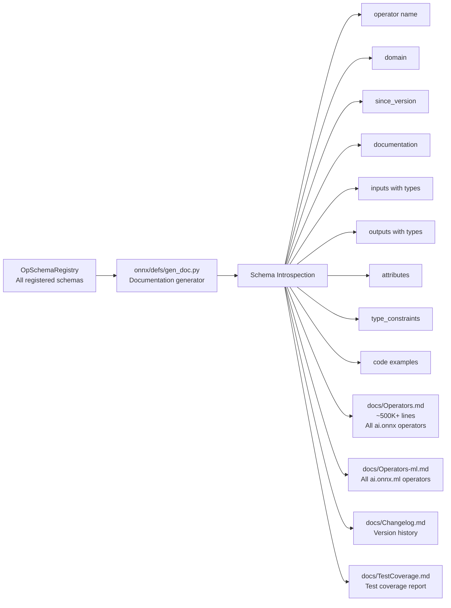

**Generated documentation structure for each operator:**

1. **Operator name and version links** - e.g., "Abs" with links to versions 1, 6, 13
2. **Description** - From `.SetDoc()` in schema
3. **Version information** - "This version... since version N"
4. **Attributes** - Name, type, default, required, description
5. **Inputs** - Name, type constraint, differentiability, description
6. **Outputs** - Same as inputs
7. **Type constraints** - Generic type parameters and allowed types
8. **Examples** - Code snippets (if provided)
9. **Sample implementation** - Reference implementation (if available)

**Example output** ([docs/Operators.md:226-298]()):
```markdown
### Abs

Absolute takes one input data (Tensor<T>) and produces one output data
(Tensor<T>) where absolute value, y = abs(x), is applied to
the tensor elementwise.

#### Version
This version of the operator has been available since version 13...

#### Inputs
- X (differentiable) : T
  Input tensor

#### Outputs
- Y (differentiable) : T
  Output tensor

#### Type Constraints
- T : tensor(uint8), tensor(uint16), ..., tensor(bfloat16)
  Constrain input and output types to all numeric tensors.
```

**Sources:** [docs/Operators.md:1-500](), [docs/Changelog.md:1-100](), [onnx/defs/gen_doc.py]() (referenced but not in file list)

---

## Usage in Model Validation

The operator system is used extensively during model checking and validation.

### Validation Flow

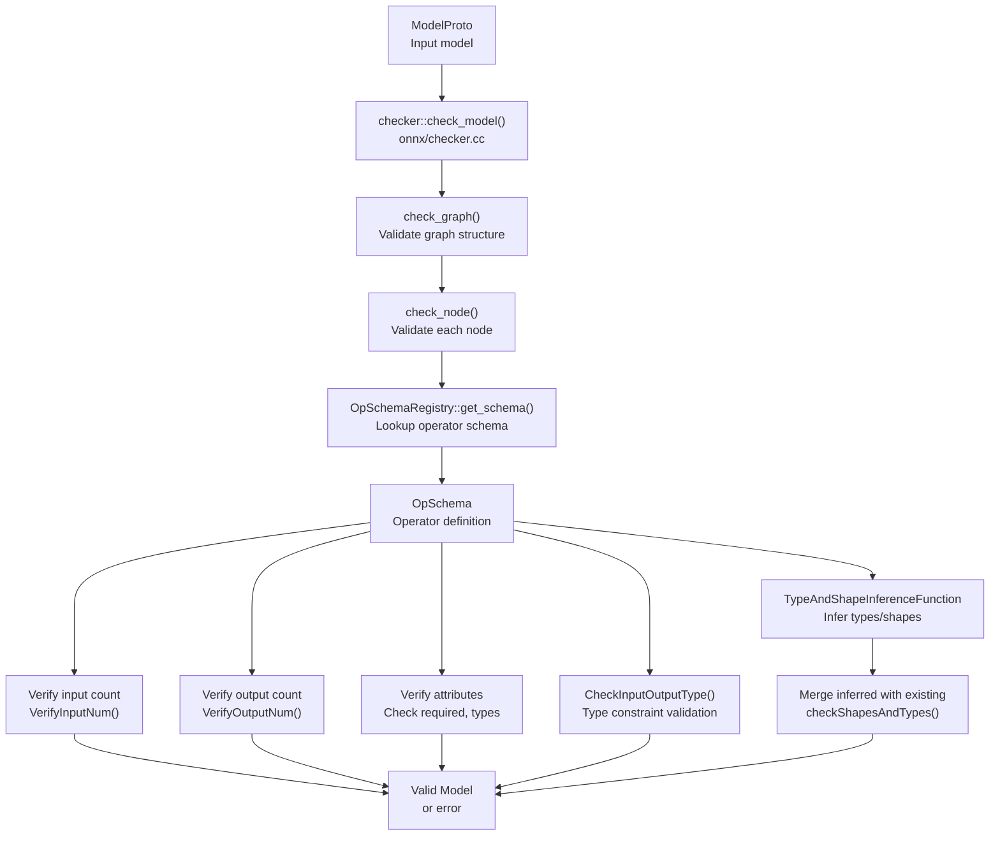

**Key validation checks:**

1. **Node validation** ([onnx/checker.cc:200-350]()):
   - Operator exists in registry for declared opset
   - Input/output count matches schema
   - All required attributes present
   - Attribute types correct

2. **Type validation** ([onnx/defs/schema.cc:114-200]()):
   - Input types satisfy type constraints
   - Homogeneous type constraints enforced
   - Output types match expected

3. **Shape inference** ([onnx/shape_inference/implementation.cc:100-500]()):
   - Compute output shapes
   - Merge with existing value_info
   - Check for conflicts

**Sources:** [onnx/checker.cc:200-400](), [onnx/defs/schema.cc:114-200](), [onnx/shape_inference/implementation.cc:100-300]()

---

## Python Bindings

The C++ operator system is exposed to Python through nanobind bindings.

### Python API Exposure

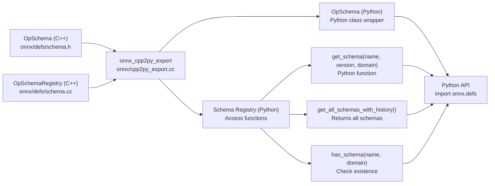

**Exported Python functions** ([onnx/cpp2py_export.cc:500-700]()):

| Python Function | C++ Source | Purpose |
|----------------|------------|---------|
| `get_schema(name, version, domain)` | `OpSchemaRegistry::Schema()` | Lookup operator schema |
| `get_all_schemas()` | `OpSchemaRegistry::get_all_schemas()` | Get all current schemas |
| `get_all_schemas_with_history()` | Iterate all versions | Get all schemas including old |
| `has_schema(name, domain)` | Check registry | Test if operator exists |

**Python usage example:**

```python
import onnx
from onnx import defs

# Get schema for specific version
schema = defs.get_schema("Conv", 11, "")

# Access schema properties
print(schema.name)               # "Conv"
print(schema.since_version)      # 11
print(schema.domain)             # ""
print(schema.doc)                # Documentation string

# Iterate inputs
for i, input in enumerate(schema.inputs):
    print(f"Input {i}: {input.name} ({input.typeStr})")

# Iterate outputs  
for i, output in enumerate(schema.outputs):
    print(f"Output {i}: {output.name} ({output.typeStr})")

# Check type constraints
for name, (types, desc) in schema.type_constraints.items():
    print(f"Type constraint {name}: {desc}")
```

**Sources:** [onnx/cpp2py_export.cc:500-800](), [onnx/defs/schema.h:147-400]()

---

## Summary

The ONNX Operator System is a sophisticated framework for defining, registering, and validating operators. Key characteristics:

| Aspect | Details |
|--------|---------|
| **Organization** | ~170 operators in 6 categories + ML domain |
| **Definition** | C++ schemas with fluent API in category-specific files |
| **Registration** | Global singleton registry indexed by domain/version/name |
| **Versioning** | 26 opset versions for ai.onnx, 5 for ai.onnx.ml |
| **Type system** | Generic type constraints with polymorphism |
| **Shape inference** | Compute output shapes from inputs + attributes |
| **Data propagation** | Partial evaluation for shape-dependent operations |
| **Function bodies** | Composite operators defined via other operators |
| **Documentation** | Auto-generated from schemas via reflection |
| **Validation** | Used by checker for model validation |
| **Python access** | Exposed via nanobind for introspection |

The system enables ONNX to maintain a stable, versioned, well-documented set of operators with strong type safety and inference capabilities.

**Sources:** [onnx/defs/schema.h:147-600](), [onnx/defs/schema.cc:1-800](), [onnx/defs/operator_sets.h:1-300](), [onnx/shape_inference/implementation.cc:1-500](), [docs/Operators.md:1-100]()

---

