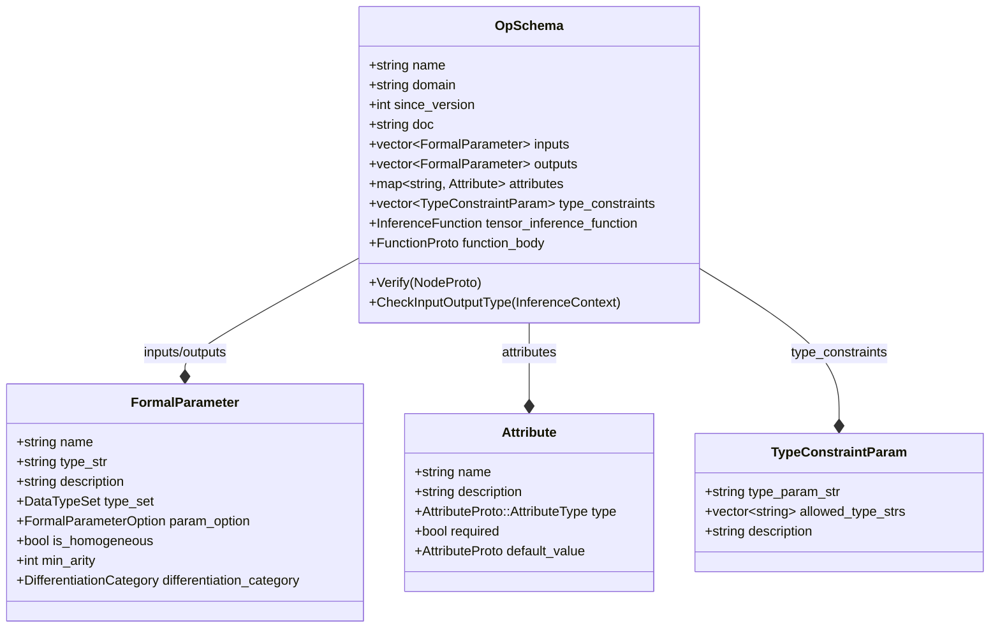
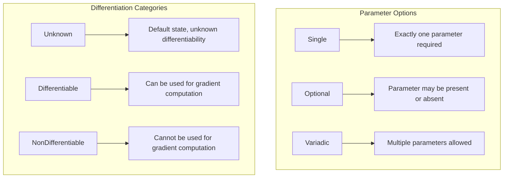
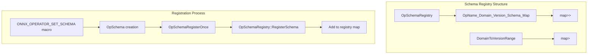
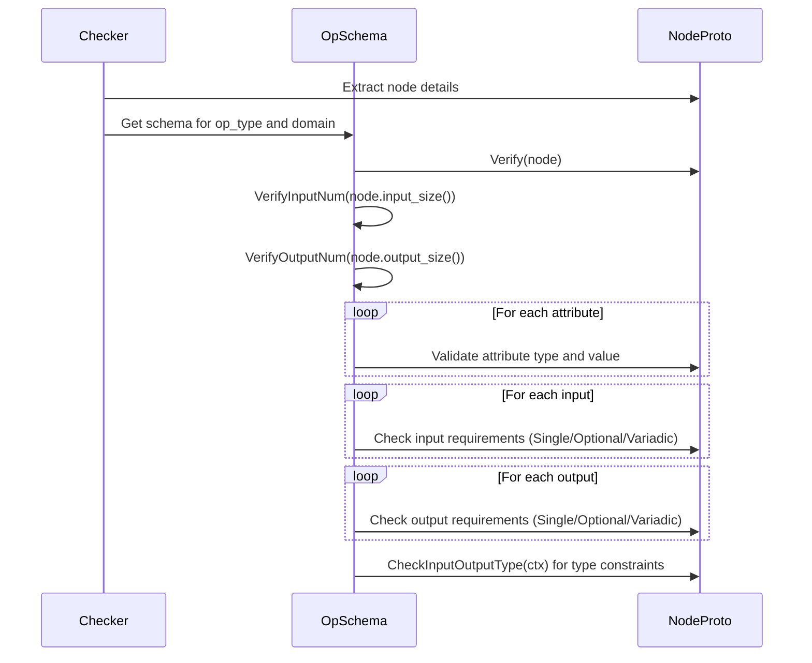
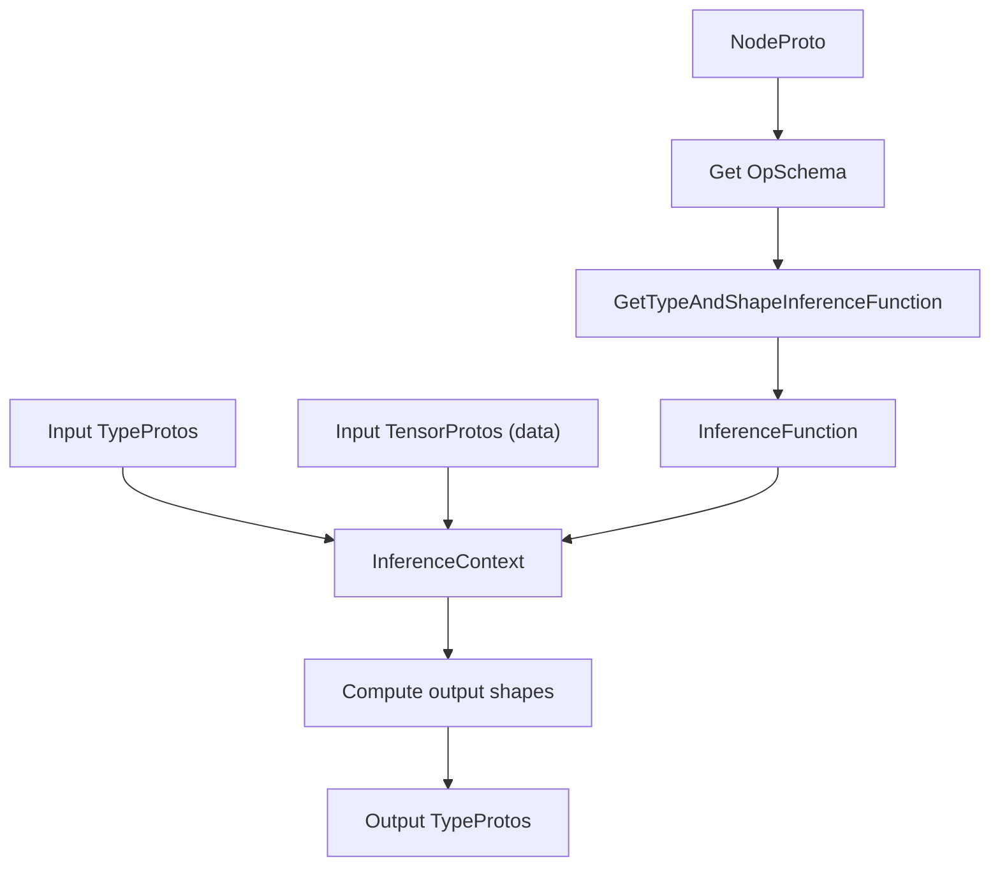
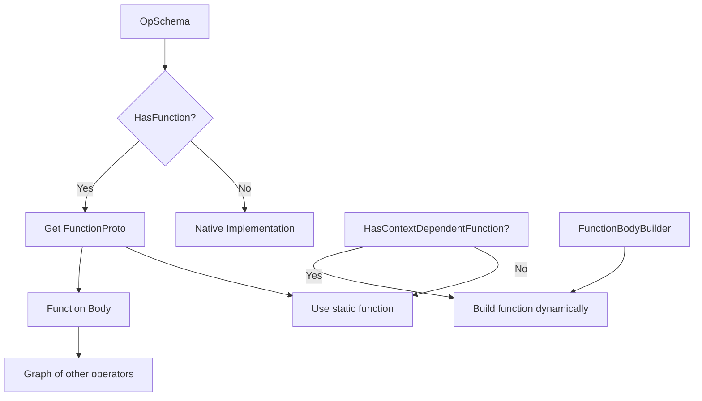
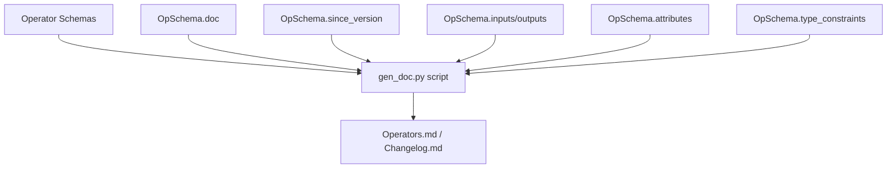

<!-- source: DeepWiki mcp.deepwiki.com · repo onnx/onnx · page 3.1 Operator Schema Registry · fetched 2026-10-21 -->

# Operator Schemas

<details>
<summary>Relevant source files</summary>

The following files were used as context for generating this wiki page:

- [docs/Changelog.md](docs/Changelog.md)
- [docs/Operators.md](docs/Operators.md)
- [docs/TestCoverage.md](docs/TestCoverage.md)
- [onnx/backend/test/case/node/cast.py](onnx/backend/test/case/node/cast.py)
- [onnx/backend/test/case/node/castlike.py](onnx/backend/test/case/node/castlike.py)
- [onnx/checker.cc](onnx/checker.cc)
- [onnx/checker.h](onnx/checker.h)
- [onnx/common/model_helpers.cc](onnx/common/model_helpers.cc)
- [onnx/common/status.cc](onnx/common/status.cc)
- [onnx/common/status.h](onnx/common/status.h)
- [onnx/cpp2py_export.cc](onnx/cpp2py_export.cc)
- [onnx/defs/controlflow/defs.cc](onnx/defs/controlflow/defs.cc)
- [onnx/defs/controlflow/old.cc](onnx/defs/controlflow/old.cc)
- [onnx/defs/function.cc](onnx/defs/function.cc)
- [onnx/defs/function.h](onnx/defs/function.h)
- [onnx/defs/math/defs.cc](onnx/defs/math/defs.cc)
- [onnx/defs/math/old.cc](onnx/defs/math/old.cc)
- [onnx/defs/nn/defs.cc](onnx/defs/nn/defs.cc)
- [onnx/defs/nn/old.cc](onnx/defs/nn/old.cc)
- [onnx/defs/operator_sets.h](onnx/defs/operator_sets.h)
- [onnx/defs/reduction/defs.cc](onnx/defs/reduction/defs.cc)
- [onnx/defs/rnn/defs.cc](onnx/defs/rnn/defs.cc)
- [onnx/defs/rnn/old.cc](onnx/defs/rnn/old.cc)
- [onnx/defs/schema.cc](onnx/defs/schema.cc)
- [onnx/defs/schema.h](onnx/defs/schema.h)
- [onnx/defs/shape_inference.cc](onnx/defs/shape_inference.cc)
- [onnx/defs/shape_inference.h](onnx/defs/shape_inference.h)
- [onnx/defs/tensor/defs.cc](onnx/defs/tensor/defs.cc)
- [onnx/defs/tensor/old.cc](onnx/defs/tensor/old.cc)
- [onnx/shape_inference/implementation.cc](onnx/shape_inference/implementation.cc)
- [onnx/shape_inference/implementation.h](onnx/shape_inference/implementation.h)
- [onnx/test/shape_inference_test.py](onnx/test/shape_inference_test.py)

</details>


Operator schemas are a fundamental component in the ONNX framework that define the specification and behavior of all operators available in ONNX. They serve as the contract between model producers and consumers, describing the inputs, outputs, attributes, type constraints, and validation rules for each operation.

For information about standard operators implemented using these schemas, see [Standard Operators](#3.2). For information about the shape inference system built on these schemas, see [Shape Inference](#3.5).

## Operator Schema Structure

The core of the operator schema system is the `OpSchema` class which encapsulates all the information needed to define an operator.



Sources: [onnx/defs/schema.h:94-859](), [onnx/defs/schema.cc:147-205]()

### Key Components

#### Formal Parameters (Inputs and Outputs)

Formal parameters define the inputs and outputs of an operator, with several important properties:

| Property | Description |
|----------|-------------|
| Name | Identifier for the parameter |
| Type String | Type specification (concrete type or type parameter) |
| Description | Documentation for the parameter |
| Option | Single, Optional, or Variadic |
| Is Homogeneous | For variadic parameters, whether all must be same type |
| Min Arity | For variadic parameters, minimum number required |
| Differentiation Category | Whether parameter is differentiable (for auto-diff) |



Sources: [onnx/defs/schema.h:152-176](), [onnx/defs/schema.h:180-289](), [onnx/defs/schema.cc:69-103]()

#### Attributes

Attributes act as configurable parameters for operators. They have the following properties:

| Property | Description |
|----------|-------------|
| Name | Identifier for the attribute |
| Type | Data type (INT, FLOAT, STRING, TENSOR, etc.) |
| Description | Documentation for the attribute |
| Required | Whether the attribute must be provided |
| Default Value | Value used if attribute is not provided |

Attributes can be scalar values or lists, and their types correspond to the `AttributeProto` types in the ONNX protobuf definition.

Sources: [onnx/defs/schema.h:428-448](), [onnx/checker.cc:427-496]()

#### Type Constraints

Type constraints define the allowed data types for inputs and outputs:

| Property | Description |
|----------|-------------|
| Type Parameter String | Identifier for the type parameter (e.g., "T") |
| Allowed Type Strings | List of allowed concrete types (e.g., ["tensor(float)", "tensor(int32)"]) |
| Description | Documentation for the constraint |

Type constraints enable polymorphic operators that can work with different data types.

Sources: [onnx/defs/schema.h:487-502](), [onnx/defs/schema.cc:577-582]()

## Schema Registration and Organization

ONNX organizes operator schemas by domain and version, allowing for evolution of operators over time.



Sources: [onnx/defs/schema.h:860-999](), [onnx/defs/schema.cc:26-60]()

### Domain Organization

Operators in ONNX are organized into domains:

| Domain | Description |
|--------|-------------|
| `""` (empty string) | Default ONNX domain, also referred to as `ai.onnx` |
| `ai.onnx.ml` | Machine learning specific operators |
| `ai.onnx.training` | Training-specific operators |
| Custom domains | User-defined operator domains |

Each domain has its own version range, specifying which opset versions are supported.

Sources: [onnx/defs/__init__.py:27-29](), [onnx/defs/schema.h:883-902]()

### Schema Registration

Operators are registered using macros or functions that add them to the registry:

```
ONNX_OPERATOR_SCHEMA(name)
    .NumInputs(n)
    .NumOutputs(n)
    .TypeConstraint("T", {"float", "double"}, "Allowed data types")
    .Input(0, "X", "Input tensor", "T")
    .Output(0, "Y", "Output tensor", "T")
    .SetDoc("Documentation")
    .TypeAndShapeInferenceFunction([](InferenceContext& ctx) {...});
```

The `OpSchema` class provides a fluent interface for defining all aspects of an operator.

Sources: [onnx/defs/schema.h:129-147](), [onnx/defs/schema.cc:377-438]()

## Schema Validation

A primary purpose of operator schemas is to validate operator nodes in an ONNX graph:



Sources: [onnx/defs/schema.cc:180-331](), [onnx/checker.cc:529-575]()

### Input and Output Validation

The schema verifies that:
- The number of inputs and outputs matches the schema specification
- Required inputs/outputs are provided
- Optional and variadic inputs/outputs are correctly handled
- Input and output types conform to type constraints

Sources: [onnx/defs/schema.cc:342-376](), [onnx/defs/schema.h:816-830]()

### Attribute Validation

For attributes, the schema checks:
- All required attributes are present
- Attribute types match the specified types
- Default values are used when attributes are missing
- No unknown attributes are provided (unless `AllowUncheckedAttributes()` is used)

Sources: [onnx/defs/schema.cc:232-330](), [onnx/checker.cc:427-496]()

## Shape Inference

Operator schemas include type and shape inference functions that determine output shapes based on input shapes:



Each schema can define a shape inference function using `TypeAndShapeInferenceFunction()`. This function:
- Takes an InferenceContext with input types and shapes
- Applies operator-specific logic to compute output shapes
- Sets the output type information in the context

Sources: [onnx/defs/schema.h:377-389](), [onnx/shape_inference.py:22-103](), [onnx/cpp2py_export.cc:65-111]()

## Function-Based Operators

ONNX allows operators to be defined as functions composed of other operators:



Function-based operators:
- Allow defining operators in terms of other operators
- Support versioning with different implementations for different opset versions
- Can be context-dependent, with function bodies built at runtime based on input types

Sources: [onnx/defs/schema.h:734-791](), [onnx/defs/schema.cc:381-409]()

## Using Operator Schemas in Python

The Python API exposes operator schemas through the `onnx.defs` module:

```python
import onnx.defs

# Get a specific schema
schema = onnx.defs.get_schema("Conv", domain="")

# Access schema properties
print(f"Name: {schema.name}")
print(f"Domain: {schema.domain}")
print(f"Since version: {schema.since_version}")
print(f"Inputs: {len(schema.inputs)}")
print(f"Outputs: {len(schema.outputs)}")

# Get all schemas
all_schemas = onnx.defs.get_all_schemas()

# Check if a schema exists
has_schema = onnx.defs.has("Conv")
```

You can also use shape inference based on schemas:

```python
import onnx.shape_inference

# Infer output types for a node
output_types = onnx.shape_inference.infer_node_outputs(
    schema, 
    node,
    input_types,
    input_data
)
```

Sources: [onnx/defs/__init__.py:32-149](), [onnx/cpp2py_export.cc:112-404](), [onnx/shape_inference.py:102-149]()

## Understanding Schema Documentation Generation

The ONNX documentation for operators is auto-generated from the schema definitions using the `gen_doc.py` script. This ensures that documentation remains in sync with the actual operator implementations.



The documentation includes:
- Operator description
- Version information
- Input and output details
- Attribute details
- Type constraints
- Examples (if available)

Sources: [onnx/defs/gen_doc.py:37-431]()

## Summary

Operator schemas are a central component of the ONNX framework that:
- Define the interface and behavior of operators
- Enable model validation and type checking
- Support shape inference
- Allow for operator versioning and evolution
- Provide a foundation for function-based operators

Understanding operator schemas is essential for both consumers and producers of ONNX models, as well as for developers extending ONNX with new operators.

Sources: [onnx/defs/schema.h:94-859](), [onnx/checker.cc:529-575](), [onnx/shape_inference.py:22-103]()

---

