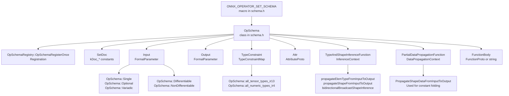
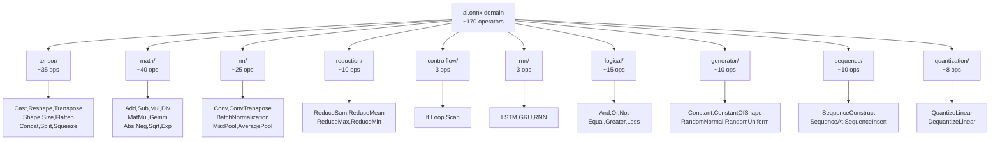
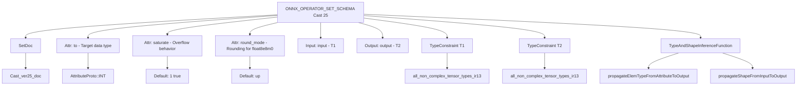
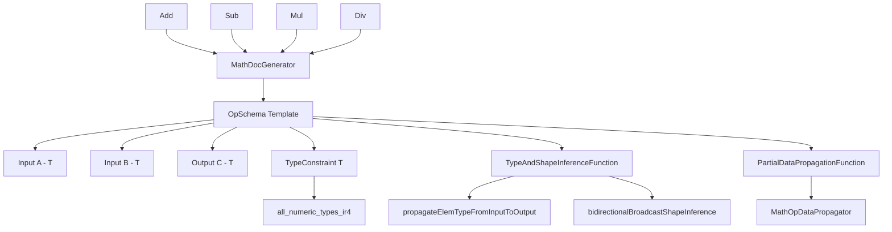
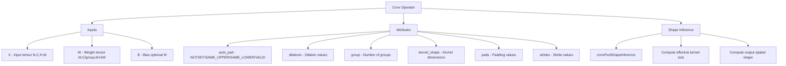
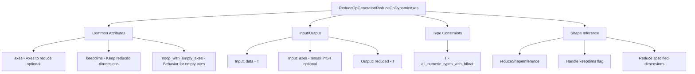
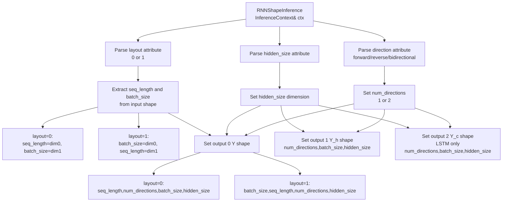
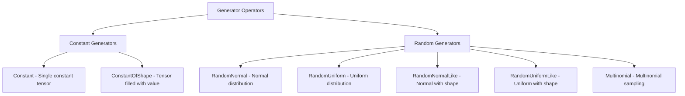

<!-- source: DeepWiki mcp.deepwiki.com · repo onnx/onnx · page 3.2 Operator Definitions and Categories · fetched 2026-10-21 -->

# Operator Definitions and Categories

<details>
<summary>Relevant source files</summary>

The following files were used as context for generating this wiki page:

- [docs/Changelog.md](docs/Changelog.md)
- [docs/Operators.md](docs/Operators.md)
- [docs/TestCoverage.md](docs/TestCoverage.md)
- [onnx/backend/test/case/node/cast.py](onnx/backend/test/case/node/cast.py)
- [onnx/backend/test/case/node/castlike.py](onnx/backend/test/case/node/castlike.py)
- [onnx/checker.cc](onnx/checker.cc)
- [onnx/checker.h](onnx/checker.h)
- [onnx/common/model_helpers.cc](onnx/common/model_helpers.cc)
- [onnx/common/status.cc](onnx/common/status.cc)
- [onnx/common/status.h](onnx/common/status.h)
- [onnx/cpp2py_export.cc](onnx/cpp2py_export.cc)
- [onnx/defs/controlflow/defs.cc](onnx/defs/controlflow/defs.cc)
- [onnx/defs/controlflow/old.cc](onnx/defs/controlflow/old.cc)
- [onnx/defs/function.cc](onnx/defs/function.cc)
- [onnx/defs/function.h](onnx/defs/function.h)
- [onnx/defs/math/defs.cc](onnx/defs/math/defs.cc)
- [onnx/defs/math/old.cc](onnx/defs/math/old.cc)
- [onnx/defs/nn/defs.cc](onnx/defs/nn/defs.cc)
- [onnx/defs/nn/old.cc](onnx/defs/nn/old.cc)
- [onnx/defs/operator_sets.h](onnx/defs/operator_sets.h)
- [onnx/defs/reduction/defs.cc](onnx/defs/reduction/defs.cc)
- [onnx/defs/rnn/defs.cc](onnx/defs/rnn/defs.cc)
- [onnx/defs/rnn/old.cc](onnx/defs/rnn/old.cc)
- [onnx/defs/schema.cc](onnx/defs/schema.cc)
- [onnx/defs/schema.h](onnx/defs/schema.h)
- [onnx/defs/shape_inference.cc](onnx/defs/shape_inference.cc)
- [onnx/defs/shape_inference.h](onnx/defs/shape_inference.h)
- [onnx/defs/tensor/defs.cc](onnx/defs/tensor/defs.cc)
- [onnx/defs/tensor/old.cc](onnx/defs/tensor/old.cc)
- [onnx/shape_inference/implementation.cc](onnx/shape_inference/implementation.cc)
- [onnx/shape_inference/implementation.h](onnx/shape_inference/implementation.h)
- [onnx/test/shape_inference_test.py](onnx/test/shape_inference_test.py)

</details>


This document explains how ONNX operators are organized, defined, and implemented across different functional categories. ONNX operators in the default `ai.onnx` domain are organized into modular categories based on their functionality, with each category implemented in separate source files under the `onnx/defs/` directory.

## Operator Organization and File Structure

ONNX operators in the `ai.onnx` domain are organized into functional categories under `onnx/defs/`, with each category in its own directory containing schema definitions and helper functions.

Diagram: ONNX Operator Directory Structure (onnx/defs/)

```mermaid
graph TD
    A["onnx/defs/"] --> B["tensor/defs.cc<br/>Cast,Reshape,Transpose,Concat"]
    A --> C["math/defs.cc<br/>Add,Mul,MatMul,Abs,Neg"]
    A --> D["nn/defs.cc<br/>Conv,BatchNormalization,MaxPool"]
    A --> E["rnn/defs.cc<br/>LSTM,GRU,RNN"]
    A --> F["reduction/defs.cc<br/>ReduceSum,ReduceMean,ReduceMax"]
    A --> G["controlflow/defs.cc<br/>If,Loop,Scan"]
    A --> H["logical/defs.cc<br/>And,Or,Equal,Greater"]
    A --> I["generator/defs.cc<br/>Constant,RandomNormal"]
    A --> J["sequence/defs.cc<br/>SequenceConstruct,SequenceAt"]
    A --> K["quantization/defs.cc<br/>QuantizeLinear,DequantizeLinear"]
    A --> L["traditionalml/defs.cc<br/>TreeEnsemble,LinearClassifier"]
    
    B --> B1["tensor/old.cc<br/>Previous versions"]
    C --> C1["math/old.cc"]
    D --> D1["nn/old.cc"]
    
    B --> B2["tensor/utils.h<br/>Shape inference helpers"]
    C --> C2["math/utils.h"]
    D --> D2["nn/utils.h<br/>convPoolShapeInference"]
```


Each category directory structure:
- `defs.cc`: Current operator schemas using `ONNX_OPERATOR_SET_SCHEMA` macro
- `old.cc`: Previous opset versions for backward compatibility  
- `utils.h`/`utils.cc`: Shared shape inference functions (e.g., `convPoolShapeInference`, `bidirectionalBroadcastShapeInference`)

All operator schemas are registered through `OpSchemaRegistry` defined in [onnx/defs/schema.h:109-245]() and collected into opset versions in [onnx/defs/operator_sets.h:1-100]().

Sources:
- [onnx/defs/tensor/defs.cc:1-77]()
- [onnx/defs/math/defs.cc:1-18]()
- [onnx/defs/nn/defs.cc:1-15]()
- [onnx/defs/rnn/defs.cc:1-11]()
- [onnx/defs/reduction/defs.cc:1-11]()
- [onnx/defs/controlflow/defs.cc:1-13]()
- [onnx/defs/schema.h:109-245]()
- [onnx/defs/operator_sets.h:1-100]()

## Operator Definition Structure

All ONNX operators are registered using the `ONNX_OPERATOR_SET_SCHEMA` macro defined in [onnx/defs/schema.h:147-243](), which creates and registers an `OpSchema` object through `OpSchemaRegistry`.

Diagram: OpSchema Registration and Components


### Anatomy of an Operator Definition

```cpp
// Example from onnx/defs/tensor/defs.cc:23-76
ONNX_OPERATOR_SET_SCHEMA(
    Cast,                    // Operator name
    25,                      // Opset version
    OpSchema()
        .SetDoc(Cast_ver25_doc)   // Documentation from defs/doc_strings.h
        .Attr(
            "to",
            "The data type to which elements are cast",
            AttributeProto::INT)     // From onnx.proto
        .Input(
            0,                       // Input index
            "input",                 // Input name
            "Input tensor to be cast.",
            "T1",                    // Type constraint parameter
            OpSchema::Single,        // FormalParameterOption
            true,                    // is_required
            1,                       // min_arity
            OpSchema::Differentiable) // DifferentiationCategory
        .Output(
            0, "output", "Output tensor with same shape as input", "T2",
            OpSchema::Single, true, 1, OpSchema::Differentiable)
        .TypeConstraint(
            "T1",
            OpSchema::all_non_complex_tensor_types_ir13(),
            "Constrain input types. Casting from complex not supported.")
        .TypeConstraint(
            "T2",
            OpSchema::all_non_complex_tensor_types_ir13(),
            "Constrain output types. Casting to complex not supported.")
        .TypeAndShapeInferenceFunction([](InferenceContext& ctx) {
            propagateElemTypeFromAttributeToOutput(ctx, "to", 0);
            if (hasNInputShapes(ctx, 1)) {
                propagateShapeFromInputToOutput(ctx, 0, 0);
            }
        })
        .PartialDataPropagationFunction([](DataPropagationContext& ctx) {
            PropagateShapeDataFromInputToOutput(ctx, 0);
        }));
```

### Key OpSchema Methods

| Method | Purpose | Code Reference |
|--------|---------|----------------|
| `Input()` / `Output()` | Define formal parameters with type constraints | [onnx/defs/schema.h:184-227]() |
| `TypeConstraint()` | Specify allowed types for type parameters | [onnx/defs/schema.h:122-126]() |
| `Attr()` | Define operator attributes with defaults | [onnx/defs/schema.h:147-243]() |
| `TypeAndShapeInferenceFunction()` | Lambda for output type/shape inference | [onnx/defs/shape_inference.h:80-195]() |
| `PartialDataPropagationFunction()` | Lambda for constant folding | [onnx/defs/shape_inference.h:197-264]() |
| `FunctionBody()` | Define operator as function composition | [onnx/defs/function.h:1-150]() |
| `SetContextDependentFunctionBodyBuilder()` | Runtime function body generation | [onnx/defs/schema.h:94-95]() |

Sources:
- [onnx/defs/tensor/defs.cc:23-76]()
- [onnx/defs/schema.h:147-243]()
- [onnx/defs/shape_inference.h:80-264]()
- [onnx/defs/function.h:1-150]()

## Operator Categories Overview

ONNX operators in the `ai.onnx` domain are organized into functional categories. As of opset version 26, there are approximately 170 operators across these categories.

Diagram: ONNX Operator Categories (ai.onnx domain)


### Category Summary Table

| Category | Directory | Operators Count | Key Functions | Latest Opset |
|----------|-----------|-----------------|---------------|--------------|
| **Tensor** | `onnx/defs/tensor/` | ~35 | Type conversion, reshaping, slicing | 26 |
| **Math** | `onnx/defs/math/` | ~40 | Arithmetic, trigonometric, matrix ops | 14 |
| **Neural Network** | `onnx/defs/nn/` | ~25 | Convolution, pooling, normalization | 22 |
| **Reduction** | `onnx/defs/reduction/` | ~10 | Aggregation along axes | 20 |
| **Control Flow** | `onnx/defs/controlflow/` | 3 | Conditionals, loops, recursion | 25 |
| **RNN** | `onnx/defs/rnn/` | 3 | Recurrent layers | 22 |
| **Logical** | `onnx/defs/logical/` | ~15 | Boolean and comparison | 7 |
| **Generator** | `onnx/defs/generator/` | ~10 | Constant and random generation | 25 |
| **Sequence** | `onnx/defs/sequence/` | ~10 | Sequence type operations | 24 |
| **Quantization** | `onnx/defs/quantization/` | ~8 | Quantize/dequantize operations | 25 |

All operators are indexed by opset version in [onnx/defs/operator_sets.h:109-2000]() with version-specific class declarations like `OpSet_Onnx_ver26`.

Sources:
- [docs/Operators.md:11-215]()
- [onnx/defs/operator_sets.h:109-2000]()
- [onnx/defs/tensor/defs.cc:1-2000]()
- [onnx/defs/math/defs.cc:1-1000]()
- [onnx/defs/nn/defs.cc:1-1500]()

## Tensor Operations Category

Tensor operations handle fundamental tensor manipulation tasks like type conversion, reshaping, and data rearrangement.

### Cast Operator

The `Cast` operator converts tensor elements from one data type to another, supporting all ONNX data types including float8 types.

Diagram: Cast Operator Definition


Key implementation details:
- Defined in: [onnx/defs/tensor/defs.cc:102-156]()
- Supports all numeric types, boolean, and string conversions
- Special handling for float8 types with saturation modes
- Shape is preserved from input to output

### Reshape Operator

The `Reshape` operator changes tensor dimensions while preserving element count.

```cpp
// Simplified schema structure
ONNX_OPERATOR_SET_SCHEMA(
    Reshape,
    25,
    OpSchema()
        .SetDoc(Reshape_ver25_doc)
        .Attr("allowzero", "Allow zero dimensions", AttributeProto::INT, 0)
        .Input(0, "data", "Input tensor", "T")
        .Input(1, "shape", "New shape specification", "tensor(int64)")
        .Output(0, "reshaped", "Reshaped tensor", "T")
        .TypeAndShapeInferenceFunction([](InferenceContext& ctx) {
            // Complex shape inference logic handling -1 and 0 dimensions
        })
);
```

Implementation: [onnx/defs/tensor/defs.cc:251-397]()

### Shape Operator

The `Shape` operator extracts tensor dimensions as a 1D int64 tensor.

```cpp
ONNX_OPERATOR_SET_SCHEMA(
    Shape,
    25,
    OpSchema()
        .Input(0, "data", "Input tensor", "T")
        .Output(0, "shape", "Shape of input", "T1")
        .Attr("start", "Start axis", AttributeProto::INT, 0)
        .Attr("end", "End axis (exclusive)", AttributeProto::INT, OPTIONAL_VALUE)
        .TypeConstraint("T1", {"tensor(int64)"}, "Output is int64")
        .PartialDataPropagationFunction([](DataPropagationContext& ctx) {
            // Propagates shape information statically when possible
        })
);
```

Implementation: [onnx/defs/tensor/defs.cc:440-552]()

Sources:
- [onnx/defs/tensor/defs.cc:102-552]()
- [docs/Operators.md:224-481]()

## Math Operations Category

Math operators implement element-wise and matrix operations. They follow common patterns for broadcasting and type constraints.

### Binary Math Operators

Math operators like `Add`, `Sub`, `Mul`, and `Div` share a common schema generated by `MathDocGenerator`.

Diagram: Binary Math Operator Structure


Example implementation:
```cpp
ONNX_OPERATOR_SET_SCHEMA(
    Add,
    14,
    OpSchema()
        .FillUsing(MathDocGenerator("addition"))
        .PartialDataPropagationFunction([](DataPropagationContext& ctx) {
            MathOpDataPropagator(ctx, "Add");
        })
);
```

Key characteristics:
- Support NumPy-style broadcasting
- Type constraint: `all_numeric_types_ir4()` includes uint8-uint64, int8-int64, float16, float, double, bfloat16
- Opset 14 added support for uint8, int8, uint16, int16

Implementation: [onnx/defs/math/defs.cc:43-148]()

### Unary Math Operators

Unary operators like `Abs`, `Neg`, `Sqrt`, `Exp` apply element-wise transformations.

```cpp
ONNX_OPERATOR_SET_SCHEMA(
    Abs,
    13,
    OpSchema()
        .SetDoc(Abs_ver13_doc)
        .Input(0, "X", "Input tensor", "T", OpSchema::Differentiable)
        .Output(0, "Y", "Output tensor", "T", OpSchema::Differentiable)
        .TypeConstraint(
            "T",
            OpSchema::all_numeric_types_ir4(),
            "Constrain to numeric tensors"
        )
        .TypeAndShapeInferenceFunction(propagateShapeAndTypeFromFirstInput)
);
```

Implementation: [onnx/defs/math/defs.cc:176-194]()

### MatMul Operator

Matrix multiplication with broadcasting support:

```cpp
// MatMul handles various input rank combinations:
// - (2,) x (2,) -> scalar
// - (M, K) x (K, N) -> (M, N)
// - (B, M, K) x (B, K, N) -> (B, M, N)
// - Broadcasting for different ranks
```

Implementation: [onnx/defs/math/defs.cc]() (in old.cc for previous versions)

Sources:
- [onnx/defs/math/defs.cc:43-270]()
- [docs/Operators.md:410-475]()

## Neural Network Operations Category

Neural network operators implement common deep learning layers and operations.

### Conv Operator

Convolution operation with extensive configuration options.

Diagram: Conv Operator Parameters


Key features:
- Supports 1D, 2D, and 3D convolutions
- Group convolution support via `group` attribute
- Dilated convolutions via `dilations` attribute
- Multiple padding modes via `auto_pad` attribute
- Extensive shape inference logic in [onnx/defs/nn/defs.cc:38-194]()

Implementation: [onnx/defs/nn/defs.cc]() and older versions

### BatchNormalization

Normalizes activations using batch statistics:

```cpp
// BatchNormalization computes:
// Y = scale * (X - mean) / sqrt(var + epsilon) + B
// where mean and var are per-channel statistics
```

Key attributes:
- `epsilon`: Small value to avoid division by zero
- `momentum`: Factor for running mean/variance
- `training_mode`: Controls output of running statistics

Implementation details in [onnx/defs/nn/defs.cc]()

### Pooling Operators

MaxPool and AveragePool share a common schema generation pattern via `PoolOpSchemaGenerator`.

```cpp
ONNX_OPERATOR_SET_SCHEMA(
    AveragePool,
    22,
    OpSchema()
        .FillUsing(PoolOpSchemaGenerator(
            "AveragePool",
            "average",
            "Output divided by number of elements (exclude pad)",
            true,   // use_dilation
            false   // supports8bit
        ))
        .Attr("count_include_pad", "Include pad in average", AttributeProto::INT, 0)
);
```

Common pooling parameters:
- `kernel_shape`: Size of pooling window
- `strides`: Stride for pooling window
- `pads`: Padding to apply
- `ceil_mode`: Use ceiling instead of floor for output shape
- `dilations`: Dilation for MaxPool

Implementation: [onnx/defs/nn/defs.cc:203-336]()

Sources:
- [onnx/defs/nn/defs.cc:38-456]()
- [docs/Operators.md:560-800]()

## Reduction Operations Category

Reduction operators compute aggregate values along specified axes.

### Reduce Operator Pattern

Reduction operators share a common pattern defined by `ReduceOpGenerator` and `ReduceOpDynamicAxes`.

Diagram: Reduction Operator Schema Pattern


Example implementations:

```cpp
// ReduceSum - Sum along axes
ONNX_OPERATOR_SET_SCHEMA(
    ReduceSum,
    13,
    OpSchema().FillUsing(ReduceOpDynamicAxes("sum", EMPTY_ZERO))
);

// ReduceMax - Maximum along axes  
ONNX_OPERATOR_SET_SCHEMA(
    ReduceMax,
    20,
    OpSchema().FillUsing(ReduceOpGenerator("max", EMPTY_MIN, true, true, nullptr, nullptr, true))
);
```

### Function-Based Reductions

Some reductions are implemented as function compositions:

```cpp
// ReduceSumSquare = Square + ReduceSum
static constexpr const char* reduce_sum_square_func_body = R"ONNX(
  {
    data_square = Mul(data, data)
    reduced = ReduceSum<keepdims: int = @keepdims, 
                        noop_with_empty_axes: int = @noop_with_empty_axes>(data_square, axes)
  }
)ONNX";

ONNX_OPERATOR_SET_SCHEMA(
    ReduceSumSquare,
    18,
    OpSchema().FillUsing(ReduceFunctionOp("sum square", EMPTY_ZERO, reduce_sum_square_func_body))
);
```

Available reduction operators:
- `ReduceSum`, `ReduceMean`, `ReduceProd`
- `ReduceMax`, `ReduceMin`
- `ReduceL1`, `ReduceL2`, `ReduceSumSquare`
- `ReduceLogSum`, `ReduceLogSumExp`

Implementation: [onnx/defs/reduction/defs.cc:12-79]()

Sources:
- [onnx/defs/reduction/defs.cc:1-79]()
- [onnx/defs/reduction/utils.h]()
- [docs/Operators.md:2000-2200]()

## RNN Operations Category

RNN operators in `onnx/defs/rnn/` implement recurrent neural network layers with shared shape inference logic.

### RNN Shape Inference Function

All three RNN operators (`LSTM`, `GRU`, `RNN`) use the shared `RNNShapeInference` function defined in [onnx/defs/rnn/defs.cc:12-73]().

Diagram: RNNShapeInference Logic (onnx/defs/rnn/defs.cc)


### LSTM Operator

LSTM (Long Short-Term Memory) is defined in [onnx/defs/rnn/defs.cc:75-400]() with the following structure:

```cpp
// From onnx/defs/rnn/defs.cc
ONNX_OPERATOR_SET_SCHEMA(
    LSTM,
    22,
    OpSchema()
        .SetDoc(LSTM_ver22_doc)
        .Attr("hidden_size", "Number of neurons in hidden layer", AttributeProto::INT)
        .Attr("direction", "forward|reverse|bidirectional", AttributeProto::STRING, "forward")
        .Attr("layout", "0: [seq,batch,input] 1: [batch,seq,input]", AttributeProto::INT, 0)
        .Attr("activations", "[f,g,h] per direction", AttributeProto::STRINGS, ...)
        .Attr("activation_alpha", "Alpha values for activations", AttributeProto::FLOATS, ...)
        .Attr("activation_beta", "Beta values for activations", AttributeProto::FLOATS, ...)
        .Attr("clip", "Cell clip threshold", AttributeProto::FLOAT, ...)
        .Attr("input_forget", "Couple input and forget gates", AttributeProto::INT, 0)
        .Input(0, "X", "[seq,batch,input_size] or [batch,seq,input_size]", "T")
        .Input(1, "W", "[num_directions,4*hidden_size,input_size]", "T")
        .Input(2, "R", "[num_directions,4*hidden_size,hidden_size]", "T")
        .Input(3, "B", "Optional [num_directions,8*hidden_size]", "T", OpSchema::Optional)
        .Input(4, "sequence_lens", "Optional [batch_size]", "T1", OpSchema::Optional)
        .Input(5, "initial_h", "Optional [num_directions,batch,hidden_size]", "T", OpSchema::Optional)
        .Input(6, "initial_c", "Optional [num_directions,batch,hidden_size]", "T", OpSchema::Optional)
        .Input(7, "P", "Optional peephole weights [num_directions,3*hidden_size]", "T", OpSchema::Optional)
        .Output(0, "Y", "All hidden states [seq,num_directions,batch,hidden_size]", "T", OpSchema::Optional)
        .Output(1, "Y_h", "Last hidden state [num_directions,batch,hidden_size]", "T", OpSchema::Optional)
        .Output(2, "Y_c", "Last cell state [num_directions,batch,hidden_size]", "T", OpSchema::Optional)
        .TypeConstraint("T", {"tensor(float16)", "tensor(float)", "tensor(double)"}, "Constrain to float types")
        .TypeConstraint("T1", {"tensor(int32)"}, "Constrain sequence_lens to int32")
        .TypeAndShapeInferenceFunction(RNNShapeInference)
);
```

### GRU and RNN Operators

- **GRU** (Gated Recurrent Unit): Simplified architecture without cell state, defined in [onnx/defs/rnn/defs.cc]()
- **RNN** (Simple RNN): Basic recurrent layer, defined in [onnx/defs/rnn/defs.cc]()

All three share:
- Same attribute set for `direction`, `hidden_size`, `layout`
- Same input structure (X, W, R, optional B, sequence_lens, initial_h)
- Same `RNNShapeInference` function
- Support for bidirectional processing

Sources:
- [onnx/defs/rnn/defs.cc:12-73]()
- [onnx/defs/rnn/defs.cc:75-400]()
- [docs/Operators.md:1274-1450]()

## Generator and Logical Operations

### Generator Operations

Generator operators create tensors with specific patterns or random values.

Diagram: Generator Operator Types


Key operators:

**Constant** (version 25):
- Supports multiple ways to specify constant value:
  - `value`: TensorProto attribute
  - `sparse_value`: SparseTensorProto attribute
  - `value_int`, `value_ints`: Integer scalar or 1D tensor
  - `value_float`, `value_floats`: Float scalar or 1D tensor
  - `value_string`, `value_strings`: String scalar or 1D tensor
- Implementation: [onnx/defs/generator/defs.cc:17-60]()

**ConstantOfShape** (version 25):
- Creates tensor of specified shape filled with constant value
- Input: `input` - 1D tensor with desired output shape
- Attribute: `value` - Optional 1-element tensor (default: 0.0 float32)
- Implementation: [onnx/defs/generator/defs.cc:62-179]()

### Logical Operations

Logical operators implement boolean and comparison operations.

Binary logical operators generated by `BinaryLogicDocGenerator`:

```cpp
std::function<void(OpSchema&)> BinaryLogicDocGenerator(const char* name) {
    return [=](OpSchema& schema) {
        schema.SetDoc("Element-wise {name} logical operation with broadcasting");
        schema.Input(0, "A", "First operand", "T");
        schema.Input(1, "B", "Second operand", "T");
        schema.Output(0, "C", "Result tensor", "T1");
        // Type inference always outputs bool
        schema.TypeAndShapeInferenceFunction(binaryLogicalOpInference);
    };
}

ONNX_OPERATOR_SET_SCHEMA(And, 7, OpSchema().FillUsing(BinaryLogicDocGenerator("and")));
ONNX_OPERATOR_SET_SCHEMA(Or, 7, OpSchema().FillUsing(BinaryLogicDocGenerator("or")));
ONNX_OPERATOR_SET_SCHEMA(Xor, 7, OpSchema().FillUsing(BinaryLogicDocGenerator("xor")));
```

Comparison operators (Equal, Greater, Less, etc.):
- All output bool tensors
- Support broadcasting
- Type constraints vary by operator

Implementation: [onnx/defs/logical/defs.cc:9-265]()

Sources:
- [onnx/defs/generator/defs.cc:17-179]()
- [onnx/defs/logical/defs.cc:9-265]()
- [docs/Operators.md:600-900]()

## Conclusion

ML operators in ONNX provide a standardized representation for traditional machine learning algorithms. They enable interoperability between different ML frameworks and deployment platforms, allowing models to be trained in one environment and deployed in another.

The operators are organized into categories based on their functionality, including feature processing, classification models, regression models, and data transformation. Key operators like `TreeEnsemble`, `LinearClassifier`, and `LabelEncoder` provide the building blocks for representing various ML models.

The versioning system ensures backward compatibility while allowing for enhancements over time. The integration with the broader ONNX ecosystem enables hybrid models that combine traditional ML and deep learning techniques.

Sources:
- [onnx/defs/traditionalml/defs.cc]()
- [docs/Operators-ml.md]()
- [docs/Changelog-ml.md]()

---

