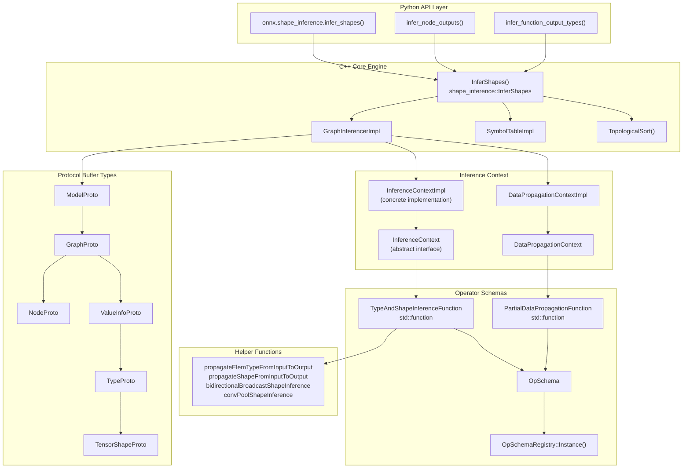
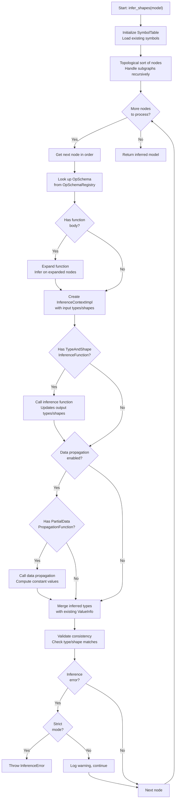
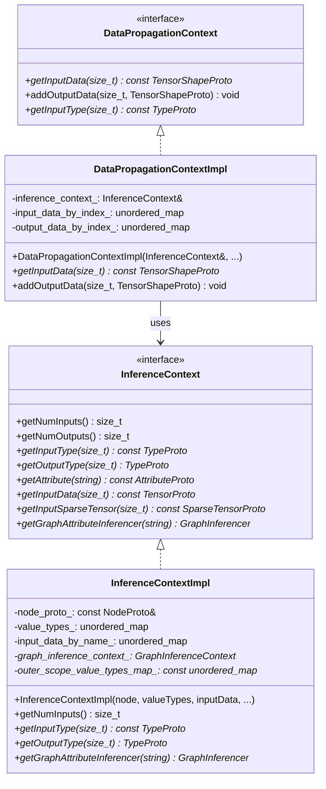
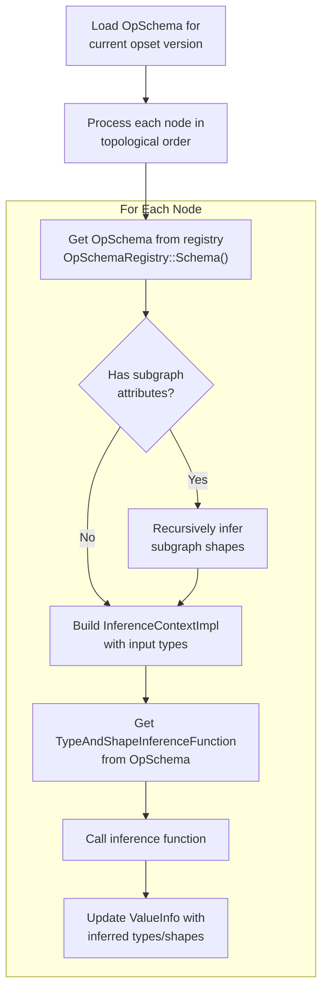
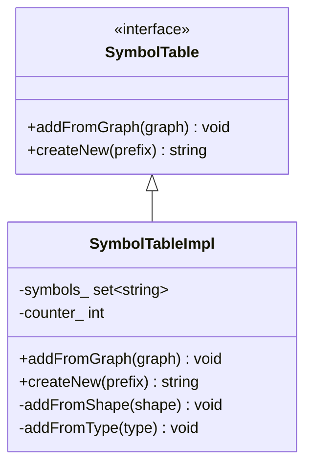
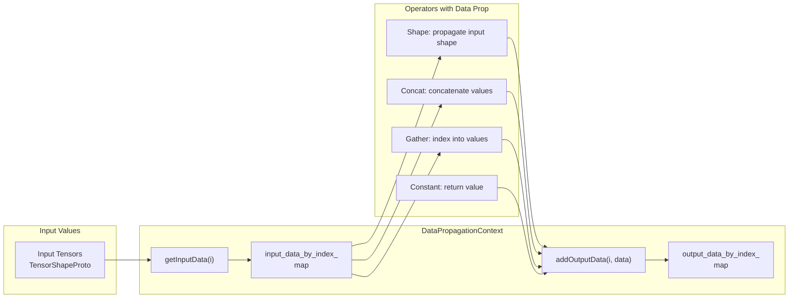
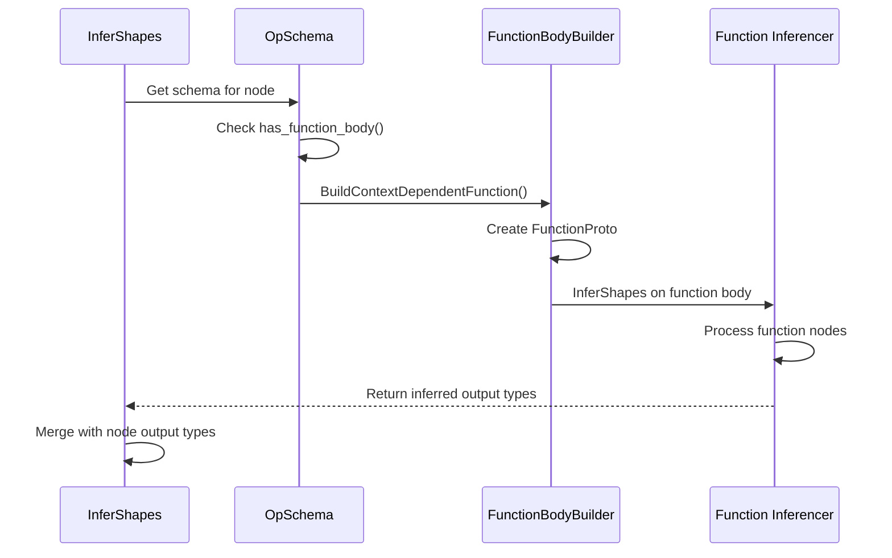

<!-- source: DeepWiki mcp.deepwiki.com · repo onnx/onnx · page 3.3 Type and Shape Inference · fetched 2026-10-21 -->

# Type and Shape Inference

<details>
<summary>Relevant source files</summary>

The following files were used as context for generating this wiki page:

- [docs/Changelog.md](docs/Changelog.md)
- [docs/Operators.md](docs/Operators.md)
- [docs/TestCoverage.md](docs/TestCoverage.md)
- [onnx/backend/test/case/node/cast.py](onnx/backend/test/case/node/cast.py)
- [onnx/backend/test/case/node/castlike.py](onnx/backend/test/case/node/castlike.py)
- [onnx/checker.cc](onnx/checker.cc)
- [onnx/checker.h](onnx/checker.h)
- [onnx/common/model_helpers.cc](onnx/common/model_helpers.cc)
- [onnx/common/status.cc](onnx/common/status.cc)
- [onnx/common/status.h](onnx/common/status.h)
- [onnx/cpp2py_export.cc](onnx/cpp2py_export.cc)
- [onnx/defs/controlflow/defs.cc](onnx/defs/controlflow/defs.cc)
- [onnx/defs/controlflow/old.cc](onnx/defs/controlflow/old.cc)
- [onnx/defs/function.cc](onnx/defs/function.cc)
- [onnx/defs/function.h](onnx/defs/function.h)
- [onnx/defs/math/defs.cc](onnx/defs/math/defs.cc)
- [onnx/defs/math/old.cc](onnx/defs/math/old.cc)
- [onnx/defs/nn/defs.cc](onnx/defs/nn/defs.cc)
- [onnx/defs/nn/old.cc](onnx/defs/nn/old.cc)
- [onnx/defs/operator_sets.h](onnx/defs/operator_sets.h)
- [onnx/defs/reduction/defs.cc](onnx/defs/reduction/defs.cc)
- [onnx/defs/rnn/defs.cc](onnx/defs/rnn/defs.cc)
- [onnx/defs/rnn/old.cc](onnx/defs/rnn/old.cc)
- [onnx/defs/schema.cc](onnx/defs/schema.cc)
- [onnx/defs/schema.h](onnx/defs/schema.h)
- [onnx/defs/shape_inference.cc](onnx/defs/shape_inference.cc)
- [onnx/defs/shape_inference.h](onnx/defs/shape_inference.h)
- [onnx/defs/tensor/defs.cc](onnx/defs/tensor/defs.cc)
- [onnx/defs/tensor/old.cc](onnx/defs/tensor/old.cc)
- [onnx/shape_inference/implementation.cc](onnx/shape_inference/implementation.cc)
- [onnx/shape_inference/implementation.h](onnx/shape_inference/implementation.h)
- [onnx/test/shape_inference_test.py](onnx/test/shape_inference_test.py)

</details>


## Purpose and Scope

This document describes the type and shape inference system in ONNX, which automatically determines the data types and tensor shapes of intermediate and output values in an ONNX model graph. Shape inference enables model validation, optimization, and execution planning by computing static shape information at graph construction time.

For information about operator schema definitions that provide the inference functions, see [Operator Schema Registry](#3.1). For the validation system that uses inferred types, see [Model Validation and Checking](#4.2).

## Core Concepts

Type and shape inference in ONNX operates on two levels:

1. **Type Inference**: Determines the data type (element type) of tensors, sequences, maps, and optional values
2. **Shape Inference**: Determines the dimensionality and size of each dimension for tensors

Inference is performed by:
- Propagating type and shape information forward through the graph
- Using operator-specific inference functions registered in `OpSchema` definitions
- Supporting symbolic dimensions for unknown or dynamic sizes
- Optionally propagating constant values to enable shape computation

**Key Properties:**
- **Forward propagation**: Inference proceeds from inputs to outputs following topological order
- **Partial inference**: Can handle unknown dimensions and symbolic parameters
- **Strict mode**: Optional validation that fails on inference errors vs. best-effort mode
- **Data propagation**: Optional constant folding for shape-computing operators

Sources: [onnx/defs/shape_inference.h:1-80](), [onnx/shape_inference/implementation.h:1-40]()

## Architecture Overview



**Type and Shape Inference System Architecture**

The system has four main layers:
1. **Python API** (`onnx.shape_inference` module) exposes inference functions to users
2. **C++ Core Engine** (`shape_inference::InferShapes()`) implements graph traversal and inference algorithm
3. **Inference Context** (`InferenceContextImpl`) provides operator-specific inference with access to inputs/outputs
4. **Operator Schemas** (`OpSchema` with registered inference functions) define per-operator inference logic

Sources: [onnx/shape_inference/implementation.h:1-200](), [onnx/shape_inference/implementation.cc:1-100](), [onnx/defs/shape_inference.h:1-100](), [onnx/defs/schema.h:1-300](), [onnx/cpp2py_export.cc:1-100]()

## The Inference Process



**Shape Inference Algorithm Flow**

The inference process:
1. Initializes symbol table from existing graph annotations
2. Topologically sorts nodes to process dependencies first
3. For each node, looks up its schema and calls inference functions
4. Optionally expands function-based operators
5. Merges inferred information with existing ValueInfo
6. Validates consistency in strict mode or continues with warnings

Sources: [onnx/shape_inference/implementation.cc:400-800](), [onnx/shape_inference/implementation.h:30-150]()

## InferenceContext API

The `InferenceContext` interface provides operator inference functions with access to node information and methods to infer output types and shapes. Defined in [onnx/defs/shape_inference.h:80-300]().

### Key Methods

| Method | Purpose | Returns | Location |
|--------|---------|---------|----------|
| `getNumInputs()` | Number of actual inputs | `size_t` | [shape_inference.h:120]() |
| `getNumOutputs()` | Number of actual outputs | `size_t` | [shape_inference.h:121]() |
| `getInputType(i)` | Type proto for input i (read-only) | `const TypeProto*` | [shape_inference.h:122]() |
| `getOutputType(i)` | Mutable type proto for output i | `TypeProto*` | [shape_inference.h:135]() |
| `getAttribute(name)` | Attribute value by name | `const AttributeProto*` | [shape_inference.h:148]() |
| `getInputData(i)` | Constant input tensor (if known) | `const TensorProto*` | [shape_inference.h:165]() |
| `getAllInputData(i, data)` | Get all input data for variadic inputs | `bool` | [shape_inference.h:169]() |

### Context Implementation Classes



**InferenceContext Class Hierarchy**

The `InferenceContextImpl` wraps:
- `node_proto_`: The current node being inferred
- `value_types_`: Map of value names to their `TypeProto`
- `input_data_by_name_`: Map of constant input data (for data propagation)
- `graph_inference_context_`: Context for inferring subgraph attributes

The context provides:
- Read access to input types and shapes
- Write access to output types and shapes
- Attribute values for the node
- Optional access to constant input values (when data propagation is enabled)

Sources: [onnx/defs/shape_inference.h:80-300](), [onnx/shape_inference/implementation.h:50-200](), [onnx/shape_inference/implementation.cc:100-300]()

## Registering Inference Functions

Operators register type and shape inference functions in their `OpSchema` definitions using the `TypeAndShapeInferenceFunction()` method.

### Example: Cast Operator

The Cast operator demonstrates simple type and shape inference [onnx/defs/tensor/defs.cc:23-76]():

```cpp
ONNX_OPERATOR_SET_SCHEMA(
    Cast,
    25,
    OpSchema()
        .TypeAndShapeInferenceFunction([](InferenceContext& ctx) {
          propagateElemTypeFromAttributeToOutput(ctx, "to", 0);
          if (hasNInputShapes(ctx, 1)) {
            propagateShapeFromInputToOutput(ctx, 0, 0);
          }
        })
        .PartialDataPropagationFunction([](DataPropagationContext& ctx) {
          PropagateShapeDataFromInputToOutput(ctx, 0);
        })
)
```

The Cast operator:
1. Propagates the element type from the "to" attribute to output 0 using `propagateElemTypeFromAttributeToOutput()`
2. Propagates the shape from input 0 to output 0 if input shape is known
3. Propagates shape data for constant folding

### Common Inference Helper Functions

| Function | Location | Usage |
|----------|----------|-------|
| `propagateElemTypeFromInputToOutput(ctx, in, out)` | [shape_inference.h:400]() | Copy element type from input to output |
| `propagateShapeFromInputToOutput(ctx, in, out)` | [shape_inference.h:410]() | Copy shape from input to output |
| `propagateElemTypeFromAttributeToOutput(ctx, attr, out)` | [shape_inference.h:420]() | Set type from attribute value |
| `propagateShapeAndTypeFromFirstInput(ctx)` | [shape_inference.h:430]() | Copy both type and shape from input 0 |
| `bidirectionalBroadcastShapeInference(shape1, shape2, out)` | [shape_inference.h:440-500]() | Compute broadcasted shape |
| `convPoolShapeInference(ctx, ...)` | [nn/defs.cc:41-196]() | Conv/Pool output shape calculation |
| `hasNInputShapes(ctx, n)` | [shape_inference.h:350]() | Check if first n inputs have shapes |
| `hasInputShape(ctx, i)` | [shape_inference.h:340]() | Check if input i has shape |

### Example: Reshape Operator

The Reshape operator demonstrates complex inference with symbolic dimensions and data propagation [onnx/defs/tensor/defs.cc:253-401]():

```cpp
ONNX_OPERATOR_SET_SCHEMA(
    Reshape,
    25,
    OpSchema()
        .Attr("allowzero", "...", AttributeProto::INT, static_cast<int64_t>(0))
        .TypeAndShapeInferenceFunction([](InferenceContext& ctx) {
          // Type inference
          propagateElemTypeFromInputToOutput(ctx, 0, 0);
          
          // Get target shape from input 1 (via data propagation)
          bool found;
          TensorShapeProto targetShapeProto = getShapeInput(ctx, 1, found);
          if (!found) return;
          
          int allowzero = static_cast<int>(getAttribute(ctx, "allowzero", 0));
          
          // Process each dimension in target shape
          // Handle -1 (infer dimension), 0 (copy from input), or explicit values
          for (int i = 0; i < targetShapeProto.dim_size(); ++i) {
            const auto dim_value = targetShapeProto.dim(i).dim_value();
            if (dim_value == -1) {
              // Mark for later inference
            } else if (dim_value == 0 && allowzero == 0) {
              // Copy dimension from input
            } else {
              // Use explicit value
            }
          }
        })
)
```

Key features:
1. Uses `getShapeInput()` to retrieve shape values from input tensor
2. Handles special dimension values: `-1` (infer), `0` (copy or literal)
3. Computes unknown `-1` dimension from total element count
4. Supports symbolic dimensions in input/output

Sources: [onnx/defs/tensor/defs.cc:253-401]()

## Shape Inference Implementation

The core inference implementation in `InferShapes()` processes graphs in topological order.

### Main Inference Function



**Node-Level Inference Process**

### Key Implementation Details

1. **Topological Ordering**: Nodes are processed in dependency order using `TopologicalSort()`
2. **Context Creation**: `InferenceContextImpl` is created with current type information
3. **Function Expansion**: Function-based operators are expanded before inference
4. **Type Merging**: `checkShapesAndTypes()` validates consistency between existing and inferred types

### Handling Missing Information

The inference system gracefully handles missing information:
- Unknown input shapes: Outputs remain unknown
- Symbolic dimensions: Preserved and propagated through operations
- Missing schemas: Skipped with optional warnings
- Inference errors: Caught and either thrown (strict mode) or logged (permissive mode)

Sources: [onnx/shape_inference/implementation.cc:400-1200]()

## Symbolic Shape Handling

ONNX supports symbolic dimensions using `dim_param` in `TensorShapeProto::Dimension`.

### Symbolic Dimension Representation

A dimension can be:
1. **Concrete value**: `dim_value = 10`
2. **Symbolic parameter**: `dim_param = "N"`
3. **Unknown**: Neither field set

### SymbolTable Management



**SymbolTable manages symbolic dimension names**

The `SymbolTableImpl`:
- Tracks all existing symbolic names in the graph
- Generates new unique symbols with `createNew()`
- Ensures no duplicate symbols are created
- Processes entire graph to collect existing symbols

### Symbolic Dimension Propagation

Example from MatMul inference:
```
// Input shapes: (M, K) x (K, N) -> (M, N)
// If M is symbolic "batch", it propagates to output
auto& dim_0 = input_shape_0.dim(0);  // batch
auto& dim_1 = input_shape_1.dim(1);  // N
output_shape->add_dim()->CopyFrom(dim_0);  // Preserves "batch"
output_shape->add_dim()->CopyFrom(dim_1);
```

### Symbolic Broadcasting

The `bidirectionalBroadcastShapeInference()` function handles symbolic dimensions in broadcasting:
- If both dimensions are concrete, computes result
- If one is symbolic and other is 1, uses symbolic
- If both symbolic with same name, uses that name
- Otherwise, creates new symbolic dimension

Sources: [onnx/shape_inference/implementation.h:30-60](), [onnx/shape_inference/implementation.cc:50-150]()

## Data Propagation

Data propagation (also called partial constant folding) computes statically-known tensor values to enable better shape inference. This is controlled by the `enable_data_propagation` flag in `ShapeInferenceOptions` [onnx/defs/shape_inference.h:21-33]().

### When Data Propagation Helps

Consider this example where shape computation depends on intermediate values:
```python
shape = Shape(input)                      # shape = [N, C, H, W]
batch_channels = Slice(shape, [0], [2])   # [N, C]
new_shape = Concat([batch_channels, [-1]])  # [N, C, -1]
output = Reshape(data, new_shape)         # Need to know new_shape values
```

Without data propagation, the Reshape cannot infer output shape because `new_shape` is computed dynamically. With data propagation:
1. `Shape` operator computes shape values from input shape dimensions
2. `Slice` extracts the first two dimensions
3. `Concat` computes concatenated constant values
4. `Reshape` uses these propagated values to infer output shape

This pattern is common in models that manipulate shapes dynamically.

### DataPropagationContext



**Data Propagation Flow**

### Registering Data Propagation Functions

Operators register data propagation with `PartialDataPropagationFunction()` in their `OpSchema` [onnx/defs/tensor/defs.cc:447-465]():

```cpp
ONNX_OPERATOR_SET_SCHEMA(
    Shape,
    25,
    OpSchema()
        .PartialDataPropagationFunction([](DataPropagationContext& ctx) {
          if (hasInputShape(ctx, 0)) {
            auto& input_shape = ctx.getInputType(0)->tensor_type().shape();
            int64_t start = getAttribute(ctx, "start", 0);
            int64_t end = getAttribute(ctx, "end", rank);
            
            TensorShapeProto output_shape;
            for (int64_t d = start; d < end; ++d) {
              *output_shape.add_dim() = input_shape.dim(static_cast<int>(d));
            }
            ctx.addOutputData(0, std::move(output_shape));
          }
        })
)
```

The `Shape` operator:
1. Extracts dimension values from input tensor shape
2. Creates a `TensorShapeProto` representing the output 1D tensor values
3. Calls `ctx.addOutputData(0, output_shape)` to register the computed values

### Operators Supporting Data Propagation

| Operator | Propagated Values | Implementation |
|----------|-------------------|----------------|
| `Shape` | Input tensor shape dimensions | [tensor/defs.cc:447-465]() |
| `Size` | Total number of elements | [tensor/defs.cc:490-496]() |
| `Constant` | The constant value | Via attribute |
| `Gather` | Selected elements from input | [data_propagators.cc]() |
| `Concat` | Concatenated constant values | [tensor/defs.cc:522-600]() |
| `Slice` | Sliced elements | [data_propagators.cc]() |
| `Squeeze/Unsqueeze` | Shape with dims removed/added | [data_propagators.cc]() |
| `Reshape` | Propagates shape input | [tensor/defs.cc:74-76]() |
| `Add/Sub/Mul` | Computed arithmetic results | [math/defs.cc:20-46]() |

Sources: [onnx/defs/tensor/defs.cc:447-520](), [onnx/defs/data_propagators.cc:1-200](), [onnx/defs/math/defs.cc:20-105]()

## Function Expansion

ONNX operators can be defined using function bodies composed of simpler operators. During inference, these are expanded and inferred recursively.

### Function Types

1. **Static Functions**: Function body is fixed in OpSchema
2. **Context-Dependent Functions**: Function body depends on input types or attributes

### Context-Dependent Function Example

The `CastLike` operator builds its function body based on the target input type:

```
.SetContextDependentFunctionBodyBuilder(
  [](const FunctionBodyBuildContext& ctx, const OpSchema& schema, FunctionProto& functionProto) {
    auto target_type = ctx.getInputType(1);
    if (!target_type || !target_type->has_tensor_type()) {
      return false;  // Cannot build without knowing target type
    }
    auto target_elt_type = target_type->tensor_type().elem_type();
    FunctionBuilder builder(functionProto);
    builder.Add("output = Cast <to= " + std::to_string(target_elt_type) + "> (input)");
    return true;
  }
)
```

### Function Expansion Process



**Function Expansion and Inference Sequence**

### Function Body Components

A `FunctionProto` contains:
- `name`: Function name
- `input`: Formal parameter names
- `output`: Output value names
- `node`: Sequence of nodes defining the function
- `opset_import`: Required opsets

The function body is a sub-graph that is independently inferred, with input types provided by the calling context.

Sources: [onnx/defs/schema.h:29-95](), [onnx/defs/tensor/defs.cc:219-233](), [onnx/shape_inference/implementation.cc:200-400]()

## Python API

The Python interface wraps the C++ inference implementation for easy use.

### Main Functions

```python
from onnx import shape_inference

# Infer shapes for entire model
inferred_model = shape_inference.infer_shapes(
    model,
    check_type=False,      # Validate type consistency
    strict_mode=True,      # Fail on inference errors
    data_prop=False        # Enable data propagation
)

# Infer shapes for a single node
output_types = shape_inference.infer_node_outputs(
    schema,
    node,
    input_types,
    input_data=None
)

# Infer shapes for a function
output_types = shape_inference.infer_function_output_types(
    function_proto,
    input_types,
    input_data_list=None
)
```

### ShapeInferenceOptions

```python
class ShapeInferenceOptions:
    check_type: bool           # Validate type equality
    error_mode: int            # 0=permissive, 1=strict  
    enable_data_propagation: bool  # Enable partial constant folding
```

### Usage Example: Basic Shape Inference

```python
import onnx
from onnx import shape_inference, helper, TensorProto

# Create a simple model
node = helper.make_node('Add', ['x', 'y'], ['sum'])
graph = helper.make_graph(
    [node],
    'test',
    [helper.make_tensor_value_info('x', TensorProto.FLOAT, [10, 20]),
     helper.make_tensor_value_info('y', TensorProto.FLOAT, [10, 20])],
    [helper.make_tensor_value_info('sum', TensorProto.FLOAT, None)]  # Shape unknown
)
model = helper.make_model(graph)

# Infer shapes with strict validation
inferred_model = shape_inference.infer_shapes(model, strict_mode=True)

# Access inferred shape
output_shape = inferred_model.graph.output[0].type.tensor_type.shape
print(output_shape.dim[0].dim_value)  # 10
print(output_shape.dim[1].dim_value)  # 20
```

### Usage Example: With Data Propagation

```python
import onnx
from onnx import helper, TensorProto, shape_inference

# Create model that uses Shape and Reshape
nodes = [
    helper.make_node('Shape', ['x'], ['x_shape']),
    helper.make_node('Constant', [], ['minus_one'], 
                     value=helper.make_tensor('', TensorProto.INT64, [1], [-1])),
    helper.make_node('Concat', ['x_shape', 'minus_one'], ['new_shape'], axis=0),
    helper.make_node('Reshape', ['data', 'new_shape'], ['output'])
]
graph = helper.make_graph(
    nodes, 'test',
    [helper.make_tensor_value_info('x', TensorProto.FLOAT, [2, 3, 4]),
     helper.make_tensor_value_info('data', TensorProto.FLOAT, [24])],
    [helper.make_tensor_value_info('output', TensorProto.FLOAT, None)]
)
model = helper.make_model(graph)

# Infer with data propagation enabled
inferred = shape_inference.infer_shapes(model, data_prop=True)

# Output shape is inferred as [2, 3, 4, -1] which becomes [2, 3, 4, 1]
output_shape = inferred.graph.output[0].type.tensor_type.shape
print([d.dim_value for d in output_shape.dim])  # [2, 3, 4, 1]
```

### Error Handling

The Python API raises `onnx.shape_inference.InferenceError` on failures:

```python
try:
    inferred = shape_inference.infer_shapes(model, strict_mode=True)
except onnx.shape_inference.InferenceError as e:
    print(f"Inference failed: {e}")
    print(f"Context: {e.args[0]}")  # Contains node information
```

Sources: [onnx/shape_inference.py:1-200](), [onnx/cpp2py_export.cc:1600-1800]()

## Common Inference Patterns

### Element-wise Binary Operations with Broadcasting

Element-wise operations like `Add`, `Mul`, `Sub` preserve element type and compute output shape via broadcasting [onnx/defs/math/defs.cc:89-96]():

```cpp
// Example: Add, Mul, Sub, Div
ONNX_OPERATOR_SET_SCHEMA(
    Add,
    14,
    OpSchema()
        .TypeAndShapeInferenceFunction([](InferenceContext& ctx) {
          propagateElemTypeFromInputToOutput(ctx, 0, 0);
          if (hasNInputShapes(ctx, 2))
            bidirectionalBroadcastShapeInference(
                ctx.getInputType(0)->tensor_type().shape(),
                ctx.getInputType(1)->tensor_type().shape(),
                *ctx.getOutputType(0)->mutable_tensor_type()->mutable_shape());
        })
)
```

The `bidirectionalBroadcastShapeInference()` function [onnx/defs/shape_inference.cc:100-200]():
- Compares dimensions from right to left
- Broadcasts dimensions where one is 1
- Preserves symbolic dimensions when compatible
- Fails if incompatible concrete dimensions

### Reduction Operations

Reduction operations like `ReduceSum`, `ReduceMean` reduce dimensions based on `axes` attribute or input [onnx/defs/reduction/utils.h:1-100]():

```cpp
// Example: ReduceSum, ReduceMean, ReduceMax
.TypeAndShapeInferenceFunction([](InferenceContext& ctx) {
  propagateElemTypeFromInputToOutput(ctx, 0, 0);
  if (!hasNInputShapes(ctx, 1)) return;
  
  auto& input_shape = ctx.getInputType(0)->tensor_type().shape();
  std::vector<int64_t> axes = ...;  // From attribute or input[1]
  int keepdims = getAttribute(ctx, "keepdims", 1);
  
  auto* output_shape = ctx.getOutputType(0)->mutable_tensor_type()->mutable_shape();
  for (int i = 0; i < input_shape.dim_size(); ++i) {
    if (axes contains i) {
      if (keepdims) output_shape->add_dim()->set_dim_value(1);
    } else {
      *output_shape->add_dim() = input_shape.dim(i);
    }
  }
})
```

### Convolution and Pooling Operations

Conv and pooling operations compute output spatial dimensions from kernel, stride, padding, and dilation [onnx/defs/nn/defs.cc:41-196]():

```cpp
// Shared inference function for Conv, MaxPool, AveragePool
void convPoolShapeInference(
    InferenceContext& ctx,
    bool use_dilation,
    bool require_kernel_shape,
    int input1Idx,
    int input2Idx) {
  
  // Extract attributes: kernel_shape, strides, pads, dilations, auto_pad
  // Calculate effective kernel size with dilation
  // effective_kernel_shape[i] = (kernel_shape[i] - 1) * dilations[i] + 1
  
  // Calculate output size for each spatial dimension:
  // output_size = floor((input_size + pad_before + pad_after 
  //                      - effective_kernel_shape[i]) / stride[i]) + 1
  // (with ceil_mode adjustment if needed)
}
```

Invoked by operators:
```cpp
.TypeAndShapeInferenceFunction([](InferenceContext& ctx) {
  propagateElemTypeFromInputToOutput(ctx, 0, 0);
  convPoolShapeInference(ctx, /*use_dilation=*/true, /*require_kernel_shape=*/true, 0, 1);
})
```

### MatMul and GEMM Operations

Matrix multiplication infers output shape based on input ranks [onnx/defs/math/defs.cc:600-700]():

```cpp
// MatMul: supports broadcasting for batch dimensions
.TypeAndShapeInferenceFunction([](InferenceContext& ctx) {
  propagateElemTypeFromInputToOutput(ctx, 0, 0);
  if (!hasNInputShapes(ctx, 2)) return;
  
  auto& shape0 = ctx.getInputType(0)->tensor_type().shape();
  auto& shape1 = ctx.getInputType(1)->tensor_type().shape();
  
  // Cases: (M,K) x (K,N) -> (M,N)
  //        (B,M,K) x (B,K,N) -> (B,M,N)
  //        etc.
  // Broadcast batch dimensions, multiply inner dimensions
})
```

Sources: [onnx/defs/math/defs.cc:48-167](), [onnx/defs/nn/defs.cc:41-196](), [onnx/defs/reduction/utils.h:1-100]()

## Testing Shape Inference

The test suite validates inference behavior across all operators.

### Test Structure

```python
class TestShapeInference(TestShapeInferenceHelper):
    def test_operator_name(self):
        graph = self._make_graph(
            [("x", TensorProto.FLOAT, (2, 3, 4))],  # Inputs
            [make_node("Operator", ["x"], ["y"])],   # Nodes
            []                                       # Additional value_info
        )
        self._assert_inferred(
            graph,
            [make_tensor_value_info("y", TensorProto.FLOAT, (expected_shape))]
        )
```

### Test Categories

| Category | Test Count | Description |
|----------|-----------|-------------|
| Basic operators | ~200 | Element-wise, reduction, shape manipulation |
| Broadcasting | ~50 | Numpy-style broadcasting rules |
| Subgraphs | ~30 | If, Loop, Scan with nested inference |
| Symbolic dimensions | ~20 | Symbol propagation and broadcasting |
| Error cases | ~40 | Invalid shapes, type mismatches |

### Example Test: MatMul with Symbolic Dimensions

```python
def test_matmul_allow_unknown(self):
    self._make_matmul_test_allow_unknown(
        version, (4, None), (2, "a"), (4, "a")
    )
    # Input shapes: (4, ?) x (2, a) -> Output: (4, a)
```

This validates that:
- Unknown dimensions (None or ?) are handled
- Symbolic dimensions ("a") are propagated correctly
- Incompatible dimensions are detected

Sources: [onnx/test/shape_inference_test.py:1-500](), [onnx/test/shape_inference_test.py:326-389]()

---

