<!-- source: DeepWiki mcp.deepwiki.com · repo onnx/onnx · page 3.4 Data Propagation and Partial Evaluation · fetched 2026-10-21 -->

# Data Propagation and Constant Folding

<details>
<summary>Relevant source files</summary>

The following files were used as context for generating this wiki page:

- [docs/Changelog.md](docs/Changelog.md)
- [docs/Operators.md](docs/Operators.md)
- [docs/TestCoverage.md](docs/TestCoverage.md)
- [onnx/backend/test/case/node/cast.py](onnx/backend/test/case/node/cast.py)
- [onnx/backend/test/case/node/castlike.py](onnx/backend/test/case/node/castlike.py)
- [onnx/checker.cc](onnx/checker.cc)
- [onnx/checker.h](onnx/checker.h)
- [onnx/common/model_helpers.cc](onnx/common/model_helpers.cc)
- [onnx/common/status.cc](onnx/common/status.cc)
- [onnx/common/status.h](onnx/common/status.h)
- [onnx/cpp2py_export.cc](onnx/cpp2py_export.cc)
- [onnx/defs/controlflow/defs.cc](onnx/defs/controlflow/defs.cc)
- [onnx/defs/controlflow/old.cc](onnx/defs/controlflow/old.cc)
- [onnx/defs/function.cc](onnx/defs/function.cc)
- [onnx/defs/function.h](onnx/defs/function.h)
- [onnx/defs/math/defs.cc](onnx/defs/math/defs.cc)
- [onnx/defs/math/old.cc](onnx/defs/math/old.cc)
- [onnx/defs/nn/defs.cc](onnx/defs/nn/defs.cc)
- [onnx/defs/nn/old.cc](onnx/defs/nn/old.cc)
- [onnx/defs/operator_sets.h](onnx/defs/operator_sets.h)
- [onnx/defs/reduction/defs.cc](onnx/defs/reduction/defs.cc)
- [onnx/defs/rnn/defs.cc](onnx/defs/rnn/defs.cc)
- [onnx/defs/rnn/old.cc](onnx/defs/rnn/old.cc)
- [onnx/defs/schema.cc](onnx/defs/schema.cc)
- [onnx/defs/schema.h](onnx/defs/schema.h)
- [onnx/defs/shape_inference.cc](onnx/defs/shape_inference.cc)
- [onnx/defs/shape_inference.h](onnx/defs/shape_inference.h)
- [onnx/defs/tensor/defs.cc](onnx/defs/tensor/defs.cc)
- [onnx/defs/tensor/old.cc](onnx/defs/tensor/old.cc)
- [onnx/shape_inference/implementation.cc](onnx/shape_inference/implementation.cc)
- [onnx/shape_inference/implementation.h](onnx/shape_inference/implementation.h)
- [onnx/test/shape_inference_test.py](onnx/test/shape_inference_test.py)

</details>


## Purpose and Scope

This page explains ONNX's data propagation system, also known as constant folding, which computes statically-known tensor values during shape inference. This mechanism enables more precise shape inference by evaluating constant expressions at compile time, particularly for operators whose output shapes depend on computed input values (like `Reshape`, `Expand`, and `Slice`).

For general information about type and shape inference, see [Type and Shape Inference](#3.3). For operator schema definitions and registration, see [Operator Schema Registry](#3.1).

---

## Overview

Data propagation is a partial evaluation mechanism that works alongside shape inference to compute constant values during graph analysis. When enabled, it allows the inference system to:

1. **Compute concrete tensor values** from operators like `Shape` and `ConstantOfShape`
2. **Propagate these values** through operations like arithmetic and type conversions
3. **Use computed values** to infer shapes for operators like `Reshape` whose output shapes depend on runtime-computed inputs
4. **Improve shape inference precision** by resolving shape dependencies that would otherwise be unknown

This is particularly critical for modern neural network architectures where shapes are often computed dynamically within the graph rather than being static attributes.

**Sources:** [onnx/shape_inference/implementation.h:21-28](), [onnx/defs/shape_inference.h:28-32]()

---

## Architecture

### Core Components

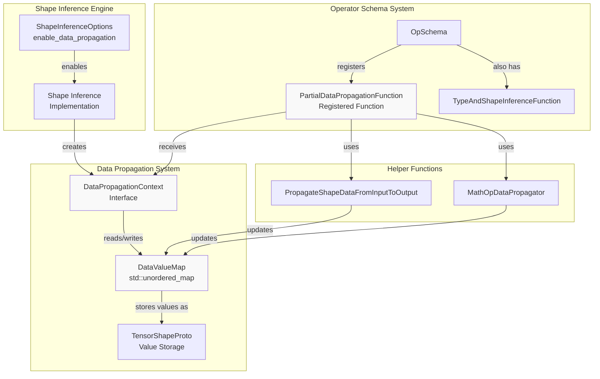

**Sources:** [onnx/defs/shape_inference.h:117-162](), [onnx/shape_inference/implementation.h:23-28](), [onnx/defs/schema.h]()

---

### DataPropagationContext Interface

The `DataPropagationContext` class provides the interface for operators to access statically-known input values and produce output values during propagation.

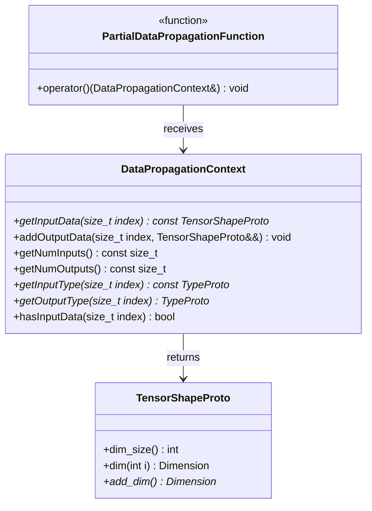

**Key Methods:**
- `getInputData(index)`: Retrieves statically-known value for input tensor at given index
- `addOutputData(index, value)`: Stores computed output value for downstream propagation
- `hasInputData(index)`: Checks if input has a known constant value

**Sources:** [onnx/defs/shape_inference.h:117-162]()

---

## Data Flow Through the System

### Propagation Pipeline

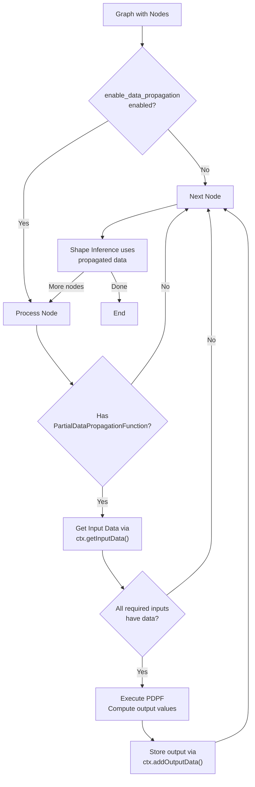

**Sources:** [onnx/shape_inference/implementation.cc](), [onnx/defs/shape_inference.h:28-32]()

---

## Operator-Specific Implementations

### Shape Operator

The `Shape` operator is the primary source of constant data in the propagation system. It produces the dimensions of its input tensor as concrete integer values.

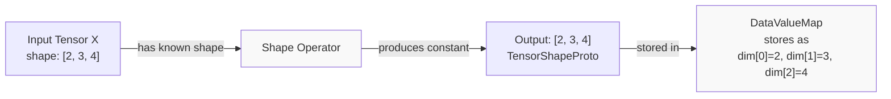

**Implementation:**
- Extracts input tensor's shape dimensions
- Creates `TensorShapeProto` with concrete dimension values
- Stores via `ctx.addOutputData(0, shape_data)`

**Sources:** [onnx/defs/tensor/defs.cc:482-492]()

---

### Cast Operator

The `Cast` operator propagates shape data through type conversions without modifying values.

**Implementation Pattern:**
```
PartialDataPropagationFunction([](DataPropagationContext& ctx) {
    PropagateShapeDataFromInputToOutput(ctx, 0);
})
```

This simply copies the shape data from input 0 to output 0, preserving constant values through the type cast.

**Sources:** [onnx/defs/tensor/defs.cc:153-155]()

---

### Math Operators (Add, Sub, Mul)

Math operators can propagate constant values when both operands are statically known, enabling constant folding of arithmetic expressions.

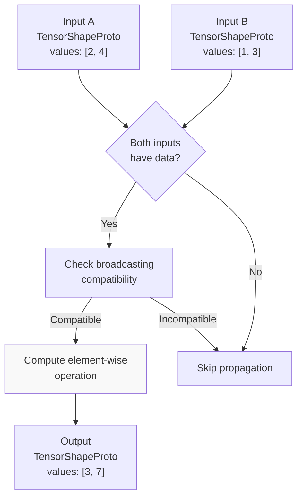

**Implementation:** The `MathOpDataPropagator` function handles broadcasting and element-wise computation for operations like Add, Sub, and Mul.

**Key Logic:**
1. Check if both inputs have constant data
2. Verify broadcasting compatibility
3. Compute result element-wise using `MathOpTwoIntegers` utility
4. Store result via `ctx.addOutputData()`

**Sources:** [onnx/defs/math/defs.cc:15-41](), [onnx/defs/math/defs.cc:84-86]()

---

### Reshape Operator

The `Reshape` operator benefits from data propagation by using the propagated shape input to determine its output shape precisely.

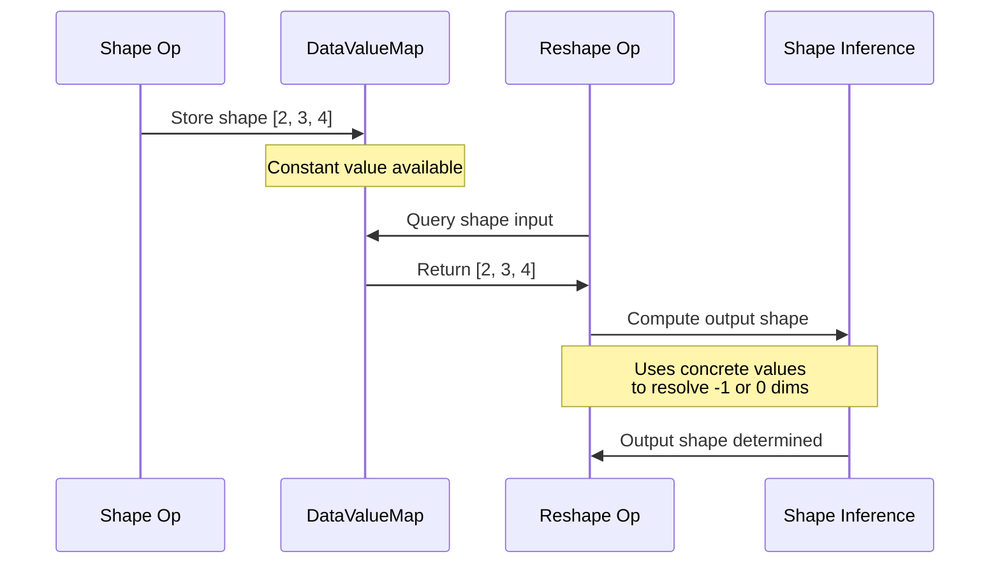

**Without data propagation:** Shape input is unknown, output shape may be partially unknown  
**With data propagation:** Shape input is concrete, output shape fully determined

**Sources:** [onnx/defs/tensor/defs.cc:251-397]()

---

## Value Representation

### Using TensorShapeProto for Values

ONNX reuses the `TensorShapeProto` message to represent constant tensor values, not just shapes. This design choice enables efficient storage and avoids creating new protobuf message types.

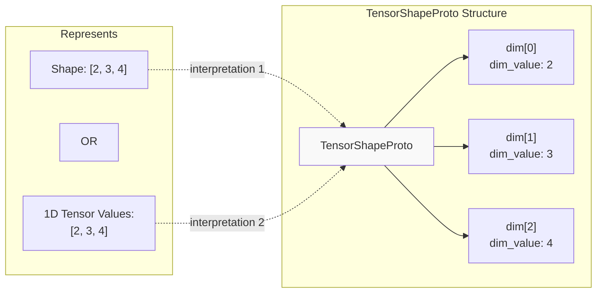

**Encoding Rules:**
- Each `dim` in `TensorShapeProto` represents one element of a 1D tensor
- `dim_value` stores the integer value
- Only supports integer values (shape-like data)
- Cannot represent floating-point constant values

**Sources:** [onnx/shape_inference/implementation.h:23-26]()

---

## Registration and Usage

### Registering Data Propagation Functions

Operators register data propagation functions on their schema using the `PartialDataPropagationFunction` method:

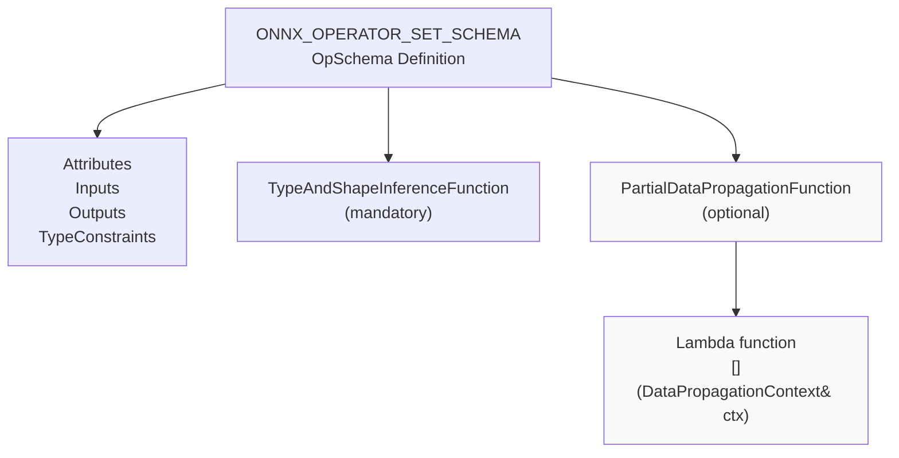

**Example Pattern:**
```cpp
ONNX_OPERATOR_SET_SCHEMA(
    OperatorName,
    Version,
    OpSchema()
        .SetDoc(...)
        .Input(...)
        .Output(...)
        .TypeAndShapeInferenceFunction([](InferenceContext& ctx) {
            // Regular type and shape inference
        })
        .PartialDataPropagationFunction([](DataPropagationContext& ctx) {
            // Data propagation logic
        }));
```

**Sources:** [onnx/defs/tensor/defs.cc:102-156](), [onnx/defs/math/defs.cc:81-86]()

---

## Complete Example: Shape → Reshape Pipeline

### Scenario

A common pattern where a `Shape` operator extracts dimensions, and a `Reshape` operator uses those dimensions to reshape another tensor.

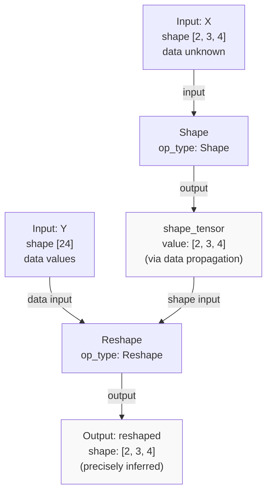

### Execution Flow

| Step | Operator | Action | Result |
|------|----------|--------|--------|
| 1 | `Shape` | Extract dimensions from X | Creates `TensorShapeProto` with values [2, 3, 4] |
| 2 | `Shape` | Store in DataValueMap | `shape_tensor` → [2, 3, 4] |
| 3 | `Reshape` | Query shape input | Retrieves [2, 3, 4] from DataValueMap |
| 4 | `Reshape` | Shape inference | Uses concrete values to determine output is [2, 3, 4] |

**Without data propagation:** Output shape of `Reshape` would be partially unknown  
**With data propagation:** Output shape is fully determined as [2, 3, 4]

**Sources:** [onnx/defs/tensor/defs.cc:251-397](), [onnx/defs/tensor/defs.cc:482-492]()

---

## Enabling Data Propagation

### Configuration

Data propagation is controlled by the `ShapeInferenceOptions` structure:

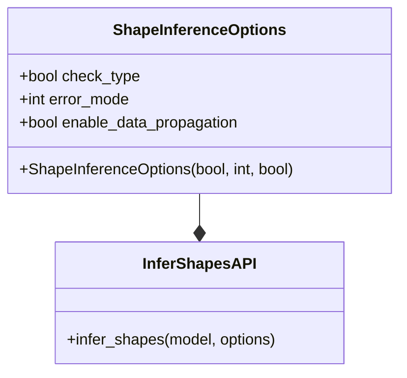

**Python API:**
```python
import onnx.shape_inference

inferred_model = onnx.shape_inference.infer_shapes(
    model,
    strict_mode=True,
    data_prop=True  # Enable data propagation
)
```

**C++ API:**
```cpp
ShapeInferenceOptions options(
    /*check_type=*/false,
    /*error_mode=*/1,
    /*enable_data_propagation=*/true
);
```

**Sources:** [onnx/defs/shape_inference.h:21-33](), [onnx/test/shape_inference_test.py:142-149]()

---

## Supported Operators

### Operators with Data Propagation

The following table lists operators that implement `PartialDataPropagationFunction`:

| Operator | Propagation Type | Purpose |
|----------|------------------|---------|
| `Shape` | **Source** | Produces shape dimensions as constant values |
| `Size` | **Source** | Produces total element count as constant |
| `Cast` | **Pass-through** | Propagates values through type conversion |
| `CastLike` | **Pass-through** | Propagates values through type conversion |
| `Reshape` | **Consumer** | Uses propagated shape to determine output |
| `Transpose` | **Pass-through** | Propagates shape data with dimension reordering |
| `Squeeze` | **Pass-through** | Propagates shape data with dimension removal |
| `Unsqueeze` | **Pass-through** | Propagates shape data with dimension addition |
| `Add` | **Compute** | Computes constant sum when inputs known |
| `Sub` | **Compute** | Computes constant difference when inputs known |
| `Mul` | **Compute** | Computes constant product when inputs known |
| `Concat` | **Compute** | Concatenates constant values |
| `Slice` | **Compute** | Extracts constant slice when indices known |
| `Gather` | **Compute** | Gathers constant values when indices known |

**Sources:** [onnx/defs/tensor/defs.cc](), [onnx/defs/math/defs.cc](), [onnx/defs/generator/defs.cc]()

---

## Limitations and Constraints

### Current Limitations

1. **Integer Values Only**
   - `TensorShapeProto` representation limited to integer dimensions
   - Cannot propagate floating-point constants
   - Cannot propagate string or boolean constants

2. **1D Tensors Only**
   - Data propagation primarily handles 1D shape tensors
   - Multi-dimensional constant propagation limited

3. **No Control Flow**
   - Does not propagate through `If`, `Loop`, or `Scan` operators
   - Subgraph boundaries prevent propagation

4. **Partial Implementation**
   - Not all operators implement data propagation
   - Some operators may benefit but lack implementation

### Design Trade-offs

| Aspect | Choice | Rationale |
|--------|--------|-----------|
| **Value Storage** | Reuse `TensorShapeProto` | Avoids new message types, efficient for shape data |
| **Scope** | Shape-related operators | Focuses on most impactful use case |
| **Precision** | Best-effort | Graceful degradation when propagation unavailable |
| **Performance** | Opt-in via flag | Avoids overhead when not needed |

**Sources:** [onnx/shape_inference/implementation.h:21-28]()

---

## Implementation Guide

### Adding Data Propagation to an Operator

To add data propagation support to an operator:

**1. Define the propagation logic:**
```cpp
void MyOpDataPropagation(DataPropagationContext& ctx) {
    // Check if required inputs have data
    const auto* input_data = ctx.getInputData(0);
    if (input_data == nullptr) {
        return;  // Cannot propagate
    }
    
    // Perform computation
    TensorShapeProto output_data;
    // ... compute output values ...
    
    // Store result
    ctx.addOutputData(0, std::move(output_data));
}
```

**2. Register on OpSchema:**
```cpp
ONNX_OPERATOR_SET_SCHEMA(
    MyOp,
    1,
    OpSchema()
        .Input(...)
        .Output(...)
        .TypeAndShapeInferenceFunction(...)
        .PartialDataPropagationFunction(MyOpDataPropagation));
```

**3. Test propagation:**
```python
# Python test
graph = make_graph(
    nodes=[
        make_node("Shape", ["x"], ["shape"]),
        make_node("MyOp", ["shape"], ["output"]),
    ],
    ...
)
model = make_model(graph)
inferred = onnx.shape_inference.infer_shapes(model, data_prop=True)
# Verify output shape is correctly inferred
```

**Sources:** [onnx/defs/tensor/defs.cc:153-155](), [onnx/defs/math/defs.cc:15-41]()

---

## Helper Functions

### Common Propagation Patterns

The ONNX codebase provides reusable helper functions for common propagation patterns:

| Function | Purpose | Usage |
|----------|---------|-------|
| `PropagateShapeDataFromInputToOutput` | Copy data from input to output | Pass-through operators |
| `MathOpDataPropagator` | Arithmetic on constant values | Math operators |
| `MathOpTwoIntegers` | Element-wise integer operations | Low-level computation |

**Example - Simple Pass-through:**
```cpp
.PartialDataPropagationFunction([](DataPropagationContext& ctx) {
    PropagateShapeDataFromInputToOutput(ctx, 0);
})
```

**Example - With Computation:**
```cpp
.PartialDataPropagationFunction([](DataPropagationContext& ctx) {
    MathOpDataPropagator(ctx, "Add");
})
```

**Sources:** [onnx/defs/data_propagators.h](), [onnx/defs/math/defs.cc:15-41]()

---

## Testing Data Propagation

### Test Infrastructure

Tests verify that data propagation correctly computes constant values:

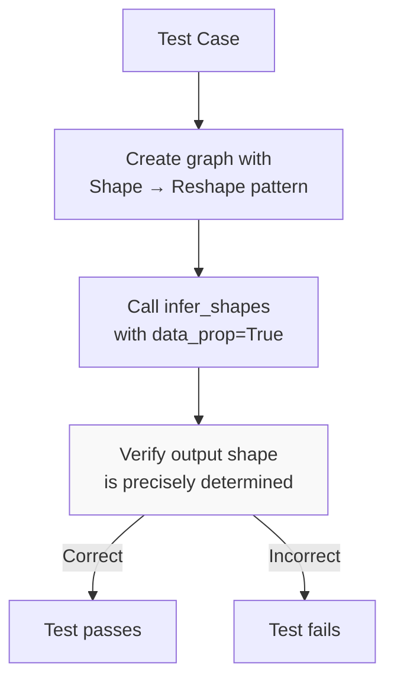

**Test Pattern:**
```python
def test_data_propagation():
    # Create model with constant folding opportunity
    graph = make_graph([
        make_node("Shape", ["x"], ["shape"]),
        make_node("Reshape", ["y", "shape"], ["output"]),
    ], ...)
    
    # Infer with data propagation enabled
    inferred = onnx.shape_inference.infer_shapes(
        make_model(graph),
        data_prop=True
    )
    
    # Verify output shape is concrete
    assert output_has_concrete_shape(inferred)
```

**Sources:** [onnx/test/shape_inference_test.py:142-152]()

---

## Relationship to Shape Inference

### Integration Points

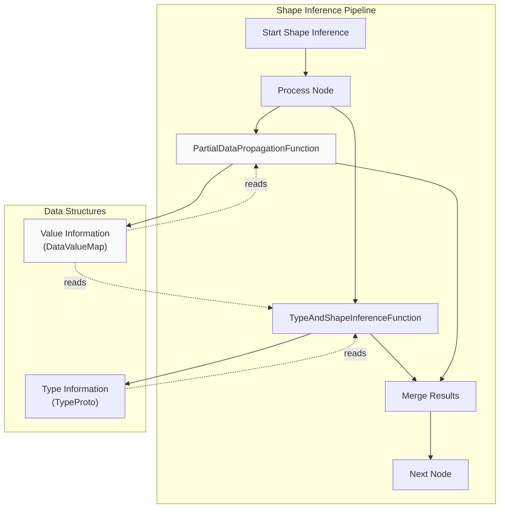

**Key Points:**
- Data propagation runs **alongside** shape inference, not instead of it
- `TypeAndShapeInferenceFunction` can use propagated data via `getSymbolicInput()`
- Both systems share the same traversal order (topological)
- Data propagation is optional and transparent to operators that don't need it

**Sources:** [onnx/shape_inference/implementation.cc](), [onnx/defs/shape_inference.h:109-110]()

---

