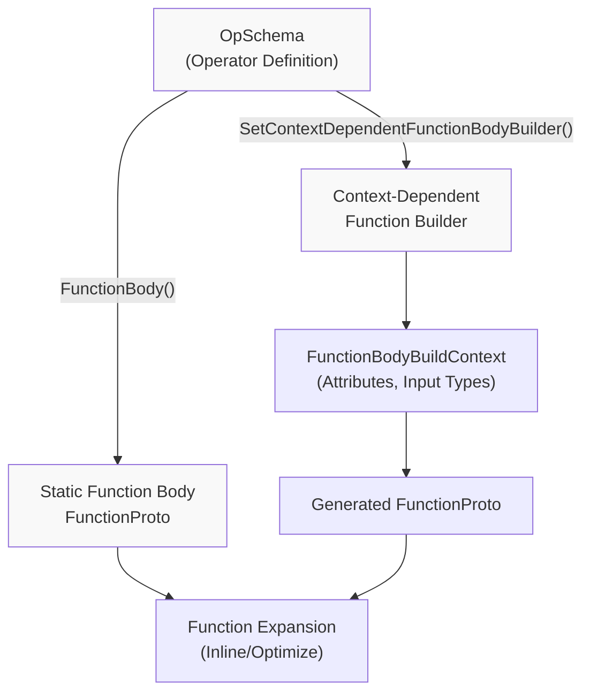
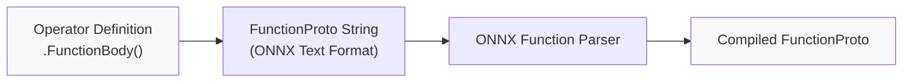
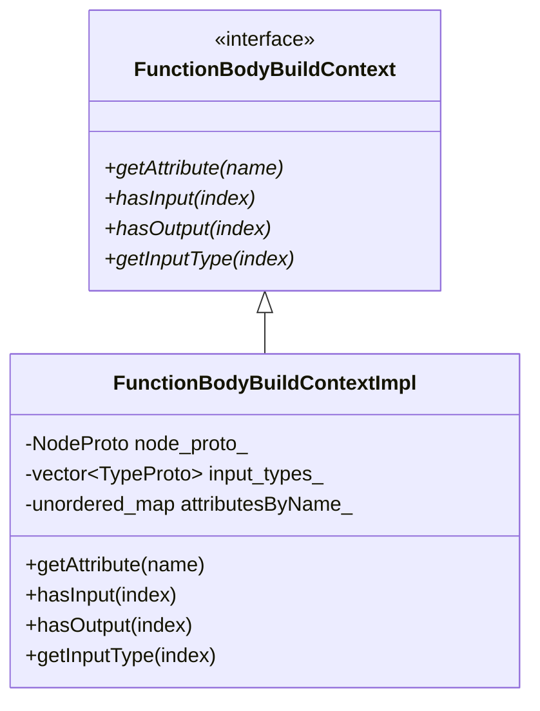
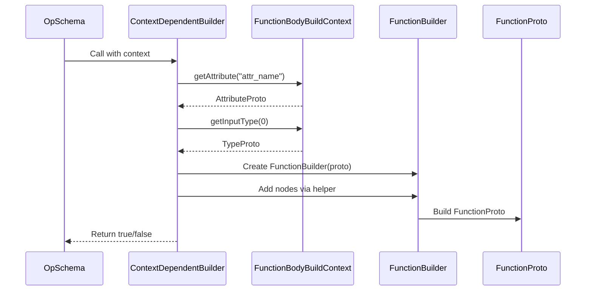
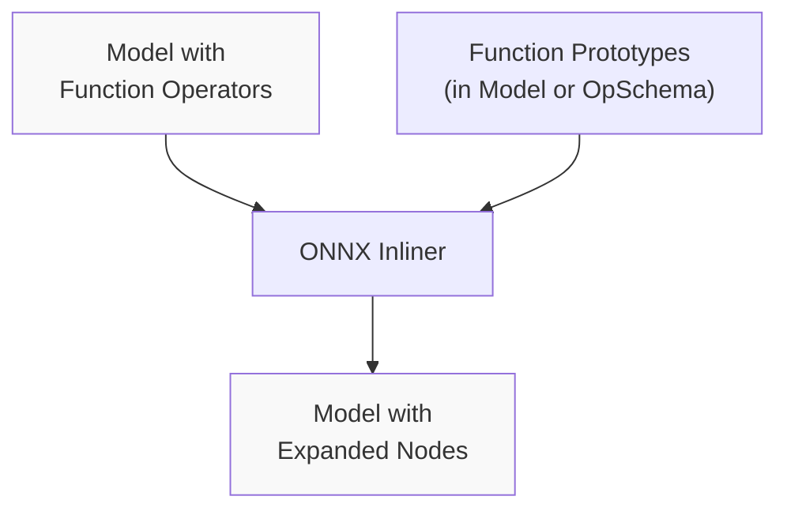
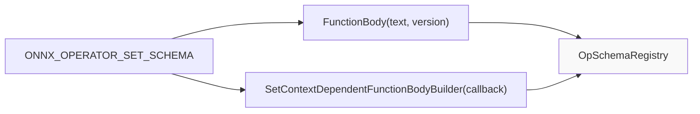

<!-- source: DeepWiki mcp.deepwiki.com · repo onnx/onnx · page 3.5 Function Bodies and Operator Composition · fetched 2026-10-21 -->

# Function Bodies and Operator Composition

<details>
<summary>Relevant source files</summary>

The following files were used as context for generating this wiki page:

- [docs/Changelog.md](docs/Changelog.md)
- [docs/Operators.md](docs/Operators.md)
- [docs/TestCoverage.md](docs/TestCoverage.md)
- [onnx/backend/test/case/node/cast.py](onnx/backend/test/case/node/cast.py)
- [onnx/backend/test/case/node/castlike.py](onnx/backend/test/case/node/castlike.py)
- [onnx/checker.cc](onnx/checker.cc)
- [onnx/checker.h](onnx/checker.h)
- [onnx/common/model_helpers.cc](onnx/common/model_helpers.cc)
- [onnx/common/status.cc](onnx/common/status.cc)
- [onnx/common/status.h](onnx/common/status.h)
- [onnx/cpp2py_export.cc](onnx/cpp2py_export.cc)
- [onnx/defs/controlflow/defs.cc](onnx/defs/controlflow/defs.cc)
- [onnx/defs/controlflow/old.cc](onnx/defs/controlflow/old.cc)
- [onnx/defs/function.cc](onnx/defs/function.cc)
- [onnx/defs/function.h](onnx/defs/function.h)
- [onnx/defs/math/defs.cc](onnx/defs/math/defs.cc)
- [onnx/defs/math/old.cc](onnx/defs/math/old.cc)
- [onnx/defs/nn/defs.cc](onnx/defs/nn/defs.cc)
- [onnx/defs/nn/old.cc](onnx/defs/nn/old.cc)
- [onnx/defs/operator_sets.h](onnx/defs/operator_sets.h)
- [onnx/defs/reduction/defs.cc](onnx/defs/reduction/defs.cc)
- [onnx/defs/rnn/defs.cc](onnx/defs/rnn/defs.cc)
- [onnx/defs/rnn/old.cc](onnx/defs/rnn/old.cc)
- [onnx/defs/schema.cc](onnx/defs/schema.cc)
- [onnx/defs/schema.h](onnx/defs/schema.h)
- [onnx/defs/shape_inference.cc](onnx/defs/shape_inference.cc)
- [onnx/defs/shape_inference.h](onnx/defs/shape_inference.h)
- [onnx/defs/tensor/defs.cc](onnx/defs/tensor/defs.cc)
- [onnx/defs/tensor/old.cc](onnx/defs/tensor/old.cc)
- [onnx/shape_inference/implementation.cc](onnx/shape_inference/implementation.cc)
- [onnx/shape_inference/implementation.h](onnx/shape_inference/implementation.h)
- [onnx/test/shape_inference_test.py](onnx/test/shape_inference_test.py)

</details>


This page describes how ONNX operators can be defined in terms of other operators using **function bodies**. This mechanism allows complex operators to be specified as compositions of simpler primitive operators, enabling operator expansion, optimization, and portability across different ONNX implementations.

For information about operator schema definitions, see [Operator Schema Registry](#3.1). For shape and type inference, see [Type and Shape Inference](#3.3).

## Overview

Function bodies provide a way to define operators by composing other operators rather than implementing them natively. When an operator has a function body, ONNX tools can:

- **Expand** the operator into its constituent operations during model optimization
- **Inline** the function during compilation or execution
- **Provide reference implementations** for testing and validation
- **Enable portability** by allowing backends to either implement the high-level operator directly or use the function expansion

Function bodies come in two forms:
1. **Static function bodies**: Fixed composition that applies to all uses of the operator
2. **Context-dependent function bodies**: Composition varies based on operator attributes, input types, or other context



**Diagram: Function Body Architecture**

Sources: [onnx/defs/schema.h:29-95]()

## Static Function Bodies

Static function bodies are defined directly in the operator schema using a fixed ONNX function representation. The composition is specified once and applies uniformly to all uses of the operator.

### Definition Pattern

Static function bodies are defined using the `FunctionBody()` method in the operator schema. The function is typically specified using ONNX textual format:



**Diagram: Static Function Body Compilation**

Sources: [onnx/defs/math/defs.cc:277-304]()

### Example: Relu

The `Relu` operator is defined as a function body that composes `Constant`, `CastLike`, and `Max`:

```
Relu(X) = Max(X, CastLike(Constant(0.0), X))
```

This definition creates a zero constant, casts it to match the input type, and takes the element-wise maximum. The actual function body from the code:

Sources: [onnx/defs/math/defs.cc:295-302]()

The function body uses:
- **Constant nodes** to create literal values
- **CastLike** to ensure type compatibility
- **Max** as the core operation

### Example: LeakyRelu

The `LeakyRelu` operator demonstrates function bodies with attributes:

```
LeakyRelu(X, alpha) = Where(X >= 0, X, alpha * X)
```

Sources: [onnx/defs/math/defs.cc:306-358]()

## Context-Dependent Function Bodies

Context-dependent function bodies are generated dynamically based on:
- **Operator attributes**: Different attribute values produce different compositions
- **Input types**: Type-specific implementations
- **Input shapes**: Shape-dependent logic

### Build Context Interface

The `FunctionBodyBuildContext` interface provides access to the context needed to build a function:

| Method | Purpose |
|--------|---------|
| `getAttribute(name)` | Access operator attribute values |
| `hasInput(index)` | Check if optional input is provided |
| `hasOutput(index)` | Check if optional output is present |
| `getInputType(index)` | Access input type information |

Sources: [onnx/defs/schema.h:29-37]()

### Implementation Class

The `FunctionBodyBuildContextImpl` class provides the concrete implementation:



**Diagram: Function Body Build Context Class Hierarchy**

Sources: [onnx/defs/schema.h:39-89]()

### Example: CastLike

The `CastLike` operator uses a context-dependent function body that varies based on the target type:

The builder function:
1. Retrieves the target input type from context
2. Extracts the element type
3. Generates a `Cast` node with appropriate `to` attribute
4. Includes the `saturate` attribute if present

Sources: [onnx/defs/tensor/defs.cc:219-233]()

The function adapts to the actual target type at runtime while preserving type safety.

## Function Body Builder Pattern

Context-dependent functions use the `ContextDependentFunctionBodyBuilder` callback:

```cpp
using ContextDependentFunctionBodyBuilder = 
    std::function<bool(const FunctionBodyBuildContext&, 
                       const OpSchema&, 
                       FunctionProto&)>;
```

The builder returns:
- `true` if function body was successfully generated
- `false` if context is insufficient (e.g., type information missing)

Sources: [onnx/defs/schema.h:94-95]()

### Builder Pattern Steps



**Diagram: Context-Dependent Function Building Sequence**

Sources: [onnx/defs/tensor/defs.cc:219-233]()

## Function Composition with FunctionBuilder

The `FunctionBuilder` class provides a fluent interface for constructing function bodies programmatically:

| Method | Purpose |
|--------|---------|
| `Add(statement)` | Add a node statement |
| `Const1D(name, value)` | Create 1D constant |
| `Constant(name, tensor)` | Create constant from tensor |

Sources: [onnx/defs/function.h]() (referenced but not in provided files)

### Example Usage Pattern

```
FunctionBuilder builder(functionProto);
builder
    .Const1D("zero", 0.0f)
    .Add("casted = CastLike(zero, X)")
    .Add("output = Max(X, casted)");
```

This pattern is used extensively in reduction operators and other complex functions.

Sources: [onnx/defs/math/old.cc:14-37]()

## Operator Function Status

The ONNX specification distinguishes between:
- **Native operators**: Require backend implementation
- **Function operators**: Can be expanded to other operators

The operator documentation indicates function status:

| Operator Type | Definition | Example |
|---------------|------------|---------|
| Native | Direct implementation required | `MatMul`, `Conv` |
| Function | Has function body | `Relu`, `LeakyRelu`, `CastLike` |

Sources: [docs/Operators.md:169-212]()

### Function Operator Table

From the operator documentation, functions are clearly marked:

```
|**Function**|**Since version**|**Function version**|
|AffineGrid|20|20|
|Attention|24|24|
|CastLike|25|25|
|Clip|13|13|
```

Each function operator lists its function version, which may differ from the operator's since version.

Sources: [docs/Operators.md:169-212]()

## Function Expansion and Inlining

ONNX provides utilities to expand function bodies into the main graph:



**Diagram: Function Inlining Process**

Sources: [onnx/inliner/inliner.h]() (referenced in imports)

The inliner:
1. Identifies function call nodes
2. Retrieves function body from model or schema
3. Substitutes function inputs/outputs
4. Inserts function body nodes into main graph
5. Removes original function call node

Sources: [onnx/cpp2py_export.cc:28]()

## Function Versioning

Functions have their own versioning independent of operator versioning:

- **Operator since_version**: When the operator was introduced
- **Function version**: When the function body was defined/updated

This allows:
- Function implementations to evolve independently
- Backward compatibility with older function definitions
- Multiple function versions for different opsets

Example from documentation:
```
|LayerNormalization|17|17, 18|
```

`LayerNormalization` was introduced in opset 17 but has function bodies for versions 17 and 18.

Sources: [docs/Operators.md:187]()

## Schema Registration with Functions

Operators register function bodies during schema creation:



**Diagram: Function Body Registration**

Sources: [onnx/defs/tensor/defs.cc:102-155](), [onnx/defs/math/defs.cc:277-304]()

The registration process:
1. `ONNX_OPERATOR_SET_SCHEMA` macro creates schema
2. Schema builder calls either `FunctionBody()` or `SetContextDependentFunctionBodyBuilder()`
3. Function is stored in `OpSchema` object
4. Schema is registered in `OpSchemaRegistry`

## Function Query and Retrieval

The schema system provides methods to check for and retrieve function bodies:

| Method | Purpose |
|--------|---------|
| `HasFunction()` | Check if operator has function body |
| `HasContextDependentFunction()` | Check if function is context-dependent |
| `BuildFunction(proto)` | Build function into proto |

Sources: [onnx/defs/schema.h:400-600]() (approximate location based on class structure)

## Use Cases

### Portability

Backends can choose to:
- Implement function operators directly for performance
- Expand functions for simpler implementation
- Selectively inline based on optimization level

### Testing and Validation

Function bodies provide:
- Reference implementations for operator testing
- Consistency validation across implementations
- Documentation of operator semantics

### Model Optimization

Functions enable:
- Operator fusion across function boundaries
- Dead code elimination of unused function outputs
- Constant folding through function expansion

Sources: [onnx/test/shape_inference_test.py:1-50]() (demonstrates function usage in tests)

## Best Practices

### When to Use Function Bodies

**Use static functions when:**
- Composition is fixed and simple
- No type or attribute dependencies
- Clear semantic mapping to primitives

**Use context-dependent functions when:**
- Behavior varies by type or attribute
- Type casting or specialization needed
- Conditional logic based on attributes

### Function Definition Guidelines

1. **Keep functions simple**: Prefer composition of few operators
2. **Minimize context dependencies**: Makes functions easier to optimize
3. **Document function semantics**: Include comments explaining the composition
4. **Test both native and expanded forms**: Ensure consistency

Sources: [onnx/defs/math/defs.cc:1-304](), [onnx/defs/tensor/defs.cc:1-500]()

---

