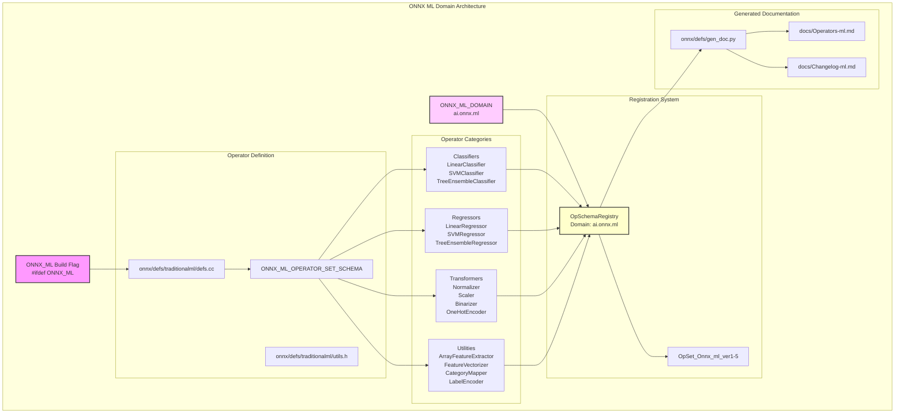
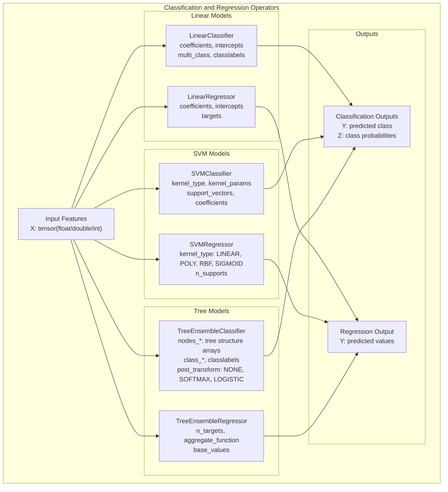
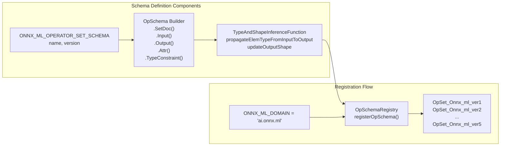
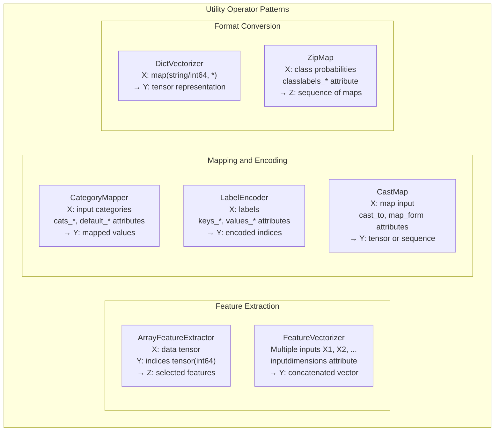
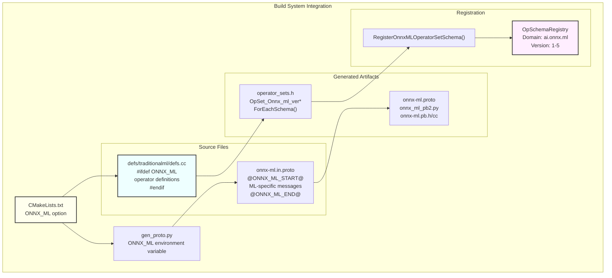
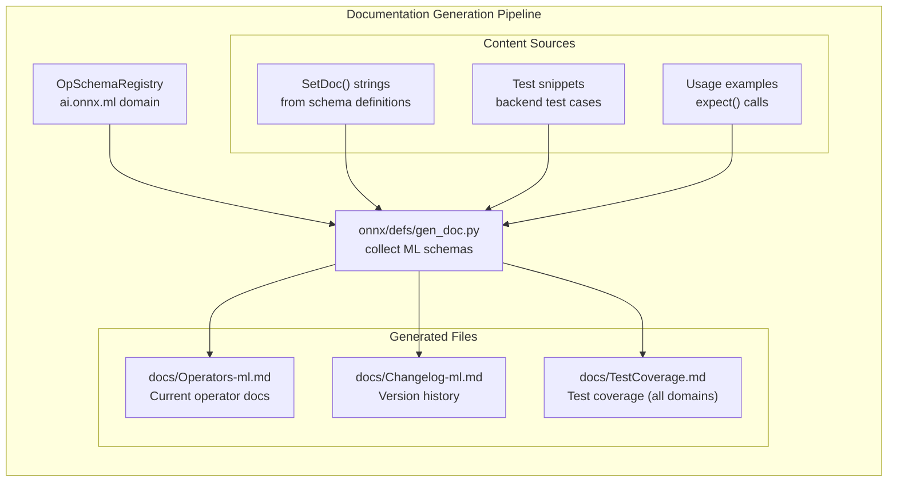

<!-- source: DeepWiki mcp.deepwiki.com · repo onnx/onnx · page 3.6 Traditional ML Operators · fetched 2026-10-21 -->

# Traditional ML Operators

<details>
<summary>Relevant source files</summary>

The following files were used as context for generating this wiki page:

- [docs/Changelog-ml.md](docs/Changelog-ml.md)
- [docs/Changelog.md](docs/Changelog.md)
- [docs/Operators-ml.md](docs/Operators-ml.md)
- [docs/Operators.md](docs/Operators.md)
- [docs/TestCoverage.md](docs/TestCoverage.md)
- [onnx/backend/test/case/node/cast.py](onnx/backend/test/case/node/cast.py)
- [onnx/backend/test/case/node/castlike.py](onnx/backend/test/case/node/castlike.py)
- [onnx/defs/__init__.py](onnx/defs/__init__.py)
- [onnx/defs/controlflow/defs.cc](onnx/defs/controlflow/defs.cc)
- [onnx/defs/controlflow/old.cc](onnx/defs/controlflow/old.cc)
- [onnx/defs/gen_doc.py](onnx/defs/gen_doc.py)
- [onnx/defs/math/defs.cc](onnx/defs/math/defs.cc)
- [onnx/defs/math/old.cc](onnx/defs/math/old.cc)
- [onnx/defs/nn/defs.cc](onnx/defs/nn/defs.cc)
- [onnx/defs/nn/old.cc](onnx/defs/nn/old.cc)
- [onnx/defs/operator_sets.h](onnx/defs/operator_sets.h)
- [onnx/defs/reduction/defs.cc](onnx/defs/reduction/defs.cc)
- [onnx/defs/rnn/defs.cc](onnx/defs/rnn/defs.cc)
- [onnx/defs/rnn/old.cc](onnx/defs/rnn/old.cc)
- [onnx/defs/tensor/defs.cc](onnx/defs/tensor/defs.cc)
- [onnx/defs/tensor/old.cc](onnx/defs/tensor/old.cc)
- [onnx/defs/traditionalml/defs.cc](onnx/defs/traditionalml/defs.cc)
- [onnx/defs/traditionalml/old.cc](onnx/defs/traditionalml/old.cc)
- [onnx/onnx_cpp2py_export/defs.pyi](onnx/onnx_cpp2py_export/defs.pyi)
- [onnx/onnx_cpp2py_export/shape_inference.pyi](onnx/onnx_cpp2py_export/shape_inference.pyi)
- [onnx/shape_inference.py](onnx/shape_inference.py)
- [onnx/test/inference_function_test.py](onnx/test/inference_function_test.py)
- [onnx/test/schema_test.py](onnx/test/schema_test.py)
- [onnx/test/shape_inference_test.py](onnx/test/shape_inference_test.py)

</details>


This page documents the Traditional Machine Learning (ML) operators in ONNX, which provide support for classical machine learning algorithms beyond deep neural networks. These operators are defined in the `ai.onnx.ml` domain and include classifiers, regressors, transformers, and preprocessing operations commonly used in scikit-learn and other traditional ML frameworks.

For information about standard neural network operators in the `ai.onnx` domain, see [Operator Definitions and Categories](#3.2). For the operator schema registry system that manages all operators, see [Operator Schema Registry](#3.1).

## Overview and Domain

Traditional ML operators are defined in a separate domain (`ai.onnx.ml`) from standard ONNX operators and are conditionally compiled based on the `ONNX_ML` build flag. This separation allows ONNX implementations to include or exclude traditional ML support based on their requirements.

**Key Characteristics:**
- **Domain**: `ai.onnx.ml` (distinct from `ai.onnx` default domain)
- **Operator Count**: ~20+ operators covering classification, regression, and feature transformation
- **Conditional Compilation**: Protected by `#ifdef ONNX_ML` preprocessor directives
- **Opset Versioning**: Currently at version 5 for the ML domain
- **Use Cases**: Scikit-learn model conversion, classical ML pipelines, feature engineering



**Diagram: Traditional ML Operators Architecture**

Sources: [onnx/defs/traditionalml/defs.cc:1-1500](), [onnx/defs/__init__.py:1-100](), [onnx/defs/operator_sets.h:1-200]()

## Operator Categories

Traditional ML operators are organized into four primary categories based on their functionality:

| Category | Operators | Purpose |
|----------|-----------|---------|
| **Classifiers** | `LinearClassifier`, `SVMClassifier`, `TreeEnsembleClassifier` | Binary and multi-class classification with probability scores |
| **Regressors** | `LinearRegressor`, `SVMRegressor`, `TreeEnsembleRegressor` | Continuous value prediction |
| **Feature Transformers** | `Normalizer`, `Scaler`, `Binarizer`, `OneHotEncoder`, `Imputer` | Data preprocessing and normalization |
| **Utilities** | `ArrayFeatureExtractor`, `FeatureVectorizer`, `CategoryMapper`, `LabelEncoder`, `DictVectorizer`, `ZipMap`, `CastMap` | Feature extraction, encoding, and format conversion |

### Classifiers and Regressors



**Diagram: Classifier and Regressor Operator Flow**

Sources: [onnx/defs/traditionalml/defs.cc:200-800](), [docs/Operators-ml.md:1-2000]()

## Schema Definition System

Traditional ML operators use the same schema definition system as standard operators but with domain-specific macros and registration:



**Diagram: ML Operator Schema Registration Flow**

### Key Schema Components

Each traditional ML operator schema includes:

1. **Operator Metadata**
   - Name and version (opset version)
   - Domain (`ONNX_ML_DOMAIN`)
   - Documentation string

2. **Inputs and Outputs**
   - Type constraints (e.g., `tensor(float)`, `tensor(int64)`)
   - Shape specifications
   - Optional/variadic flags

3. **Attributes**
   - Model parameters (e.g., coefficients, kernel parameters)
   - Configuration options (e.g., `post_transform`, `kernel_type`)
   - Default values

4. **Type and Shape Inference Functions**
   - Compute output types from input types
   - Propagate or compute output shapes
   - Validate attribute values

Sources: [onnx/defs/traditionalml/defs.cc:1-100](), [onnx/defs/schema.h:1-200]()

## Feature Transformation Operators

These operators handle data preprocessing, normalization, and feature engineering:

| Operator | Purpose | Key Attributes |
|----------|---------|----------------|
| `Normalizer` | Normalize vectors using L1, L2, or Max norm | `norm: 'MAX', 'L1', 'L2'` |
| `Scaler` | Linear scaling: `Y = (X - offset) * scale` | `scale`, `offset` arrays |
| `Binarizer` | Threshold-based binarization | `threshold` (default: 0.0) |
| `Imputer` | Replace missing values | `imputed_value_floats/ints` |
| `OneHotEncoder` | Categorical to one-hot encoding | `cats_int64s`, `cats_strings`, `zeros` |
| `LabelEncoder` | Map labels to numeric indices | `keys_*`, `values_*`, `default_*` |

### Example: Normalizer Operator

The `Normalizer` operator demonstrates typical ML operator structure:

**Inputs:**
- `X`: Input tensor to normalize (type: `T`)

**Outputs:**
- `Y`: Normalized tensor (type: `tensor(float)`)

**Attributes:**
- `norm`: Normalization method - `"MAX"`, `"L1"`, or `"L2"` (default: `"MAX"`)

**Type Constraints:**
- `T`: `tensor(float)`, `tensor(double)`, `tensor(int64)`, `tensor(int32)`

Sources: [onnx/defs/traditionalml/defs.cc:450-550](), [docs/Operators-ml.md:800-900]()

## Utility Operators



**Diagram: Utility Operator Categories**

### ArrayFeatureExtractor

Selects elements from input tensors based on indices - commonly used after classifiers to extract specific features:

- **Operation**: `Z = X[..., Y]` (applies indices to last axis)
- **Shape Inference**: Output rank = input rank, last dimension = total indices
- **Use Case**: Extracting specific class probabilities or feature subsets

### FeatureVectorizer

Concatenates multiple feature vectors into a single vector:

- **Variadic Inputs**: `X1, X2, ..., Xn`
- **Attribute**: `inputdimensions` specifies size of each input
- **Output**: Flattened concatenation of all inputs
- **Use Case**: Combining heterogeneous features before model input

Sources: [onnx/defs/traditionalml/defs.cc:14-150](), [onnx/defs/traditionalml/utils.h:1-100]()

## Build Configuration and Conditional Compilation

Traditional ML operators are controlled by the `ONNX_ML` preprocessor flag:



**Diagram: Build Configuration Flow**

### Build Flags

| Flag | Default | Effect |
|------|---------|--------|
| `ONNX_ML` | ON | Includes traditional ML operators in build |
| `ONNX_ML=0` (env) | N/A | Excludes ML operators from protocol buffer generation |

### Code Structure

**Conditional Compilation Pattern:**
```
#ifdef ONNX_ML
namespace ONNX_NAMESPACE {
  ONNX_ML_OPERATOR_SET_SCHEMA(OperatorName, version, OpSchema()...);
}
#endif
```

Sources: [onnx/defs/traditionalml/defs.cc:12-13](), [onnx/defs/gen_doc.py:24]()

## Tree Ensemble Operators

Tree ensemble operators (`TreeEnsembleClassifier`, `TreeEnsembleRegressor`) deserve special attention due to their complexity:

### Tree Structure Representation

Trees are encoded using parallel arrays:

| Attribute | Type | Description |
|-----------|------|-------------|
| `nodes_treeids` | `list of ints` | Tree ID for each node |
| `nodes_nodeids` | `list of ints` | Node ID within tree |
| `nodes_featureids` | `list of ints` | Feature index for split |
| `nodes_modes` | `list of strings` | Branch mode: `BRANCH_LEQ`, `BRANCH_LT`, `BRANCH_GTE`, etc. |
| `nodes_values` | `list of floats` | Split threshold values |
| `nodes_truenodeids` | `list of ints` | True branch destination |
| `nodes_falsenodeids` | `list of ints` | False branch destination |
| `nodes_missing_value_tracks_true` | `list of ints` | Missing value handling |

### Leaf Values

| Attribute | Purpose |
|-----------|---------|
| `class_treeids` | Tree ID for leaf classes |
| `class_nodeids` | Node ID for leaf classes |
| `class_ids` | Class label for leaf |
| `class_weights` | Weight/probability for leaf |
| `target_*` | Regression target values |

### Aggregation and Post-Transform

**TreeEnsembleClassifier:**
- `aggregate_function`: How to combine tree outputs (e.g., `SUM`, `AVERAGE`)
- `post_transform`: Applied to final scores (`NONE`, `SOFTMAX`, `LOGISTIC`, `SOFTMAX_ZERO`, `PROBIT`)

**TreeEnsembleRegressor:**
- `aggregate_function`: `SUM` (default), `AVERAGE`, `MIN`, `MAX`
- `n_targets`: Number of regression targets
- `base_values`: Base prediction values

Sources: [onnx/defs/traditionalml/defs.cc:900-1500](), [docs/Operators-ml.md:1500-2500]()

## Type Constraints and Inference

Traditional ML operators have specific type constraint patterns:

### Common Type Patterns

1. **Flexible Numeric Input:**
   - `T`: `tensor(float)`, `tensor(double)`, `tensor(int64)`, `tensor(int32)`
   - Used by: `LinearClassifier`, `SVMClassifier`, `Normalizer`

2. **String or Integer Keys:**
   - Maps and categorical operators support both string and integer keys
   - `CategoryMapper`, `LabelEncoder`, `ZipMap`

3. **Mixed Type Support:**
   - `DictVectorizer`: Input is `map(string, T1)` or `map(int64, T2)`
   - Output: `tensor(float)` or `tensor(double)`

### Shape Inference Examples

**LinearClassifier:**
```
Input: X [N, F]  (N samples, F features)
Output: Y [N]    (N class predictions)
Output: Z [N, C] (N samples, C class probabilities)
```

**TreeEnsembleRegressor:**
```
Input: X [N, F]      (N samples, F features)
Output: Y [N, T]     (N samples, T targets)
  where T = n_targets attribute
```

**Normalizer:**
```
Input: X [N, F]  or [F]
Output: Y (same shape as X)
  with element type always tensor(float)
```

Sources: [onnx/defs/traditionalml/defs.cc:200-1500](), [onnx/defs/traditionalml/utils.h:1-100]()

## Opset Versioning

The `ai.onnx.ml` domain follows its own opset versioning independent of the standard `ai.onnx` domain:

| ML Opset Version | Key Changes | Operators |
|-----------------|-------------|-----------|
| **1** | Initial release | All core ML operators |
| **2** | Updates to `LinearClassifier`, `SVMClassifier` | Type constraint expansion |
| **3** | Enhanced `TreeEnsemble*` operators | Additional aggregation functions |
| **4** | `LabelEncoder` string/int64 unification | Improved type flexibility |
| **5** | Current version | Latest refinements |

**Version Registration:**
- Defined in [onnx/defs/operator_sets.h:5000-6000]()
- Functions: `OpSet_Onnx_ml_ver1::ForEachSchema()` through `OpSet_Onnx_ml_ver5::ForEachSchema()`
- Domain constant: `ONNX_ML_DOMAIN = "ai.onnx.ml"`

Sources: [onnx/defs/operator_sets.h:5000-6000](), [docs/Changelog-ml.md:1-1000]()

## Documentation Generation

Traditional ML operator documentation is auto-generated using the same system as standard operators:



**Diagram: ML Operator Documentation Generation**

**Key Functions:**
- `should_render_domain(domain, output)`: Filters ML vs. standard operators based on output file
- `format_name_with_domain(domain, schema_name)`: Prefixes operators with `ai.onnx.ml.`
- Domain detection: Checks for `"-ml"` in output filename to route ML operators correctly

Sources: [onnx/defs/gen_doc.py:33-50](), [docs/Operators-ml.md:1-10](), [docs/Changelog-ml.md:1-10]()

## Integration with Standard Operators

Traditional ML operators integrate with the broader ONNX ecosystem:

**Model Composition:**
- ML operators can be combined with standard neural network operators in the same model
- Example: Neural network feature extraction followed by `LinearClassifier`
- Requires specifying opset imports for both `ai.onnx` and `ai.onnx.ml` domains

**Opset Import Example:**
```python
model.opset_import.add(domain='', version=18)        # ai.onnx
model.opset_import.add(domain='ai.onnx.ml', version=5)  # ai.onnx.ml
```

**Shared Infrastructure:**
- Type and shape inference system ([Type and Shape Inference](#3.3))
- Schema registry ([Operator Schema Registry](#3.1))
- Model validation and checking ([Model Validation and Checking](#4.2))
- Protocol buffer serialization ([Protocol Buffer Schema](#2.1))

Sources: [onnx/defs/traditionalml/defs.cc:1-20](), [onnx/defs/schema.h:1-100]()

---

