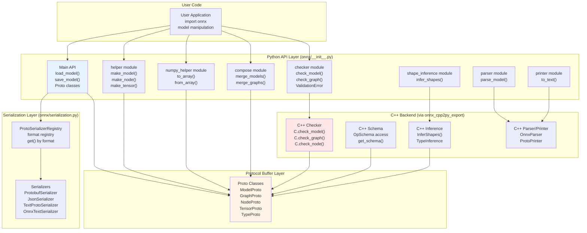
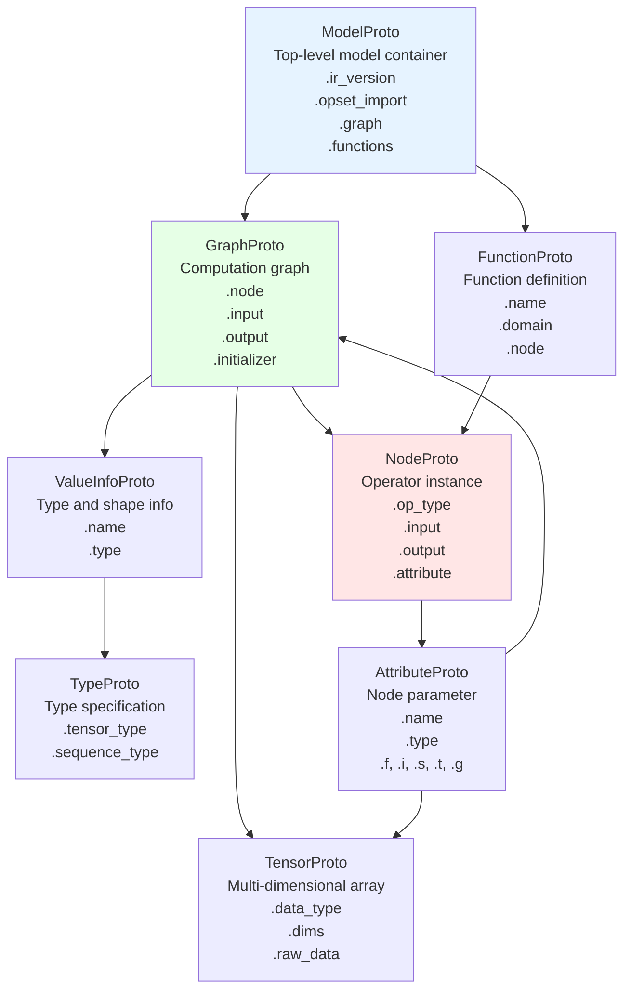
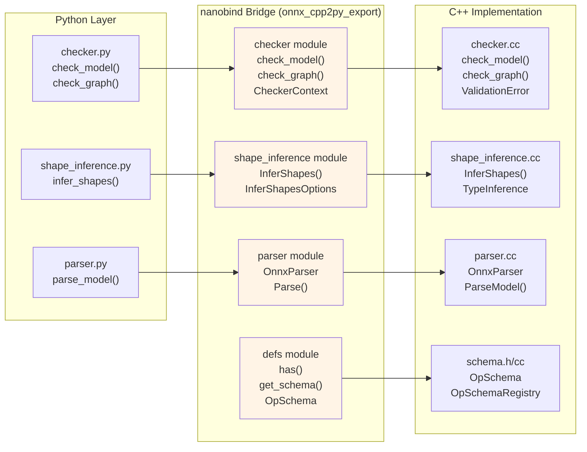
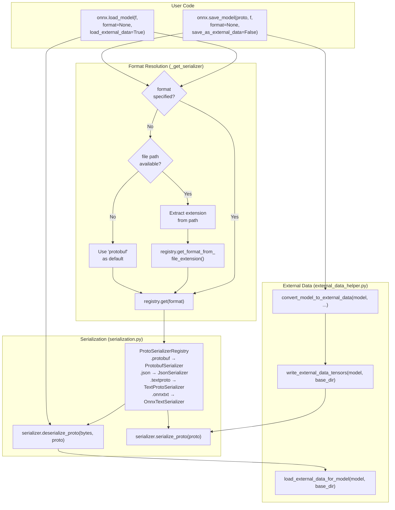

<!-- source: DeepWiki mcp.deepwiki.com · repo onnx/onnx · page 4 Python API · fetched 2026-10-21 -->

# Python API

<details>
<summary>Relevant source files</summary>

The following files were used as context for generating this wiki page:

- [VERSION_NUMBER](VERSION_NUMBER)
- [docs/IR.md](docs/IR.md)
- [docs/OnnxReleases.md](docs/OnnxReleases.md)
- [docs/Versioning.md](docs/Versioning.md)
- [onnx/__init__.py](onnx/__init__.py)
- [onnx/checker.py](onnx/checker.py)
- [onnx/common/version.h](onnx/common/version.h)
- [onnx/compose.py](onnx/compose.py)
- [onnx/defs/data_type_utils.cc](onnx/defs/data_type_utils.cc)
- [onnx/defs/data_type_utils.h](onnx/defs/data_type_utils.h)
- [onnx/external_data_helper.py](onnx/external_data_helper.py)
- [onnx/helper.py](onnx/helper.py)
- [onnx/model_container.py](onnx/model_container.py)
- [onnx/numpy_helper.py](onnx/numpy_helper.py)
- [onnx/onnx-ml.proto](onnx/onnx-ml.proto)
- [onnx/onnx-ml.proto3](onnx/onnx-ml.proto3)
- [onnx/onnx.in.proto](onnx/onnx.in.proto)
- [onnx/onnx.proto](onnx/onnx.proto)
- [onnx/onnx.proto3](onnx/onnx.proto3)
- [onnx/onnx_cpp2py_export/checker.pyi](onnx/onnx_cpp2py_export/checker.pyi)
- [onnx/reference/ops/op_range.py](onnx/reference/ops/op_range.py)
- [onnx/serialization.py](onnx/serialization.py)
- [onnx/test/basic_test.py](onnx/test/basic_test.py)
- [onnx/test/checker_test.py](onnx/test/checker_test.py)
- [onnx/test/compose_test.py](onnx/test/compose_test.py)
- [onnx/test/helper_test.py](onnx/test/helper_test.py)
- [onnx/test/numpy_helper_test.py](onnx/test/numpy_helper_test.py)
- [onnx/test/serialization_test.py](onnx/test/serialization_test.py)
- [onnx/test/test_external_data.py](onnx/test/test_external_data.py)

</details>


The Python API is the primary interface for interacting with ONNX models from Python code. It provides comprehensive functionality for creating, loading, saving, validating, and manipulating ONNX models and their components. The API consists of pure Python modules that wrap high-performance C++ implementations through nanobind bindings, providing both ease of use and efficient execution.

For detailed information about specific subsystems:
- Model construction utilities: see [Helper Functions for Model Creation](#4.1)
- Model validation: see [Model Validation and Checking](#4.2)
- Array/tensor conversion: see [NumPy Conversion and Data Handling](#4.3)
- Type and shape inference: see [Shape Inference API](#4.4)
- Operator introspection: see [Schema Access and Introspection](#4.5)
- Model persistence: see [Loading and Saving Models](#4.6)
- Graph manipulation: see [Graph Composition and Manipulation](#4.7)
- Text format support: see [Textual Syntax Parser and Printer](#4.8)

## Architecture Overview

The Python API is organized into distinct functional modules, each responsible for specific aspects of ONNX model manipulation. The implementation follows a layered architecture where user-facing Python code delegates performance-critical operations to C++ implementations.



**Sources:** [onnx/__init__.py:1-465](), [onnx/helper.py:1-100](), [onnx/checker.py:1-150](), [onnx/serialization.py:1-200]()

## Module Organization

The Python API is exposed through the `onnx` package and organized into the following modules:

| Module | Primary Purpose | Key Functions/Classes |
|--------|----------------|----------------------|
| `onnx` (main) | Model I/O, constants, proto classes | `load_model()`, `save_model()`, `ModelProto`, `GraphProto` |
| `onnx.helper` | Model construction utilities | `make_model()`, `make_node()`, `make_tensor()`, `make_attribute()` |
| `onnx.checker` | Model validation | `check_model()`, `check_graph()`, `check_node()`, `ValidationError` |
| `onnx.numpy_helper` | NumPy/tensor conversion | `to_array()`, `from_array()`, `from_dict()`, `to_list()` |
| `onnx.shape_inference` | Type and shape inference | `infer_shapes()`, `infer_shapes_path()` |
| `onnx.compose` | Graph merging and manipulation | `merge_models()`, `merge_graphs()`, `add_prefix()` |
| `onnx.parser` | Text format parsing | `parse_model()`, `parse_graph()`, `parse_node()` |
| `onnx.printer` | Text format printing | `to_text()` |
| `onnx.defs` | Operator schema access | `has()`, `get_schema()`, `get_all_schemas()`, `onnx_opset_version()` |
| `onnx.external_data_helper` | External data management | `load_external_data_for_model()`, `convert_model_to_external_data()` |

**Sources:** [onnx/__init__.py:1-73](), [onnx/__init__.py:129-142]()

## Core Protocol Buffer Classes

ONNX models are represented using Protocol Buffer message types. These are the fundamental data structures manipulated by all Python API functions:



**Sources:** [onnx/onnx.proto:446-523](), [onnx/onnx.proto:561-599](), [onnx/onnx.proto:220-246](), [onnx/onnx.proto:604-899]()

## Python-C++ Integration

The Python API achieves high performance by delegating compute-intensive operations to C++ implementations. This integration is accomplished through the `onnx_cpp2py_export` module, built using nanobind.



The bindings expose C++ functionality while maintaining Pythonic interfaces. For example, `checker.check_model()` in Python:

1. Serializes the `ModelProto` to bytes using Protocol Buffers
2. Calls `C.check_model()` from `onnx_cpp2py_export.checker`
3. C++ performs validation and may raise `ValidationError`
4. Exception propagates back to Python with detailed error messages

**Sources:** [onnx/checker.py:24-150](), [onnx/onnx_cpp2py_export/checker.pyi:1-20]()

## Model I/O with Format Auto-Detection

The main API provides flexible model loading and saving with automatic format detection based on file extensions:



**Supported Formats:**

| Format | Extension | Description | Use Case |
|--------|-----------|-------------|----------|
| `protobuf` | `.onnx`, `.pb` | Binary Protocol Buffer format | Default, most efficient |
| `textproto` | `.onnx.txt`, `.pbtxt` | Text Protocol Buffer format | Human-readable debugging |
| `json` | `.onnx.json` | JSON representation | Web/JavaScript integration |
| `onnxtxt` | `.onnxtxt` | ONNX custom text format | Compact human-readable format |

**Sources:** [onnx/__init__.py:185-202](), [onnx/__init__.py:204-364](), [onnx/serialization.py:1-200]()

## Constants and Versioning

The Python API exposes key constants for version checking and compatibility:

| Constant | Type | Purpose | Example Value |
|----------|------|---------|---------------|
| `onnx.IR_VERSION` | `int` | Current IR version | `13` (0x0D) |
| `onnx.IR_VERSION_2023_5_5` | `int` | IR version 9 constant | `0x09` |
| `onnx.ONNX_ML` | `bool` | Whether ML operators included | `True` or `False` |
| `onnx.STABLE` | `int` | Operator status: stable | `0` |
| `onnx.EXPERIMENTAL` | `int` | Operator status: experimental | `1` |

Version management utilities in `helper.py`:

```python
# VERSION_TABLE maps (release_version, ir_version, ai.onnx_version, ai.onnx.ml_version)
VERSION_TABLE = [
    ("1.0", 3, 1, 1),
    ("1.21.0", 13, 26, 5, 1),  # Latest
    # ...
]

# Find minimum IR version required for given opset imports
min_ir = helper.find_min_ir_version_for(opset_imports, ignore_unknown=False)
```

**Sources:** [onnx/__init__.py:8-73](), [onnx/helper.py:44-133](), [onnx/onnx.proto:50-126]()

## Common Usage Patterns

### Loading and Validating a Model

```python
import onnx

# Load model with format auto-detection
model = onnx.load_model("model.onnx")

# Validate the model structure
onnx.checker.check_model(model)

# Infer missing type/shape information
model = onnx.shape_inference.infer_shapes(model)
```

### Creating a Simple Model

```python
import onnx
from onnx import helper, TensorProto

# Create nodes
node1 = helper.make_node("Relu", ["X"], ["Y"])
node2 = helper.make_node("Add", ["Y", "Z"], ["Out"])

# Create graph
graph = helper.make_graph(
    [node1, node2],
    "simple_graph",
    [helper.make_tensor_value_info("X", TensorProto.FLOAT, [1, 2])],
    [helper.make_tensor_value_info("Out", TensorProto.FLOAT, [1, 2])]
)

# Create model
model = helper.make_model(graph, producer_name="my_producer")

# Save model
onnx.save_model(model, "simple_model.onnx")
```

### Working with Tensors and NumPy

```python
import numpy as np
import onnx
from onnx import numpy_helper

# NumPy array to TensorProto
np_array = np.array([[1, 2], [3, 4]], dtype=np.float32)
tensor = numpy_helper.from_array(np_array, name="my_tensor")

# TensorProto to NumPy array
recovered_array = numpy_helper.to_array(tensor)

# Create tensor in model construction
tensor_proto = helper.make_tensor(
    name="const",
    data_type=TensorProto.FLOAT,
    dims=[2, 2],
    vals=[1.0, 2.0, 3.0, 4.0]
)
```

**Sources:** [onnx/__init__.py:204-234](), [onnx/helper.py:135-329](), [onnx/numpy_helper.py:172-250]()

## Error Handling

The Python API defines specific exceptions for different error conditions:

| Exception | Module | Raised When | Example |
|-----------|--------|-------------|---------|
| `ValidationError` | `onnx.checker` | Model validation fails | Invalid operator, type mismatch |
| `TypeError` | `onnx.helper` | Incorrect argument types | Wrong proto type passed |
| `ValueError` | `onnx.helper` | Invalid values | Empty iterator without type hint |

Example validation error handling:

```python
import onnx
from onnx import checker

try:
    model = onnx.load_model("model.onnx")
    checker.check_model(model)
except checker.ValidationError as e:
    print(f"Model validation failed: {e}")
except ValueError as e:
    print(f"Value error: {e}")
```

**Sources:** [onnx/checker.py:19-23](), [onnx/helper.py:667-720]()

## Advanced Features

### External Data Management

For large models (>2GB), tensors can be stored externally:

```python
import onnx

# Load model with external data
model = onnx.load_model(
    "large_model.onnx",
    load_external_data=True  # Loads from same directory
)

# Convert model to use external data
onnx.save_model(
    model,
    "output.onnx",
    save_as_external_data=True,
    all_tensors_to_one_file=True,
    location="external_data.bin",
    size_threshold=1024  # Only tensors >= 1KB externalized
)

# Manual external data management
from onnx import external_data_helper

external_data_helper.load_external_data_for_model(model, "/path/to/data")
external_data_helper.convert_model_to_external_data(
    model,
    all_tensors_to_one_file=True,
    location="data.bin",
    size_threshold=0  # Externalize all tensors
)
```

**Sources:** [onnx/__init__.py:204-344](), [onnx/external_data_helper.py:46-250]()

### Model Composition

Merge multiple models or extract subgraphs:

```python
from onnx import compose

# Merge two models
merged = compose.merge_models(
    model1,
    model2,
    io_map=[("model1_output", "model2_input")],
    prefix1="m1_",
    prefix2="m2_"
)

# Extract subgraph
subgraph = compose.extract_subgraph(
    model,
    input_names=["layer3_in"],
    output_names=["layer5_out"]
)
```

**Sources:** [onnx/compose.py:1-800]()

### Text Format Parsing

Parse ONNX models from text representation:

```python
from onnx import parser

model_text = """
<
  ir_version: 8,
  opset_import: ["" : 17],
  producer_name: "test"
>
agraph (float[N, 128] X) => (float[N, 10] Y) {
  Y = Gemm(X, W, B)
}
"""

model = parser.parse_model(model_text)
```

**Sources:** [onnx/parser.py:1-100]()

## CheckerContext for Custom Validation

The `CheckerContext` class allows customizing validation behavior:

```python
from onnx import checker

# Create custom context
ctx = checker.C.CheckerContext()
ctx.ir_version = 9
ctx.opset_imports = {"": 17, "ai.onnx.ml": 3}

# Use custom context for validation
checker.check_model(model, ctx)

# Full validation (includes shape inference)
checker.check_model(model, full_check=True)

# Skip opset compatibility check
checker.check_model(model, skip_opset_compatibility_check=True)
```

**Sources:** [onnx/checker.py:39-150](), [onnx/onnx_cpp2py_export/checker.pyi:1-5]()

---

