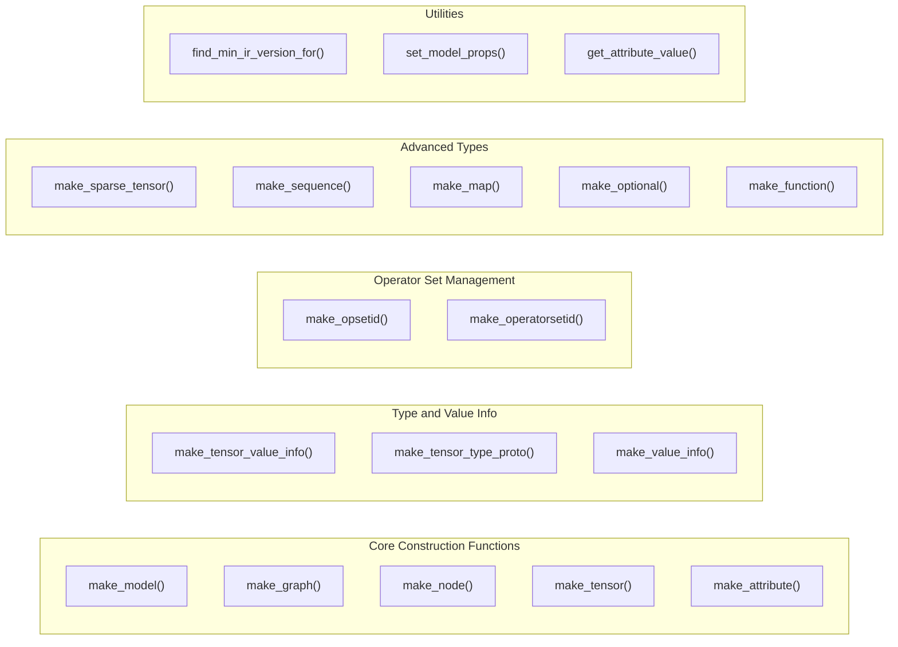
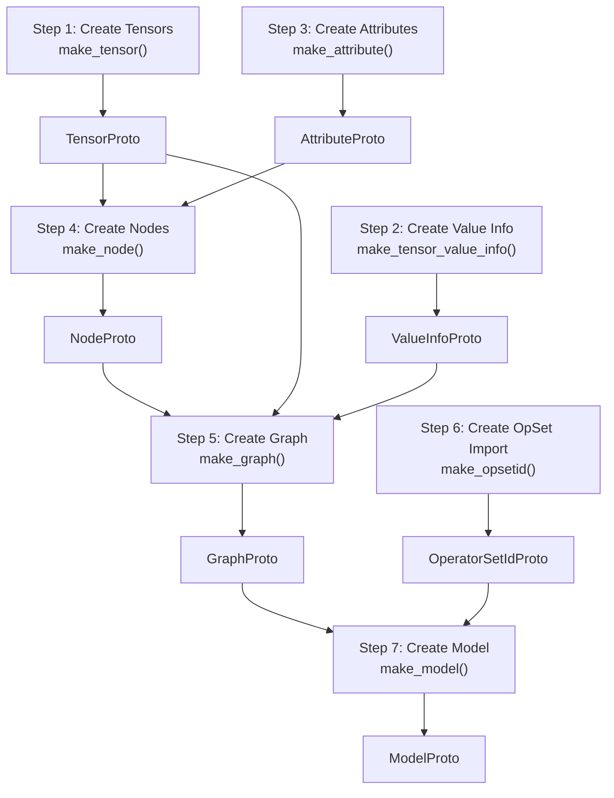
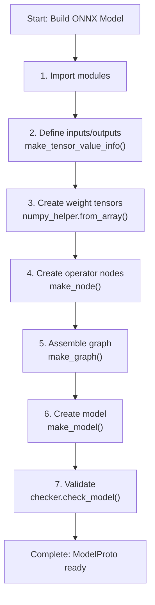

<!-- source: DeepWiki mcp.deepwiki.com · repo onnx/onnx · page 4.1 Helper Functions for Model Creation · fetched 2026-10-21 -->

# Helper Functions for Model Creation

<details>
<summary>Relevant source files</summary>

The following files were used as context for generating this wiki page:

- [VERSION_NUMBER](VERSION_NUMBER)
- [docs/IR.md](docs/IR.md)
- [docs/OnnxReleases.md](docs/OnnxReleases.md)
- [docs/Versioning.md](docs/Versioning.md)
- [onnx/checker.cc](onnx/checker.cc)
- [onnx/checker.h](onnx/checker.h)
- [onnx/common/model_helpers.cc](onnx/common/model_helpers.cc)
- [onnx/common/status.cc](onnx/common/status.cc)
- [onnx/common/status.h](onnx/common/status.h)
- [onnx/common/version.h](onnx/common/version.h)
- [onnx/cpp2py_export.cc](onnx/cpp2py_export.cc)
- [onnx/defs/data_type_utils.cc](onnx/defs/data_type_utils.cc)
- [onnx/defs/data_type_utils.h](onnx/defs/data_type_utils.h)
- [onnx/defs/function.cc](onnx/defs/function.cc)
- [onnx/defs/function.h](onnx/defs/function.h)
- [onnx/defs/schema.cc](onnx/defs/schema.cc)
- [onnx/defs/schema.h](onnx/defs/schema.h)
- [onnx/defs/shape_inference.cc](onnx/defs/shape_inference.cc)
- [onnx/defs/shape_inference.h](onnx/defs/shape_inference.h)
- [onnx/helper.py](onnx/helper.py)
- [onnx/numpy_helper.py](onnx/numpy_helper.py)
- [onnx/onnx-ml.proto](onnx/onnx-ml.proto)
- [onnx/onnx-ml.proto3](onnx/onnx-ml.proto3)
- [onnx/onnx.in.proto](onnx/onnx.in.proto)
- [onnx/onnx.proto](onnx/onnx.proto)
- [onnx/onnx.proto3](onnx/onnx.proto3)
- [onnx/reference/ops/op_range.py](onnx/reference/ops/op_range.py)
- [onnx/shape_inference/implementation.cc](onnx/shape_inference/implementation.cc)
- [onnx/shape_inference/implementation.h](onnx/shape_inference/implementation.h)
- [onnx/test/helper_test.py](onnx/test/helper_test.py)
- [onnx/test/numpy_helper_test.py](onnx/test/numpy_helper_test.py)

</details>


The ONNX helper module provides a Python API for programmatically constructing ONNX models. Located primarily in [onnx/helper.py]() with NumPy conversion utilities in [onnx/numpy_helper.py](), these functions abstract away the complexity of directly manipulating protobuf message objects. This page focuses on the core functions for building models: `make_model()`, `make_graph()`, `make_node()`, `make_tensor()`, `make_attribute()`, and related utilities.

For other aspects of the Python API, see page 4.2 (Model Validation), page 4.3 (NumPy Conversion), page 4.4 (Shape Inference), page 4.5 (Schema Access), and page 4.6 (Loading and Saving Models).

Sources: [onnx/helper.py:1-78]()

## Core Model Creation Functions

**Diagram: Primary Helper Functions in onnx.helper Module**



Sources: [onnx/helper.py:133-180](), [onnx/helper.py:200-241](), [onnx/helper.py:294-327](), [onnx/helper.py:390-505](), [onnx/helper.py:627-719](), [onnx/helper.py:784-845]()

## Model Construction Workflow

Models are built bottom-up: create basic components (tensors, attributes), assemble them into nodes, combine nodes into a graph, and finally wrap the graph in a model.

**Diagram: Bottom-Up Model Construction Flow**



Sources: [onnx/helper.py:133-180](), [onnx/helper.py:200-241](), [onnx/helper.py:294-327](), [onnx/helper.py:390-505](), [onnx/helper.py:627-719](), [onnx/helper.py:829-845]()

## Model Creation Functions

### make_model() - Creating ModelProto

The `make_model()` function creates a complete ONNX model from a graph and metadata.

**Function Signature:**
```python
def make_model(graph: GraphProto, **kwargs: Any) -> ModelProto
```

**Key Parameters:**
- `graph`: The GraphProto that forms the main computational graph
- `opset_imports`: Sequence of OperatorSetIdProto specifying operator versions (defaults to current ONNX opset if not provided)
- `functions`: Optional sequence of FunctionProto for model-local functions
- Additional kwargs set as model attributes (e.g., `producer_name`, `model_version`, `doc_string`)

**Behavior:**
- Sets `model.ir_version` to `onnx.IR_VERSION` (current IR version)
- If no `opset_imports` provided, defaults to `[{"": defs.onnx_opset_version()}]`
- Copies the provided graph into `model.graph`

**Related Function:** `make_model_gen_version(graph, **kwargs)` automatically infers the minimum required IR version based on the opset imports using `find_min_ir_version_for()`.

**Example:**
```python
import onnx
from onnx import helper, TensorProto

# Assume we already have a graph
model = helper.make_model(
    graph,
    producer_name="my-framework",
    opset_imports=[helper.make_opsetid("", 13)],
    doc_string="Example model"
)
```

Sources: [onnx/helper.py:294-327](), [onnx/helper.py:331-338]()

### make_graph() - Creating GraphProto

The `make_graph()` function assembles nodes, inputs, outputs, and initializers into a computational graph.

**Function Signature:**
```python
def make_graph(
    nodes: Sequence[NodeProto],
    name: str,
    inputs: Sequence[ValueInfoProto],
    outputs: Sequence[ValueInfoProto],
    initializer: Sequence[TensorProto] | None = None,
    doc_string: str | None = None,
    value_info: Sequence[ValueInfoProto] | None = None,
    sparse_initializer: Sequence[SparseTensorProto] | None = None,
) -> GraphProto
```

**Parameters:**
- `nodes`: List of NodeProto defining the computational operations
- `name`: Name of the graph
- `inputs`: List of ValueInfoProto describing graph inputs
- `outputs`: List of ValueInfoProto describing graph outputs
- `initializer`: Optional list of TensorProto for constant tensors (weights, biases)
- `doc_string`: Optional documentation string
- `value_info`: Optional list of ValueInfoProto for intermediate values (useful for debugging/visualization)
- `sparse_initializer`: Optional list of SparseTensorProto for sparse constant tensors

**Example:**
```python
# Assume we have created nodes, inputs, outputs, and initializers
graph = helper.make_graph(
    nodes=[conv_node, relu_node],
    name="simple-cnn",
    inputs=[input_tensor],
    outputs=[output_tensor],
    initializer=[weight_tensor, bias_tensor],
    value_info=[intermediate_tensor],
    doc_string="A simple CNN with one conv layer"
)
```

Sources: [onnx/helper.py:200-241]()

### make_node() - Creating NodeProto

The `make_node()` function creates a node representing an operator instance in the graph.

**Function Signature:**
```python
def make_node(
    op_type: str,
    inputs: Sequence[str],
    outputs: Sequence[str],
    name: str | None = None,
    doc_string: str | None = None,
    domain: str | None = None,
    overload: str | None = None,
    **kwargs: Any,
) -> NodeProto
```

**Parameters:**
- `op_type`: Name of the operator (e.g., "Conv", "Relu", "Add")
- `inputs`: List of input names (strings referring to graph inputs, outputs of other nodes, or initializers)
- `outputs`: List of output names (strings that can be consumed by other nodes or returned as graph outputs)
- `name`: Optional unique identifier for the node
- `doc_string`: Optional documentation
- `domain`: Optional domain (empty string for standard ONNX operators)
- `overload`: Optional overload name for model-local function resolution
- `**kwargs`: Operator attributes (converted to AttributeProto via `make_attribute()`)

**Attribute Handling:**
- Keyword arguments are automatically converted to attributes
- `None` values are filtered out
- Attributes are sorted alphabetically

**Example:**
```python
# Convolution node
conv_node = helper.make_node(
    "Conv",
    inputs=["X", "W", "B"],  # Input tensor, weights, biases
    outputs=["Y"],
    name="conv1",
    kernel_shape=[3, 3],
    strides=[1, 1],
    pads=[1, 1, 1, 1],
    dilations=[1, 1]
)

# Simple operator with no attributes
relu_node = helper.make_node(
    "Relu",
    inputs=["Y"],
    outputs=["Z"]
)
```

Sources: [onnx/helper.py:133-180]()

### make_tensor() - Creating TensorProto

The `make_tensor()` function creates a tensor containing numeric data or strings, typically used for initializers (weights, biases, constants).

**Function Signature:**
```python
def make_tensor(
    name: str,
    data_type: int,
    dims: Sequence[int],
    vals: Sequence[int | float] | bytes | np.ndarray,
    raw: bool = False,
) -> TensorProto
```

**Parameters:**
- `name`: Tensor name
- `data_type`: Data type constant from `TensorProto` (e.g., `TensorProto.FLOAT`, `TensorProto.INT64`)
- `dims`: Shape of the tensor as a sequence of integers
- `vals`: Tensor values as a sequence, bytes, or NumPy array
- `raw`: If `True`, `vals` should be bytes (raw serialized data); if `False`, `vals` is a list/array that will be stored in the appropriate typed field

**Data Storage:**
- When `raw=False`: Values are stored in typed fields (`float_data`, `int32_data`, etc.)
- When `raw=True`: Values are stored in `raw_data` as bytes
- Special handling for low-bit types (INT4, UINT4, INT2, UINT2, FLOAT4E2M1) which are packed
- Special handling for float8 types with saturation casting
- String type must use `raw=False`

**Example:**
```python
import numpy as np
from onnx import TensorProto, helper

# Float tensor from list
weight = helper.make_tensor(
    name="W",
    data_type=TensorProto.FLOAT,
    dims=[3, 3],
    vals=[1.0, 0.0, 0.0,
          0.0, 1.0, 0.0,
          0.0, 0.0, 1.0]
)

# Float tensor from NumPy array
np_array = np.random.randn(64, 128).astype(np.float32)
weight_from_numpy = helper.make_tensor(
    name="dense_weight",
    data_type=TensorProto.FLOAT,
    dims=np_array.shape,
    vals=np_array.flatten().tolist()
)

# String tensor
labels = helper.make_tensor(
    name="class_labels",
    data_type=TensorProto.STRING,
    dims=[3],
    vals=["cat", "dog", "bird"]
)
```

**Note:** For NumPy arrays, consider using `numpy_helper.from_array()` which is more convenient (see page 4.3).

Sources: [onnx/helper.py:390-505](), [onnx/test/helper_test.py:454-489]()

### make_tensor_value_info() - Creating ValueInfoProto

The `make_tensor_value_info()` function creates type and shape information for graph inputs, outputs, and intermediate values.

**Function Signature:**
```python
def make_tensor_value_info(
    name: str,
    elem_type: int,
    shape: Sequence[str | int | None] | None,
    doc_string: str = "",
    shape_denotation: list[str] | None = None,
) -> ValueInfoProto
```

**Parameters:**
- `name`: Name of the value
- `elem_type`: Data type constant (e.g., `TensorProto.FLOAT`)
- `shape`: Sequence specifying dimensions where:
  - `int` values represent concrete dimensions (e.g., `64`)
  - `str` values represent symbolic dimensions (e.g., `"batch_size"`)
  - `None` represents unknown dimensions
  - `None` for the entire shape means completely unknown shape
- `doc_string`: Optional documentation
- `shape_denotation`: Optional list of semantic labels for each dimension (e.g., `["BATCH", "CHANNEL", "HEIGHT", "WIDTH"]`)

**Example:**
```python
# Fixed-size tensor
X = helper.make_tensor_value_info(
    "X", 
    TensorProto.FLOAT, 
    [1, 3, 224, 224]  # Concrete dimensions
)

# Dynamic batch size with symbolic dimension
X_dynamic = helper.make_tensor_value_info(
    "X_dynamic",
    TensorProto.FLOAT,
    ["batch", 3, 224, 224]  # "batch" is symbolic
)

# Unknown dimensions
X_unknown = helper.make_tensor_value_info(
    "X_unknown",
    TensorProto.FLOAT,
    [None, None, None, None]  # All dimensions unknown
)

# With shape denotation
X_semantic = helper.make_tensor_value_info(
    "X_semantic",
    TensorProto.FLOAT,
    ["N", "C", 224, 224],
    shape_denotation=["BATCH", "CHANNEL", "HEIGHT", "WIDTH"]
)
```

**Related Functions:**
- `make_tensor_type_proto()`: Creates just the TypeProto part
- `make_sparse_tensor_value_info()`: For sparse tensors
- `make_value_info()`: Generic version accepting any TypeProto

Sources: [onnx/helper.py:829-845](), [onnx/helper.py:784-827]()

### make_attribute() - Creating AttributeProto

The `make_attribute()` function creates operator attributes. Typically called implicitly by `make_node()` via keyword arguments, but can be used directly.

**Function Signature:**
```python
def make_attribute(
    key: str,
    value: Any,
    doc_string: str | None = None,
    attr_type: int | None = None,
) -> AttributeProto
```

**Parameters:**
- `key`: Attribute name
- `value`: Attribute value (type determines AttributeProto type)
- `doc_string`: Optional documentation
- `attr_type`: Optional explicit type (required for empty lists)

**Type Inference:**
The function automatically infers the attribute type from the Python value:
- `int` → `AttributeProto.INT`
- `float` → `AttributeProto.FLOAT`
- `str`/`bytes` → `AttributeProto.STRING`
- `TensorProto` → `AttributeProto.TENSOR`
- `GraphProto` → `AttributeProto.GRAPH`
- `TypeProto` → `AttributeProto.TYPE_PROTO`
- `list[int]` → `AttributeProto.INTS`
- `list[float]` → `AttributeProto.FLOATS`
- `list[str]` → `AttributeProto.STRINGS`
- `list[TensorProto]` → `AttributeProto.TENSORS`
- `list[GraphProto]` → `AttributeProto.GRAPHS`

**Example:**
```python
# Typically used via make_node kwargs:
node = helper.make_node(
    "Conv",
    inputs=["X", "W"],
    outputs=["Y"],
    kernel_shape=[3, 3],  # Becomes INTS attribute
    strides=[1, 1],       # Becomes INTS attribute
)

# Direct usage:
attr_int = helper.make_attribute("my_int", 42)
attr_floats = helper.make_attribute("my_floats", [1.0, 2.0, 3.0])
attr_string = helper.make_attribute("my_string", "hello")

# Empty list requires explicit type
attr_empty = helper.make_attribute(
    "empty_list", 
    [], 
    attr_type=AttributeProto.INTS
)
```

**Attribute Reference:** For function attributes, use `make_attribute_ref()` which creates a reference to a parent function's attribute.

Sources: [onnx/helper.py:627-719](), [onnx/helper.py:721-731](), [onnx/test/helper_test.py:62-125]()

### make_opsetid() - Creating OperatorSetIdProto

The `make_opsetid()` and `make_operatorsetid()` functions specify which operator set versions a model uses.

**Function Signatures:**
```python
def make_opsetid(domain: str, version: int) -> OperatorSetIdProto
def make_operatorsetid(domain: str, version: int) -> OperatorSetIdProto
```

Both functions are identical and create an OperatorSetIdProto.

**Parameters:**
- `domain`: Domain name (empty string `""` or `"ai.onnx"` for standard ONNX operators)
- `version`: Operator set version number

**Common Domains:**
- `""` or `"ai.onnx"`: Standard ONNX operators
- `"ai.onnx.ml"`: Traditional ML operators
- `"ai.onnx.training"`: Training operators
- Custom domains for vendor-specific extensions

**Example:**
```python
# Standard ONNX opset 13
opset_onnx = helper.make_opsetid("", 13)

# ML operators
opset_ml = helper.make_opsetid("ai.onnx.ml", 2)

# Custom domain
opset_custom = helper.make_opsetid("com.mycompany", 1)

# Used in model creation
model = helper.make_model(
    graph,
    opset_imports=[opset_onnx, opset_ml]
)
```

Sources: [onnx/helper.py:182-198](), [onnx/helper.py:243-256]()

## Additional Creation Functions

### Collection Types

ONNX supports collection types (Sequence, Map, Optional) for representing structured data:

**make_sequence()**: Creates a SequenceProto
```python
from onnx import SequenceProto
seq = helper.make_sequence(
    "my_sequence",
    SequenceProto.TENSOR,
    [tensor1, tensor2, tensor3]
)
```

**make_map()**: Creates a MapProto
```python
from onnx import TensorProto
map_proto = helper.make_map(
    "my_map",
    key_type=TensorProto.STRING,
    keys=["key1", "key2"],
    values=sequence_of_values
)
```

**make_optional()**: Creates an OptionalProto
```python
from onnx import OptionalProto
opt = helper.make_optional(
    "my_optional",
    OptionalProto.TENSOR,
    tensor_value  # or None for empty optional
)
```

Sources: [onnx/helper.py:527-556](), [onnx/helper.py:558-587](), [onnx/helper.py:589-618]()

### Sparse Tensors

**make_sparse_tensor()**: Creates a SparseTensorProto from values and indices tensors:
```python
sparse = helper.make_sparse_tensor(
    values=values_tensor,
    indices=indices_tensor,
    dims=[100, 100]
)
```

Sources: [onnx/helper.py:507-525]()

### Functions

**make_function()**: Creates a FunctionProto for defining model-local reusable functions:
```python
func = helper.make_function(
    domain="com.example",
    fname="my_function",
    inputs=["a", "b"],
    outputs=["c"],
    nodes=[node1, node2],
    opset_imports=[helper.make_opsetid("", 13)]
)
```

Sources: [onnx/helper.py:258-292]()

## Utility Functions

### Metadata Management

**set_model_props()** and **set_metadata_props()**: Add key-value metadata to models or other ONNX objects:

```python
# Set model metadata
helper.set_model_props(model, {
    "title": "ResNet-50",
    "author": "ONNX Team",
    "license": "Apache-2.0"
})

# Works on ModelProto, GraphProto, FunctionProto, NodeProto, etc.
helper.set_metadata_props(graph, {
    "description": "Main computational graph"
})
```

Sources: [onnx/helper.py:340-360]()

### Attribute Access

**get_attribute_value()**: Extracts the value from an AttributeProto:
```python
attr = node.attribute[0]
value = helper.get_attribute_value(attr)  # Returns Python object
```

**get_node_attr_value()**: Gets an attribute value from a node by name:
```python
kernel_shape = helper.get_node_attr_value(conv_node, "kernel_shape")
```

Sources: [onnx/helper.py:733-776]()

## Versioning Utilities

### find_min_ir_version_for()

Determines the minimum IR version required for a given set of operator versions.

**Function Signature:**
```python
def find_min_ir_version_for(
    opsetidlist: Sequence[OperatorSetIdProto],
    ignore_unknown: bool = False
) -> int
```

**Parameters:**
- `opsetidlist`: List of OperatorSetIdProto specifying operator set versions
- `ignore_unknown`: If `True`, unknown domain/version combinations return default (3); if `False`, raises `ValueError`

**Returns:** Minimum IR version (integer) required to support all specified operator sets

**Usage:**
```python
opsets = [
    helper.make_opsetid("", 13),
    helper.make_opsetid("ai.onnx.ml", 2)
]
min_ir = helper.find_min_ir_version_for(opsets)  # Returns 7
```

Used by `make_model_gen_version()` to automatically set appropriate IR version.

Sources: [onnx/helper.py:105-131]()

### VERSION_TABLE

The `VERSION_TABLE` constant maps ONNX release versions to IR versions and operator set versions. This is the authoritative source for version compatibility information.

**Structure:**
```python
VERSION_TABLE: VersionTableType = [
    # (release, ir_version, ai.onnx_version, ai.onnx.ml_version, ai.onnx.training_version)
    ("1.0", 3, 1, 1),
    ("1.1", 3, 5, 1),
    # ... more entries ...
    ("1.19.0", 12, 24, 5, 1),
    ("1.20.0", 13, 25, 5, 1),
]
```

**Note:** This table must be kept in sync with [docs/Versioning.md]() and is updated with each ONNX release.

**Usage:** Typically used internally by `find_min_ir_version_for()`, but can be queried directly for version information:
```python
from onnx.helper import VERSION_TABLE
# Get latest release info
latest = VERSION_TABLE[-1]
release_version, ir_version, onnx_opset, ml_opset = latest[:4]
```

Sources: [onnx/helper.py:46-78](), [onnx/helper.py:83-100](), [docs/Versioning.md:169-201](), [docs/OnnxReleases.md:29-33]()

## Type Conversion Helpers

ONNX includes helper functions for dtype conversions:

**tensor_dtype_to_np_dtype()**: Converts ONNX tensor dtype enum to NumPy dtype
```python
np_dtype = helper.tensor_dtype_to_np_dtype(TensorProto.FLOAT)  # Returns np.float32
```

**np_dtype_to_tensor_dtype()**: Converts NumPy dtype to ONNX tensor dtype enum
```python
tensor_dtype = helper.np_dtype_to_tensor_dtype(np.float32)  # Returns TensorProto.FLOAT
```

**tensor_dtype_to_field()**: Returns the protobuf field name for a given dtype
```python
field = helper.tensor_dtype_to_field(TensorProto.FLOAT)  # Returns "float_data"
```

These utilities are defined in [onnx/mapping.py]() and imported into the helper module.

**Note:** For low-bit types (FLOAT8, INT4, etc.) and conversions, see [onnx/numpy_helper.py]() which provides `to_array()` and `from_array()` with automatic handling of special types including packing/unpacking. The deprecated float conversion functions in helper.py should not be used; prefer `ml_dtypes` library for specialized floating-point conversions.

Sources: [onnx/mapping.py:1-100](), [onnx/numpy_helper.py:172-284]()

## NumPy Integration

The [onnx/numpy_helper.py]() module provides convenient conversions between ONNX tensors and NumPy arrays. These functions are covered in detail on page 4.3 (NumPy Conversion and Data Handling).

**Quick Overview:**

**from_array()**: Converts NumPy array to TensorProto (recommended over `make_tensor()` for NumPy data)
```python
import numpy as np
from onnx import numpy_helper

array = np.random.randn(3, 3).astype(np.float32)
tensor = numpy_helper.from_array(array, name="my_tensor")
```

**to_array()**: Converts TensorProto to NumPy array
```python
array = numpy_helper.to_array(tensor)
```

These functions automatically handle:
- Type conversions (including float8, bfloat16, low-bit types)
- Endianness
- Packing/unpacking for sub-byte types (INT4, UINT4, INT2, UINT2, FLOAT4E2M1)
- External data loading (for large tensors)
- String tensors

**Additional Functions:**
- `from_list()` / `to_list()`: SequenceProto ↔ Python list
- `from_dict()` / `to_dict()`: MapProto ↔ Python dict
- `from_optional()` / `to_optional()`: OptionalProto ↔ Python value/None

Sources: [onnx/numpy_helper.py:172-284](), [onnx/numpy_helper.py:306-363](), [onnx/numpy_helper.py:365-441]()

## Complete Example: Building an ONNX Model

**Diagram: Complete Model Construction Example**



**Complete Code Example:**

```python
import numpy as np
from onnx import helper, numpy_helper, TensorProto, checker

# Step 1: Define inputs and outputs with type/shape info
X = helper.make_tensor_value_info("X", TensorProto.FLOAT, [1, 1, 28, 28])
Y = helper.make_tensor_value_info("Y", TensorProto.FLOAT, [1, 10])

# Step 2: Create weight tensors (initializers)
# Using numpy_helper for convenience with NumPy arrays
W_conv = np.random.randn(8, 1, 3, 3).astype(np.float32)
W_fc = np.random.randn(10, 8*26*26).astype(np.float32)

conv_weight = numpy_helper.from_array(W_conv, name="W_conv")
fc_weight = numpy_helper.from_array(W_fc, name="W_fc")

# Step 3: Create nodes (operators)
# Convolution
conv_node = helper.make_node(
    "Conv",
    inputs=["X", "W_conv"],
    outputs=["conv_out"],
    kernel_shape=[3, 3],
    pads=[0, 0, 0, 0]
)

# ReLU activation
relu_node = helper.make_node(
    "Relu",
    inputs=["conv_out"],
    outputs=["relu_out"]
)

# Flatten for fully connected layer
flatten_node = helper.make_node(
    "Flatten",
    inputs=["relu_out"],
    outputs=["flatten_out"],
    axis=1
)

# Fully connected (using Gemm)
fc_node = helper.make_node(
    "Gemm",
    inputs=["flatten_out", "W_fc"],
    outputs=["Y"],
    transB=1
)

# Step 4: Create graph
graph = helper.make_graph(
    nodes=[conv_node, relu_node, flatten_node, fc_node],
    name="mnist-example",
    inputs=[X],
    outputs=[Y],
    initializer=[conv_weight, fc_weight]
)

# Step 5: Create model with opset version
model = helper.make_model(
    graph,
    producer_name="onnx-example",
    opset_imports=[helper.make_opsetid("", 13)]
)

# Step 6: Add metadata
helper.set_model_props(model, {
    "title": "Simple MNIST Model",
    "description": "Conv + ReLU + FC for digit classification"
})

# Step 7: Validate the model
checker.check_model(model)

print("Model created successfully!")
```

**Alternative Using make_model_gen_version():**

If you want automatic IR version inference, replace step 5 with:

```python
model = helper.make_model_gen_version(
    graph,
    producer_name="onnx-example",
    opset_imports=[helper.make_opsetid("", 13)]
)
# IR version automatically set based on opset version
```

Sources: [onnx/helper.py:133-180](), [onnx/helper.py:200-241](), [onnx/helper.py:294-327](), [onnx/helper.py:331-338](), [onnx/numpy_helper.py:306-363](), [onnx/test/helper_test.py:375-395]()

## Version Management

ONNX version management is carefully tracked using the `VERSION_TABLE` in `helper.py`. This table serves as the source of truth for ONNX releases, mapping release versions to IR versions and operator set versions.

When making a new ONNX release, this table must be updated, as noted in the release documentation:

```
Make sure the release version, IR version, ai.onnx opset version, ai.onnx.ml opset version, 
and ai.onnx.training opset version are correct for the new release in ONNX proto files, 
Versioning.md, schema.h, helper.py, and helper_test.py.
```

Sources: [docs/OnnxReleases.md:24-27](), [onnx/helper.py:50-77]()

## Conclusion

The ONNX helper functions provide a comprehensive set of utilities for working with ONNX models, graphs, nodes, tensors, and other components. They abstract away the complexity of directly interacting with the protobuf definitions, making it easier to create and manipulate ONNX models programmatically.

For more information about specific aspects of ONNX, refer to:
- [Introduction to ONNX](#1) for an overview of the ONNX project
- [ONNX Model Representation](#2) for details on the ONNX model structure
- [ONNX Operator System](#3) for information about ONNX operators
- [Loading and Saving Models](#5.1) for information about serializing models

Sources: [onnx/helper.py](), [onnx/numpy_helper.py](), [onnx/mapping.py](), [onnx/test/helper_test.py](), [onnx/test/numpy_helper_test.py](), [docs/Versioning.md](), [docs/OnnxReleases.md]()

---

