<!-- source: DeepWiki mcp.deepwiki.com · repo onnx/onnx · page 4.2 Model Validation and Checking · fetched 2026-10-21 -->

# Model Validation and Checking

<details>
<summary>Relevant source files</summary>

The following files were used as context for generating this wiki page:

- [onnx/__init__.py](onnx/__init__.py)
- [onnx/checker.cc](onnx/checker.cc)
- [onnx/checker.h](onnx/checker.h)
- [onnx/checker.py](onnx/checker.py)
- [onnx/common/model_helpers.cc](onnx/common/model_helpers.cc)
- [onnx/common/status.cc](onnx/common/status.cc)
- [onnx/common/status.h](onnx/common/status.h)
- [onnx/compose.py](onnx/compose.py)
- [onnx/cpp2py_export.cc](onnx/cpp2py_export.cc)
- [onnx/defs/function.cc](onnx/defs/function.cc)
- [onnx/defs/function.h](onnx/defs/function.h)
- [onnx/defs/schema.cc](onnx/defs/schema.cc)
- [onnx/defs/schema.h](onnx/defs/schema.h)
- [onnx/defs/shape_inference.cc](onnx/defs/shape_inference.cc)
- [onnx/defs/shape_inference.h](onnx/defs/shape_inference.h)
- [onnx/external_data_helper.py](onnx/external_data_helper.py)
- [onnx/model_container.py](onnx/model_container.py)
- [onnx/onnx_cpp2py_export/checker.pyi](onnx/onnx_cpp2py_export/checker.pyi)
- [onnx/serialization.py](onnx/serialization.py)
- [onnx/shape_inference/implementation.cc](onnx/shape_inference/implementation.cc)
- [onnx/shape_inference/implementation.h](onnx/shape_inference/implementation.h)
- [onnx/test/basic_test.py](onnx/test/basic_test.py)
- [onnx/test/checker_test.py](onnx/test/checker_test.py)
- [onnx/test/compose_test.py](onnx/test/compose_test.py)
- [onnx/test/serialization_test.py](onnx/test/serialization_test.py)
- [onnx/test/test_external_data.py](onnx/test/test_external_data.py)

</details>


## Purpose and Scope

This document describes the ONNX model validation and checking system, which ensures that ONNX models conform to the ONNX specification. The checker validates the structural integrity, semantic correctness, and IR version compatibility of ONNX models at multiple levels: from individual attributes and tensors to complete graphs and models.

For information about creating models, see [Helper Functions for Model Creation](#4.1). For information about type and shape inference during validation, see [Type and Shape Inference](#3.3). For information about testing ONNX implementations, see [Backend Test Framework](#5.1).

## Validation Architecture

The ONNX validation system uses a two-layer architecture: a C++ backend that performs the actual validation logic, and a Python wrapper that provides a convenient API for Python users.

### System Overview

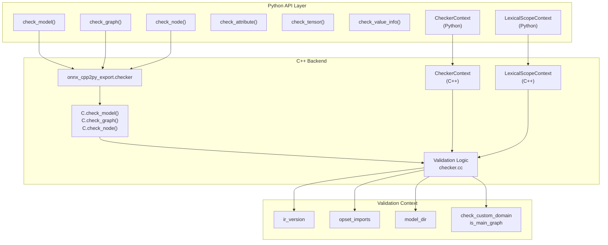

**Sources:** [onnx/checker.py:1-167](), [onnx/checker.cc:1-800](), [onnx/checker.h:1-120]()

### Component Interaction

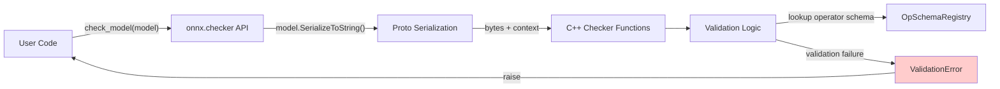

**Sources:** [onnx/checker.py:48-167](), [onnx/checker.cc:530-577]()

## Validation Levels

The ONNX checker validates models at multiple hierarchical levels, from the smallest components to the complete model.

### Validation Hierarchy

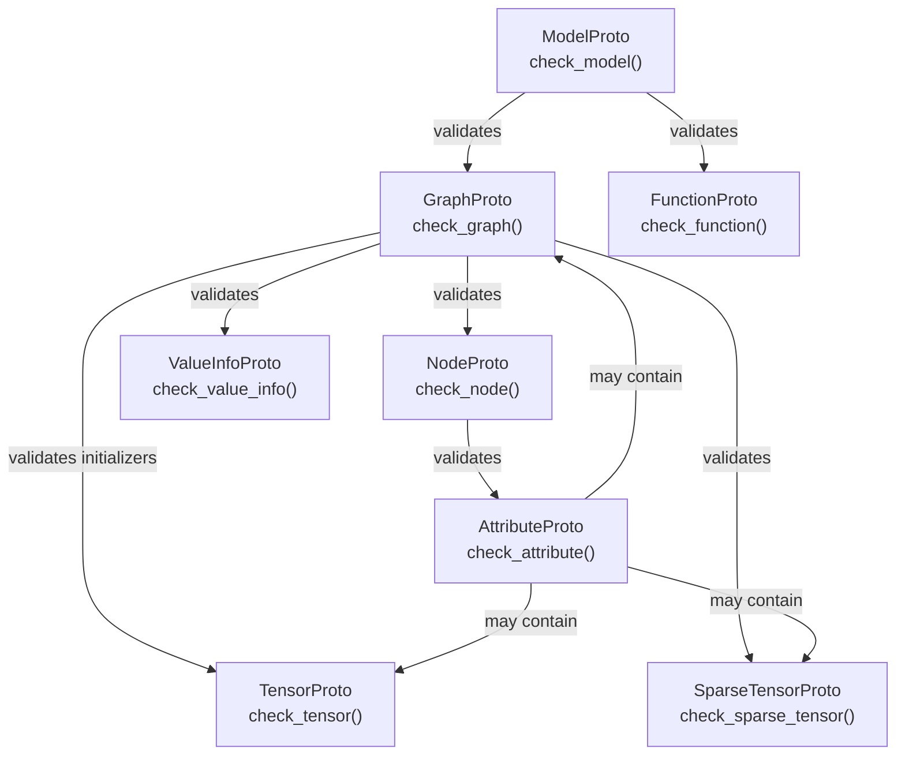

**Sources:** [onnx/checker.py:8-22](), [onnx/checker.cc:37-800]()

## Validation Rules and Constraints

### Model-Level Validation

The `check_model()` function performs the following validations:

| Validation | Description | IR Version |
|------------|-------------|------------|
| IR version check | Model's `ir_version` must be valid and <= checker's `IR_VERSION` | All |
| Opset imports | For IR >= 3, `opset_import` must be specified | >= 3 |
| No opset imports | For IR < 3, `opset_import` must be empty | < 3 |
| Metadata uniqueness | Keys in `metadata_props` must be distinct | >= 10 |
| Graph validation | Main graph must pass `check_graph()` | All |
| Function validation | All model-local functions must be valid | >= 8 |

**Sources:** [onnx/checker.py:121-167](), [docs/IR.md:69-93]()

### Graph-Level Validation

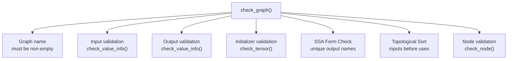

**Sources:** [onnx/checker.cc:579-695]()

#### SSA and Topological Constraints

The checker enforces two critical graph properties:

1. **Single Static Assignment (SSA)**: Each value name can be defined at most once within a graph scope
2. **Topological Ordering**: Nodes must be ordered such that a node's inputs have been defined before the node is executed

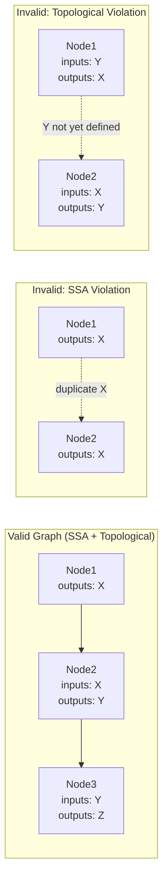

**Sources:** [onnx/checker.cc:647-690](), [docs/IR.md:257-260]()

#### Initializer Rules

The handling of initializers varies by IR version:

| IR Version | Rule |
|------------|------|
| <= 3 | Initializers must be a subset of graph inputs |
| >= 4 | Initializers may have same name as input (provides default) or different name (constant) |

**Sources:** [onnx/checker.cc:608-644]()

### Node-Level Validation

The `check_node()` function validates:

1. **Node structure**: Non-empty `op_type`, at least one input or output
2. **Domain resolution**: Node's domain must be in model's `opset_import`
3. **Operator schema**: Operator must exist in the specified domain/version
4. **Schema verification**: Inputs/outputs/attributes must conform to operator's schema
5. **Attribute validation**: All attributes must pass `check_attribute()`

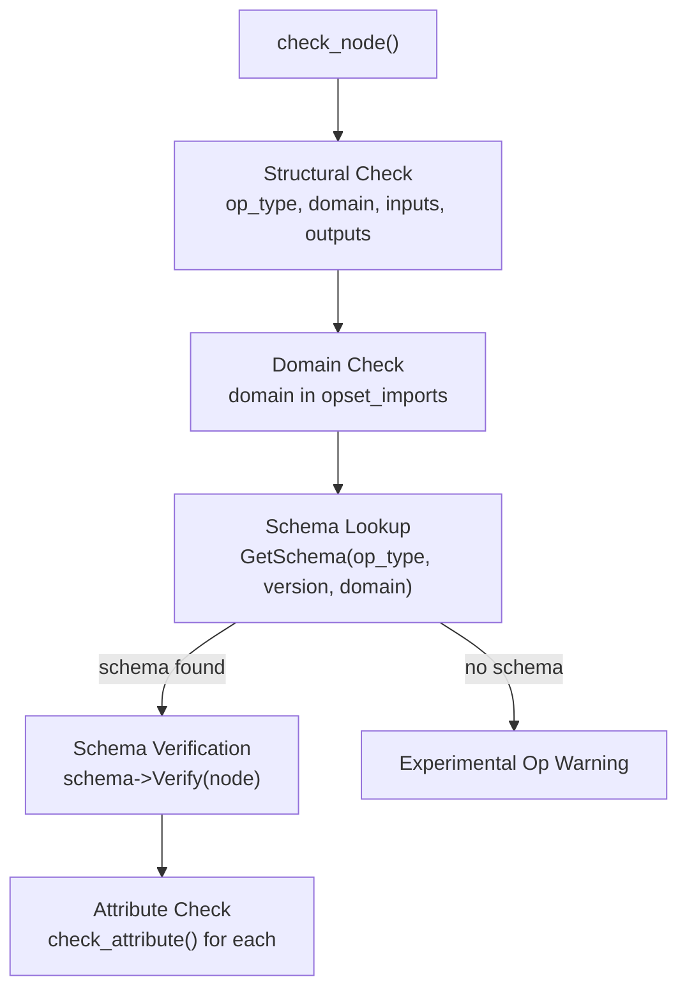

**Sources:** [onnx/checker.cc:530-577]()

### Attribute Validation

Attributes are validated for:

- **Name presence**: `name` field must be present
- **Type discriminator**: For IR >= 2, `type` field must be set and match data field
- **Single value field**: Exactly one value field must be set (except proto3 defaults)
- **Type consistency**: Inferred type from value must match explicit `type` field
- **Reference attributes**: In functions, `ref_attr_name` indicates parent scope reference
- **Nested validation**: Embedded tensors, graphs, and sparse tensors are validated

**Sources:** [onnx/checker.cc:428-516]()

### Tensor Validation

#### Regular Tensors

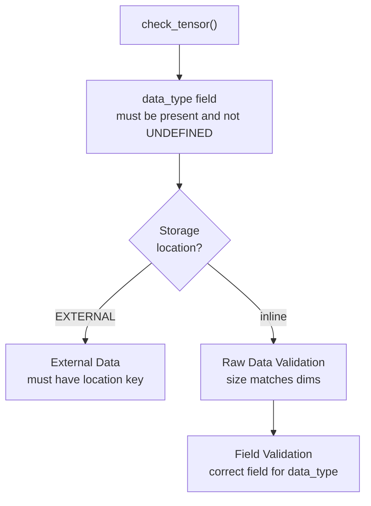

**Sources:** [onnx/checker.cc:78-206]()

#### Data Type to Field Mapping

Tensors store data in different protobuf fields based on their data type:

| Data Types | Storage Field |
|------------|---------------|
| FLOAT, COMPLEX64 | `float_data` or `raw_data` |
| DOUBLE, COMPLEX128 | `double_data` or `raw_data` |
| INT32, UINT8, INT8, UINT16, INT16, BOOL, FLOAT16, BFLOAT16, FLOAT8*, UINT4, INT4, UINT2, INT2, FLOAT4E2M1 | `int32_data` or `raw_data` |
| INT64 | `int64_data` or `raw_data` |
| UINT32, UINT64 | `uint64_data` or `raw_data` |
| STRING | `string_data` (not allowed in `raw_data`) |

**Sources:** [onnx/checker.cc:155-203]()

#### Sparse Tensor Validation

Sparse tensors require:

- Values tensor with rank 1 and size = NNZ (number of non-zero elements)
- Indices tensor with INT64 data type
- Indices in one of two formats:
  - Rank 1: Linearized indices (size = NNZ)
  - Rank 2: COO format (size = NNZ × rank)
- Indices must be in sorted order (lexicographic for COO)
- Dense dimensions must be positive

**Sources:** [onnx/checker.cc:306-424]()

### ValueInfo Validation

ValueInfo objects define the type and shape of graph inputs, outputs, and intermediate values:

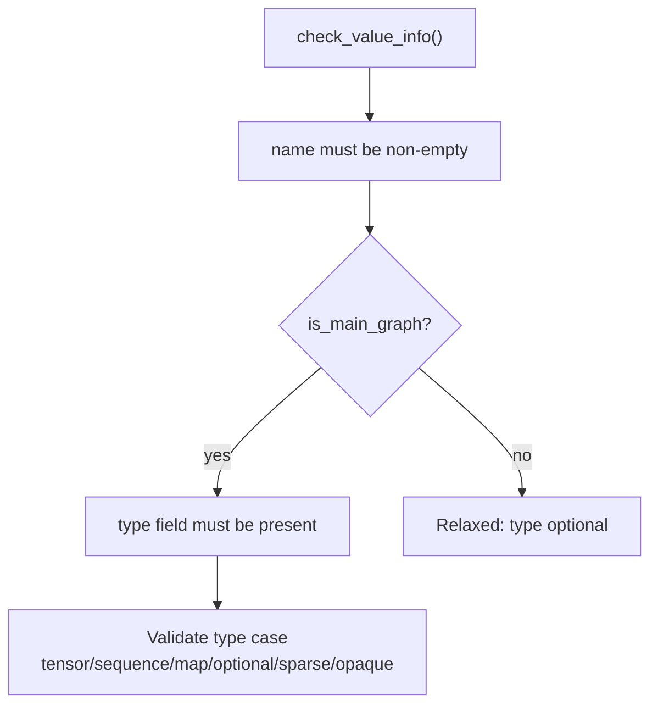

Main graph inputs/outputs must specify complete type information (including `elem_type` and `shape` for tensors), while subgraph inputs/outputs have relaxed requirements.

**Sources:** [onnx/checker.cc:37-76]()

## Using the Validation API

### Basic Model Validation

```python
import onnx

# Load model
model = onnx.load("model.onnx")

# Basic validation
onnx.checker.check_model(model)

# Validation with shape inference
onnx.checker.check_model(model, full_check=True)

# Skip opset compatibility check
onnx.checker.check_model(model, skip_opset_compatibility_check=True)

# Check custom domain operators
onnx.checker.check_model(model, check_custom_domain=True)
```

**Sources:** [onnx/checker.py:121-167]()

### Validation Functions by Component

| Function | Input Type | Purpose |
|----------|------------|---------|
| `check_model()` | `ModelProto`, path, or bytes | Complete model validation |
| `check_graph()` | `GraphProto` | Graph structure and nodes |
| `check_node()` | `NodeProto` | Single node validation |
| `check_function()` | `FunctionProto` | Function definition |
| `check_attribute()` | `AttributeProto` | Attribute structure and value |
| `check_tensor()` | `TensorProto` | Tensor data and metadata |
| `check_sparse_tensor()` | `SparseTensorProto` | Sparse tensor format |
| `check_value_info()` | `ValueInfoProto` | Value type information |

**Sources:** [onnx/checker.py:55-119]()

### Large Model Validation

For models larger than 2GB, validation must be performed from file path:

```python
# For models > 2GB, pass the file path
onnx.checker.check_model("large_model.onnx")

# Do not do this for large models:
# model = onnx.load("large_model.onnx")  # May exceed protobuf limit
# onnx.checker.check_model(model)
```

**Sources:** [onnx/checker.py:136-143](), [onnx/checker.py:36]()

## Validation Context and Configuration

### CheckerContext

The `CheckerContext` class controls validation behavior:

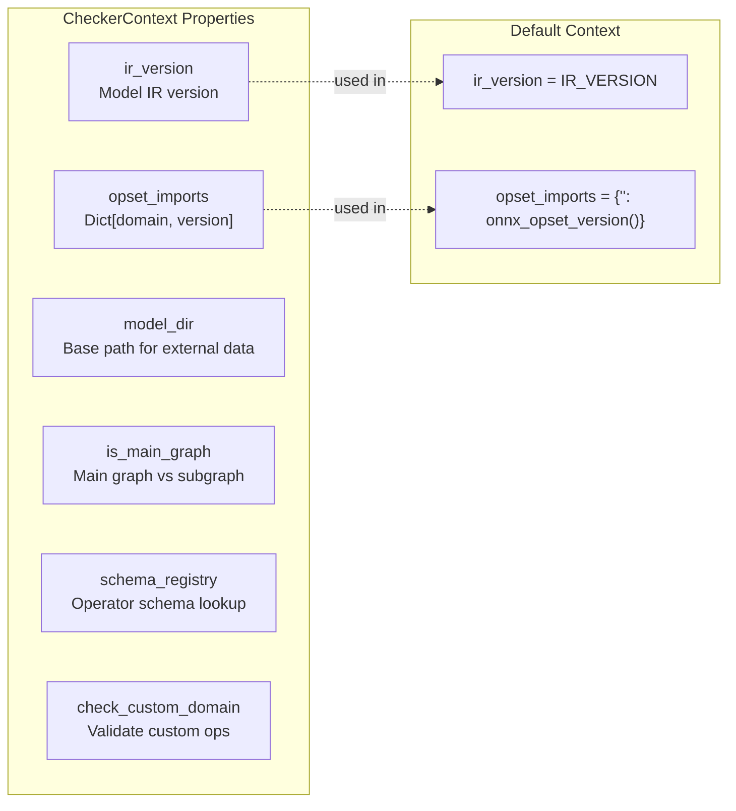

**Sources:** [onnx/checker.h:39-95](), [onnx/checker.py:38-44]()

### LexicalScopeContext

The `LexicalScopeContext` tracks names across nested graph scopes to validate SSA form and name visibility:

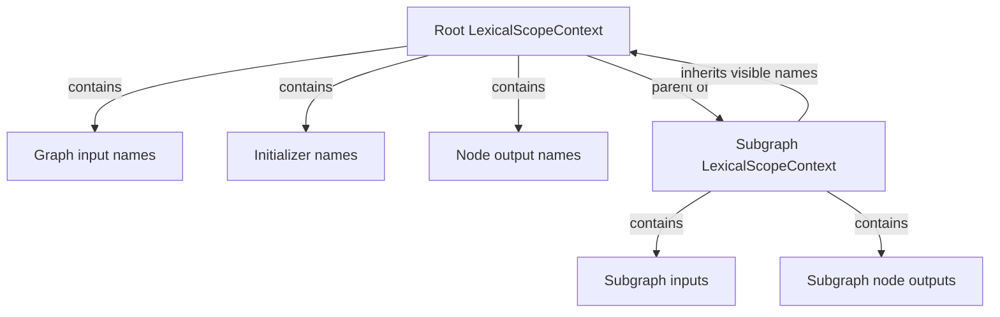

The context provides methods:
- `this_graph_has(name)`: Check if name is defined in current graph
- `this_or_ancestor_graph_has(name)`: Check if name is visible in current scope
- `add(name)`: Register a new name in current scope

**Sources:** [onnx/checker.h:97-120](), [onnx/checker.cc:579-695]()

## Error Handling

### ValidationError Exception

All validation failures raise `ValidationError` with detailed context:

```python
try:
    onnx.checker.check_model(model)
except onnx.checker.ValidationError as e:
    print(f"Validation failed: {e}")
    # Error messages include:
    # - What constraint was violated
    # - Location (node name, field name)
    # - Additional context from call stack
```

**Sources:** [onnx/checker.h:19-34](), [onnx/checker.py:20]()

### Common Validation Errors

| Error Type | Cause | Resolution |
|------------|-------|------------|
| IR version mismatch | Model IR version > checker IR version | Use newer ONNX version or downgrade model |
| Missing opset_import | IR >= 3 but no opset specified | Add opset_import to ModelProto |
| SSA violation | Duplicate output name | Ensure each value name is defined once |
| Topological error | Node input not yet defined | Reorder nodes topologically |
| Schema not found | Unknown operator or domain | Check op_type and domain spelling, or add opset_import |
| Type mismatch | Attribute type doesn't match value | Fix attribute data or type field |
| Missing required field | Required proto field not set | Set all required fields per IR spec |

**Sources:** [onnx/checker.cc:23-36](), [onnx/test/checker_test.py:60-77]()

### Experimental Operator Warnings

When a graph contains operators marked as EXPERIMENTAL, the checker prints a warning but does not fail validation:

```
Warning: Model contains experimental ops: OpName1, OpName2,
```

This indicates the operator's API may change in future ONNX versions.

**Sources:** [onnx/checker.cc:518-528](), [onnx/checker.cc:667-669]()

## Validation Integration

### Model Creation Workflow

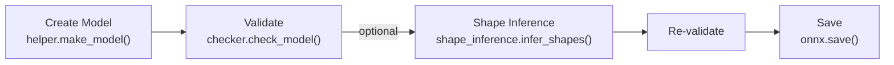

**Sources:** [onnx/helper.py:294-327](), [onnx/checker.py:121-167]()

### Testing Integration

The checker is used extensively in ONNX's test suite to ensure models and operators are correctly defined:

```python
# Test that valid models pass
def test_valid_model():
    model = helper.make_model(...)
    checker.check_model(model)  # Should not raise

# Test that invalid models are caught
def test_invalid_model():
    model = create_invalid_model()
    with pytest.raises(checker.ValidationError):
        checker.check_model(model)
```

**Sources:** [onnx/test/checker_test.py:29-77](), [onnx/test/helper_test.py:256-318]()

---

