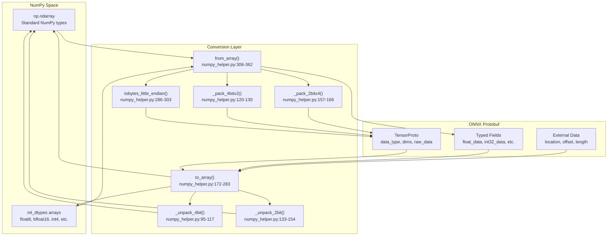
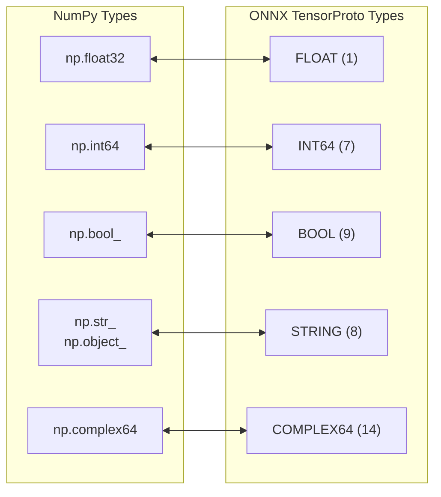
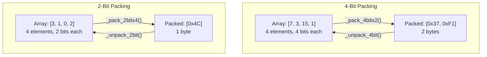
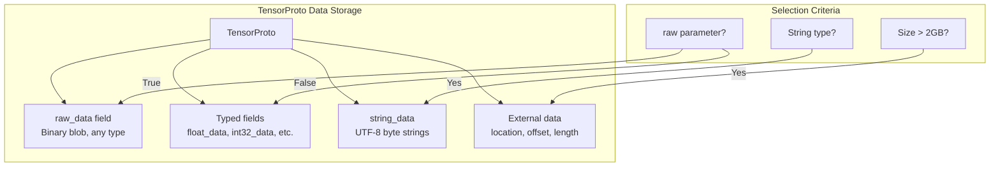
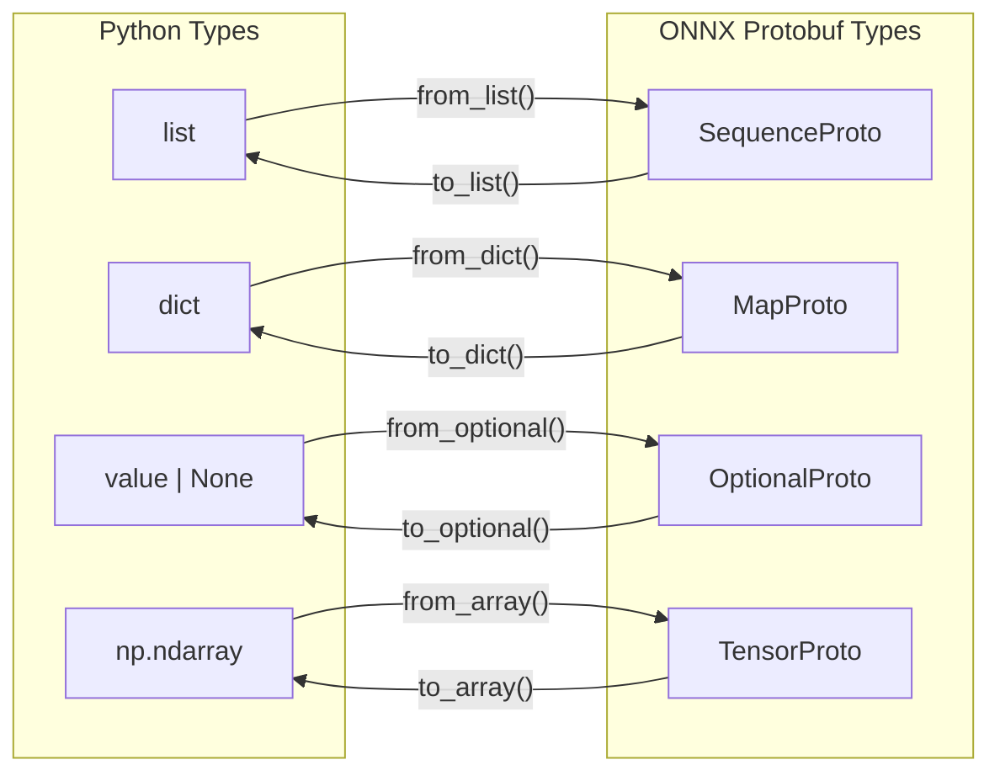

<!-- source: DeepWiki mcp.deepwiki.com · repo onnx/onnx · page 4.3 NumPy Conversion and Data Handling · fetched 2026-10-21 -->

# NumPy Conversion and Data Handling

<details>
<summary>Relevant source files</summary>

The following files were used as context for generating this wiki page:

- [VERSION_NUMBER](VERSION_NUMBER)
- [docs/IR.md](docs/IR.md)
- [docs/OnnxReleases.md](docs/OnnxReleases.md)
- [docs/Versioning.md](docs/Versioning.md)
- [onnx/__init__.py](onnx/__init__.py)
- [onnx/checker.py](onnx/checker.py)
- [onnx/common/version.h](onnx/common/version.h)
- [onnx/compose.py](onnx/compose.py)
- [onnx/defs/data_type_utils.cc](onnx/defs/data_type_utils.cc)
- [onnx/defs/data_type_utils.h](onnx/defs/data_type_utils.h)
- [onnx/external_data_helper.py](onnx/external_data_helper.py)
- [onnx/helper.py](onnx/helper.py)
- [onnx/model_container.py](onnx/model_container.py)
- [onnx/numpy_helper.py](onnx/numpy_helper.py)
- [onnx/onnx-ml.proto](onnx/onnx-ml.proto)
- [onnx/onnx-ml.proto3](onnx/onnx-ml.proto3)
- [onnx/onnx.in.proto](onnx/onnx.in.proto)
- [onnx/onnx.proto](onnx/onnx.proto)
- [onnx/onnx.proto3](onnx/onnx.proto3)
- [onnx/onnx_cpp2py_export/checker.pyi](onnx/onnx_cpp2py_export/checker.pyi)
- [onnx/reference/ops/op_range.py](onnx/reference/ops/op_range.py)
- [onnx/serialization.py](onnx/serialization.py)
- [onnx/test/basic_test.py](onnx/test/basic_test.py)
- [onnx/test/checker_test.py](onnx/test/checker_test.py)
- [onnx/test/compose_test.py](onnx/test/compose_test.py)
- [onnx/test/helper_test.py](onnx/test/helper_test.py)
- [onnx/test/numpy_helper_test.py](onnx/test/numpy_helper_test.py)
- [onnx/test/serialization_test.py](onnx/test/serialization_test.py)
- [onnx/test/test_external_data.py](onnx/test/test_external_data.py)

</details>


## Purpose and Scope

This document describes the NumPy conversion and data handling functionality in ONNX, which provides bidirectional conversion between NumPy arrays and ONNX protobuf tensor representations. The `onnx.numpy_helper` module is the primary interface for these operations, enabling Python users to work with ONNX tensors using familiar NumPy arrays.

For information about creating ONNX models and tensors using higher-level helper functions, see [Helper Functions for Model Creation](#4.1). For details on loading and saving complete models with external data, see [Loading and Saving Models](#4.6).

**Sources:** [onnx/numpy_helper.py:1-647](), [onnx/helper.py:1-505]()

---

## Conversion Architecture

The conversion system bridges NumPy's in-memory array representation with ONNX's serialized TensorProto format, handling data type mappings, byte ordering, and special encoding requirements.

### System Overview



**Sources:** [onnx/numpy_helper.py:172-362](), [onnx/helper.py:390-505]()

---

## Core Conversion Functions

### from_array: NumPy to TensorProto

The `from_array()` function converts a NumPy array into a TensorProto message. This is the primary entry point for embedding NumPy data into ONNX models.

**Function Signature:**
```python
def from_array(array: np.ndarray, /, name: str | None = None) -> onnx.TensorProto
```

**Implementation Details:**

| Aspect | Behavior |
|--------|----------|
| **Location** | [onnx/numpy_helper.py:306-362]() |
| **Data Type Detection** | Automatically maps NumPy dtype to ONNX TensorProto data type using `helper.np_dtype_to_tensor_dtype()` |
| **String Handling** | Detects object or string dtypes, flattens array, encodes as UTF-8 bytes |
| **Low-bit Packing** | Automatically packs INT4, UINT4, FLOAT4E2M1 (4-bit types) and INT2, UINT2 (2-bit types) |
| **Storage Format** | Always uses `raw_data` field (binary format) for efficiency |
| **Byte Order** | Ensures little-endian byte ordering via `tobytes_little_endian()` |

**Sources:** [onnx/numpy_helper.py:306-362](), [onnx/helper.py:344-361]()

### to_array: TensorProto to NumPy

The `to_array()` function converts a TensorProto message into a NumPy array. It handles both raw binary data and typed field representations, and supports external data loading.

**Function Signature:**
```python
def to_array(tensor: onnx.TensorProto, base_dir: str = "") -> np.ndarray
```

**Implementation Details:**

| Aspect | Behavior |
|--------|----------|
| **Location** | [onnx/numpy_helper.py:172-283]() |
| **Data Sources** | Reads from `raw_data` field (binary) or typed fields (`float_data`, `int32_data`, etc.) |
| **External Data** | Loads external data if `uses_external_data()` returns True, using `base_dir` parameter |
| **Type Mapping** | Uses `helper.tensor_dtype_to_np_dtype()` and `helper.tensor_dtype_to_storage_tensor_dtype()` |
| **Low-bit Unpacking** | Automatically unpacks 4-bit and 2-bit types |
| **Byte Order** | Handles big-endian systems by converting from little-endian |
| **String Decoding** | Decodes UTF-8 bytes to string objects |

**Sources:** [onnx/numpy_helper.py:172-283](), [onnx/external_data_helper.py]()

---

## Data Type Mapping and Handling

### Standard Type Mapping

The conversion layer maintains bidirectional mappings between NumPy dtypes and ONNX TensorProto data types through `helper.tensor_dtype_to_np_dtype()` and `helper.np_dtype_to_tensor_dtype()`.



**Standard Mappings:**

| ONNX Type | TensorProto Enum | NumPy dtype | Notes |
|-----------|-----------------|-------------|-------|
| FLOAT | 1 | `np.float32` | 32-bit float |
| UINT8 | 2 | `np.uint8` | Unsigned 8-bit |
| INT8 | 3 | `np.int8` | Signed 8-bit |
| UINT16 | 4 | `np.uint16` | Unsigned 16-bit |
| INT16 | 5 | `np.int16` | Signed 16-bit |
| INT32 | 6 | `np.int32` | Signed 32-bit |
| INT64 | 7 | `np.int64` | Signed 64-bit |
| STRING | 8 | `np.object_` | UTF-8 encoded strings |
| BOOL | 9 | `np.bool_` | Boolean values |
| FLOAT16 | 10 | `np.float16` | IEEE 16-bit float |
| DOUBLE | 11 | `np.float64` | 64-bit double |
| UINT32 | 12 | `np.uint32` | Unsigned 32-bit |
| UINT64 | 13 | `np.uint64` | Unsigned 64-bit |
| COMPLEX64 | 14 | `np.complex64` | Complex 64-bit |
| COMPLEX128 | 15 | `np.complex128` | Complex 128-bit |

**Sources:** [onnx/helper.py:1-2201](), [onnx/numpy_helper.py:172-283]()

### Extended Types via ml_dtypes

ONNX supports specialized data types not available in standard NumPy through the `ml_dtypes` package. These types are essential for modern machine learning workloads requiring reduced precision or specialized formats.

**Extended Type Mappings:**

| ONNX Type | TensorProto Enum | ml_dtypes dtype | Use Case |
|-----------|-----------------|-----------------|----------|
| BFLOAT16 | 16 | `ml_dtypes.bfloat16` | Brain float for training |
| FLOAT8E4M3FN | 17 | `ml_dtypes.float8_e4m3fn` | 8-bit float, 4-bit exponent |
| FLOAT8E4M3FNUZ | 18 | `ml_dtypes.float8_e4m3fnuz` | 8-bit float, UZ encoding |
| FLOAT8E5M2 | 19 | `ml_dtypes.float8_e5m2` | 8-bit float, 5-bit exponent |
| FLOAT8E5M2FNUZ | 20 | `ml_dtypes.float8_e5m2fnuz` | 8-bit float, UZ encoding |
| UINT4 | 21 | `ml_dtypes.uint4` | 4-bit unsigned int |
| INT4 | 22 | `ml_dtypes.int4` | 4-bit signed int |
| FLOAT8E8M0 | 23 | `ml_dtypes.float8_e8m0fnu` | Exponent-only float8 |
| UINT2 | 24 | `ml_dtypes.uint2` | 2-bit unsigned int |
| INT2 | 25 | `ml_dtypes.int2` | 2-bit signed int |
| FLOAT4E2M1 | 26 | `ml_dtypes.float4_e2m1fn` | 4-bit float |

**Float8 Conversion:**

The `to_float8e8m0()` function [onnx/numpy_helper.py:20-92]() provides specialized conversion for the FLOAT8E8M0 type, which represents exponent-only values:

- **Saturating Cast**: Clamps values to representable range
- **Rounding Modes**: Supports "nearest", "up", or "down" rounding
- **Special Values**: Preserves NaN and Infinity

**Sources:** [onnx/numpy_helper.py:20-92](), [onnx/helper.py:422-505](), [onnx/test/helper_test.py:465-636]()

### Packed Low-Bit Type Handling

Types with bit widths less than 8 bits (INT4, UINT4, INT2, UINT2, FLOAT4E2M1) are stored in packed format to save space. Two values are packed into each byte for 4-bit types, and four values for 2-bit types.



**4-Bit Packing Algorithm** [onnx/numpy_helper.py:120-130]():
1. Flatten array to 1D, view as uint8
2. Add padding byte if odd number of elements
3. Mask each element to 4 bits (`& 0x0F`)
4. Shift odd-indexed elements left 4 bits (`<<= 4`)
5. OR pairs together: `packed[i] = array[2i] | array[2i+1]`

**2-Bit Packing Algorithm** [onnx/numpy_helper.py:157-169]():
1. Flatten array to 1D, view as uint8
2. Add padding bytes if not multiple of 4 elements
3. Mask each element to 2 bits (`& 0x03`)
4. Shift elements left by 0, 2, 4, or 6 bits based on position
5. OR quads together: `packed[i] = array[4i] | array[4i+1] | array[4i+2] | array[4i+3]`

**Sources:** [onnx/numpy_helper.py:95-169](), [onnx/helper.py:362-388](), [onnx/test/helper_test.py:637-756]()

---

## TensorProto Storage Modes

TensorProto supports multiple storage modes for tensor data, each with different characteristics and use cases.

### Storage Mode Comparison



**Storage Mode Details:**

| Mode | Field Name | When Used | Advantages | Limitations |
|------|-----------|-----------|------------|-------------|
| **Raw Binary** | `raw_data` | Default for `from_array()` | Compact, efficient, type-agnostic | Requires length calculation |
| **Typed Fields** | `float_data`, `int32_data`, etc. | Legacy, human-readable output | Type-safe, protobuf native | More verbose, type-specific |
| **String Data** | `string_data` | STRING data type only | UTF-8 encoding, variable length | Cannot use raw_data |
| **External Data** | `data_location`, `external_data` | Tensors > 2GB or explicit request | Avoids protobuf size limits | Requires file management |

**Storage Field Selection** in `make_tensor()` [onnx/helper.py:390-505]():

The `raw` parameter controls storage mode selection:
- `raw=True`: Forces `raw_data` field usage
- `raw=False`: Uses appropriate typed field based on `data_type`
- STRING type: Always uses `string_data` (raw_data forbidden)

**Sources:** [onnx/helper.py:390-505](), [onnx/numpy_helper.py:172-283](), [onnx/test/helper_test.py:454-636]()

### Byte Ordering

The `tobytes_little_endian()` function [onnx/numpy_helper.py:286-303]() ensures consistent little-endian byte ordering across platforms:

**Algorithm:**
1. Check array's byte order: `array.dtype.byteorder`
2. If big-endian (`">"`) or system default on big-endian system, convert to little-endian
3. Use `array.dtype.newbyteorder("<")` to create little-endian view
4. Return `array.tobytes()`

This ensures that models created on big-endian systems (e.g., some IBM architectures) can be read correctly on little-endian systems (x86, ARM).

**Sources:** [onnx/numpy_helper.py:286-303](), [onnx/helper.py:440-444]()

---

## Composite Type Conversion

Beyond simple tensors, `numpy_helper` provides conversion for ONNX's composite types: sequences, maps, and optionals.

### Conversion Function Matrix



**Sources:** [onnx/numpy_helper.py:365-594]()

### Sequence Conversion

**from_list()** [onnx/numpy_helper.py:386-440]():
- Converts Python list to `SequenceProto`
- Automatically detects element type from first element
- Supports nested sequences
- Allows explicit `dtype` parameter for empty lists
- Validates homogeneous element types

**to_list()** [onnx/numpy_helper.py:365-383]():
- Converts `SequenceProto` to Python list
- Recursively handles nested sequences
- Supports tensor, sparse tensor, sequence, and map elements

**Supported Element Types:**

| SequenceProto.DataType | Python Type | Conversion |
|------------------------|-------------|------------|
| TENSOR | `np.ndarray` | via `to_array()` / `from_array()` |
| SPARSE_TENSOR | `SparseTensorProto` | via `to_array()` |
| SEQUENCE | `list` | Recursive `to_list()` / `from_list()` |
| MAP | `dict` | via `to_dict()` / `from_dict()` |

**Sources:** [onnx/numpy_helper.py:365-440]()

### Map Conversion

**from_dict()** [onnx/numpy_helper.py:468-518]():
- Converts Python dict to `MapProto`
- Validates key type homogeneity
- Validates value type homogeneity
- Supports integer and string keys
- Values stored as SequenceProto

**to_dict()** [onnx/numpy_helper.py:443-465]():
- Converts `MapProto` to Python dict
- Handles `string_keys` or numeric `keys` field
- Validates key-value length consistency

**Valid Key Types:**

| TensorProto Type | Usage |
|-----------------|--------|
| STRING | Stored in `string_keys` field |
| INT8, INT16, INT32, INT64 | Stored in `keys` field |
| UINT8, UINT16, UINT32, UINT64 | Stored in `keys` field |

**Sources:** [onnx/numpy_helper.py:443-518]()

### Optional Conversion

**from_optional()** [onnx/numpy_helper.py:546-594]():
- Converts Python optional value or None to `OptionalProto`
- Allows explicit `dtype` parameter for None values
- Automatically detects type from value

**to_optional()** [onnx/numpy_helper.py:521-543]():
- Converts `OptionalProto` to Python value or None
- Returns None for UNDEFINED element type
- Recursively handles nested optionals

**Element Type Detection:**

| Python Value | OptionalProto.DataType |
|-------------|----------------------|
| `None` | UNDEFINED |
| `np.ndarray` | TENSOR |
| `dict` | MAP |
| `list` | SEQUENCE |

**Sources:** [onnx/numpy_helper.py:521-594]()

---

## Utility Functions

### saturate_cast: Type-Safe Casting

The `saturate_cast()` function [onnx/numpy_helper.py:628-646]() provides safe casting to target dtypes by clamping values to the representable range:

**Algorithm:**
1. Determine if target dtype is integer or floating point
2. Get min/max representable values from `ml_dtypes.iinfo()` or `ml_dtypes.finfo()`
3. Round values if target is integer
4. Clip values to [min, max] range using `np.clip()`
5. Cast to target dtype

**Use Cases:**
- Float8 tensor creation (prevents overflow)
- Low-bit quantization
- Type conversion with saturation semantics

**Sources:** [onnx/numpy_helper.py:628-646](), [onnx/helper.py:469-476]()

### create_random_int: Test Data Generation

The `create_random_int()` function [onnx/numpy_helper.py:597-625]() generates random integer arrays for testing:

**Features:**
- Respects dtype range limits
- Handles both signed and unsigned types
- Clamps to int32 range for `np.random.randint()` compatibility
- Configurable random seed

**Sources:** [onnx/numpy_helper.py:597-625]()

---

## Usage Patterns

### Pattern 1: Simple Tensor Conversion

Converting a NumPy array to TensorProto and back:

```python
# Create NumPy array
array = np.array([[1.0, 2.0], [3.0, 4.0]], dtype=np.float32)

# Convert to TensorProto
tensor_proto = numpy_helper.from_array(array, name="my_tensor")

# Convert back to NumPy
recovered_array = numpy_helper.to_array(tensor_proto)
```

**Implementation:** [onnx/numpy_helper.py:306-362]() and [onnx/numpy_helper.py:172-283]()

### Pattern 2: Float8 Data Handling

Working with specialized float8 types:

```python
# Create float32 data
data = np.array([0.5, 1.0, 50000.0, 10.1], dtype=np.float32)

# Create tensor with saturating cast
tensor = helper.make_tensor(
    name="float8_data",
    data_type=TensorProto.FLOAT8E4M3FN,
    dims=[4],
    vals=data
)

# Conversion automatically applies saturating cast
array = numpy_helper.to_array(tensor)
# array.dtype is ml_dtypes.float8_e4m3fn
```

**Implementation:** [onnx/helper.py:469-476](), [onnx/numpy_helper.py:172-283]()

### Pattern 3: Low-Bit Quantization

Creating packed low-bit tensors:

```python
# Create 4-bit integer data
data = np.array([7, 3, 15, 1], dtype=np.int8)

# Create tensor - automatically packed
tensor = helper.make_tensor(
    name="int4_data",
    data_type=TensorProto.INT4,
    dims=[4],
    vals=data
)

# Data is stored packed in tensor.int32_data
# Two values per byte: 0x37, 0xF1
```

**Implementation:** [onnx/helper.py:493-498](), [onnx/numpy_helper.py:120-130]()

### Pattern 4: External Data

Handling large tensors with external storage:

```python
# Load tensor with external data
tensor_proto = ...  # TensorProto with external_data field set
array = numpy_helper.to_array(tensor_proto, base_dir="/path/to/model/dir")

# external_data_helper automatically loads external file
```

**Implementation:** [onnx/numpy_helper.py:203-204](), external data helper integration

### Pattern 5: Composite Type Construction

Building complex data structures:

```python
# Create sequence of tensors
tensors = [np.array([1, 2]), np.array([3, 4])]
seq_proto = numpy_helper.from_list(tensors, name="tensor_seq")

# Create map
mapping = {0: np.array([0.1]), 1: np.array([0.9])}
map_proto = numpy_helper.from_dict(mapping, name="tensor_map")

# Create optional
opt_proto = numpy_helper.from_optional(
    np.array([1.0, 2.0]), 
    name="maybe_tensor"
)
```

**Implementation:** [onnx/numpy_helper.py:386-594]()

**Sources:** [onnx/test/numpy_helper_test.py:16-188](), [onnx/test/helper_test.py:453-756]()

---

## Implementation Notes

### Type Safety and Validation

The conversion layer performs validation at multiple levels:

1. **Data Type Validation**: [onnx/numpy_helper.py:186-187]() checks for UNDEFINED type
2. **Range Validation**: `saturate_cast()` ensures values fit in target type
3. **Size Validation**: [onnx/helper.py:451-454]() validates raw data size matches expected size
4. **Encoding Validation**: String data validated for UTF-8 compliance

### Performance Considerations

**Optimization Strategies:**

| Aspect | Implementation | Benefit |
|--------|---------------|---------|
| **Binary Storage** | Uses `raw_data` by default | Smaller protobuf size |
| **View Operations** | Uses array views instead of copies where possible | Reduced memory allocation |
| **Batch Packing** | Packs low-bit types in vectorized operations | Faster than element-wise |
| **Type Detection** | Caches dtype mappings | Avoids repeated lookups |

**Memory Layout:**
- Little-endian storage ensures optimal performance on common architectures
- Contiguous memory layout maintained through flattening operations
- Zero-copy conversions when byte order matches

**Sources:** [onnx/numpy_helper.py:286-303](), [onnx/helper.py:424-455]()

### Error Handling

**Common Error Conditions:**

| Error | Condition | Location |
|-------|-----------|----------|
| `TypeError` | UNDEFINED tensor data type | [onnx/numpy_helper.py:187]() |
| `ValueError` | Segment field present | [onnx/numpy_helper.py:185]() |
| `ValueError` | Raw data size mismatch | [onnx/helper.py:452-454]() |
| `TypeError` | String type with raw=True | [onnx/helper.py:419-420]() |
| `NotImplementedError` | Unrecognized object in string array | [onnx/numpy_helper.py:338-341]() |
| `TypeError` | Heterogeneous types in list/dict | [onnx/numpy_helper.py:420-424]() |

**Sources:** [onnx/numpy_helper.py:172-594](), [onnx/helper.py:390-505]()

---

