<!-- source: DeepWiki mcp.deepwiki.com · repo onnx/onnx · page 4.4 Shape Inference API · fetched 2026-10-21 -->

# Shape Inference API

<details>
<summary>Relevant source files</summary>

The following files were used as context for generating this wiki page:

- [onnx/__init__.py](onnx/__init__.py)
- [onnx/checker.cc](onnx/checker.cc)
- [onnx/checker.h](onnx/checker.h)
- [onnx/checker.py](onnx/checker.py)
- [onnx/common/model_helpers.cc](onnx/common/model_helpers.cc)
- [onnx/common/status.cc](onnx/common/status.cc)
- [onnx/common/status.h](onnx/common/status.h)
- [onnx/compose.py](onnx/compose.py)
- [onnx/cpp2py_export.cc](onnx/cpp2py_export.cc)
- [onnx/defs/function.cc](onnx/defs/function.cc)
- [onnx/defs/function.h](onnx/defs/function.h)
- [onnx/defs/schema.cc](onnx/defs/schema.cc)
- [onnx/defs/schema.h](onnx/defs/schema.h)
- [onnx/defs/shape_inference.cc](onnx/defs/shape_inference.cc)
- [onnx/defs/shape_inference.h](onnx/defs/shape_inference.h)
- [onnx/external_data_helper.py](onnx/external_data_helper.py)
- [onnx/model_container.py](onnx/model_container.py)
- [onnx/onnx_cpp2py_export/checker.pyi](onnx/onnx_cpp2py_export/checker.pyi)
- [onnx/serialization.py](onnx/serialization.py)
- [onnx/shape_inference/implementation.cc](onnx/shape_inference/implementation.cc)
- [onnx/shape_inference/implementation.h](onnx/shape_inference/implementation.h)
- [onnx/test/basic_test.py](onnx/test/basic_test.py)
- [onnx/test/checker_test.py](onnx/test/checker_test.py)
- [onnx/test/compose_test.py](onnx/test/compose_test.py)
- [onnx/test/serialization_test.py](onnx/test/serialization_test.py)
- [onnx/test/test_external_data.py](onnx/test/test_external_data.py)

</details>


The Shape Inference API provides Python functions for determining the shapes and types of all intermediate and output tensors in an ONNX model. This API enables model validation, optimization, and execution planning by propagating type and shape information through the computational graph.

For details on operator-specific shape inference implementations, see [Type and Shape Inference](#3.3). For model validation that includes shape inference, see [Model Validation and Checking](#4.2).

## Overview

Shape inference analyzes an ONNX model to compute data types and tensor dimensions for all values in the graph. The API provides functions that take a model or graph as input and return an updated version with inferred shape information populated in the `value_info` field.

**Python Shape Inference API Flow**

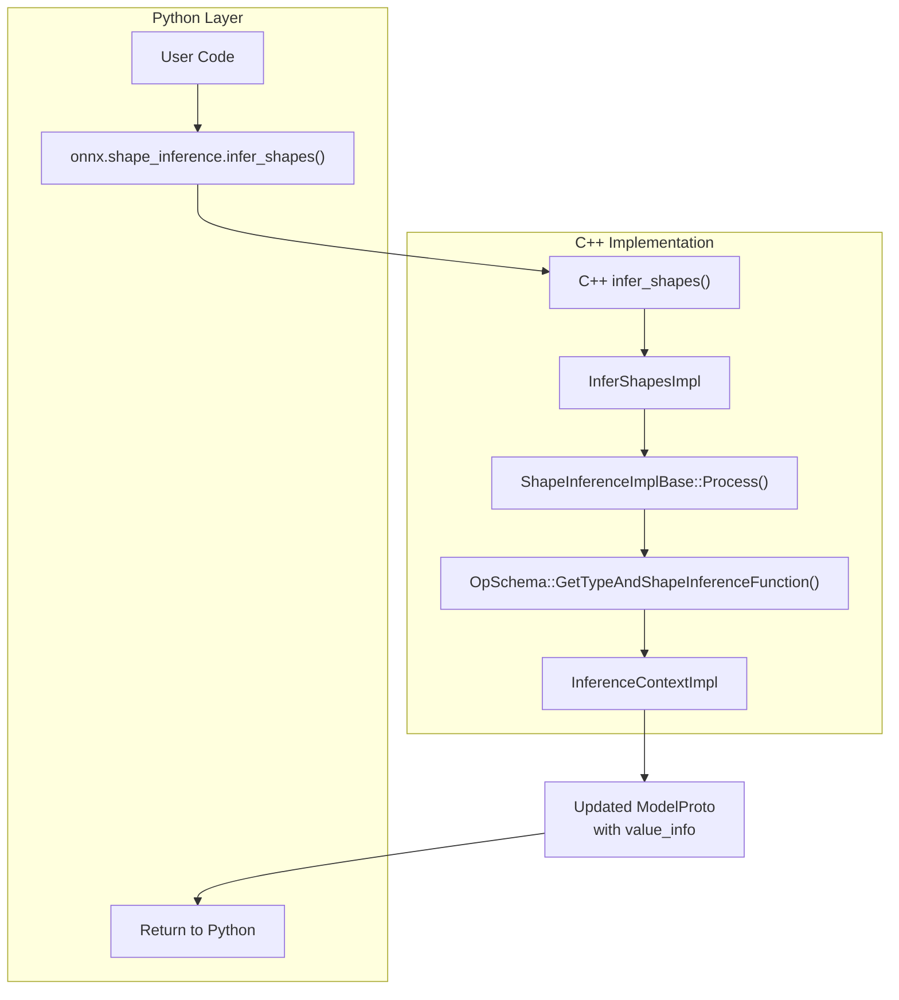

Sources: [onnx/shape_inference/implementation.cc:677-707](), [onnx/shape_inference/implementation.h:338-535](), [onnx/cpp2py_export.cc:126-172]()

## Core API Functions

The shape inference API is accessible through the `onnx.shape_inference` module and provides the following primary functions:

### infer_shapes

The main function for inferring shapes in an ONNX model. This Python function delegates to the C++ implementation `InferShapesImpl` which traverses the graph and applies operator-specific inference functions.

```python
import onnx
from onnx import shape_inference

# Load a model
model = onnx.load("model.onnx")

# Infer shapes
inferred_model = shape_inference.infer_shapes(model)

# Access inferred shape information
for value_info in inferred_model.graph.value_info:
    print(f"{value_info.name}: {value_info.type}")
```

**Function signature:**
```python
def infer_shapes(
    model: ModelProto,
    check_type: bool = False,
    strict_mode: bool = False,
    data_prop: bool = False
) -> ModelProto
```

**Parameters:**
- `model`: The ONNX `ModelProto` to perform inference on
- `check_type`: If `True`, validates type constraints using `OpSchema::CheckInputOutputType()`
- `strict_mode`: If `False` (default), suppresses node-level errors via `error_mode=0` in `ShapeInferenceOptions`. If `True`, all errors are thrown (`error_mode=1`)
- `data_prop`: If `True`, enables `enable_data_propagation` flag for partial evaluation of constant values

**Returns:** A new `ModelProto` with inferred shapes populated in `graph.value_info`

**Implementation Details:**
The function internally calls the C++ `InferShapesImpl` function which creates a `ShapeInferenceImplBase` instance to process each node in the graph. For each node, it retrieves the `OpSchema` and invokes its `TypeAndShapeInferenceFunction` with an `InferenceContextImpl` object.

Sources: [onnx/shape_inference/implementation.cc:677-707](), [onnx/defs/shape_inference.h:21-33](), [onnx/cpp2py_export.cc:126-172]()

### infer_shapes_path

Shape inference can also be performed on model files without loading them entirely into memory. This function uses `ParseProtoFromBytes` to read the model incrementally and is essential for large models exceeding the protobuf 2GB limit.

```python
from onnx import shape_inference

# Infer shapes from file and save to new file
shape_inference.infer_shapes_path(
    "input_model.onnx",
    "output_model_with_shapes.onnx",
    check_type=False,
    strict_mode=True,
    data_prop=True
)
```

**Implementation Notes:**
- Uses `ParseProtoFromBytes` for streaming protobuf parsing
- Calls `InferShapesImpl` on the parsed model
- Writes output using `WriteProtoToPath`
- Particularly useful for models >2GB that exceed protobuf single-message limits

Sources: [onnx/shape_inference/implementation.cc:797-857]()

### Internal C++ Functions

The following functions are part of the C++ implementation and are not directly exposed to Python users but are important for understanding the architecture:

**InferShapeForFunctionNode**

Handles shape inference for function-based operators. When an operator is defined using a `FunctionProto` rather than a primitive implementation, this function processes the function's internal graph structure.

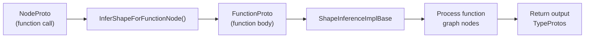

Sources: [onnx/shape_inference/implementation.cc:602-673]()

**InferenceContextImpl**

The C++ context object passed to operator-specific inference functions. It provides:
- `getInputType(index)`: Returns `TypeProto*` for input at index
- `getOutputType(index)`: Returns mutable `TypeProto*` for output at index  
- `getAttribute(name)`: Returns `AttributeProto*` for attribute
- `getInputData(index)`: Returns `TensorProto*` for constant input values
- `getSymbolicInput(index)`: Returns `TensorShapeProto*` for data-propagated values

Sources: [onnx/shape_inference/implementation.h:138-291]()

## Shape Inference Options

The behavior of shape inference is controlled by the `ShapeInferenceOptions` struct in C++, exposed to Python through three boolean parameters:

| Python Parameter | C++ Field | Description | Default |
|------------------|-----------|-------------|---------|
| `check_type` | `check_type` | When `True`, calls `OpSchema::CheckInputOutputType()` to validate type constraints according to operator schema | `False` |
| `strict_mode` | `error_mode` | Controls error handling: `0` (default) suppresses node-level errors; `1` throws all inference errors | `False` (mode 0) |
| `data_prop` | `enable_data_propagation` | When `True`, enables partial evaluation via `DataPropagationContext` to compute shapes dependent on constant values | `False` |

**Example with options:**

```python
import onnx
from onnx import shape_inference

model = onnx.load("model.onnx")

# Strict inference with type checking and data propagation
inferred_model = shape_inference.infer_shapes(
    model,
    check_type=True,
    strict_mode=True,
    data_prop=True
)
```

**C++ ShapeInferenceOptions Structure:**

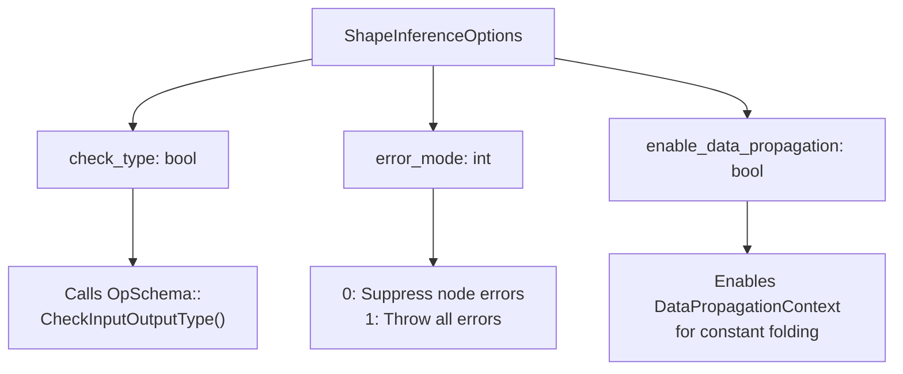

Sources: [onnx/defs/shape_inference.h:21-33](), [onnx/shape_inference/implementation.cc:677-707]()

## Usage Examples

### Basic Shape Inference

```python
import onnx
from onnx import helper, shape_inference, TensorProto

# Create a simple model
node = helper.make_node("Relu", ["X"], ["Y"])
graph = helper.make_graph(
    [node],
    "test_graph",
    [helper.make_tensor_value_info("X", TensorProto.FLOAT, [1, 3, 224, 224])],
    [helper.make_tensor_value_info("Y", TensorProto.FLOAT, None)]  # Shape unknown
)
model = helper.make_model(graph)

# Infer shapes
inferred_model = shape_inference.infer_shapes(model)

# Y now has shape [1, 3, 224, 224]
print(inferred_model.graph.output[0].type.tensor_type.shape)
```

Sources: [onnx/test/helper_test.py:375-386]()

### Handling Dynamic Shapes with Symbolic Dimensions

When input dimensions are unknown, shape inference uses symbolic dimension parameters:

```python
import onnx
from onnx import helper, shape_inference, TensorProto

node = helper.make_node("MatMul", ["A", "B"], ["C"])
graph = helper.make_graph(
    [node],
    "matmul_graph",
    [
        helper.make_tensor_value_info("A", TensorProto.FLOAT, ["batch", 128]),
        helper.make_tensor_value_info("B", TensorProto.FLOAT, [128, 256])
    ],
    [helper.make_tensor_value_info("C", TensorProto.FLOAT, None)]
)
model = helper.make_model(graph)

inferred_model = shape_inference.infer_shapes(model)

# C has shape ["batch", 256] where "batch" is a symbolic dimension
output_shape = inferred_model.graph.output[0].type.tensor_type.shape
print(output_shape.dim[0].dim_param)  # "batch"
print(output_shape.dim[1].dim_value)  # 256
```

Sources: [onnx/shape_inference/implementation.h:30-94](), [onnx/defs/shape_inference.h:36-46]()

### Using Data Propagation for Complex Shapes

Data propagation enables inference of shapes that depend on computed values:

```python
import onnx
from onnx import helper, shape_inference, TensorProto, numpy_helper
import numpy as np

# Create a model with Shape and Reshape operations
shape_node = helper.make_node("Shape", ["X"], ["shape_of_x"])
reshape_node = helper.make_node("Reshape", ["Y", "shape_of_x"], ["Z"])

# Create tensor for initializer
x_init = numpy_helper.from_array(np.zeros([2, 3, 4], dtype=np.float32), "X")

graph = helper.make_graph(
    [shape_node, reshape_node],
    "reshape_graph",
    [helper.make_tensor_value_info("Y", TensorProto.FLOAT, [24])],
    [helper.make_tensor_value_info("Z", TensorProto.FLOAT, None)],
    initializer=[x_init]
)
model = helper.make_model(graph)

# Without data propagation, Z's shape cannot be inferred
inferred_model = shape_inference.infer_shapes(model, data_prop=False)
# Z shape is unknown

# With data propagation, Z's shape is [2, 3, 4]
inferred_model = shape_inference.infer_shapes(model, data_prop=True)
# Z has shape [2, 3, 4]
```

Sources: [onnx/shape_inference/implementation.cc:505-514](), [onnx/defs/shape_inference.h:117-147]()

## Understanding Shape Inference Results

After calling `infer_shapes()`, the returned model contains shape information in the `value_info` field of the graph:

**Accessing Inferred Shapes**

```python
import onnx

model = onnx.load("model.onnx")
inferred_model = onnx.shape_inference.infer_shapes(model)

# Iterate through value_info entries
for value_info in inferred_model.graph.value_info:
    name = value_info.name
    type_proto = value_info.type
    
    if type_proto.HasField("tensor_type"):
        tensor_type = type_proto.tensor_type
        elem_type = tensor_type.elem_type
        shape = tensor_type.shape
        
        dims = []
        for dim in shape.dim:
            if dim.HasField("dim_value"):
                dims.append(dim.dim_value)
            elif dim.HasField("dim_param"):
                dims.append(dim.dim_param)  # Symbolic dimension
            else:
                dims.append("?")  # Unknown dimension
        
        print(f"{name}: type={elem_type}, shape={dims}")
```

**Shape Information Structure**

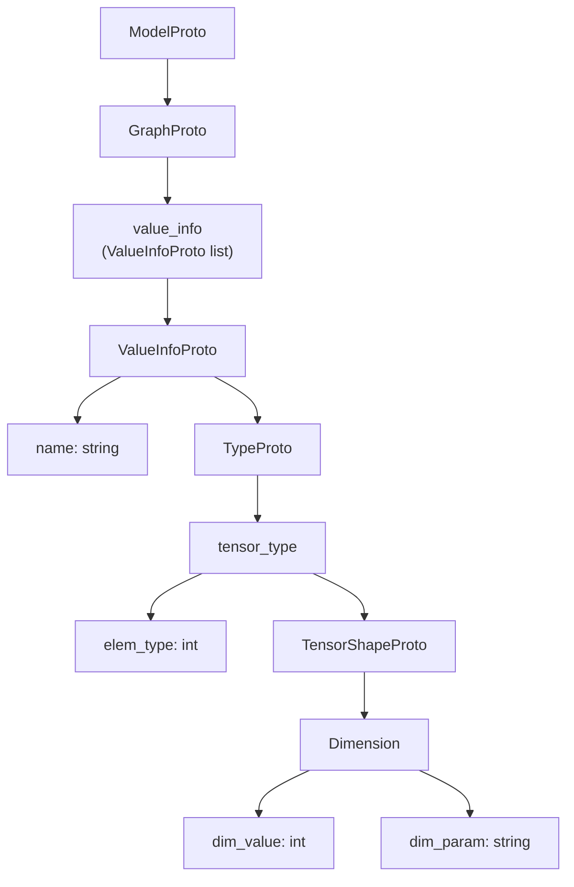

Sources: [onnx/onnx_pb.py](), [onnx/helper.py:778-844]()

## Integration with Model Validation

Shape inference is often used together with model validation. The `check_model()` function can optionally perform shape inference as part of validation:

```python
import onnx

model = onnx.load("model.onnx")

# Validate model without shape inference
onnx.checker.check_model(model, full_check=False)

# Validate model with shape inference
# This calls shape_inference.infer_shapes() internally
onnx.checker.check_model(model, full_check=True)
```

When `full_check=True`, the checker performs shape inference and validates that:
- All operator inputs have compatible types
- Shape constraints are satisfied
- No shape mismatches exist between connected tensors

Sources: [onnx/checker.py:121-169](), [onnx/test/checker_test.py:149-194]()

## Error Handling

Shape inference can encounter errors when:
- Operator schemas are not found for a node
- Input types are incompatible with operator requirements
- Shape constraints cannot be satisfied

**Error Types and Handling**

```python
from onnx import shape_inference

try:
    inferred_model = shape_inference.infer_shapes(model, strict_mode=True)
except onnx.shape_inference.InferenceError as e:
    print(f"Shape inference failed: {e}")
    # Error message includes context about which node/operation failed
```

The `InferenceError` exception provides context about where inference failed, including node names and operation types.

**Non-Strict Mode**

When `strict_mode=False` (default), shape inference continues even if some nodes fail:

```python
# Suppress node-level errors, continue inference where possible
inferred_model = shape_inference.infer_shapes(model, strict_mode=False)

# Some tensors may still lack shape information if inference failed for them
```

This is useful for models with custom operators or when partial shape information is sufficient.

Sources: [onnx/defs/shape_inference.h:60-85](), [onnx/shape_inference/implementation.cc:709-724]()

## Advanced Topics

### Symbolic Dimensions

Symbolic dimensions use `TensorShapeProto::Dimension::dim_param` to represent unknown sizes that may vary at runtime. The `SymbolTableImpl` class manages symbolic dimension names to ensure consistency across the model.

```python
from onnx import helper, TensorProto

# Create a model with symbolic batch dimension
graph = helper.make_graph(
    nodes=[helper.make_node("Identity", ["input"], ["output"])],
    name="symbolic_batch",
    inputs=[helper.make_tensor_value_info("input", TensorProto.FLOAT, ["batch", 128])],
    outputs=[helper.make_tensor_value_info("output", TensorProto.FLOAT, None)]
)
```

After shape inference, the output will have shape `["batch", 128]`, preserving the symbolic dimension name. This is important for:
- Dynamic batch sizes
- Variable sequence lengths  
- Any dimension that changes between inference runs

**SymbolTableImpl Class:**

The `SymbolTableImpl` class (implementing the `SymbolTable` interface) manages symbolic dimension names:

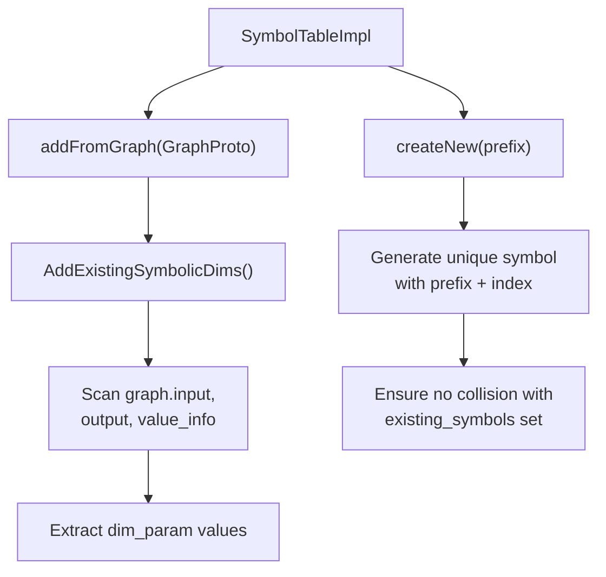

Sources: [onnx/shape_inference/implementation.h:30-94](), [onnx/shape_inference/implementation.cc:216-250]()

### Data Propagation Mechanism

Data propagation enables shape inference for operators where output shapes depend on input values rather than just input shapes. This is critical for operators like:

- `Shape`: Outputs the shape of input as data
- `Reshape`: Takes target shape as an input tensor
- `Slice`: Uses input data to determine slice indices

**How Data Propagation Works**

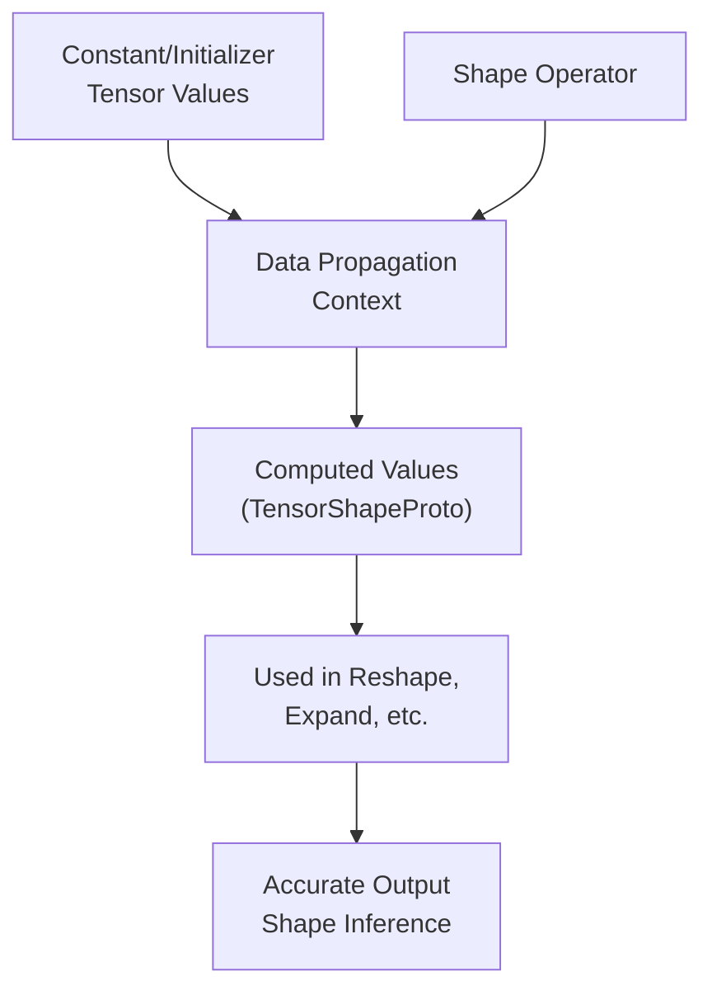

Enable data propagation with `data_prop=True` when shapes depend on computed values.

Sources: [onnx/defs/shape_inference.h:117-147](), [onnx/shape_inference/implementation.cc:505-514]()

## Python API Reference

The shape inference module provides the following Python functions accessed via `onnx.shape_inference`:

| Function | Signature | Description |
|----------|-----------|-------------|
| `infer_shapes` | `(model: ModelProto, check_type: bool, strict_mode: bool, data_prop: bool) -> ModelProto` | Main API for inferring shapes on a ModelProto |
| `infer_shapes_path` | `(input: str, output: str, check_type: bool, strict_mode: bool, data_prop: bool) -> None` | Infer shapes from/to file paths (for large models >2GB) |

**C++ Implementation Classes:**

These C++ classes implement the shape inference logic and are exposed through Python bindings via `onnx_cpp2py_export`:

| Class | Purpose |
|-------|---------|
| `ShapeInferenceOptions` | Holds configuration: `check_type`, `error_mode`, `enable_data_propagation` |
| `InferenceContext` | Abstract interface providing `getInputType()`, `getOutputType()`, `getAttribute()`, etc. |
| `InferenceContextImpl` | Concrete implementation of `InferenceContext` used during graph traversal |
| `DataPropagationContext` | Interface for propagating constant values: `getInputData()`, `addOutputData()` |
| `GraphInferenceContext` | Holds global context: `opset_imports`, `symbol_table`, `schema_registry`, etc. |
| `SymbolTableImpl` | Manages symbolic dimension names via `createNew()` and `addFromGraph()` |

**Key C++ Functions:**

| Function | File | Description |
|----------|------|-------------|
| `InferShapesImpl` | implementation.cc | Main entry point from Python; creates `ShapeInferenceImplBase` |
| `InferShapeForFunctionNode` | implementation.cc:602-673 | Handles inference for operators defined as functions |
| `checkShapesAndTypes` | implementation.cc:108-146 | Validates inferred types match existing types |
| `mergeShapesAndTypes` | implementation.cc:148-214 | Merges inferred shape info with existing ValueInfoProtos |

Sources: [onnx/shape_inference/implementation.h:21-291](), [onnx/shape_inference/implementation.cc:677-707](), [onnx/defs/shape_inference.h:87-147]()

## Integration with Operator System

Operators define their shape inference behavior via `OpSchema::TypeAndShapeInferenceFunction()`. The inference function receives an `InferenceContext` and computes output types/shapes.

**Operator Schema Shape Inference Flow:**

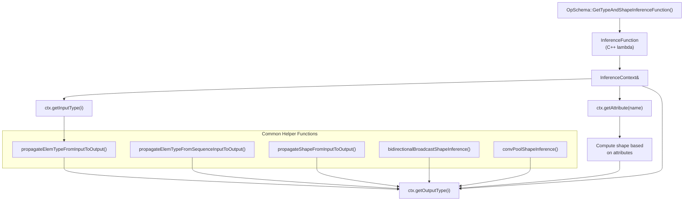

**Common Shape Inference Patterns:**

| Pattern | Helper Function | Example Operators |
|---------|----------------|-------------------|
| Identity | `propagateShapeFromInputToOutput()` | Identity, Cast, Clip |
| Element-wise | `propagateElemTypeFromInputToOutput()` | Relu, Sigmoid, Tanh |
| Broadcast | `bidirectionalBroadcastShapeInference()` | Add, Mul, Sub |
| Pooling/Conv | `convPoolShapeInference()` | Conv, MaxPool, AveragePool |
| Reduction | Custom logic with `multiplyDims()` | ReduceSum, ReduceMean |
| Shape-dependent | Requires `data_prop=True` | Reshape, Expand |

Sources: [onnx/defs/shape_inference.h:265-394](), [onnx/defs/shape_inference.cc:20-48]()

## Error Handling

The shape inference system uses the `InferenceError` exception class (derived from `std::runtime_error`) for reporting errors. Python code catches these as `onnx.shape_inference.InferenceError`.

**Error Reporting Macros:**

The C++ implementation defines two macros for throwing inference errors:

```cpp
#define fail_type_inference(...) \
  ONNX_THROW_EX(ONNX_NAMESPACE::InferenceError(ONNX_NAMESPACE::MakeString("[TypeInferenceError] ", __VA_ARGS__)));

#define fail_shape_inference(...) \
  ONNX_THROW_EX(ONNX_NAMESPACE::InferenceError(ONNX_NAMESPACE::MakeString("[ShapeInferenceError] ", __VA_ARGS__)));
```

**Error Mode Behavior:**

The `error_mode` field in `ShapeInferenceOptions` controls exception handling:

| Mode | Behavior | Use Case |
|------|----------|----------|
| `0` | Suppresses node-level errors, continues inference | Default; backward compatibility with partial models |
| `1` | Throws all errors immediately | Strict validation; use with `strict_mode=True` |

**Error Handling in Python:**

```python
from onnx import shape_inference

try:
    inferred_model = shape_inference.infer_shapes(model, strict_mode=True)
except shape_inference.InferenceError as e:
    print(f"Inference failed: {e}")
    # Exception message includes node name and operation context
```

**Exception Context:**

The `InferenceError::AppendContext()` method adds contextual information to errors, showing which node/operation failed:

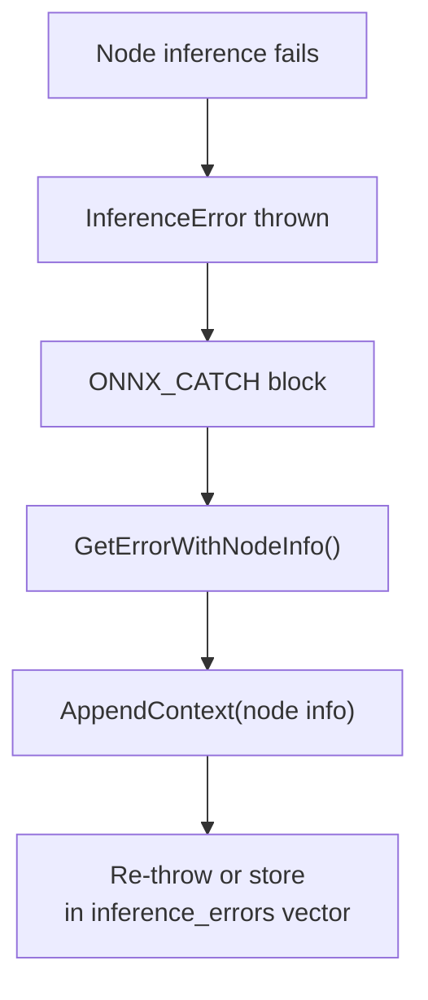

Sources: [onnx/defs/shape_inference.h:60-85](), [onnx/shape_inference/implementation.cc:514-534]()

## Data Propagation for Enhanced Shape Inference

Data propagation allows for partial evaluation of operators to resolve shapes that depend on runtime values:

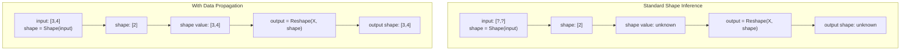

Data propagation is enabled via the `enable_data_propagation` flag in `ShapeInferenceOptions` and requires operators to implement a `DataPropagationFunction`.

Sources: [onnx/defs/shape_inference.h:117-147](onnx/defs/shape_inference.h:117-147), [onnx/shape_inference/implementation.cc:505-514](onnx/shape_inference/implementation.cc:505-514)

## Special Cases

### Function-Based Operators

For operators defined as functions, the shape inference system processes the underlying function graph:

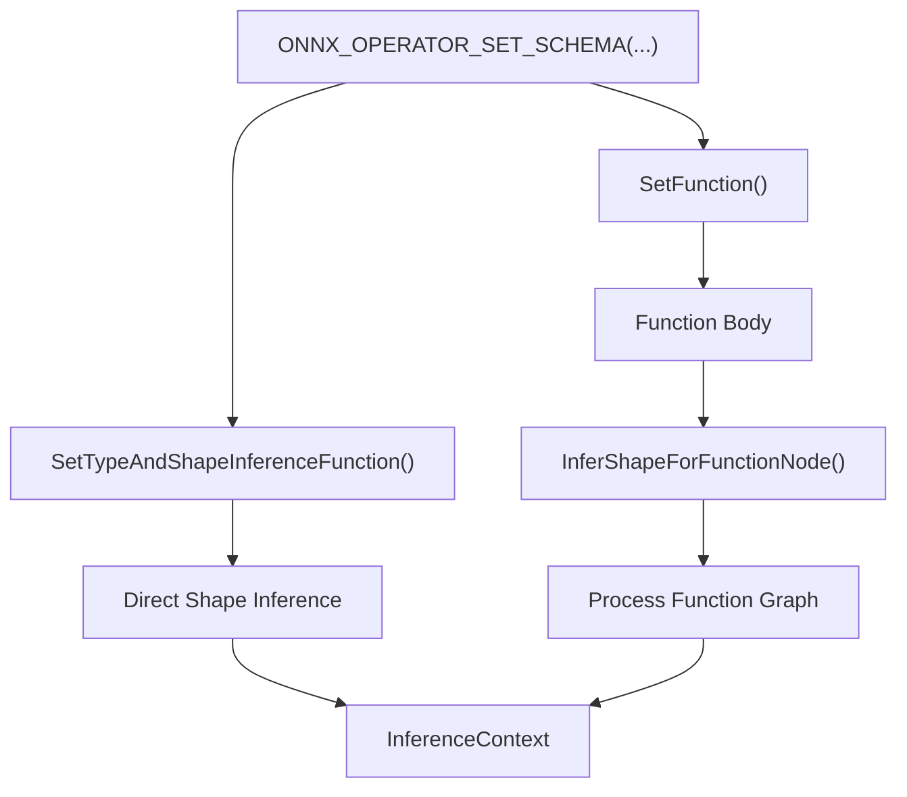

The function body can be processed by `InferShapeForFunctionNode()` to infer shapes for the function outputs based on its internal structure.

Sources: [onnx/shape_inference/implementation.cc:476-479](onnx/shape_inference/implementation.cc:476-479), [onnx/shape_inference/implementation.cc:602-673](onnx/shape_inference/implementation.cc:602-673)

### Subgraph Inference

Some operators (like `If`, `Loop`, and `Scan`) contain subgraphs. The inference system handles these using `GraphInferencer`:

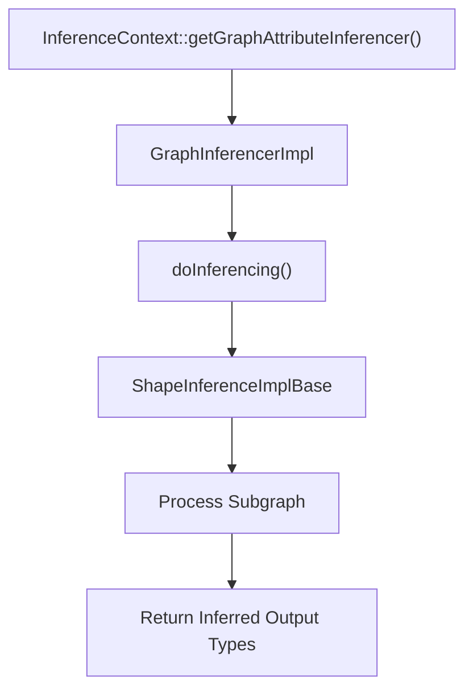

This allows for maintaining shape inference context across nested graphs within a model.

Sources: [onnx/shape_inference/implementation.h:122-136](onnx/shape_inference/implementation.h:122-136), [onnx/test/cpp/shape_inference_test.cc:344-509](onnx/test/cpp/shape_inference_test.cc:344-509)

## Examples of Shape Inference Usage

### Reshape Example

Shape inference can handle complex cases like Reshape with dynamically provided shape:

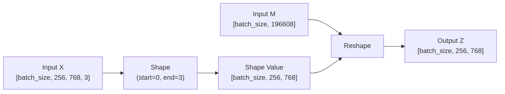

The shape inference can correctly infer that the output has shape `[batch_size, 256, 768]`.

Sources: [onnx/test/cpp/shape_inference_test.cc:539-561](onnx/test/cpp/shape_inference_test.cc:539-561)

### Constant Example

For operators like `Constant` that produce fixed outputs, shape inference takes shape directly from attributes:

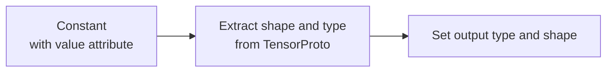

The shape inference function for `Constant` extracts shape information from the value attribute without complex computation.

Sources: [onnx/defs/generator/old.cc:626-635](onnx/defs/generator/old.cc:626-635)

## Summary

The Shape Inference System is a critical component of ONNX that analyzes models to determine the shapes and types of all tensors. It works by:

1. Traversing the model graph
2. Using operator-defined shape inference functions
3. Merging and validating shape information
4. Supporting symbolic dimensions for unknown shapes
5. Enabling data propagation for more precise inference

The system provides the foundation for model validation, optimization, and execution planning.

---

