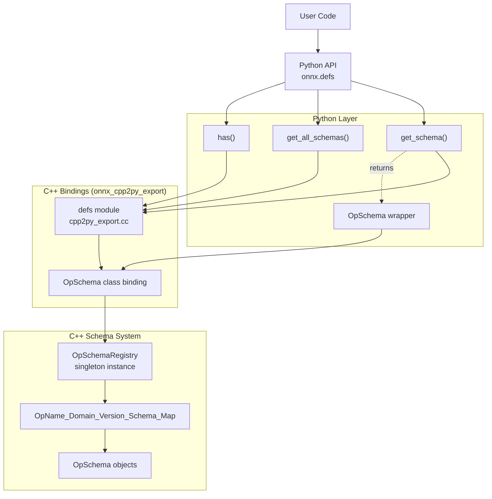
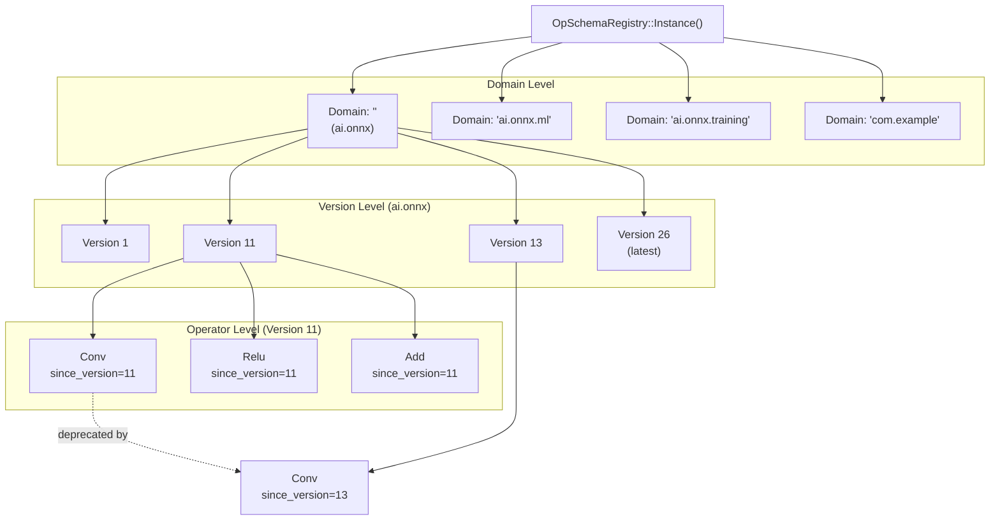
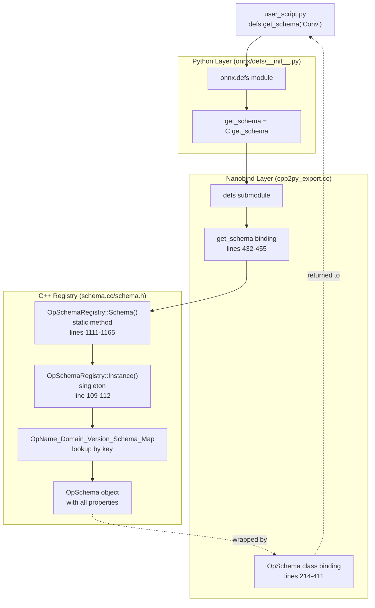

<!-- source: DeepWiki mcp.deepwiki.com · repo onnx/onnx · page 4.5 Schema Access and Introspection · fetched 2026-10-21 -->

# Schema Access and Introspection

<details>
<summary>Relevant source files</summary>

The following files were used as context for generating this wiki page:

- [docs/Changelog-ml.md](docs/Changelog-ml.md)
- [docs/Operators-ml.md](docs/Operators-ml.md)
- [onnx/checker.cc](onnx/checker.cc)
- [onnx/checker.h](onnx/checker.h)
- [onnx/common/model_helpers.cc](onnx/common/model_helpers.cc)
- [onnx/common/status.cc](onnx/common/status.cc)
- [onnx/common/status.h](onnx/common/status.h)
- [onnx/cpp2py_export.cc](onnx/cpp2py_export.cc)
- [onnx/defs/__init__.py](onnx/defs/__init__.py)
- [onnx/defs/function.cc](onnx/defs/function.cc)
- [onnx/defs/function.h](onnx/defs/function.h)
- [onnx/defs/gen_doc.py](onnx/defs/gen_doc.py)
- [onnx/defs/schema.cc](onnx/defs/schema.cc)
- [onnx/defs/schema.h](onnx/defs/schema.h)
- [onnx/defs/shape_inference.cc](onnx/defs/shape_inference.cc)
- [onnx/defs/shape_inference.h](onnx/defs/shape_inference.h)
- [onnx/defs/traditionalml/defs.cc](onnx/defs/traditionalml/defs.cc)
- [onnx/defs/traditionalml/old.cc](onnx/defs/traditionalml/old.cc)
- [onnx/onnx_cpp2py_export/defs.pyi](onnx/onnx_cpp2py_export/defs.pyi)
- [onnx/onnx_cpp2py_export/shape_inference.pyi](onnx/onnx_cpp2py_export/shape_inference.pyi)
- [onnx/shape_inference.py](onnx/shape_inference.py)
- [onnx/shape_inference/implementation.cc](onnx/shape_inference/implementation.cc)
- [onnx/shape_inference/implementation.h](onnx/shape_inference/implementation.h)
- [onnx/test/inference_function_test.py](onnx/test/inference_function_test.py)
- [onnx/test/schema_test.py](onnx/test/schema_test.py)

</details>


This page documents the Python API for querying and inspecting ONNX operator schemas. Schemas define the specification for each operator, including inputs, outputs, attributes, type constraints, and inference functions. The schema system enables programmatic access to operator definitions for validation, documentation generation, and tooling.

For information about defining new operators and their schemas, see [Adding New Operators](#8.1). For details on how schemas are used during model validation, see [Model Validation and Checking](#4.2). For shape inference using schemas, see [Shape Inference API](#4.4).

## Overview

The schema system provides introspection capabilities for all registered ONNX operators. Each operator is defined by an `OpSchema` object that contains:
- Operator metadata (name, domain, version, documentation)
- Input/output specifications (formal parameters)
- Attribute definitions with types and defaults
- Type constraints for generic type parameters
- Inference functions for type and shape propagation

The Python API provides access to the C++ schema registry through nanobind bindings, allowing users to query schemas, inspect their properties, and use them for validation or code generation.



**Sources:** [onnx/defs/__init__.py:1-121](), [onnx/cpp2py_export.cc:191-700](), [onnx/defs/schema.h:147-886](), [onnx/defs/schema.cc:109-112]()

## Python Schema Retrieval API

The primary functions for accessing schemas are exposed through the `onnx.defs` module.

### Basic Schema Retrieval

```python
import onnx.defs as defs

# Get the latest schema for an operator
schema = defs.get_schema("Relu")

# Get a specific version from a specific domain
schema = defs.get_schema("Conv", 11, "")  # version 11, ONNX domain
ml_schema = defs.get_schema("TreeEnsembleClassifier", 1, "ai.onnx.ml")

# Check if a schema exists
if defs.has("CustomOp", domain="com.example"):
    schema = defs.get_schema("CustomOp", domain="com.example")
```

### Retrieving All Schemas

```python
# Get all schemas for the latest opset version
all_schemas = defs.get_all_schemas()  # List[OpSchema]

# Get all schemas including historical versions
all_with_history = defs.get_all_schemas_with_history()  # List[OpSchema]
```

### Function Signatures

| Function | Parameters | Returns | Description |
|----------|------------|---------|-------------|
| `get_schema` | `name: str, max_inclusive_version: int = max, domain: str = ""` | `OpSchema` | Retrieves schema for operator, optionally specifying max version and domain |
| `get_all_schemas` | none | `list[OpSchema]` | Returns all schemas for latest opset versions |
| `get_all_schemas_with_history` | none | `list[OpSchema]` | Returns all schemas including deprecated versions |
| `has` | `op_type: str, domain: str = ""` | `bool` | Checks if schema exists for operator |
| `onnx_opset_version` | none | `int` | Returns current opset version for `ai.onnx` domain |

**Sources:** [onnx/defs/__init__.py:31-40](), [onnx/onnx_cpp2py_export/defs.pyi:123-145](), [onnx/cpp2py_export.cc:432-481]()

## OpSchema Structure

The `OpSchema` class contains all metadata and specifications for an operator. The following diagram shows the structure of an OpSchema instance:

```mermaid
graph TB
    OpSchema["OpSchema instance"]
    
    subgraph "Basic Metadata"
        Name["name: str"]
        Domain["domain: str"]
        Version["since_version: int"]
        Doc["doc: str"]
        Deprecated["deprecated: bool"]
        Support["support_level: SupportType"]
    end
    
    subgraph "Parameters"
        Inputs["inputs: list[FormalParameter]"]
        Outputs["outputs: list[FormalParameter]"]
        MinInput["min_input: int"]
        MaxInput["max_input: int"]
        MinOutput["min_output: int"]
        MaxOutput["max_output: int"]
    end
    
    subgraph "Attributes"
        AttrMap["attributes: dict[str, Attribute]"]
        AttrItem["Attribute:<br/>name, type, required,<br/>default_value, description"]
    end
    
    subgraph "Type System"
        TypeConstraints["type_constraints:<br/>list[TypeConstraintParam]"]
        TypeParam["TypeConstraintParam:<br/>type_param_str,<br/>allowed_type_strs,<br/>description"]
    end
    
    subgraph "Inference Functions"
        TypeShapeInfer["has_type_and_shape_inference_function: bool"]
        DataProp["has_data_propagation_function: bool"]
        FunctionBody["function_body: FunctionProto"]
    end
    
    OpSchema --> Name
    OpSchema --> Domain
    OpSchema --> Version
    OpSchema --> Doc
    OpSchema --> Deprecated
    OpSchema --> Support
    
    OpSchema --> Inputs
    OpSchema --> Outputs
    OpSchema --> MinInput
    OpSchema --> MaxInput
    OpSchema --> MinOutput
    OpSchema --> MaxOutput
    
    OpSchema --> AttrMap
    AttrMap --> AttrItem
    
    OpSchema --> TypeConstraints
    TypeConstraints --> TypeParam
    
    OpSchema --> TypeShapeInfer
    OpSchema --> DataProp
    OpSchema --> FunctionBody
```



**Sources:** [onnx/defs/schema.h:147-886](), [onnx/onnx_cpp2py_export/defs.pyi:11-122]()

## Schema Property Access

### Basic Properties

All basic schema properties are accessible as read-only attributes:

```python
schema = defs.get_schema("Conv")

# Basic metadata
print(schema.name)            # "Conv"
print(schema.domain)          # "" (empty string = ai.onnx)
print(schema.since_version)   # 11 (or latest version)
print(schema.doc)             # Documentation string
print(schema.deprecated)      # False
print(schema.support_level)   # OpSchema.SupportType.COMMON
```

| Property | Type | Description |
|----------|------|-------------|
| `name` | `str` | Operator name |
| `domain` | `str` | Domain (empty string for default `ai.onnx`) |
| `since_version` | `int` | Opset version when this schema was introduced |
| `doc` | `str` | Documentation string |
| `deprecated` | `bool` | Whether operator is deprecated |
| `support_level` | `SupportType` | COMMON or EXPERIMENTAL |
| `file` | `str` | Source file where schema was defined |
| `line` | `int` | Line number in source file |

### Input and Output Specifications

Inputs and outputs are represented as `FormalParameter` objects:

```python
schema = defs.get_schema("Add")

# Access inputs
for i, input_param in enumerate(schema.inputs):
    print(f"Input {i}: {input_param.name}")
    print(f"  Type: {input_param.type_str}")
    print(f"  Description: {input_param.description}")
    print(f"  Option: {input_param.option}")  # Single, Optional, or Variadic
    print(f"  Differentiable: {input_param.differentiation_category}")

# Access outputs
for i, output_param in enumerate(schema.outputs):
    print(f"Output {i}: {output_param.name}")
    print(f"  Type: {output_param.type_str}")
    
# Check counts
print(f"Min inputs: {schema.min_input}")
print(f"Max inputs: {schema.max_input}")
print(f"Min outputs: {schema.min_output}")
print(f"Max outputs: {schema.max_output}")
```

#### FormalParameter Properties

| Property | Type | Description |
|----------|------|-------------|
| `name` | `str` | Parameter name |
| `type_str` | `str` | Type string (e.g., "T", "tensor(float)") |
| `description` | `str` | Parameter description |
| `types` | `set[DataType]` | Resolved allowed types |
| `option` | `FormalParameterOption` | Single, Optional, or Variadic |
| `is_homogeneous` | `bool` | For variadic params, whether all must be same type |
| `min_arity` | `int` | Minimum count for variadic parameters |
| `differentiation_category` | `DifferentiationCategory` | Unknown, Differentiable, or NonDifferentiable |

**Sources:** [onnx/defs/schema.h:184-287](), [onnx/cpp2py_export.cc:304-341](), [onnx/defs/schema.cc:73-107]()

### Attribute Specifications

Attributes are stored in a dictionary mapping attribute names to `Attribute` objects:

```python
schema = defs.get_schema("Conv")

# Iterate over attributes
for attr_name, attr in schema.attributes.items():
    print(f"Attribute: {attr_name}")
    print(f"  Type: {attr.type}")  # AttributeProto.AttributeType enum
    print(f"  Required: {attr.required}")
    print(f"  Description: {attr.description}")
    
    # Access default value if present
    if not attr.required and attr.default_value.name:
        print(f"  Default: {attr.default_value}")

# Check specific attribute
if "kernel_shape" in schema.attributes:
    kernel_attr = schema.attributes["kernel_shape"]
    print(f"Kernel shape type: {kernel_attr.type}")
```

#### Attribute Properties

| Property | Type | Description |
|----------|------|-------------|
| `name` | `str` | Attribute name |
| `type` | `AttributeProto.AttributeType` | FLOAT, INT, STRING, TENSOR, GRAPH, etc. |
| `required` | `bool` | Whether attribute is required |
| `description` | `str` | Attribute description |
| `default_value` | `AttributeProto` | Default value (if not required) |

**Sources:** [onnx/defs/schema.h:421-437](), [onnx/cpp2py_export.cc:252-292](), [onnx/defs/__init__.py:68-75]()

### Type Constraints

Type constraints define allowed types for generic type parameters:

```python
schema = defs.get_schema("Add")

# Access type constraints
for tc in schema.type_constraints:
    print(f"Type parameter: {tc.type_param_str}")
    print(f"  Allowed types: {tc.allowed_type_strs}")
    print(f"  Description: {tc.description}")

# Example output for Add:
# Type parameter: T
#   Allowed types: ['tensor(uint32)', 'tensor(uint64)', 'tensor(int32)', ...]
#   Description: Constrain input and output types to numeric tensors.
```

**Sources:** [onnx/defs/schema.h:481-497](), [onnx/cpp2py_export.cc:294-302](), [onnx/defs/schema.cc:703-729]()

## Inference Function Introspection

Schemas may include inference functions for type/shape inference and data propagation:

```python
schema = defs.get_schema("Reshape")

# Check if inference functions are available
has_type_shape = schema.has_type_and_shape_inference_function
has_data_prop = schema.has_data_propagation_function

print(f"Has type/shape inference: {has_type_shape}")
print(f"Has data propagation: {has_data_prop}")

# For function ops, access the function body
if hasattr(schema, 'function_body'):
    func_proto = schema.function_body  # Returns FunctionProto
    print(f"Function op with {len(func_proto.node)} nodes")
```

### Using Inference Functions Programmatically

The schema's inference function can be invoked through the `infer_node_outputs` helper:

```python
from onnx.shape_inference import infer_node_outputs
import onnx

# Create a node
node = onnx.helper.make_node("Add", ["A", "B"], ["C"])

# Define input types
input_types = {
    "A": onnx.helper.make_tensor_type_proto(onnx.TensorProto.FLOAT, [1, 3, 224, 224]),
    "B": onnx.helper.make_tensor_type_proto(onnx.TensorProto.FLOAT, [1, 3, 224, 224])
}

# Get schema
schema = defs.get_schema("Add")

# Infer output types
output_types = infer_node_outputs(schema, node, input_types)
print(output_types["C"])  # TypeProto for output C
```

**Sources:** [onnx/shape_inference.py:111-156](), [onnx/cpp2py_export.cc:126-172]()

## Schema Registry Organization

The schema registry is organized hierarchically by domain, version, and operator name:



### Accessing Domain Information

```python
# Get current opset versions
onnx_version = defs.onnx_opset_version()  # Current version for ai.onnx
ml_version = defs.onnx_ml_opset_version()  # Current version for ai.onnx.ml

# Get version map for all domains
version_map = defs.C.schema_version_map()
# Returns: {domain: (min_version, max_version)}
# Example: {"": (1, 26), "ai.onnx.ml": (1, 5)}

print(f"ONNX domain: versions {version_map[''][0]}-{version_map[''][1]}")
print(f"ML domain: versions {version_map['ai.onnx.ml'][0]}-{version_map['ai.onnx.ml'][1]}")
```

**Sources:** [onnx/defs/__init__.py:38-45](), [onnx/defs/schema.h:905-969](), [onnx/cpp2py_export.cc:482-486]()

## Advanced Schema Operations

### Registering Custom Schemas

Custom operators can be registered programmatically:

```python
from onnx import defs

# Create a custom schema
custom_schema = defs.OpSchema(
    name="CustomOp",
    domain="com.example",
    since_version=1,
    doc="Custom operator documentation",
    inputs=[
        defs.OpSchema.FormalParameter(
            name="X",
            type_str="T",
            description="Input tensor"
        )
    ],
    outputs=[
        defs.OpSchema.FormalParameter(
            name="Y", 
            type_str="T",
            description="Output tensor"
        )
    ],
    type_constraints=[
        ("T", ["tensor(float)", "tensor(double)"], "Numeric types")
    ],
    attributes=[
        defs.OpSchema.Attribute(
            name="scale",
            type=defs.OpSchema.AttrType.FLOAT,
            description="Scaling factor",
            required=False
        )
    ]
)

# Register the schema
defs.register_schema(custom_schema)

# Verify registration
assert defs.has("CustomOp", domain="com.example")

# Deregister when done
defs.deregister_schema("CustomOp", version=1, domain="com.example")
```

**Sources:** [onnx/cpp2py_export.cc:343-411](), [onnx/defs/schema.cc:39-64]()

### Schema Comparison and Versioning

```python
# Get all versions of an operator
all_conv_schemas = [
    s for s in defs.get_all_schemas_with_history() 
    if s.name == "Conv" and s.domain == ""
]

# Sort by version
all_conv_schemas.sort(key=lambda s: s.since_version)

# Compare versions
for i in range(len(all_conv_schemas) - 1):
    old = all_conv_schemas[i]
    new = all_conv_schemas[i + 1]
    print(f"Conv changed from v{old.since_version} to v{new.since_version}")
    
    # Compare inputs
    if len(old.inputs) != len(new.inputs):
        print(f"  Input count changed: {len(old.inputs)} -> {len(new.inputs)}")
    
    # Compare attributes
    old_attrs = set(old.attributes.keys())
    new_attrs = set(new.attributes.keys())
    added = new_attrs - old_attrs
    removed = old_attrs - new_attrs
    if added:
        print(f"  Added attributes: {added}")
    if removed:
        print(f"  Removed attributes: {removed}")
```

### Using Schemas for Documentation Generation

The schema introspection API is used extensively for generating documentation:

```python
# Example from gen_doc.py
def generate_operator_doc(schema):
    """Generate markdown documentation for an operator"""
    doc = f"### {schema.name}\n\n"
    
    if schema.doc:
        doc += schema.doc + "\n\n"
    
    doc += f"#### Version\n\n"
    doc += f"Since version {schema.since_version} of {schema.domain or 'ai.onnx'}\n\n"
    
    # Document attributes
    if schema.attributes:
        doc += "#### Attributes\n\n"
        for name, attr in sorted(schema.attributes.items()):
            doc += f"- **{name}** ({attr.type})"
            if not attr.required:
                doc += f" (optional, default={attr.default_value})"
            doc += f": {attr.description}\n"
    
    # Document inputs
    doc += "#### Inputs\n\n"
    for inp in schema.inputs:
        doc += f"- **{inp.name}** ({inp.type_str}): {inp.description}\n"
    
    # Document outputs
    doc += "#### Outputs\n\n"
    for out in schema.outputs:
        doc += f"- **{out.name}** ({out.type_str}): {out.description}\n"
    
    return doc
```

**Sources:** [onnx/defs/gen_doc.py:103-226]()

## Complete Access Flow

The following diagram shows the complete flow from Python user code to C++ schema objects:



**Sources:** [onnx/defs/__init__.py:31-35](), [onnx/cpp2py_export.cc:432-455](), [onnx/defs/schema.cc:1111-1165]()

## Practical Examples

### Example 1: Validating Node Compatibility

```python
def validate_node_against_schema(node, input_types):
    """Validate a node matches its schema requirements"""
    schema = defs.get_schema(node.op_type, domain=node.domain)
    
    # Check input count
    if len(node.input) < schema.min_input:
        raise ValueError(f"Too few inputs: {len(node.input)} < {schema.min_input}")
    if len(node.input) > schema.max_input:
        raise ValueError(f"Too many inputs: {len(node.input)} > {schema.max_input}")
    
    # Check required attributes
    for attr_name, attr in schema.attributes.items():
        if attr.required:
            if not any(a.name == attr_name for a in node.attribute):
                raise ValueError(f"Missing required attribute: {attr_name}")
    
    # Check type constraints
    for tc in schema.type_constraints:
        # Type validation logic here
        pass
    
    return True
```

### Example 2: Generating Test Cases

```python
def generate_test_for_op(op_name):
    """Generate test scaffold for an operator"""
    schema = defs.get_schema(op_name)
    
    print(f"# Test for {op_name}")
    print(f"def test_{op_name.lower()}():")
    
    # Generate input creation
    for i, inp in enumerate(schema.inputs):
        print(f"    input_{i} = onnx.helper.make_tensor_value_info(")
        print(f"        '{inp.name}', onnx.TensorProto.FLOAT, [1, 3, 224, 224])")
    
    # Generate node creation
    input_names = [inp.name for inp in schema.inputs]
    output_names = [out.name for out in schema.outputs]
    print(f"    node = onnx.helper.make_node('{op_name}',")
    print(f"        inputs={input_names},")
    print(f"        outputs={output_names})")
    
    # Add required attributes
    required_attrs = [a for a in schema.attributes.values() if a.required]
    if required_attrs:
        print(f"    # Add required attributes: {[a.name for a in required_attrs]}")
```

### Example 3: Schema-Driven Code Generation

```python
def generate_cpp_wrapper(op_name):
    """Generate C++ wrapper code from schema"""
    schema = defs.get_schema(op_name)
    
    # Generate function signature
    params = ", ".join(f"Tensor {inp.name}" for inp in schema.inputs)
    print(f"Tensor {op_name}({params}) {{")
    
    # Generate attribute handling
    if schema.attributes:
        print("    // Attributes:")
        for attr_name, attr in schema.attributes.items():
            cpp_type = {
                defs.OpSchema.AttrType.FLOAT: "float",
                defs.OpSchema.AttrType.INT: "int64_t",
                defs.OpSchema.AttrType.STRING: "std::string"
            }.get(attr.type, "auto")
            print(f"    {cpp_type} {attr_name};")
    
    print("    // Implementation here")
    print("}")
```

**Sources:** [onnx/test/schema_test.py:19-97](), [onnx/defs/gen_doc.py:1-251]()

---

