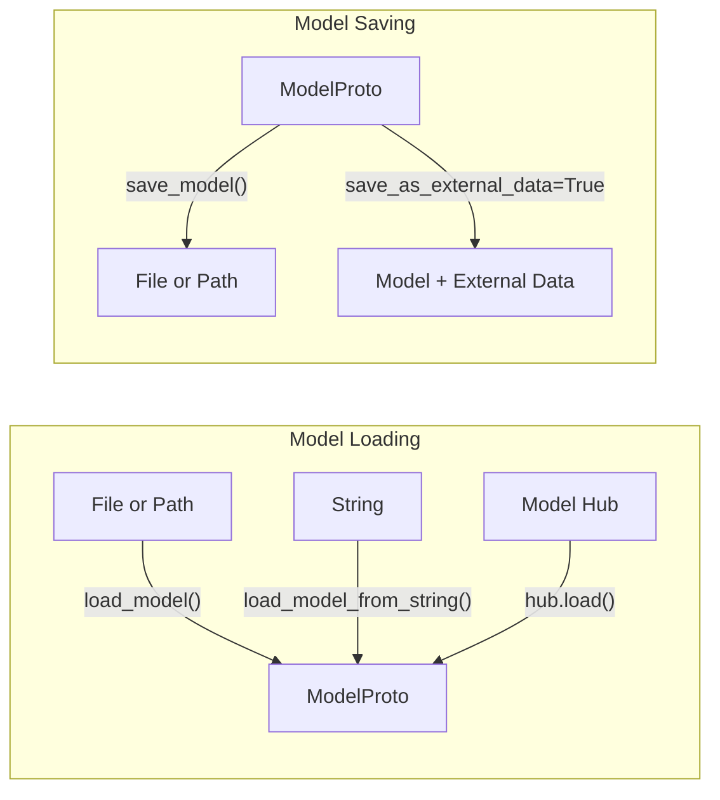
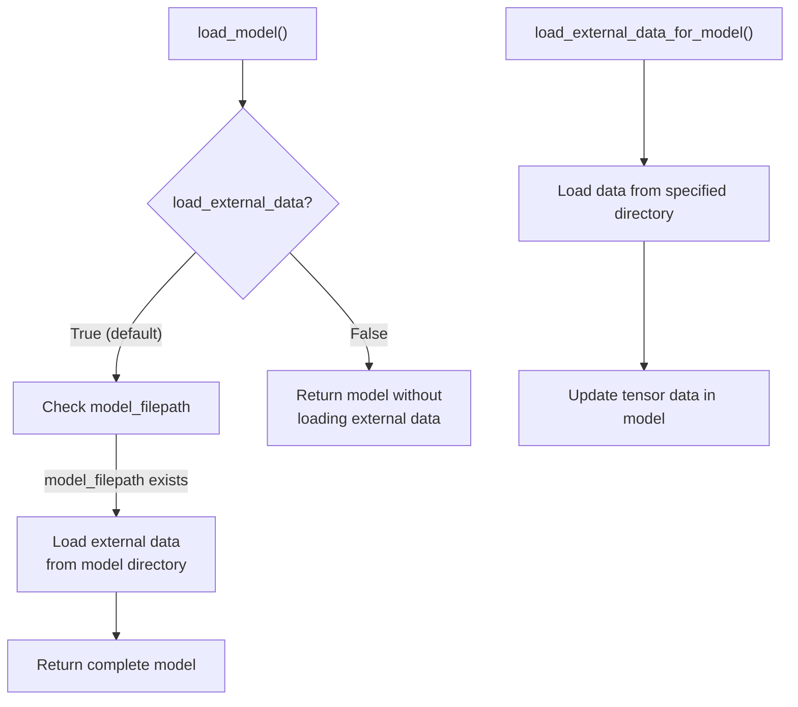
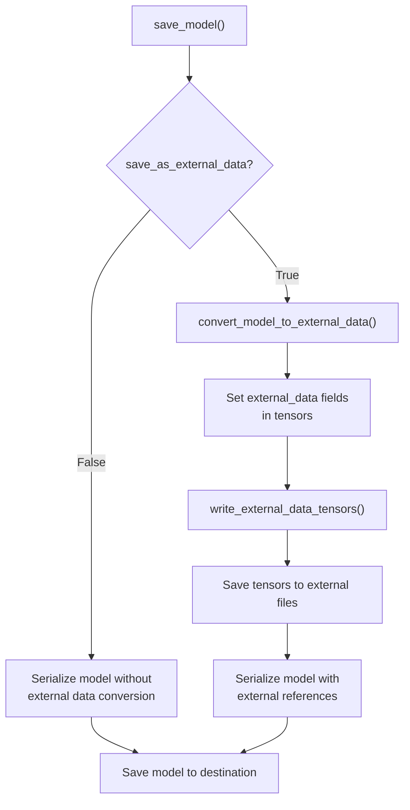
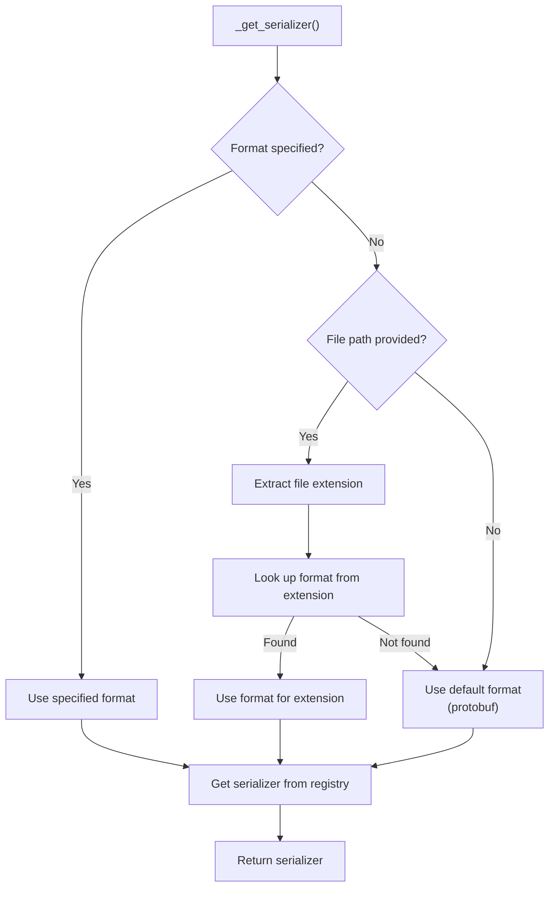

<!-- source: DeepWiki mcp.deepwiki.com · repo onnx/onnx · page 4.6 Loading and Saving Models · fetched 2026-10-21 -->

# Loading and Saving Models

<details>
<summary>Relevant source files</summary>

The following files were used as context for generating this wiki page:

- [VERSION_NUMBER](VERSION_NUMBER)
- [docs/IR.md](docs/IR.md)
- [docs/OnnxReleases.md](docs/OnnxReleases.md)
- [docs/Versioning.md](docs/Versioning.md)
- [onnx/__init__.py](onnx/__init__.py)
- [onnx/checker.py](onnx/checker.py)
- [onnx/common/version.h](onnx/common/version.h)
- [onnx/compose.py](onnx/compose.py)
- [onnx/defs/data_type_utils.cc](onnx/defs/data_type_utils.cc)
- [onnx/defs/data_type_utils.h](onnx/defs/data_type_utils.h)
- [onnx/external_data_helper.py](onnx/external_data_helper.py)
- [onnx/helper.py](onnx/helper.py)
- [onnx/model_container.py](onnx/model_container.py)
- [onnx/numpy_helper.py](onnx/numpy_helper.py)
- [onnx/onnx-ml.proto](onnx/onnx-ml.proto)
- [onnx/onnx-ml.proto3](onnx/onnx-ml.proto3)
- [onnx/onnx.in.proto](onnx/onnx.in.proto)
- [onnx/onnx.proto](onnx/onnx.proto)
- [onnx/onnx.proto3](onnx/onnx.proto3)
- [onnx/onnx_cpp2py_export/checker.pyi](onnx/onnx_cpp2py_export/checker.pyi)
- [onnx/reference/ops/op_range.py](onnx/reference/ops/op_range.py)
- [onnx/serialization.py](onnx/serialization.py)
- [onnx/test/basic_test.py](onnx/test/basic_test.py)
- [onnx/test/checker_test.py](onnx/test/checker_test.py)
- [onnx/test/compose_test.py](onnx/test/compose_test.py)
- [onnx/test/helper_test.py](onnx/test/helper_test.py)
- [onnx/test/numpy_helper_test.py](onnx/test/numpy_helper_test.py)
- [onnx/test/serialization_test.py](onnx/test/serialization_test.py)
- [onnx/test/test_external_data.py](onnx/test/test_external_data.py)

</details>


This page documents the ONNX Python API for loading and saving models. It covers basic model loading and saving operations, handling external data for large models, and various serialization formats supported by ONNX. For information about accessing pre-trained models from the ONNX Model Hub, see the related section on [Model Hub](#5.2).

## Overview

ONNX provides several functions to load models from files, strings, or the ONNX Model Hub, and save models to various formats. These functions handle the serialization and deserialization of models, as well as the management of external data for large models.



Sources:
- [onnx/__init__.py:204-276]()
- [onnx/hub.py:230-293]()
- [docs/PythonAPIOverview.md:11-76]()

## Supported Formats

ONNX supports multiple serialization formats for models. The default format is binary protobuf, but you can also use text formats for better readability or JSON for interoperability.

| Format | File Extensions | Description |
|--------|----------------|-------------|
| protobuf | .onnx, .pb | Binary protobuf format (default) |
| textproto | .textproto, .prototxt, .pbtxt | Text-based protobuf format |
| json | .json, .onnxjson | JSON format |
| onnxtxt | .onnxtxt, .onnxtext | ONNX textual representation |

Sources:
- [onnx/__init__.py:145-153]()
- [onnx/serialization.py:94-212]()

## Loading Models

### Basic Model Loading

The simplest way to load an ONNX model is using the `load_model()` function. This function can accept a file path, a PathLike object, or a file-like object.

```python
import onnx

# Load from a file path
model = onnx.load_model("path/to/model.onnx")

# Load from a file-like object
with open("path/to/model.onnx", "rb") as f:
    model = onnx.load_model(f)
```

The `load_model()` function automatically detects the serialization format based on the file extension or can be explicitly specified using the `format` parameter.

Sources:
- [onnx/__init__.py:204-234]()
- [docs/PythonAPIOverview.md:11-19]()

### Loading from String

You can also load a model from a binary or text string using `load_model_from_string()`:

```python
import onnx

# Load from a binary string
model = onnx.load_model_from_string(binary_data)

# Load from a binary string with a specific format
model = onnx.load_model_from_string(text_data, format="textproto")
```

Sources:
- [onnx/__init__.py:256-272]()

### Loading Models with External Data

ONNX models can store large tensors in external files to avoid protobuf size limits (2GB). When loading such models, you have two options:

1. If the external data is in the same directory as the model file, it will be loaded automatically.

2. If the external data is in a different directory, you can specify the path:

```python
import onnx
from onnx.external_data_helper import load_external_data_for_model

# Disable automatic external data loading
model = onnx.load_model("path/to/model.onnx", load_external_data=False)

# Load external data from a specific directory
load_external_data_for_model(model, "path/to/external/data/")
```



Sources:
- [onnx/__init__.py:204-234]()
- [onnx/external_data_helper.py:44-80]()
- [docs/PythonAPIOverview.md:22-41]()
- [docs/ExternalData.md:9-28]()

## Saving Models

### Basic Model Saving

To save an ONNX model, use the `save_model()` function:

```python
import onnx

# Save a model to a file
onnx.save_model(model, "path/to/model.onnx")

# Save with a specific format
onnx.save_model(model, "path/to/model.json", format="json")
```

The function can save to a file path, a PathLike object, or a file-like object (such as BytesIO).

Sources:
- [onnx/__init__.py:294-345]()
- [docs/PythonAPIOverview.md:54-66]()

### Saving Models with External Data

For large models that exceed the 2GB protobuf limit, you can save tensors as external data:

```python
import onnx

# Save model with external data
onnx.save_model(
    model,
    "path/to/model.onnx",
    save_as_external_data=True,
    all_tensors_to_one_file=True,
    location="tensors.bin",
    size_threshold=1024  # Tensors larger than 1KB will be external
)
```

The parameters for external data handling are:
- `save_as_external_data`: Enable external data saving
- `all_tensors_to_one_file`: Save all tensors to a single file or one file per tensor
- `location`: Name of the external data file (relative to the model)
- `size_threshold`: Minimum tensor size to be saved externally (in bytes)
- `convert_attribute`: Include attribute tensors in external storage



Sources:
- [onnx/__init__.py:294-345]()
- [onnx/external_data_helper.py:112-168]()
- [docs/PythonAPIOverview.md:68-76]()
- [docs/ExternalData.md:30-50]()

### Converting Models to Use External Data

You can also convert an existing in-memory model to use external data without immediately saving it:

```python
from onnx.external_data_helper import convert_model_to_external_data

# Convert model to use external data
convert_model_to_external_data(
    model,
    all_tensors_to_one_file=True,
    location="tensors.bin",
    size_threshold=1024
)

# Later, save the model
onnx.save_model(model, "path/to/model.onnx")
```

Sources:
- [onnx/external_data_helper.py:112-168]()
- [docs/PythonAPIOverview.md:43-52]()
- [docs/ExternalData.md:30-40]()

## Model Serialization Process

When loading or saving models, ONNX uses a serialization registry to handle different formats. The format is determined based on:

1. The explicitly specified format parameter
2. The file extension (if not specified and path is provided)
3. Default to "protobuf" if neither is available



Sources:
- [onnx/__init__.py:186-202]()
- [onnx/serialization.py:51-92]()
- [onnx/serialization.py:94-212]()

## Special Considerations for Large Models

Models larger than 2GB require special handling due to protobuf limitations:

1. When loading, use file paths rather than loading into memory:
   ```python
   # For large models, use the file path directly
   onnx.checker.check_model("path/to/large_model.onnx")
   ```

2. For shape inference on large models:
   ```python
   # For large models, use path-based shape inference
   onnx.shape_inference.infer_shapes_path("path/to/large_model.onnx", "output_model.onnx")
   ```

3. When saving, always use external data:
   ```python
   onnx.save_model(
       model, 
       "path/to/model.onnx", 
       save_as_external_data=True, 
       all_tensors_to_one_file=True
   )
   ```

ONNX also provides a `ModelContainer` class for handling models larger than 2GB, which allows for more sophisticated management of large initializers without serializing them as part of the protobuf.

Sources:
- [onnx/model_container.py:79-345]()
- [docs/PythonAPIOverview.md:203-211]()
- [docs/PythonAPIOverview.md:247-260]()
- [docs/ExternalData.md:52-67]()

## Working with Tensors

Similar to models, ONNX provides functions to load and save individual tensors:

```python
import onnx

# Load a tensor from a file
tensor = onnx.load_tensor("path/to/tensor.pb")

# Save a tensor to a file
onnx.save_tensor(tensor, "path/to/tensor.pb")

# Load a tensor from a string
tensor = onnx.load_tensor_from_string(binary_data)
```

These functions follow the same patterns as their model counterparts, supporting different formats and file paths or file-like objects.

Sources:
- [onnx/__init__.py:237-254]()
- [onnx/__init__.py:347-364]()
- [docs/PythonAPIOverview.md:79-126]()

## Backward Compatibility

For backward compatibility, ONNX provides aliases for some loading and saving functions:

```python
# These are aliases for backward compatibility
onnx.load = onnx.load_model
onnx.load_from_string = onnx.load_model_from_string
onnx.save = onnx.save_model
```

Sources:
- [onnx/__init__.py:367-370]()

## Summary

This page covered the essential functions for loading and saving ONNX models, including handling external data for large models and various serialization formats. The API provides flexibility in how models are loaded and saved, with options for different file formats, paths, or in-memory representations.

For more information on related topics, refer to:
- [External Data Handling](#2.3) for details on how ONNX handles large models with external tensors
- [Model Hub](#5.2) for accessing pre-trained models from the ONNX Model Hub
- [Helper Functions](#5.4) for creating and manipulating ONNX models

---

