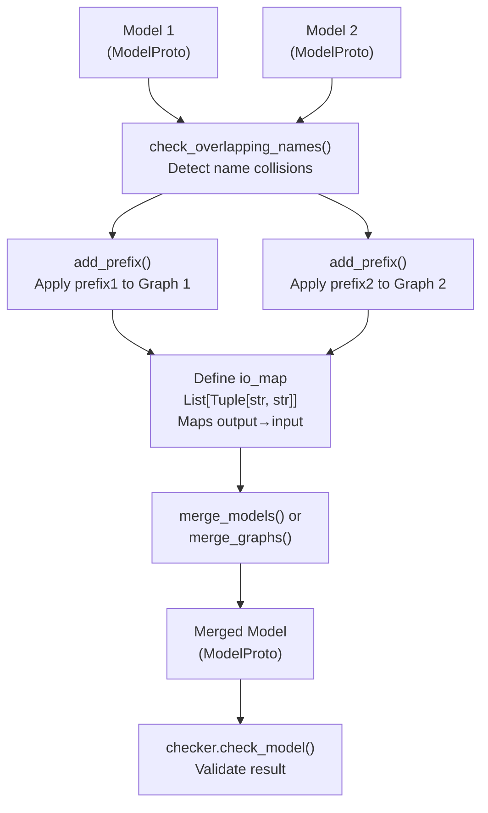
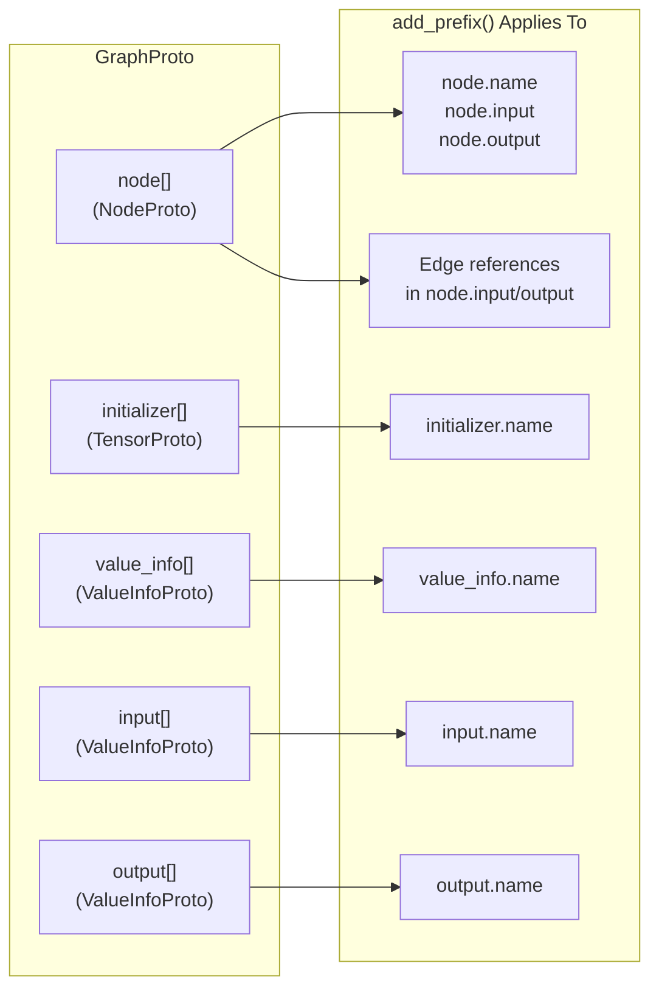
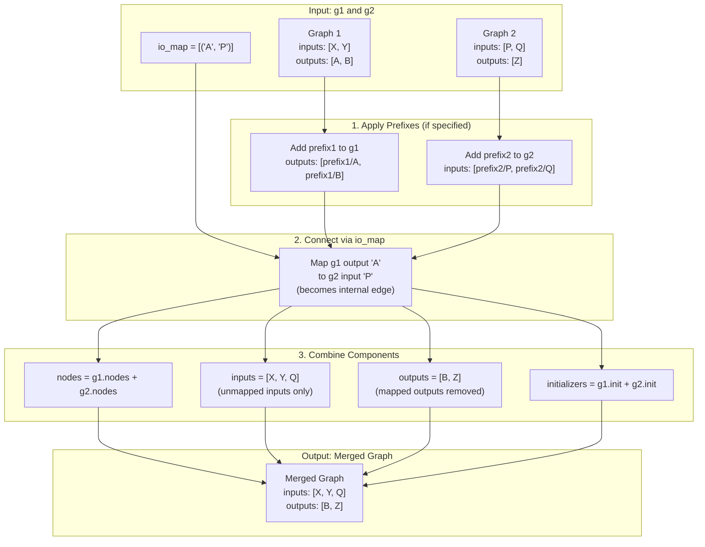
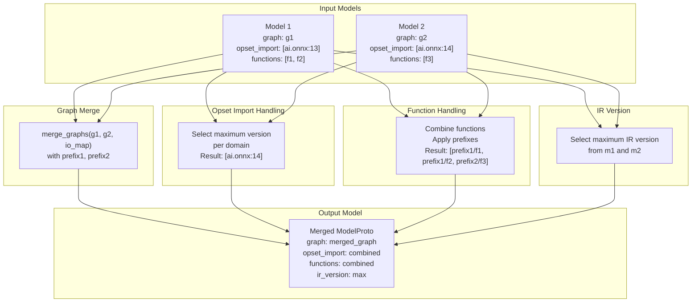

<!-- source: DeepWiki mcp.deepwiki.com · repo onnx/onnx · page 4.7 Graph Composition and Manipulation · fetched 2026-10-21 -->

# Graph Composition and Manipulation

<details>
<summary>Relevant source files</summary>

The following files were used as context for generating this wiki page:

- [VERSION_NUMBER](VERSION_NUMBER)
- [docs/IR.md](docs/IR.md)
- [docs/OnnxReleases.md](docs/OnnxReleases.md)
- [docs/Versioning.md](docs/Versioning.md)
- [onnx/__init__.py](onnx/__init__.py)
- [onnx/checker.py](onnx/checker.py)
- [onnx/common/version.h](onnx/common/version.h)
- [onnx/compose.py](onnx/compose.py)
- [onnx/defs/data_type_utils.cc](onnx/defs/data_type_utils.cc)
- [onnx/defs/data_type_utils.h](onnx/defs/data_type_utils.h)
- [onnx/external_data_helper.py](onnx/external_data_helper.py)
- [onnx/helper.py](onnx/helper.py)
- [onnx/model_container.py](onnx/model_container.py)
- [onnx/numpy_helper.py](onnx/numpy_helper.py)
- [onnx/onnx-ml.proto](onnx/onnx-ml.proto)
- [onnx/onnx-ml.proto3](onnx/onnx-ml.proto3)
- [onnx/onnx.in.proto](onnx/onnx.in.proto)
- [onnx/onnx.proto](onnx/onnx.proto)
- [onnx/onnx.proto3](onnx/onnx.proto3)
- [onnx/onnx_cpp2py_export/checker.pyi](onnx/onnx_cpp2py_export/checker.pyi)
- [onnx/reference/ops/op_range.py](onnx/reference/ops/op_range.py)
- [onnx/serialization.py](onnx/serialization.py)
- [onnx/test/basic_test.py](onnx/test/basic_test.py)
- [onnx/test/checker_test.py](onnx/test/checker_test.py)
- [onnx/test/compose_test.py](onnx/test/compose_test.py)
- [onnx/test/helper_test.py](onnx/test/helper_test.py)
- [onnx/test/numpy_helper_test.py](onnx/test/numpy_helper_test.py)
- [onnx/test/serialization_test.py](onnx/test/serialization_test.py)
- [onnx/test/test_external_data.py](onnx/test/test_external_data.py)

</details>


This page documents the Python API functions in `onnx.compose` for combining and manipulating ONNX graphs and models. These operations enable users to build complex models from simpler components by merging multiple graphs together, extracting portions of graphs, and resolving naming conflicts.

For information about creating individual graphs and models from scratch, see [Helper Functions for Model Creation](#4.1). For loading and saving complete models, see [Loading and Saving Models](#4.6).

## Overview

Graph composition allows you to combine multiple ONNX models or graphs into a single unified model. The primary use cases include:

- **Model chaining**: Connect the output of one model to the input of another
- **Ensemble creation**: Combine multiple models that process the same inputs
- **Subgraph extraction**: Isolate specific portions of a larger graph
- **Name conflict resolution**: Add prefixes to avoid naming collisions when merging

The composition operations work at two levels: the `GraphProto` level and the `ModelProto` level. Graph-level operations manipulate the computational graph directly, while model-level operations also handle metadata, opset imports, and functions.

**Sources:** [onnx/compose.py:1-410]()

## Composition Workflow



**Diagram: High-level workflow for merging two models with name conflict resolution**

**Sources:** [onnx/compose.py:22-410](), [onnx/test/compose_test.py:1-1300]()

## Name Collision Detection

The `check_overlapping_names` function identifies naming conflicts between two graphs before merging. This is critical because ONNX requires all names within a graph to be unique within their respective namespaces.

### Function Signature

```python
def check_overlapping_names(
    g1: GraphProto,
    g2: GraphProto,
    io_map: list[tuple[str, str]] | None = None
) -> list[tuple[str, list[str]]]
```

### Behavior

The function checks for overlapping names across five namespaces:
- **Nodes**: Node names (optional but checked if present)
- **Initializers**: Constant tensor names
- **Inputs**: Graph input names (excluding those remapped via `io_map`)
- **Outputs**: Graph output names (excluding those remapped via `io_map`)
- **Value_infos**: Intermediate value metadata

The `io_map` parameter specifies output-to-input mappings in the format `[(g1_output_name, g2_input_name), ...]`. Names appearing in the `io_map` are excluded from collision checks since they will be connected during merging.

### Return Format

Returns a list of tuples: `[(namespace_name, [conflicting_names]), ...]`. An empty list indicates no conflicts.

**Example:**
```python
overlaps = check_overlapping_names(graph1, graph2)
# Returns: [('nodes', ['conv1', 'relu1']), ('initializers', ['weight'])]
```

**Sources:** [onnx/compose.py:22-76](), [onnx/test/compose_test.py:340-386]()

## Adding Prefixes to Graphs

The `add_prefix` function prepends a string prefix to names within a graph to avoid collisions when merging multiple graphs.

### Function Signature

```python
def add_prefix(
    graph: GraphProto,
    prefix: str = "",
    rename_nodes: bool = True,
    rename_edges: bool = True,
    rename_initializers: bool = True,
    rename_value_infos: bool = True,
    rename_functions: bool = True,
    inplace: bool = False,
) -> GraphProto
```

### Parameters

| Parameter | Type | Default | Description |
|-----------|------|---------|-------------|
| `graph` | `GraphProto` | - | The graph to modify |
| `prefix` | `str` | `""` | Prefix string to prepend |
| `rename_nodes` | `bool` | `True` | Add prefix to node names |
| `rename_edges` | `bool` | `True` | Add prefix to edge names (inputs/outputs) |
| `rename_initializers` | `bool` | `True` | Add prefix to initializer names |
| `rename_value_infos` | `bool` | `True` | Add prefix to value_info names |
| `rename_functions` | `bool` | `True` | Add prefix to function names |
| `inplace` | `bool` | `False` | Modify graph in place or create copy |

### Renaming Scope



**Diagram: Scope of name prefixing within a GraphProto**

### Behavior Details

- **Edge renaming** (`rename_edges=True`): Prefixes all value names appearing in node inputs/outputs, graph inputs/outputs, and initializers. This maintains connectivity.
- **Node renaming** (`rename_nodes=True`): Prefixes the optional `node.name` field.
- **Function renaming** (`rename_functions=True`): Prefixes calls to model-local functions referenced by nodes.
- **In-place modification**: When `inplace=True`, modifies the input graph directly. When `False`, creates and returns a copy.

**Sources:** [onnx/compose.py:78-170](), [onnx/test/compose_test.py:64-150]()

## Merging Graphs

The `merge_graphs` function combines two graphs into a single graph, connecting them via an input-output mapping.

### Function Signature

```python
def merge_graphs(
    g1: GraphProto,
    g2: GraphProto,
    io_map: list[tuple[str, str]],
    inputs: list[ValueInfoProto] | None = None,
    outputs: list[ValueInfoProto] | None = None,
    prefix1: str | None = None,
    prefix2: str | None = None,
    doc_string: str | None = None,
    name: str | None = None,
    producer_name: str | None = None,
    producer_version: str | None = None,
) -> GraphProto
```

### Key Parameters

| Parameter | Type | Description |
|-----------|------|-------------|
| `g1`, `g2` | `GraphProto` | Source graphs to merge |
| `io_map` | `List[Tuple[str, str]]` | Maps g1 outputs to g2 inputs: `[(g1_out, g2_in), ...]` |
| `inputs` | `List[ValueInfoProto]` | Inputs of merged graph (defaults to g1.inputs + unmapped g2.inputs) |
| `outputs` | `List[ValueInfoProto]` | Outputs of merged graph (defaults to g1.outputs + unmapped g2.outputs) |
| `prefix1`, `prefix2` | `str` | Optional prefixes to apply before merging |
| `name` | `str` | Name for the merged graph |

### Merge Process



**Diagram: Step-by-step process of merging two graphs with io_map connection**

### Merge Rules

1. **Node combination**: All nodes from both graphs are included
2. **Initializer combination**: All initializers from both graphs are included (must have unique names)
3. **Input handling**: 
   - Includes all g1 inputs
   - Includes g2 inputs that are NOT mapped via `io_map`
   - Order: g1 inputs, then unmapped g2 inputs
4. **Output handling**:
   - Includes g1 outputs that are NOT mapped via `io_map`
   - Includes all g2 outputs
   - Order: unmapped g1 outputs, then g2 outputs
5. **Value_info**: Combined from both graphs
6. **Sparse_initializers**: Combined from both graphs

**Sources:** [onnx/compose.py:172-306](), [onnx/test/compose_test.py:152-338]()

## Merging Models

The `merge_models` function combines two complete models, handling not just graphs but also metadata, opset imports, and functions.

### Function Signature

```python
def merge_models(
    m1: ModelProto,
    m2: ModelProto,
    io_map: list[tuple[str, str]],
    inputs: list[ValueInfoProto] | None = None,
    outputs: list[ValueInfoProto] | None = None,
    prefix1: str | None = None,
    prefix2: str | None = None,
    doc_string: str | None = None,
    producer_name: str | None = None,
    producer_version: str | None = None,
) -> ModelProto
```

### Model-Level Merge Behavior



**Diagram: Model-level merge operations including metadata, opsets, and functions**

### Opset Import Resolution

When merging models with different opset versions:
- For each domain, the **maximum version** is selected
- Example: `m1` uses `ai.onnx:13`, `m2` uses `ai.onnx:14` → merged model uses `ai.onnx:14`
- This ensures the merged model can execute all operators from both source models

### Function Handling

Model-local functions (stored in `ModelProto.functions`) are combined:
1. Functions from both models are collected
2. If `prefix1` or `prefix2` are provided, function names and references are prefixed
3. All functions are included in the merged model's function list
4. The merged graph can reference functions from either source model

### IR Version Selection

The merged model's `ir_version` is set to `max(m1.ir_version, m2.ir_version)` to ensure compatibility with features used by either model.

**Sources:** [onnx/compose.py:308-410](), [onnx/test/compose_test.py:388-589]()

## Common Usage Patterns

### Pattern 1: Sequential Model Chaining

Connect the output of one model directly to the input of another:

```python
# Model 1: input X → output A
# Model 2: input A → output Z
# Goal: X → A → Z

merged = onnx.compose.merge_models(
    model1, 
    model2,
    io_map=[("A", "A")],  # Connect model1 output A to model2 input A
    prefix1="stage1_",
    prefix2="stage2_"
)
```

Result: Single model with input X and output Z.

### Pattern 2: Parallel Ensemble

Merge models that share inputs but produce different outputs:

```python
# Model 1: input X → output A
# Model 2: input X → output B
# Goal: X → [A, B]

merged = onnx.compose.merge_models(
    model1,
    model2,
    io_map=[("X", "X")],  # Share the input X
    inputs=[model1.graph.input[0]],  # Use single X input
    outputs=model1.graph.output + model2.graph.output  # Both outputs
)
```

Result: Model with one input X and two outputs A and B.

### Pattern 3: Subgraph with Prefix

Add a distinguishing prefix to all names in a graph:

```python
prefixed_graph = onnx.compose.add_prefix(
    original_graph,
    prefix="module_A_",
    rename_nodes=True,
    rename_edges=True,
    inplace=False  # Create a copy
)
```

Result: New graph where all names have the "module_A_" prefix.

### Pattern 4: Name Conflict Detection

Check for conflicts before attempting to merge:

```python
conflicts = onnx.compose.check_overlapping_names(
    graph1,
    graph2,
    io_map=[("output1", "input2")]
)

if conflicts:
    print(f"Conflicts found: {conflicts}")
    # Apply prefixes to resolve conflicts
    graph1 = onnx.compose.add_prefix(graph1, "g1_")
    graph2 = onnx.compose.add_prefix(graph2, "g2_")
```

**Sources:** [onnx/test/compose_test.py:152-589]()

## Integration with Other APIs

### Validation After Merge

Always validate merged models using the checker:

```python
merged_model = onnx.compose.merge_models(m1, m2, io_map)
onnx.checker.check_model(merged_model)
```

**Related:** [Model Validation and Checking](#4.2)

### Shape Inference

Run shape inference on merged models to compute output shapes:

```python
merged_model = onnx.compose.merge_models(m1, m2, io_map)
inferred_model = onnx.shape_inference.infer_shapes(merged_model)
```

**Related:** [Shape Inference API](#4.4)

### Saving Large Merged Models

If the merged model exceeds 2GB, use external data:

```python
onnx.save_model(
    merged_model,
    "merged.onnx",
    save_as_external_data=True,
    all_tensors_to_one_file=True,
    location="merged.data"
)
```

**Related:** [Loading and Saving Models](#4.6)

**Sources:** [onnx/compose.py:1-410](), [onnx/checker.py:1-150](), [onnx/__init__.py:293-343]()

## Implementation Details

### Key Data Structures

The composition functions operate on protobuf message types defined in `onnx.onnx_pb`:

| Proto Type | Description | Fields Used in Composition |
|------------|-------------|---------------------------|
| `ModelProto` | Top-level model container | `graph`, `opset_import`, `functions`, `ir_version` |
| `GraphProto` | Computation graph | `node`, `input`, `output`, `initializer`, `value_info` |
| `NodeProto` | Single operation | `name`, `input`, `output`, `op_type`, `domain` |
| `ValueInfoProto` | Input/output metadata | `name`, `type` |
| `TensorProto` | Constant tensor | `name`, `dims`, `data_type` |
| `FunctionProto` | Model-local function | `name`, `domain`, `node` |

### Name Uniqueness Requirements

ONNX enforces Single Static Assignment (SSA) within each namespace:
- All node output names must be unique within a graph
- All initializer names must be unique within a graph
- Node names (if present) must be unique within a graph
- Function names must be unique within a model

The `add_prefix` function and merge operations preserve these invariants by avoiding name collisions.

### Utility Functions

The compose module uses helper functions from `onnx.helper`:
- `make_model()` - Constructs ModelProto from GraphProto [onnx/helper.py:296-328]()
- `make_graph()` - Constructs GraphProto from components [onnx/helper.py:202-242]()
- `make_opsetid()` - Creates OperatorSetIdProto [onnx/helper.py:245-257]()

**Sources:** [onnx/compose.py:1-410](), [onnx/onnx.proto:213-600](), [onnx/helper.py:1-1200]()

---

