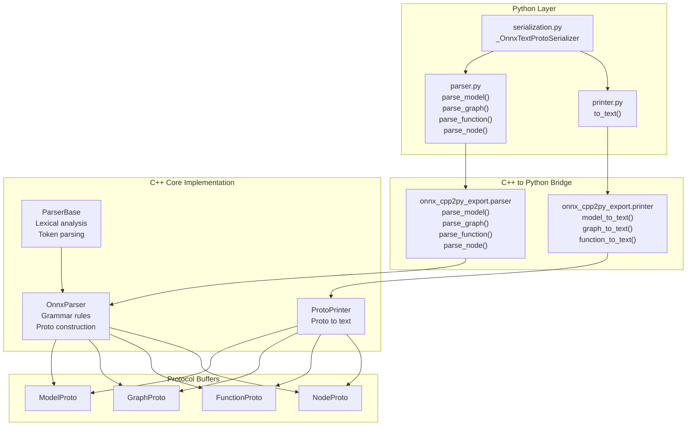
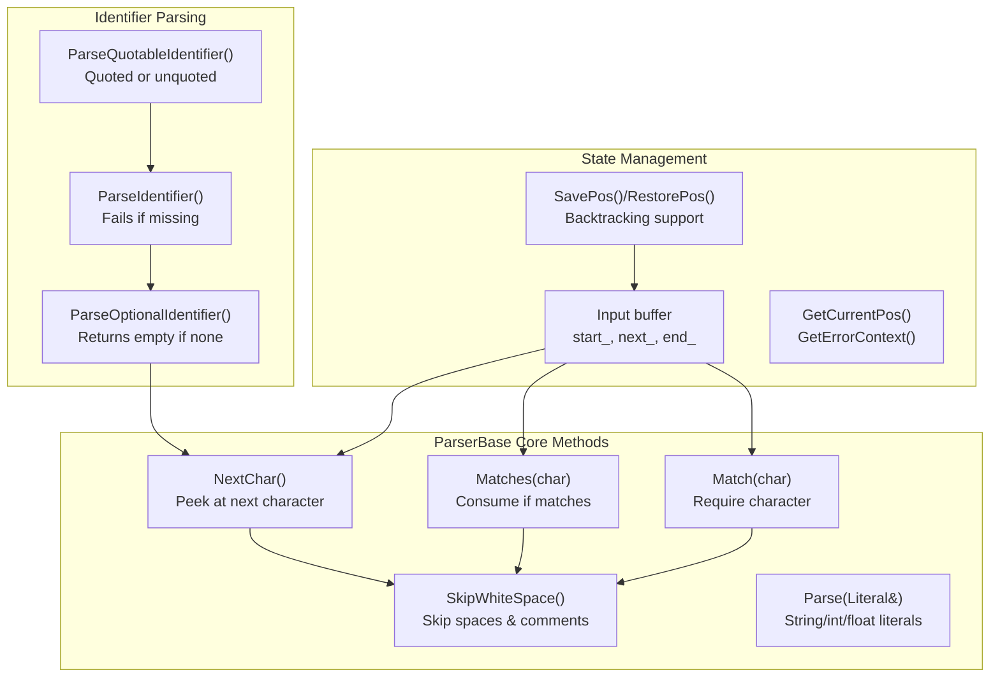
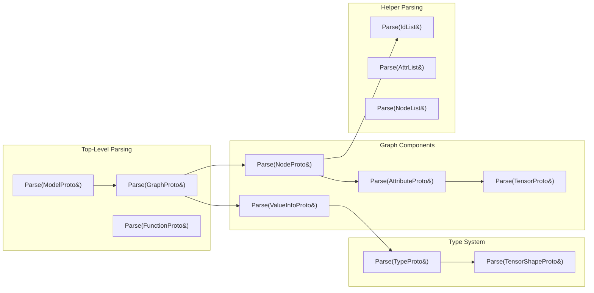
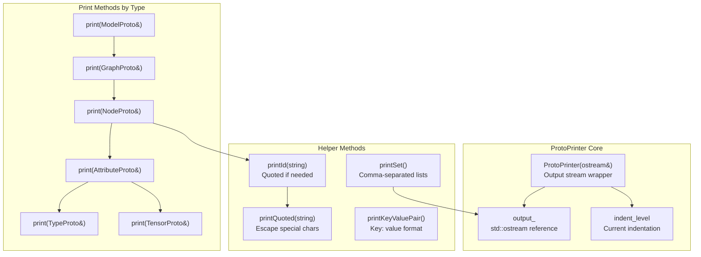
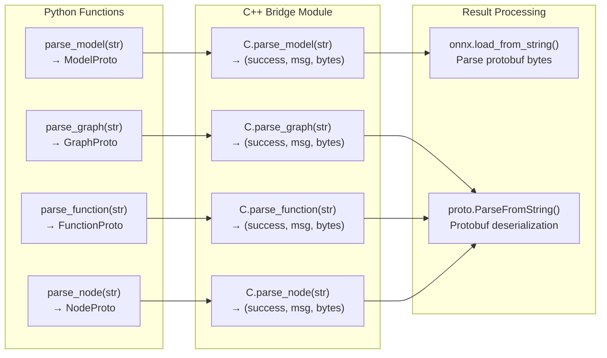
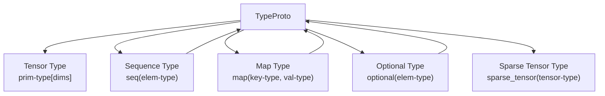
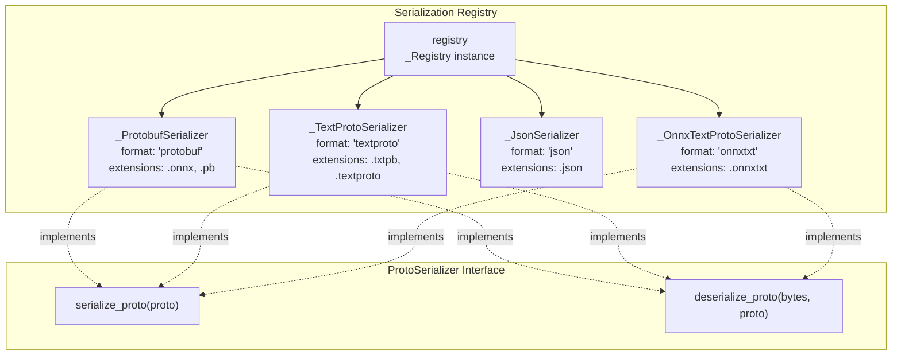

<!-- source: DeepWiki mcp.deepwiki.com · repo onnx/onnx · page 4.8 Textual Syntax Parser and Printer · fetched 2026-10-21 -->

# Textual Syntax Parser and Printer

<details>
<summary>Relevant source files</summary>

The following files were used as context for generating this wiki page:

- [.gitignore](.gitignore)
- [docs/Syntax.md](docs/Syntax.md)
- [onnx/__init__.py](onnx/__init__.py)
- [onnx/checker.py](onnx/checker.py)
- [onnx/compose.py](onnx/compose.py)
- [onnx/defs/parser.cc](onnx/defs/parser.cc)
- [onnx/defs/parser.h](onnx/defs/parser.h)
- [onnx/defs/printer.cc](onnx/defs/printer.cc)
- [onnx/defs/printer.h](onnx/defs/printer.h)
- [onnx/external_data_helper.py](onnx/external_data_helper.py)
- [onnx/model_container.py](onnx/model_container.py)
- [onnx/onnx_cpp2py_export/checker.pyi](onnx/onnx_cpp2py_export/checker.pyi)
- [onnx/onnx_cpp2py_export/parser.pyi](onnx/onnx_cpp2py_export/parser.pyi)
- [onnx/onnx_cpp2py_export/printer.pyi](onnx/onnx_cpp2py_export/printer.pyi)
- [onnx/parser.py](onnx/parser.py)
- [onnx/printer.py](onnx/printer.py)
- [onnx/serialization.py](onnx/serialization.py)
- [onnx/test/basic_test.py](onnx/test/basic_test.py)
- [onnx/test/checker_test.py](onnx/test/checker_test.py)
- [onnx/test/compose_test.py](onnx/test/compose_test.py)
- [onnx/test/cpp/parser_test.cc](onnx/test/cpp/parser_test.cc)
- [onnx/test/parser_test.py](onnx/test/parser_test.py)
- [onnx/test/printer_test.py](onnx/test/printer_test.py)
- [onnx/test/serialization_test.py](onnx/test/serialization_test.py)
- [onnx/test/test_external_data.py](onnx/test/test_external_data.py)

</details>


This document describes the ONNX textual syntax parser and printer system, which provides a human-readable text representation of ONNX models as an alternative to binary protobuf format. The system consists of C++ parsing and printing implementations with Python bindings that enable bidirectional conversion between textual and protobuf representations.

For information about loading and saving models in different formats, see [Loading and Saving Models](#4.6). For information about the protobuf schema definitions, see [Protocol Buffer Schema](#2.1).

---

## Purpose and Use Cases

The textual syntax system serves three primary purposes:

1. **Compact test case representation**: Enable readable test cases in CI for ONNX and dependent projects
2. **Simplified function definitions**: Make ONNX function definitions more maintainable
3. **Human-readable model inspection**: Provide an easily readable format for small models and debugging

The system is **not** designed for efficient serialization of large tensor constants. For large models, use binary protobuf format with external data storage.

Sources: [docs/Syntax.md:9-18](), [onnx/defs/parser.cc:1-7]()

---

## System Architecture Overview



**Architecture: Textual Syntax Parser and Printer System**

The system has three layers:

| Layer | Components | Responsibility |
|-------|-----------|---------------|
| **Python API** | `parser.py`, `printer.py` | Simple wrapper functions for user interface |
| **C++ Bridge** | `onnx_cpp2py_export` module | nanobind bindings exposing C++ functions |
| **C++ Core** | `ParserBase`, `OnnxParser`, `ProtoPrinter` | Actual parsing and printing logic |

Sources: [onnx/parser.py:1-71](), [onnx/printer.py:1-18](), [onnx/defs/parser.h:176-482](), [onnx/defs/printer.h:1-51]()

---

## C++ Parser Implementation

### ParserBase Class

The `ParserBase` class provides foundational parsing utilities for lexical analysis:



**Diagram: ParserBase Class Structure**

Key features:
- **Character-by-character parsing**: Maintains position pointers (`start_`, `next_`, `end_`)
- **Comment handling**: `#` characters start line comments
- **Backtracking**: `SavePos()`/`RestorePos()` support lookahead parsing
- **Error reporting**: `GetCurrentPos()` provides line/column information

Sources: [onnx/defs/parser.h:176-414](), [onnx/defs/parser.cc:24-147]()

### OnnxParser Class

The `OnnxParser` class implements the grammar for ONNX textual syntax:



**Diagram: OnnxParser Parse Methods**

The parser provides specialized methods for each proto type:

| Method | Purpose | Input Example |
|--------|---------|---------------|
| `Parse(ModelProto&)` | Parse complete model | `<ir_version: 8> graph...` |
| `Parse(GraphProto&)` | Parse graph structure | `mygraph (float[N] x) => (float[N] y) {...}` |
| `Parse(NodeProto&)` | Parse single node | `y = Add<alpha=1.0>(x, z)` |
| `Parse(TypeProto&)` | Parse type annotation | `float[N,M]`, `seq(float[])` |
| `Parse(TensorProto&)` | Parse tensor constant | `float[3] {1.0, 2.0, 3.0}` |
| `Parse(AttributeProto&)` | Parse node attribute | `alpha: float = 1.5` |

Sources: [onnx/defs/parser.h:416-482](), [onnx/defs/parser.cc:162-212](), [onnx/defs/parser.cc:239-327]()

### Parsing Algorithm Flow

The parser uses recursive descent with specific patterns:

1. **Token matching**: Use `Matches()` for optional tokens, `Match()` for required tokens
2. **List parsing**: Parse comma-separated elements with `do...while(Matches(','))`
3. **Type disambiguation**: Use `NextIsType()` to differentiate between identifiers and type keywords
4. **Backtracking**: Use `SavePos()`/`RestorePos()` for lookahead

Sources: [onnx/defs/parser.cc:149-201](), [onnx/defs/parser.cc:544-562]()

---

## C++ Printer Implementation

### ProtoPrinter Class

The `ProtoPrinter` class converts protobuf messages back to textual format:



**Diagram: ProtoPrinter Class Structure**

Key printing strategies:

- **Identifier validation**: Use `IsValidIdentifier()` to determine if quoting is needed
- **Escape sequences**: Handle `\"` and `\\` in string literals
- **Indentation**: Track nesting level for readable output
- **Set printing**: Consistent format for lists with `printSet(open, sep, close, collection)`

Sources: [onnx/defs/printer.cc:30-155](), [onnx/defs/printer.cc:16-28]()

### Output Format Examples

The printer generates compact, readable output:

```
// Model with metadata
<
   ir_version: 7,
   opset_import: ["" : 10, "custom" : 1],
   producer_name: "test"
>
agraph (float[N, 128] X, float[128, 10] W) => (float[N, 10] Y)
<
  float[10] bias = {0.1, 0.2, 0.3, ...}
>
{
   T = MatMul(X, W)
   Y = Add(T, bias)
}
```

Sources: [onnx/defs/printer.cc:410-429](), [onnx/defs/printer.cc:464-485]()

### Operator Overloading

The printer provides `operator<<` overloads for convenient output:

```cpp
// Overloaded operators for streaming
std::ostream& operator<<(std::ostream& os, const ModelProto& model);
std::ostream& operator<<(std::ostream& os, const GraphProto& graph);
std::ostream& operator<<(std::ostream& os, const NodeProto& node);
// ... and others
```

This enables direct streaming: `std::cout << model_proto;`

The template function `ProtoToString()` uses these overloads to convert any proto to string:

```cpp
template <typename ProtoType>
std::string ProtoToString(const ProtoType& proto) {
  std::stringstream ss;
  ss << proto;
  return ss.str();
}
```

Sources: [onnx/defs/printer.cc:487-522](), [onnx/defs/printer.h:43-48]()

---

## Python API

### Parser Module

The `onnx.parser` module provides Python functions that wrap C++ implementations:



**Diagram: Python Parser API Flow**

Each Python function follows the same pattern:

1. Call C++ bridge function which returns `(success, message, serialized_proto)`
2. If `success` is True, deserialize the protobuf bytes into a Python proto object
3. If `success` is False, raise `ParseError` with the error message

Example usage:

```python
import onnx

model_text = """
<ir_version: 8, opset_import: ["" : 17]>
mygraph (float[N] x) => (float[N] y) {
    y = Relu(x)
}
"""

model = onnx.parser.parse_model(model_text)
```

Sources: [onnx/parser.py:1-71](), [onnx/onnx_cpp2py_export/parser.pyi:1-28]()

### Printer Module

The `onnx.printer` module provides a single function for converting protos to text:

```python
def to_text(proto: ModelProto | FunctionProto | GraphProto) -> str:
    """Convert an ONNX proto to textual representation."""
    if isinstance(proto, onnx.ModelProto):
        return C.model_to_text(proto.SerializeToString())
    if isinstance(proto, onnx.FunctionProto):
        return C.function_to_text(proto.SerializeToString())
    if isinstance(proto, onnx.GraphProto):
        return C.graph_to_text(proto.SerializeToString())
    raise TypeError("Unsupported argument type.")
```

The function:
1. Checks the proto type
2. Serializes it to protobuf bytes
3. Calls the appropriate C++ bridge function
4. Returns the textual string

Example usage:

```python
import onnx

model = onnx.load('model.onnx')
text = onnx.printer.to_text(model)
print(text)
```

Sources: [onnx/printer.py:1-18](), [onnx/onnx_cpp2py_export/printer.pyi:1-4]()

---

## Textual Syntax Format

### Grammar Overview

The textual syntax follows a BNF-style grammar. Key productions include:

| Construct | Syntax | Example |
|-----------|--------|---------|
| **Model** | `<metadata> graph function*` | See below |
| **Graph** | `name input-list => output-list initializer-list node-list` | `g (float[N] x) => (float[N] y) {...}` |
| **Node** | `output-list = op-type<attrs>(input-list)` | `y = Add<alpha=1>(x, z)` |
| **Type** | `prim-type[dims]` | `float[N, 128]` |
| **Sequence** | `seq(type)` | `seq(float[N])` |
| **Map** | `map(key-type, value-type)` | `map(int32, float[])` |
| **Optional** | `optional(type)` | `optional(float[N])` |

Sources: [docs/Syntax.md:48-97]()

### Type System

The parser supports ONNX's rich type system:



**Diagram: Type System in Textual Syntax**

Primitive types supported: `float`, `int32`, `int64`, `uint8`, `bool`, `double`, `string`, `float16`, `bfloat16`, and sub-byte types like `int4`, `uint4`, `int2`, `uint2`.

Tensor dimensions can be:
- **Numeric**: `float[3, 224, 224]`
- **Symbolic**: `float[N, C, H, W]`
- **Unknown**: `float[?, 128, ?]`
- **Quoted symbols**: `float["M + N", K]` for non-identifier dim_params

Sources: [onnx/defs/parser.h:70-104](), [onnx/defs/parser.cc:240-327]()

### Node Syntax

Nodes can be written with attributes before or after the input list:

```
// Attributes before inputs
y = Add<alpha: float = 1.0>(x, z)

// Attributes after inputs (when no subgraph attributes)
y = Add(x, z) <alpha: float = 1.0>

// Optional node label
[node_name] y = Add(x, z)

// Domain-qualified operator
y = custom_domain.CustomOp(x)

// Overload syntax
y = Add:overload_name(x, z)

// Optional inputs (empty strings)
y = SomeOp(x, "", z)
y = SomeOp(x, , z)  // Alternative syntax
```

Sources: [onnx/defs/parser.cc:739-771](), [onnx/test/cpp/parser_test.cc:229-271]()

### Initializers and External Data

Initializers can be defined inline or reference external data:

```
// Inline data
<float[3] weights = {1.0, 2.0, 3.0}>

// External data
<float[1000, 1000] large_weights = [
  "location": "weights.bin",
  "offset": "0",
  "length": "4000000"
]>
```

Sources: [onnx/defs/parser.cc:444-542](), [onnx/test/cpp/parser_test.cc:132-156]()

### Comments

The parser supports line comments starting with `#`:

```
# This is a comment
agraph (float[N] x) => (float[N] y) {
    # Another comment
    y = Relu(x)  # Inline comment
}
```

Comments are skipped during whitespace handling and do not affect parsing.

Sources: [onnx/defs/parser.h:229-239]()

---

## Integration with Serialization System

### Serialization Format Registry

The textual format integrates with ONNX's serialization registry system, enabling it to be used with `load_model()` and `save_model()`:



**Diagram: Serialization Registry Integration**

The registry maps formats and file extensions to serializer implementations:

| Format | File Extensions | Description |
|--------|----------------|-------------|
| `protobuf` | `.onnx`, `.pb` | Binary protobuf (default) |
| `textproto` | `.txtpb`, `.textproto`, `.prototxt`, `.pbtxt` | Protobuf text format |
| `json` | `.json` | JSON representation |
| `onnxtxt` | Custom | ONNX textual syntax (custom serializer) |

Sources: [onnx/serialization.py:51-92](), [onnx/serialization.py:94-127](), [onnx/serialization.py:129-167]()

### Custom ONNX Text Serializer

A custom serializer can be implemented for the ONNX textual syntax:

```python
class _OnnxTestTextualSerializer(onnx.serialization.ProtoSerializer):
    supported_format = "onnxtext"
    file_extensions = frozenset({".onnxtext"})
    
    def serialize_proto(self, proto) -> bytes:
        text = onnx.printer.to_text(proto)
        return text.encode("utf-8")
    
    def deserialize_proto(self, serialized: bytes, proto):
        text = serialized.decode("utf-8")
        if isinstance(proto, onnx.ModelProto):
            return onnx.parser.parse_model(text)
        if isinstance(proto, onnx.GraphProto):
            return onnx.parser.parse_graph(text)
        # ... handle other proto types
```

Register it:

```python
onnx.serialization.registry.register(_OnnxTestTextualSerializer())
```

Then use it with standard APIs:

```python
# Save as textual format
onnx.save_model(model, "model.onnxtext", format="onnxtext")

# Load from textual format
model = onnx.load_model("model.onnxtext", format="onnxtext")
```

Sources: [onnx/test/serialization_test.py:33-54](), [onnx/test/serialization_test.py:56-87]()

### File Extension Auto-Detection

When no format is explicitly specified, the serialization system auto-detects based on file extension:

```python
# Format inferred from extension
onnx.save_model(model, "model.textproto")  # Uses textproto format
onnx.load_model("model.textproto")  # Automatically uses textproto

# Explicit format overrides extension
onnx.save_model(model, "model.txt", format="textproto")
```

Sources: [onnx/__init__.py:185-201](), [onnx/test/basic_test.py:128-187]()

---

## Usage Examples and Patterns

### Basic Parsing and Printing

Round-trip conversion between text and proto:

```python
import onnx

# Parse text to proto
text = """
<ir_version: 8, opset_import: ["" : 17]>
mygraph (float[N, 128] X, float[128, 10] W) => (float[N, 10] Y) {
    T = MatMul(X, W)
    Y = Relu(T)
}
"""
model = onnx.parser.parse_model(text)

# Print proto back to text
text_output = onnx.printer.to_text(model)

# Round-trip should be equivalent
model2 = onnx.parser.parse_model(text_output)
assert onnx.printer.to_text(model2) == text_output
```

Sources: [onnx/test/printer_test.py:19-36](), [onnx/test/parser_test.py:33-49]()

### Testing with Textual Syntax

The textual syntax is extensively used in tests for its compactness:

```python
import onnx
from onnx import checker

def test_graph_with_textual_syntax():
    model_def = """
    <ir_version: 7, opset_import: ["" : 10]>
    test_graph (float[N] x, float[N] y) => (float[N] z) {
        z = Add(x, y)
    }
    """
    model = onnx.parser.parse_model(model_def)
    checker.check_model(model)
    
    # Assertions on parsed model
    assert len(model.graph.node) == 1
    assert model.graph.node[0].op_type == "Add"
```

Sources: [onnx/test/parser_test.py:14-49](), [onnx/test/cpp/parser_test.cc:40-45]()

### Function Definition

Defining ONNX functions using textual syntax:

```python
function_text = """
<
  domain: "custom_domain",
  opset_import: ["" : 15],
  doc_string: "Custom Selu function"
>
Selu <alpha: float = 1.67, gamma: float = 1.05> (X) => (Y) {
    alpha_const = Constant<value_float: float = @alpha>()
    gamma_const = Constant<value_float: float = @gamma>()
    exp_x = Exp(X)
    # ... more operations
    Y = Where(condition, negative_branch, positive_branch)
}
"""
function = onnx.parser.parse_function(function_text)
```

Sources: [onnx/test/parser_test.py:81-117](), [onnx/test/cpp/parser_test.cc:196-211]()

### Handling Quoted Identifiers

Non-identifier strings require quoting:

```python
# Symbolic dimension with special characters
type_text = 'float["M + N", "K * 2"]'
# This creates a tensor type with dim_params "M + N" and "K * 2"

# Node output names with special characters
graph_text = '''
mygraph (float[N] x) => (float[N] "output/result") {
    "output/result" = Identity(x)
}
'''
```

Sources: [onnx/test/printer_test.py:38-48](), [onnx/test/cpp/parser_test.cc:125-130]()

### External Data References

Parse models with external tensor data:

```python
model_text = """
<ir_version: 8, opset_import: ["" : 17]>
mygraph (float[1000, 1000] x) => (float[1000, 1000] y)
<
  float[1000, 1000] weights = [
    "location": "weights.bin",
    "offset": "0",
    "length": "4000000"
  ]
>
{
    y = MatMul(x, weights)
}
"""
model = onnx.parser.parse_model(model_text)
# The weights tensor has external_data field populated
```

Sources: [onnx/defs/parser.cc:535-541]()

### Error Handling

The parser provides detailed error messages with position information:

```python
try:
    bad_text = "agraph (float[N] x) => (float[N] y) { y = Add[x] }"
    model = onnx.parser.parse_model(bad_text)
except onnx.parser.ParseError as e:
    # Error message includes position information
    print(e)  # "[ParseError at position (line: 1 column: 46)]..."
```

Sources: [onnx/parser.py:10-25](), [onnx/defs/parser.h:220-227]()

---

## Implementation Details

### Macro Definitions

The parser uses preprocessor macros for cleaner error handling:

```cpp
#define PARSE_TOKEN(x) CHECK_PARSER_STATUS(ParserBase::Parse(x))
#define PARSE(...) CHECK_PARSER_STATUS(Parse(__VA_ARGS__))
#define MATCH(...) CHECK_PARSER_STATUS(Match(__VA_ARGS__))

#define CHECK_PARSER_STATUS(status) \
  {                                 \
    auto local_status_ = status;    \
    if (!local_status_.IsOK())      \
      return local_status_;         \
  }
```

These macros:
- Check return status of parsing operations
- Propagate errors up the call stack
- Simplify error handling in recursive descent parser

Sources: [onnx/defs/parser.cc:18-21](), [onnx/defs/parser.h:34-39]()

### String Map Classes

The parser uses template-based string-to-int mappings for type names and keywords:

```cpp
class PrimitiveTypeNameMap : public StringIntMap<PrimitiveTypeNameMap> {
public:
  PrimitiveTypeNameMap() : StringIntMap() {
    map_["float"] = TensorProto_DataType_FLOAT;
    map_["int32"] = TensorProto_DataType_INT32;
    // ... more mappings
  }
  
  static bool IsTypeName(const std::string& dtype) {
    return Lookup(dtype) != 0;
  }
};
```

Similar classes exist for:
- `AttributeTypeNameMap`: Attribute type names
- `KeyWordMap`: Keywords like `ir_version`, `opset_import`, `domain`

Sources: [onnx/defs/parser.h:70-124](), [onnx/defs/parser.h:126-174]()

### Indent Management

The printer tracks indentation for nested structures:

```cpp
class ProtoPrinter {
private:
  int indent_level = 3;  // Initial indent
  
  void indent() {
    indent_level += 3;  // Increase by 3 spaces
  }
  
  void outdent() {
    indent_level -= 3;  // Decrease by 3 spaces
  }
  
  // Use with std::setw for output
  output_ << std::setw(indent_level) << ' ';
};
```

This creates properly indented output for subgraphs and nested attributes.

Sources: [onnx/defs/printer.cc:146-154]()

### Validation Integration

Both parser and printer integrate with ONNX's checker for validation:

```cpp
// In tests
static void CheckModel(const char* code) {
  ModelProto model;
  Parse(model, code);
  checker::check_model(model);  // Validate parsed model
}
```

The round-trip test pattern ensures correctness:

```cpp
template <typename T>
static void Parse(T& parsedData, const char* input) {
  // Parse input
  OnnxParser parser(input);
  auto status = parser.Parse(parsedData);
  EXPECT_TRUE(status.IsOK());
  
  // Convert back to text
  std::string text1 = ProtoToString(parsedData);
  
  // Parse again
  T temp;
  status = OnnxParser::Parse(temp, text1.c_str());
  EXPECT_TRUE(status.IsOK());
  
  // Compare outputs
  std::string text2 = ProtoToString(temp);
  EXPECT_EQ(text1, text2);  // Should be identical
}
```

Sources: [onnx/test/cpp/parser_test.cc:15-32](), [onnx/test/cpp/parser_test.cc:40-45]()

---

## Limitations and Considerations

### Performance

- **Not optimized for large tensors**: Parsing and printing large numeric arrays is slow
- **Intended for small models**: Best for test cases and documentation, not production models
- **Use binary protobuf for large models**: Serialization and deserialization is much faster

### Syntax Stability

- **Experimental feature**: The syntax may change between ONNX versions
- **Not a stable interchange format**: For long-term storage, use binary protobuf
- **Version compatibility**: Older textual models may not parse in newer versions

### Format Coverage

The textual syntax supports most ONNX features but has some limitations:

| Feature | Supported | Notes |
|---------|-----------|-------|
| Basic types | ✓ | All primitive tensor types |
| Sequence types | ✓ | `seq(type)` syntax |
| Map types | ✓ | `map(key, value)` syntax |
| Optional types | ✓ | `optional(type)` syntax |
| Sparse tensors | ✓ | `sparse_tensor(type)` syntax |
| External data | ✓ | String-string list format |
| Sub-byte types | ✓ | `int4`, `uint4`, `int2`, `uint2` |
| Large tensor data | ✗ | Not practical for arrays >1000 elements |
| Quantization parameters | Partial | Through tensor metadata |

Sources: [docs/Syntax.md:9-18](), [onnx/defs/parser.cc:480-531]()

### Security Considerations

When using the textual parser:

- **Input validation**: Parse untrusted input with caution
- **External data paths**: Validate external data locations to prevent path traversal
- **Resource limits**: Large input strings can consume significant memory during parsing
- **Error messages**: May leak information about file system structure

Sources: [onnx/external_data_helper.py:199-237]()

---

