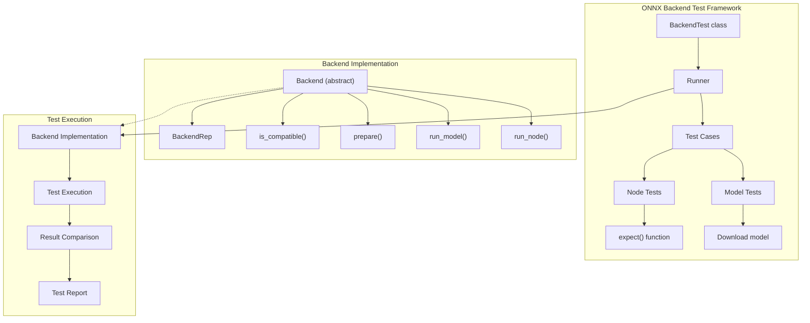
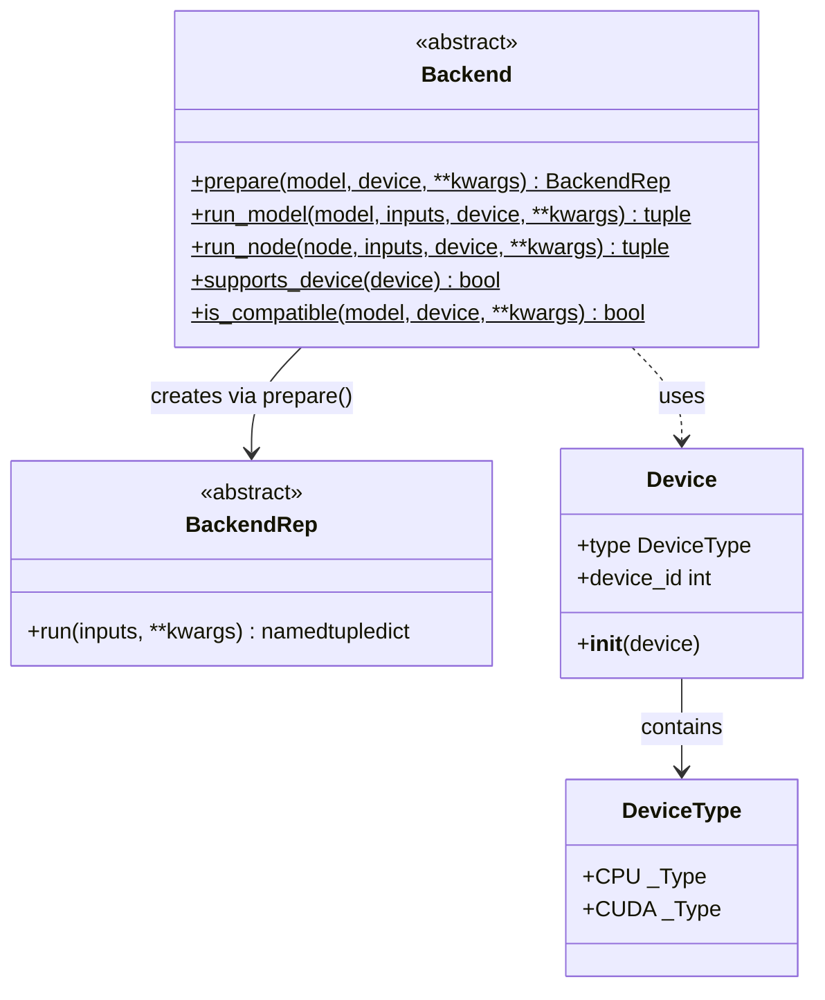
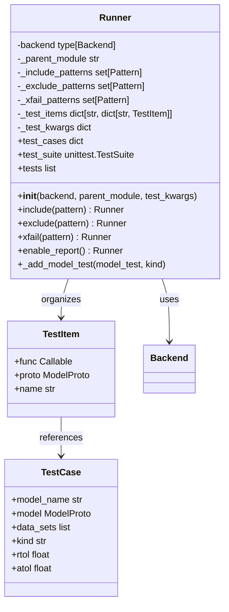
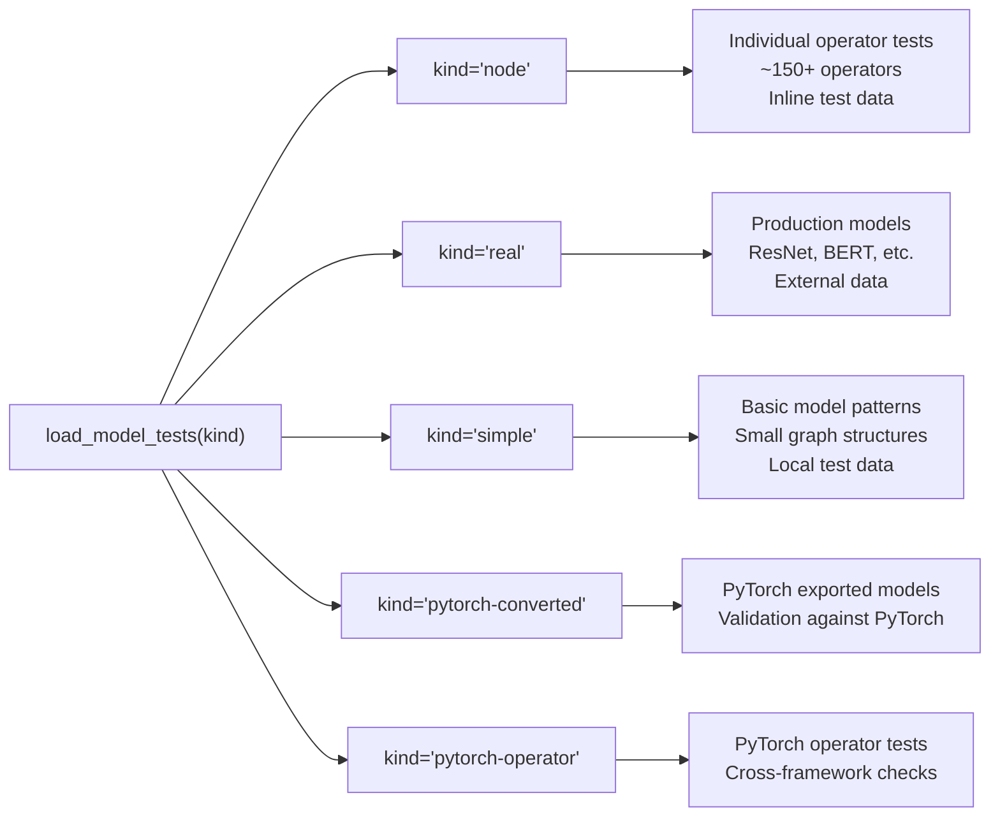
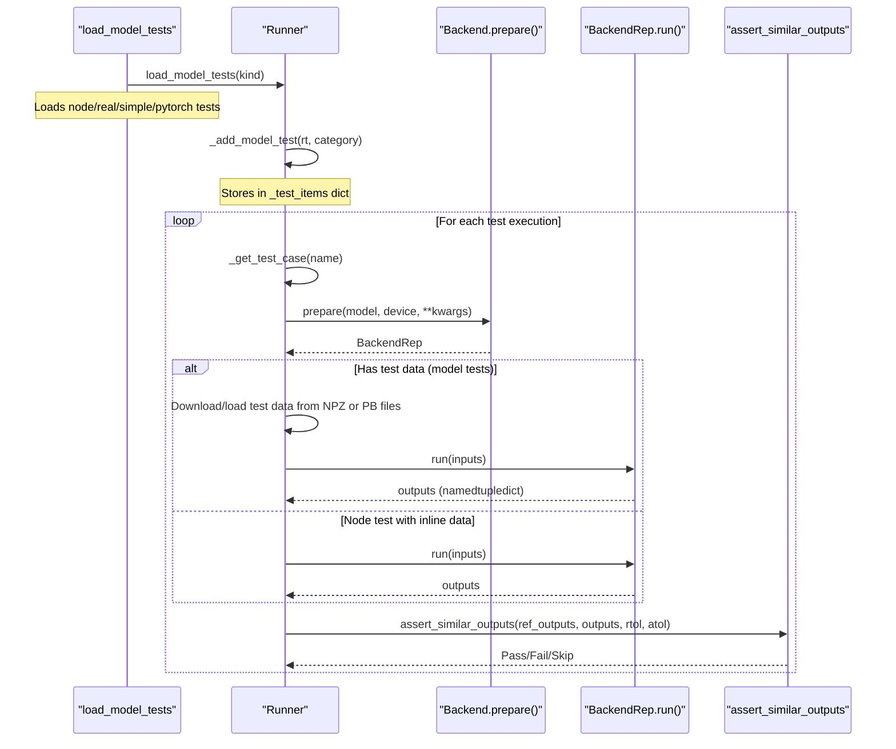
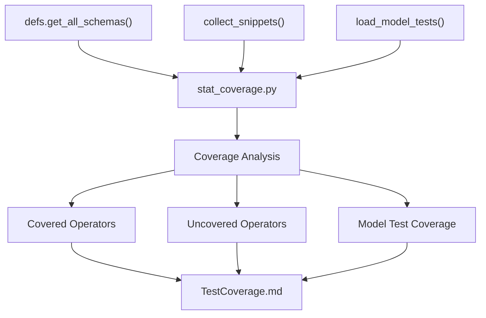
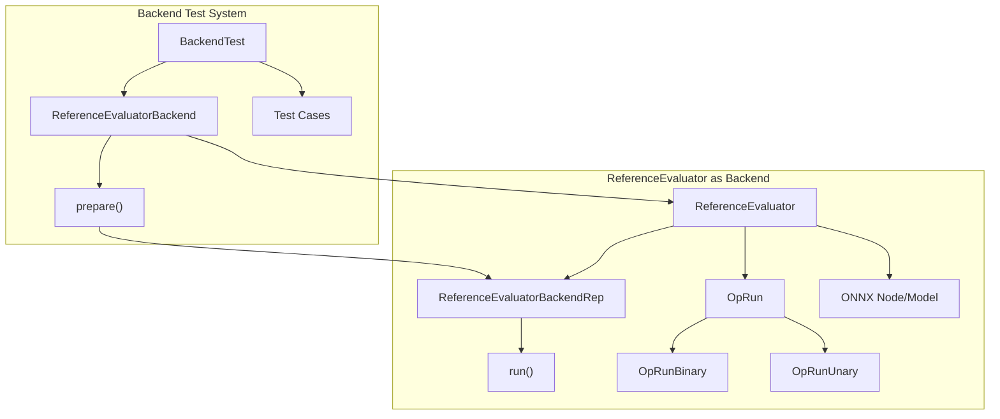
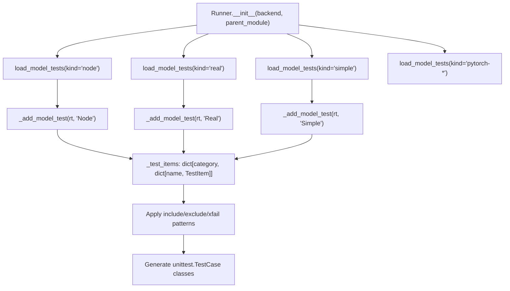
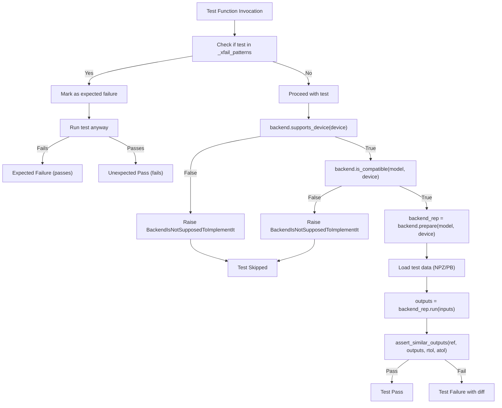

<!-- source: DeepWiki mcp.deepwiki.com · repo onnx/onnx · page 5 Testing ONNX Models and Backends · fetched 2026-10-21 -->

# Testing ONNX Models and Backends

<details>
<summary>Relevant source files</summary>

The following files were used as context for generating this wiki page:

- [docs/Changelog.md](docs/Changelog.md)
- [docs/Operators.md](docs/Operators.md)
- [docs/TestCoverage-ml.md](docs/TestCoverage-ml.md)
- [docs/TestCoverage.md](docs/TestCoverage.md)
- [onnx/backend/base.py](onnx/backend/base.py)
- [onnx/backend/test/case/node/cast.py](onnx/backend/test/case/node/cast.py)
- [onnx/backend/test/case/node/castlike.py](onnx/backend/test/case/node/castlike.py)
- [onnx/backend/test/report/__init__.py](onnx/backend/test/report/__init__.py)
- [onnx/backend/test/report/coverage.py](onnx/backend/test/report/coverage.py)
- [onnx/backend/test/runner/__init__.py](onnx/backend/test/runner/__init__.py)
- [onnx/backend/test/stat_coverage.py](onnx/backend/test/stat_coverage.py)
- [onnx/defs/controlflow/defs.cc](onnx/defs/controlflow/defs.cc)
- [onnx/defs/controlflow/old.cc](onnx/defs/controlflow/old.cc)
- [onnx/defs/math/defs.cc](onnx/defs/math/defs.cc)
- [onnx/defs/math/old.cc](onnx/defs/math/old.cc)
- [onnx/defs/nn/defs.cc](onnx/defs/nn/defs.cc)
- [onnx/defs/nn/old.cc](onnx/defs/nn/old.cc)
- [onnx/defs/operator_sets.h](onnx/defs/operator_sets.h)
- [onnx/defs/reduction/defs.cc](onnx/defs/reduction/defs.cc)
- [onnx/defs/rnn/defs.cc](onnx/defs/rnn/defs.cc)
- [onnx/defs/rnn/old.cc](onnx/defs/rnn/old.cc)
- [onnx/defs/tensor/defs.cc](onnx/defs/tensor/defs.cc)
- [onnx/defs/tensor/old.cc](onnx/defs/tensor/old.cc)
- [onnx/test/shape_inference_test.py](onnx/test/shape_inference_test.py)
- [onnx/test/test_backend_test.py](onnx/test/test_backend_test.py)

</details>


This page describes the testing infrastructure for ONNX models and backend implementations. It explains how to run tests against ONNX backends, how to implement a backend that can run these tests, and how to create new tests for ONNX operators and models.

For details on the reference implementation of ONNX operators, see [Reference Evaluator](#5.3).

## Overview

ONNX provides a comprehensive testing framework to ensure consistency and compatibility across different backend implementations. This framework includes:

1. Node tests for verifying individual operator implementations
2. Model tests for validating end-to-end model execution
3. A backend testing system to verify that implementations correctly follow the ONNX specification



Sources: [onnx/backend/test/runner/__init__.py:60-73](). [onnx/backend/base.py:69-79]().

## Backend Testing Architecture

The ONNX backend testing system centers around the abstract `Backend` class in [onnx/backend/base.py:58-148]() and the `Runner` class in [onnx/backend/test/runner/__init__.py:61-532]() that orchestrates test execution.

### Backend Abstract Class Structure



### Runner and Test Organization



Sources: [onnx/backend/base.py:19-148](), [onnx/backend/test/runner/__init__.py:61-532](), [onnx/backend/test/runner/item.py:1-20]().

## Implementing a Backend

To create an ONNX backend that can be tested with the ONNX test framework, you must implement the `Backend` interface. Here's the minimal requirements:

1. Implement the `prepare()` method, which converts an ONNX model into a form that can be executed.
2. Implement the `BackendRep` class with a `run()` method that executes the prepared model.

### Basic Backend Implementation

The basic structure of a backend implementation includes:

```python
class MyBackendRep(onnx.backend.base.BackendRep):
    def __init__(self, model):
        self.model = model  # Store the prepared model
        
    def run(self, inputs, **kwargs):
        # Execute the model with the given inputs
        # Return a tuple of output values
        return outputs

class MyBackend(onnx.backend.base.Backend):
    @classmethod
    def prepare(cls, model, device='CPU', **kwargs):
        # Convert the ONNX model to your backend's format
        prepared_model = convert_model(model)
        return MyBackendRep(prepared_model)
        
    @classmethod
    def supports_device(cls, device):
        # Report which devices your backend supports
        return device == 'CPU'  # For example
```

For a real example, see the `ReferenceEvaluatorBackend` implementation:

Sources: [onnx/test/test_backend_reference.py:26-90]().

## Running Backend Tests

The `BackendTest` class manages the test cases and handles their execution against a backend implementation:

```python
import onnx.backend.test

# Create a BackendTest instance with your backend
backend_test = onnx.backend.test.BackendTest(MyBackend, __name__)

# You can customize which tests to run
backend_test.include('test_relu')  # Only run tests matching this pattern
backend_test.exclude('test_conv')  # Skip tests matching this pattern

# Update the global namespace with the test cases
globals().update(backend_test.test_cases)
```

Sources: [onnx/test/test_backend_reference.py:93-105](). [onnx/test/test_backend_test.py:115-127]().

## Test Types and Data Management

The ONNX test framework organizes tests into multiple categories, each serving different validation purposes.

### Test Categories



### Node Tests

Node tests are defined using the `expect()` function in [onnx/backend/test/case/node/__init__.py:240-380](). Each test creates a minimal ONNX graph containing a single operator:

```python
def expect(
    node: onnx.NodeProto,
    inputs: Sequence[np.ndarray],
    outputs: Sequence[np.ndarray],
    name: str,
    **kwargs
) -> None:
    # Creates test case files in test_data/node/
    # Saves input_*.pb and output_*.pb files
```

The test data is stored in the `test_data/node/test_<name>/` directory structure with:
- `model.onnx` - The operator wrapped in a minimal graph
- `test_data_set_0/input_*.pb` - Input tensors as protobuf
- `test_data_set_0/output_*.pb` - Expected output tensors

### Model Tests

Model tests validate end-to-end execution. The `load_model_tests()` function in [onnx/backend/test/loader.py:1-250]() discovers tests from:

1. **Local test data** - Stored in `test_data/` directories
2. **Remote models** - Downloaded from URLs (with retry logic in [onnx/backend/test/runner/__init__.py:40-58]())
3. **Generated data** - Created on-the-fly for parameterized tests

Test data formats:
- **NPZ files** - Compressed NumPy arrays (`.npz`)
- **Protobuf files** - Serialized `TensorProto` messages (`.pb`)

Sources: [onnx/backend/test/loader.py:30-250](), [onnx/backend/test/case/node/__init__.py:240-380](), [onnx/backend/test/runner/__init__.py:81-94]().

## Test Case Execution Flow

The test execution flow involves test discovery, data preparation, backend execution, and result validation. The `Runner` class orchestrates this entire process.

### Test Execution Sequence



Sources: [onnx/backend/test/runner/__init__.py:81-94](), [onnx/backend/test/runner/__init__.py:218-280](), [onnx/backend/test/loader.py:1-250]().

## Test Coverage Reporting

ONNX provides comprehensive test coverage tracking through two primary modules: static coverage analysis and dynamic coverage reporting.

### Static Coverage Analysis

The `stat_coverage.py` module analyzes test cases against the operator schema registry to identify gaps:



The generated report shows:
- Node test coverage (e.g., "187/199 operators covered")
- Model test coverage by category
- Detailed test case listings for each operator
- Uncovered operators requiring new tests

### Dynamic Coverage Reporting

The `Coverage` class in [onnx/backend/test/report/coverage.py:20-261]() tracks runtime execution:

```python
class Coverage:
    - _all_schemas: list[OpSchema]
    - _node_test_data: dict[str, NodeCoverage]  # operator -> coverage info
    - _model_test_data: list[ModelCoverage]
    
    + update_node_test(test_name, node)
    + update_model_test(test_name, model_name)
    + report_text() -> str
    + report_xlsx(writer, ort_coverage)
    + report_csv(writer)  # For backend scoreboard
```

The coverage system generates:
1. **Text reports** - Human-readable summaries with tables
2. **CSV files** - Machine-readable data for the [ONNX Backend Scoreboard](https://onnx.ai/backend-scoreboard)
3. **XLSX spreadsheets** - Detailed coverage with attribute and type tracking

Sources: [onnx/backend/test/stat_coverage.py:1-262](), [onnx/backend/test/report/coverage.py:20-261](), [onnx/backend/test/case/__init__.py:1-100]().

## Reference Evaluator as a Backend

The `ReferenceEvaluator` provides a pure Python implementation of ONNX operators and can be used as a backend for testing. This is useful for:

1. Testing the ONNX specification itself
2. Providing a reference implementation to compare with other backends
3. Debugging operator implementations



The `ReferenceEvaluatorBackend` wraps the `ReferenceEvaluator` to provide a backend implementation that can be used with the ONNX test framework.

Sources: [onnx/test/test_backend_reference.py:26-90](). [onnx/reference/reference_evaluator.py:33-201]().

## Creating Custom Tests

You can create custom test cases for operators or models:

### Creating Node Tests

Node tests are created by defining test functions in [onnx/backend/test/case/node/](). Each operator has its own test file (e.g., `cast.py`, `add.py`):

```python
# In onnx/backend/test/case/node/add.py
import numpy as np
import onnx
from onnx.backend.test.case.node import expect

class Add(Base):
    @staticmethod
    def export_add() -> None:
        node = onnx.helper.make_node(
            'Add',
            inputs=['x', 'y'],
            outputs=['sum'],
        )
        
        x = np.random.randn(3, 4, 5).astype(np.float32)
        y = np.random.randn(3, 4, 5).astype(np.float32)
        
        expect(node, inputs=[x, y], outputs=[x + y], name='test_add')
    
    @staticmethod
    def export_add_broadcast() -> None:
        node = onnx.helper.make_node(
            'Add',
            inputs=['x', 'y'],
            outputs=['sum'],
        )
        
        x = np.random.randn(3, 4, 5).astype(np.float32)
        y = np.random.randn(5).astype(np.float32)  # Broadcasting
        
        expect(node, inputs=[x, y], outputs=[x + y], name='test_add_bcast')
```

The `expect()` function in [onnx/backend/test/case/node/__init__.py:240-380]() creates the test artifacts:

1. Wraps the node in a minimal `GraphProto` and `ModelProto`
2. Serializes inputs/outputs to `.pb` files in `test_data/node/test_<name>/`
3. Registers the test for discovery by `load_model_tests()`

Sources: [onnx/backend/test/case/node/__init__.py:240-380](), [onnx/backend/test/case/node/add.py:1-50](), [onnx/backend/test/case/base.py:1-50]().

### Creating Model Tests

For model tests, you typically need to:

1. Create or download an ONNX model
2. Create test data (inputs and expected outputs)
3. Register the model as a test case

## Detailed Test Execution Workflow

The `Runner` class manages the complete test lifecycle from discovery through execution to result validation.

### Test Discovery and Organization



### Test Execution with Error Handling



### Output Comparison Logic

The `assert_similar_outputs` function in [onnx/backend/test/runner/__init__.py:500-532]() performs detailed output validation:

```python
def assert_similar_outputs(
    ref_outputs: Sequence[Any],
    outputs: Sequence[Any],
    rtol: float,
    atol: float
) -> None:
    # Handles multiple output types:
    # - np.ndarray: use np.testing.assert_allclose with rtol/atol
    # - list: recursively compare elements
    # - dict: compare keys and values
    # - SparseTensorProto: compare indices, values, shape
```

Sources: [onnx/backend/test/runner/__init__.py:81-94](), [onnx/backend/test/runner/__init__.py:115-280](), [onnx/backend/test/runner/__init__.py:500-532]().

## Testing Reference Evaluator

The `ReferenceEvaluator` is a pure Python implementation of the ONNX specification. It's used as a reference implementation for operator behaviors and can be used as a backend for testing.

When implementing a new operator or working on operator compatibility, the Reference Evaluator is an essential tool for verifying correctness.

```python
# Example of using ReferenceEvaluator directly
import onnx
import numpy as np
from onnx.reference import ReferenceEvaluator

# Create or load a model
model = onnx.load("model.onnx")

# Create an evaluator
ref = ReferenceEvaluator(model)

# Run the model
inputs = {"X": np.array([1, 2, 3], dtype=np.float32)}
outputs = ref.run(None, inputs)
```

Sources: [onnx/reference/reference_evaluator.py:33-201](). [onnx/test/reference_evaluator_test.py:1-500]().

## Conclusion

The ONNX testing framework provides a comprehensive system for ensuring that backend implementations correctly follow the ONNX specification. By implementing the Backend interface and running the provided tests, you can verify that your backend correctly handles ONNX models and operators.

The framework includes tools for tracking test coverage, creating new tests, and comparing results across different backends. The Reference Evaluator provides a reference implementation that can be used as a baseline for comparison.

---

