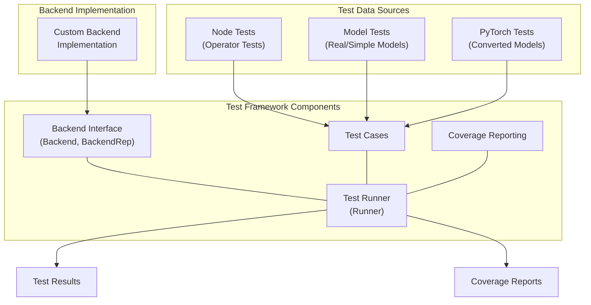
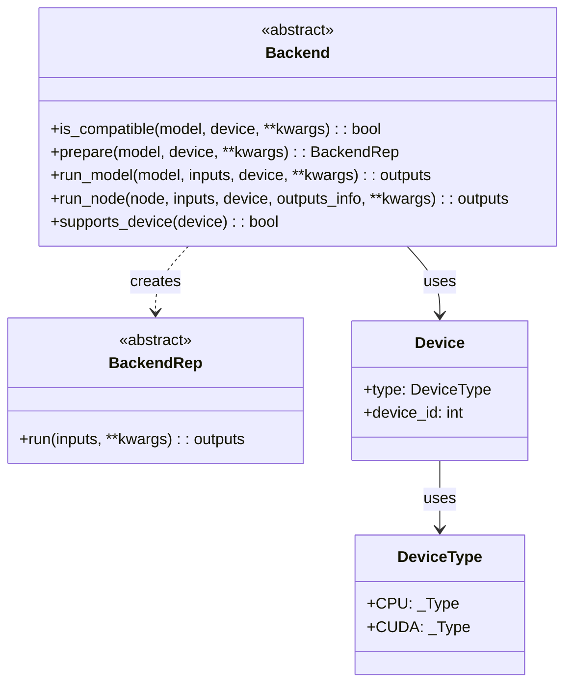
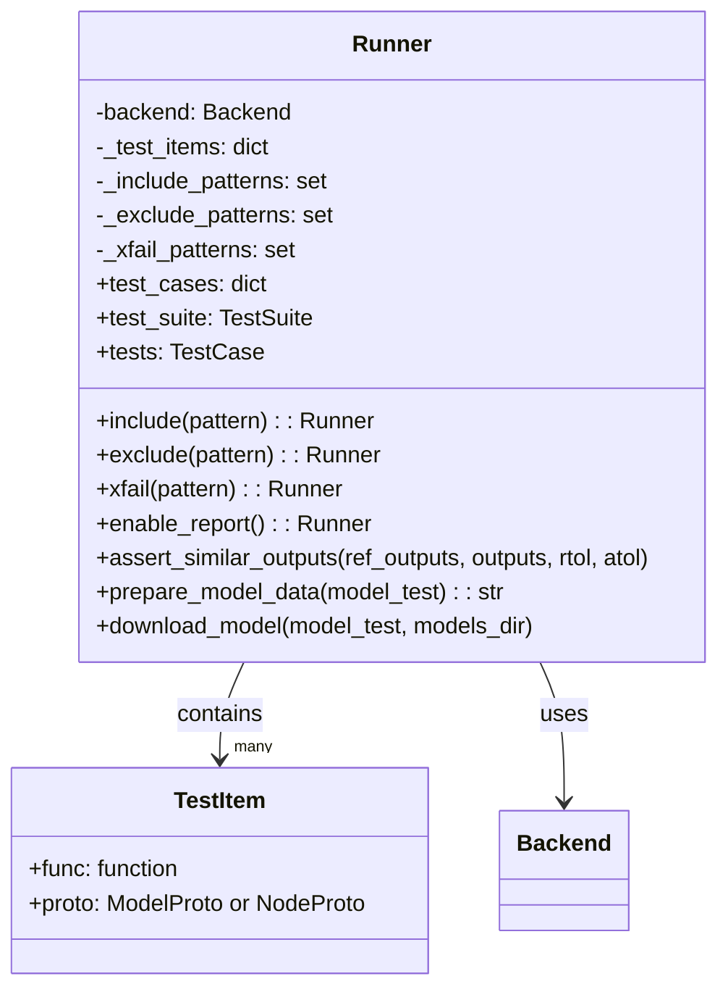
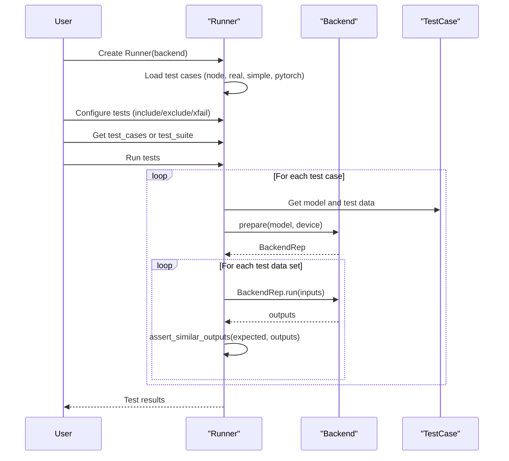
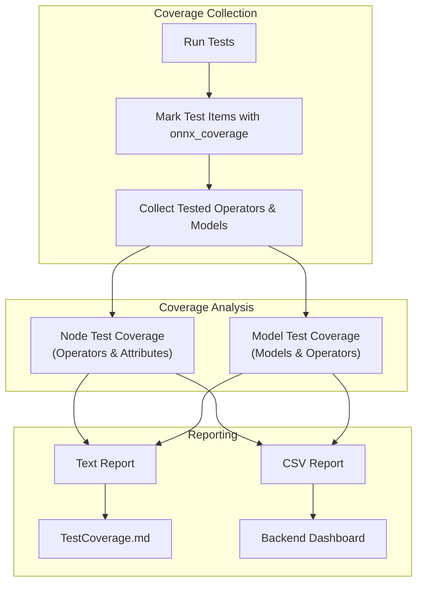
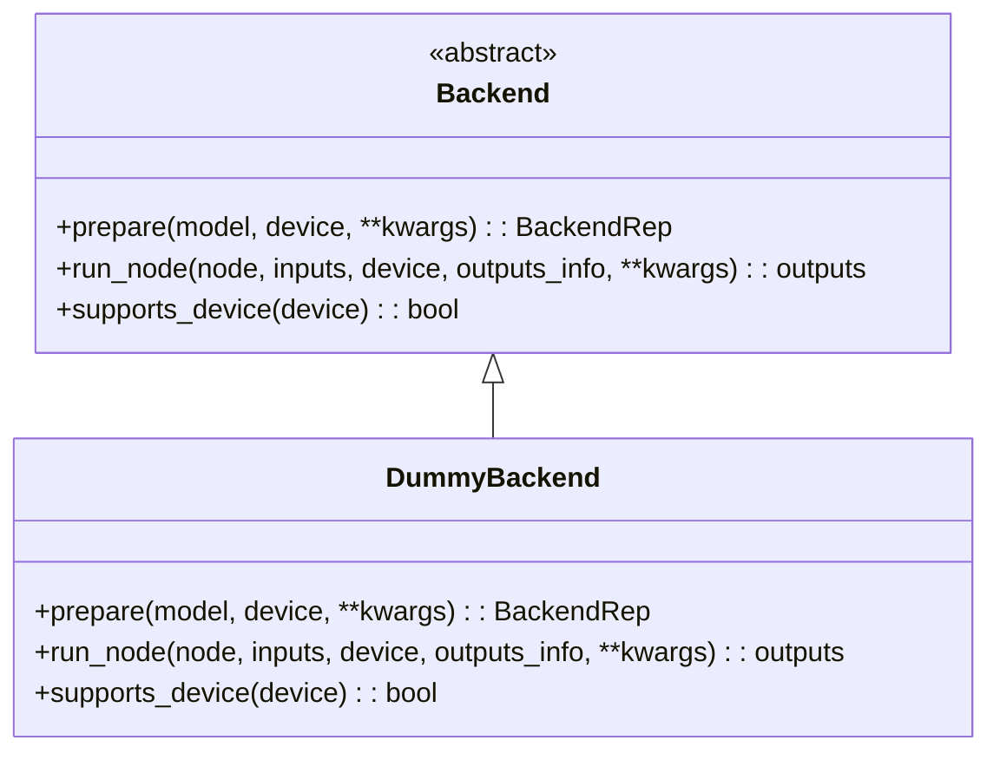

<!-- source: DeepWiki mcp.deepwiki.com · repo onnx/onnx · page 5.1 Backend Test Framework Architecture · fetched 2026-10-21 -->

# Backend Test Framework

<details>
<summary>Relevant source files</summary>

The following files were used as context for generating this wiki page:

- [docs/TestCoverage-ml.md](docs/TestCoverage-ml.md)
- [onnx/backend/base.py](onnx/backend/base.py)
- [onnx/backend/test/report/__init__.py](onnx/backend/test/report/__init__.py)
- [onnx/backend/test/report/coverage.py](onnx/backend/test/report/coverage.py)
- [onnx/backend/test/runner/__init__.py](onnx/backend/test/runner/__init__.py)
- [onnx/backend/test/stat_coverage.py](onnx/backend/test/stat_coverage.py)
- [onnx/test/test_backend_test.py](onnx/test/test_backend_test.py)

</details>


The ONNX Backend Test Framework provides a standardized way to verify compatibility and correctness of ONNX backend implementations. A backend is any system that can execute ONNX models, such as a deep learning framework or inference engine. This framework ensures backends correctly implement ONNX operators and model execution according to the specification.

For information about building your own backend implementation, see [Implementing an ONNX Backend](#6.2).

## Architecture Overview

The Backend Test Framework architecture consists of several key components that work together to validate backend implementations:



Sources: [onnx/backend/test/runner/__init__.py:60-78](), [onnx/backend/base.py:19-148]()

## Backend Interface

The Backend Interface consists of two abstract classes that define the contract for all backend implementations:



The `Backend` class is an abstract base class that defines methods backends must implement:

- `is_compatible`: Checks if a model can be run by this backend
- `prepare`: Prepares a model for execution and returns a `BackendRep` object
- `run_model`: Convenience method to load and run a model in one step
- `run_node`: Executes a single operator node
- `supports_device`: Checks if a device (CPU/CUDA) is supported

The `BackendRep` class represents a prepared model that can be run repeatedly with different inputs.

Sources: [onnx/backend/base.py:19-148]()

## Test Runner

The `Runner` class is the central component of the framework that orchestrates test execution:



The `Runner` provides methods to:

1. Configure test execution through pattern-based inclusion/exclusion
2. Mark tests as expected failures
3. Generate test cases for Python's unittest framework
4. Assert output similarity between backend results and reference data
5. Prepare and download test models

Sources: [onnx/backend/test/runner/__init__.py:60-183]()

## Test Workflow

The general workflow for testing a backend implementation follows this sequence:



During test execution, the framework:

1. Loads the model from a file or test definition
2. Prepares the model using the backend implementation
3. Runs the model with test input data
4. Compares the outputs with expected reference outputs
5. Reports success or failure

Sources: [onnx/backend/test/runner/__init__.py:348-494]()

## Test Case Types

The framework includes several types of test cases:

| Test Type | Description | Source |
|-----------|-------------|--------|
| Node Tests | Test individual ONNX operators | [onnx/backend/test/case/node/__init__.py]() |
| Real Model Tests | Test real-world ONNX models | [onnx/backend/test/runner/__init__.py:86]() |
| Simple Model Tests | Test minimal ONNX models | [onnx/backend/test/runner/__init__.py:89]() |
| PyTorch Converted Tests | Test models converted from PyTorch | [onnx/backend/test/runner/__init__.py:92]() |
| PyTorch Operator Tests | Test PyTorch-specific operators | [onnx/backend/test/runner/__init__.py:95]() |

Sources: [onnx/backend/test/runner/__init__.py:80-94]()

## Test Coverage Reporting

The framework provides comprehensive coverage reporting to track which operators and features are tested:



The coverage system provides:

1. Node test coverage - which operators are tested by individual node tests
2. Model test coverage - which operators are used in model tests
3. Attribute coverage - which attributes of each operator are tested
4. Reports in text and CSV formats for further analysis

Sources: [onnx/backend/test/report/coverage.py:17-262](), [onnx/backend/test/stat_coverage.py:36-296]()

## Example Dummy Backend

The ONNX repository includes a `DummyBackend` implementation that demonstrates how to implement the Backend interface:



The `DummyBackend` doesn't actually execute models but verifies that:
1. Models are valid ONNX graphs (using the checker)
2. Shape inference works correctly
3. Value type information is present and complete

This serves as a template for real backend implementations and demonstrates how the testing framework validates model structure.

Sources: [onnx/test/test_backend_test.py:37-87]()

## Using the Backend Test Framework

To use the Backend Test Framework with your own backend implementation:

1. Create a class that inherits from `Backend` and implements all required methods
2. Create a `BackendRep` class to represent prepared models
3. Create a `Runner` instance with your backend
4. Configure test filtering if needed
5. Run the tests using one of the provided methods

```python
# Example usage
backend_test = onnx.backend.test.BackendTest(MyBackend)

# Optional test filtering
backend_test.include('test_relu')  # Only run ReLU tests
backend_test.exclude('test_lstm')  # Skip LSTM tests
backend_test.xfail('test_conv')    # Mark Conv tests as expected failures

# Run tests through unittest
globals().update(backend_test.test_cases)
unittest.main()
```

Sources: [onnx/test/test_backend_test.py:115-130]()

## Test Utilities and Helpers

The Backend Test Framework provides several utility functions to help with test implementation:

| Utility | Description |
|---------|-------------|
| `assert_similar_outputs` | Compares backend outputs with expected outputs within tolerance |
| `prepare_model_data` | Downloads and prepares model data for testing |
| `download_model` | Downloads model files from URLs |
| `generate_dummy_data` | Generates random input data for testing |
| `retry_execute` | Decorator to retry test execution in case of transient failures |

These utilities simplify test implementation and provide robust handling of common testing scenarios.

Sources: [onnx/backend/test/runner/__init__.py:185-342]()

## Special Test Considerations

The framework includes special handling for:

1. **Device support** - Tests can be run on CPU or CUDA devices
2. **Expected failures** - Tests that are known to fail can be marked as `xfail`
3. **Model compatibility** - Backends can declare incompatibility with specific models
4. **Test data generation** - Test data can be provided or generated for model testing
5. **Error tolerance** - Numeric comparison uses configurable relative and absolute tolerances

Sources: [onnx/backend/test/runner/__init__.py:101-111](), [onnx/backend/test/runner/__init__.py:185-232]()

---

