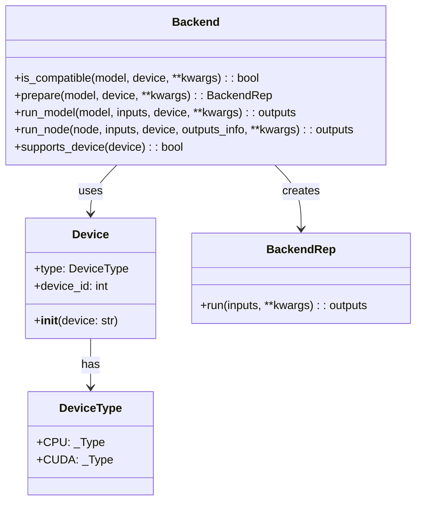
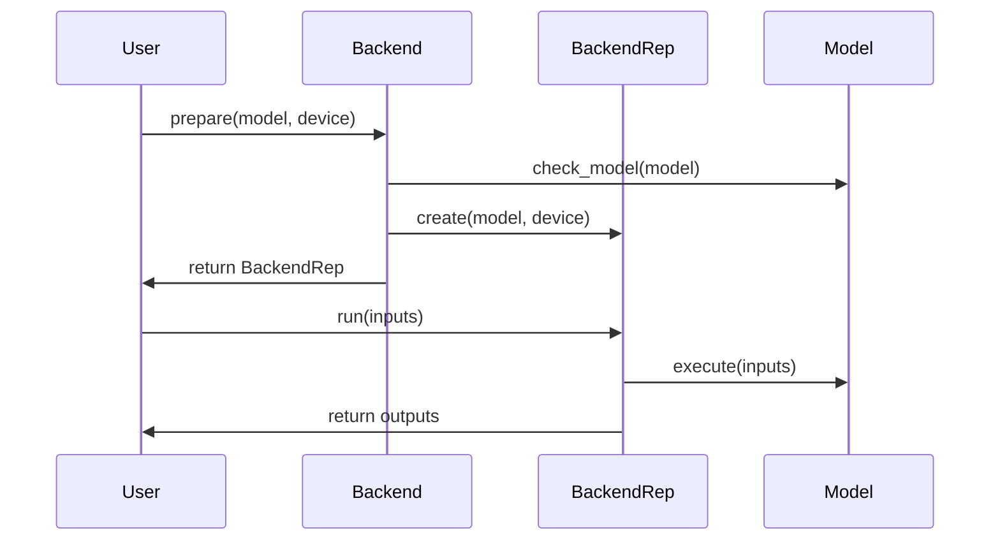
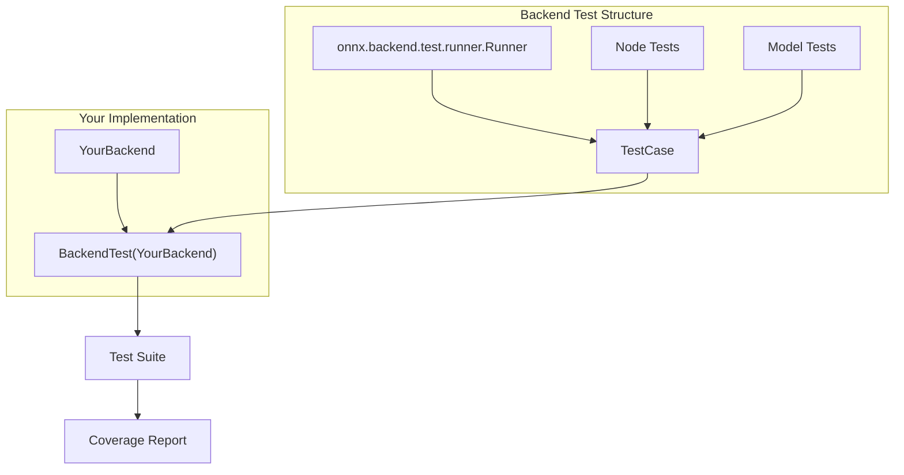
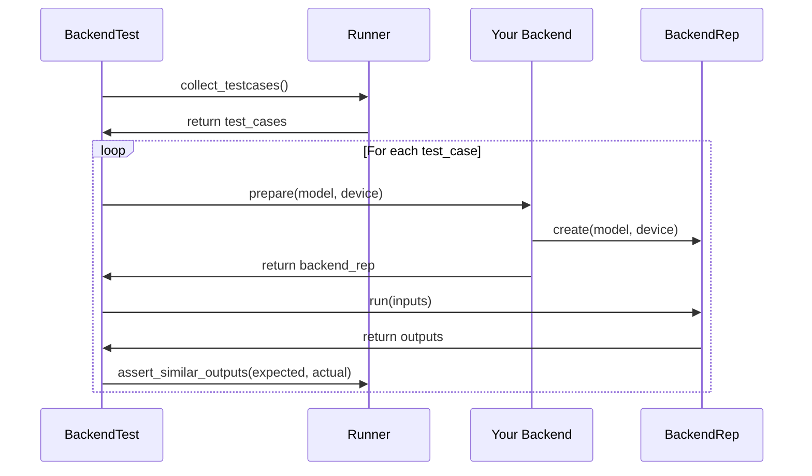

<!-- source: DeepWiki mcp.deepwiki.com · repo onnx/onnx · page 5.2 Implementing an ONNX Backend · fetched 2026-10-21 -->

# Implementing an ONNX Backend

<details>
<summary>Relevant source files</summary>

The following files were used as context for generating this wiki page:

- [docs/TestCoverage-ml.md](docs/TestCoverage-ml.md)
- [onnx/backend/base.py](onnx/backend/base.py)
- [onnx/backend/test/report/__init__.py](onnx/backend/test/report/__init__.py)
- [onnx/backend/test/report/coverage.py](onnx/backend/test/report/coverage.py)
- [onnx/backend/test/runner/__init__.py](onnx/backend/test/runner/__init__.py)
- [onnx/backend/test/stat_coverage.py](onnx/backend/test/stat_coverage.py)
- [onnx/test/test_backend_test.py](onnx/test/test_backend_test.py)

</details>


This document provides a detailed guide on implementing an ONNX backend - a library that can run ONNX models. This typically involves converting ONNX models to your framework's representation and delegating execution to that framework. For information about testing ONNX models and backends, see [Testing ONNX Models and Backends](#6).

## Core Backend Concepts

The ONNX backend interface is defined at [onnx/backend/base.py](/onnx/backend/base.py) and consists of three primary components:



1. **Device**: A lightweight abstraction over hardware (CPU, GPU).
2. **Backend**: The main class that processes an ONNX model and prepares it for execution.
3. **BackendRep**: A handle that the Backend returns after preparing a model for repeated execution.

Sources: [onnx/backend/base.py:19-148]()

### Backend Execution Flow



For one-off execution, users can call `run_model()` or `run_node()`. For repeated execution, `prepare()` creates a `BackendRep` that can be reused with different inputs.

Sources: [onnx/backend/base.py:69-107]()

## Implementation Steps

### 1. Create a Backend Class

Your backend class must inherit from `onnx.backend.base.Backend` and implement these methods:

| Method | Description | Required |
|--------|-------------|----------|
| `prepare(model, device, **kwargs)` | Prepares a model for execution | Yes |
| `run_model(model, inputs, device, **kwargs)` | Runs a model once | Has default implementation |
| `run_node(node, inputs, device, **kwargs)` | Runs a single node | Yes |
| `supports_device(device)` | Checks if a device is supported | Yes |
| `is_compatible(model, device, **kwargs)` | Checks model compatibility | Optional |

Example implementation:

```python
from onnx.backend.base import Backend, BackendRep, Device, DeviceType
import onnx

class MyBackend(Backend):
    @classmethod
    def prepare(cls, model, device='CPU', **kwargs):
        # Check the model
        onnx.checker.check_model(model)
        # Convert the model to your framework's representation
        return MyBackendRep(model, device)
    
    @classmethod
    def run_node(cls, node, inputs, device='CPU', outputs_info=None, **kwargs):
        # Implement computation for a single node
        # This depends on your target framework
        return cls._run_node_impl(node, inputs)
    
    @classmethod
    def supports_device(cls, device):
        # Check if the device is supported
        d = Device(device)
        return d.type == DeviceType.CPU
```

Sources: [onnx/backend/base.py:69-148]()

### 2. Create a BackendRep Class

The `BackendRep` class handles repeated execution of a model:

```python
class MyBackendRep(BackendRep):
    def __init__(self, model, device):
        self.model = model
        self.device = device
        # Convert the ONNX model to your framework's representation
        self.framework_model = self._convert_model(model)
    
    def _convert_model(self, model):
        # Implement conversion from ONNX to your framework
        # This is the core of your backend implementation
        pass
    
    def run(self, inputs, **kwargs):
        # Run the converted model with the given inputs
        # Return outputs in the expected format
        return self._run_model(self.framework_model, inputs)
```

Sources: [onnx/backend/base.py:58-66]()

### 3. Example: Minimal Test Backend

Here's a minimal example based on the ONNX test backend:

```python
class DummyBackend(Backend):
    @classmethod
    def prepare(cls, model, device='CPU', **kwargs):
        onnx.checker.check_model(model)
        
        # Optionally apply shape inference
        model = onnx.shape_inference.infer_shapes(model)
        
        return DummyBackendRep(model)
    
    @classmethod
    def run_node(cls, node, inputs, device='CPU', outputs_info=None, **kwargs):
        # This just checks the node and raises an exception
        # A real implementation would compute the result
        onnx.checker.check_node(node)
        raise BackendIsNotSupposedToImplementIt(
            "This is a dummy backend that doesn't implement operators"
        )
    
    @classmethod
    def supports_device(cls, device):
        d = Device(device)
        return d.type == DeviceType.CPU

class DummyBackendRep(BackendRep):
    def __init__(self, model):
        self.model = model
    
    def run(self, inputs, **kwargs):
        # A real implementation would execute the model
        # and return the outputs
        raise BackendIsNotSupposedToImplementIt(
            "This is a dummy backend that doesn't execute models"
        )
```

Sources: [onnx/test/test_backend_test.py:37-87]()

## Testing Your Backend

### Backend Test System

ONNX provides a comprehensive test suite to verify if your backend correctly implements ONNX operators.



The test suite includes:
- **Node Tests**: Verify individual operators
- **Model Tests**: Verify complete models

Sources: [onnx/backend/test/runner/__init__.py:60-183](), [docs/OnnxBackendTest.md:9-24]()

### Running Backend Tests

To integrate the ONNX Backend Test suite:

```python
from onnx.backend.test.runner import BackendTest

# Create a test suite for your backend
test = BackendTest(MyBackend, __name__)

# You can exclude specific tests if needed
test.exclude('test_pattern')

# You can also include only specific tests
test.include('test_pattern')

# Add the tests to the global namespace
globals().update(test.test_cases)

if __name__ == "__main__":
    import unittest
    unittest.main()
```

Sources: [onnx/test/test_backend_test.py:115-130]()

### Test Execution Flow



Sources: [onnx/backend/test/runner/__init__.py:184-226]()

### Coverage Reports

When running the tests with pytest, you can get a coverage report:

```
---------- onnx coverage: ----------
Operators (passed/loaded/total): 21/21/70
------------------------------------
```

This shows how many operators your backend supports out of all ONNX operators.

Sources: [onnx/backend/test/stat_coverage.py:20-86](), [onnx/backend/test/report/coverage.py:20-261]()

## Advanced Topics

### Handling External Data

Large models might store tensor data in external files:

```python
from onnx.external_data_helper import load_external_data_for_model

# Load a model but skip external data
model = onnx.load("model.onnx", load_external_data=False)

# Then load the external data from a specific directory
load_external_data_for_model(model, "external_data_dir/")
```

Sources: [docs/ExternalData.md:8-28](), [onnx/utils.py:255-314]()

### Testing with Model Hub Models

ONNX provides a Model Hub with pre-trained models for testing:

```python
from onnx import hub

# Download a model by name
model = hub.load("resnet50")

# Test your backend with it
outputs = MyBackend.run_model(model, test_inputs)
```

Sources: [onnx/hub.py:29-293](), [docs/Hub.md:7-238]()

### Extracting Submodels for Testing

To test specific parts of a model:

```python
import onnx.utils

# Extract a submodel with specific inputs/outputs
onnx.utils.extract_model(
    "original_model.onnx", 
    "submodel.onnx", 
    ["input_name"], 
    ["output_name"]
)
```

Sources: [onnx/utils.py:187-252](), [onnx/test/utils_test.py:15-64]()

## Common Implementation Challenges

1. **Operator Compatibility**: Mapping ONNX operators to your framework's operations
2. **Shape Inference**: Ensuring tensor shapes are correctly propagated
3. **Data Type Handling**: Managing differences in data type representations
4. **Performance Optimization**: Efficiently converting and executing models
5. **Test Stability**: Handling numerical precision differences between frameworks

Sources: [docs/ImplementingAnOnnxBackend.md:9-128]()

## Best Practices

1. **Start Small**: Begin by implementing a few key operators and gradually expand coverage
2. **Use Test-Driven Development**: Leverage the ONNX test suite from the beginning
3. **Prioritize Models**: Focus first on operators required by common models
4. **Handle Versioning**: Be mindful of ONNX opset versions
5. **Document Limitations**: Clearly document which operators and features your backend supports

Sources: [onnx/backend/test/runner/__init__.py:60-183](), [docs/ImplementingAnOnnxBackend.md:9-128]()

---

