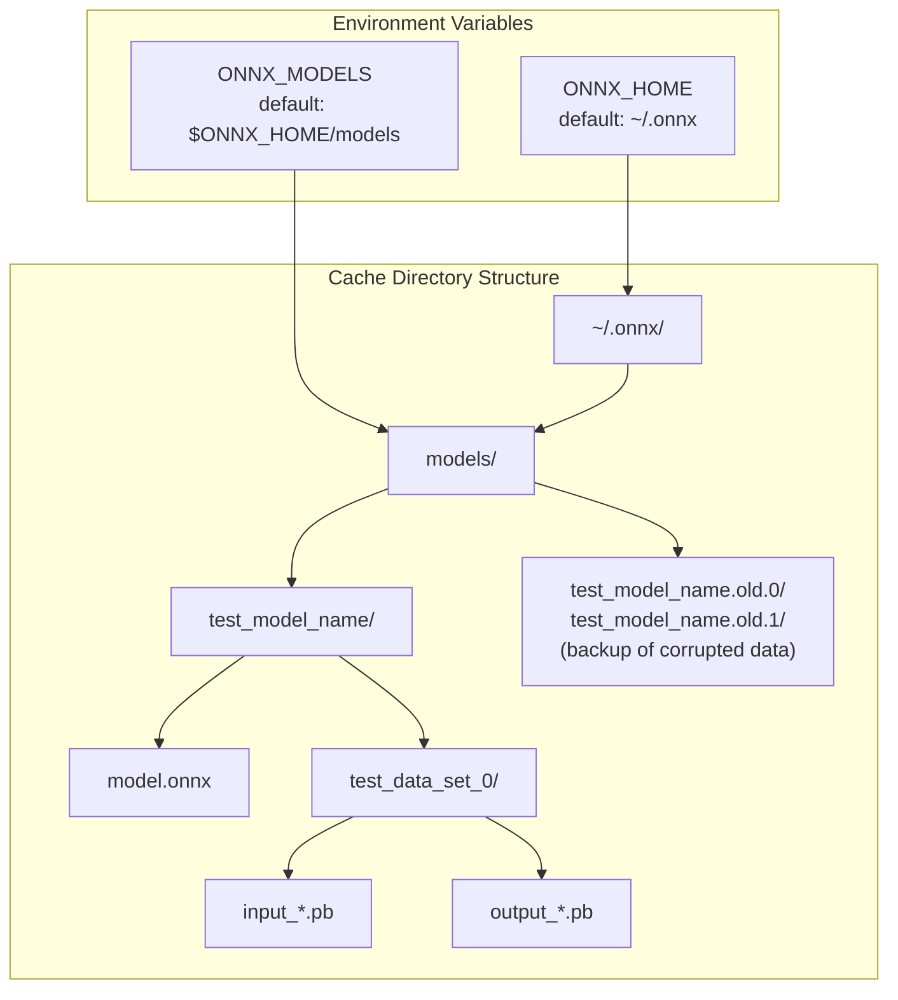
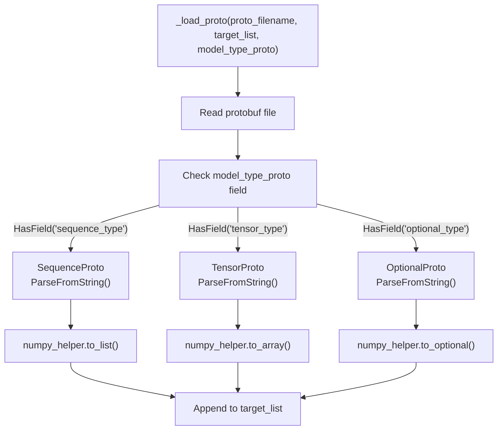
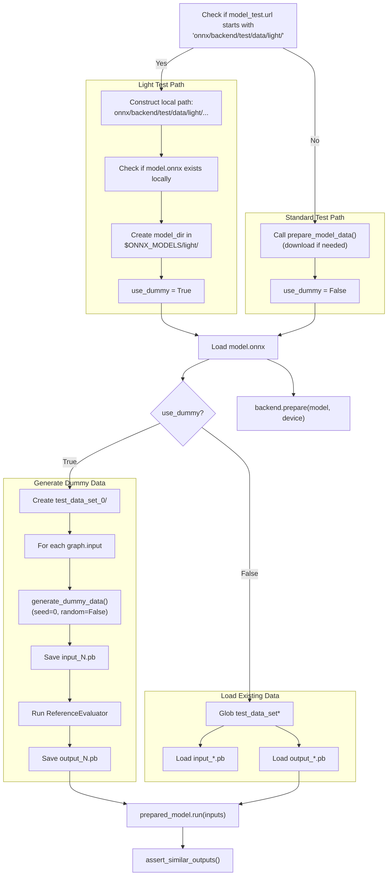
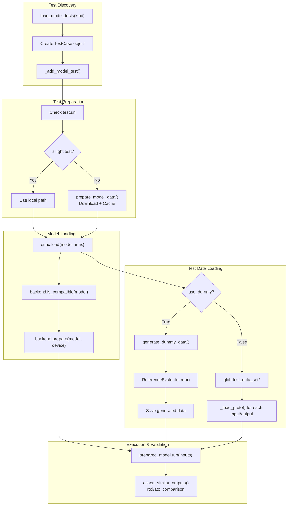

<!-- source: DeepWiki mcp.deepwiki.com · repo onnx/onnx · page 5.3 Test Case Generation and Data Management · fetched 2026-10-21 -->

# Test Case Generation and Data

<details>
<summary>Relevant source files</summary>

The following files were used as context for generating this wiki page:

- [docs/TestCoverage-ml.md](docs/TestCoverage-ml.md)
- [onnx/backend/base.py](onnx/backend/base.py)
- [onnx/backend/test/report/__init__.py](onnx/backend/test/report/__init__.py)
- [onnx/backend/test/report/coverage.py](onnx/backend/test/report/coverage.py)
- [onnx/backend/test/runner/__init__.py](onnx/backend/test/runner/__init__.py)
- [onnx/backend/test/stat_coverage.py](onnx/backend/test/stat_coverage.py)
- [onnx/test/test_backend_test.py](onnx/test/test_backend_test.py)

</details>


## Purpose and Scope

This document describes test case data management in the ONNX backend test framework. It covers how test data is stored, loaded, cached, downloaded, and generated at runtime. The document explains the protobuf-based test data format, the NPZ legacy format, dummy data generation for light tests, and the ONNX_HOME caching mechanism. For information about running these tests against backend implementations, see [Backend Test Framework Architecture](#5.1). For coverage reporting, see [Test Coverage Reporting](#5.4).

The primary data management is handled by the `Runner` class in [onnx/backend/test/runner/__init__.py:61-530]().
</old_str>

<old_str>
## Test Data Download and Caching

The `Runner` class manages test data downloads with automatic caching to avoid repeated network requests.

### ONNX_HOME Directory Structure



Sources: [onnx/backend/test/runner/__init__.py:254-273]()

### Download and Extraction Process

The `Runner.prepare_model_data()` method manages the download process:

| Step | Action | Method |
|------|--------|--------|
| 1. Check cache | Look for `model.onnx` in `$ONNX_MODELS/{model_name}/` | `prepare_model_data()` |
| 2. Move corrupted | If exists but incomplete, move to `.old.N` backup | `prepare_model_data()` [onnx/backend/test/runner/__init__.py:261-269]() |
| 3. Download | Fetch from `model_test.url` with retry logic | `download_model()` [onnx/backend/test/runner/__init__.py:232-252]() |
| 4. Extract | Safely extract archive using `_extract_model_safe()` | `download_model()` [onnx/backend/test/runner/__init__.py:248]() |
| 5. Return path | Return model directory path | `prepare_model_data()` |

### Download with Retry Logic

The `@retry_execute(3)` decorator provides retry logic for network failures:

```python
@retry_execute(3)
def download_model(cls, model_test: TestCase, models_dir: str) -> None:
    # Downloads with 3 retry attempts
    # Waits 5*i seconds between attempts
```

Sources: [onnx/backend/test/runner/__init__.py:40-58, 232-252]()
</old_str>
<new_str>
## Test Data Formats

ONNX backend tests support two data formats: the current protobuf format and a legacy NPZ format.

### Protobuf Format (Current)

The protobuf format stores test data as individual `.pb` files containing serialized Protocol Buffer messages. This is the standard format for ONNX test data.

**File Types:**
- `model.onnx`: ONNX model file (ModelProto)
- `input_N.pb`: Input tensor files (TensorProto, SequenceProto, or OptionalProto)
- `output_N.pb`: Expected output files (TensorProto, SequenceProto, or OptionalProto)

### NPZ Format (Legacy)

The NPZ format stores test data in compressed NumPy array files (`.npz`). This format is deprecated and will be removed in future versions.

**File Structure:**
- `test_data_*.npz`: Compressed archive containing `inputs` and `outputs` arrays

The `Runner._add_model_test()` method handles both formats, processing NPZ files when present and protobuf files otherwise [onnx/backend/test/runner/__init__.py:450-467]().

### Loading Protocol Buffer Test Data

The `Runner._load_proto()` method loads test data from protobuf files and handles multiple data types:



Sources: [onnx/backend/test/runner/__init__.py:504-530]()

The method supports:
- **TensorProto**: Standard tensor data converted to `np.ndarray`
- **SequenceProto**: Sequence data converted to Python lists
- **OptionalProto**: Optional data (may be None)
- **MapProto/SparseTensorProto**: Currently unsupported (logs warning)

## Test Case Definition with `expect()`

Test cases in ONNX are defined programmatically using the `expect()` function. This function creates a `TestCase` object that specifies an ONNX operator or model along with sample inputs and expected outputs.

### The `expect()` Function

The `expect()` function is the primary interface for defining test cases:

```python
def expect(
    node: onnx.NodeProto | onnx.ModelProto | onnx.FunctionProto,
    inputs: Sequence[np.ndarray],
    outputs: Sequence[np.ndarray],
    name: str,
    **kwargs: Any,
) -> None
```

**Parameters:**
- `node`: The ONNX node, model, or function to test
- `inputs`: List of NumPy arrays representing input tensors
- `outputs`: List of NumPy arrays representing expected output tensors
- `name`: Unique test name (e.g., `"test_abs"`, `"test_add_bcast"`)
- `kwargs`: Additional options like `opset_imports` for specific opset versions

The function internally creates a `TestCase` object and adds it to the `_NodeTestCases` list for later processing.

Sources: [onnx/backend/test/case/node/__init__.py:47-111]()

### Example Usage

Here's a typical test case definition from the operator documentation:

```python
node = onnx.helper.make_node(
    "Abs",
    inputs=["x"],
    outputs=["y"],
)
x = np.random.randn(3, 4, 5).astype(np.float32)
y = np.abs(x)

expect(node, inputs=[x], outputs=[y], name="test_abs")
```

This creates a test case that:
1. Defines an `Abs` operator node
2. Generates random input data
3. Computes expected output using NumPy
4. Registers the test with the name `"test_abs"`

Sources: [docs/Operators.md:258-273](), [docs/TestCoverage.md:19-36]()

## Dummy Data Generation for Light Tests

Light tests use local model files without pre-generated test data. The `Runner.generate_dummy_data()` method generates random input data at runtime.

### Dummy Data Generation Method

```python
@staticmethod
def generate_dummy_data(
    x: ValueInfoProto,
    seed: int = 0,
    name: str = "",
    random: bool = False
) -> np.ndarray
```

**Parameters:**
- `x`: Input definition from `ValueInfoProto`
- `seed`: Random seed for reproducibility
- `name`: Model name (for error messages)
- `random`: If True, use random values; if False, use sequential values

**Behavior:**
- Currently supports only float tensors (elem_type == 1)
- Extracts shape from `x.type.tensor_type.shape.dim`
- Uses `dim_value` if available, otherwise defaults to 1
- Generates either random data (`np.random.default_rng(seed).random()`) or sequential data (`np.arange(n).reshape(shape) / n`)

Sources: [onnx/backend/test/runner/__init__.py:316-340]()

### Light Test Execution Flow



Sources: [onnx/backend/test/runner/__init__.py:346-492]()

### Why Dummy Data Generation?

Light tests include large models (e.g., `test_bvlc_alexnet`) where storing pre-computed test data would be impractical. The dummy data approach:
- Reduces repository size
- Uses `ReferenceEvaluator` to compute expected outputs at runtime
- Generates deterministic inputs for reproducible testing
- Avoids slow pre-computation of large model outputs

Sources: [onnx/backend/test/runner/__init__.py:396-402]()

## Test Data Directory Structure

Test data is organized in a hierarchical directory structure by test category.

### Directory Organization

```
onnx/backend/test/data/
├── node/                          # Node operator tests
│   ├── test_abs/
│   │   ├── model.onnx
│   │   └── test_data_set_0/
│   │       ├── input_0.pb
│   │       └── output_0.pb
│   ├── test_add/
│   │   ├── model.onnx
│   │   └── test_data_set_0/
│   │       ├── input_0.pb
│   │       ├── input_1.pb
│   │       └── output_0.pb
│   └── ...
├── light/                         # Light tests (local models)
│   ├── test_bvlc_alexnet/
│   │   └── model.onnx            # No pre-generated test data
│   └── ...
├── real/                          # Real-world models
│   └── ...                        # Downloaded from remote URLs
├── simple/                        # Simple end-to-end models
│   └── ...
├── pytorch-converted/             # PyTorch exported models
│   └── ...
└── pytorch-operator/              # PyTorch operator tests
    └── ...
```

Each test category is loaded separately using `load_model_tests(kind)`:

```python
for rt in load_model_tests(kind="node"):
    self._add_model_test(rt, "Node")

for rt in load_model_tests(kind="real"):
    self._add_model_test(rt, "Real")

for rt in load_model_tests(kind="simple"):
    self._add_model_test(rt, "Simple")

for ct in load_model_tests(kind="pytorch-converted"):
    self._add_model_test(ct, "PyTorchConverted")

for ot in load_model_tests(kind="pytorch-operator"):
    self._add_model_test(ot, "PyTorchOperator")
```

Sources: [onnx/backend/test/runner/__init__.py:81-94]()

### Test Data Set Structure

Each test directory may contain multiple test data sets for the same model:

```
test_model_name/
├── model.onnx
├── test_data_set_0/
│   ├── input_0.pb
│   ├── input_1.pb
│   ├── output_0.pb
│   └── output_1.pb
├── test_data_set_1/              # Optional: additional test sets
│   ├── input_0.pb
│   ├── input_1.pb
│   ├── output_0.pb
│   └── output_1.pb
└── ...
```

The `Runner._add_model_test()` method iterates through all `test_data_set*` directories using `glob.glob()` [onnx/backend/test/runner/__init__.py:469-491]().

Sources: [onnx/backend/test/runner/__init__.py:341-503]()

## Test Execution Data Flow

The complete test execution involves loading models, preparing test data, running the backend, and comparing outputs.

### Test Execution Pipeline



Sources: [onnx/backend/test/runner/__init__.py:341-492]()

### Output Comparison Logic

The `Runner.assert_similar_outputs()` method compares backend outputs against reference outputs:

**Comparison Strategy:**
- Uses `np.testing.assert_allclose()` with configurable `rtol` (relative tolerance) and `atol` (absolute tolerance)
- Recursively handles nested sequences (lists/tuples)
- Validates shape matches before value comparison
- Special handling for string tensors (object dtype) - exact match required
- Reports detailed error messages including test name

**Default Tolerances:**
- Most tests use model-specific `rtol` and `atol` from `TestCase`
- Can be overridden via `test_kwargs` parameter

Sources: [onnx/backend/test/runner/__init__.py:186-231]()

## Test Case Categories

The ONNX backend test suite includes several categories with different data management strategies.

### Test Category Characteristics

| Category | Directory | Data Source | Caching | Dummy Data | Description |
|----------|-----------|-------------|---------|------------|-------------|
| **Node Tests** | `data/node/` | Pre-generated | No | No | Individual operator tests with pre-computed inputs/outputs |
| **Light Tests** | `data/light/` | Local files | Yes | Yes | Large models with runtime-generated test data |
| **Real Tests** | `data/real/` | Remote URLs | Yes | No | Real-world pre-trained models downloaded on demand |
| **Simple Tests** | `data/simple/` | Pre-generated | No | No | Simple end-to-end model tests |
| **PyTorch Converted** | `data/pytorch-converted/` | Remote URLs | Yes | No | Models exported from PyTorch framework |
| **PyTorch Operator** | `data/pytorch-operator/` | Remote URLs | Yes | No | PyTorch-specific operator tests |

### Light Tests vs. Downloaded Tests

**Light Tests:**
- Model files stored locally in repository
- URL starts with `"onnx/backend/test/data/light/"`
- Test data generated at runtime using `generate_dummy_data()` and `ReferenceEvaluator`
- Avoids storing large pre-computed tensor files in version control
- Cached in `$ONNX_MODELS/light/`

**Downloaded Tests:**
- Model files downloaded from remote URLs
- Cached in `$ONNX_MODELS/` to avoid repeated downloads
- Test data pre-computed and included in downloaded archive
- Uses `retry_execute(3)` decorator for network resilience

Sources: [onnx/backend/test/runner/__init__.py:81-94, 346-380]()

## Tensor Conversion and Storage

NumPy arrays are converted to ONNX Protocol Buffer format for storage and transmission.

### NumPy to Protobuf Conversion

The `numpy_helper` module provides bidirectional conversion:

```python
# Converting NumPy array to TensorProto
tensor_proto = onnx.numpy_helper.from_array(numpy_array, name="input_0")

# Converting TensorProto back to NumPy array
numpy_array = onnx.numpy_helper.to_array(tensor_proto)

# Converting lists to SequenceProto
sequence_proto = onnx.numpy_helper.from_list(python_list)
python_list = onnx.numpy_helper.to_list(sequence_proto)

# Converting optional values to OptionalProto
optional_proto = onnx.numpy_helper.from_optional(value)
value = onnx.numpy_helper.to_optional(optional_proto)
```

The `_load_proto()` method uses these conversions when loading test data [onnx/backend/test/runner/__init__.py:504-530]().

### Protobuf Message Types

**TensorProto Fields:**
- `dims`: Shape dimensions (list of integers)
- `data_type`: Element type (enum value)
- `raw_data` or typed fields: Actual tensor data
- `name`: Tensor identifier

**SequenceProto:**
- Used for sequence types (lists of tensors)
- Converted via `numpy_helper.to_list()`

**OptionalProto:**
- Used for optional types (may contain None)
- Converted via `numpy_helper.to_optional()`

### Saving Test Data

When generating dummy data, arrays are converted and saved:

```python
# From _add_model_test() for light tests
value = self.generate_dummy_data(x, seed=0, name=model_test.model_name, random=False)
with open(name, "wb") as f:
    f.write(onnx.numpy_helper.from_array(value).SerializeToString())
```

Sources: [onnx/backend/test/runner/__init__.py:420-426, 504-530]()

## Backend Compatibility and ONNX_ML Support

The test framework includes checks for backend compatibility and ONNX-ML operator support.

### ONNX-ML Test Filtering

Tests involving `ai.onnx.ml` domain operators are automatically skipped when ONNX is built without ML support:

```python
if not ONNX_ML and "ai_onnx_ml" in model_dir:
    return  # Skip ML tests when ONNX_ML=0
```

The `ONNX_ML` constant is imported from the main `onnx` module and reflects the build configuration [onnx/backend/test/runner/__init__.py:381-382]().

### Backend Compatibility Checks

Backends can implement `is_compatible()` to indicate which models they support:

```python
if (
    hasattr(self.backend, "is_compatible")
    and callable(self.backend.is_compatible)
    and not self.backend.is_compatible(model)
):
    raise unittest.SkipTest("Not compatible with backend")
```

This allows backends to gracefully skip tests for unsupported features (e.g., specific operators, opset versions, or model structures) [onnx/backend/test/runner/__init__.py:386-391]().

Sources: [onnx/backend/test/runner/__init__.py:381-391](), [onnx/backend/base.py:80-88]()

## Environment Configuration

Test data management behavior can be configured via environment variables.

### Environment Variables

| Variable | Default | Purpose |
|----------|---------|---------|
| `ONNX_HOME` | `~/.onnx` | Root directory for ONNX cache data |
| `ONNX_MODELS` | `$ONNX_HOME/models` | Directory for cached model files |

### Usage Example

```bash
# Use custom cache directory
export ONNX_HOME=/tmp/onnx_cache
export ONNX_MODELS=/data/onnx_models

# Run backend tests
pytest onnx/backend/test/
```

The `prepare_model_data()` method reads these variables to determine cache locations [onnx/backend/test/runner/__init__.py:254-259]().

Sources: [onnx/backend/test/runner/__init__.py:254-273]()

## Test Naming Conventions

Test names follow specific conventions for consistency:

| Pattern | Example | Purpose |
|---------|---------|---------|
| `test_{op}` | `test_abs` | Basic operator test |
| `test_{op}_{variant}` | `test_add_bcast` | Variant with specific behavior |
| `test_{op}_{dtype}` | `test_add_int8` | Type-specific test |
| `test_{op}_{feature}` | `test_transpose_preexisting` | Feature-specific test |
| `test_{op}_example` | `test_acos_example` | Documentation example |

Test names must:
- Be unique across the test suite
- Use lowercase with underscores
- Start with `"test_"`
- Be valid Python identifiers

Sources: [docs/TestCoverage.md:1-1000](), [onnx/backend/test/case/node/__init__.py:47-111]()

## Summary

The ONNX test case generation system provides:

1. **`expect()` Function**: Simple API for defining test cases with nodes, inputs, and outputs
2. **Protobuf Serialization**: Test data stored as `.onnx` and `.pb` files for portability
3. **`generate-data` Command**: Automated conversion from in-memory test cases to disk files
4. **Structured Organization**: Clear directory hierarchy for different test categories
5. **Multiple Test Types**: Support for node tests, real models, and converted models

This system enables comprehensive operator testing while maintaining version control over test data and making it easy for backend implementations to validate their ONNX compliance.

Sources: [onnx/backend/test/case/node/__init__.py:1-200](), [onnx/backend/test/cmd_tools.py:1-150](), [onnx/backend/test/runner/__init__.py:1-150]()

---

