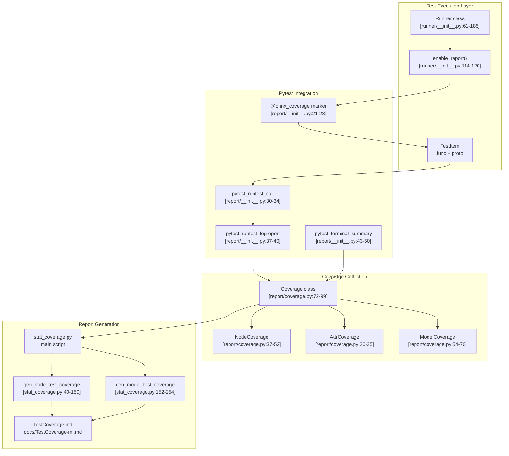
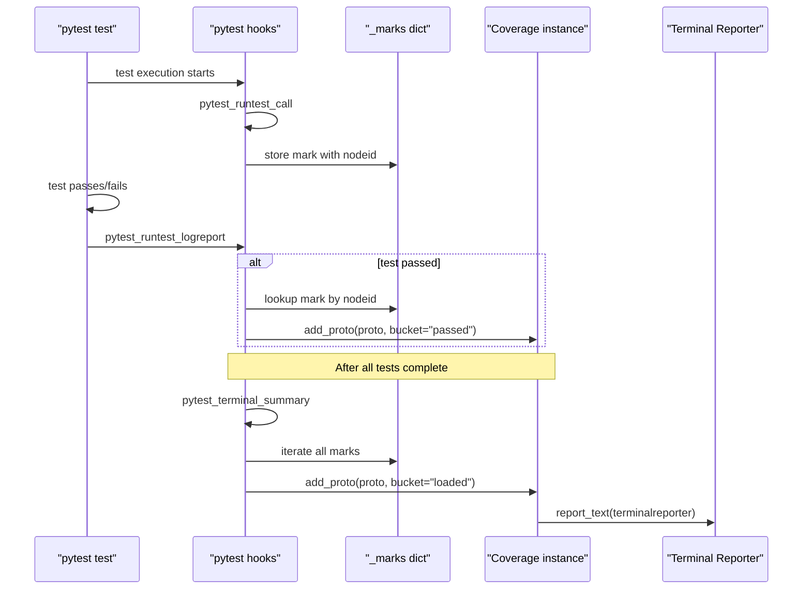
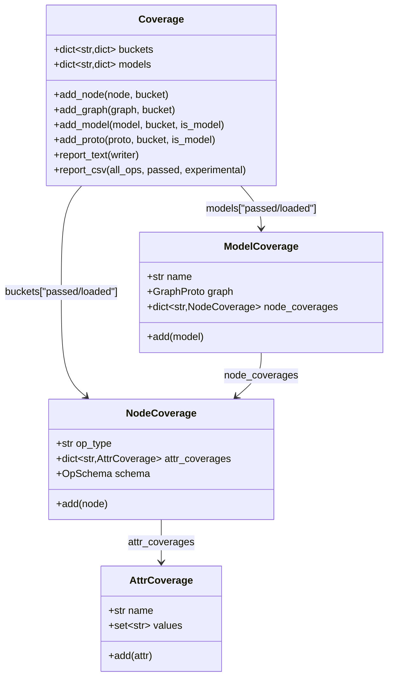
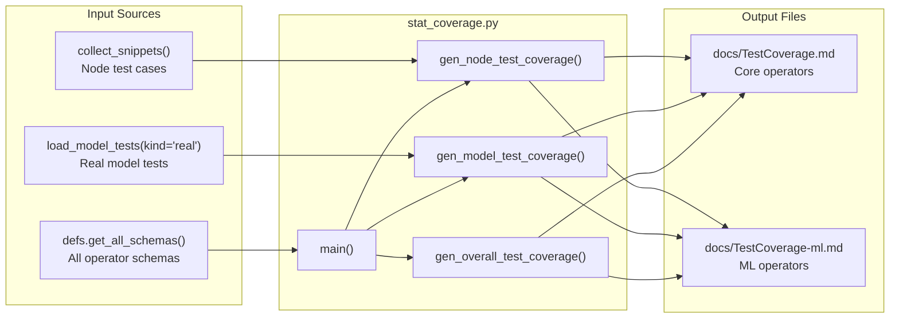
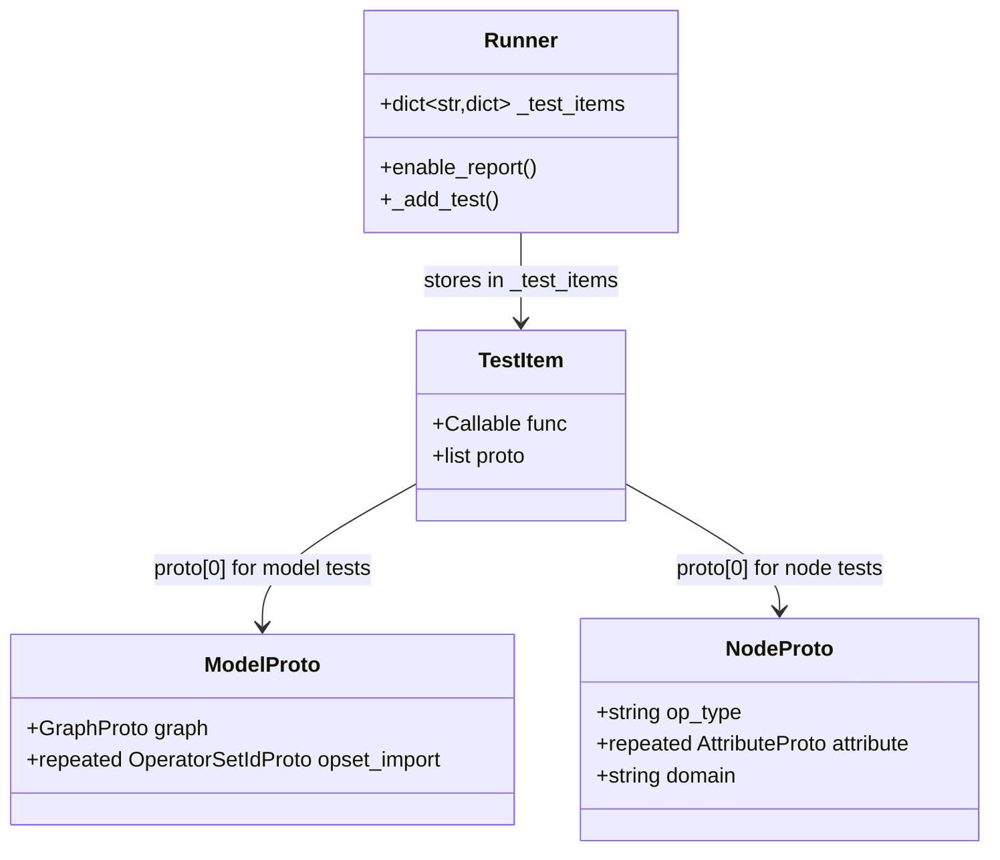

<!-- source: DeepWiki mcp.deepwiki.com · repo onnx/onnx · page 5.4 Test Coverage Reporting · fetched 2026-10-21 -->

# Test Coverage Reporting

<details>
<summary>Relevant source files</summary>

The following files were used as context for generating this wiki page:

- [docs/Changelog.md](docs/Changelog.md)
- [docs/Operators.md](docs/Operators.md)
- [docs/TestCoverage-ml.md](docs/TestCoverage-ml.md)
- [docs/TestCoverage.md](docs/TestCoverage.md)
- [onnx/backend/base.py](onnx/backend/base.py)
- [onnx/backend/test/case/node/cast.py](onnx/backend/test/case/node/cast.py)
- [onnx/backend/test/case/node/castlike.py](onnx/backend/test/case/node/castlike.py)
- [onnx/backend/test/report/__init__.py](onnx/backend/test/report/__init__.py)
- [onnx/backend/test/report/coverage.py](onnx/backend/test/report/coverage.py)
- [onnx/backend/test/runner/__init__.py](onnx/backend/test/runner/__init__.py)
- [onnx/backend/test/stat_coverage.py](onnx/backend/test/stat_coverage.py)
- [onnx/defs/controlflow/defs.cc](onnx/defs/controlflow/defs.cc)
- [onnx/defs/controlflow/old.cc](onnx/defs/controlflow/old.cc)
- [onnx/defs/math/defs.cc](onnx/defs/math/defs.cc)
- [onnx/defs/math/old.cc](onnx/defs/math/old.cc)
- [onnx/defs/nn/defs.cc](onnx/defs/nn/defs.cc)
- [onnx/defs/nn/old.cc](onnx/defs/nn/old.cc)
- [onnx/defs/operator_sets.h](onnx/defs/operator_sets.h)
- [onnx/defs/reduction/defs.cc](onnx/defs/reduction/defs.cc)
- [onnx/defs/rnn/defs.cc](onnx/defs/rnn/defs.cc)
- [onnx/defs/rnn/old.cc](onnx/defs/rnn/old.cc)
- [onnx/defs/tensor/defs.cc](onnx/defs/tensor/defs.cc)
- [onnx/defs/tensor/old.cc](onnx/defs/tensor/old.cc)
- [onnx/test/shape_inference_test.py](onnx/test/shape_inference_test.py)
- [onnx/test/test_backend_test.py](onnx/test/test_backend_test.py)

</details>


## Purpose and Scope

This document explains ONNX's test coverage reporting system, which tracks which operators, attributes, and models are exercised by the backend test suite. The coverage system integrates with pytest to collect test execution data and generates comprehensive markdown reports showing which ONNX operators have test coverage.

For information about the backend test framework itself, see [Backend Test Framework](#5.1). For details on implementing backends, see [Implementing an ONNX Backend](#5.2). For test case generation, see [Test Case Generation and Data](#5.3).

## System Architecture



**Coverage Tracking Flow**

The system operates in two modes: runtime pytest integration for live coverage tracking, and static analysis via `stat_coverage.py` for documentation generation.

Sources: [onnx/backend/test/runner/__init__.py:61-185](), [onnx/backend/test/report/__init__.py:1-51](), [onnx/backend/test/report/coverage.py:72-262](), [onnx/backend/test/stat_coverage.py:1-300]()

## Enabling Coverage Reporting

Coverage reporting is enabled by calling `enable_report()` on the `Runner` instance:

```python
backend_test = onnx.backend.test.BackendTest(MyBackend, __name__)
backend_test.enable_report()
```

The `enable_report()` method decorates all test functions with the `@pytest.mark.onnx_coverage` marker, which triggers pytest hooks during test execution:

[onnx/backend/test/runner/__init__.py:114-120]()

```python
def enable_report(self) -> Runner:
    import pytest  # noqa: PLC0415

    for category, items_map in self._test_items.items():
        for item in items_map.values():
            item.func = pytest.mark.onnx_coverage(item.proto, category)(item.func)
    return self
```

Each `TestItem` contains:
- `func`: The test function to execute
- `proto`: A list containing the `ModelProto` or `NodeProto` being tested
- Test metadata (category: "Node", "Real", "Simple", etc.)

Sources: [onnx/backend/test/runner/__init__.py:114-120](), [onnx/backend/test/runner/item.py]()

## Pytest Hook Integration



**Pytest Hook Execution Flow**

The coverage system uses three pytest hooks defined in [onnx/backend/test/report/__init__.py]():

### Hook 1: pytest_runtest_call

[onnx/backend/test/report/__init__.py:30-34]()

Executed when each test is called. Stores the `onnx_coverage` mark in the `_marks` dictionary indexed by test `nodeid`.

### Hook 2: pytest_runtest_logreport

[onnx/backend/test/report/__init__.py:37-40]()

Executed after test completion. If the test passed (`report.outcome == "passed"`), adds the proto to the "passed" bucket in the `Coverage` instance.

### Hook 3: pytest_terminal_summary

[onnx/backend/test/report/__init__.py:43-50]()

Executed after all tests complete. Adds all marked tests to the "loaded" bucket (regardless of pass/fail) and generates the coverage report to terminal output.

Sources: [onnx/backend/test/report/__init__.py:1-51]()

## Coverage Data Model



**Coverage Class Hierarchy**

### Coverage Class

The top-level `Coverage` class [onnx/backend/test/report/coverage.py:72-99]() maintains two types of buckets:

| Bucket Key | Purpose |
|------------|---------|
| `buckets["loaded"]` | All operators encountered in test models, whether tests passed or not |
| `buckets["passed"]` | Only operators from tests that passed successfully |
| `models["loaded"]` | All models loaded for testing |
| `models["passed"]` | Only models whose tests passed |

Each bucket maps operator names to `NodeCoverage` instances or model names to `ModelCoverage` instances.

### NodeCoverage Class

[onnx/backend/test/report/coverage.py:37-52]()

Tracks coverage for a single operator type:
- `op_type`: The operator name (e.g., "Conv", "Add")
- `schema`: The `OpSchema` for this operator from the schema registry
- `attr_coverages`: Dictionary mapping attribute names to `AttrCoverage` instances

### AttrCoverage Class

[onnx/backend/test/report/coverage.py:20-35]()

Tracks which values an operator attribute has been tested with:
- `name`: The attribute name
- `values`: Set of stringified attribute values encountered in tests

For example, if Conv is tested with `kernel_shape=[3,3]` and `kernel_shape=[5,5]`, the `values` set would contain `["(3, 3)", "(5, 5)"]`.

### ModelCoverage Class

[onnx/backend/test/report/coverage.py:54-70]()

Tracks coverage for entire models (real-world models, not synthetic test cases):
- `name`: Model graph name
- `graph`: The `GraphProto` for this model
- `node_coverages`: Dictionary of `NodeCoverage` for each operator in the model

Sources: [onnx/backend/test/report/coverage.py:20-99]()

## Static Coverage Report Generation



**Static Report Generation Pipeline**

The `stat_coverage.py` script [onnx/backend/test/stat_coverage.py:272-296]() generates comprehensive markdown documentation without running tests:

### Execution

```bash
python onnx/backend/test/stat_coverage.py
```

This generates two files:
- `docs/TestCoverage.md` - Core ONNX operators (domain="ai.onnx" or "")
- `docs/TestCoverage-ml.md` - ML operators (domain="ai.onnx.ml")

### Report Generation Functions

#### gen_node_test_coverage

[onnx/backend/test/stat_coverage.py:40-150]()

Generates node test coverage statistics by:
1. Calling `collect_snippets()` to get all node test definitions
2. Categorizing operators by support level (COMMON vs EXPERIMENTAL)
3. Calculating coverage percentages
4. Listing covered/uncovered operators with code snippets

**Output structure:**
- Summary with coverage percentages
- ✅ Covered Common Operators (with test case code)
- ❌ No Cover Common Operators
- ✅ Covered Experimental Operators
- ❌ No Cover Experimental Operators

#### gen_model_test_coverage

[onnx/backend/test/stat_coverage.py:152-254]()

Generates model test coverage by:
1. Loading real models using `Runner.prepare_model_data()`
2. Analyzing which operators appear in each model
3. Tracking which attributes are used and their values
4. Cross-referencing with node test coverage

For each model, the report shows:
- Number of nodes covered by node tests
- Coverage percentage
- Expandable details of attribute usage

Sources: [onnx/backend/test/stat_coverage.py:1-300]()

## Coverage Report Output Format

### Node Test Coverage Section

```markdown
# Node Test Coverage
## Summary
Node tests have covered 150/200 (75.00%, 5 generators excluded) common operators.

## ✅ Covered Common Operators
### Add
There are 3 test cases, listed as following:
<details>
<summary>add</summary>

[Python code snippet]

</details>
```

The report includes:
- **Coverage metrics**: Fraction and percentage of operators tested
- **Generator exclusion**: Random operators (RandomNormal, etc.) are noted but excluded from coverage calculations
- **Code snippets**: Actual test case code is included for reference
- **Support level categorization**: COMMON vs EXPERIMENTAL operators

### Model Test Coverage Section

```markdown
# Model Test Coverage
## resnet50

resnet50 has 53 nodes. Of these, 53 are covered by node tests (100.0%)

<details>
<summary>nodes</summary>

<details>
<summary>Conv: 2 out of 6 attributes covered</summary>

kernel_shape: 3
strides: 2
pads: 0
dilations: 0
group: 0
auto_pad: 0
</details>
```

For each model:
- **Total node count** vs nodes with test coverage
- **Per-operator attribute coverage**: Shows how many attribute combinations are tested
- **Attribute value counts**: Tracks diversity of attribute values tested

Sources: [docs/TestCoverage-ml.md:1-351]()

## CSV Report Generation for Backend Scoreboard

When the `CSVDIR` environment variable is set, the coverage system generates CSV files for the ONNX Backend Scoreboard:

### CSV Files Generated

| File | Content |
|------|---------|
| `nodes.csv` | Per-operator pass/fail status across backends |
| `models.csv` | Per-model coverage and pass/fail status |
| `metadata.csv` | Timestamp of latest update |

### Format Example (nodes.csv)

[onnx/backend/test/report/coverage.py:147-210]()

```csv
Op,Backend1,Backend2,Backend3
Add,Passed!,Passed!,Failed!
Conv,Passed!,Skipped!,Passed!
Summary,150/200 node tests passed,120/200 node tests passed,180/200 node tests passed
```

### Enabling CSV Output

```bash
export CSVDIR=./coverage_reports
export BACKEND=MyBackendName
pytest onnx/test/test_backend_reference.py
```

The CSV generation logic [onnx/backend/test/report/coverage.py:147-262]():
1. Loads existing CSV files if present
2. Updates the column for the current backend (`BACKEND` env var)
3. Preserves data for other backends
4. Writes summary row with total coverage

Sources: [onnx/backend/test/report/coverage.py:147-262]()

## Integration with Backend Tests

### Example: DummyBackend Test

[onnx/test/test_backend_test.py:115-124]()

```python
backend_test = onnx.backend.test.BackendTest(
    DummyBackend, __name__, test_kwargs=test_kwargs
)
# Note: enable_report() is NOT called in test_backend_test.py
# because the test validates well-formedness, not results

# Import test cases into global scope
globals().update(backend_test.test_cases)
```

This example does **not** enable coverage reporting because `DummyBackend` only validates model structure, not correctness.

### Example: ReferenceEvaluator Backend Test

[onnx/test/test_backend_reference.py:92-103]()

```python
backend_test = onnx.backend.test.BackendTest(
    ReferenceEvaluatorBackend,
    __name__,
    test_kwargs={...}
)
# Coverage reporting would be enabled here in production
# backend_test.enable_report()

globals().update(backend_test.test_cases)
```

The `ReferenceEvaluator` backend would typically enable coverage reporting to track which operators are correctly implemented.

Sources: [onnx/test/test_backend_test.py:115-124](), [onnx/test/test_backend_reference.py:92-103]()

## Test Item Structure



**Test Item Data Structure**

Each test in the backend framework is wrapped in a `TestItem` containing:

| Field | Type | Description |
|-------|------|-------------|
| `func` | Callable | The test function (potentially decorated with pytest markers) |
| `proto` | list | Single-element list containing `ModelProto` or `NodeProto` being tested |

The `proto` field is initialized as a list with one element (`[None]`) and populated at runtime when the test loads the model [onnx/backend/test/runner/__init__.py:344-345]():

```python
model_marker: list[ModelProto | NodeProto | None] = [None]

def run(test_self, device, **kwargs):
    # ... load model ...
    model_marker[0] = model  # Store loaded model for coverage tracking
```

This design allows the coverage system to access the actual protobuf objects after test execution.

Sources: [onnx/backend/test/runner/__init__.py:275-314](), [onnx/backend/test/runner/__init__.py:341-345]()

## Coverage Metrics and Analysis

### Operator Coverage Calculation

[onnx/backend/test/stat_coverage.py:40-92]()

The coverage percentage is calculated as:

```
coverage = covered_operators / (total_operators - generators)
```

Where:
- `covered_operators`: Operators with at least one test case
- `total_operators`: All operators in the schema registry for the domain
- `generators`: Random/non-deterministic operators excluded from coverage

**Generator operators** (excluded from coverage):
- Multinomial
- RandomNormal
- RandomNormalLike
- RandomUniform
- RandomUniformLike

### Attribute Coverage Tracking

Attribute coverage tracks both:
1. **Existence**: Whether an attribute is tested at all
2. **Value diversity**: How many different values are tested

For example, if `Conv` has 6 possible attributes but tests only use 2 of them, the report shows "2 out of 6 attributes covered". The detailed view lists each attribute with the count of unique values tested.

Sources: [onnx/backend/test/stat_coverage.py:40-92](), [onnx/backend/test/report/coverage.py:100-138]()

## Command-Line Tools

The `cmd_tools.py` script provides utilities related to test data but not coverage reporting itself:

```bash
# Generate test data from test cases
python onnx/backend/test/cmd_tools.py generate-data

# Generate for specific operator only
python onnx/backend/test/cmd_tools.py generate-data --op_type Conv

# Generate for changed operators only (in PR)
python onnx/backend/test/cmd_tools.py generate-data --diff
```

The `generate-data` command creates the `.pb` files in `onnx/backend/test/data/` that tests use. While not directly part of coverage reporting, these test data files are what gets executed and measured for coverage.

Sources: [onnx/backend/test/cmd_tools.py:1-191]()

---

