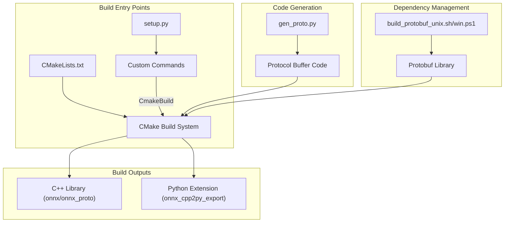
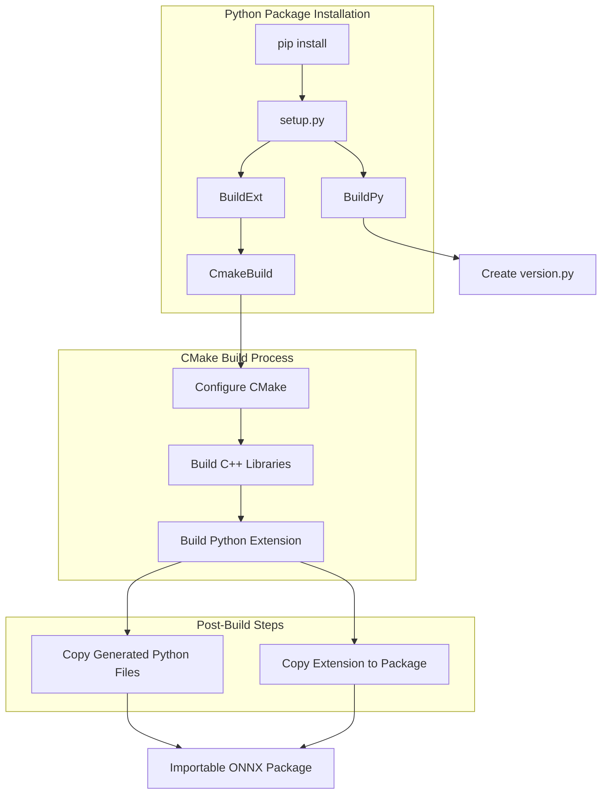
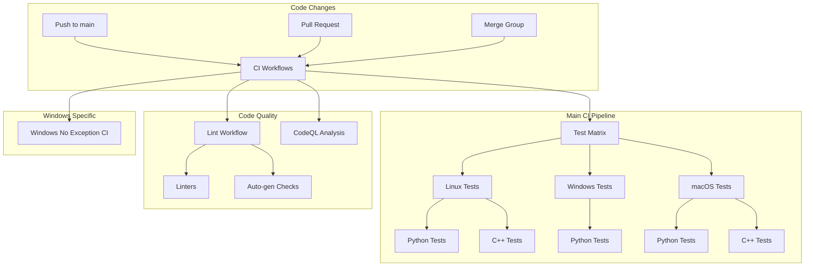
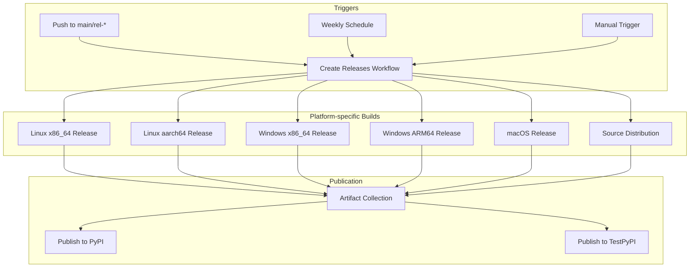
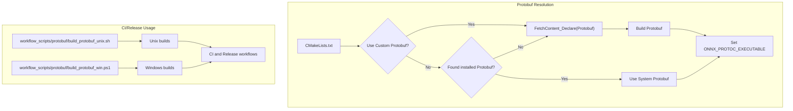

<!-- source: DeepWiki mcp.deepwiki.com · repo onnx/onnx · page 6 Build System · fetched 2026-10-21 -->

# Build System and CI/CD

<details>
<summary>Relevant source files</summary>

The following files were used as context for generating this wiki page:

- [.github/workflows/main.yml](.github/workflows/main.yml)
- [.lintrunner.toml](.lintrunner.toml)
- [CMakeLists.txt](CMakeLists.txt)
- [MANIFEST.in](MANIFEST.in)
- [README.md](README.md)
- [cmake/ONNXConfig.cmake.in](cmake/ONNXConfig.cmake.in)
- [cmake/Utils.cmake](cmake/Utils.cmake)
- [cmake/external/googletest.cmake](cmake/external/googletest.cmake)
- [cmake/summary.cmake](cmake/summary.cmake)
- [cmake/unittest.cmake](cmake/unittest.cmake)
- [docs/ImplementingAnOnnxBackend.md](docs/ImplementingAnOnnxBackend.md)
- [docs/OnnxBackendTest.md](docs/OnnxBackendTest.md)
- [onnx/gen_proto.py](onnx/gen_proto.py)
- [onnx/test/cmake/CMakeLists.txt](onnx/test/cmake/CMakeLists.txt)
- [onnx/test/cmake/main.cc](onnx/test/cmake/main.cc)
- [onnx/test/cpp/checker_test.cc](onnx/test/cpp/checker_test.cc)
- [onnx/test/cpp/function_get_test.cc](onnx/test/cpp/function_get_test.cc)
- [onnx/test/cpp/test_main.cc](onnx/test/cpp/test_main.cc)
- [pyproject.toml](pyproject.toml)
- [requirements-dev.txt](requirements-dev.txt)
- [requirements-lintrunner.txt](requirements-lintrunner.txt)
- [requirements.txt](requirements.txt)
- [setup.py](setup.py)
- [tools/gen_coverage_report.py](tools/gen_coverage_report.py)
- [workflow_scripts/protobuf/build_protobuf_unix.sh](workflow_scripts/protobuf/build_protobuf_unix.sh)
- [workflow_scripts/protobuf/build_protobuf_win.ps1](workflow_scripts/protobuf/build_protobuf_win.ps1)

</details>


This page documents the build system and continuous integration/continuous deployment (CI/CD) pipeline used in the ONNX project. It covers the CMake-based build system, Python integration, testing infrastructure, and release workflows. For information about implementing ONNX backends, see [Testing ONNX Models and Backends](#6).

## Overview

ONNX uses a CMake-based build system that builds both C++ libraries and Python bindings. The continuous integration pipeline ensures code quality through automated tests across multiple platforms, while the continuous deployment pipeline automates the building and publishing of packages to PyPI.

## Build System Architecture

### CMake Build System

ONNX uses CMake to build its C++ components. The build system handles platform-specific configurations, dependency management, and compilation settings.

#### Build System Architecture Diagram



Sources: [CMakeLists.txt:1-732](), [setup.py:138-257](), [onnx/gen_proto.py:1-271](), [workflow_scripts/protobuf/build_protobuf_unix.sh:1-49](), [workflow_scripts/protobuf/build_protobuf_win.ps1:1-34]()

### Main Configuration Options

The CMake build system provides various configuration options through environment variables and CMake variables:

| Option | Default | Description |
|--------|---------|-------------|
| `ONNX_BUILD_PYTHON` | OFF | Build Python bindings |
| `ONNX_BUILD_CUSTOM_PROTOBUF` | OFF | Build and use ONNX's own protobuf |
| `ONNX_USE_PROTOBUF_SHARED_LIBS` | OFF | Build ONNX using protobuf shared library |
| `ONNX_GEN_PB_TYPE_STUBS` | ON | Generate protobuf python type stubs |
| `ONNX_WERROR` | OFF | Build with warnings as errors |
| `ONNX_COVERAGE` | OFF | Build with coverage instrumentation |
| `ONNX_BUILD_TESTS` | OFF | Build ONNX C++ API Tests |
| `ONNX_USE_LITE_PROTO` | OFF | Use lite protobuf instead of full |
| `ONNX_ML` | ON | Enable traditional ML API |
| `ONNX_NAMESPACE` | "onnx" | Namespace for ONNX |

Sources: [CMakeLists.txt:32-56](), [setup.py:40-48]()

### Build Process

The build process involves several key steps:

1. **Configuration**: CMake configures the build based on platform and options
2. **Protocol Buffer Generation**: Generates C++ and Python code from `.proto` files
3. **C++ Library Compilation**: Builds the core ONNX libraries (`onnx` and `onnx_proto`)
4. **Python Bindings**: Builds the Python extension module if enabled

Sources: [CMakeLists.txt:414-439](), [CMakeLists.txt:450-498](), [setup.py:163-236]()

### Python Integration

Python integration is handled through a custom build process in `setup.py` that invokes CMake:



Sources: [setup.py:138-183](), [setup.py:238-247](), [setup.py:254-298]()

## CI/CD Pipeline

ONNX uses GitHub Actions for continuous integration and deployment. The CI/CD pipeline includes testing on multiple platforms, automated releases, and code quality checks.

### CI Pipeline Diagram



Sources: [.github/workflows/main.yml:1-242](), [.github/workflows/lint.yml:1-128](), [.github/workflows/codeql.yml:1-95](), [.github/workflows/win_no_exception_ci.yml:1-81]()

### Test Matrix

The main CI workflow tests multiple combinations of:

- Operating systems (Ubuntu, Windows, macOS)
- Python versions (3.9 through 3.13)
- Build configurations (debug/release)
- ML support (enabled/disabled)
- Protobuf versions (internal/external)

Sources: [.github/workflows/main.yml:29-74]()

### Release Pipeline Diagram



Sources: [.github/workflows/create_release.yml:1-269](), [.github/workflows/release_linux_x86_64.yml:1-98](), [.github/workflows/release_linux_aarch64.yml:1-119](), [.github/workflows/release_win_x86_64.yml:1-112](), [.github/workflows/release_win_aarch64.yml:1-75](), [.github/workflows/release_mac.yml:1-129](), [.github/workflows/release_sdist.yml:1-67]()

### Release Workflows

The release pipeline builds packages for multiple platforms and Python versions:

| Workflow | Platform | Architectures |
|----------|----------|---------------|
| `release_linux_x86_64.yml` | Linux | x86_64 |
| `release_linux_aarch64.yml` | Linux | aarch64 |
| `release_win_x86_64.yml` | Windows | x86_64, x86 |
| `release_win_aarch64.yml` | Windows | arm64 |
| `release_mac.yml` | macOS | x86_64, arm64 |
| `release_sdist.yml` | Any | N/A (source) |

Each release workflow:
1. Builds wheel packages for various Python versions
2. Tests the built wheels
3. Verifies compatibility with different dependency versions
4. Uploads artifacts for publication

Sources: [.github/workflows/create_release.yml:61-109](), [docs/CIPipelines.md:17-21]()

### Publication Process

The `create_release.yml` workflow coordinates the entire release process and handles publication to PyPI:

1. **Preview Build**: Weekly builds published as `onnx-weekly` to PyPI
2. **Release Build**: Stable releases published as `onnx` to PyPI
3. **Testing Releases**: Option to publish to TestPyPI before production

Publication requires approval through GitHub Actions environments to ensure controlled deployments.

Sources: [.github/workflows/create_release.yml:111-262]()

## Dependency Management

ONNX carefully manages its dependencies, with special handling for Protobuf and Python.

### Protobuf Handling

Protobuf is a critical dependency handled in two ways:

1. **System Protobuf**: Using existing Protobuf installation (controlled by `ONNX_BUILD_CUSTOM_PROTOBUF=OFF`)
2. **Custom Protobuf**: Building a specific Protobuf version from source (controlled by `ONNX_BUILD_CUSTOM_PROTOBUF=ON`)



Sources: [CMakeLists.txt:149-282](), [workflow_scripts/protobuf/build_protobuf_unix.sh:1-49](), [workflow_scripts/protobuf/build_protobuf_win.ps1:1-34]()

### Python Dependencies

Python dependencies are managed through multiple requirement files:

| File | Purpose |
|------|---------|
| `requirements-release.txt` | Dependencies for building release packages |
| `requirements-release_test.txt` | Dependencies for testing release packages |
| `requirements-min.txt` | Minimum supported dependency versions |
| `requirements-release_build.txt` | Minimal build dependencies for release |

Sources: [requirements-release_test.txt:1-11](), [requirements-release_build.txt:1-4]()

## Testing Framework

ONNX has a comprehensive testing framework for both C++ and Python code.

### Python Tests

Python tests use pytest and cover:

1. Core API functionality
2. Model validation
3. Shape inference
4. Version conversion
5. Operator implementations
6. Backend compatibility

Tests can be run with `pytest` after installing ONNX.

Sources: [CONTRIBUTING.md:123-135]()

### C++ Tests (GTest)

C++ tests use Google Test and require building ONNX with `ONNX_BUILD_TESTS=1`:

```bash
# Build with tests enabled
ONNX_BUILD_TESTS=1 pip install -e . -v

# Run tests on Linux/macOS
export LD_LIBRARY_PATH="./.setuptools-cmake-build/:$LD_LIBRARY_PATH"
.setuptools-cmake-build/onnx_gtests

# Run tests on Windows
.setuptools-cmake-build\Release\onnx_gtests.exe
```

Sources: [CONTRIBUTING.md:145-165](), [cmake/unittest.cmake:1-60]()

## Code Quality Tools

Code quality is maintained through various linting tools:

1. **Lintrunner**: Drives multiple linters defined in `.lintrunner.toml`
2. **clang-tidy**: For C++ code
3. **ruff/mypy**: For Python code
4. **Misspell**: For spelling checks
5. **Shellcheck**: For shell scripts
6. **CPPLint**: For C++ code style

These tools run in CI and can be run locally with `lintrunner`.

Sources: [.github/workflows/lint.yml:22-127](), [CONTRIBUTING.md:95-119]()

## Documentation

Documentation is automatically generated and deployed to GitHub Pages:

1. **Operator documentation**: Generated from operator definitions
2. **API documentation**: Generated from code
3. **Changelog**: Generated from version history

Documentation is built using Sphinx and deployed through GitHub Actions.

Sources: [.github/workflows/pages.yml:1-69](), [CONTRIBUTING.md:77-91]()

## Contributing to the Build System

When contributing changes to the build system:

1. Ensure compatibility with all supported platforms (Linux, Windows, macOS)
2. Test changes locally before submitting a pull request
3. Consider impacts on CI/CD pipelines
4. Update documentation when making significant changes

For detailed contribution guidelines, see the [Developer Guide](#8).

Sources: [CONTRIBUTING.md:35-44](), [cmake/summary.cmake:1-83]()

---

