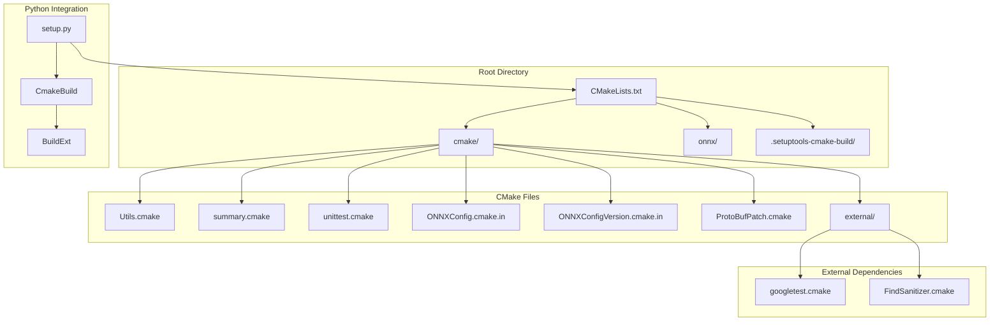
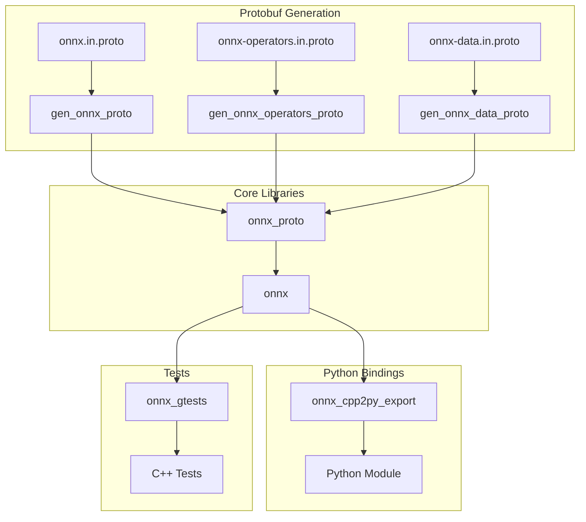
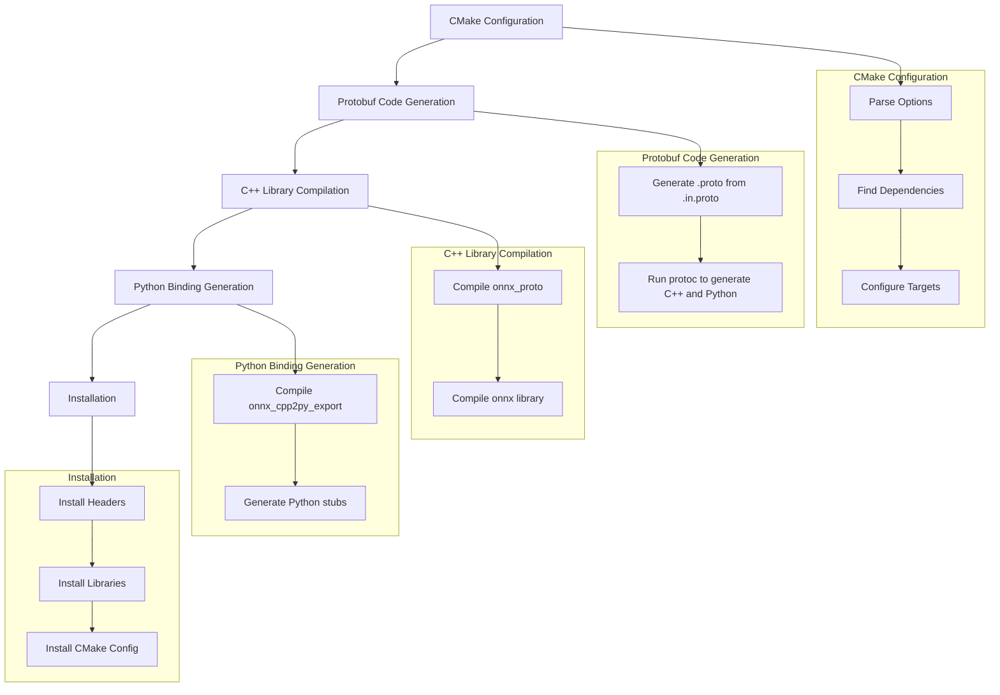
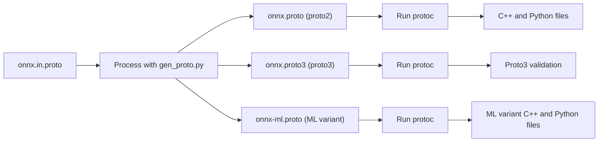
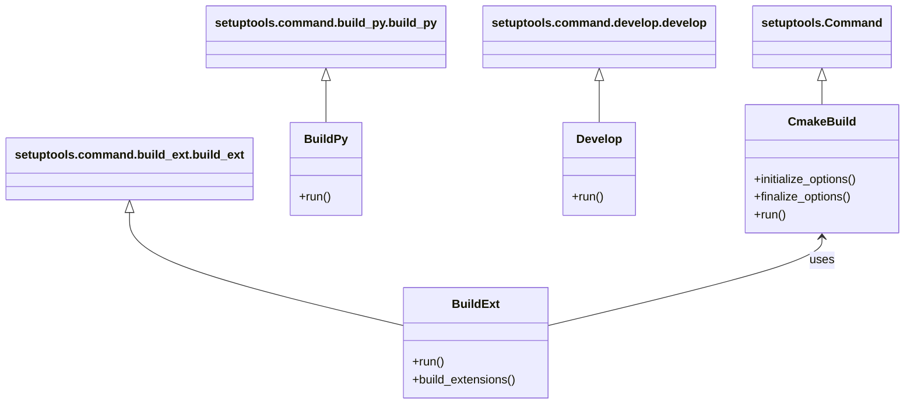
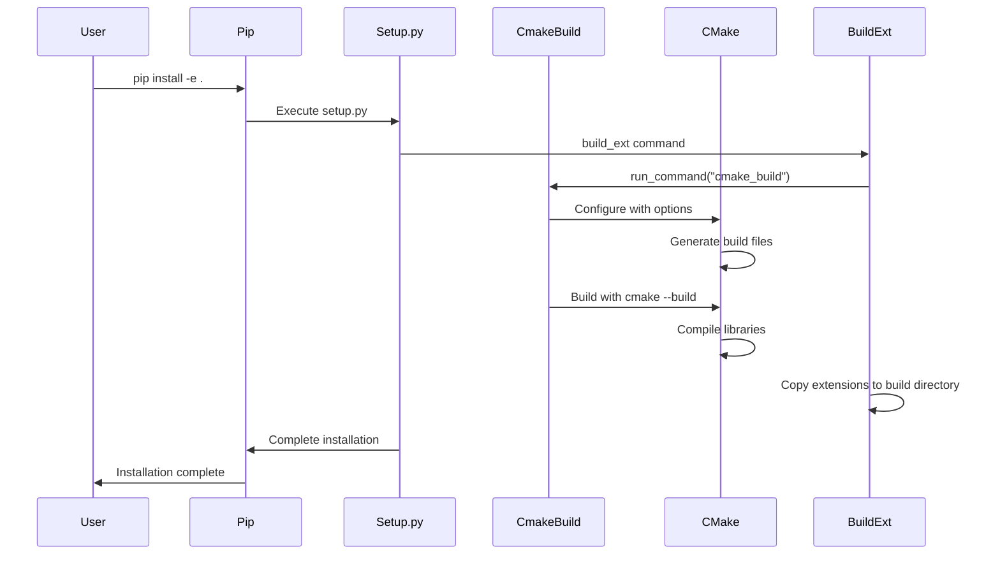
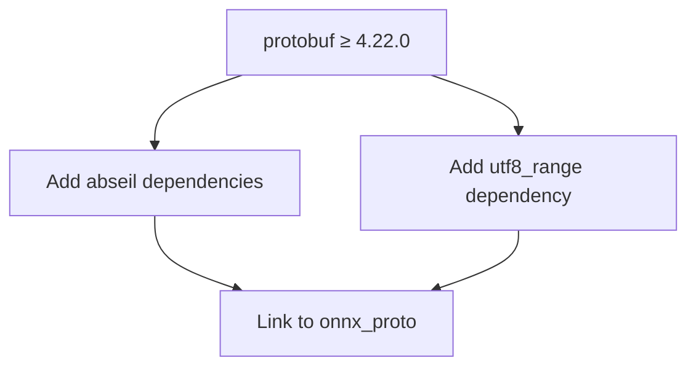
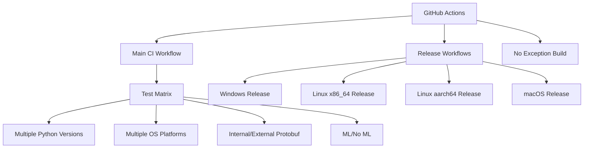

<!-- source: DeepWiki mcp.deepwiki.com · repo onnx/onnx · page 6.1 CMake Build Configuration · fetched 2026-10-21 -->

# CMake Build System

<details>
<summary>Relevant source files</summary>

The following files were used as context for generating this wiki page:

- [.github/workflows/main.yml](.github/workflows/main.yml)
- [CMakeLists.txt](CMakeLists.txt)
- [README.md](README.md)
- [cmake/ONNXConfig.cmake.in](cmake/ONNXConfig.cmake.in)
- [cmake/Utils.cmake](cmake/Utils.cmake)
- [cmake/external/googletest.cmake](cmake/external/googletest.cmake)
- [cmake/summary.cmake](cmake/summary.cmake)
- [cmake/unittest.cmake](cmake/unittest.cmake)
- [docs/ImplementingAnOnnxBackend.md](docs/ImplementingAnOnnxBackend.md)
- [docs/OnnxBackendTest.md](docs/OnnxBackendTest.md)
- [onnx/gen_proto.py](onnx/gen_proto.py)
- [onnx/test/cmake/CMakeLists.txt](onnx/test/cmake/CMakeLists.txt)
- [onnx/test/cmake/main.cc](onnx/test/cmake/main.cc)
- [onnx/test/cpp/checker_test.cc](onnx/test/cpp/checker_test.cc)
- [onnx/test/cpp/function_get_test.cc](onnx/test/cpp/function_get_test.cc)
- [onnx/test/cpp/test_main.cc](onnx/test/cpp/test_main.cc)
- [setup.py](setup.py)
- [workflow_scripts/protobuf/build_protobuf_unix.sh](workflow_scripts/protobuf/build_protobuf_unix.sh)
- [workflow_scripts/protobuf/build_protobuf_win.ps1](workflow_scripts/protobuf/build_protobuf_win.ps1)

</details>


This document provides a comprehensive overview of the CMake build system used by ONNX. It covers the structure, configuration options, build process, and Python integration. For information about release workflows, see [Release Workflows](#7.2), and for dependency management, see [Dependency Management](#7.3).

## Build System Overview

The ONNX project uses CMake as its primary build system. CMake provides a platform-independent way to configure, build, and test the ONNX library across Windows, Linux, and macOS environments. The build system supports building both the C++ library and the Python bindings.

### Directory Structure and Key Files



Sources: [CMakeLists.txt](), [cmake/Utils.cmake](), [cmake/summary.cmake](), [cmake/unittest.cmake](), [setup.py]()

### Build Targets and Components

The ONNX build system produces several key targets:



Sources: [CMakeLists.txt:414-450](), [CMakeLists.txt:492-500](), [CMakeLists.txt:510-520](), [cmake/unittest.cmake:59-60]()

## Build Configuration Options

ONNX provides a variety of configuration options to customize the build process.

### Core Build Options

| Option | Description | Default | File Reference |
|--------|-------------|---------|----------------|
| `ONNX_BUILD_PYTHON` | Build Python bindings | OFF | [CMakeLists.txt:32]() |
| `ONNX_BUILD_CUSTOM_PROTOBUF` | Build and use ONNX's own protobuf | OFF | [CMakeLists.txt:33]() |
| `ONNX_USE_PROTOBUF_SHARED_LIBS` | Build ONNX using protobuf shared library | OFF | [CMakeLists.txt:34]() |
| `ONNX_GEN_PB_TYPE_STUBS` | Generate protobuf python type stubs | ON | [CMakeLists.txt:35]() |
| `ONNX_WERROR` | Build with Werror | OFF | [CMakeLists.txt:36]() |
| `ONNX_COVERAGE` | Build with coverage instrumentation | OFF | [CMakeLists.txt:37]() |
| `ONNX_BUILD_TESTS` | Build ONNX C++ APIs Tests | OFF | [CMakeLists.txt:38]() |
| `ONNX_USE_ASAN` | Build ONNX with ASAN | OFF | [CMakeLists.txt:39]() |
| `ONNX_USE_LITE_PROTO` | Use lite protobuf instead of full | OFF | [CMakeLists.txt:40]() |
| `ONNX_DISABLE_EXCEPTIONS` | Disable exception handling | OFF | [CMakeLists.txt:41]() |
| `ONNX_DISABLE_STATIC_REGISTRATION` | Disable static registration for ONNX operator schemas | OFF | [CMakeLists.txt:42]() |
| `ONNX_USE_UNITY_BUILD` | Enable Unity (Jumbo) build | OFF | [CMakeLists.txt:43]() |
| `ONNX_ML` | Enable traditional ML API | ON | [CMakeLists.txt:56]() |
| `ONNX_VERIFY_PROTO3` | Generate code by proto3 | OFF | [CMakeLists.txt:65]() |

Sources: [CMakeLists.txt:32-66]()

### Platform-Specific Options

| Platform | Option | Description | Default | File Reference |
|----------|--------|-------------|---------|----------------|
| Windows | `ONNX_USE_MSVC_STATIC_RUNTIME` | Build with MSVC static runtime | OFF | [CMakeLists.txt:45]() |

Sources: [CMakeLists.txt:44-46]()

## Build Process

The ONNX build process involves several stages:



Sources: [CMakeLists.txt](), [setup.py](), [onnx/gen_proto.py]()

### Protobuf Code Generation

ONNX uses a custom process to generate Protobuf files. The process starts with `.in.proto` files which are processed to generate `.proto` files with variant-specific customizations (ML vs. standard, proto2 vs. proto3).



Sources: [CMakeLists.txt:289-406](), [onnx/gen_proto.py]()

The code generation uses a custom function `RELATIVE_PROTOBUF_GENERATE_CPP` defined in [CMakeLists.txt:289-412]() that:
1. Processes the `.in.proto` files using Python
2. Runs the protobuf compiler on the generated `.proto` files
3. Adds ONNX API prefixes to the generated code
4. Handles different namespaces and ML variants

## Python Integration

ONNX uses a custom integration between `setup.py` and CMake to build the Python package. This enables seamless building of the C++ components from Python's package installation process.



Sources: [setup.py:138-327]()

### Setup.py to CMake Workflow

When installing ONNX from source, `pip install -e .` or `pip install .` triggers the following process:



Sources: [setup.py:138-327](), [.github/workflows/main.yml:131-156]()

### Build Customization with Environment Variables

The build process can be customized through environment variables when running `pip install`.

| Environment Variable | Description | Default | File Reference |
|----------------------|-------------|---------|----------------|
| `ONNX_ML` | Enable ML operators | "1" | [setup.py:42]() |
| `ONNX_VERIFY_PROTO3` | Verify proto3 format | "0" | [setup.py:43]() |
| `ONNX_NAMESPACE` | Namespace for ONNX | "onnx" | [setup.py:44]() |
| `ONNX_BUILD_TESTS` | Build tests | "0" | [setup.py:45]() |
| `ONNX_DISABLE_EXCEPTIONS` | Disable exceptions | "0" | [setup.py:46]() |
| `ONNX_DISABLE_STATIC_REGISTRATION` | Disable static registration | "0" | [setup.py:47]() |
| `DEBUG` | Build in debug mode | "0" | [setup.py:51]() |
| `CMAKE_ARGS` | Additional CMake arguments | None | [setup.py:207-212]() |

Sources: [setup.py:36-52](), [setup.py:170-219]()

## Working with the Build System

### Building ONNX from Source

To build ONNX from source, you can use either the Python setup tools or CMake directly.

#### Using Python Setup Tools

```
# Basic installation
pip install -e .

# With custom options
ONNX_ML=0 DEBUG=1 CMAKE_ARGS="-DONNX_USE_LITE_PROTO=ON" pip install -e . -v
```

Sources: [setup.py](), [.github/workflows/main.yml:131-156]()

#### Using CMake Directly

```
# Configure
mkdir build && cd build
cmake -DONNX_BUILD_PYTHON=ON -DONNX_ML=0 ..

# Build
cmake --build . --parallel

# Install
cmake --install .
```

Sources: [CMakeLists.txt](), [CONTRIBUTING.md:47-61]()

### Build Output Structure

The build process generates the following structure:

| Directory | Description |
|-----------|-------------|
| `.setuptools-cmake-build/` | CMake build directory created by setup.py |
| `build/lib.*/onnx/` | Python package build output |
| `onnx/` | Python module with generated files |

Sources: [.gitignore:67-71](), [setup.py:264-297]()

### Testing the Build

To run C++ tests, you need to build with the `ONNX_BUILD_TESTS=1` option:

```
# Using Python
ONNX_BUILD_TESTS=1 pip install -e . -v

# Run C++ tests
export LD_LIBRARY_PATH="./.setuptools-cmake-build/:$LD_LIBRARY_PATH"
.setuptools-cmake-build/onnx_gtests
```

Sources: [CONTRIBUTING.md:147-165](), [cmake/unittest.cmake]()

## Troubleshooting Common Issues

### Protobuf Compatibility

The ONNX build system handles multiple versions of protobuf, including support for the latest protobuf 4.22+ which requires additional dependencies like `absl` and `utf8_range`.

For protobuf 4.22+, the build system automatically adds the required dependencies:



Sources: [CMakeLists.txt:204-250]()

### Cross-Platform Considerations

The build system includes specific handling for different platforms:

- **Windows**: Special handling for static runtime, architectures (x64, ARM64), and linking
- **macOS**: Special linking flags and handling for deployment targets
- **Linux**: Position-independent code and additional compiler options

Sources: [CMakeLists.txt:84-96](), [CMakeLists.txt:536-563](), [CMakeLists.txt:591-639]()

## CI Integration

The ONNX project uses GitHub Actions for continuous integration, with multiple workflows testing different configurations of the build system.



Sources: [.github/workflows/main.yml](), [docs/CIPipelines.md]()

## Summary

The ONNX CMake build system provides a flexible and robust way to build the ONNX library on multiple platforms. It handles complex code generation, platform-specific requirements, and integrates smoothly with Python's packaging system.

Key features of the build system include:
- Flexible configuration options
- Cross-platform support
- Integration with Python setup tools
- Protobuf code generation
- Comprehensive testing framework

The build system is a critical component that enables ONNX to maintain compatibility across different environments and use cases.

---

