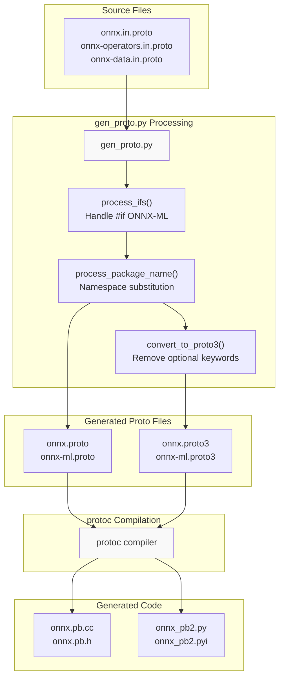
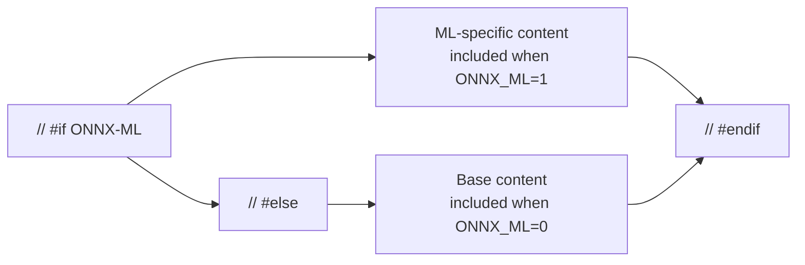
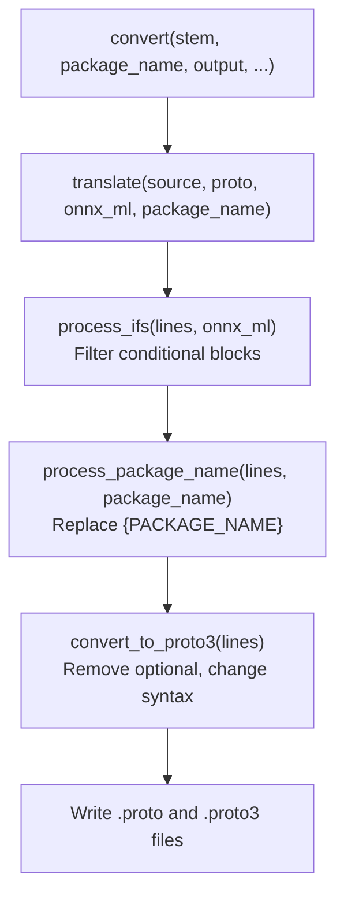
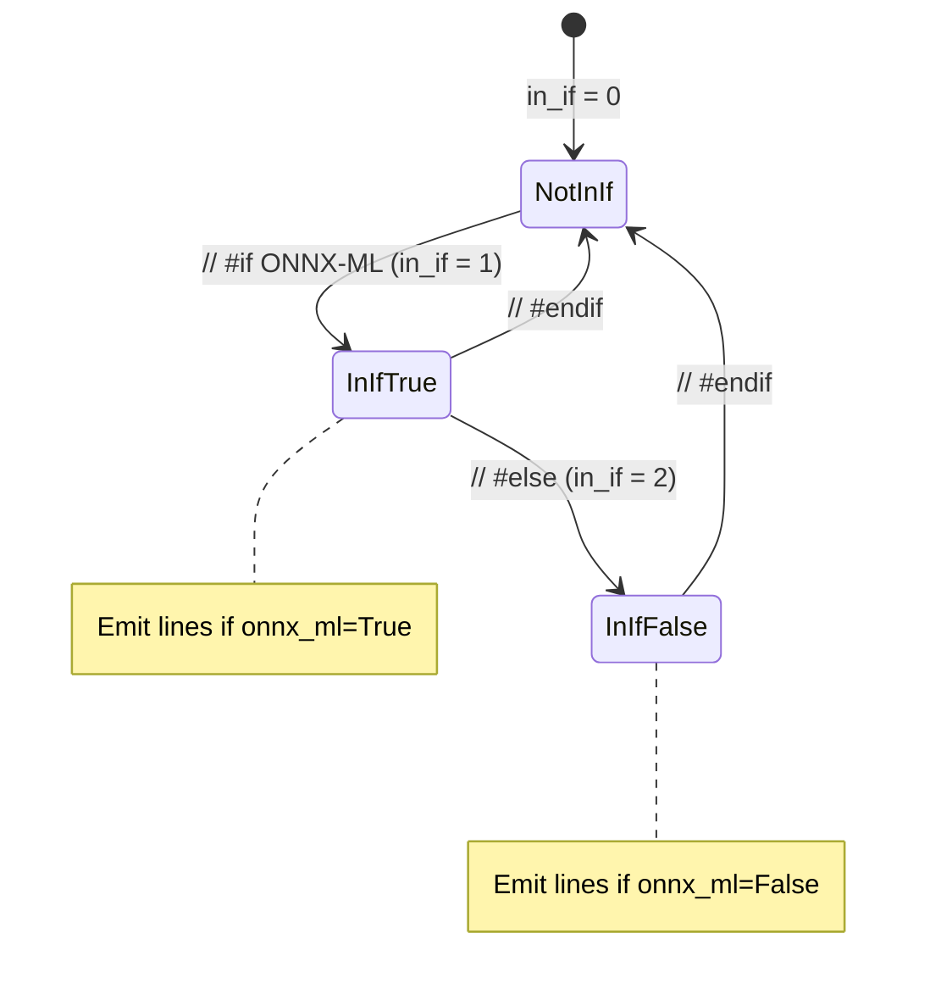
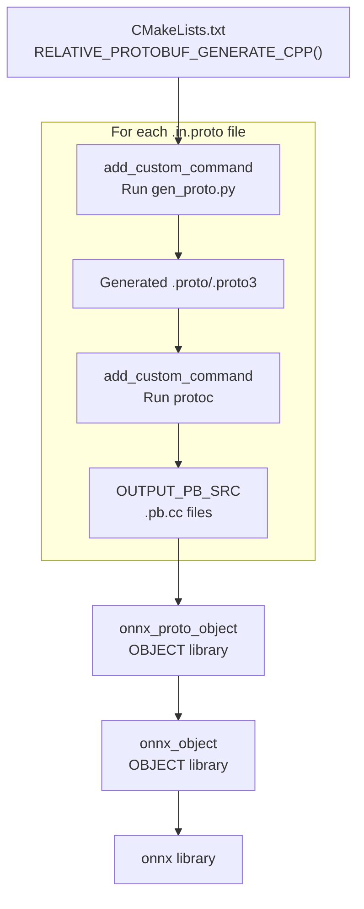
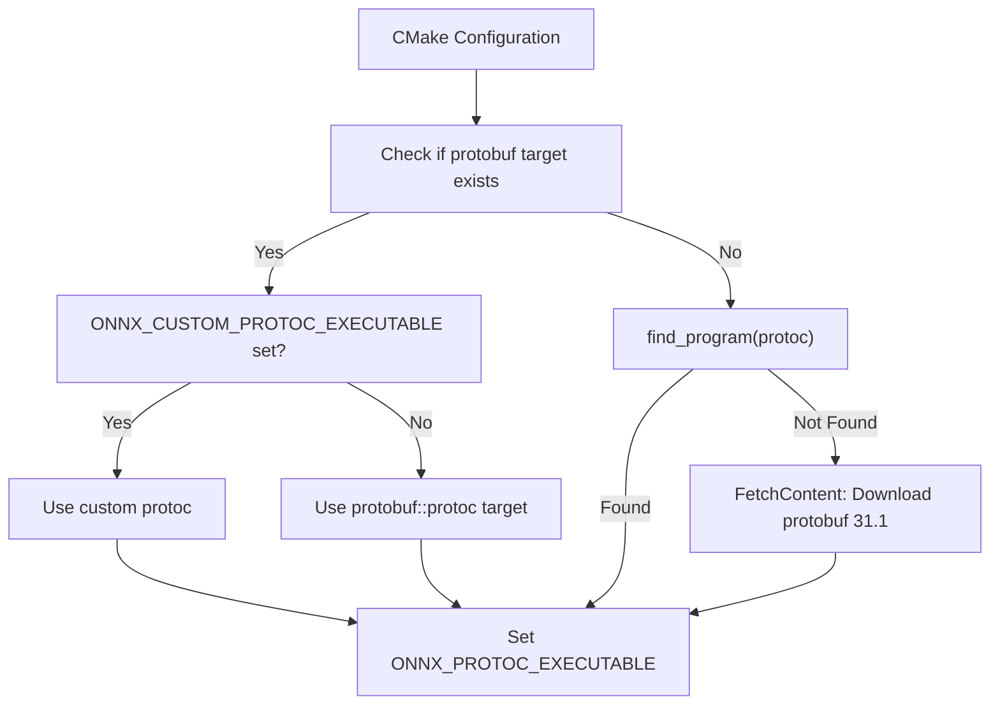
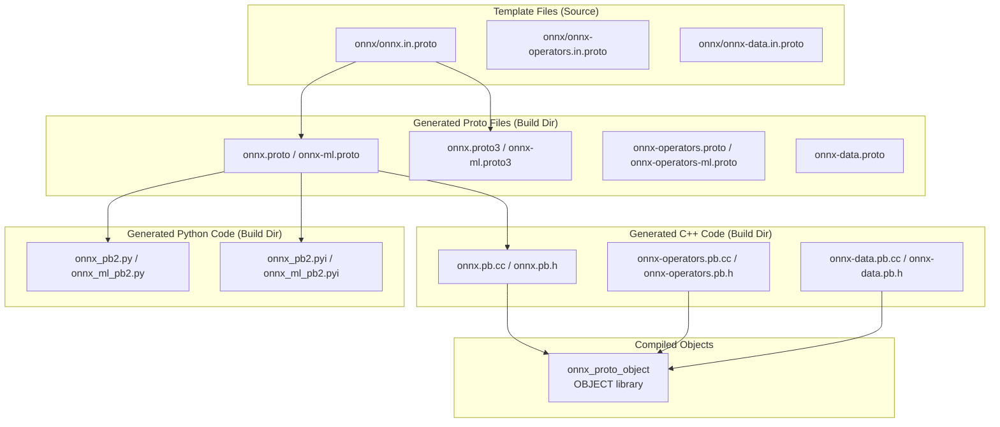
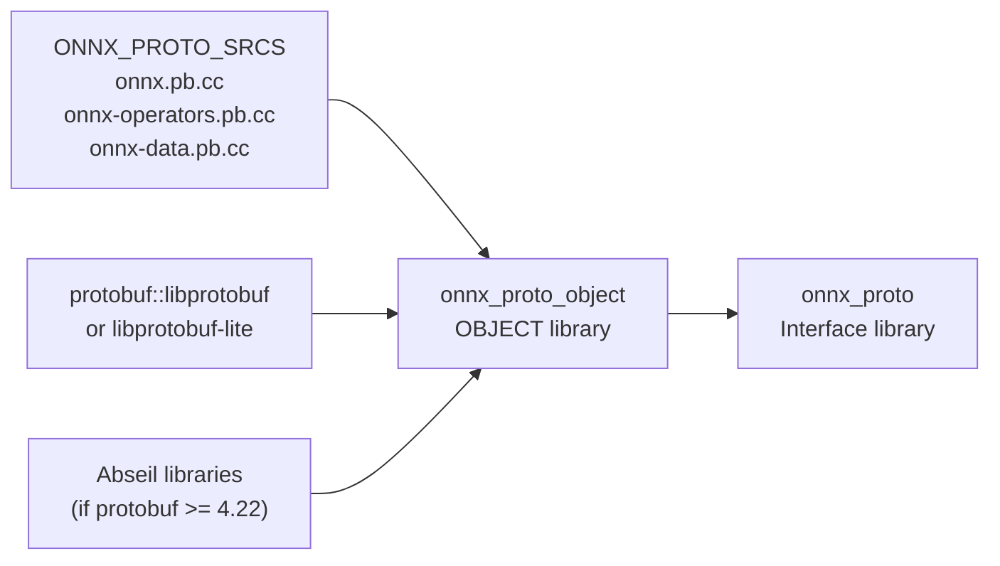
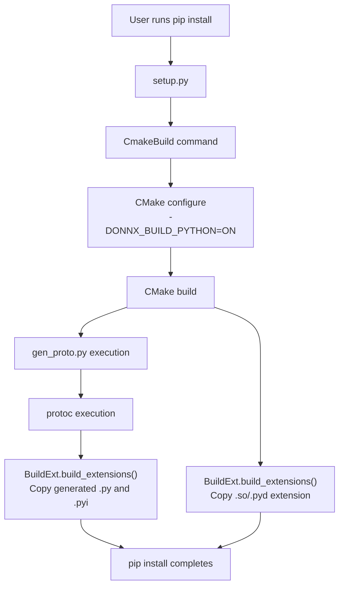

<!-- source: DeepWiki mcp.deepwiki.com · repo onnx/onnx · page 6.2 Protocol Buffer Code Generation · fetched 2026-10-21 -->

# Protobuf Code Generation

<details>
<summary>Relevant source files</summary>

The following files were used as context for generating this wiki page:

- [.github/workflows/main.yml](.github/workflows/main.yml)
- [CMakeLists.txt](CMakeLists.txt)
- [README.md](README.md)
- [VERSION_NUMBER](VERSION_NUMBER)
- [cmake/ONNXConfig.cmake.in](cmake/ONNXConfig.cmake.in)
- [cmake/Utils.cmake](cmake/Utils.cmake)
- [cmake/external/googletest.cmake](cmake/external/googletest.cmake)
- [cmake/summary.cmake](cmake/summary.cmake)
- [cmake/unittest.cmake](cmake/unittest.cmake)
- [docs/IR.md](docs/IR.md)
- [docs/ImplementingAnOnnxBackend.md](docs/ImplementingAnOnnxBackend.md)
- [docs/OnnxBackendTest.md](docs/OnnxBackendTest.md)
- [docs/OnnxReleases.md](docs/OnnxReleases.md)
- [docs/Versioning.md](docs/Versioning.md)
- [onnx/common/version.h](onnx/common/version.h)
- [onnx/defs/data_type_utils.cc](onnx/defs/data_type_utils.cc)
- [onnx/defs/data_type_utils.h](onnx/defs/data_type_utils.h)
- [onnx/gen_proto.py](onnx/gen_proto.py)
- [onnx/helper.py](onnx/helper.py)
- [onnx/numpy_helper.py](onnx/numpy_helper.py)
- [onnx/onnx-ml.proto](onnx/onnx-ml.proto)
- [onnx/onnx-ml.proto3](onnx/onnx-ml.proto3)
- [onnx/onnx.in.proto](onnx/onnx.in.proto)
- [onnx/onnx.proto](onnx/onnx.proto)
- [onnx/onnx.proto3](onnx/onnx.proto3)
- [onnx/reference/ops/op_range.py](onnx/reference/ops/op_range.py)
- [onnx/test/cmake/CMakeLists.txt](onnx/test/cmake/CMakeLists.txt)
- [onnx/test/cmake/main.cc](onnx/test/cmake/main.cc)
- [onnx/test/cpp/checker_test.cc](onnx/test/cpp/checker_test.cc)
- [onnx/test/cpp/function_get_test.cc](onnx/test/cpp/function_get_test.cc)
- [onnx/test/cpp/test_main.cc](onnx/test/cpp/test_main.cc)
- [onnx/test/helper_test.py](onnx/test/helper_test.py)
- [onnx/test/numpy_helper_test.py](onnx/test/numpy_helper_test.py)
- [setup.py](setup.py)
- [workflow_scripts/protobuf/build_protobuf_unix.sh](workflow_scripts/protobuf/build_protobuf_unix.sh)
- [workflow_scripts/protobuf/build_protobuf_win.ps1](workflow_scripts/protobuf/build_protobuf_win.ps1)

</details>


## Purpose and Scope

This page describes the protobuf code generation system in ONNX, which transforms template `.in.proto` files into concrete `.proto` and `.proto3` files, then compiles them into C++ and Python bindings. This system handles conditional compilation for ONNX-ML features, namespace customization, and generates both Protocol Buffers v2 and v3 compatible outputs.

For information about the protobuf schema definitions themselves, see [Protobuf Schema Definition](#2.1). For details on the build system that invokes this code generation, see [CMake Build Configuration](#6.1).

## Overview of the Protobuf Code Generation Pipeline

The ONNX protobuf code generation follows a multi-stage pipeline that transforms template files into usable C++ and Python code:



**Sources:** [onnx/gen_proto.py:1-257](), [CMakeLists.txt:302-393]()

## Template Proto Files

ONNX uses template `.in.proto` files with special preprocessing directives to support conditional compilation and namespace customization.

### Template File Structure

The primary template file is `onnx.in.proto`, which contains:

| Feature | Syntax | Purpose |
|---------|--------|---------|
| ONNX-ML conditionals | `// #if ONNX-ML` ... `// #endif` | Include ML-specific operators |
| Package placeholder | `{PACKAGE_NAME}` | Support custom namespaces |
| Proto2 syntax | `syntax = "proto2";` | Base format for template |

**Example from onnx.in.proto:**

```
package {PACKAGE_NAME};

// #if ONNX-ML
// Definitions of the built-in classical machine learning operators
// #endif
```

### Conditional Compilation Directives

The template system supports three conditional directives:



**Sources:** [onnx/onnx.in.proto:1-100](), [onnx/gen_proto.py:36-59]()

## The gen_proto.py Script

The `gen_proto.py` script orchestrates the transformation from template to concrete proto files.

### Core Functions



### Processing Pipeline

#### 1. process_ifs()

Handles conditional compilation based on `ONNX_ML` flag:



#### 2. process_package_name()

Replaces `{PACKAGE_NAME}` placeholder and adjusts import statements for custom namespaces. When the package name differs from the default "onnx", import statements are modified:

- `onnx.proto` → `onnx_customname.proto`
- `onnx-ml.proto` → `onnx_customname-ml.proto`

#### 3. convert_to_proto3()

Transforms proto2 syntax to proto3 by:
- Changing `syntax = "proto2"` to `syntax = "proto3"`
- Removing `optional` keywords (proto3 treats all fields as optional by default)
- Updating import paths from `.proto` to `.proto3`

**Sources:** [onnx/gen_proto.py:41-127]()

### Command-Line Interface

The script is invoked with arguments:

| Argument | Description | Example |
|----------|-------------|---------|
| `-p` | Package name | `onnx` |
| `-o` | Output directory | `${CMAKE_CURRENT_BINARY_DIR}/onnx` |
| `-m` | Enable ONNX-ML mode | Flag presence |
| `-l` | Use lite protobuf | Flag presence |
| `--protoc_path` | Path to protoc (for verification) | `/usr/bin/protoc` |

**Sources:** [onnx/gen_proto.py:177-257]()

## CMake Integration

CMake orchestrates protobuf code generation through the `RELATIVE_PROTOBUF_GENERATE_CPP` function.

### CMake Build Flow



### RELATIVE_PROTOBUF_GENERATE_CPP Function

This function at [CMakeLists.txt:302-393]() performs two key operations for each input `.in.proto` file:

**Step 1: Generate .proto files**

```cmake
add_custom_command(OUTPUT "${GENERATED_PROTO}"
    COMMAND ${ONNX_PYTHON_INTERPRETER} "${GEN_PROTO_PY}" ${GEN_PROTO_ARGS}
    DEPENDS ${INFILE}
    COMMENT "Running gen_proto.py on ${INFILE}")
```

The `GEN_PROTO_ARGS` are constructed based on build options:

| Condition | Argument Added |
|-----------|---------------|
| Always | `-p ${ONNX_NAMESPACE}` |
| Always | `-o ${OUTPUT_PROTO_DIR}` |
| Always | `${FILE_WE}` (filename without extension) |
| `ONNX_ML=ON` | `-m` |
| `ONNX_USE_LITE_PROTO=ON` | `-l` |
| `ONNX_VERIFY_PROTO3=ON` | `--protoc_path ${ONNX_PROTOC_EXECUTABLE}` |

**Step 2: Compile with protoc**

```cmake
add_custom_command(OUTPUT "${OUTPUT_PB_SRC}"
    COMMAND "${ONNX_PROTOC_EXECUTABLE}" ${PROTOC_ARGS}
    DEPENDS ${GENERATED_FILES}
    COMMENT "Running C++ protocol buffer compiler on ${GENERATED_PROTO}")
```

The `PROTOC_ARGS` include:
- Input: `${GENERATED_PROTO}` (the generated .proto file)
- Include path: `-I ${CMAKE_CURRENT_BINARY_DIR}`
- C++ output: `--cpp_out ${CMAKE_CURRENT_BINARY_DIR}`
- Python output (if `ONNX_BUILD_PYTHON=ON`): `--python_out ${CMAKE_CURRENT_BINARY_DIR}`
- Type stubs (if `ONNX_GEN_PB_TYPE_STUBS=ON`): `pyi_out:${CMAKE_CURRENT_BINARY_DIR}`

**Sources:** [CMakeLists.txt:302-393]()

### File Naming Convention

Generated filenames depend on the `ONNX_ML` setting and namespace:

| Condition | Input File | Generated Proto2 | Generated Proto3 |
|-----------|-----------|------------------|------------------|
| `ONNX_ML=OFF`, namespace="onnx" | `onnx.in.proto` | `onnx.proto` | `onnx.proto3` |
| `ONNX_ML=ON`, namespace="onnx" | `onnx.in.proto` | `onnx-ml.proto` | `onnx-ml.proto3` |
| `ONNX_ML=ON`, namespace="custom" | `onnx.in.proto` | `onnx_custom-ml.proto` | `onnx_custom-ml.proto3` |
| Any | `onnx-data.in.proto` | `onnx-data.proto` | `onnx-data.proto3` |

Note: The `onnx-data.in.proto` file never generates ML variants as it contains no ML-specific content.

**Sources:** [CMakeLists.txt:318-332]()

## Protoc Invocation

The Protocol Buffers compiler (`protoc`) is invoked to generate C++ and Python code from the processed `.proto` files.

### Protoc Executable Resolution

ONNX resolves the `protoc` executable through multiple strategies:



### Compiler Options

Different protobuf options affect the generated code:

| Option | Effect | Set By |
|--------|--------|--------|
| `ONNX_USE_LITE_PROTO` | Generates smaller code using libprotobuf-lite | CMake option, adds `option optimize_for = LITE_RUNTIME;` |
| `ONNX_GEN_PB_TYPE_STUBS` | Generates Python type stubs (.pyi) | CMake option (default ON) |
| `ONNX_BUILD_PYTHON` | Enables Python bindings generation | CMake option |

**Sources:** [CMakeLists.txt:163-296](), [CMakeLists.txt:371-384]()

### Generated Files by Protoc

For each processed `.proto` file, `protoc` generates:

**C++ Files:**
- `{filename}.pb.cc` - Implementation
- `{filename}.pb.h` - Header declarations

**Python Files (if ONNX_BUILD_PYTHON=ON):**
- `{filename}_pb2.py` - Python protobuf bindings
- `{filename}_pb2.pyi` - Python type stubs (if ONNX_GEN_PB_TYPE_STUBS=ON)

These files are placed in `${CMAKE_CURRENT_BINARY_DIR}/onnx/`.

**Sources:** [CMakeLists.txt:371-389](), [.gitignore:19-25]()

## Generated Artifacts

The complete code generation process produces multiple artifacts organized by purpose.

### Artifact Hierarchy



### Build Directory Structure

After code generation, the build directory contains:

```
${CMAKE_CURRENT_BINARY_DIR}/
└── onnx/
    ├── onnx.proto                  # Proto2 format
    ├── onnx-ml.proto               # Proto2 with ML extensions
    ├── onnx.proto3                 # Proto3 format
    ├── onnx-ml.proto3              # Proto3 with ML extensions
    ├── onnx.pb.cc                  # C++ implementation
    ├── onnx.pb.h                   # C++ headers
    ├── onnx_pb2.py                 # Python bindings (proto2)
    ├── onnx_ml_pb2.py              # Python bindings (ML, proto2)
    ├── onnx_pb2.pyi                # Python type stubs
    └── onnx_ml_pb2.pyi             # Python type stubs (ML)
```

These files are temporary build artifacts and are listed in `.gitignore`.

**Sources:** [.gitignore:19-25](), [CMakeLists.txt:395-398]()

### Object Library Integration

The generated C++ code is compiled into the `onnx_proto_object` OBJECT library:



The `onnx_proto_object` is then linked into:
- `onnx_proto` - Public interface library
- `onnx_object` - Main ONNX implementation objects
- `onnx_cpp2py_export` - Python extension module (if `ONNX_BUILD_PYTHON=ON`)

**Sources:** [CMakeLists.txt:400-460]()

## Build System Integration

The protobuf code generation integrates with both CMake and Python build systems.

### CMake to Python Integration



### BuildExt Class Integration

The `BuildExt` class in `setup.py` handles copying generated Python files:

```python
# From setup.py:258-301
class BuildExt(setuptools.command.build_ext.build_ext):
    def build_extensions(self):
        # Extensions built by cmake_build
        # Copy generated Python files
        generated_py_files = glob.glob(
            os.path.join(CMAKE_BUILD_DIR, "onnx", "*.py")
        )
        generated_pyi_files = glob.glob(
            os.path.join(CMAKE_BUILD_DIR, "onnx", "*.pyi")
        )
```

The generated files are copied from `CMAKE_BUILD_DIR` to:
- `build_lib` directory (for normal installation)
- `TOP_DIR` (for editable installation with `pip install -e`)

**Sources:** [setup.py:139-302](), [CMakeLists.txt:395-398]()

### Environment Variables

The following environment variables control the code generation:

| Variable | Effect | Default |
|----------|--------|---------|
| `ONNX_ML` | Enable ONNX-ML extensions | `"1"` (enabled) |
| `ONNX_NAMESPACE` | Custom C++ namespace | `"onnx"` |
| `ONNX_VERIFY_PROTO3` | Verify proto3 compatibility | `"0"` (disabled) |
| `ONNX_USE_LITE_PROTO` | Use lite protobuf runtime | `"0"` (disabled) |

These variables are read by both `setup.py` and `CMakeLists.txt` to ensure consistent configuration.

**Sources:** [setup.py:42-47](), [CMakeLists.txt:61-77]()

### Generated File Installation

During `pip install`, the generated Python files are installed to:

```
<site-packages>/
└── onnx/
    ├── onnx_pb2.py          # or onnx_ml_pb2.py
    ├── onnx_pb2.pyi
    ├── onnx_operators_pb2.py
    ├── onnx_data_pb2.py
    └── onnx_cpp2py_export.<ext>  # .so on Linux, .pyd on Windows
```

The C++ headers and libraries are installed to:

```
<prefix>/
├── include/
│   └── onnx/
│       ├── onnx.pb.h
│       ├── onnx-operators.pb.h
│       └── onnx-data.pb.h
└── lib/
    ├── libonnx.so (or .dylib/.dll)
    └── libonnx_proto.so
```

**Sources:** [CMakeLists.txt:528-537](), [setup.py:294-301]()

---

