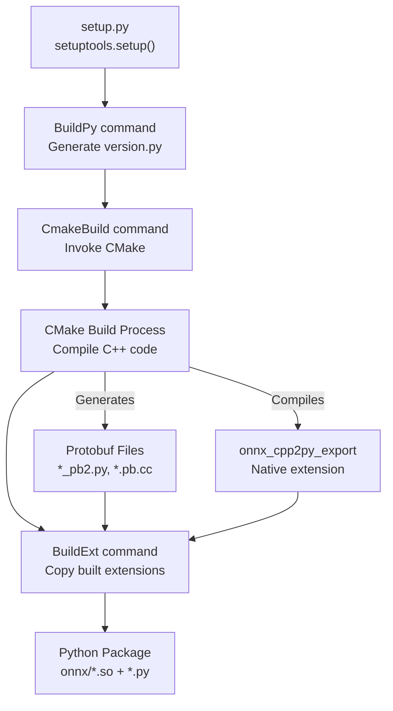
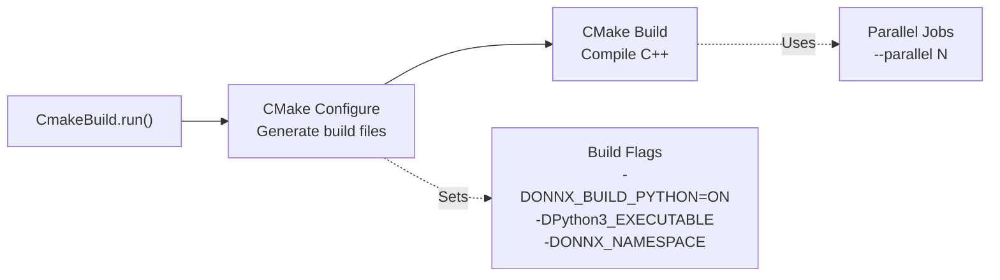
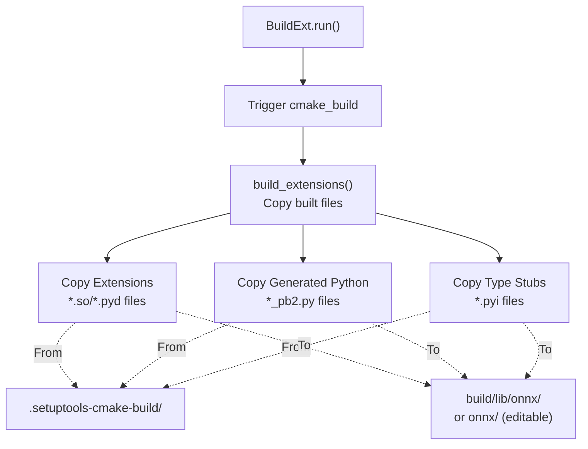
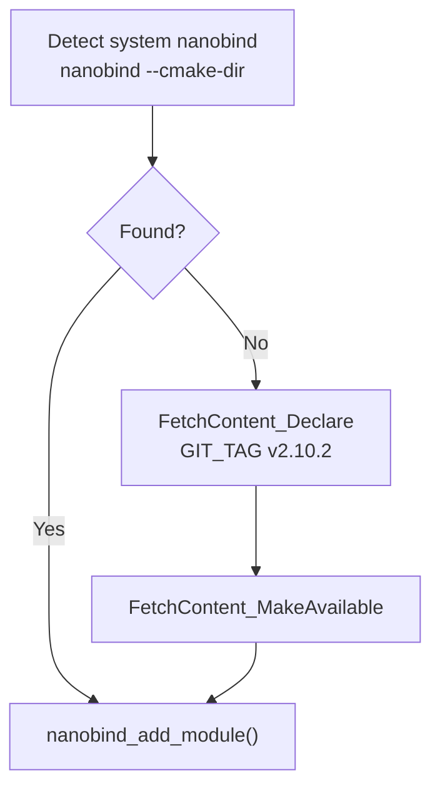
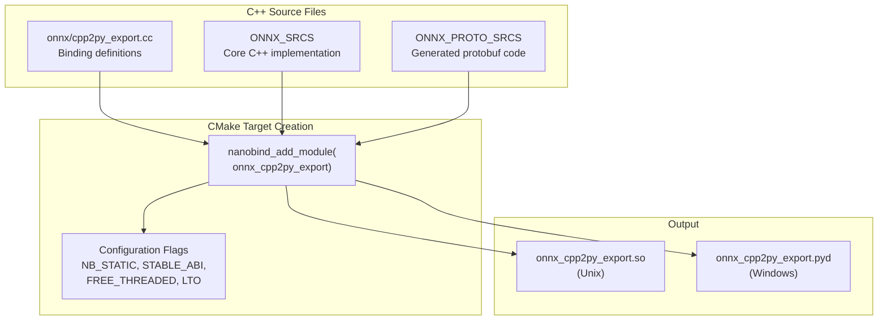
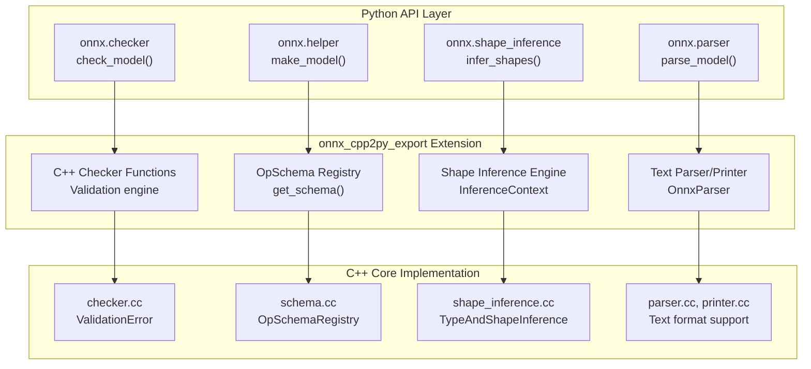
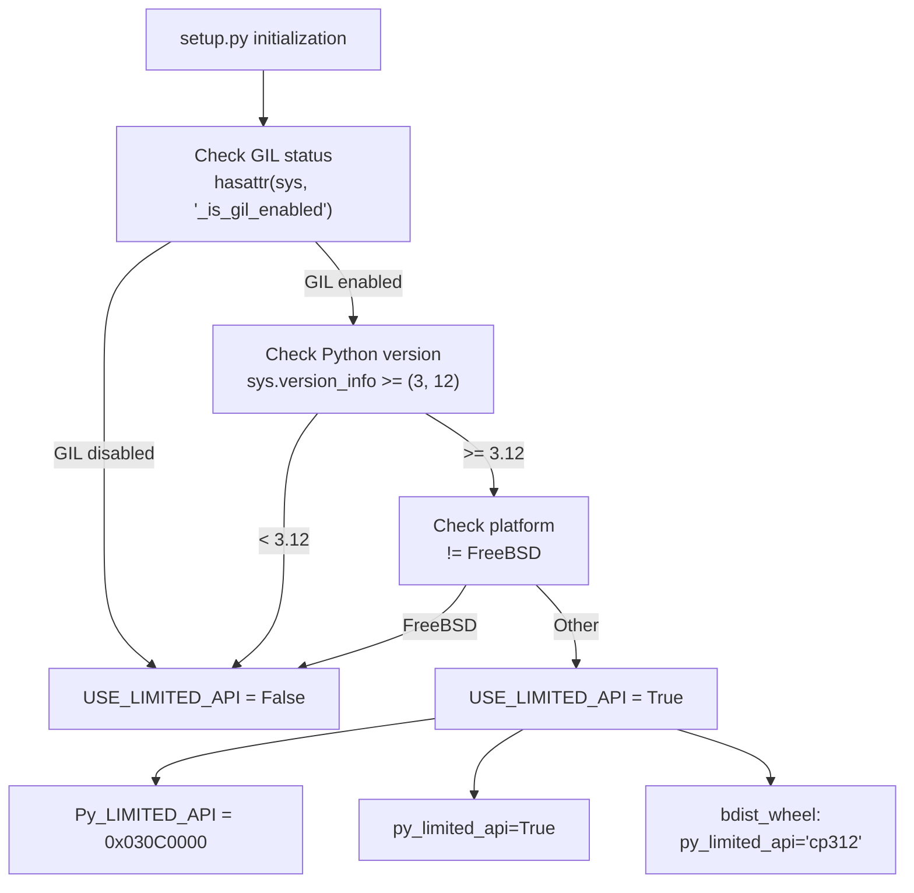
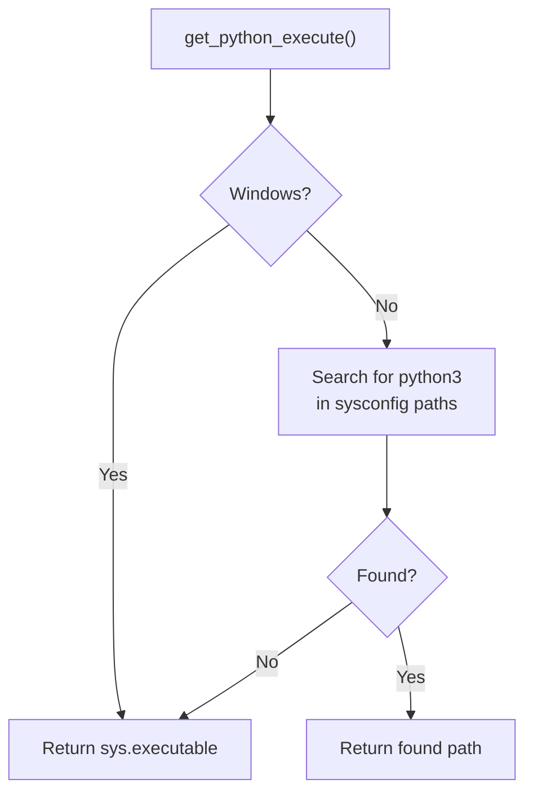

<!-- source: DeepWiki mcp.deepwiki.com · repo onnx/onnx · page 6.3 Python Extension Building · fetched 2026-10-21 -->

# Python Extension Building

<details>
<summary>Relevant source files</summary>

The following files were used as context for generating this wiki page:

- [.github/workflows/main.yml](.github/workflows/main.yml)
- [CMakeLists.txt](CMakeLists.txt)
- [README.md](README.md)
- [cmake/ONNXConfig.cmake.in](cmake/ONNXConfig.cmake.in)
- [cmake/Utils.cmake](cmake/Utils.cmake)
- [cmake/external/googletest.cmake](cmake/external/googletest.cmake)
- [cmake/summary.cmake](cmake/summary.cmake)
- [cmake/unittest.cmake](cmake/unittest.cmake)
- [docs/ImplementingAnOnnxBackend.md](docs/ImplementingAnOnnxBackend.md)
- [docs/OnnxBackendTest.md](docs/OnnxBackendTest.md)
- [onnx/gen_proto.py](onnx/gen_proto.py)
- [onnx/test/cmake/CMakeLists.txt](onnx/test/cmake/CMakeLists.txt)
- [onnx/test/cmake/main.cc](onnx/test/cmake/main.cc)
- [onnx/test/cpp/checker_test.cc](onnx/test/cpp/checker_test.cc)
- [onnx/test/cpp/function_get_test.cc](onnx/test/cpp/function_get_test.cc)
- [onnx/test/cpp/test_main.cc](onnx/test/cpp/test_main.cc)
- [setup.py](setup.py)
- [workflow_scripts/protobuf/build_protobuf_unix.sh](workflow_scripts/protobuf/build_protobuf_unix.sh)
- [workflow_scripts/protobuf/build_protobuf_win.ps1](workflow_scripts/protobuf/build_protobuf_win.ps1)

</details>


## Purpose and Scope

This document describes how ONNX builds its Python extensions using `setup.py`, integrating CMake with setuptools to compile C++ code and create Python bindings via nanobind. For information about the underlying CMake build configuration, see [CMake Build Configuration](#6.1). For protobuf code generation that occurs during this process, see [Protobuf Code Generation](#6.2). For platform-specific build configurations including manylinux wheels, see [Platform-Specific Builds](#6.4).

## Overview

The ONNX Python extension building system bridges Python's setuptools packaging system with CMake's C++ compilation infrastructure. The process creates the `onnx_cpp2py_export` extension module, which exposes C++ functionality (operator schemas, model validation, shape inference) to Python using nanobind bindings.

### High-Level Build Flow



**Sources:** [setup.py:1-358](), [CMakeLists.txt:469-496]()

## Custom setuptools Commands

The build process uses four custom setuptools command classes to orchestrate the C++/Python integration.

### CmakeBuild Command

The `CmakeBuild` class is the core orchestrator that invokes CMake to compile the C++ codebase.



| Configuration | Environment Variable | CMake Flag | Default |
|---------------|---------------------|------------|---------|
| Python Executable | N/A | `-DPython3_EXECUTABLE` | Detected |
| ML Support | `ONNX_ML` | `-DONNX_ML=1` | `1` |
| Proto3 Verification | `ONNX_VERIFY_PROTO3` | `-DONNX_VERIFY_PROTO3=1` | `0` |
| Build Tests | `ONNX_BUILD_TESTS` | `-DONNX_BUILD_TESTS=ON` | `0` |
| Debug Build | `DEBUG` | `-DCMAKE_BUILD_TYPE=Debug` | `Release` |
| Coverage | `COVERAGE` | `-DONNX_COVERAGE=ON` | `0` |
| Parallel Jobs | `MAX_JOBS` / `--parallel` | N/A | CPU count |

**Key implementation details:**

The `CmakeBuild` command creates a build directory at `.setuptools-cmake-build` and invokes CMake twice:
1. **Configure phase** - [setup.py:172-223](): Generates build files with appropriate flags
2. **Build phase** - [setup.py:225-239](): Compiles the code with parallel jobs

Platform-specific logic:
- **Windows**: Selects architecture (`-A x64`, `-A ARM64`, `-A Win32`, `-A ARM`) based on platform detection [setup.py:191-200]()
- **Unix/Mac**: Uses Ninja generator if available for faster builds [setup.py:178-179]()
- **MSVC Static Runtime**: Controlled by `USE_MSVC_STATIC_RUNTIME` environment variable [setup.py:189-190]()

**Sources:** [setup.py:139-240](), [CMakeLists.txt:469-496]()

### BuildPy Command

The `BuildPy` command extends the standard `build_py` to generate `onnx/version.py` with version metadata.

```python
# Generated version.py structure (example)
version = "1.17.0"
git_version = "abc123def456..."
```

The version file is created at different locations depending on installation mode:
- **Normal installation**: Written to `build/lib/onnx/version.py` [setup.py:247]()
- **Editable installation**: Written to `onnx/version.py` in the source tree [setup.py:245]()

**Sources:** [setup.py:242-250](), [setup.py:120-137]()

### BuildExt Command

The `BuildExt` command is responsible for copying compiled extensions from the CMake build directory to the final package location.



**File copying logic:**

1. **Extension modules** [setup.py:271-286]():
   - On Windows: Searches `Debug/` or `Release/` subdirectories in CMake build dir
   - On Unix/Mac: Files are directly in CMake build dir
   - Copies `.so`/`.pyd` files to `{build_lib}/onnx/`

2. **Generated Python files** [setup.py:294-301]():
   - Copies `*_pb2.py` (protobuf Python bindings)
   - Copies `*.pyi` (type stub files for mypy)
   - Destination depends on editable mode

**Sources:** [setup.py:258-302](), [CMakeLists.txt:377-384]()

### Develop Command

The `Develop` command extends the standard `develop` command to support editable installations (`pip install -e .`).

**Sources:** [setup.py:252-256]()

## Extension Module Definition and nanobind Integration

### The onnx_cpp2py_export Extension

The ONNX Python extension is defined as a nanobind module that exposes C++ functionality to Python.

**Extension declaration in setup.py:**

```python
EXT_MODULES = [
    setuptools.Extension(
        name="onnx.onnx_cpp2py_export",
        sources=[],  # Empty - built by CMake
        py_limited_api=USE_LIMITED_API,
        define_macros=macros,
    )
]
```

**Sources:** [setup.py:331-338]()

### nanobind Integration in CMake

The actual extension compilation happens in CMake using nanobind to create Python bindings for C++ code:

#### nanobind Acquisition and Configuration



**nanobind discovery logic** [CMakeLists.txt:426-455]():
1. First attempts to find system-installed nanobind via `python -m nanobind --cmake-dir`
2. If not found, uses CMake FetchContent to download nanobind v2.10.2 from GitHub
3. FetchContent is only used if `FETCHCONTENT_FULLY_DISCONNECTED` is not enabled

#### Extension Module Compilation



**nanobind_add_module() flags** [CMakeLists.txt:458-461]():
- `NB_STATIC`: Statically link nanobind into the extension
- `NB_DOMAIN onnx`: Set exception domain namespace to "onnx"
- `STABLE_ABI`: Enable Python stable ABI for version compatibility
- `FREE_THREADED`: Support Python 3.13+ free-threaded mode
- `LTO`: Enable link-time optimization for smaller binaries

**Key architectural decision:**

The extension is built by directly including `ONNX_SRCS` and `ONNX_PROTO_SRCS` source files [CMakeLists.txt:461](). This means:
- The extension has direct access to all internal C++ APIs
- No need to export symbols from a shared library
- Simpler symbol visibility management
- All code is compiled together in a single translation unit context

The module receives the same compile definitions as the main `onnx` library via `add_onnx_global_defines()` and `add_onnx_compile_options()` [CMakeLists.txt:468-469]().

**Sources:** [CMakeLists.txt:425-470](), [setup.py:331-338]()

## Python C++ Extension Architecture

### What onnx_cpp2py_export Exposes

The `onnx_cpp2py_export` extension module serves as the bridge between Python and C++, exposing critical functionality:



The bindings in `onnx/cpp2py_export.cc` expose:
- **Model validation**: C++ checker functions for fast model verification
- **Schema access**: Query operator schemas, type constraints, and versioning
- **Shape inference**: Compute output shapes and types without execution
- **Text parsing**: Parse and print ONNX models in textual format
- **Protobuf utilities**: Low-level protobuf manipulation functions

**Sources:** [CMakeLists.txt:458-461]()

### Extension Module Loading

The Python package uses an import wrapper to load the native extension:

```
onnx/
├── __init__.py                  # Main package, imports from cpp2py_export
├── onnx_cpp2py_export.so        # Native extension built by nanobind
├── checker.py                   # Python wrapper around C++ checker
├── shape_inference/
│   └── __init__.py              # Python wrapper around C++ inference
└── parser.py                    # Python wrapper around C++ parser
```

Python modules like `checker.py` import functions from `onnx_cpp2py_export` and provide a more Pythonic API on top of the C++ implementation.

**Sources:** [CMakeLists.txt:458-470]()

## ABI3 Limited API Support

ONNX supports the Python Limited API (Stable ABI) for Python 3.12 and later, enabling a single binary wheel to work across multiple Python versions.

### ABI3 Configuration Logic



**Detection logic** [setup.py:337-339]():
```python
NO_GIL = hasattr(sys, "_is_gil_enabled") and not sys._is_gil_enabled()
PY_312_OR_NEWER = sys.version_info >= (3, 12)
USE_LIMITED_API = not NO_GIL and PY_312_OR_NEWER and platform.system() != "FreeBSD"
```

**When ABI3 is enabled:**

1. **C macro definition** [setup.py:342-343](): `Py_LIMITED_API` is set to `0x030C0000` (Python 3.12 API)
2. **Extension tagging** [setup.py:349](): Extension marked with `py_limited_api=True`
3. **Wheel tagging** [setup.py:361](): Wheel tagged with `py_limited_api="cp312"`

**Resulting wheel filename:**
```
onnx-1.17.0-cp312-abi3-linux_x86_64.whl
           ^^^^^  ^^^^
           |      |
           |      +-- Stable ABI marker
           +--------- Minimum Python version
```

This wheel works on Python 3.12, 3.13, 3.14, and future versions without recompilation.

**Limitations:**
- **FreeBSD excluded**: ABI3 support is disabled on FreeBSD due to platform compatibility issues [setup.py:339]()
- **Free-threaded Python excluded**: When GIL is disabled, ABI3 is not used [setup.py:337]()
- **nanobind requirement**: nanobind must support the stable ABI (added in recent versions)

**Sources:** [setup.py:337-347](), [setup.py:358-364](), [README.md:91-93]()

## Version Generation

The `create_version()` function generates `onnx/version.py` with version and git information.

### Version Information Structure

| Variable | Source | Example |
|----------|--------|---------|
| `version` | `VERSION_NUMBER` file | `"1.17.0"` or `"1.17.0.dev20240115"` (preview) |
| `git_version` | `git rev-parse HEAD` | `"abc123def456..."` |

**Preview build logic** [setup.py:74-77]():
- If `ONNX_PREVIEW_BUILD=1` environment variable is set
- Appends `.dev{YYYYMMDD}` to version (e.g., `1.17.0.dev20240115`)
- Used for `onnx-weekly` package on PyPI

**Sources:** [setup.py:63-78](), [setup.py:120-137]()

## Build Configuration Environment Variables

The setup.py script respects numerous environment variables for build customization:

| Environment Variable | Type | Default | Purpose |
|---------------------|------|---------|---------|
| `ONNX_ML` | bool | `1` | Enable ML operators |
| `ONNX_VERIFY_PROTO3` | bool | `0` | Generate and verify proto3 files |
| `ONNX_NAMESPACE` | string | `"onnx"` | C++ namespace |
| `ONNX_BUILD_TESTS` | bool | `0` | Build C++ unit tests |
| `ONNX_DISABLE_EXCEPTIONS` | bool | `0` | Disable C++ exceptions (C++ only) |
| `ONNX_DISABLE_STATIC_REGISTRATION` | bool | `0` | Disable static operator registration |
| `ONNX_PREVIEW_BUILD` | bool | `0` | Create preview/dev build |
| `USE_MSVC_STATIC_RUNTIME` | bool | `0` | Use MSVC static runtime (Windows) |
| `USE_NINJA` | bool | `1` | Use Ninja build system |
| `DEBUG` | bool | `0` | Debug build |
| `COVERAGE` | bool | `0` | Enable coverage instrumentation |
| `MAX_JOBS` | int | CPU count | Number of parallel build jobs |
| `CMAKE_ARGS` | string | N/A | Additional CMake arguments |
| `ONNX_WHEEL_PLATFORM_NAME` | string | N/A | Override wheel platform tag |

**Sources:** [setup.py:36-58]()

## Generated Files and Output Structure

### Build Directory Layout

The CMake build process creates the following structure in `.setuptools-cmake-build/`:

```
.setuptools-cmake-build/
├── CMakeCache.txt
├── CMakeFiles/
├── onnx/
│   ├── onnx-ml.proto           # Generated proto (with ML ops)
│   ├── onnx-ml.proto3          # Proto3 version
│   ├── onnx-ml.pb.cc           # Generated protobuf C++ source
│   ├── onnx-ml.pb.h            # Generated protobuf C++ header
│   ├── onnx_ml_pb2.py          # Generated protobuf Python module
│   ├── onnx_ml_pb2.pyi         # Type stubs for mypy/pyright
│   ├── onnx-operators-ml.proto
│   ├── onnx_operators_ml_pb2.py
│   ├── onnx_operators_ml_pb2.pyi
│   ├── onnx-data.proto
│   ├── onnx_data_pb2.py
│   └── onnx_data_pb2.pyi
├── onnx_cpp2py_export.so       # Compiled extension (Unix/Mac)
├── Release/                     # Windows Release build
│   └── onnx_cpp2py_export.pyd  # Compiled extension (Windows)
└── Debug/                       # Windows Debug build
    └── onnx_cpp2py_export.pyd
```

**File generation process:**

1. **Proto generation** [CMakeLists.txt:367-391](): 
   - `gen_proto.py` processes `*.in.proto` templates
   - Generates both `.proto` and `.proto3` files
   - Protoc compiles to C++ and Python

2. **Extension compilation** [CMakeLists.txt:458-461]():
   - `nanobind_add_module()` compiles C++ bindings
   - Output location varies by platform (Release/Debug on Windows)

3. **Type stub generation** [CMakeLists.txt:381-382]():
   - When `ONNX_GEN_PB_TYPE_STUBS=ON` (default)
   - Protoc generates `.pyi` files for type checking

### Final Package Structure

After `BuildExt` copies files [setup.py:283-315]():

```
build/lib/onnx/              # Or onnx/ for editable installs
├── __init__.py              # Package init, imports from extension
├── version.py               # Generated by BuildPy command
├── onnx_cpp2py_export.so    # Native extension (or .pyd on Windows)
│
├── onnx_ml_pb2.py           # Protobuf Python bindings
├── onnx_ml_pb2.pyi          # Type stubs for static analysis
├── onnx_pb.py               # Import wrapper for onnx_ml_pb2
│
├── onnx_operators_ml_pb2.py
├── onnx_operators_ml_pb2.pyi
├── onnx_operators_pb.py     # Import wrapper
│
├── onnx_data_pb2.py
├── onnx_data_pb2.pyi
└── onnx_data_pb.py          # Import wrapper
```

**Import wrapper generation** [onnx/gen_proto.py:198-220]():

Each `*_pb.py` wrapper file contains a single import statement:
```python
# This file is generated by setup.py. DO NOT EDIT!

from .onnx_ml_pb2 import *  # noqa
```

This allows Python code to use consistent import paths regardless of whether ML operators are enabled:
```python
from onnx.onnx_pb import ModelProto  # Works with or without ONNX_ML
```

**Sources:** [setup.py:283-315](), [CMakeLists.txt:367-391](), [onnx/gen_proto.py:198-220]()

## Python Executable Detection

The build system carefully determines which Python interpreter to use, particularly important for cross-compilation scenarios.

### Detection Logic



**Implementation** [setup.py:97-112]():
- On Windows: Always uses `sys.executable`
- On Unix/Mac: Attempts to find `python3` or `python` in `sysconfig` paths
- Falls back to `sys.executable` if not found
- Passed to CMake as `-DPython3_EXECUTABLE`

This ensures the build uses the correct Python environment, especially when building in virtual environments or conda environments.

**Sources:** [setup.py:97-112](), [setup.py:174]()

## Wheel Customization

The final wheel generation can be customized via the `bdist_wheel` command options:

```python
bdist_wheel_options = {}

if USE_LIMITED_API:
    bdist_wheel_options["py_limited_api"] = "cp312"

if ONNX_WHEEL_PLATFORM_NAME is not None:
    bdist_wheel_options["plat_name"] = ONNX_WHEEL_PLATFORM_NAME
```

**Platform name override** [setup.py:55-57]():
- Useful for MacOS universal binaries
- Can force a specific platform tag (e.g., `macosx_11_0_universal2`)
- See GitHub PR #6117 for context

**Sources:** [setup.py:344-357]()

## Integration with CI/CD

The Python extension building process is tested across multiple platforms in the CI workflow:

### CI Build Matrix

| Platform | Python Versions | Protobuf | Additional Features |
|----------|----------------|----------|---------------------|
| Ubuntu 24.04 | 3.10-3.14, 3.13t, 3.14t | Internal | ASAN, Unity Build |
| Windows Latest | 3.10-3.14, 3.13t, 3.14t | Internal | Lite Proto, MSVC |
| MacOS Latest | 3.10, 3.12-3.14, 3.13t, 3.14t | Internal | Universal2 binaries |
| Ubuntu 24.04 | 3.11 | External | System protobuf test |

**Build commands used in CI** [.github/workflows/main.yml:143-180]():

```bash
# Linux with reference implementation
export SOURCE_DATE_EPOCH=$(git log -1 --pretty=%ct)
pip install -e ".[reference]" -v

# Windows (no reference implementation due to missing dependencies)
pip install -e . -v

# MacOS with reference implementation
pip install -e ".[reference]" -v
```

**Environment variables** [.github/workflows/main.yml:156-180]():

Common across all platforms:
- `DEBUG=1` or `0`: Controls debug vs release build
- `ONNX_ML=1` or `0`: Enable/disable ML operators
- `ONNX_BUILD_TESTS=1`: Build C++ unit tests

Platform-specific `CMAKE_ARGS`:
- **Linux**: `-DONNX_WERROR=ON -DONNX_USE_ASAN=$DEBUG -DONNX_USE_UNITY_BUILD=$unity_build -DONNX_HARDENING=ON`
- **MacOS**: `-DONNX_WERROR=ON -DONNX_USE_UNITY_BUILD=$unity_build -DONNX_HARDENING=ON`
- **Windows**: `-DONNX_WERROR=ON -DONNX_USE_PROTOBUF_SHARED_LIBS=OFF -DONNX_USE_LITE_PROTO=ON -DONNX_USE_UNITY_BUILD=$unity_build -DONNX_HARDENING=ON`

### ABI3 Wheel Testing

The CI matrix specifically tests ABI3 wheel compatibility:
- **Python 3.12+**: Builds wheels with `cp312-abi3` tag
- **Free-threaded Python (3.13t, 3.14t)**: Tests compatibility with GIL-disabled mode
- **Multiple platforms**: Ensures ABI3 works on Linux, Windows, and macOS

After building, the CI runs the full test suite with `pytest` to verify the extension works correctly [.github/workflows/main.yml:196-198]().

### External C++ Linking Test

The CI includes a test that verifies ONNX can be linked as a CMake dependency [.github/workflows/main.yml:211-221]():

```bash
cd ./.setuptools-cmake-build/
sudo cmake --build . --target install
cd .././onnx/test/cmake
mkdir build && cd build
cmake -DONNX_ML=${{ matrix.onnx_ml }} ..
cmake --build .
./main  # Runs test that links against installed ONNX
```

This ensures the installed CMake targets work correctly for downstream C++ projects.

**Sources:** [.github/workflows/main.yml:29-285](), [onnx/test/cmake/CMakeLists.txt:1-10](), [onnx/test/cmake/main.cc:1-29]()

## Command Registration

All custom commands are registered with setuptools in the `CMD_CLASS` dictionary:

```python
CMD_CLASS = {
    "cmake_build": CmakeBuild,
    "build_py": BuildPy,
    "build_ext": BuildExt,
    "develop": Develop,
}

setuptools.setup(
    ext_modules=EXT_MODULES,
    cmdclass=CMD_CLASS,
    version=VERSION_INFO["version"],
    options={"bdist_wheel": bdist_wheel_options},
)
```

**Command execution order:**
1. `build_py` → Generates `version.py`
2. `build_ext` → Runs `cmake_build` → Copies extensions
3. For editable installs: `develop` → Generates `version.py`

**Sources:** [setup.py:304-309](), [setup.py:352-357]()

---

