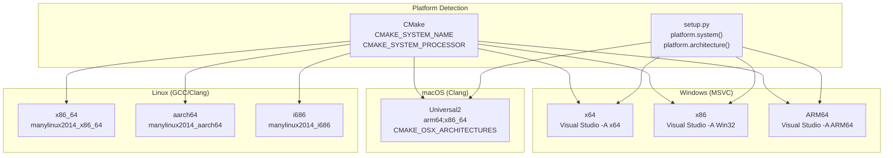
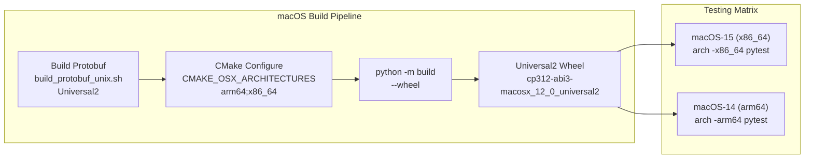
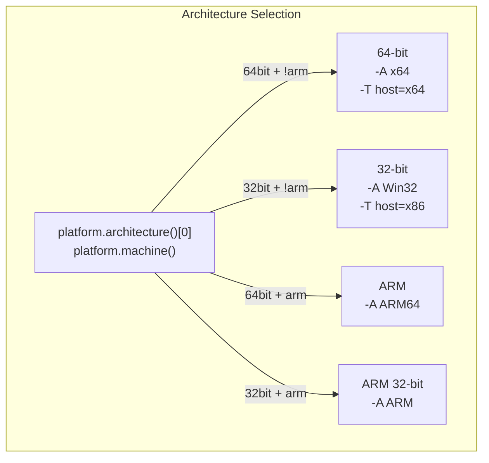
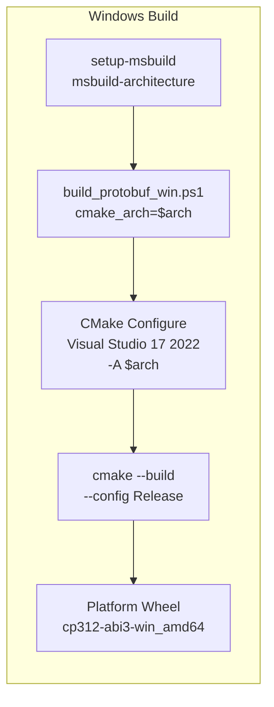
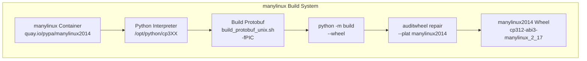
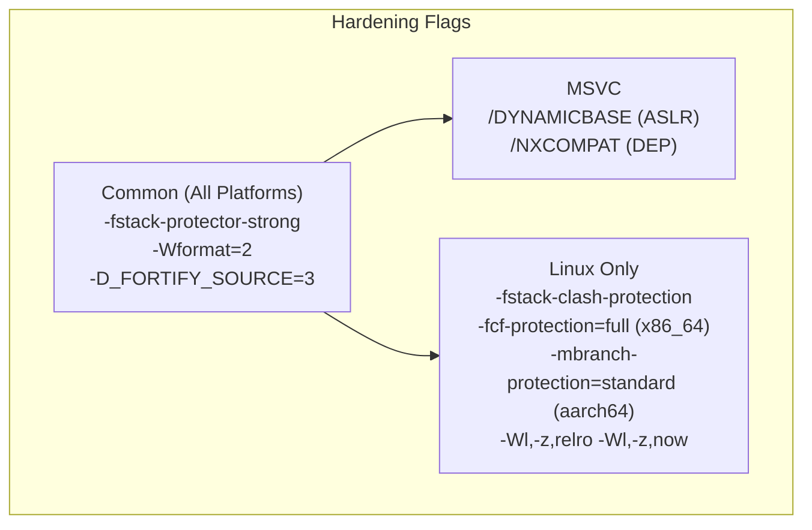
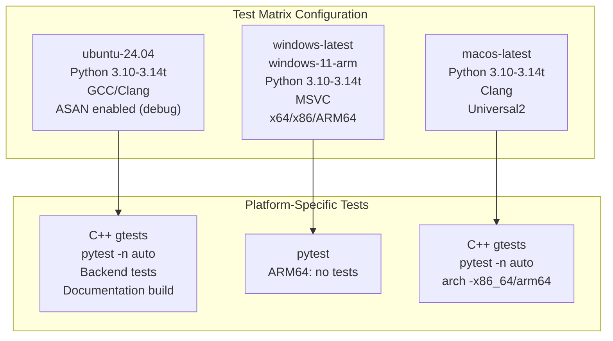

<!-- source: DeepWiki mcp.deepwiki.com · repo onnx/onnx · page 6.4 Platform-Specific Build Configuration · fetched 2026-10-21 -->

# Platform-Specific Build Configuration

<details>
<summary>Relevant source files</summary>

The following files were used as context for generating this wiki page:

- [.github/workflows/auto_update_doc.yml](.github/workflows/auto_update_doc.yml)
- [.github/workflows/codeql.yml](.github/workflows/codeql.yml)
- [.github/workflows/lint.yml](.github/workflows/lint.yml)
- [.github/workflows/main.yml](.github/workflows/main.yml)
- [.github/workflows/manylinux/entrypoint.sh](.github/workflows/manylinux/entrypoint.sh)
- [.github/workflows/pages.yml](.github/workflows/pages.yml)
- [.github/workflows/pr_checks.yml](.github/workflows/pr_checks.yml)
- [.github/workflows/release_mac.yml](.github/workflows/release_mac.yml)
- [.github/workflows/release_sdist.yml](.github/workflows/release_sdist.yml)
- [.github/workflows/release_win.yml](.github/workflows/release_win.yml)
- [.github/workflows/scorecard.yml](.github/workflows/scorecard.yml)
- [.github/workflows/win_no_exception_ci.yml](.github/workflows/win_no_exception_ci.yml)
- [CMakeLists.txt](CMakeLists.txt)
- [README.md](README.md)
- [cmake/ONNXConfig.cmake.in](cmake/ONNXConfig.cmake.in)
- [cmake/Utils.cmake](cmake/Utils.cmake)
- [cmake/external/googletest.cmake](cmake/external/googletest.cmake)
- [cmake/summary.cmake](cmake/summary.cmake)
- [cmake/unittest.cmake](cmake/unittest.cmake)
- [docs/ImplementingAnOnnxBackend.md](docs/ImplementingAnOnnxBackend.md)
- [docs/OnnxBackendTest.md](docs/OnnxBackendTest.md)
- [onnx/gen_proto.py](onnx/gen_proto.py)
- [onnx/test/cmake/CMakeLists.txt](onnx/test/cmake/CMakeLists.txt)
- [onnx/test/cmake/main.cc](onnx/test/cmake/main.cc)
- [onnx/test/cpp/checker_test.cc](onnx/test/cpp/checker_test.cc)
- [onnx/test/cpp/function_get_test.cc](onnx/test/cpp/function_get_test.cc)
- [onnx/test/cpp/test_main.cc](onnx/test/cpp/test_main.cc)
- [setup.py](setup.py)
- [workflow_scripts/protobuf/build_protobuf_unix.sh](workflow_scripts/protobuf/build_protobuf_unix.sh)
- [workflow_scripts/protobuf/build_protobuf_win.ps1](workflow_scripts/protobuf/build_protobuf_win.ps1)

</details>


## Purpose and Scope

This document describes the platform-specific build configurations for ONNX across Windows (MSVC), macOS (Clang), and Linux (GCC/Clang). It covers compiler flags, architecture selection, deployment targets, runtime library linking, and platform-specific build tools.

For general build system configuration, see [CMake Build Configuration](#6.1). For Python extension building specifics, see [Python Extension Building](#6.3). For CI/CD release pipelines, see [Release Orchestration and PyPI Publishing](#7.2).

## Platform Detection and Build Matrix

### Platform and Architecture Support

ONNX builds across multiple platforms and architectures through a combination of CMake platform detection and Python setup logic:



**Platform Detection Logic:**
- **CMake**: Uses `CMAKE_SYSTEM_NAME` and `CMAKE_SYSTEM_PROCESSOR` variables [CMakeLists.txt:155-157]()
- **Python Setup**: Uses `platform.system()` and `platform.architecture()[0]` [setup.py:32-33](), [setup.py:202-211]()

Sources: [CMakeLists.txt:1-560](), [setup.py:1-372](), [.github/workflows/main.yml:35-36]()

## macOS Build Configuration

### Universal2 Binary Support

macOS builds produce Universal2 binaries containing both x86_64 and arm64 architectures in a single wheel file.

**Deployment Target and Architecture:**
```bash
export MACOSX_DEPLOYMENT_TARGET="12.0"
export CMAKE_OSX_ARCHITECTURES="arm64;x86_64"
```

The deployment target is set in the release workflow [.github/workflows/release_mac.yml:18]() and controls the minimum macOS version required.

**Compiler Selection:**
```bash
export CC="clang"
export CXX="clang++"
```

Clang is explicitly selected as the compiler [.github/workflows/release_mac.yml:51-52]() for consistency and Universal2 support.

### Build Process Flow



**Testing on Different Architectures:**

The `arch` command is used to run tests under specific architectures:

```bash
arch -x86_64 python -m pip install dist/*.whl
arch -x86_64 pytest

arch -arm64 python -m pip install dist/*.whl  
arch -arm64 pytest
```

This ensures the Universal2 binary works correctly on both architectures [.github/workflows/release_mac.yml:112-113](), [.github/workflows/release_mac.yml:128-129]().

### macOS-Specific CMake Flags

```cmake
if(NOT CMAKE_BUILD_TYPE)
  set(CMAKE_BUILD_TYPE "Release" CACHE STRING "..." FORCE)
endif()

# Position-independent code enabled by default
if(NOT DEFINED CMAKE_POSITION_INDEPENDENT_CODE)
  set(CMAKE_POSITION_INDEPENDENT_CODE ON)
endif()
```

[CMakeLists.txt:13-22](), [CMakeLists.txt:160-162]()

Sources: [.github/workflows/release_mac.yml:1-151](), [CMakeLists.txt:155-162](), [setup.py:189-211]()

## Windows Build Configuration

### MSVC Toolchain and Architecture Selection

Windows builds use the MSVC compiler with architecture-specific Visual Studio generators.

**Architecture Configuration:**



The architecture is detected and CMake generator arguments are set accordingly [setup.py:202-211]():

```python
if platform.architecture()[0] == "64bit":
    if "arm" in platform.machine().lower():
        cmake_args.extend(["-A", "ARM64"])
    else:
        cmake_args.extend(["-A", "x64", "-T", "host=x64"])
else:
    if "arm" in platform.machine().lower():
        cmake_args.extend(["-A", "ARM"])
    else:
        cmake_args.extend(["-A", "Win32", "-T", "host=x86"])
```

### MSVC Runtime Library Configuration

**Static vs Dynamic Runtime:**

The `ONNX_USE_MSVC_STATIC_RUNTIME` option controls whether to link against the static (`/MT`, `/MTd`) or dynamic (`/MD`, `/MDd`) MSVC runtime:

```cmake
if(WIN32)
  option(ONNX_USE_MSVC_STATIC_RUNTIME "Build with MSVC static runtime" OFF)
endif()
```

[CMakeLists.txt:57-59]()

The `add_msvc_runtime_flag` function applies the appropriate flags [cmake/Utils.cmake:76-84]():

```cmake
function(add_msvc_runtime_flag lib)
  if(ONNX_USE_MSVC_STATIC_RUNTIME)
    target_compile_options(${lib} PRIVATE 
      $<$<NOT:$<CONFIG:Debug>>:/MT>
      $<$<CONFIG:Debug>:/MTd>)
  else()
    target_compile_options(${lib} PRIVATE 
      $<$<NOT:$<CONFIG:Debug>>:/MD>
      $<$<CONFIG:Debug>:/MDd>)
  endif()
endfunction()
```

This is set to `OFF` in release builds [.github/workflows/release_win.yml:92]() to use the dynamic runtime.

### MSVC-Specific Compile Options

```cmake
if(MSVC)
  if(NOT ONNX_DISABLE_EXCEPTIONS)
    string(APPEND CMAKE_CXX_FLAGS " /EHsc /wd26812")
    string(APPEND CMAKE_C_FLAGS " /EHsc /wd26812")
  endif()
  add_compile_options(/MP /utf-8 /nologo)
  add_compile_options(
    /wd5287
    /Zc:lambda
  )
endif()
```

[CMakeLists.txt:111-121]()

**Key MSVC Flags:**
- `/EHsc`: Enable C++ exception handling
- `/wd26812`: Disable enum class warning
- `/MP`: Multi-processor compilation
- `/utf-8`: UTF-8 source and execution character sets
- `/nologo`: Suppress compiler banner
- `/wd5287`: Suppress operand difference warning
- `/Zc:lambda`: Enable lambda conformance mode

**Protobuf-Specific Warnings Disabled:**

```cmake
if(MSVC)
  set(protobuf_warnings
    /wd4146  # unary minus on unsigned type
    /wd4244  # conversion with possible loss of data
    /wd4267  # size_t to int conversion
    /wd4141  # inline used more than once
    /wd4047  # pointer indirection level differs
  )
  target_compile_options(${target} PUBLIC ${protobuf_warnings})
endif()
```

[cmake/Utils.cmake:105-117]()

### Windows Build Process



The PowerShell script builds protobuf with the correct architecture [workflow_scripts/protobuf/build_protobuf_win.ps1:1-34]():

```powershell
param(
    [String]$cmake_arch = "x64",
    [String]$build_type = "Release"
)

cmake -G "Visual Studio 17 2022" -A $cmake_arch ...
cmake --build . --config $build_type --target install
```

### Windows ARM64 Considerations

ARM64 builds have special considerations:
- No dependencies installed during build (no prebuilt wheels available) [.github/workflows/release_win.yml:107-108]()
- Wheels installed with `--no-deps` flag [.github/workflows/release_win.yml:108]()
- Tests skipped on ARM64 due to lack of testing infrastructure [.github/workflows/release_win.yml:138]()

Sources: [CMakeLists.txt:111-132](), [setup.py:199-211](), [.github/workflows/release_win.yml:1-172](), [cmake/Utils.cmake:76-117](), [workflow_scripts/protobuf/build_protobuf_win.ps1:1-34]()

## Linux Build Configuration

### manylinux Container System

Linux builds use manylinux containers to ensure binary compatibility across Linux distributions:



**Python Version Mapping:**

The entrypoint script maps Python versions to manylinux paths [.github/workflows/manylinux/entrypoint.sh:34-37]():

```bash
declare -A python_map=(
  ["3.10"]="cp310-cp310" 
  ["3.11"]="cp311-cp311"
  ["3.12"]="cp312-cp312"
  ["3.13"]="cp313-cp313"
  ["3.13t"]="cp313-cp313t"
  ["3.14"]="cp314-cp314"
  ["3.14t"]="cp314-cp314t"
)
PY_VER=${python_map[$PY_VERSION]}
PIP_INSTALL_COMMAND="/opt/python/${PY_VER}/bin/pip install --no-cache-dir -q"
PYTHON_COMMAND="/opt/python/${PY_VER}/bin/python"
```

### GCC/Clang Compiler Flags

**Non-MSVC Platform Flags:**

```cmake
if(NOT MSVC)
  set(CMAKE_CXX_FLAGS "${CMAKE_CXX_FLAGS} -Wnon-virtual-dtor")
  set(CMAKE_C_FLAGS_DEBUG "${CMAKE_CXX_FLAGS_DEBUG} -O0")
  set(CMAKE_CXX_FLAGS_DEBUG "${CMAKE_CXX_FLAGS_DEBUG} -O0")
  if(ONNX_COVERAGE)
    set(CMAKE_C_FLAGS "${CMAKE_C_FLAGS} -fprofile-arcs -ftest-coverage")
    set(CMAKE_CXX_FLAGS "${CMAKE_CXX_FLAGS} -fprofile-arcs -ftest-coverage")
  endif()
endif()
```

[CMakeLists.txt:97-105]()

**Standard Warning Flags:**

```cmake
if(NOT MSVC)
  target_compile_options(${target} PRIVATE -Wall -Wextra)
  if(CMAKE_COMPILER_IS_GNUCXX AND CMAKE_CXX_COMPILER_VERSION VERSION_GREATER_EQUAL 13)
    target_compile_options(${target} PRIVATE "-Wno-stringop-overflow")
  endif()
  if(CMAKE_CXX_COMPILER_ID STREQUAL "AppleClang")
    target_compile_options(${target} PRIVATE "-Wno-shorten-64-to-32")
  endif()
  if(ONNX_WERROR)
    target_compile_options(${target} PRIVATE "-Werror")
  endif()
endif()
```

[cmake/Utils.cmake:122-133]()

### Position-Independent Code (PIC)

PIC is required for building shared libraries and Python extensions:

```cmake
# Build the libraries with -fPIC including the protobuf lib.
if(NOT DEFINED CMAKE_POSITION_INDEPENDENT_CODE)
  set(CMAKE_POSITION_INDEPENDENT_CODE ON)
endif()
```

[CMakeLists.txt:160-162]()

The protobuf build script also ensures PIC is enabled [workflow_scripts/protobuf/build_protobuf_unix.sh:34]():

```bash
cmake -DCMAKE_POSITION_INDEPENDENT_CODE=ON ...
```

### ASAN/UBSAN Support (Linux Only)

AddressSanitizer (ASAN) and UndefinedBehaviorSanitizer (UBSAN) are supported on Linux:

```cmake
if(ONNX_USE_ASAN AND NOT MSVC)
  find_package(Sanitizer REQUIRED)
  if(TARGET Sanitizer::address)
    target_link_libraries(onnx PRIVATE Sanitizer::address)
    message(STATUS "Use ASAN")
  endif()
  if(TARGET Sanitizer::undefined)
    target_link_libraries(onnx PRIVATE Sanitizer::undefined)
    message(STATUS "Use UBSAN")
  endif()
endif()
```

[CMakeLists.txt:471-481]()

**Environment Variables:**

```yaml
env:
  ASAN_OPTIONS: detect_leaks=0:symbolize=1:detect_stack_use_after_return=true:...
  UBSAN_OPTIONS: print_stacktrace=1
```

[.github/workflows/main.yml:8-9]()

**LD_PRELOAD for GCC ASAN:**

```bash
export LD_PRELOAD="$(/usr/bin/c++ -print-file-name=libasan.so):$LD_PRELOAD"
```

[.github/workflows/main.yml:189]()

### auditwheel Wheel Repair

The `auditwheel` tool bundles external shared libraries into the wheel and repairs the RPATH:

```bash
find . -type f -iname "*-linux*.whl" -exec sh -c \
  'auditwheel repair "$1" -w "$(dirname "$1")" --plat "$2"' \
  _ {} "${PLAT}" \;
```

[.github/workflows/manylinux/entrypoint.sh:71]()

This ensures the wheel is self-contained and compatible with the target manylinux platform.

### Linux-Specific Hardening Flags

```cmake
if(CMAKE_SYSTEM_NAME STREQUAL "Linux")
  # Stack clash protection
  check_cxx_compiler_flag(-fstack-clash-protection COMPILER_SUPPORTS_STACK_CLASH)
  if(COMPILER_SUPPORTS_STACK_CLASH)
    target_compile_options(${target} PRIVATE -fstack-clash-protection)
  endif()
  
  # Control-flow protection (x86_64)
  if(CMAKE_SYSTEM_PROCESSOR MATCHES "x86_64|amd64|AMD64")
    check_cxx_compiler_flag(-fcf-protection=full COMPILER_SUPPORTS_CF_PROTECTION)
    if(COMPILER_SUPPORTS_CF_PROTECTION)
      target_compile_options(${target} PRIVATE -fcf-protection=full)
    endif()
  endif()
  
  # Branch protection (AArch64)
  if(CMAKE_SYSTEM_PROCESSOR MATCHES "aarch64|arm64|ARM64")
    check_cxx_compiler_flag(-mbranch-protection=standard COMPILER_SUPPORTS_BRANCH_PROTECTION)
    if(COMPILER_SUPPORTS_BRANCH_PROTECTION)
      target_compile_options(${target} PRIVATE -mbranch-protection=standard)
    endif()
  endif()
  
  # Linker hardening
  target_link_options(${target} PRIVATE
    -Wl,-z,noexecstack
    -Wl,-z,relro
    -Wl,-z,now
  )
endif()
```

[cmake/Utils.cmake:38-71]()

Sources: [.github/workflows/manylinux/entrypoint.sh:1-84](), [CMakeLists.txt:97-105](), [CMakeLists.txt:160-162](), [CMakeLists.txt:471-481](), [cmake/Utils.cmake:17-73](), [workflow_scripts/protobuf/build_protobuf_unix.sh:1-49]()

## Cross-Compilation Support

### Python Interpreter vs Development Headers

When cross-compiling, different Python packages are needed for the build host (interpreter) and target (development headers):

```cmake
if(CMAKE_CROSSCOMPILING)
  # When cross-compiling, the interpreter and the compiling/linking steps
  # must use a different package.
  if(ONNX_BUILD_PYTHON)
    find_package(Python3 REQUIRED COMPONENTS ${python_dev_component})
  endif()
  find_package(Python REQUIRED COMPONENTS Interpreter)
  set(ONNX_PYTHON_INTERPRETER Python::Interpreter)
else()
  find_package(Python3 REQUIRED COMPONENTS Interpreter ${python_dev_component})
  set(Python_EXECUTABLE ${Python3_EXECUTABLE})
  find_package(Python REQUIRED COMPONENTS Interpreter ${python_dev_component})
  set(ONNX_PYTHON_INTERPRETER Python3::Interpreter)
endif()
```

[CMakeLists.txt:138-153]()

This separation ensures:
- The **host interpreter** runs `gen_proto.py` and other build scripts
- The **target development headers** are used for compiling the Python extension

### AIX Platform Support

```cmake
if(CMAKE_SYSTEM_NAME STREQUAL "AIX")
  set(CMAKE_NO_SYSTEM_FROM_IMPORTED 1)
endif()
```

[CMakeLists.txt:155-157]()

This prevents CMake from using system paths for imported targets on AIX.

Sources: [CMakeLists.txt:138-157]()

## Platform-Specific Hardening Flags

### OpenSSF Compiler Hardening

The `add_onnx_hardening_flags` function implements OpenSSF best practices for compiler hardening when `ONNX_HARDENING=ON`:



**Platform Detection Logic:**

```cmake
function(add_onnx_hardening_flags target)
  if(NOT ONNX_HARDENING)
    return()
  endif()
  
  if(MSVC)
    # Windows hardening
    target_link_options(${target} PRIVATE /DYNAMICBASE /NXCOMPAT)
  else()
    # GCC/Clang hardening
    target_compile_options(${target} PRIVATE
      -Wformat -Wformat=2 -Wimplicit-fallthrough
      -Werror=format-security -fstack-protector-strong
    )
    
    if(NOT ONNX_USE_ASAN)
      target_compile_options(${target} PRIVATE
        -U_FORTIFY_SOURCE -D_FORTIFY_SOURCE=3
      )
    endif()
    
    target_compile_definitions(${target} PRIVATE _GLIBCXX_ASSERTIONS)
    
    if(CMAKE_SYSTEM_NAME STREQUAL "Linux")
      # Linux-specific hardening flags
      ...
    endif()
  endif()
endfunction()
```

[cmake/Utils.cmake:5-73]()

**Note:** macOS does not use the Linux-specific flags (`-fstack-clash-protection`, linker flags) as they are not supported or use different mechanisms [cmake/Utils.cmake:37-44](), [cmake/Utils.cmake:55-62](), [cmake/Utils.cmake:64-71]().

Sources: [cmake/Utils.cmake:5-73](), [.github/workflows/main.yml:160](), [.github/workflows/release_win.yml:92]()

## Build Output and Artifact Locations

### CMake Build Directory

```python
CMAKE_BUILD_DIR = os.path.join(TOP_DIR, ".setuptools-cmake-build")
```

[setup.py:30]()

**Windows Subdirectories:**

On Windows, built extensions are placed in configuration-specific subdirectories:

```python
if WINDOWS:
    debug_lib_dir = os.path.join(CMAKE_BUILD_DIR, "Debug")
    release_lib_dir = os.path.join(CMAKE_BUILD_DIR, "Release")
    if os.path.exists(debug_lib_dir):
        lib_dir = debug_lib_dir
    elif os.path.exists(release_lib_dir):
        lib_dir = release_lib_dir
```

[setup.py:292-297]()

### Generated Files Location

**Protobuf Generated Files:**

```cmake
set(OUTPUT_PROTO_DIR "${CMAKE_CURRENT_BINARY_DIR}/${REL_DIR}")
set(OUTPUT_PB_SRC "${OUTPUT_PROTO_DIR}/${GENERATED_FILE_WE}.pb.cc")
set(GENERATED_PROTO "${OUTPUT_PROTO_DIR}/${GENERATED_FILE_WE}.proto")
```

[CMakeLists.txt:336-339]()

**Python Files:**

Generated Python files (`.py` and `.pyi`) are copied from the build directory:

```python
generated_py_files = glob.glob(os.path.join(CMAKE_BUILD_DIR, "onnx", "*.py"))
generated_pyi_files = glob.glob(os.path.join(CMAKE_BUILD_DIR, "onnx", "*.pyi"))
for src in (*generated_py_files, *generated_pyi_files):
    dst = os.path.join(dst_dir, os.path.relpath(src, CMAKE_BUILD_DIR))
    os.makedirs(os.path.dirname(dst), exist_ok=True)
    self.copy_file(src, dst)
```

[setup.py:308-315]()

Sources: [setup.py:30](), [setup.py:289-315](), [CMakeLists.txt:336-391]()

## Platform-Specific Testing Matrix

### CI Testing Matrix



**Platform Exclusions:**

```yaml
matrix:
  os: [ubuntu-24.04, windows-latest, macos-latest]
  python_version: ['3.14t', '3.14', '3.13t', '3.13', '3.12', '3.11', '3.10']
  exclude:
    - os: windows-11-arm
      python_version: '3.10'
    - os: macos-latest
      python_version: '3.11'
```

[.github/workflows/main.yml:34-88]()

### Platform-Specific Test Commands

**Linux:**
```bash
export LD_LIBRARY_PATH="./.setuptools-cmake-build/:$LD_LIBRARY_PATH"
./.setuptools-cmake-build/onnx_gtests
pytest -sv --cov=onnx -n auto --dist loadscope
```

[.github/workflows/main.yml:208-209](), [.github/workflows/main.yml:198]()

**macOS:**
```bash
./.setuptools-cmake-build/onnx_gtests
pytest -sv --cov=onnx -n auto --dist loadscope
arch -x86_64 pytest  # Test x86_64 on Universal2
arch -arm64 pytest   # Test arm64 on Universal2
```

[.github/workflows/release_mac.yml:129](), [.github/workflows/release_mac.yml:136]()

**Windows:**
```powershell
pytest -sv --cov=onnx --dist loadscope
# ARM64: Tests skipped
```

[.github/workflows/release_win.yml:141](), [.github/workflows/release_win.yml:138]()

Sources: [.github/workflows/main.yml:29-285](), [.github/workflows/release_mac.yml:90-151](), [.github/workflows/release_win.yml:136-171]()

## Reproducible Builds

### SOURCE_DATE_EPOCH Support

ONNX supports reproducible builds on Linux using the `SOURCE_DATE_EPOCH` standard:

```cmake
if(DEFINED ENV{SOURCE_DATE_EPOCH})
  execute_process(
    COMMAND "date" "-u" "-d" "@$ENV{SOURCE_DATE_EPOCH}" "+%Y-%m-%d"
    OUTPUT_VARIABLE BUILD_DATE
    OUTPUT_STRIP_TRAILING_WHITESPACE)
else()
  execute_process(
    COMMAND "date" "+%Y-%m-%d"
    OUTPUT_VARIABLE BUILD_DATE
    OUTPUT_STRIP_TRAILING_WHITESPACE)
endif()
```

[CMakeLists.txt:24-35]()

**CI Usage:**

```bash
export SOURCE_DATE_EPOCH=$(git log -1 --pretty=%ct)
pip install -e ".[reference]" -v
```

[.github/workflows/main.yml:146]()

**manylinux Build:**

```bash
SOURCE_DATE_EPOCH_ARG=$4  # Passed as argument
if [[ -n "$SOURCE_DATE_EPOCH_ARG" ]]; then
    export SOURCE_DATE_EPOCH=$SOURCE_DATE_EPOCH_ARG
fi
```

[.github/workflows/manylinux/entrypoint.sh:22-25]()

This ensures that builds from the same source commit produce identical binaries.

Sources: [CMakeLists.txt:24-35](), [.github/workflows/main.yml:146](), [.github/workflows/manylinux/entrypoint.sh:20-27](), [README.md:114-128]()

---

