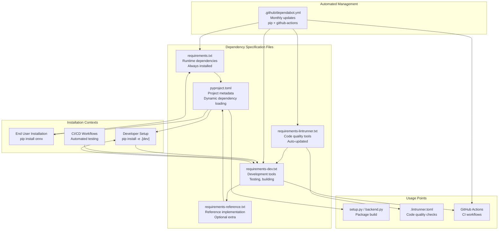
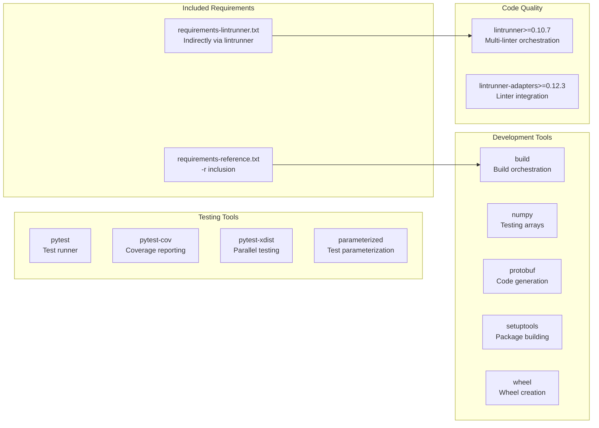
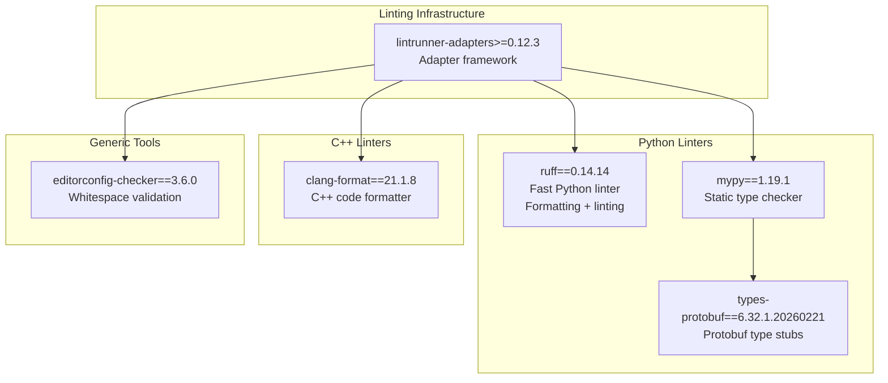
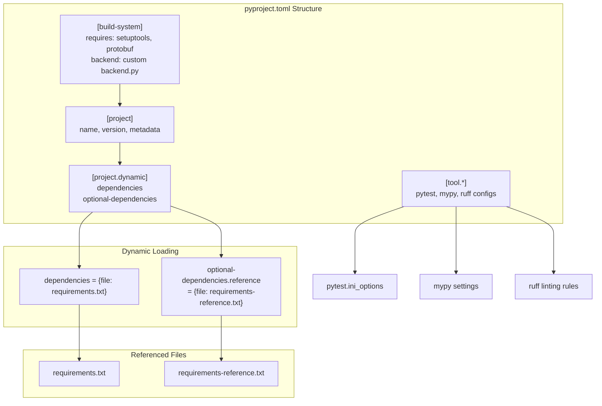
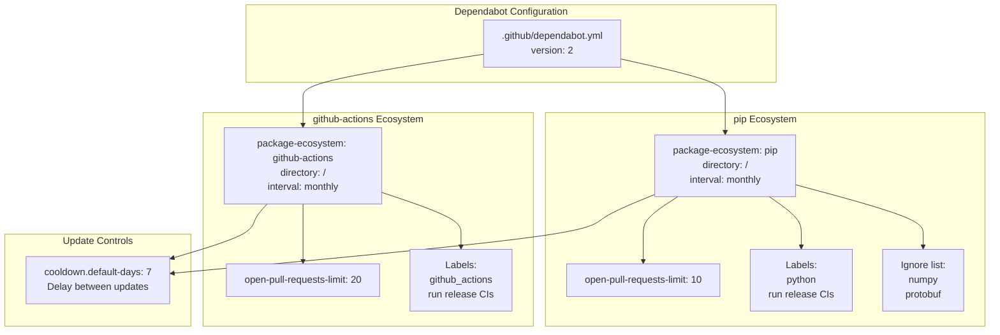
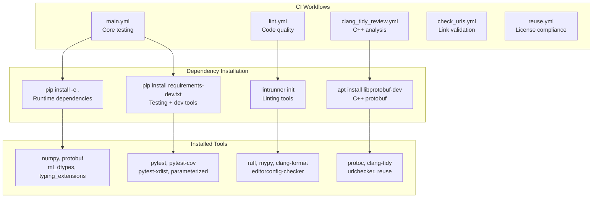

<!-- source: DeepWiki mcp.deepwiki.com · repo onnx/onnx · page 6.5 Dependency Management and Requirements · fetched 2026-10-21 -->

# Dependency Management and Requirements

<details>
<summary>Relevant source files</summary>

The following files were used as context for generating this wiki page:

- [.github/dependabot.yml](.github/dependabot.yml)
- [.github/workflows/check_urls.yml](.github/workflows/check_urls.yml)
- [.github/workflows/clang_tidy_review.yml](.github/workflows/clang_tidy_review.yml)
- [.github/workflows/clang_tidy_review_post.yml](.github/workflows/clang_tidy_review_post.yml)
- [.github/workflows/pr_checks_post.yml](.github/workflows/pr_checks_post.yml)
- [.github/workflows/reuse.yml](.github/workflows/reuse.yml)
- [.lintrunner.toml](.lintrunner.toml)
- [MANIFEST.in](MANIFEST.in)
- [pyproject.toml](pyproject.toml)
- [requirements-dev.txt](requirements-dev.txt)
- [requirements-lintrunner.txt](requirements-lintrunner.txt)
- [requirements.txt](requirements.txt)
- [tools/gen_coverage_report.py](tools/gen_coverage_report.py)

</details>


## Purpose and Scope

This document describes the dependency management system in the ONNX repository, covering how Python dependencies are organized, specified, and automatically updated. It explains the purpose of each requirements file, the role of `pyproject.toml` in dependency specification, and the Dependabot automation system.

For information about C++ dependencies and build-time requirements, see [CMake Build Configuration](#6.1). For Python package distribution and wheel building, see [Python Extension Building](#6.3).

## Dependency Organization Overview

The ONNX repository organizes dependencies into separate categories based on their usage context. This separation allows users to install only the dependencies they need while enabling developers to access the full toolchain.



**Sources:** [requirements.txt](), [requirements-dev.txt](), [requirements-lintrunner.txt](), [pyproject.toml](), [.github/dependabot.yml]()

## Runtime Dependencies

Runtime dependencies are specified in `requirements.txt` and are always installed with the ONNX package. These are the minimum dependencies needed to use ONNX models.

### Dependency Specifications

| Dependency | Version Constraint | Platform Condition | Purpose |
|------------|-------------------|-------------------|---------|
| `numpy` | `>=1.23.2` | All | Array operations, tensor data handling |
| `protobuf` | `>=4.25.1` | All | Protocol buffer serialization |
| `typing_extensions` | `>=4.7.1` | All | Backported typing features |
| `ml_dtypes` | `>=0.5.0` | Not s390x | Extended dtypes (bfloat16, float8) |
| `ml_dtypes` | `>=0.5.4` | s390x only | Extended dtypes with s390x support |

The `ml_dtypes` dependency uses platform markers to specify different versions for the s390x architecture, which requires a newer version for proper support [requirements.txt:4-5]().

### Version Pinning Strategy

The runtime dependencies use **minimum version constraints** (`>=`) rather than exact pinning. This approach allows:

- **Forward compatibility**: Users can install newer versions of dependencies
- **Reduced conflicts**: Easier to integrate ONNX into projects with other dependencies
- **Security updates**: Users automatically receive security patches

Two dependencies are intentionally excluded from Dependabot automatic updates [.github/dependabot.yml:19-21]():
- `numpy`: Updates may break compatibility with older Python versions
- `protobuf`: Updates may introduce breaking changes in serialization format

**Sources:** [requirements.txt:1-6](), [.github/dependabot.yml:18-21]()

## Development Dependencies

Development dependencies in `requirements-dev.txt` include tools for building, testing, and validating the ONNX codebase. These are not installed by default but are required for contributors.



**Development Workflow Integration:**

1. **Initial Setup**: `pip install -r requirements-dev.txt` installs all development tools
2. **Testing**: `pytest` and related tools run the test suite [pyproject.toml:53-59]()
3. **Linting**: `lintrunner` orchestrates all code quality checks
4. **Building**: `build`, `setuptools`, and `wheel` create distributable packages

The file explicitly includes `requirements-reference.txt` via the `-r` directive [requirements-dev.txt:14](), ensuring that developers have access to the reference implementation dependencies.

**Sources:** [requirements-dev.txt:1-15](), [pyproject.toml:53-59]()

## Linting Dependencies

The `requirements-lintrunner.txt` file specifies exact versions of all linting tools, ensuring consistent code quality checks across all environments. This file is automatically updated by Dependabot.

### Linter Versions



**Version Pinning Strategy:**

Unlike runtime dependencies, linting tools use **exact version pinning** (`==`) [requirements-lintrunner.txt:4,6,7,9,11](). This ensures:

- **Consistency**: All developers and CI runs use identical linter versions
- **Reproducibility**: Code quality checks produce identical results
- **Controlled updates**: Changes only occur through Dependabot PRs

The file header explicitly states that it is auto-updated by Dependabot [requirements-lintrunner.txt:1](), indicating that manual edits should be avoided.

**Sources:** [requirements-lintrunner.txt:1-12](), [.lintrunner.toml:57-65]()

## Project Configuration in pyproject.toml

The `pyproject.toml` file serves as the central configuration for the ONNX package, using dynamic dependency loading to reference the requirements files.

### Build System Configuration



### Dynamic Dependency Declaration

The project uses dynamic dependency specification [pyproject.toml:12](), loading dependencies at build time from external files:

**Runtime Dependencies:**
```toml
[tool.setuptools.dynamic]
dependencies = {file = "requirements.txt"}
```
[pyproject.toml:33-34]()

**Optional Dependencies:**
```toml
[tool.setuptools.dynamic.optional-dependencies]
reference = {file = "requirements-reference.txt"}
```
[pyproject.toml:36-37]()

This approach allows:
- **Single source of truth**: Dependencies specified once in requirements files
- **Flexible installation**: Users choose which extras to install
- **Build-time resolution**: Dependencies loaded when building wheels

### Installation Commands

| Command | Dependencies Installed | Use Case |
|---------|----------------------|----------|
| `pip install onnx` | `requirements.txt` only | End users |
| `pip install onnx[reference]` | `requirements.txt` + `requirements-reference.txt` | Reference implementation users |
| `pip install -e .` | `requirements.txt` only | Basic development |
| `pip install -e .[reference]` | Runtime + reference | Development with reference impl |
| `pip install -r requirements-dev.txt` | All dependencies | Full development setup |

**Sources:** [pyproject.toml:6,12,33-37]()

## Automated Dependency Updates with Dependabot

Dependabot automates dependency updates through a monthly scanning schedule configured in `.github/dependabot.yml`. The system monitors both Python packages and GitHub Actions for updates.

### Dependabot Configuration



### Python Package Updates

The pip ecosystem configuration [.github/dependabot.yml:12-25]() monitors:
- All files in the repository root directory
- Monthly update schedule
- 7-day cooldown between updates [.github/dependabot.yml:16-17]()
- Maximum 10 concurrent PRs

**Ignored Dependencies:**

Two dependencies are explicitly excluded from automatic updates [.github/dependabot.yml:18-21]():

```yaml
ignore:
  - dependency-name: "numpy"
  - dependency-name: "protobuf"
```

These must be updated manually because:
- **numpy**: Version changes may affect Python version compatibility matrix
- **protobuf**: Version changes may affect serialization format compatibility

### GitHub Actions Updates

The github-actions ecosystem [.github/dependabot.yml:27-38]() monitors:
- Workflow files in `.github/workflows/`
- Monthly update schedule
- 7-day cooldown period
- Maximum 20 concurrent PRs (higher than pip due to more workflows)

All Dependabot PRs are automatically labeled with `"run release CIs"` [.github/dependabot.yml:25,38](), triggering comprehensive release testing to validate dependency updates before merging.

**Sources:** [.github/dependabot.yml:1-39]()

## Integration with Build System

Dependencies are integrated into the build system through multiple mechanisms, ensuring consistent environments across local development and CI/CD.

### Build-Time Dependencies

The `[build-system]` section of `pyproject.toml` specifies dependencies required before the package can be built:

```toml
[build-system]
requires = ["setuptools>=77", "protobuf>=4.25.1"]
backend-path = ["."]
build-backend = "backend"
```
[pyproject.toml:5-8]()

These are **isolated build dependencies** that `pip` installs into a temporary environment before running the build backend. They are separate from runtime dependencies.

### Package Inclusion Manifest

`MANIFEST.in` specifies which files to include in source distributions, including requirements files:

```
include requirements.txt
include requirements-reference.txt
```
[MANIFEST.in:6-7]()

This ensures that requirements files are available in source distributions, allowing users to install from source with all necessary dependency information.

### Lintrunner Initialization

The `.lintrunner.toml` configuration specifies how to initialize linting dependencies [.lintrunner.toml:57-65]():

```toml
init_command = [
    'python',
    '-m',
    'lintrunner_adapters',
    'run',
    'pip_init',
    '--dry-run={{DRYRUN}}',
    '--requirement=requirements-lintrunner.txt',
]
```

This command is executed when running `lintrunner init`, automatically installing all linting dependencies from the requirements file.

**Sources:** [pyproject.toml:5-8](), [MANIFEST.in:6-7](), [.lintrunner.toml:57-65]()

## Dependency Usage in CI/CD

Dependencies are installed and used across multiple GitHub Actions workflows, with different dependency sets for different testing contexts.



### Clang-Tidy Workflow Dependencies

The clang-tidy workflow requires system-level C++ dependencies installed via apt [.github/workflows/clang_tidy_review.yml:32]():

```yaml
apt_packages: "libprotobuf-dev,protobuf-compiler"
```

This installs:
- `libprotobuf-dev`: Protocol buffer development headers
- `protobuf-compiler`: The `protoc` compiler for generating C++ code

### URL Checker Dependencies

The URL checking workflow uses a third-party action that includes `urlchecker` as a bundled dependency [.github/workflows/check_urls.yml:28]():

```yaml
uses: urlstechie/urlchecker-action@b643b43e2ac605e1475331c7b67247d242b7dce4 # v0.0.34
```

No explicit dependency installation is needed as the action provides its own environment.

### REUSE License Checker

The REUSE compliance workflow similarly uses a bundled action [.github/workflows/reuse.yml:20]():

```yaml
uses: fsfe/reuse-action@676e2d560c9a403aa252096d99fcab3e1132b0f5
```

**Sources:** [.github/workflows/clang_tidy_review.yml:26-34](), [.github/workflows/check_urls.yml:27-38](), [.github/workflows/reuse.yml:15-21]()

## Tool Configuration in pyproject.toml

The `pyproject.toml` file centralizes configuration for multiple development tools, ensuring consistent settings across all environments.

### Pytest Configuration

```toml
[tool.pytest.ini_options]
addopts = "--tb=short --color=yes"
testpaths = [
    "onnx/test",
    "onnx/examples",
]
```
[pyproject.toml:53-59]()

This configuration:
- Uses short tracebacks (`--tb=short`) for cleaner test output
- Enables colored output (`--color=yes`)
- Limits test discovery to specific paths

### MyPy Configuration

The MyPy type checker is configured with strict settings [pyproject.toml:61-81]():

| Setting | Value | Purpose |
|---------|-------|---------|
| `follow_imports` | `silent` | Don't report errors in imported modules |
| `strict_optional` | `true` | Strict checking of Optional types |
| `warn_return_any` | `true` | Warn when returning Any from typed function |
| `check_untyped_defs` | `true` | Type-check untyped functions |
| `ignore_missing_imports` | `true` | Allow imports without type stubs |

Generated protobuf files are explicitly excluded from type checking [pyproject.toml:87-97]():

```toml
[[tool.mypy.overrides]]
module = [
    'onnx.onnx_data_pb',
    'onnx.onnx_data_pb2',
    'onnx.onnx_pb',
    'onnx.onnx_pb2',
    'onnx.onnx_ml_pb2',
    'onnx.onnx_operators_pb',
    'onnx.onnx_operators_ml_pb2',
]
ignore_errors = true
```

### Ruff Configuration

Ruff is configured with an extensive set of rule categories [pyproject.toml:116-147]():

**Enabled Rule Categories:**
- **A**: flake8-builtins - Prevent shadowing built-in names
- **E/W**: pycodestyle - Style guide enforcement
- **F**: Pyflakes - Logic errors
- **N**: pep8-naming - Naming conventions
- **D**: pydocstyle - Docstring conventions
- **I**: isort - Import sorting
- **UP**: pyupgrade - Modern Python syntax
- **RUF**: Ruff-specific rules

The target Python version is set to 3.10 [pyproject.toml:114](), matching the minimum supported version [pyproject.toml:22]().

**Sources:** [pyproject.toml:53-202]()

## Dependency Version Constraints Summary

| File | Constraint Style | Update Strategy | Purpose |
|------|-----------------|-----------------|---------|
| `requirements.txt` | Minimum versions (`>=`) | Manual for numpy/protobuf, Dependabot for others | Runtime flexibility |
| `requirements-dev.txt` | Minimum versions (`>=`) | Dependabot monthly | Development compatibility |
| `requirements-lintrunner.txt` | Exact versions (`==`) | Dependabot monthly | Consistent code quality |
| `pyproject.toml` [build-system] | Minimum versions (`>=`) | Manual | Build isolation |

This multi-tiered approach balances:
- **Flexibility** for end users (runtime dependencies)
- **Stability** for developers (pinned linter versions)
- **Security** through automated updates (Dependabot)
- **Compatibility** through manual control of critical dependencies

**Sources:** [requirements.txt](), [requirements-dev.txt](), [requirements-lintrunner.txt](), [pyproject.toml](), [.github/dependabot.yml]()

---

