<!-- source: DeepWiki mcp.deepwiki.com · repo onnx/onnx · page 7 CI/CD and Release Process · fetched 2026-10-21 -->

# CI/CD and Release Process

<details>
<summary>Relevant source files</summary>

The following files were used as context for generating this wiki page:

- [.github/workflows/auto_update_doc.yml](.github/workflows/auto_update_doc.yml)
- [.github/workflows/codeql.yml](.github/workflows/codeql.yml)
- [.github/workflows/copilot-setup-steps.yml](.github/workflows/copilot-setup-steps.yml)
- [.github/workflows/create_release.yml](.github/workflows/create_release.yml)
- [.github/workflows/lint.yml](.github/workflows/lint.yml)
- [.github/workflows/manylinux/entrypoint.sh](.github/workflows/manylinux/entrypoint.sh)
- [.github/workflows/pages.yml](.github/workflows/pages.yml)
- [.github/workflows/pr_checks.yml](.github/workflows/pr_checks.yml)
- [.github/workflows/preview_source_dist_test.yml](.github/workflows/preview_source_dist_test.yml)
- [.github/workflows/release_linux.yml](.github/workflows/release_linux.yml)
- [.github/workflows/release_mac.yml](.github/workflows/release_mac.yml)
- [.github/workflows/release_sdist.yml](.github/workflows/release_sdist.yml)
- [.github/workflows/release_win.yml](.github/workflows/release_win.yml)
- [.github/workflows/scorecard.yml](.github/workflows/scorecard.yml)
- [.github/workflows/win_no_exception_ci.yml](.github/workflows/win_no_exception_ci.yml)

</details>


This document describes ONNX's continuous integration, continuous deployment, and release management infrastructure. It covers the GitHub Actions workflows that build, test, validate, and publish ONNX packages across multiple platforms, architectures, and Python versions.

For information about the build system itself (CMake configuration, protobuf generation, Python extensions), see [Build System](#6). For information about the testing framework used to validate operator implementations, see [Testing ONNX Models and Backends](#5).

## Overview

The ONNX CI/CD system is built entirely on GitHub Actions and consists of three primary subsystems:

1. **Continuous Integration** - Automated testing on every push and pull request
2. **Release Orchestration** - Multi-platform wheel building and artifact management
3. **Publishing Pipeline** - PyPI deployment for preview builds and official releases

The system builds for **3 operating systems** (Linux, Windows, macOS), **3 architectures** (x64, arm64, x86), and **7 Python versions** (3.10, 3.11, 3.12, 3.13, 3.13t, 3.14, 3.14t), producing over 50 wheel variants per release.

## Release Strategy and Distribution Channels

ONNX uses a multi-tier release strategy with different distribution channels for different purposes:

| Channel | Package Name | Repository | Trigger | Purpose |
|---------|-------------|------------|---------|---------|
| Weekly Preview | `onnx-weekly` | PyPI | Weekly (Monday 00:00 UTC) | Bleeding-edge builds from main |
| Weekly Test | `onnx-weekly` | TestPyPI | Manual workflow_dispatch | Testing preview builds |
| Release Candidate | `onnx` | TestPyPI | Manual from rel-* branch | Pre-release validation |
| Official Release | `onnx` | PyPI | Manual from rel-* branch | Stable production release |

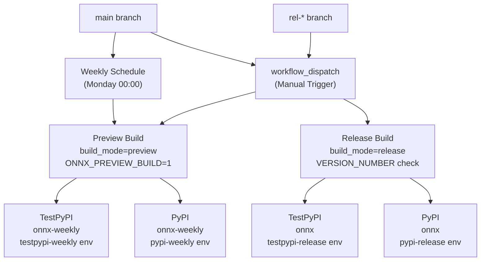

**Sources**: [.github/workflows/create_release.yml:1-329]()

### Preview vs Release Builds

The build mode controls package naming and version handling:

**Preview Builds** (`build_mode: preview`):
- Package name: `onnx-weekly`
- Modifies [pyproject.toml]() to replace `name = "onnx"` with `name = "onnx-weekly"`
- Sets `ONNX_PREVIEW_BUILD=1` environment variable
- Built from `main` branch or with explicit `build_mode: preview` selection
- No version checking required

**Release Builds** (`build_mode: release`):
- Package name: `onnx`
- Requires `rel-*` branch
- Validates that [VERSION_NUMBER]() matches branch name (e.g., `rel-1.16` requires `VERSION_NUMBER` to be `1.16` or `1.16rc1`)
- Uses unmodified [pyproject.toml]()
- Enforces version consistency check before PyPI publication

**Sources**: [.github/workflows/create_release.yml:51-58](), [.github/workflows/release_mac.yml:61-64](), [.github/workflows/release_win.yml:94-102](), [.github/workflows/manylinux/entrypoint.sh:53-59]()

## Release Orchestration Workflow

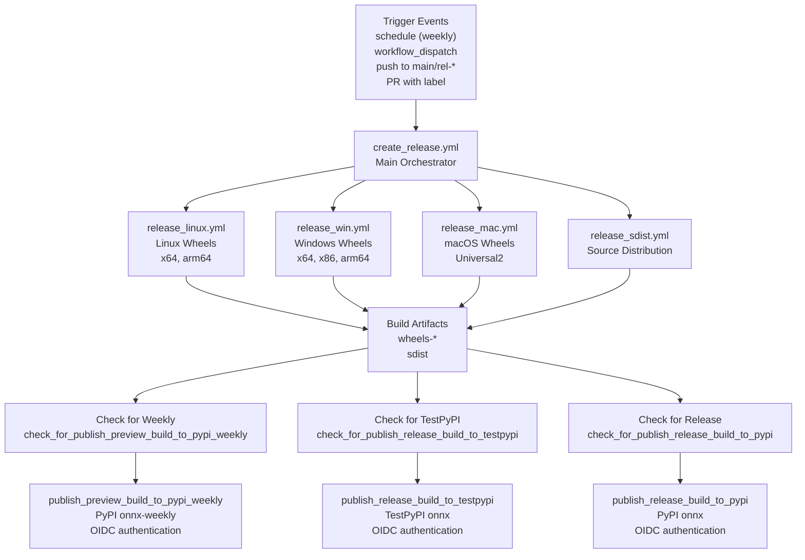

The [create_release.yml]() workflow orchestrates the entire release process using `workflow_call` to invoke platform-specific build workflows. Each platform workflow produces wheel artifacts that are aggregated and conditionally published based on trigger conditions and manual inputs.

**Sources**: [.github/workflows/create_release.yml:67-96]()

### Publishing Conditions

Each publishing job has strict guard conditions:

| Job | Conditions |
|-----|-----------|
| `publish_preview_build_to_pypi_weekly` | `github.ref == 'refs/heads/main'` AND (`schedule` event OR `publish_pypi_weekly == 'yes'`) |
| `publish_preview_build_to_testpypi_weekly` | `github.ref == 'refs/heads/main'` AND `publish_testpypi_weekly == 'yes'` |
| `publish_release_build_to_testpypi` | `startsWith(github.ref, 'refs/heads/rel-')` AND `publish_testpypi_release == 'yes'` |
| `publish_release_build_to_pypi` | `startsWith(github.ref, 'refs/heads/rel-')` AND `publish_pypi_release == 'yes'` AND `build_mode == 'release'` |

**Sources**: [.github/workflows/create_release.yml:97-131](), [.github/workflows/create_release.yml:132-197](), [.github/workflows/create_release.yml:237-286](), [.github/workflows/create_release.yml:288-321]()

## Platform-Specific Build Workflows

### Linux Build Pipeline

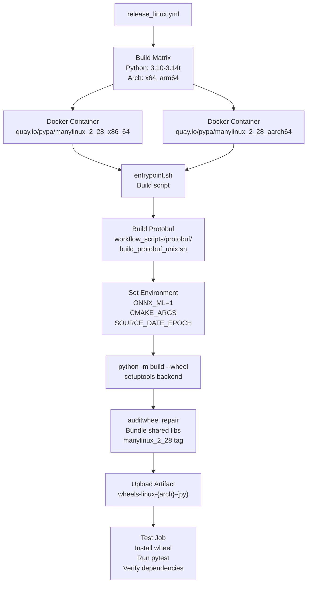

The Linux build uses manylinux containers to ensure compatibility across Linux distributions. Key components:

- **Container**: `quay.io/pypa/manylinux_2_28_x86_64:2025.10.10-1` for x64, `quay.io/pypa/manylinux_2_28_aarch64:2025.10.10-1` for arm64
- **Build Script**: [.github/workflows/manylinux/entrypoint.sh:1-84]() runs inside container
- **Protobuf**: Built from source using [workflow_scripts/protobuf/build_protobuf_unix.sh]()
- **Environment**: `ONNX_ML=1`, `CMAKE_ARGS="-DONNX_USE_LITE_PROTO=ON -DONNX_HARDENING=ON"`
- **Reproducibility**: `SOURCE_DATE_EPOCH` set from git commit timestamp
- **Wheel Repair**: `auditwheel repair` bundles external shared libraries and adds manylinux platform tag

**Python Version Mapping**:
```bash
declare -A python_map=(
  ["3.10"]="cp310-cp310" 
  ["3.11"]="cp311-cp311" 
  ["3.12"]="cp312-cp312" 
  ["3.13"]="cp313-cp313" 
  ["3.13t"]="cp313-cp313t"  # Free-threaded
  ["3.14"]="cp314-cp314" 
  ["3.14t"]="cp314-cp314t"  # Free-threaded
)
```

**Sources**: [.github/workflows/release_linux.yml:1-176](), [.github/workflows/manylinux/entrypoint.sh:1-84]()

### Windows Build Pipeline

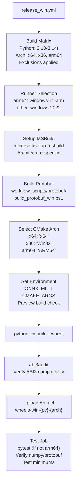

Windows builds have architecture-specific complexity:

- **Runners**: `windows-11-arm` for ARM64, `windows-2022` for x64/x86
- **MSBuild**: Architecture-aware Visual Studio 2022 setup
- **CMake Architecture Mapping**: x64 → `x64`, x86 → `Win32`, arm64 → `ARM64`
- **Protobuf Build**: [workflow_scripts/protobuf/build_protobuf_win.ps1]() with architecture parameter
- **ARM64 Limitations**: No dependency wheels available, installed with `--no-deps`, skipped tests

**Matrix Exclusions**:
```yaml
exclude:
  - python-version: '3.14t'
    architecture: 'x86'
  - python-version: '3.13t'
    architecture: 'x86'
  - python-version: '3.10'
    architecture: 'arm64'
```

**Sources**: [.github/workflows/release_win.yml:1-172]()

### macOS Build Pipeline

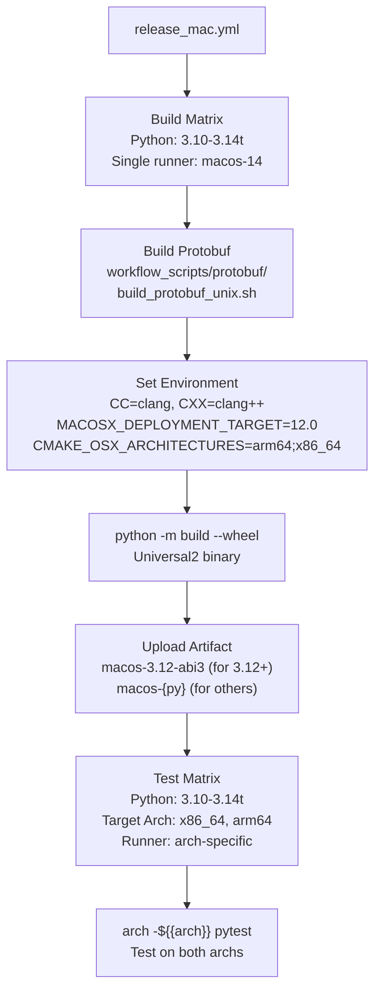

macOS builds produce Universal2 binaries containing both x86_64 and arm64 code:

- **Runner**: `macos-14` (arm64) for building
- **Deployment Target**: `MACOSX_DEPLOYMENT_TARGET=12.0` (macOS 12+)
- **Architectures**: `CMAKE_OSX_ARCHITECTURES="arm64;x86_64"` creates Universal2 binaries
- **Compiler**: `CC=clang`, `CXX=clang++`
- **Testing**: Separate test matrix runs on both `macos-15` (x86_64) and `macos-14` (arm64) using `arch -x86_64` and `arch -arm64` commands

**Sources**: [.github/workflows/release_mac.yml:1-151]()

## ABI3 Wheel Strategy

ONNX uses Python's Limited API (ABI3) to reduce the number of wheels needed:

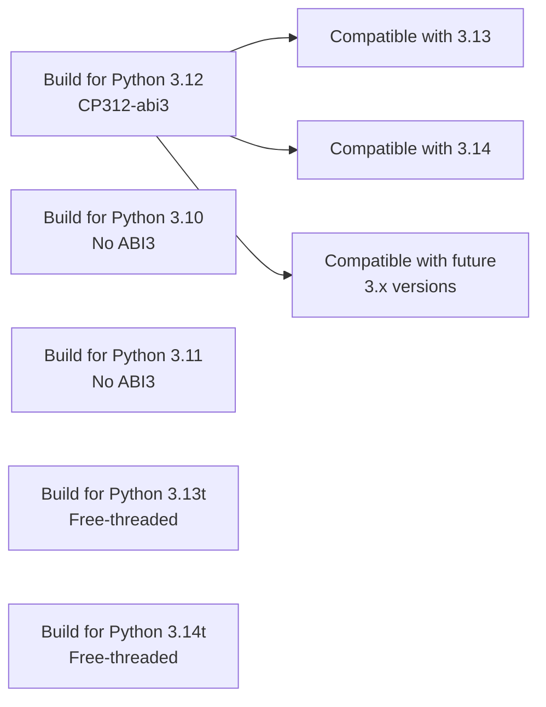

**Artifact Upload Logic**:

For **Python 3.12**: Upload to `wheels-{os}-3.12-abi3` artifact
- Used by Python 3.12, 3.13, 3.14 (non-free-threaded)

For **Python 3.10, 3.11, 3.13t, 3.14t**: Upload to `wheels-{os}-{python-version}` artifact
- Python 3.10 and 3.11 don't use ABI3
- Free-threaded variants (3.13t, 3.14t) need separate builds

**Verification**: All wheels are checked with `abi3audit` to verify ABI3 compliance

**Sources**: [.github/workflows/release_mac.yml:79-88](), [.github/workflows/release_win.yml:120-133](), [.github/workflows/release_linux.yml:133-143]()

## Source Distribution Build

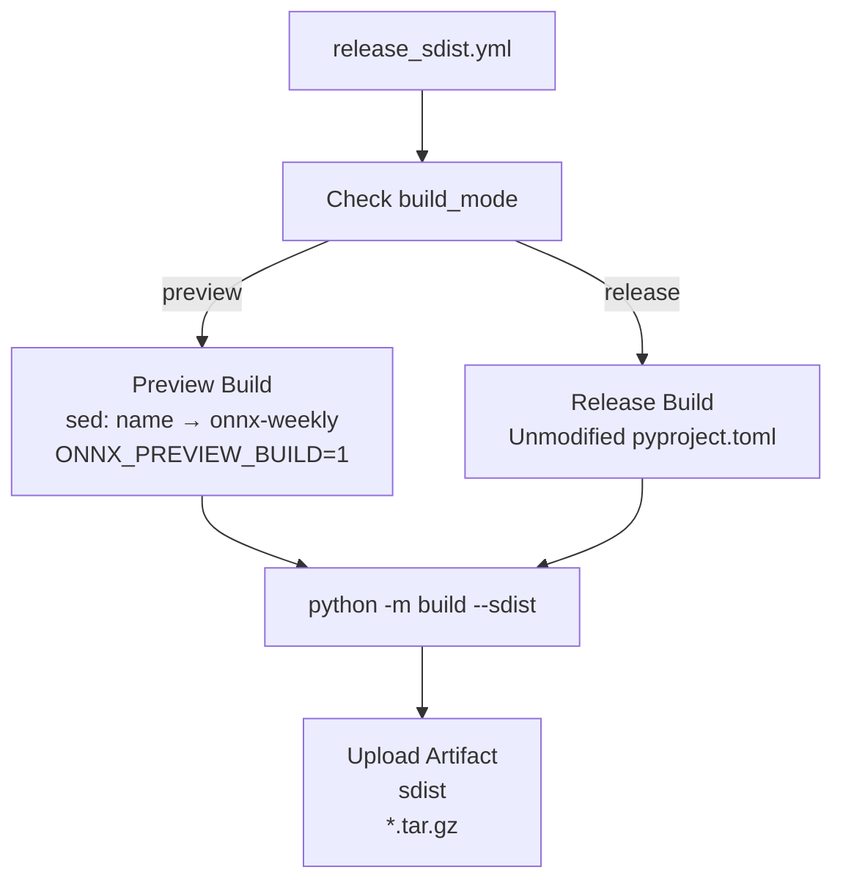

The source distribution build is simpler as it's platform-independent:

- **Single Build**: Runs only once on `ubuntu-24.04` with Python 3.10
- **No Compilation**: Source distribution doesn't include compiled code
- **Preview Handling**: Same package name modification as wheel builds
- **Artifact Name**: `sdist` containing `*.tar.gz`

**Sources**: [.github/workflows/release_sdist.yml:1-67]()

## Continuous Integration Workflows

### Main CI Workflow (main.yml)

While not included in the provided files, the main CI is referenced in the diagrams. The key workflows shown are supplementary CI processes:

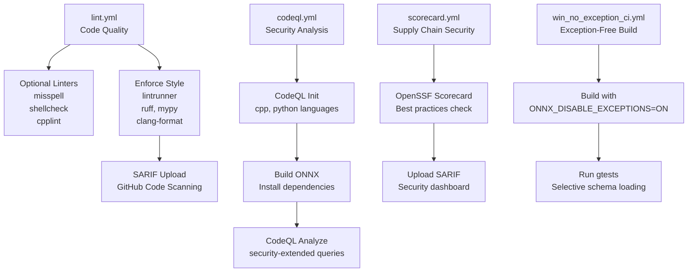

**Sources**: [.github/workflows/lint.yml:1-139](), [.github/workflows/codeql.yml:1-76](), [.github/workflows/scorecard.yml:1-49](), [.github/workflows/win_no_exception_ci.yml:1-81]()

### Linting Infrastructure

The `lint.yml` workflow has two jobs:

**1. Optional Linters** (informational):
- `misspell`: Spell checking with US locale
- `shellcheck`: Shell script static analysis
- `cpplint`: C++ style checking with `--linelength=120`

**2. Enforce Style** (required):
- Runs `lintrunner` with all configured linters
- Verifies auto-generated files are up-to-date:
  - `ONNX_ML=1 python onnx/defs/gen_doc.py`
  - `python onnx/gen_proto.py -l` and `python onnx/gen_proto.py -l --ml`
  - `python onnx/backend/test/stat_coverage.py`
- Produces SARIF output for GitHub Code Scanning dashboard
- Uploads artifacts for debugging: `lint.json`, `lintrunner.sarif`

**Custom ONNX Namespace Test**: Builds with `ONNX_NAMESPACE=ONNX_NAMESPACE_FOO_BAR_FOR_CI` to ensure namespace independence

**Sources**: [.github/workflows/lint.yml:57-139]()

### CodeQL Security Analysis

The `codeql.yml` workflow performs static security analysis:

- **Languages**: `cpp` and `python`
- **Queries**: `security-extended` and `security-and-quality`
- **Configuration**: [.github/codeql/codeql-config.yml]()
- **Build Step**: Installs ONNX with `ONNX_ML=1` so CodeQL can analyze real code paths
- **Schedule**: Weekly on Friday at 6:33 UTC
- **Triggers**: Also runs on push/PR to main and rel-* branches

**Sources**: [.github/workflows/codeql.yml:1-76]()

### OpenSSF Scorecard

The `scorecard.yml` workflow assesses supply chain security:

- **Analysis**: Runs `ossf/scorecard-action` to check security best practices
- **Output**: SARIF format uploaded to code-scanning dashboard
- **Metrics**: Evaluates branch protection, dependency management, token permissions, etc.
- **Schedule**: Weekly on Saturday at 10:24 UTC
- **Publishing**: Results published to OpenSSF Scorecard public dashboard

**Sources**: [.github/workflows/scorecard.yml:1-49]()

## Documentation and Automation Workflows

### Documentation Publishing

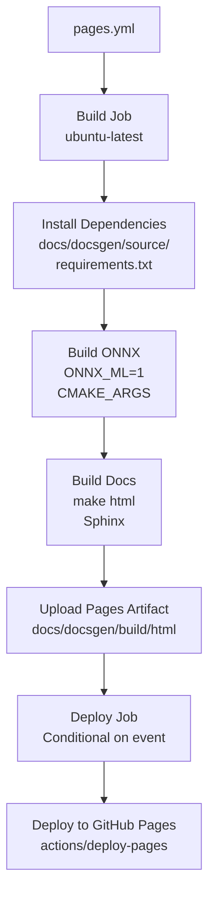

The `pages.yml` workflow builds and publishes documentation to GitHub Pages:

- **Build**: Always builds on PR and push to main
- **Deploy**: Only deploys when `github.event_name != 'pull_request'`
- **Source**: Sphinx documentation in [docs/docsgen]()
- **ONNX Build**: Installs development version with `ONNX_ML=1` and `CMAKE_ARGS="-DONNX_USE_PROTOBUF_SHARED_LIBS=ON -DONNX_WERROR=ON"`

**Sources**: [.github/workflows/pages.yml:1-69]()

### Automatic Documentation Updates

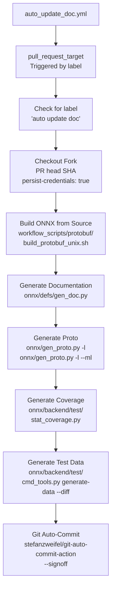

The `auto_update_doc.yml` workflow automatically updates generated documentation and test data when a PR is labeled with "auto update doc":

- **Trigger**: `pull_request_target` - runs with repository permissions
- **Safety**: Only executes if PR has specific label
- **Checkout**: Uses PR head SHA from fork repository
- **Updates**: Regenerates operator documentation, protocol buffers, coverage reports, and test data
- **Commit**: Automatically commits changes back to PR branch with `--signoff`

**Security Note**: Uses `pull_request_target` carefully with fork checkout to avoid arbitrary code execution

**Sources**: [.github/workflows/auto_update_doc.yml:1-61]()

### PR Validation Workflow

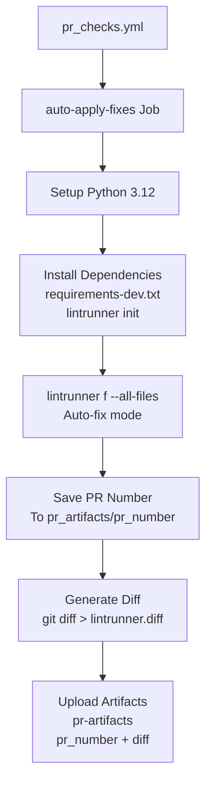

The `pr_checks.yml` workflow suggests automatic fixes for linting issues:

- **Trigger**: Pull requests to main branch
- **Lintrunner**: Runs with `lintrunner f` (fix mode) on all files
- **Artifacts**: Saves PR number and generated diff to `pr-artifacts`
- **Integration**: Artifacts can be consumed by a separate privileged workflow to post suggestions

**Note**: The workflow runs with minimal permissions (`contents: read`) for security. Actual commenting would require a separate `pull_request_target` workflow.

**Sources**: [.github/workflows/pr_checks.yml:1-98]()

## Wheel Testing Strategy

All wheel builds include comprehensive testing phases:

### Test Matrix

Each platform runs tests across a broader matrix than the build matrix:

| Platform | Build Python Versions | Test Python Versions | Test Architectures |
|----------|----------------------|---------------------|-------------------|
| Linux | 3.10, 3.11, 3.12, 3.13t, 3.14t | 3.10, 3.11, 3.12, 3.13, 3.13t, 3.14, 3.14t | x64, arm64 |
| Windows | 3.10, 3.11, 3.12, 3.13t, 3.14t (per arch) | Same as build | x64, x86, arm64 |
| macOS | 3.10, 3.11, 3.12, 3.13t, 3.14t | 3.10, 3.11, 3.12, 3.13, 3.13t, 3.14, 3.14t | x86_64, arm64 |

**ABI3 Testing**: Python 3.13 and 3.14 (non-free-threaded) download the 3.12 ABI3 wheel and verify compatibility.

### Test Phases

Each test job runs three phases:

**1. Standard Test**:
```bash
python -m pip install --upgrade dist/*.whl
pytest
```

**2. Latest Dependency Test**:
```bash
python -m pip uninstall -y numpy onnx
python -m pip install numpy  # Latest version
python -m pip install --upgrade dist/*.whl
pytest
```

**3. Minimum Dependency Test**:
```bash
python -m pip uninstall -y numpy protobuf onnx
python -m pip install -r requirements-min.txt  # Minimum versions
python -m pip install --upgrade dist/*.whl
pytest
```

This ensures ONNX works with both newest and oldest supported dependency versions.

**Platform-Specific**: macOS uses `arch -x86_64` and `arch -arm64` to test both architectures of Universal2 binaries. Windows skips tests for ARM64 and free-threaded builds due to dependency availability.

**Sources**: [.github/workflows/release_mac.yml:126-150](), [.github/workflows/release_win.yml:135-171](), [.github/workflows/release_linux.yml:149-175]()

## Environment Variables and Configuration

### Build Environment Variables

| Variable | Purpose | Values |
|----------|---------|--------|
| `ONNX_ML` | Enable ML operator domain | Always `1` in release builds |
| `CMAKE_ARGS` | CMake build flags | `-DONNX_USE_LITE_PROTO=ON -DONNX_WERROR=ON -DONNX_HARDENING=ON` |
| `ONNX_PREVIEW_BUILD` | Mark as preview build | `1` for preview, unset for release |
| `BUILD_MODE` | Build type input | `preview` or `release` |
| `ONNX_BUILD_TESTS` | Build C++ tests | `0` in some workflows, `ON` in others |
| `ONNX_NAMESPACE` | Custom namespace | `ONNX_NAMESPACE_FOO_BAR_FOR_CI` in lint workflow |
| `SOURCE_DATE_EPOCH` | Reproducible builds | Git commit timestamp (Linux only) |

### Platform-Specific Variables

**Linux**:
- `LD_LIBRARY_PATH=/usr/local/lib`: For protobuf library discovery
- `MANYLINUX_WHEEL_X64=manylinux_2_28_x86_64`
- `MANYLINUX_WHEEL_ARM64=manylinux_2_28_aarch64`

**Windows**:
- CMake architecture: `x64`, `Win32`, or `ARM64`
- `CMAKE_ARGS=-DONNX_USE_PROTOBUF_SHARED_LIBS=OFF` (Windows uses static protobuf)

**macOS**:
- `MACOSX_DEPLOYMENT_TARGET=12.0`
- `CMAKE_OSX_ARCHITECTURES=arm64;x86_64` (Universal2)
- `CC=clang`, `CXX=clang++`

**Sources**: [.github/workflows/manylinux/entrypoint.sh:32-49](), [.github/workflows/release_win.yml:74-92](), [.github/workflows/release_mac.yml:17-56]()

## PyPI Publishing with OIDC

ONNX uses GitHub's OIDC authentication for secure PyPI publishing without long-lived tokens:

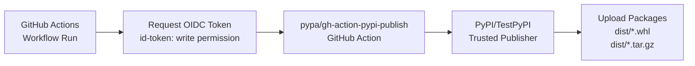

**Configuration**:
- **Permissions**: `id-token: write` and `contents: read`
- **Environment**: Each PyPI target is a protected GitHub environment
  - `pypi-weekly`: Official weekly preview builds
  - `testpypi-weekly`: Test weekly preview builds  
  - `testpypi-release`: Test release candidates
  - `pypi-release`: Official stable releases
- **Action**: `pypa/gh-action-pypi-publish@ed0c53931b1dc9bd32cbe73a98c7f6766f8a527e`
- **Options**: `verbose: true`, `print-hash: true` for transparency

**Artifact Download**:
```yaml
- uses: actions/download-artifact@37930b1c2abaa49bbe596cd826c3c89aef350131
  with:
    pattern: wheels*
    path: dist
    merge-multiple: true
```

All `wheels-*` artifacts are merged into a single `dist/` directory for publishing.

**Sources**: [.github/workflows/create_release.yml:159-183](), [.github/workflows/create_release.yml:211-234](), [.github/workflows/create_release.yml:263-285](), [.github/workflows/create_release.yml:301-320]()

## Protobuf Build Scripts

All platforms build protobuf from source for consistency:

**Unix (Linux/macOS)**: [workflow_scripts/protobuf/build_protobuf_unix.sh]()
- Takes number of cores and install prefix as arguments
- Builds protobuf with `cmake` and `make -j`
- Sets environment variables for CMake to find protobuf

**Windows**: [workflow_scripts/protobuf/build_protobuf_win.ps1]()
- Takes CMake architecture as parameter
- Builds with MSBuild
- Static linking (`ONNX_USE_PROTOBUF_SHARED_LIBS=OFF`)

**Why Build from Source?**:
1. **Consistency**: Same protobuf version across all platforms
2. **Compatibility**: Ensures ABI compatibility with ONNX build
3. **Optimization**: Platform-specific optimizations
4. **Control**: Exact configuration control

**Sources**: [.github/workflows/manylinux/entrypoint.sh:43-45](), [.github/workflows/release_win.yml:88](), [.github/workflows/release_mac.yml:58-60]()

## Concurrency Control

All workflows use concurrency groups to prevent resource waste:

```yaml
concurrency:
  group: ${{ github.workflow }}-${{ github.ref }}-${{ github.event_name == 'workflow_dispatch' }}
  cancel-in-progress: true
```

This configuration:
- Groups runs by workflow name, git ref, and whether manually triggered
- Cancels in-progress runs when new commits are pushed
- Prevents duplicate builds from the same PR
- Allows manual triggers to run separately from automatic triggers

**Exception**: The `release_sdist.yml` workflow has a separate group suffix `-sdist` to allow sdist builds to run independently.

**Sources**: [.github/workflows/create_release.yml:63-65](), [.github/workflows/lint.yml:18-20](), [.github/workflows/release_sdist.yml:20-22]()

## Key Files and Entry Points

| File Path | Purpose |
|-----------|---------|
| [.github/workflows/create_release.yml]() | Main release orchestration workflow |
| [.github/workflows/release_linux.yml]() | Linux wheel builds via manylinux containers |
| [.github/workflows/release_win.yml]() | Windows wheel builds for x64/x86/arm64 |
| [.github/workflows/release_mac.yml]() | macOS Universal2 wheel builds |
| [.github/workflows/release_sdist.yml]() | Source distribution builds |
| [.github/workflows/manylinux/entrypoint.sh]() | Linux container build script |
| [.github/workflows/lint.yml]() | Code quality and style enforcement |
| [.github/workflows/codeql.yml]() | Security analysis with CodeQL |
| [.github/workflows/scorecard.yml]() | Supply chain security assessment |
| [.github/workflows/pages.yml]() | Documentation building and publishing |
| [.github/workflows/auto_update_doc.yml]() | Automatic documentation regeneration |
| [workflow_scripts/protobuf/build_protobuf_unix.sh]() | Unix protobuf build script |
| [workflow_scripts/protobuf/build_protobuf_win.ps1]() | Windows protobuf build script |

**Sources**: All workflow files cited above

---

