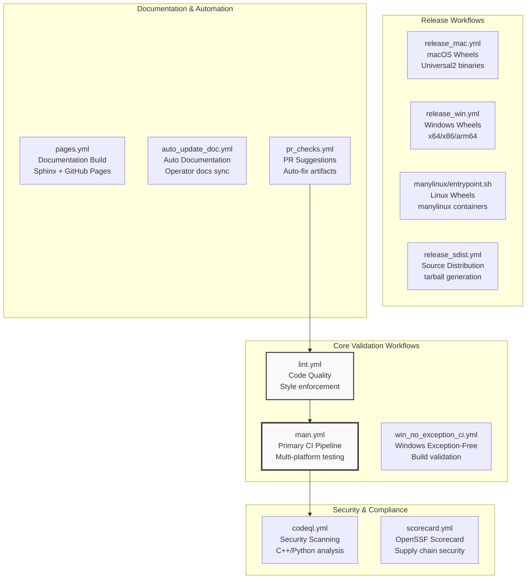
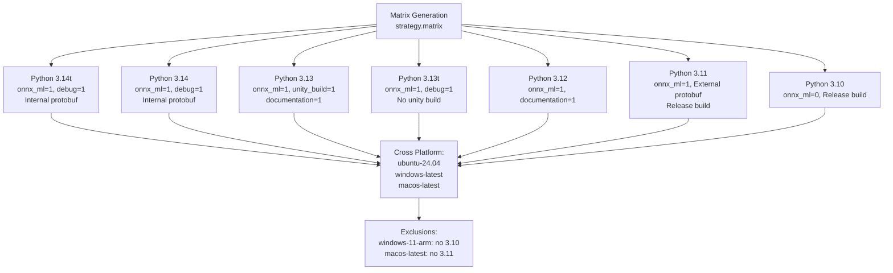
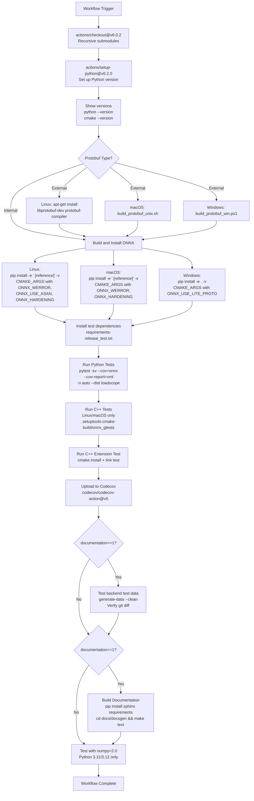
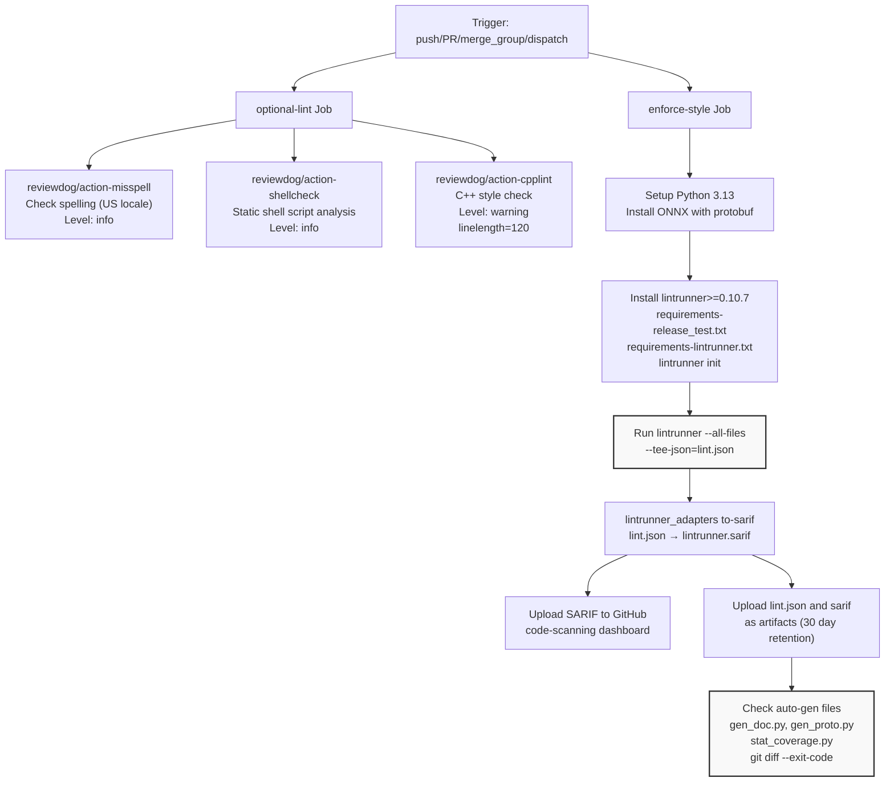
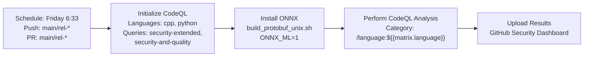
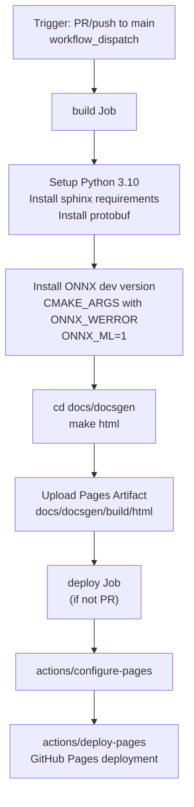
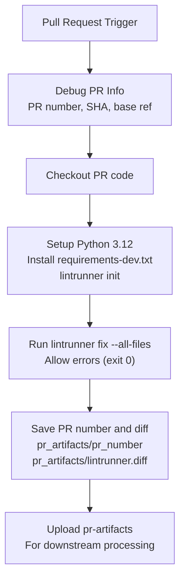

<!-- source: DeepWiki mcp.deepwiki.com · repo onnx/onnx · page 7.1 Continuous Integration Workflows · fetched 2026-10-21 -->

# Continuous Integration Workflows

<details>
<summary>Relevant source files</summary>

The following files were used as context for generating this wiki page:

- [.github/workflows/auto_update_doc.yml](.github/workflows/auto_update_doc.yml)
- [.github/workflows/codeql.yml](.github/workflows/codeql.yml)
- [.github/workflows/lint.yml](.github/workflows/lint.yml)
- [.github/workflows/main.yml](.github/workflows/main.yml)
- [.github/workflows/manylinux/entrypoint.sh](.github/workflows/manylinux/entrypoint.sh)
- [.github/workflows/pages.yml](.github/workflows/pages.yml)
- [.github/workflows/pr_checks.yml](.github/workflows/pr_checks.yml)
- [.github/workflows/release_mac.yml](.github/workflows/release_mac.yml)
- [.github/workflows/release_sdist.yml](.github/workflows/release_sdist.yml)
- [.github/workflows/release_win.yml](.github/workflows/release_win.yml)
- [.github/workflows/scorecard.yml](.github/workflows/scorecard.yml)
- [.github/workflows/win_no_exception_ci.yml](.github/workflows/win_no_exception_ci.yml)
- [CMakeLists.txt](CMakeLists.txt)
- [README.md](README.md)
- [cmake/ONNXConfig.cmake.in](cmake/ONNXConfig.cmake.in)
- [cmake/Utils.cmake](cmake/Utils.cmake)
- [cmake/external/googletest.cmake](cmake/external/googletest.cmake)
- [cmake/summary.cmake](cmake/summary.cmake)
- [cmake/unittest.cmake](cmake/unittest.cmake)
- [docs/ImplementingAnOnnxBackend.md](docs/ImplementingAnOnnxBackend.md)
- [docs/OnnxBackendTest.md](docs/OnnxBackendTest.md)
- [onnx/gen_proto.py](onnx/gen_proto.py)
- [onnx/test/cmake/CMakeLists.txt](onnx/test/cmake/CMakeLists.txt)
- [onnx/test/cmake/main.cc](onnx/test/cmake/main.cc)
- [onnx/test/cpp/checker_test.cc](onnx/test/cpp/checker_test.cc)
- [onnx/test/cpp/function_get_test.cc](onnx/test/cpp/function_get_test.cc)
- [onnx/test/cpp/test_main.cc](onnx/test/cpp/test_main.cc)
- [setup.py](setup.py)
- [workflow_scripts/protobuf/build_protobuf_unix.sh](workflow_scripts/protobuf/build_protobuf_unix.sh)
- [workflow_scripts/protobuf/build_protobuf_win.ps1](workflow_scripts/protobuf/build_protobuf_win.ps1)

</details>


This document describes the GitHub Actions-based continuous integration system that validates, tests, and builds the ONNX project. The CI workflows ensure code quality, security, and correctness across multiple platforms, Python versions, and build configurations.

For release orchestration and PyPI publishing workflows, see [Release Orchestration and PyPI Publishing](#7.2). For code quality tooling details, see [Code Quality and Linting Infrastructure](#7.3). For security scanning specifics, see [Security and Compliance Automation](#7.4).

## Workflow Architecture Overview

The CI system consists of multiple specialized workflows that run in response to various triggers. The main components are coordinated through GitHub Actions workflows defined in `.github/workflows/`.

### Workflow Inventory



Sources: [.github/workflows/main.yml:1-285](), [.github/workflows/lint.yml:1-139](), [.github/workflows/codeql.yml:1-76](), [.github/workflows/scorecard.yml:1-49](), [.github/workflows/pages.yml:1-69](), [.github/workflows/release_mac.yml:1-151](), [.github/workflows/release_win.yml:1-172]()

## Main CI Workflow (main.yml)

The primary continuous integration workflow validates all code changes across a comprehensive matrix of platforms and configurations.

### Workflow Triggers and Concurrency

The `main.yml` workflow is triggered by:
- **Schedule**: Daily at midnight (for codecov reporting)
- **Push**: To `main` branch
- **Pull Request**: On any PR
- **Merge Group**: GitHub merge queue
- **Workflow Dispatch**: Manual trigger

Concurrency control prevents redundant builds:
```yaml
concurrency:
  group: ${{ github.workflow }}-${{ github.ref }}-${{ github.event_name == 'workflow_dispatch' }}
  cancel-in-progress: true
```

Sources: [.github/workflows/main.yml:11-26]()

### Test Matrix Configuration

The CI executes a comprehensive matrix of configurations to ensure compatibility across diverse environments:

| Dimension | Values |
|-----------|--------|
| **Operating Systems** | `ubuntu-24.04`, `windows-latest`, `macos-latest`, `windows-11-arm` |
| **Python Versions** | `3.10`, `3.11`, `3.12`, `3.13`, `3.13t`, `3.14`, `3.14t` (free-threaded) |
| **Build Types** | `Debug` (debug_build=1), `Release` (debug_build=0) |
| **ONNX Variants** | `ONNX_ML=0` (standard), `ONNX_ML=1` (with ML operators) |
| **Protobuf Source** | `Internal` (FetchContent), `External` (system package) |
| **Unity Build** | `unity_build=0/1` (single translation unit optimization) |
| **Documentation** | `documentation=0/1` (build docs on specific configs) |

### Build Matrix Logic



Sources: [.github/workflows/main.yml:28-89]()

### CI Pipeline Execution Flow



Sources: [.github/workflows/main.yml:91-285]()

### Build Configuration Details

#### Linux Build Configuration

The Linux build uses strict compilation flags and optional ASAN (AddressSanitizer):

```bash
# Environment variables set during build
DEBUG=${{ matrix.debug_build }}
ONNX_ML=${{ matrix.onnx_ml }}
ONNX_BUILD_TESTS=1
CMAKE_ARGS="-DONNX_WERROR=ON -DONNX_USE_ASAN=${{ matrix.debug_build }} 
            -DONNX_USE_UNITY_BUILD=${{ matrix.unity_build }} 
            -DONNX_HARDENING=ON"
```

ASAN environment configuration:
```bash
ASAN_OPTIONS: detect_leaks=0:symbolize=1:detect_stack_use_after_return=true:
              strict_init_order=true:detect_odr_violation=1:
              detect_container_overflow=0:check_initialization_order=true:
              debug=true:fast_unwind_on_malloc=1:verify_asan_link_order=0
UBSAN_OPTIONS: print_stacktrace=1
```

Sources: [.github/workflows/main.yml:7-10](), [.github/workflows/main.yml:143-161]()

#### Windows Build Configuration

Windows builds use MSVC static runtime and lite protobuf:

```bash
DEBUG=${{ matrix.debug_build }}
ONNX_ML=${{ matrix.onnx_ml }}
ONNX_BUILD_TESTS=1
CMAKE_ARGS="-DONNX_WERROR=ON -DONNX_USE_PROTOBUF_SHARED_LIBS=OFF 
            -DONNX_USE_LITE_PROTO=ON -DONNX_USE_UNITY_BUILD=${{ matrix.unity_build }} 
            -DONNX_HARDENING=ON"
```

MSBuild setup varies by architecture:
- **x64**: Standard 64-bit builds
- **arm64**: ARM64 builds (on `windows-11-arm` runners)

Sources: [.github/workflows/main.yml:119-130](), [.github/workflows/main.yml:172-181]()

#### macOS Build Configuration

macOS uses similar flags to Linux but without ASAN:

```bash
DEBUG=${{ matrix.debug_build }}
ONNX_ML=${{ matrix.onnx_ml }}
ONNX_BUILD_TESTS=1
CMAKE_ARGS="-DONNX_WERROR=ON -DONNX_USE_UNITY_BUILD=${{ matrix.unity_build }} 
            -DONNX_HARDENING=ON"
```

Sources: [.github/workflows/main.yml:162-171]()

### Test Execution Strategy

#### Python Tests

Python tests run using pytest with parallel execution:
```bash
pytest -sv --cov=onnx --cov-report=xml --cov-append --cov-branch 
       --junitxml junit.xml -n auto --dist loadscope
```

Parameters:
- `-sv`: Verbose output
- `--cov=onnx`: Coverage measurement
- `--cov-report=xml`: XML coverage report for Codecov
- `--cov-append`: Append to existing coverage data
- `--cov-branch`: Branch coverage
- `--junitxml junit.xml`: JUnit XML test results
- `-n auto`: Auto-detect CPU count for parallel execution
- `--dist loadscope`: Distribute tests by scope

Sources: [.github/workflows/main.yml:195-199]()

#### C++ Tests

C++ unit tests run via `gtest` on Linux and macOS:
```bash
export LD_LIBRARY_PATH="./.setuptools-cmake-build/:$LD_LIBRARY_PATH"
./.setuptools-cmake-build/onnx_gtests
```

The test executable is built by CMake when `ONNX_BUILD_TESTS=1`. Test sources are in [onnx/test/cpp/]().

Sources: [.github/workflows/main.yml:205-210]()

#### C++ Extension Linking Test

Validates that external projects can link against installed ONNX libraries:
```bash
cd ./.setuptools-cmake-build/
sudo cmake --build . --target install
cd .././onnx/test/cmake
mkdir build && cd build
cmake -DONNX_ML=${{ matrix.onnx_ml }} ..
cmake --build .
./main
```

This test uses a minimal CMakeLists.txt that finds and links ONNX.

Sources: [.github/workflows/main.yml:211-222](), [onnx/test/cmake/CMakeLists.txt:1-10](), [onnx/test/cmake/main.cc:1-30]()

#### Backend Test Data Validation

On documentation builds, the CI validates that backend test data is up-to-date:
```bash
python onnx/backend/test/cmd_tools.py generate-data --clean
git status
git diff --exit-code -- . ':!onnx/onnx-data.proto' ':!onnx/onnx-data.proto3' 
                         ':!*output_*.pb' ':!*input_*.pb'
```

This ensures generated test data files are synchronized with code changes.

Sources: [.github/workflows/main.yml:238-261]()

### Coverage Reporting

Code coverage is uploaded to Codecov for both source and test results:

```yaml
- name: Upload coverage to Codecov
  if: github.repository_owner == 'onnx'
  uses: codecov/codecov-action@v5
  with:
    token: ${{ secrets.CODECOV_TOKEN }}

- name: Upload test results to Codecov
  if: github.repository_owner == 'onnx' && !cancelled()
  uses: codecov/codecov-action@v5
  with:
    token: ${{ secrets.CODECOV_TOKEN }}
    report_type: test_results
```

Sources: [.github/workflows/main.yml:223-235]()

## Lint Workflow (lint.yml)

The lint workflow enforces code style and quality standards across Python and C++ code.

### Lint Workflow Structure



Sources: [.github/workflows/lint.yml:1-139]()

### Linting Tools Configuration

The enforce-style job runs multiple linters through `lintrunner`:

1. **Ruff**: Python linting and formatting (~30 rule categories)
2. **MyPy**: Python type checking (strict mode)
3. **clang-format**: C++ formatting
4. **clang-tidy**: C++ static analysis (separate workflow for security)
5. **editorconfig-checker**: Whitespace and line ending consistency

Installation and initialization:
```bash
python -m pip install lintrunner>=0.10.7
python -m pip install -r requirements-release_test.txt
python -m pip install -r requirements-lintrunner.txt
lintrunner init
```

Execution:
```bash
lintrunner --force-color --all-files --tee-json=lint.json -v
```

Sources: [.github/workflows/lint.yml:83-98]()

### Auto-Generated File Validation

The workflow verifies that all auto-generated files are up-to-date:

```bash
ONNX_ML=1 python onnx/defs/gen_doc.py
python onnx/gen_proto.py -l
python onnx/gen_proto.py -l --ml
python onnx/backend/test/stat_coverage.py

git status
git diff --exit-code -- . ':(exclude)onnx/onnx-data.proto' ':(exclude)onnx/onnx-data.proto3'
```

This prevents commits that update schemas or operators without regenerating documentation.

Sources: [.github/workflows/lint.yml:123-139]()

## Windows Exception-Free CI

A specialized workflow validates that ONNX can build on Windows without C++ exception handling.

### Win_no_exception_ci.yml Workflow

This workflow tests `ONNX_DISABLE_EXCEPTIONS=ON` configuration:

```bash
cmake -G "Visual Studio 17 2022" -A ${{ matrix.architecture }} 
      -DONNX_USE_PROTOBUF_SHARED_LIBS=OFF 
      -DONNX_USE_LITE_PROTO=ON 
      -DONNX_WERROR=ON 
      -DONNX_DISABLE_EXCEPTIONS=ON 
      -DCMAKE_BUILD_TYPE=Release 
      -DONNX_USE_MSVC_STATIC_RUNTIME=OFF 
      -DONNX_ML=1 
      -DONNX_BUILD_TESTS=ON 
      -S . -B .setuptools-cmake-build\
```

The workflow also tests non-static registration (selective schema loading):
```bash
cmake ... -DONNX_DISABLE_STATIC_REGISTRATION=ON ...
Release\onnx_gtests.exe --gtest_filter="SchemaRegistrationTest*"
```

Sources: [.github/workflows/win_no_exception_ci.yml:1-81]()

## Security Scanning Workflows

### CodeQL Analysis (codeql.yml)

Performs security scanning for C++ and Python code:



Configuration file: `.github/codeql/codeql-config.yml`

Sources: [.github/workflows/codeql.yml:1-76]()

### OpenSSF Scorecard (scorecard.yml)

Evaluates supply chain security best practices:

```yaml
- name: "Run analysis"
  uses: ossf/scorecard-action@v4
  with:
    results_file: results.sarif
    results_format: sarif
    publish_results: true

- name: "Upload to code-scanning"
  uses: github/codeql-action/upload-sarif@v5
  with:
    sarif_file: results.sarif
```

Runs weekly on Saturdays and on branch protection rule changes.

Sources: [.github/workflows/scorecard.yml:1-49]()

## Documentation Workflows

### GitHub Pages Publishing (pages.yml)

Builds and publishes Sphinx documentation to GitHub Pages:



Sources: [.github/workflows/pages.yml:1-69]()

### Auto Documentation Update (auto_update_doc.yml)

Automatically regenerates documentation when a PR is labeled:

```yaml
if: contains( github.event.pull_request.labels.*.name, 'auto update doc')
```

Steps performed:
1. Checkout PR branch from fork
2. Install ONNX from source
3. Regenerate documentation:
   ```bash
   python onnx/defs/gen_doc.py
   python onnx/gen_proto.py -l
   python onnx/gen_proto.py -l --ml
   python onnx/backend/test/stat_coverage.py
   python onnx/backend/test/cmd_tools.py generate-data --diff
   ```
4. Auto-commit changes back to PR branch

Sources: [.github/workflows/auto_update_doc.yml:1-61]()

## PR Checks Workflow (pr_checks.yml)

Provides auto-fix suggestions for PRs:



The workflow runs lintrunner in fix mode (`lintrunner f --all-files`) and uploads the resulting diff as an artifact. This allows for automated suggestion comments on PRs.

Sources: [.github/workflows/pr_checks.yml:1-98]()

## Build System Integration

### CMake Configuration in CI

The CI workflows leverage CMake build options defined in [CMakeLists.txt:1-560](). Key options:

| CMake Variable | Purpose |
|----------------|---------|
| `ONNX_BUILD_PYTHON` | Build Python bindings (always ON in CI) |
| `ONNX_BUILD_TESTS` | Build C++ test suite (ON in main CI) |
| `ONNX_ML` | Include ML operators (varies by matrix) |
| `ONNX_WERROR` | Treat warnings as errors (ON in CI) |
| `ONNX_USE_ASAN` | AddressSanitizer (ON for debug builds) |
| `ONNX_USE_UNITY_BUILD` | Unity/jumbo build (varies by matrix) |
| `ONNX_HARDENING` | Compiler hardening flags (ON in CI) |
| `ONNX_USE_LITE_PROTO` | Use protobuf-lite (ON for Windows) |
| `ONNX_DISABLE_EXCEPTIONS` | Disable C++ exceptions (win_no_exception_ci only) |
| `ONNX_DISABLE_STATIC_REGISTRATION` | Non-static operator registration (special test) |

Sources: [CMakeLists.txt:43-59](), [.github/workflows/main.yml:156-161](), [.github/workflows/main.yml:170](), [.github/workflows/main.yml:180]()

### Python Setup Script Integration

The CI invokes [setup.py:1-372]() which:
1. Reads version from [VERSION_NUMBER]()
2. Detects build configuration from environment variables
3. Configures CMake with appropriate flags
4. Builds C++ libraries and nanobind Python bindings
5. Creates wheel packages

Environment variables used:
```python
ONNX_ML = os.getenv("ONNX_ML") != "0"
ONNX_BUILD_TESTS = os.getenv("ONNX_BUILD_TESTS") == "1"
ONNX_NAMESPACE = os.getenv("ONNX_NAMESPACE", "onnx")
DEBUG = os.getenv("DEBUG", "0") == "1"
COVERAGE = os.getenv("COVERAGE", "0") == "1"
```

Sources: [setup.py:42-53](), [.github/workflows/main.yml:156-161]()

## Reproducible Builds

### SOURCE_DATE_EPOCH Support

The CI system supports reproducible builds on Linux using the `SOURCE_DATE_EPOCH` standard:

```bash
export SOURCE_DATE_EPOCH=$(git log -1 --pretty=%ct)
```

This environment variable is processed by [CMakeLists.txt:24-35]():
```cmake
if(DEFINED ENV{SOURCE_DATE_EPOCH})
  execute_process(
    COMMAND "date" "-u" "-d" "@$ENV{SOURCE_DATE_EPOCH}" "+%Y-%m-%d"
    OUTPUT_VARIABLE BUILD_DATE
    OUTPUT_STRIP_TRAILING_WHITESPACE)
endif()
```

Sources: [.github/workflows/main.yml:146](), [CMakeLists.txt:24-35](), [README.md:114-128]()

## Workflow Concurrency Management

All workflows implement concurrency control to prevent wasted resources:

```yaml
concurrency:
  group: ${{ github.workflow }}-${{ github.ref }}-${{ github.event_name == 'workflow_dispatch' }}
  cancel-in-progress: true
```

This ensures:
- Only one workflow run per branch/PR
- Previous runs are cancelled when new commits are pushed
- Manual triggers (workflow_dispatch) get their own concurrency group

Sources: [.github/workflows/main.yml:24-26](), [.github/workflows/lint.yml:18-20](), [.github/workflows/codeql.yml:15-17]()

## Permissions and Security

All workflows follow the principle of least privilege with explicit permission declarations:

```yaml
permissions:  # set top-level default permissions as security best practice
  contents: read
```

Jobs requiring additional permissions declare them explicitly:
```yaml
jobs:
  enforce-style:
    permissions:
      security-events: write  # For SARIF upload
```

Sources: [.github/workflows/main.yml:21-22](), [.github/workflows/lint.yml:15-16](), [.github/workflows/lint.yml:60-61]()

---

