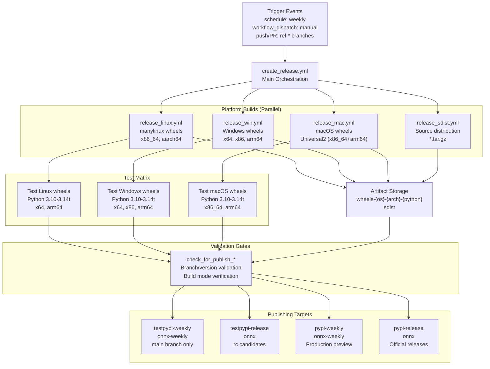
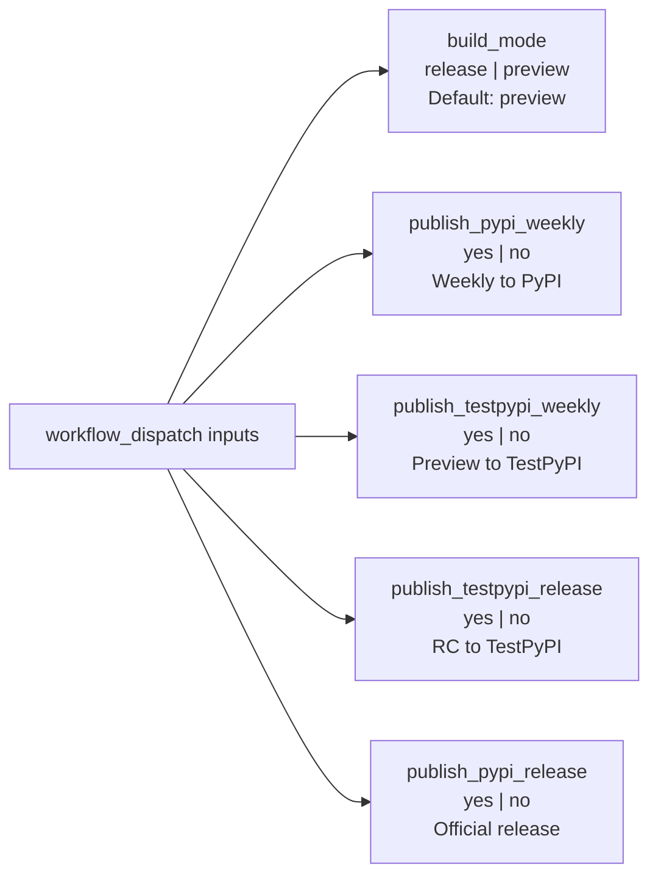
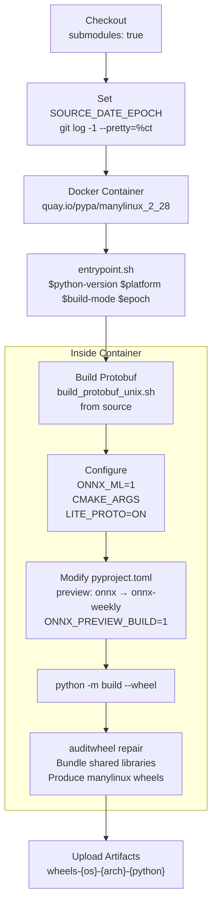
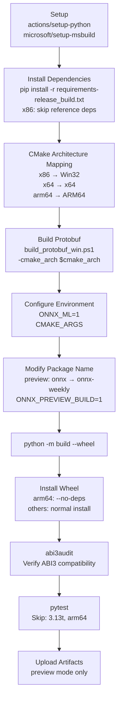
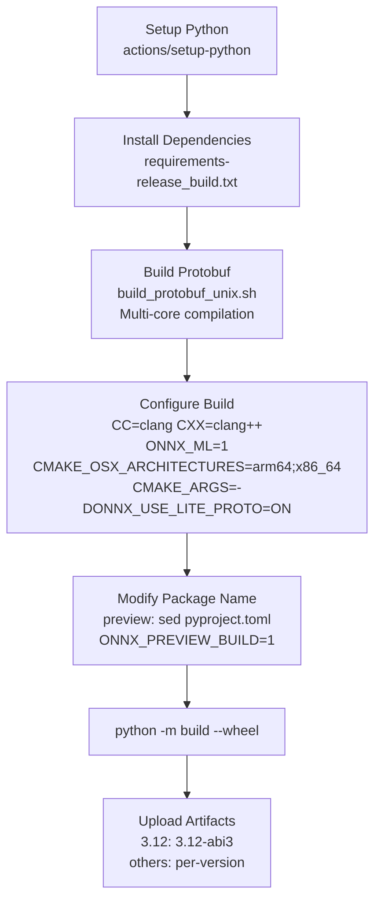
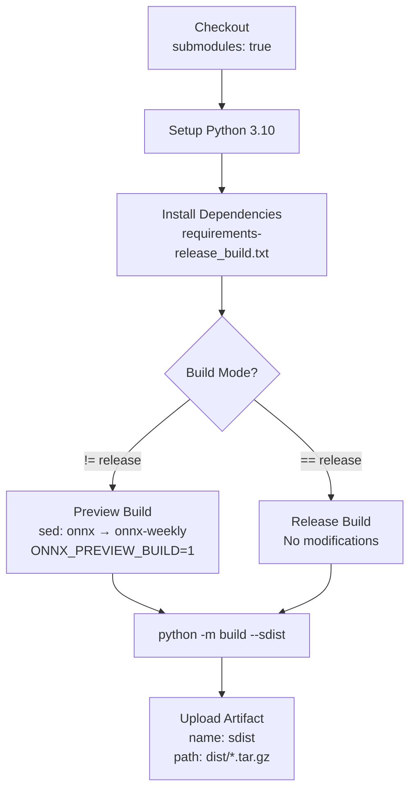
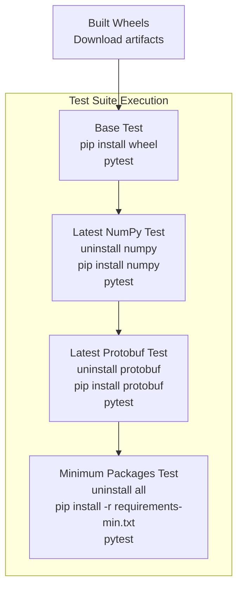
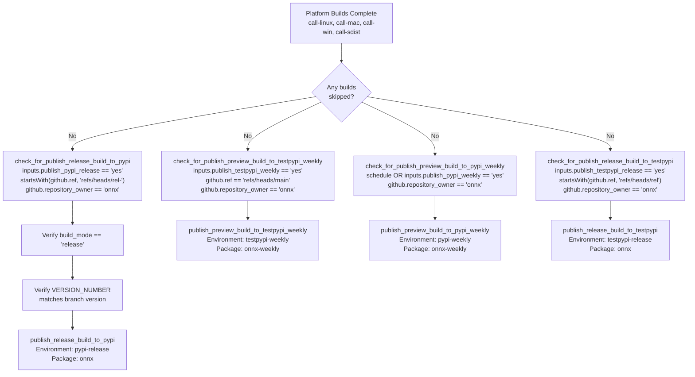
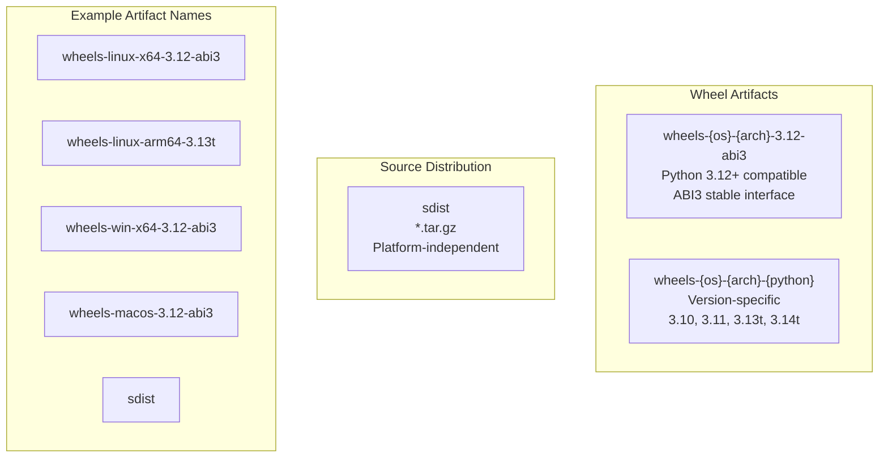

<!-- source: DeepWiki mcp.deepwiki.com · repo onnx/onnx · page 7.2 Release Orchestration and PyPI Publishing · fetched 2026-10-21 -->

# Release Orchestration and PyPI Publishing

<details>
<summary>Relevant source files</summary>

The following files were used as context for generating this wiki page:

- [.github/workflows/auto_update_doc.yml](.github/workflows/auto_update_doc.yml)
- [.github/workflows/codeql.yml](.github/workflows/codeql.yml)
- [.github/workflows/copilot-setup-steps.yml](.github/workflows/copilot-setup-steps.yml)
- [.github/workflows/create_release.yml](.github/workflows/create_release.yml)
- [.github/workflows/lint.yml](.github/workflows/lint.yml)
- [.github/workflows/manylinux/entrypoint.sh](.github/workflows/manylinux/entrypoint.sh)
- [.github/workflows/pages.yml](.github/workflows/pages.yml)
- [.github/workflows/pr_checks.yml](.github/workflows/pr_checks.yml)
- [.github/workflows/preview_source_dist_test.yml](.github/workflows/preview_source_dist_test.yml)
- [.github/workflows/release_linux.yml](.github/workflows/release_linux.yml)
- [.github/workflows/release_mac.yml](.github/workflows/release_mac.yml)
- [.github/workflows/release_sdist.yml](.github/workflows/release_sdist.yml)
- [.github/workflows/release_win.yml](.github/workflows/release_win.yml)
- [.github/workflows/scorecard.yml](.github/workflows/scorecard.yml)
- [.github/workflows/win_no_exception_ci.yml](.github/workflows/win_no_exception_ci.yml)

</details>


## Purpose and Scope

This document describes the release orchestration system that builds, tests, and publishes ONNX packages to PyPI. The system handles multi-platform wheel builds (Linux, Windows, macOS), source distributions, comprehensive testing, and controlled publishing to both test and production PyPI repositories.

For information about the underlying build system and CMake configuration, see [Build System](#6). For CI/CD workflows related to code quality and testing, see [Continuous Integration Workflows](#7.1) and [Code Quality and Linting Infrastructure](#7.3).

## System Overview

The release system operates as a multi-stage pipeline triggered by scheduled runs (weekly), manual dispatch, or branch-specific events. The orchestration workflow coordinates platform-specific builds, aggregates artifacts, performs validation checks, and publishes to appropriate PyPI repositories based on build mode and branch context.



**Sources:** [.github/workflows/create_release.yml:1-329]()

## Orchestration Workflow: create_release.yml

The `create_release.yml` workflow serves as the central orchestrator for all release activities. It uses the `workflow_call` pattern to invoke platform-specific workflows and manages publishing decisions based on inputs and context.

### Trigger Configuration

| Trigger Type | Schedule | Branch | Purpose |
|-------------|----------|--------|---------|
| `schedule` | Weekly (Monday 00:00 UTC) | main | Automated weekly preview builds |
| `push` | On push | main, rel-* | CI validation of release process |
| `pull_request` | On PR | main, rel-* | Testing with "run release CIs" label |
| `workflow_dispatch` | Manual | Any | Controlled releases with inputs |

**Sources:** [.github/workflows/create_release.yml:6-17]()

### Workflow Inputs

The workflow accepts four critical inputs for manual dispatch:



**Sources:** [.github/workflows/create_release.yml:18-58]()

### Platform Build Orchestration

The orchestrator invokes four platform-specific workflows in parallel:

```yaml
# Workflow call pattern for each platform
jobs:
  call-linux:
    uses: ./.github/workflows/release_linux.yml
    with:
      os: "linux"
      build_mode: ${{ github.event.inputs.build_mode || 'preview' }}
  
  call-win:
    uses: ./.github/workflows/release_win.yml
    with:
      os: "win"
      build_mode: ${{ github.event.inputs.build_mode || 'preview' }}
  
  call-mac:
    uses: ./.github/workflows/release_mac.yml
    with:
      os: "macos"
      build_mode: ${{ github.event.inputs.build_mode || 'preview' }}
  
  call-sdist:
    uses: ./.github/workflows/release_sdist.yml
    with:
      os: "macos"
      build_mode: ${{ github.event.inputs.build_mode || 'preview' }}
```

**Sources:** [.github/workflows/create_release.yml:69-96]()

## Platform-Specific Build Workflows

### Linux Builds: release_linux.yml

Linux builds use manylinux Docker containers to ensure compatibility across distributions. The workflow builds for both x86_64 and aarch64 architectures.

#### Build Matrix

| Architecture | Runner | Container | Python Versions |
|-------------|--------|-----------|-----------------|
| x64 | ubuntu-24.04 | manylinux_2_28_x86_64 | 3.10, 3.11, 3.12, 3.13t, 3.14t |
| arm64 | ubuntu-24.04-arm | manylinux_2_28_aarch64 | 3.10, 3.11, 3.12, 3.13t, 3.14t |

**Sources:** [.github/workflows/release_linux.yml:24-34]()

#### Build Process

The Linux build delegates to a containerized entrypoint script:



**Sources:** [.github/workflows/release_linux.yml:36-89](), [.github/workflows/manylinux/entrypoint.sh:1-84]()

#### Linux Build Script Details

The `entrypoint.sh` script ([.github/workflows/manylinux/entrypoint.sh:1-84]()) performs the following operations:

1. **Python version mapping**: Maps user-friendly versions (3.10, 3.11, etc.) to CPython ABI tags (cp310-cp310, cp311-cp311)
2. **Protobuf compilation**: Builds protobuf from source to ensure compatibility
3. **Environment configuration**: Sets `ONNX_ML=1`, `CMAKE_ARGS="-DONNX_USE_LITE_PROTO=ON -DONNX_HARDENING=ON"`
4. **Package name modification**: For preview builds, changes package name from "onnx" to "onnx-weekly"
5. **Wheel building**: Uses `python -m build --wheel`
6. **Auditwheel repair**: Bundles external shared libraries into wheels and updates platform tags

**Sources:** [.github/workflows/manylinux/entrypoint.sh:12-84]()

### Windows Builds: release_win.yml

Windows builds support three architectures with architecture-specific exclusions due to Python availability.

#### Build Matrix

| Architecture | Runner | Python Versions | Exclusions |
|-------------|--------|-----------------|------------|
| x64 | windows-2022 | 3.10, 3.11, 3.12, 3.13t, 3.14t | None |
| x86 | windows-2022 | 3.10, 3.11, 3.12 | 3.13t, 3.14t (no x86 support) |
| arm64 | windows-11-arm | 3.11, 3.12, 3.13t, 3.14t | 3.10 (no arm64 support) |

**Sources:** [.github/workflows/release_win.yml:23-40]()

#### Windows Build Process



**Sources:** [.github/workflows/release_win.yml:42-172]()

#### Windows-Specific Configuration

The Windows workflow includes several platform-specific considerations:

1. **Reference implementation exclusion**: x86 builds exclude reference implementation dependencies due to lack of prebuilt wheels
2. **ARM64 installation**: ARM64 wheels install with `--no-deps` flag due to unavailable dependency wheels
3. **Testing limitations**: Tests skipped for free-threaded Python (3.13t, 3.14t) and ARM64 due to dependency availability
4. **ABI3 verification**: All wheels verified with `abi3audit` for Python Limited API compatibility

**Sources:** [.github/workflows/release_win.yml:60-142]()

### macOS Builds: release_mac.yml

macOS builds produce Universal2 binaries containing both x86_64 and arm64 architectures in a single wheel.

#### Build Configuration

| Parameter | Value |
|-----------|-------|
| Runner | macos-14 (Apple Silicon) |
| Deployment Target | macOS 12.0 |
| Architectures | arm64;x86_64 (Universal2) |
| Compiler | clang/clang++ |
| Python Versions | 3.10, 3.11, 3.12, 3.13t, 3.14t |

**Sources:** [.github/workflows/release_mac.yml:18-31]()

#### macOS Build Process



**Sources:** [.github/workflows/release_mac.yml:32-89]()

#### macOS Testing Strategy

The test phase runs on architecture-specific runners with comprehensive version testing:

| Test Runner | Architecture | Purpose |
|------------|--------------|---------|
| macos-15 | x86_64 | Test x86_64 slice of Universal2 |
| macos-14 | arm64 | Test arm64 slice of Universal2 |

Tests run against Python 3.10-3.14t, with architecture-specific execution using the `arch` command:

```bash
arch -${{ matrix.target-architecture }} python -m pip install --upgrade dist/*.whl
arch -${{ matrix.target-architecture }} pytest
```

**Sources:** [.github/workflows/release_mac.yml:90-151]()

### Source Distribution: release_sdist.yml

The source distribution workflow produces a platform-independent `.tar.gz` package.



**Sources:** [.github/workflows/release_sdist.yml:24-67]()

## Build Modes and Package Naming

The release system supports two build modes that determine package naming and versioning:

### Build Mode Comparison

| Mode | Package Name | PyPI Target | Version Format | Trigger |
|------|-------------|-------------|----------------|---------|
| `preview` | onnx-weekly | pypi-weekly, testpypi-weekly | X.Y.Z.devYYYYMMDD | schedule, default |
| `release` | onnx | pypi-release, testpypi-release | X.Y.Z, X.Y.ZrcN | manual (rel-* branches) |

### Package Name Transformation

For preview builds, each workflow modifies `pyproject.toml` to change the package name:

**Linux/macOS:**
```bash
sed -i 's/name = "onnx"/name = "onnx-weekly"/' 'pyproject.toml'
export ONNX_PREVIEW_BUILD=1
```

**Windows (PowerShell):**
```powershell
(Get-Content -Path 'pyproject.toml') |
  ForEach-Object { $_ -replace 'name = "onnx"', 'name = "onnx-weekly"' } |
  Set-Content -Path 'pyproject.toml'
$Env:ONNX_PREVIEW_BUILD = 1
```

**Sources:** [.github/workflows/manylinux/entrypoint.sh:53-59](), [.github/workflows/release_win.yml:95-102](), [.github/workflows/release_mac.yml:61-65]()

## Testing Strategy

Each platform workflow includes comprehensive testing after wheel building. Tests validate functionality with different dependency versions.

### Test Matrix



### Test Execution Pattern

All three platform-specific workflows follow this testing pattern:

1. **Base functionality test**: Install wheel with standard dependencies from `requirements-release_test.txt`
2. **Latest NumPy compatibility**: Uninstall NumPy, install latest version, reinstall wheel, run tests
3. **Latest Protobuf compatibility**: Uninstall Protobuf, install latest version, reinstall wheel, run tests
4. **Minimum dependency test**: Install minimal supported versions from `requirements-min.txt`, run tests

**Sources:** [.github/workflows/release_linux.yml:149-175](), [.github/workflows/release_win.yml:135-171](), [.github/workflows/release_mac.yml:126-151]()

### ABI3 Verification

Both Linux and Windows workflows verify Python Limited API (ABI3) compatibility using `abi3audit`:

```bash
python -m pip install -q abi3audit
python -m abi3audit -v "$whl"
```

This ensures wheels built with Python 3.12 can be used with Python 3.12+ without recompilation.

**Sources:** [.github/workflows/release_linux.yml:133-143](), [.github/workflows/release_win.yml:120-133]()

## Publishing Strategy

The orchestrator implements a sophisticated publishing strategy with multiple validation gates and target environments.

### Publishing Decision Flow



**Sources:** [.github/workflows/create_release.yml:97-321]()

### Publishing Environments

The workflow defines four GitHub environments with protected OIDC publishing:

| Environment | Repository URL | Package Name | Purpose |
|------------|---------------|--------------|---------|
| `testpypi-weekly` | https://test.pypi.org/legacy/ | onnx-weekly | Preview builds testing |
| `testpypi-release` | https://test.pypi.org/legacy/ | onnx | Release candidate validation |
| `pypi-weekly` | https://upload.pypi.org/legacy/ | onnx-weekly | Production preview builds |
| `pypi-release` | https://upload.pypi.org/legacy/ | onnx | Official stable releases |

**Sources:** [.github/workflows/create_release.yml:151-153,203-205,255-257,293-295]()

### Version Validation for Releases

Before publishing official releases, the workflow validates version consistency:

```bash
branch_version=${GITHUB_REF#refs/heads/rel-}
package_version=$(cat VERSION_NUMBER)

if [[ "$package_version" != "$branch_version" && 
      "$package_version" != "$branch_version"rc* ]]; then
  echo "Error: Package version ($package_version) does not match branch version ($branch_version)"
  exit 1
fi
```

This ensures that:
- Release builds match the branch version (e.g., `rel-1.19` requires `VERSION_NUMBER` of `1.19`)
- Release candidates follow the pattern `X.Y.ZrcN` (e.g., `1.19.0rc1`)

**Sources:** [.github/workflows/create_release.yml:120-130]()

### Publishing Execution

All publishing jobs use the `pypa/gh-action-pypi-publish` action with OIDC authentication:

```yaml
- name: Publish to PyPI
  uses: pypa/gh-action-pypi-publish@ed0c53931b1dc9bd32cbe73a98c7f6766f8a527e
  with:
    repository-url: https://upload.pypi.org/legacy/
    verbose: true
    print-hash: true
```

Required permissions:
- `contents: read` - Read repository contents
- `id-token: write` - Generate OIDC token for PyPI authentication

**Sources:** [.github/workflows/create_release.yml:155-157,207-209,259-261,296-299,314-320]()

## Artifact Management

The release system uses GitHub Actions artifacts to pass build outputs between jobs.

### Artifact Naming Scheme



### ABI3 Wheel Strategy

Starting with Python 3.12, ONNX uses the Python Limited API (ABI3) to produce stable ABI wheels. A single ABI3 wheel works across multiple Python versions:

| Python Version | Artifact Used |
|---------------|---------------|
| 3.10 | wheels-{os}-{arch}-3.10 |
| 3.11 | wheels-{os}-{arch}-3.11 |
| 3.12 | wheels-{os}-{arch}-3.12-abi3 |
| 3.13 | wheels-{os}-{arch}-3.12-abi3 |
| 3.14 | wheels-{os}-{arch}-3.12-abi3 |
| 3.13t (free-threaded) | wheels-{os}-{arch}-3.13t |
| 3.14t (free-threaded) | wheels-{os}-{arch}-3.14t |

Free-threaded Python builds require separate wheels due to ABI differences.

**Sources:** [.github/workflows/release_linux.yml:78-89](), [.github/workflows/release_mac.yml:79-88]()

### Artifact Downloading for Publishing

Publishing jobs download all artifacts and merge them into a single `dist/` directory:

```yaml
- uses: actions/download-artifact@37930b1c2abaa49bbe596cd826c3c89aef350131
  with:
    pattern: wheels*
    path: dist
    merge-multiple: true

- uses: actions/download-artifact@37930b1c2abaa49bbe596cd826c3c89aef350131
  with:
    pattern: sdist
    path: dist
    merge-multiple: true
```

The `merge-multiple: true` option combines all matching artifacts into a single directory.

**Sources:** [.github/workflows/create_release.yml:161-174,213-226,264-277,302-312]()

## Security and Permissions

### OIDC Authentication

All PyPI publishing uses OpenID Connect (OIDC) for authentication, eliminating the need for long-lived tokens:

```yaml
permissions:
  contents: read
  id-token: write
```

The `id-token: write` permission allows the workflow to request an OIDC token from GitHub, which PyPI validates against configured trust relationships.

**Sources:** [.github/workflows/create_release.yml:155-157,207-209,259-261,297-299]()

### Principle of Least Privilege

The orchestrator follows security best practices:

- **Top-level permissions**: `contents: read` only
- **Job-level permissions**: Elevated only when needed (publishing jobs)
- **Conditional execution**: Publishing only from `onnx` organization repository
- **Protected environments**: GitHub environments provide additional approval gates

**Sources:** [.github/workflows/create_release.yml:60-61]()

### Repository Ownership Checks

All publishing jobs verify repository ownership to prevent accidental publishing from forks:

```yaml
if: (github.repository_owner == 'onnx')
```

**Sources:** [.github/workflows/create_release.yml:102,137,176,190,242,280,315]()

## Trigger Conditions and Branch Protection

### Conditional Execution

Platform build workflows include a guard condition to prevent unnecessary execution:

```yaml
if: github.event_name != 'pull_request' || 
    startsWith(github.base_ref, 'rel-') || 
    contains(github.event.pull_request.labels.*.name, 'run release CIs')
```

This allows:
- All non-PR events (push, schedule, workflow_dispatch) to run
- PRs targeting `rel-*` branches to run
- PRs with "run release CIs" label to run

**Sources:** [.github/workflows/release_linux.yml:22](), [.github/workflows/release_win.yml:22](), [.github/workflows/release_mac.yml:25]()

### Concurrency Control

The orchestrator uses concurrency groups to prevent overlapping runs:

```yaml
concurrency:
  group: ${{ github.workflow }}-${{ github.ref }}-${{ github.event_name == 'workflow_dispatch' }}
  cancel-in-progress: true
```

This ensures that:
- Multiple pushes to the same branch cancel previous runs
- Manual dispatches are tracked separately
- Resources are not wasted on obsolete builds

**Sources:** [.github/workflows/create_release.yml:63-65]()

## Build Environment Configuration

### Reproducible Builds

Linux builds support reproducible builds through the `SOURCE_DATE_EPOCH` environment variable:

```bash
echo "SOURCE_DATE_EPOCH=$(git log -1 --pretty=%ct)" >> $GITHUB_ENV
```

This sets the build timestamp to the last commit time, enabling byte-for-byte reproducible wheels.

**Sources:** [.github/workflows/release_linux.yml:46-48](), [.github/workflows/manylinux/entrypoint.sh:22-30]()

### Platform-Specific Build Flags

Each platform uses optimized build configuration:

**Linux:**
```bash
export ONNX_ML=1
export CMAKE_ARGS="-DONNX_USE_LITE_PROTO=ON -DONNX_HARDENING=ON"
```

**Windows:**
```powershell
$Env:ONNX_ML = 1
$Env:CMAKE_ARGS = "-DONNX_USE_PROTOBUF_SHARED_LIBS=OFF -DONNX_USE_LITE_PROTO=ON -DONNX_WERROR=ON -DONNX_HARDENING=ON"
```

**macOS:**
```bash
export ONNX_ML=1
export CMAKE_ARGS="-DONNX_USE_LITE_PROTO=ON -DONNX_WERROR=ON"
export CMAKE_OSX_ARCHITECTURES="arm64;x86_64"
```

Key flags:
- `ONNX_ML=1`: Enable traditional ML operators
- `ONNX_USE_LITE_PROTO=ON`: Use lite protobuf runtime for smaller binaries
- `ONNX_HARDENING=ON`: Enable security hardening features
- `ONNX_WERROR=ON`: Treat warnings as errors

**Sources:** [.github/workflows/manylinux/entrypoint.sh:47-49](), [.github/workflows/release_win.yml:91-92](), [.github/workflows/release_mac.yml:50-56]()

---

