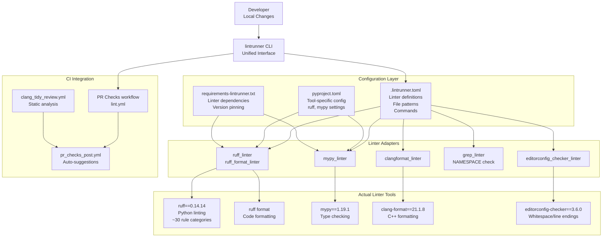
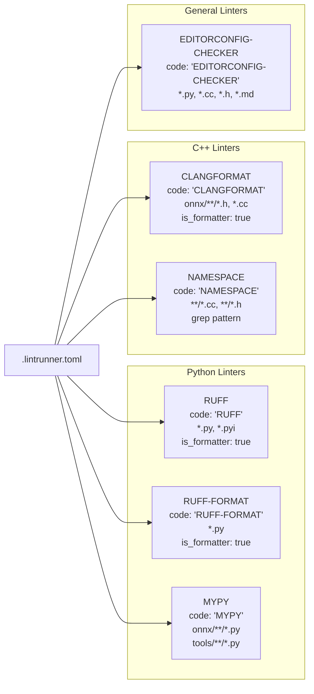
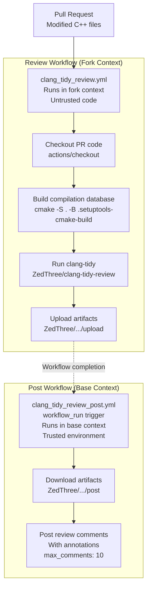
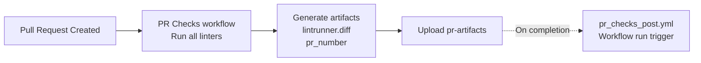
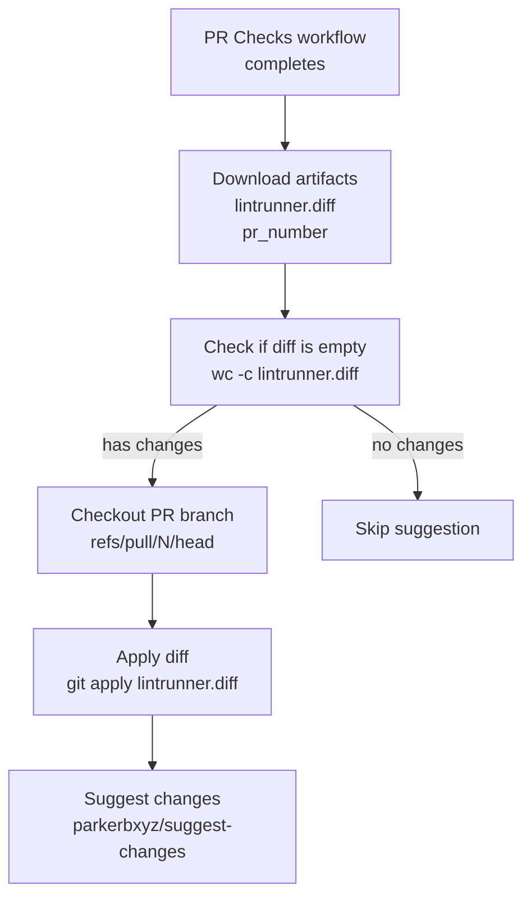

<!-- source: DeepWiki mcp.deepwiki.com · repo onnx/onnx · page 7.3 Code Quality and Linting Infrastructure · fetched 2026-10-21 -->

# Code Quality and Linting Infrastructure

<details>
<summary>Relevant source files</summary>

The following files were used as context for generating this wiki page:

- [.github/dependabot.yml](.github/dependabot.yml)
- [.github/workflows/check_urls.yml](.github/workflows/check_urls.yml)
- [.github/workflows/clang_tidy_review.yml](.github/workflows/clang_tidy_review.yml)
- [.github/workflows/clang_tidy_review_post.yml](.github/workflows/clang_tidy_review_post.yml)
- [.github/workflows/pr_checks_post.yml](.github/workflows/pr_checks_post.yml)
- [.github/workflows/reuse.yml](.github/workflows/reuse.yml)
- [.lintrunner.toml](.lintrunner.toml)
- [MANIFEST.in](MANIFEST.in)
- [pyproject.toml](pyproject.toml)
- [requirements-dev.txt](requirements-dev.txt)
- [requirements-lintrunner.txt](requirements-lintrunner.txt)
- [requirements.txt](requirements.txt)
- [tools/gen_coverage_report.py](tools/gen_coverage_report.py)

</details>


## Purpose and Scope

This document describes the code quality and linting infrastructure for the ONNX repository. It covers the lintrunner orchestration system, individual linters for Python and C++, configuration management, and CI integration. For information about the broader CI/CD system including testing and release workflows, see [Continuous Integration Workflows](#7.1) and [Release Orchestration](#7.2). For security-specific automation, see [Security and Compliance Automation](#7.4).

The linting infrastructure ensures consistent code style, type safety, and quality across ~100+ Python files and ~200+ C++ files in the ONNX codebase.

## Linting Infrastructure Overview

The ONNX repository uses `lintrunner` as a centralized orchestration tool that manages multiple linters through a unified interface. This approach provides consistent file filtering, parallel execution, and auto-fixing capabilities across different linting tools.



**Sources:** [.lintrunner.toml:1-222](), [requirements-lintrunner.txt:1-12](), [pyproject.toml:61-202]()

## Lintrunner Configuration and Orchestration

The lintrunner system is configured in `.lintrunner.toml`, which defines all linters, their file patterns, and execution commands.

### Configuration Structure

Each linter in `.lintrunner.toml` follows this pattern:

| Field | Purpose | Example |
|-------|---------|---------|
| `code` | Unique identifier | `"RUFF"`, `"MYPY"`, `"CLANGFORMAT"` |
| `include_patterns` | Files to lint | `["**/*.py", "**/*.pyi"]` |
| `exclude_patterns` | Files to skip | `["*_pb2*", ".setuptools-cmake-build/*"]` |
| `command` | Execution command | Uses `lintrunner_adapters` |
| `init_command` | Dependency installation | Installs from requirements file |
| `is_formatter` | Can auto-fix | `true` for formatters |

**Sources:** [.lintrunner.toml:37-222]()

### Linter Registration



**Sources:** [.lintrunner.toml:37-221]()

### Command Structure

All linters use the `lintrunner_adapters` module for consistent execution:

```
python -m lintrunner_adapters run <adapter_name> \
    --config=<config_file> \
    -- \
    @{{PATHSFILE}}
```

The `@{{PATHSFILE}}` placeholder is replaced by lintrunner with a file containing the list of files to lint. This enables efficient batch processing.

**Sources:** [.lintrunner.toml:48-56](), [.lintrunner.toml:80-90]()

### Initialization System

Each linter defines an `init_command` that installs dependencies:

```
python -m lintrunner_adapters run pip_init \
    --dry-run={{DRYRUN}} \
    --requirement=requirements-lintrunner.txt
```

This ensures all linters and their dependencies are installed before running. The dependencies are version-pinned in `requirements-lintrunner.txt`:

| Tool | Version | Purpose |
|------|---------|---------|
| `lintrunner-adapters` | `>=0.12.3` | Adapter framework |
| `ruff` | `==0.14.14` | Python linting and formatting |
| `mypy` | `==1.19.1` | Type checking |
| `types-protobuf` | `==6.32.1.20260221` | Protobuf stubs for mypy |
| `clang-format` | `==21.1.8` | C++ formatting |
| `editorconfig-checker` | `==3.6.0` | Whitespace validation |

**Sources:** [requirements-lintrunner.txt:1-12](), [.lintrunner.toml:57-65]()

## Python Linting with Ruff

Ruff is a fast Python linter and formatter written in Rust. ONNX uses it for both linting (error detection) and formatting (code style).

### Ruff Linting Rules

The ruff configuration in `pyproject.toml` enables 30+ rule categories:

```mermaid
graph TB
    RuffConfig["[tool.ruff]<br/>pyproject.toml"]
    
    subgraph "Error Detection"
        E["E: pycodestyle errors"]
        F["F: Pyflakes"]
        B["B: flake8-bugbear"]
        A["A: flake8-builtins"]
        BLE["BLE: flake8-blind-except"]
    end
    
    subgraph "Code Quality"
        PL["PL: pylint"]
        C4["C4: flake8-comprehensions"]
        SIM["SIM: flake8-simplify"]
        PERF["PERF: Perflint"]
        RUF["RUF: Ruff-specific"]
    end
    
    subgraph "Style & Formatting"
        I["I: isort (imports)"]
        UP["UP: pyupgrade"]
        W["W: pycodestyle warnings"]
        N["N: pep8-naming"]
        D["D: pydocstyle"]
    end
    
    subgraph "Type Checking"
        TC["TC: flake8-type-checking"]
        FA["FA: future-annotations"]
        PYI["PYI: flake8-pyi"]
    end
    
    RuffConfig --> E
    RuffConfig --> F
    RuffConfig --> B
    RuffConfig --> A
    RuffConfig --> BLE
    RuffConfig --> PL
    RuffConfig --> C4
    RuffConfig --> SIM
    RuffConfig --> PERF
    RuffConfig --> RUF
    RuffConfig --> I
    RuffConfig --> UP
    RuffConfig --> W
    RuffConfig --> N
    RuffConfig --> D
    RuffConfig --> TC
    RuffConfig --> FA
    RuffConfig --> PYI
```



**Sources:** [pyproject.toml:116-147]()

### Ruff Configuration Details

Key configuration settings in `pyproject.toml`:

| Setting | Value | Purpose |
|---------|-------|---------|
| `target-version` | `"py310"` | Minimum Python version |
| `unsafe-fixes` | `true` | Allow aggressive auto-fixes |
| `lint.select` | 30+ categories | Enabled rule categories |
| `lint.ignore` | ~20 rules | Disabled rules with justification |

Notable ignored rules:

- **D1**: Missing docstrings (not yet enforced across codebase)
- **E501**: Line length (handled by formatter)
- **N803**, **N806**: Naming conventions (relaxed for legacy code)
- **PLR0912**, **PLR0913**, **PLR0915**: Complexity metrics (too strict)

**Sources:** [pyproject.toml:112-173]()

### Ruff File Patterns

The lintrunner configuration defines which files ruff checks:

**Include patterns:**
- `**/*.py` - All Python source files
- `**/*.pyi` - All Python stub files

**Exclude patterns:**
- `*_pb2*` - Generated protobuf files
- `.setuptools-cmake-build/*` - Build artifacts
- `docs/**` - Documentation (separate tooling)

**Sources:** [.lintrunner.toml:39-47](), [.lintrunner.toml:103-111]()

### Import Sorting and Future Annotations

Ruff's `isort` integration enforces import ordering and requires future annotations:

```
[tool.ruff.lint.isort]
required-imports = ["from __future__ import annotations"]
```

This ensures all Python files use PEP 563 postponed annotation evaluation, improving forward compatibility.

**Sources:** [pyproject.toml:185-186]()

### Per-File Overrides

Ruff allows file-specific rule overrides for exceptional cases:

| Pattern | Ignored Rules | Reason |
|---------|---------------|--------|
| `**/*_test*` | N802 | Test function naming conventions differ |
| `onnx/backend/test/**` | PLR2004 | Magic numbers allowed in tests |
| `onnx/reference/ops/**` | N801, PLR2004 | Reference ops use operator names |
| `onnx/onnx_cpp2py_export/defs.pyi` | N802 | C++ binding stubs preserve C++ names |

**Sources:** [pyproject.toml:188-202]()

## Type Checking with MyPy

MyPy provides static type checking for Python code. ONNX uses strict type checking settings with selective exclusions.

### MyPy Configuration

The `pyproject.toml` defines strict type checking rules:

```mermaid
graph TB
    MypyConfig["[tool.mypy]<br/>pyproject.toml"]
    
    subgraph "Type Strictness"
        StrictOptional["strict_optional = true"]
        WarnReturnAny["warn_return_any = true"]
        WarnNoReturn["warn_no_return = true"]
        WarnRedundant["warn_redundant_casts = true"]
    end
    
    subgraph "Code Quality"
        CheckUntyped["check_untyped_defs = true"]
        NoImplicitOpt["no_implicit_optional = true"]
        WarnUnusedConfig["warn_unused_configs = true"]
        DisallowAnyGenerics["disallow_any_generics = false"]
    end
    
    subgraph "Reporting"
        ShowErrorCodes["show_error_codes = true"]
        ShowColumns["show_column_numbers = true"]
        IgnoreMissing["ignore_missing_imports = true"]
    end
    
    MypyConfig --> StrictOptional
    MypyConfig --> WarnReturnAny
    MypyConfig --> WarnNoReturn
    MypyConfig --> WarnRedundant
    MypyConfig --> CheckUntyped
    MypyConfig --> NoImplicitOpt
    MypyConfig --> WarnUnusedConfig
    MypyConfig --> DisallowAnyGenerics
    MypyConfig --> ShowErrorCodes
    MypyConfig --> ShowColumns
    MypyConfig --> IgnoreMissing
```



**Sources:** [pyproject.toml:61-81]()

### MyPy Scope and Exclusions

MyPy checking is applied selectively through lintrunner configuration:

**Include patterns:**
- `onnx/**/*.py` - Core ONNX library
- `tools/**/*.py` - Build and utility scripts

**Exclude patterns:**
- `onnx/backend/test/**` - Backend test framework (needs type improvements)
- `onnx/reference/ops/**` - Reference implementation (needs type improvements)
- `onnx/test/**` - All test files
- `onnx/reference/reference_evaluator.py` - Complex type issues

**Sources:** [.lintrunner.toml:70-79]()

### Module-Specific Overrides

Generated protobuf files have types ignored completely:

```
[[tool.mypy.overrides]]
module = [
    'onnx.onnx_data_pb',
    'onnx.onnx_data_pb2',
    'onnx.onnx_pb',
    'onnx.onnx_pb2',
    'onnx.onnx_ml_pb2',
    'onnx.onnx_operators_pb',
    'onnx.onnx_operators_ml_pb2',
]
ignore_errors = true
```

These modules are generated from protocol buffer definitions and don't have accurate type stubs.

**Sources:** [pyproject.toml:87-97]()

### MyPy Dependency Management

MyPy requires type stubs for external libraries. The `requirements-lintrunner.txt` includes:

- `mypy==1.19.1` - Type checker
- `types-protobuf==6.32.1.20260221` - Protobuf type stubs

**Sources:** [requirements-lintrunner.txt:5-7]()

## C++ Formatting with clang-format

The `clang-format` tool ensures consistent C++ code formatting across the ONNX codebase.

### clang-format Configuration

The lintrunner configuration for clang-format:

```
[[linter]]
code = 'CLANGFORMAT'
include_patterns = [
    'onnx/**/*.h',
    'onnx/**/*.cc',
]
command = [
    'python',
    '-m',
    'lintrunner_adapters',
    'run',
    'clangformat_linter',
    '--binary=clang-format',
    '--fallback',
    '--',
    '@{{PATHSFILE}}'
]
is_formatter = true
```

The `--fallback` flag allows lintrunner to find system-installed clang-format if the pip-installed version is unavailable.

**Sources:** [.lintrunner.toml:155-182]()

### C++ File Coverage

clang-format applies to all C++ files in the `onnx/` directory:
- `onnx/**/*.h` - Header files
- `onnx/**/*.cc` - Implementation files

This includes:
- Operator definitions in `onnx/defs/`
- Core infrastructure in `onnx/common/`
- Shape inference in `onnx/shape_inference/`
- Python bindings in `onnx/onnx_cpp2py_export/`

**Sources:** [.lintrunner.toml:156-159]()

## C++ Static Analysis with clang-tidy

Unlike clang-format which is run through lintrunner, clang-tidy uses a specialized GitHub Actions workflow with security-conscious split execution.

### Split Workflow Architecture



**Sources:** [.github/workflows/clang_tidy_review.yml:1-38](), [.github/workflows/clang_tidy_review_post.yml:1-36]()

### Review Workflow Details

The `clang_tidy_review.yml` workflow runs in the fork's context:

**Trigger conditions:**
- Pull requests targeting `main` or `rel-*` branches
- Only when `**.cc` or `**.h` files are modified
- Manual dispatch via `workflow_dispatch`

**Key steps:**

1. **Checkout PR code** - Uses `actions/checkout@de0fac2e4500dabe0009e67214ff5f5447ce83dd`
2. **Install dependencies** - `libprotobuf-dev`, `protobuf-compiler`
3. **Configure build** - `cmake -S . -B .setuptools-cmake-build -DONNX_USE_PROTOBUF_SHARED_LIBS=ON`
4. **Run clang-tidy** - `ZedThree/clang-tidy-review@a63ad24ca2c9f69340890c82dd235f295f7feac8`
5. **Upload artifacts** - Results stored for posting workflow

**Sources:** [.github/workflows/clang_tidy_review.yml:7-37]()

### Post Workflow Details

The `clang_tidy_review_post.yml` workflow runs in the base repository context with elevated permissions:

**Permissions:**
- `checks: write` - Create check runs
- `pull-requests: write` - Post comments

**Configuration:**
- `lgtm_comment_body: ""` - Disable "looks good" comments
- `annotations: true` - Use GitHub annotations instead of comments
- `max_comments: 10` - Limit comment spam
- `num_comments_as_exitcode: false` - Don't fail on warnings

**Sources:** [.github/workflows/clang_tidy_review_post.yml:15-35]()

### Security Model

The split workflow pattern is critical for security:

| Workflow | Context | Code Source | Permissions | Security Risk |
|----------|---------|-------------|-------------|---------------|
| Review | Fork | Untrusted PR code | Read-only | Low (isolated) |
| Post | Base | Trusted base code | Write (PR comments) | Low (no untrusted code) |

This prevents malicious PRs from executing arbitrary code with write permissions.

**Sources:** [.github/workflows/clang_tidy_review.yml:15-16](), [.github/workflows/clang_tidy_review_post.yml:15-17]()

## EditorConfig Validation

The `editorconfig-checker` enforces whitespace and line ending consistency across all file types.

### EditorConfig Checker Configuration

```
[[linter]]
code = 'EDITORCONFIG-CHECKER'
include_patterns=[
    '**/*.py',
    '**/*.pyi',
    '**/*.cc',
    '**/*.h',
    '**/*.md',
    '**/*.cpp',
    '**/*.yml',
]
exclude_patterns = [
    '*_pb2*',
    '.setuptools-cmake-build/*',
    'cmake/**',
    'docs/Changelog*',
    'docs/Operators*',
    'docs/TestCoverage*',
    'community/sc-election-guidelines.md',
]
```

This checker validates:
- Indentation consistency
- Line ending style (LF vs CRLF)
- Trailing whitespace
- Final newline presence

**Sources:** [.lintrunner.toml:185-221]()

## Custom Lint Checks

ONNX implements custom lint rules using the `grep_linter` adapter.

### Namespace Hardcoding Check

The `NAMESPACE` linter prevents hardcoded namespace usage:

```
[[linter]]
code = 'NAMESPACE'
include_patterns = ['**/*.cc', '**/*.h']
command = [
    'python',
    '-m',
    'lintrunner_adapters',
    'run',
    'grep_linter',
    '--pattern=namespace onnx|onnx::',
    '--linter-name=NAMESPACE',
    '--error-name=hardcoded onnx namespace',
    '--error-description=Do not hardcode onnx's namespace...',
    '--',
    '@{{PATHSFILE}}'
]
```

This ensures libraries that statically link with ONNX can hide ONNX symbols in a private namespace, preventing symbol conflicts.

**Sources:** [.lintrunner.toml:133-152]()

## CI Integration and Automation

The linting infrastructure integrates with GitHub Actions for automated quality enforcement.

### PR Checks Workflow

The main CI workflow runs linters on all pull requests (referenced in `pr_checks_post.yml`):



The workflow generates a diff file containing all auto-fixable lint violations.

**Sources:** [.github/workflows/pr_checks_post.yml:8-11]()

### Auto-Suggestion System



**Sources:** [.github/workflows/pr_checks_post.yml:39-111]()

### Auto-Suggestion Implementation Details

The `pr_checks_post.yml` workflow:

1. **Downloads artifacts** from the completed PR Checks workflow:
   - `lintrunner.diff` - Unified diff of all auto-fixable violations
   - `pr_number` - The pull request number

2. **Validates diff** - Checks if the diff file has content:
   ```bash
   if [ -s /tmp/pr_artifacts/lintrunner.diff ]; then
     echo "has_changes=true"
   else
     echo "has_changes=false"
   fi
   ```

3. **Applies fixes** - If changes exist:
   - Checks out the PR branch
   - Applies the diff with `git apply`
   - Posts suggested changes as reviewable comments

4. **Permissions** - Runs with `pull-requests: write` permission to post suggestions

**Sources:** [.github/workflows/pr_checks_post.yml:63-111]()

## Dependency Management

Linter dependencies are managed through multiple layers to ensure reproducibility.

### Dependency Files

| File | Purpose | Managed By |
|------|---------|------------|
| `requirements-lintrunner.txt` | Linter tool versions | Dependabot |
| `requirements-dev.txt` | Development dependencies | Manual |
| `pyproject.toml` | Tool configuration | Manual |
| `.lintrunner.toml` | Linter orchestration | Manual |

**Sources:** [requirements-lintrunner.txt:1-12](), [requirements-dev.txt:1-15]()

### Dependabot Configuration

Dependabot automatically updates linter dependencies on a monthly schedule:

```yaml
- package-ecosystem: "pip"
  directory: "/"
  schedule:
    interval: "monthly"
  cooldown:
    default-days: 7
  ignore:
    - dependency-name: "numpy"
    - dependency-name: "protobuf"
  open-pull-requests-limit: 10
  labels:
    - "python"
    - "run release CIs"
```

The `requirements-lintrunner.txt` header confirms auto-updates:
```
# This file is auto updated by dependabot
```

**Sources:** [.github/dependabot.yml:12-25](), [requirements-lintrunner.txt:1]()

### Version Pinning Strategy

All linter tools use exact version pinning (`==`) to ensure reproducible results:

- `ruff==0.14.14` - Exact version
- `mypy==1.19.1` - Exact version
- `clang-format==21.1.8` - Exact version
- `editorconfig-checker==3.6.0` - Exact version

Only `lintrunner-adapters>=0.12.3` uses minimum version pinning, as it's a stable orchestration layer.

**Sources:** [requirements-lintrunner.txt:2-11]()

## Additional Quality Checks

Beyond linting, ONNX enforces additional quality standards through automated workflows.

### REUSE Compliance

The `reuse.yml` workflow verifies license and copyright compliance:

```yaml
name: REUSE Compliance Check
on: [push, pull_request]
jobs:
  test:
    runs-on: ubuntu-latest
    steps:
    - uses: actions/checkout@de0fac2e4500dabe0009e67214ff5f5447ce83dd
    - name: REUSE Compliance Check
      uses: fsfe/reuse-action@676e2d560c9a403aa252096d99fcab3e1132b0f5
```

This ensures all files have proper SPDX license headers and copyright notices.

**Sources:** [.github/workflows/reuse.yml:1-21]()

### URL Validation

The `check_urls.yml` workflow validates links in documentation and code:

**Scope:**
- `onnx/` - Code files (`.md`, `.py`, `.rst`, `.ipynb`, `.cc`, `.h`, `.cpp`)
- `docs/` - Documentation
- `community/` - Community files

**Configuration:**
- Runs monthly on schedule
- Timeout: 2-10 seconds per URL
- Retry count: 2
- Excludes specific problematic URLs

```yaml
- name: urls-checker-code
  uses: urlstechie/urlchecker-action@b643b43e2ac605e1475331c7b67247d242b7dce4
  with:
    subfolder: onnx
    file_types: .md,.py,.rst,.ipynb,.cc,.h,.cpp
    timeout: 2
    retry_count: 2
```

**Sources:** [.github/workflows/check_urls.yml:1-59]()

## Running Linters Locally

Developers can run all linters locally using lintrunner.

### Installation

```bash
pip install lintrunner lintrunner-adapters
lintrunner init
```

The `lintrunner init` command:
- Reads `.lintrunner.toml`
- Installs all dependencies from `requirements-lintrunner.txt`
- Downloads any required binaries

**Sources:** [.lintrunner.toml:2-12]()

### Basic Usage

| Command | Purpose |
|---------|---------|
| `lintrunner` | Lint modified files only |
| `lintrunner --all-files` | Lint entire codebase |
| `lintrunner -a` | Auto-fix all violations |
| `lintrunner --dry-run` | Show what would be fixed |

### Targeting Specific Linters

```bash
# Run only ruff
lintrunner --take RUFF

# Run Python linters
lintrunner --take RUFF,MYPY,RUFF-FORMAT

# Run C++ linters
lintrunner --take CLANGFORMAT,NAMESPACE

# Skip specific linters
lintrunner --skip MYPY
```

**Sources:** [.lintrunner.toml:14-32]()

### File Filtering

Lintrunner automatically filters files based on patterns in `.lintrunner.toml`:

```bash
# Only lint Python files
lintrunner onnx/**/*.py

# Lint specific file
lintrunner onnx/helper.py

# Lint changed files in git
lintrunner $(git diff --name-only)
```

The `merge_base_with = 'main'` setting means `lintrunner` defaults to checking files changed from the main branch.

**Sources:** [.lintrunner.toml:35]()

## Summary of Linting Tools

| Tool | Purpose | Files Checked | Auto-fix | Config Location |
|------|---------|---------------|----------|-----------------|
| **ruff** | Python linting | `**/*.py`, `**/*.pyi` | Yes | `pyproject.toml` [tool.ruff] |
| **ruff format** | Python formatting | `**/*.py` | Yes | Built-in |
| **mypy** | Type checking | `onnx/**/*.py`, `tools/**/*.py` | No | `pyproject.toml` [tool.mypy] |
| **clang-format** | C++ formatting | `onnx/**/*.h`, `onnx/**/*.cc` | Yes | `.clang-format` |
| **clang-tidy** | C++ static analysis | `**/*.cc`, `**/*.h` | No | Via GitHub Actions |
| **editorconfig-checker** | Whitespace validation | All text files | No | `.editorconfig` |
| **NAMESPACE checker** | No hardcoded namespaces | `**/*.cc`, `**/*.h` | No | `.lintrunner.toml` |

**Sources:** [.lintrunner.toml:37-221](), [pyproject.toml:61-202](), [requirements-lintrunner.txt:1-12]()

---

