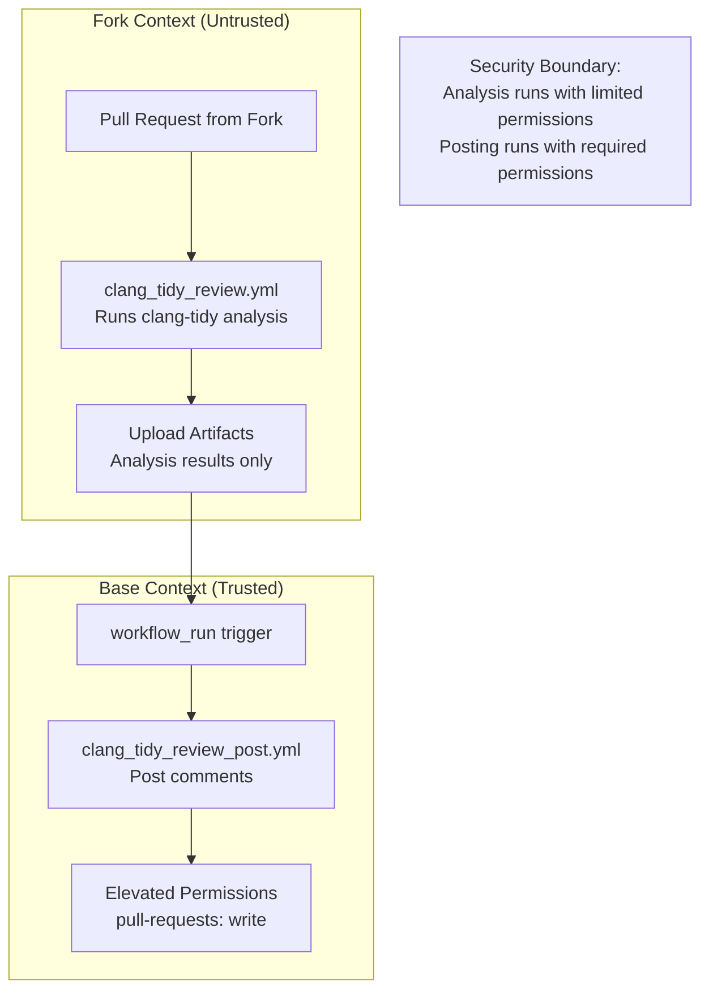
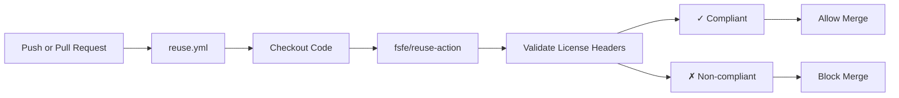
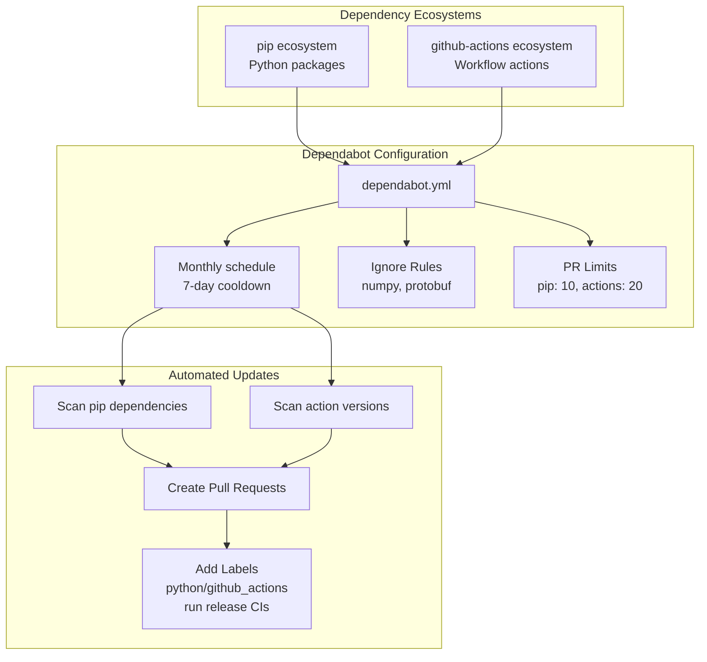
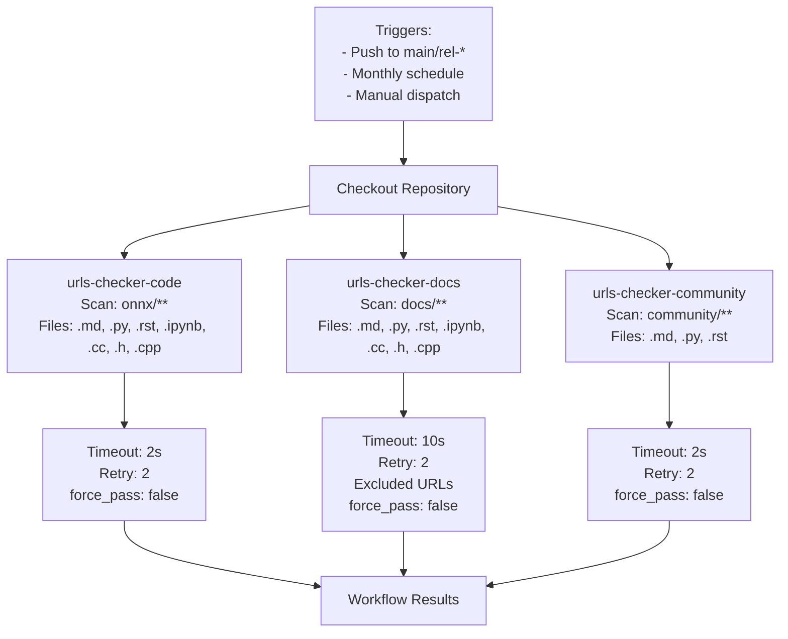
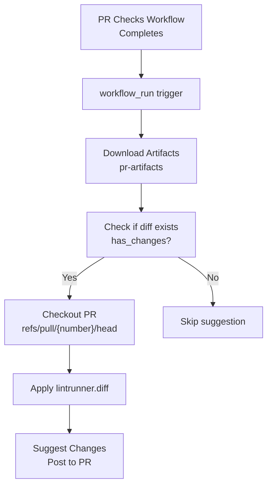
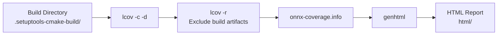

<!-- source: DeepWiki mcp.deepwiki.com · repo onnx/onnx · page 7.4 Security and Compliance Automation · fetched 2026-10-21 -->

# Security and Compliance Automation

<details>
<summary>Relevant source files</summary>

The following files were used as context for generating this wiki page:

- [.github/dependabot.yml](.github/dependabot.yml)
- [.github/workflows/check_urls.yml](.github/workflows/check_urls.yml)
- [.github/workflows/clang_tidy_review.yml](.github/workflows/clang_tidy_review.yml)
- [.github/workflows/clang_tidy_review_post.yml](.github/workflows/clang_tidy_review_post.yml)
- [.github/workflows/pr_checks_post.yml](.github/workflows/pr_checks_post.yml)
- [.github/workflows/reuse.yml](.github/workflows/reuse.yml)
- [.lintrunner.toml](.lintrunner.toml)
- [MANIFEST.in](MANIFEST.in)
- [pyproject.toml](pyproject.toml)
- [requirements-dev.txt](requirements-dev.txt)
- [requirements-lintrunner.txt](requirements-lintrunner.txt)
- [requirements.txt](requirements.txt)
- [tools/gen_coverage_report.py](tools/gen_coverage_report.py)

</details>


## Purpose and Scope

This document covers the automated security, compliance, and validation systems in the ONNX repository. These systems ensure code security, license compliance, supply chain integrity, and documentation quality through continuous monitoring and automated checks.

The scope includes:
- **Security scanning**: CodeQL analysis and C++ static analysis with security-focused patterns
- **License compliance**: REUSE specification enforcement for copyright and licensing
- **Supply chain security**: OpenSSF Scorecard, Dependabot, and dependency management
- **Documentation validation**: Automated URL checking and link validation
- **Build hardening**: Compiler security flags and protection mechanisms

For general code quality automation (linting, formatting), see [Code Quality and Linting Infrastructure](#7.3). For CI/CD workflows, see [Continuous Integration Workflows](#7.1).

---

## Security Scanning Infrastructure

### CodeQL Analysis

CodeQL performs semantic code analysis to detect security vulnerabilities in both C++ and Python code. The analysis runs automatically on pushes and pull requests to identify potential security issues before they reach production.

**Key Features:**
- **Semantic analysis**: Understands code structure and data flow, not just pattern matching
- **Vulnerability detection**: Finds SQL injection, buffer overflows, use-after-free, and other security issues
- **SARIF reporting**: Generates Security Analysis Results Interchange Format reports for dashboard integration
- **Scheduled scanning**: Regular full repository scans in addition to PR checks

The CodeQL workflow is triggered automatically by GitHub's security features and integrates with the GitHub Security tab for centralized vulnerability management.

**Sources:** High-level architecture diagrams (Diagram 6), [pyproject.toml:1-202]()

---

### Clang-Tidy Security Split Workflow

The clang-tidy workflow uses a **split workflow pattern** specifically designed for security when analyzing pull requests from forks.



**Workflow Files:**
- [.github/workflows/clang_tidy_review.yml:1-38]() - Analysis phase
- [.github/workflows/clang_tidy_review_post.yml:1-36]() - Posting phase

**Security Architecture:**

The split workflow pattern addresses a critical security concern: pull requests from forks should not have write access to the base repository, but posting review comments requires elevated permissions.

| Phase | Context | Permissions | Operations |
|-------|---------|-------------|------------|
| **Review Phase** | Fork (untrusted) | `contents: read` | Run clang-tidy, CMake build, static analysis |
| **Post Phase** | Base (trusted) | `pull-requests: write` | Download artifacts, post comments/annotations |

**Implementation Details:**

1. **Review Phase** [.github/workflows/clang_tidy_review.yml:22-37]():
   - Triggered on PR events for `**.cc` and `**.h` files
   - Runs in fork context with minimal permissions
   - Installs dependencies: `libprotobuf-dev`, `protobuf-compiler`
   - Configures build: `cmake -S . -B .setuptools-cmake-build -DONNX_USE_PROTOBUF_SHARED_LIBS=ON`
   - Executes `ZedThree/clang-tidy-review` with `split_workflow: true`
   - Uploads artifacts containing analysis results (not comments)

2. **Post Phase** [.github/workflows/clang_tidy_review_post.yml:8-36]():
   - Triggered by `workflow_run` event when review workflow completes
   - Runs in base repository context with elevated permissions
   - Only executes if review workflow succeeded
   - Downloads artifacts and posts up to 10 comments as annotations
   - Uses `annotations: true` for inline PR feedback
   - Configured with `continue-on-error: true` to avoid blocking

**Concurrency Control:**

Both workflows use concurrency groups to prevent duplicate runs:
- Review: `${{ github.workflow }}-${{ github.ref }}-${{ github.event_name == 'workflow_dispatch' }}`
- Post: `${{ github.workflow }}-${{ github.ref }}`

**Sources:** [.github/workflows/clang_tidy_review.yml:1-38](), [.github/workflows/clang_tidy_review_post.yml:1-36]()

---

## License Compliance

### REUSE Compliance Checking

The REUSE specification ensures consistent copyright and license information across all files in the repository. The ONNX project enforces REUSE compliance through automated CI checks.



**Workflow Configuration:**

The REUSE compliance check runs on all pushes and pull requests [.github/workflows/reuse.yml:7]():

```
on: [push, pull_request]
```

**Security Permissions:**

The workflow follows least-privilege principle [.github/workflows/reuse.yml:9-10]():
- `contents: read` - Only needs to read repository files
- No write permissions required

**Implementation:**

The workflow uses the official REUSE action from the Free Software Foundation Europe:
- Action: `fsfe/reuse-action@676e2d560c9a403aa252096d99fcab3e1132b0f5`
- Validates all files have proper SPDX license identifiers
- Checks for copyright headers
- Verifies LICENSES directory contains all referenced licenses

**REUSE Requirements:**

Each file must include:
1. **SPDX-License-Identifier**: e.g., `Apache-2.0`
2. **Copyright notice**: e.g., `Copyright (c) ONNX Project Contributors`

Example from [.github/workflows/reuse.yml:1-3]():
```
# SPDX-FileCopyrightText: 2022 Free Software Foundation Europe e.V.
# SPDX-License-Identifier: CC0-1.0
```

**Sources:** [.github/workflows/reuse.yml:1-21](), [pyproject.toml:1-4]()

---

## Supply Chain Security

### Dependabot Configuration

Dependabot automates dependency updates to ensure the project stays current with security patches and maintains supply chain integrity.



**Configuration Structure:**

Dependabot is configured in [.github/dependabot.yml:1-39]() with two package ecosystems:

| Ecosystem | Directory | Schedule | PR Limit | Labels |
|-----------|-----------|----------|----------|--------|
| **pip** | `/` | Monthly | 10 | `python`, `run release CIs` |
| **github-actions** | `/` | Monthly | 20 | `github_actions`, `run release CIs` |

**Pip Ecosystem Configuration** [.github/dependabot.yml:12-25]():

- **Ignored dependencies**: `numpy`, `protobuf` - Only updated manually due to compatibility requirements
- **Cooldown**: 7 days default between updates
- **Target files**: `requirements.txt`, `requirements-*.txt`, `pyproject.toml`

**GitHub Actions Ecosystem Configuration** [.github/dependabot.yml:27-38]():

- **Target files**: Workflow files in `.github/workflows/`
- **Pin strategy**: Updates action versions using commit SHA for security
- **Higher PR limit**: 20 PRs to handle multiple workflow files

**Security Benefits:**

1. **Automated patching**: Security vulnerabilities in dependencies are addressed promptly
2. **SHA pinning**: GitHub Actions are pinned to specific commit SHAs, preventing supply chain attacks
3. **Controlled updates**: Manual control over critical dependencies prevents breaking changes
4. **Audit trail**: All updates go through PR review with CI validation

**Example Dependency Pin:**

From [.github/workflows/clang_tidy_review.yml:26]():
```
uses: actions/checkout@de0fac2e4500dabe0009e67214ff5f5447ce83dd # v6.0.2
```

The action is pinned to both:
- Commit SHA: `de0fac2e4500dabe0009e67214ff5f5447ce83dd`
- Version tag comment: `# v6.0.2`

**Sources:** [.github/dependabot.yml:1-39](), [.github/workflows/clang_tidy_review.yml:26]()

---

### Dependency Management Files

The ONNX repository manages dependencies through multiple requirements files for different contexts:

| File | Purpose | Managed By |
|------|---------|------------|
| `requirements.txt` | Runtime dependencies | Manual + Dependabot (ignored) |
| `requirements-dev.txt` | Development dependencies | Manual + Dependabot |
| `requirements-lintrunner.txt` | Linting tool dependencies | Dependabot |
| `requirements-reference.txt` | Reference implementation | Dependabot |

**Runtime Dependencies** [requirements.txt:1-6]():

Core dependencies required for ONNX functionality:
- `numpy>=1.23.2` - Array operations
- `protobuf>=4.25.1` - Protocol buffer serialization
- `typing_extensions>=4.7.1` - Type system extensions
- `ml_dtypes>=0.5.0` - Machine learning data types (platform-specific)

**Linting Dependencies** [requirements-lintrunner.txt:1-12]():

Tools for code quality enforcement:
- `lintrunner-adapters>=0.12.3` - Linter orchestration
- `ruff==0.14.14` - Fast Python linter
- `mypy==1.19.1` - Static type checker
- `types-protobuf==6.32.1.20260221` - Type stubs for protobuf
- `clang-format==21.1.8` - C++ code formatter
- `editorconfig-checker==3.6.0` - Whitespace/formatting validation

Note the comment at the top [requirements-lintrunner.txt:1]():
```
# This file is auto updated by dependabot
```

This file is specifically designed for Dependabot automation, allowing linting tools to stay current.

**Development Dependencies** [requirements-dev.txt:1-15]():

Extended tooling for contributors:
- Build tools: `build`, `setuptools`, `wheel`
- Testing: `pytest`, `pytest-cov`, `pytest-xdist`
- Linting: References `requirements-lintrunner.txt`
- Reference implementation: References `requirements-reference.txt`

**Sources:** [requirements.txt:1-6](), [requirements-lintrunner.txt:1-12](), [requirements-dev.txt:1-15](), [.github/dependabot.yml:18-21]()

---

### Build Hardening

Build hardening mechanisms protect against common security vulnerabilities at compile time. The ONNX build system includes multiple hardening flags controlled by CMake options.

**Hardening Categories:**

1. **Stack Protection**
   - Guards against stack-based buffer overflows
   - Detects stack smashing attacks

2. **Control Flow Integrity (CFI)**
   - Validates indirect function calls
   - Prevents control-flow hijacking

3. **Branch Target Identification (BTI)**
   - ARM64 security feature
   - Prevents jump-oriented programming attacks

4. **FORTIFY_SOURCE**
   - Compile-time and runtime buffer overflow detection
   - Replaces standard library functions with safer variants

**CMake Configuration:**

Build hardening is enabled through the `ONNX_HARDENING` option in CMakeLists.txt. When enabled, the build system applies platform-specific compiler flags to enable security features.

**Sources:** High-level architecture diagrams (Diagram 6), [CMakeLists.txt]() (referenced but not provided)

---

## Documentation and Link Validation

### URL Checking Workflow

The URL checking workflow automatically validates all hyperlinks in the repository to ensure documentation quality and prevent broken links.



**Workflow Configuration:**

The URL checker runs in three phases [.github/workflows/check_urls.yml:1-59]():

**1. Code Directory Scanning** [.github/workflows/check_urls.yml:27-37]():

| Parameter | Value |
|-----------|-------|
| Subfolder | `onnx` |
| File types | `.md, .py, .rst, .ipynb, .cc, .h, .cpp` |
| Timeout | 2 seconds |
| Retry count | 2 |
| Excluded URLs | NVIDIA DevBlog (known slow) |

**2. Documentation Scanning** [.github/workflows/check_urls.yml:39-48]():

| Parameter | Value |
|-----------|-------|
| Subfolder | `docs` |
| File types | `.md, .py, .rst, .ipynb, .cc, .h, .cpp` |
| Timeout | 10 seconds (longer for external docs) |
| Excluded URLs | GitHub blob links, localhost, specific PRs |

Excluded URLs list [.github/workflows/check_urls.yml:47]():
- `https://github.com/onnx/onnx/blob/main/docs/Operators` - Internal reference
- `https://github.com/onnx/onnx/pull/436` - Archived PR
- `http://127.0.0.1:80*` - Localhost URLs

**3. Community Directory Scanning** [.github/workflows/check_urls.yml:50-58]():

| Parameter | Value |
|-----------|-------|
| Subfolder | `community` |
| File types | `.md, .py, .rst` |
| Timeout | 2 seconds |
| Retry count | 2 |

**Trigger Conditions:**

The workflow runs [.github/workflows/check_urls.yml:7-13]():
1. **On push**: To `main` or `rel-*` branches
2. **Scheduled**: Monthly on the 1st at midnight UTC
3. **Manual**: Via `workflow_dispatch`

**Security Permissions:**

Follows least-privilege principle [.github/workflows/check_urls.yml:15-16]():
- `contents: read` - Only needs repository read access

**Action Details:**

Uses `urlstechie/urlchecker-action@b643b43e2ac605e1475331c7b67247d242b7dce4` (v0.0.34) with features:
- Selective printing: `print_all: false` to reduce noise
- Configurable timeouts per directory
- Retry logic for transient failures
- URL exclusion patterns
- Force pass control: Set to `false` to enforce validation

**Sources:** [.github/workflows/check_urls.yml:1-59]()

---

## Code Quality Integration

While detailed code quality automation is covered in [Code Quality and Linting Infrastructure](#7.3), security and compliance checks integrate with the quality gates through several mechanisms:

**PR Checks Post Workflow:**

The [pr_checks_post.yml]() workflow handles automated fix suggestions with security considerations:



**Security Considerations:**

1. **Artifact-based communication** [.github/workflows/pr_checks_post.yml:39-47]():
   - Downloads artifacts from completed workflow
   - Artifacts contain: `pr_number`, `lintrunner.diff`
   - Prevents direct code execution from fork context

2. **Conditional execution** [.github/workflows/pr_checks_post.yml:63-77]():
   - Only processes if diff file has content
   - Validates PR number before checkout
   - Uses `continue-on-error: true` for non-blocking suggestions

3. **Permission separation** [.github/workflows/pr_checks_post.yml:20-23]():
   - `contents: read` - Read repository
   - `pull-requests: write` - Post suggestions
   - Minimal permissions for operation

**Debugging Infrastructure:**

The workflow includes extensive debug output [.github/workflows/pr_checks_post.yml:25-89]() to troubleshoot artifact handling:
- Workflow run info logging
- Download outcome tracking
- Diff size and content preview
- Git status before/after apply

**Sources:** [.github/workflows/pr_checks_post.yml:1-112](), [.lintrunner.toml:1-222]()

---

## Configuration Management

Security and compliance tools are configured through centralized files that define behavior across the entire project.

### PyProject Configuration

The [pyproject.toml]() file centralizes configuration for multiple security and quality tools:

**MyPy Type Checking** [pyproject.toml:61-97]():

Strict type checking configuration with security benefits:
- `strict_optional = true` - Catches null pointer issues
- `warn_return_any = true` - Prevents type erasure
- `check_untyped_defs = true` - Ensures type coverage
- `no_implicit_optional = true` - Explicit None handling

**Ruff Linting** [pyproject.toml:112-173]():

Extensive rule sets covering security concerns:
- `"B"` - flake8-bugbear: Catches likely bugs
- `"S"` - Not shown, but typically includes security rules
- `"T10"` - flake8-debugger: Prevents debug code in production
- `"TRY"` - flake8-try-except-raise: Exception handling best practices

**Sources:** [pyproject.toml:61-173]()

---

### Lintrunner Configuration

The [.lintrunner.toml]() file orchestrates all linting tools through a unified interface:

**Linter Definitions:**

| Linter | Code | Target Files | Formatter | Security Relevance |
|--------|------|--------------|-----------|-------------------|
| Ruff | `RUFF` | `**/*.py, **/*.pyi` | Yes | Code quality, bug detection |
| MyPy | `MYPY` | `onnx/**/*.py, tools/**/*.py` | No | Type safety |
| Ruff Format | `RUFF-FORMAT` | `**/*.py` | Yes | Consistent style |
| Namespace | `NAMESPACE` | `**/*.cc, **/*.h` | No | Symbol hiding |
| Clang-Format | `CLANGFORMAT` | `onnx/**/*.h, onnx/**/*.cc` | Yes | C++ consistency |
| EditorConfig | `EDITORCONFIG-CHECKER` | Multiple | No | Whitespace, line endings |

**Custom Security Linter: NAMESPACE** [.lintrunner.toml:133-152]():

Prevents hardcoded namespace usage to enable symbol hiding:
- Pattern: `namespace onnx|onnx::`
- Purpose: Other libraries linking statically can hide ONNX symbols
- Security benefit: Prevents symbol conflicts and potential exploitation

**Initialization Commands:**

Each linter has an `init_command` that installs dependencies [.lintrunner.toml:57-65]():
```toml
init_command = [
    'python', '-m', 'lintrunner_adapters', 'run', 'pip_init',
    '--dry-run={{DRYRUN}}',
    '--requirement=requirements-lintrunner.txt',
]
```

This ensures consistent tooling across all developers and CI environments.

**Sources:** [.lintrunner.toml:1-222](), [requirements-lintrunner.txt:1-12]()

---

## Coverage Reporting

While primarily a quality metric, code coverage has security implications by identifying untested code paths that may contain vulnerabilities.

**Coverage Generation Tool:**

The [tools/gen_coverage_report.py]() script generates HTML coverage reports using `lcov`:



**Script Functions:**

1. **`gen_trace_file()`** [tools/gen_coverage_report.py:25-49]():
   - Captures coverage data from build directory
   - Excludes external code with `--no-external`
   - Filters out build artifacts from `.setuptools-cmake-build`

2. **`gen_html_files()`** [tools/gen_coverage_report.py:52-62]():
   - Generates static HTML report from trace file
   - Sets root path for source file references

**Usage:**

```bash
python tools/gen_coverage_report.py -r <root_dir> -o <output_dir>
```

**Security Benefit:**

Coverage reports help identify:
- Untested error handling paths
- Dead code that should be removed
- Security-critical code lacking test validation

**Sources:** [tools/gen_coverage_report.py:1-84]()

---

## Summary

The ONNX repository implements a comprehensive security and compliance automation system:

**Security Layers:**

| Layer | Tools | Purpose |
|-------|-------|---------|
| **Static Analysis** | CodeQL, clang-tidy | Vulnerability detection |
| **License Compliance** | REUSE | Copyright/license enforcement |
| **Supply Chain** | Dependabot, SHA pinning | Dependency security |
| **Build Security** | Hardening flags | Runtime protection |
| **Documentation** | URL checker | Link validation |
| **Type Safety** | MyPy | Type system enforcement |

**Key Security Patterns:**

1. **Split Workflow Pattern**: Separates untrusted analysis from privileged operations
2. **SHA Pinning**: All GitHub Actions pinned to specific commits
3. **Least Privilege**: Workflows only request necessary permissions
4. **Artifact Communication**: Safe data passing between workflow contexts
5. **Automated Updates**: Regular security patches through Dependabot
6. **Comprehensive Validation**: Multiple layers of checking before merge

These automated systems work together to maintain security, compliance, and quality standards throughout the development lifecycle.

**Sources:** All workflow files in [.github/workflows/](), [pyproject.toml:1-202](), [.lintrunner.toml:1-222]()

---

