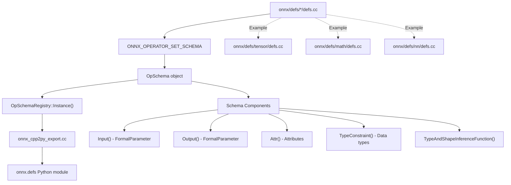
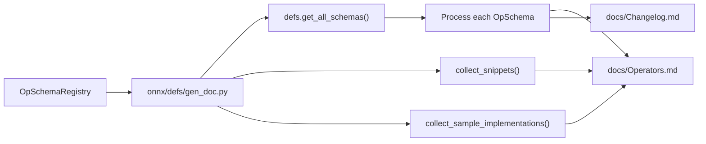
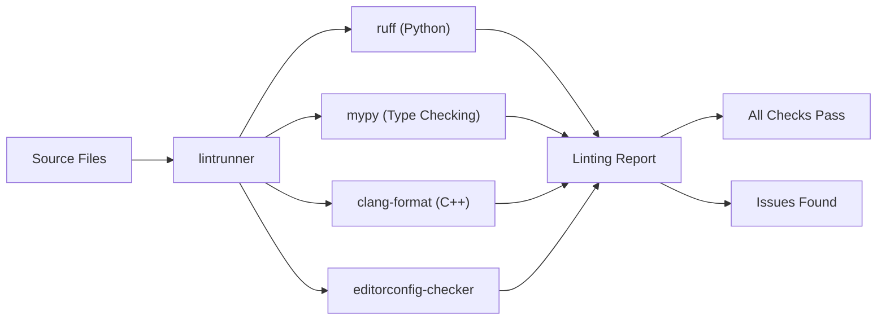
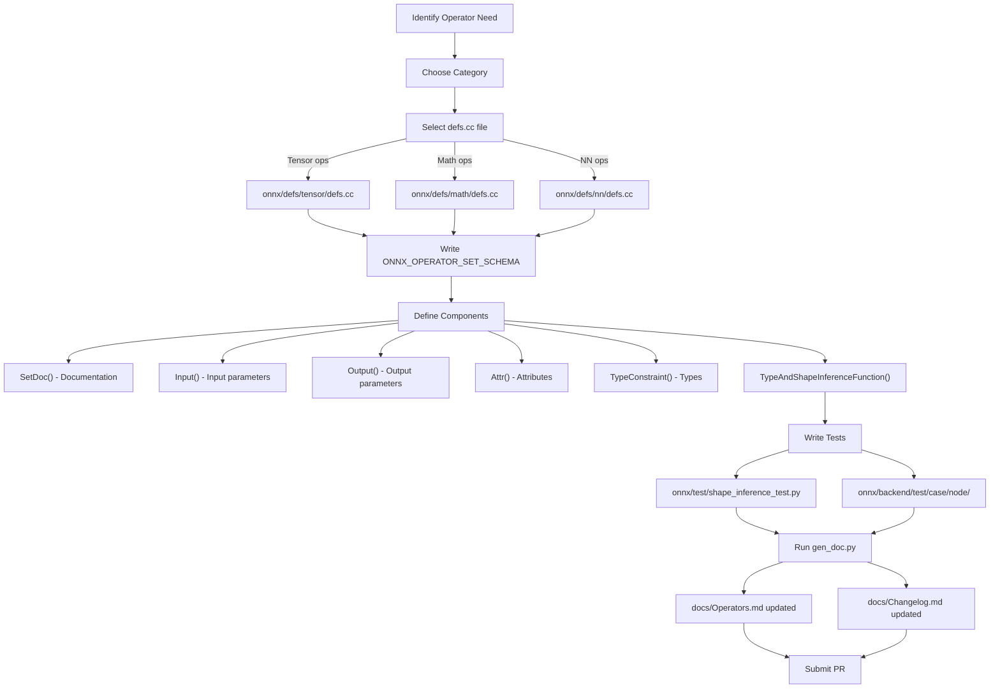
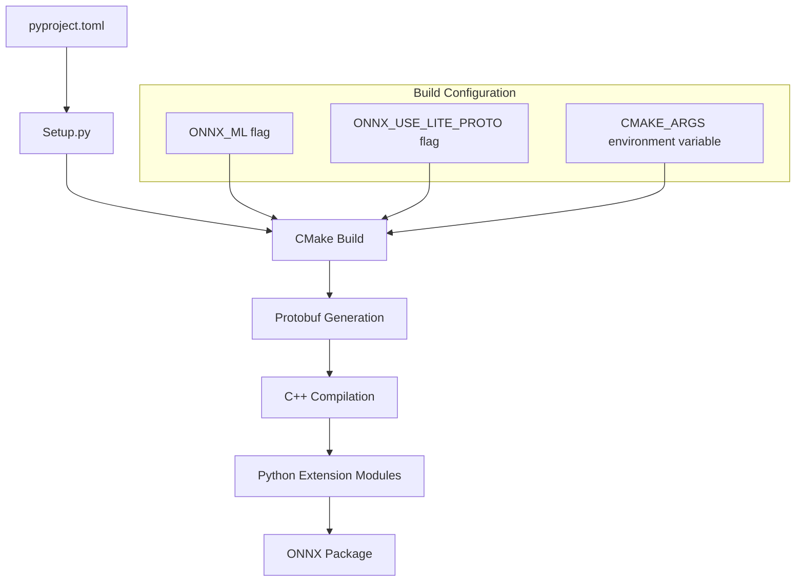

<!-- source: DeepWiki mcp.deepwiki.com · repo onnx/onnx · page 8 Developer Guide · fetched 2026-10-21 -->

# Developer Guide

<details>
<summary>Relevant source files</summary>

The following files were used as context for generating this wiki page:

- [docs/Changelog-ml.md](docs/Changelog-ml.md)
- [docs/Changelog.md](docs/Changelog.md)
- [docs/Operators-ml.md](docs/Operators-ml.md)
- [docs/Operators.md](docs/Operators.md)
- [docs/TestCoverage.md](docs/TestCoverage.md)
- [onnx/backend/test/case/node/cast.py](onnx/backend/test/case/node/cast.py)
- [onnx/backend/test/case/node/castlike.py](onnx/backend/test/case/node/castlike.py)
- [onnx/defs/__init__.py](onnx/defs/__init__.py)
- [onnx/defs/controlflow/defs.cc](onnx/defs/controlflow/defs.cc)
- [onnx/defs/controlflow/old.cc](onnx/defs/controlflow/old.cc)
- [onnx/defs/gen_doc.py](onnx/defs/gen_doc.py)
- [onnx/defs/math/defs.cc](onnx/defs/math/defs.cc)
- [onnx/defs/math/old.cc](onnx/defs/math/old.cc)
- [onnx/defs/nn/defs.cc](onnx/defs/nn/defs.cc)
- [onnx/defs/nn/old.cc](onnx/defs/nn/old.cc)
- [onnx/defs/operator_sets.h](onnx/defs/operator_sets.h)
- [onnx/defs/reduction/defs.cc](onnx/defs/reduction/defs.cc)
- [onnx/defs/rnn/defs.cc](onnx/defs/rnn/defs.cc)
- [onnx/defs/rnn/old.cc](onnx/defs/rnn/old.cc)
- [onnx/defs/tensor/defs.cc](onnx/defs/tensor/defs.cc)
- [onnx/defs/tensor/old.cc](onnx/defs/tensor/old.cc)
- [onnx/defs/traditionalml/defs.cc](onnx/defs/traditionalml/defs.cc)
- [onnx/defs/traditionalml/old.cc](onnx/defs/traditionalml/old.cc)
- [onnx/onnx_cpp2py_export/defs.pyi](onnx/onnx_cpp2py_export/defs.pyi)
- [onnx/onnx_cpp2py_export/shape_inference.pyi](onnx/onnx_cpp2py_export/shape_inference.pyi)
- [onnx/shape_inference.py](onnx/shape_inference.py)
- [onnx/test/inference_function_test.py](onnx/test/inference_function_test.py)
- [onnx/test/schema_test.py](onnx/test/schema_test.py)
- [onnx/test/shape_inference_test.py](onnx/test/shape_inference_test.py)

</details>


This guide provides comprehensive information for developers who want to contribute to the ONNX project. It covers the development environment setup, code organization, and the general workflow for making changes to the ONNX specification and implementation.

For step-by-step instructions on defining new operators, see page 8.1 (Adding New Operators). For information about how operator documentation is generated, see page 8.2 (Operator Documentation Generation). For details on the contribution workflow, PR process, and testing requirements, see page 8.3 (Contributing Guidelines and Development Workflow).

## Development Environment Setup

### Prerequisites

To contribute to ONNX, you need the following tools and dependencies:

| Requirement | Minimum Version | Purpose |
|-------------|----------------|---------|
| Python | 3.10 | Core implementation and tooling |
| Protobuf | 4.25.1 | Protocol buffer compiler and runtime |
| CMake | 3.13 | Build system |
| C++ Compiler | C++17 support | Compiling core libraries |
| NumPy | 1.23.2 | Array operations |

Sources: [pyproject.toml:22](), [requirements.txt]()

### Installation Steps

1. **Clone the repository:**
   ```bash
   git clone https://github.com/onnx/onnx.git
   cd onnx
   ```

2. **Install Python dependencies:**
   ```bash
   pip install -r requirements.txt
   pip install -r requirements-dev.txt
   ```

3. **Set up linting tools:**
   ```bash
   pip install -r requirements-lintrunner.txt
   lintrunner init
   ```

4. **Build ONNX from source:**
   ```bash
   # Development install (editable)
   pip install -e .
   
   # With optional reference implementation
   pip install -e .[reference]
   ```

The build process invokes CMake to compile C++ code, generates Python bindings via nanobind, and creates protobuf files from `.proto` definitions.

Sources: [requirements-lintrunner.txt:1-11](), [pyproject.toml:5-8]()

### Directory Structure Overview

Key directories for developers:

```
onnx/
├── defs/                    # Operator definitions (C++)
│   ├── schema.h/cc          # OpSchema class and registry
│   ├── tensor/defs.cc       # Tensor operators
│   ├── math/defs.cc         # Math operators
│   ├── nn/defs.cc           # Neural network operators
│   └── gen_doc.py           # Documentation generator
├── test/                    # Unit tests
│   └── shape_inference_test.py
├── backend/test/            # Backend compatibility tests
├── cpp2py_export.cc         # Python bindings via nanobind
├── *.proto                  # Protocol buffer definitions
└── shape_inference.py       # Python shape inference wrapper
```

Sources: [onnx/defs/tensor/defs.cc:1-3](), [onnx/defs/math/defs.cc:1-3](), [onnx/defs/nn/defs.cc:1-3](), [onnx/defs/gen_doc.py:1-2](), [onnx/cpp2py_export.cc:1-3]()

## Code Organization: How ONNX Operators Are Implemented

### Operator Definition System

ONNX operators are defined in C++ using the `OpSchema` class and registered via the `ONNX_OPERATOR_SET_SCHEMA` macro. The operator schema specifies inputs, outputs, attributes, type constraints, and inference functions.

**Diagram: Operator Schema Registration Flow**


Sources: [onnx/defs/schema.h:147-234](), [onnx/defs/tensor/defs.cc:102-155](), [onnx/cpp2py_export.cc:1-77]()

### Key C++ Classes and Macros

The following table lists the core C++ constructs used in operator definitions:

| Construct | Location | Purpose |
|-----------|----------|---------|
| `OpSchema` | [onnx/defs/schema.h:147]() | Class representing operator schema |
| `ONNX_OPERATOR_SET_SCHEMA` | [onnx/defs/schema.h]() | Macro to register operator schema |
| `OpSchemaRegistry` | [onnx/defs/schema.cc:106-109]() | Singleton registry of all schemas |
| `InferenceContext` | [onnx/defs/shape_inference.h]() | Context for shape inference functions |
| `TypeAndShapeInferenceFunction` | [onnx/defs/schema.h]() | Function type for shape inference |
| `FormalParameter` | [onnx/defs/schema.h:184-234]() | Represents input/output parameters |

Sources: [onnx/defs/schema.h:147-234](), [onnx/defs/schema.cc:106-109]()

### Example: Operator Definition Structure

Here's the structure of how operators like `Cast` are defined in [onnx/defs/tensor/defs.cc:102-155]():

```
ONNX_OPERATOR_SET_SCHEMA(
    Cast,                                    // Operator name
    25,                                      // Opset version
    OpSchema()
        .SetDoc(Cast_ver25_doc)             // Documentation string
        .Attr("to", ..., AttributeProto::INT) // Attributes
        .Attr("saturate", ..., static_cast<int64_t>(1))
        .Input(0, "input", ..., "T1", ...)  // Input specification
        .Output(0, "output", ..., "T2", ...) // Output specification
        .TypeConstraint("T1", ...)           // Type constraints
        .TypeConstraint("T2", ...)
        .TypeAndShapeInferenceFunction(...) // Inference logic
        .PartialDataPropagationFunction(...) // Data propagation
);
```

Sources: [onnx/defs/tensor/defs.cc:102-155]()

### Documentation Auto-Generation

The `gen_doc.py` script reads operator schemas from the registry and generates documentation files:

**Diagram: Documentation Generation Pipeline**


The generated files [docs/Operators.md]() and [docs/Changelog.md]() contain the warning: "This file is automatically generated... Do not modify directly and instead edit operator definitions."

Sources: [onnx/defs/gen_doc.py:1-47](), [docs/Operators.md:1-5](), [docs/Changelog.md:1-5]()

## Developer Workflow Overview

### Code Quality Tools

ONNX uses `lintrunner` to orchestrate multiple code quality tools:

| Tool | Version | Purpose |
|------|---------|---------|
| `ruff` | 0.14.3 | Python linting and formatting |
| `mypy` | 1.18.2 | Static type checking |
| `clang-format` | 21.1.2 | C++ code formatting |
| `editorconfig-checker` | 3.4.1 | Enforce .editorconfig rules |

**Running code quality checks:**
```bash
# Run all linters on changed files
lintrunner

# Auto-fix issues
lintrunner -a

# Run on all files
lintrunner --all-files
```

Sources: [requirements-lintrunner.txt:1-11](), [pyproject.toml:61-89]()

**Diagram: Linting and Type Checking Flow**


Sources: [requirements-lintrunner.txt:1-11](), [pyproject.toml:61-89]()

### Testing

ONNX has comprehensive testing infrastructure:

| Test Type | Location | Purpose |
|-----------|----------|---------|
| Shape Inference Tests | [onnx/test/shape_inference_test.py]() | Verify shape inference logic |
| Unit Tests | [onnx/test/]() | Test individual components |
| Backend Tests | [onnx/backend/test/]() | Verify operator implementations |
| Test Coverage | [docs/TestCoverage.md]() | Track operator coverage |

**Running tests:**
```bash
# Run all tests
pytest

# Run specific test file
pytest onnx/test/shape_inference_test.py

# Run with coverage
pytest --cov=onnx
```

Sources: [onnx/test/shape_inference_test.py:1-49](), [docs/TestCoverage.md:1-10](), [pyproject.toml:53-59]()

## Key Development Tasks

### Adding New Operators

To add a new operator to ONNX, you need to:

1. **Define the operator schema** in the appropriate `defs.cc` file (e.g., [onnx/defs/tensor/defs.cc](), [onnx/defs/math/defs.cc]())
2. **Implement shape inference** function to compute output shapes
3. **Add tests** in [onnx/test/]() and [onnx/backend/test/]()
4. **Run documentation generation** via `gen_doc.py`

For detailed step-by-step instructions, see page 8.1 (Adding New Operators).

**Diagram: Operator Addition Workflow**


Sources: [onnx/defs/tensor/defs.cc:1-3](), [onnx/defs/math/defs.cc:1-3](), [onnx/defs/nn/defs.cc:1-3](), [onnx/defs/gen_doc.py:1-47]()

### Shape Inference Implementation

Shape inference functions use the `InferenceContext` API to determine output shapes:

**Key InferenceContext methods** (from [onnx/defs/shape_inference.h]()):
- `getInputType(index)` - Get input tensor type and shape
- `getOutputType(index)` - Get output tensor type (to set)
- `getAttribute(name)` - Get operator attribute value
- `hasNInputShapes(n)` - Check if first n inputs have shapes
- `propagateElemTypeFromInputToOutput(in, out)` - Copy element type

**Example pattern from [onnx/defs/tensor/defs.cc:276-397]():**
```cpp
.TypeAndShapeInferenceFunction([](InferenceContext& ctx) {
    // 1. Propagate element type from input to output
    propagateElemTypeFromInputToOutput(ctx, 0, 0);
    
    // 2. Get input shape
    if (!hasNInputShapes(ctx, 1)) return;
    auto& input_shape = ctx.getInputType(0)->tensor_type().shape();
    
    // 3. Get attributes
    int64_t allowzero = getAttribute(ctx, "allowzero", 0);
    
    // 4. Compute and set output shape
    auto* output_shape = ctx.getOutputType(0)
        ->mutable_tensor_type()->mutable_shape();
    // ... shape computation logic ...
})
```

Sources: [onnx/defs/tensor/defs.cc:276-397](), [onnx/test/shape_inference_test.py:89-138]()

### Generating Documentation

ONNX uses [onnx/defs/gen_doc.py]() to auto-generate operator documentation:

```bash
# Generate documentation
python onnx/defs/gen_doc.py

# Output files
# - docs/Operators.md (main operator reference)
# - docs/Changelog.md (version history)
# - docs/Operators-ml.md (ONNX-ML operators)
# - docs/Changelog-ml.md (ONNX-ML history)
```

The script:
1. Calls `defs.get_all_schemas()` to retrieve all registered operators
2. Collects code snippets from [onnx/backend/test/]() 
3. Generates markdown documentation with schema details
4. Adds "DO NOT MODIFY" warning headers

For details on the documentation generation system, see page 8.2 (Operator Documentation Generation).

Sources: [onnx/defs/gen_doc.py:1-47](), [docs/Operators.md:1-5](), [docs/Changelog.md:1-5]()

## Testing Guidelines

ONNX has extensive testing requirements to ensure compatibility across implementations.

### Test Types

| Test Type | Purpose | Location |
|-----------|---------|----------|
| Unit Tests | Test individual components | `onnx/test/` |
| Shape Inference Tests | Verify shape inference logic | `onnx/test/shape_inference_test.py` |
| Backend Tests | Test operator implementations | `onnx/backend/test/` |
| End-to-End Tests | Test complete model workflows | `onnx/test/models/` |

### Running Tests

```bash
# Run all tests
pytest

# Run specific test file
pytest onnx/test/checker_test.py

# Run with parallelism
pytest -xvs -n auto
```

Source: [pyproject.toml:53-59]()

## Building and Packaging

ONNX uses a build system based on CMake and Python's packaging tools.

### Build System Overview



Sources: [pyproject.toml:5-51](), [.github/workflows/manylinux/entrypoint.sh:35-56]()

### Building for Distribution

The ONNX project uses GitHub Actions to build wheels for multiple platforms, including:

- Linux (manylinux)
- Windows
- macOS
- Various Python versions (3.9+)

For local development, you can create a wheel package with:

```bash
python -m build --wheel
```

The release process generates wheels with proper platform tags using the `auditwheel` tool on Linux systems.

Sources: [.github/workflows/manylinux/entrypoint.sh:57-73](), [requirements-release.txt]()

## Conclusion

This developer guide provides a starting point for contributors to the ONNX project. For more specific guidance, refer to the linked subsections or explore the ONNX codebase directly.

Remember that ONNX is a community-driven project, and contributions are welcome. By following the guidelines in this document, you can ensure that your contributions meet the project's standards and are more likely to be accepted.

---

