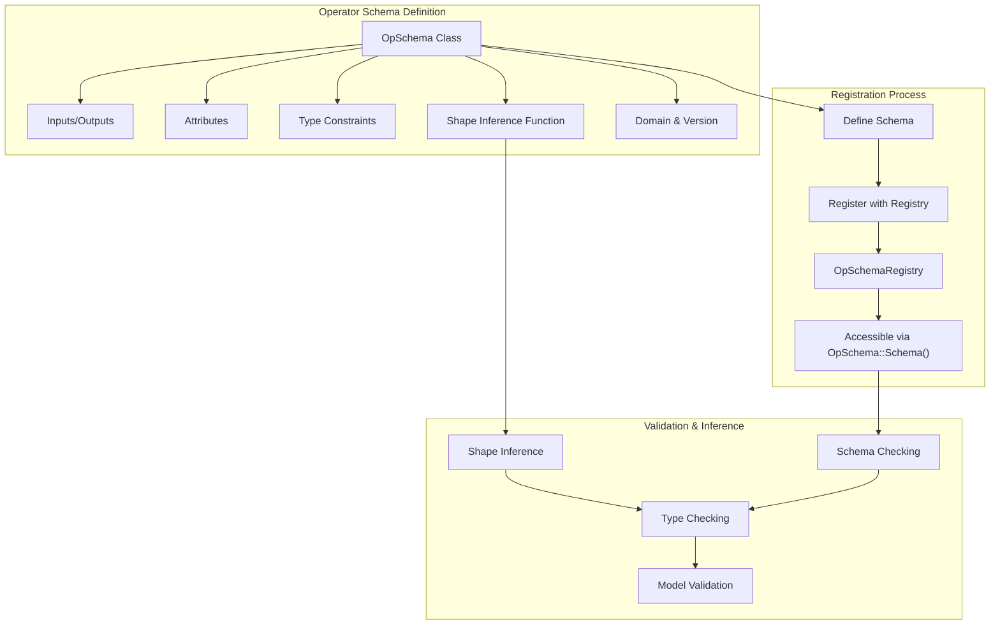
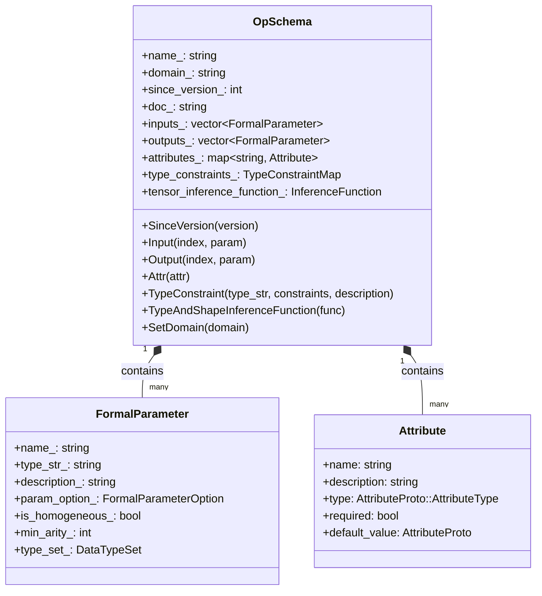
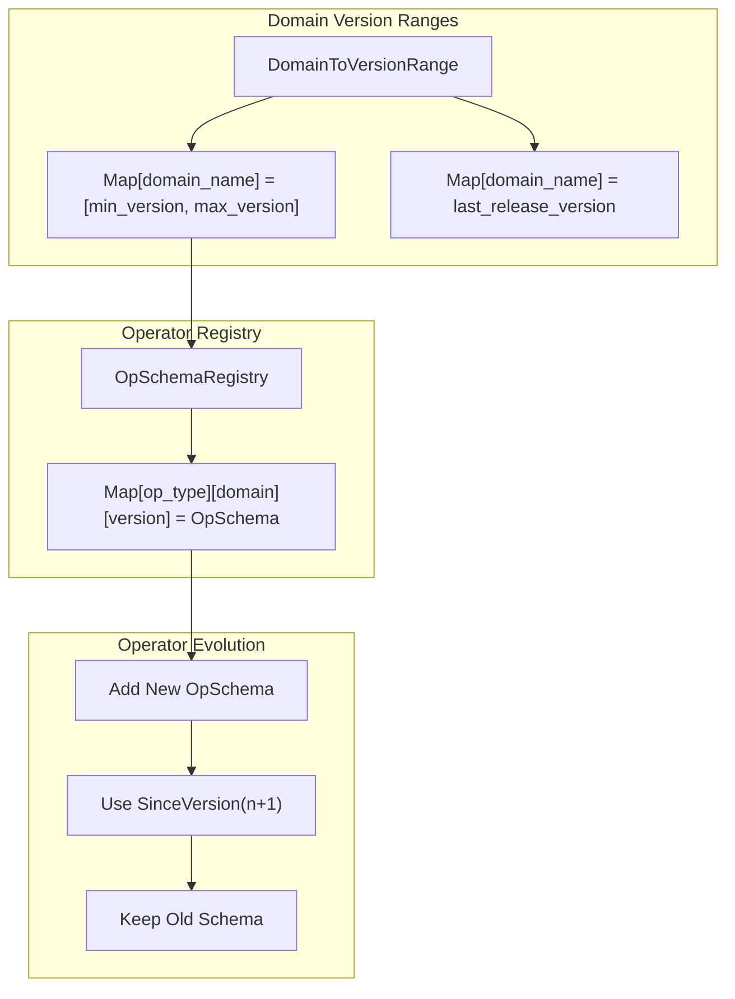
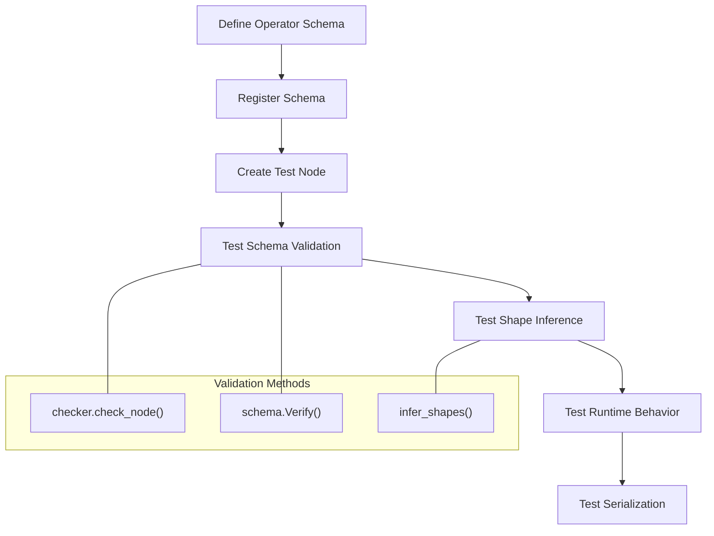

<!-- source: DeepWiki mcp.deepwiki.com · repo onnx/onnx · page 8.1 Adding New Operators · fetched 2026-10-21 -->

# Adding New Operators

<details>
<summary>Relevant source files</summary>

The following files were used as context for generating this wiki page:

- [docs/Changelog-ml.md](docs/Changelog-ml.md)
- [docs/Changelog.md](docs/Changelog.md)
- [docs/Operators-ml.md](docs/Operators-ml.md)
- [docs/Operators.md](docs/Operators.md)
- [docs/TestCoverage.md](docs/TestCoverage.md)
- [onnx/backend/test/case/node/cast.py](onnx/backend/test/case/node/cast.py)
- [onnx/backend/test/case/node/castlike.py](onnx/backend/test/case/node/castlike.py)
- [onnx/checker.cc](onnx/checker.cc)
- [onnx/checker.h](onnx/checker.h)
- [onnx/common/model_helpers.cc](onnx/common/model_helpers.cc)
- [onnx/common/status.cc](onnx/common/status.cc)
- [onnx/common/status.h](onnx/common/status.h)
- [onnx/cpp2py_export.cc](onnx/cpp2py_export.cc)
- [onnx/defs/__init__.py](onnx/defs/__init__.py)
- [onnx/defs/controlflow/defs.cc](onnx/defs/controlflow/defs.cc)
- [onnx/defs/controlflow/old.cc](onnx/defs/controlflow/old.cc)
- [onnx/defs/function.cc](onnx/defs/function.cc)
- [onnx/defs/function.h](onnx/defs/function.h)
- [onnx/defs/gen_doc.py](onnx/defs/gen_doc.py)
- [onnx/defs/math/defs.cc](onnx/defs/math/defs.cc)
- [onnx/defs/math/old.cc](onnx/defs/math/old.cc)
- [onnx/defs/nn/defs.cc](onnx/defs/nn/defs.cc)
- [onnx/defs/nn/old.cc](onnx/defs/nn/old.cc)
- [onnx/defs/operator_sets.h](onnx/defs/operator_sets.h)
- [onnx/defs/reduction/defs.cc](onnx/defs/reduction/defs.cc)
- [onnx/defs/rnn/defs.cc](onnx/defs/rnn/defs.cc)
- [onnx/defs/rnn/old.cc](onnx/defs/rnn/old.cc)
- [onnx/defs/schema.cc](onnx/defs/schema.cc)
- [onnx/defs/schema.h](onnx/defs/schema.h)
- [onnx/defs/shape_inference.cc](onnx/defs/shape_inference.cc)
- [onnx/defs/shape_inference.h](onnx/defs/shape_inference.h)
- [onnx/defs/tensor/defs.cc](onnx/defs/tensor/defs.cc)
- [onnx/defs/tensor/old.cc](onnx/defs/tensor/old.cc)
- [onnx/defs/traditionalml/defs.cc](onnx/defs/traditionalml/defs.cc)
- [onnx/defs/traditionalml/old.cc](onnx/defs/traditionalml/old.cc)
- [onnx/onnx_cpp2py_export/defs.pyi](onnx/onnx_cpp2py_export/defs.pyi)
- [onnx/onnx_cpp2py_export/shape_inference.pyi](onnx/onnx_cpp2py_export/shape_inference.pyi)
- [onnx/shape_inference.py](onnx/shape_inference.py)
- [onnx/shape_inference/implementation.cc](onnx/shape_inference/implementation.cc)
- [onnx/shape_inference/implementation.h](onnx/shape_inference/implementation.h)
- [onnx/test/inference_function_test.py](onnx/test/inference_function_test.py)
- [onnx/test/schema_test.py](onnx/test/schema_test.py)
- [onnx/test/shape_inference_test.py](onnx/test/shape_inference_test.py)

</details>


This document explains how to add new operators to the ONNX framework. It covers the process of defining operator schemas, implementing shape inference, versioning considerations, and registering operators with the ONNX ecosystem. For information about using existing operators, see [ONNX Operator System](#3).

## Overview of ONNX Operator System

The ONNX operator system allows you to define computational nodes that can be used in ONNX models. Each operator is formally defined by an `OpSchema` which specifies its behavior, inputs, outputs, and constraints.



Sources: [onnx/defs/schema.h:147-191](). [onnx/defs/schema.h:859-879](). [onnx/checker.cc:529-575]().

## Defining an Operator Schema

The `OpSchema` class is the core of operator definition. It encapsulates all information about an operator's interface and behavior.

### Key Components of an Operator Schema



Sources: [onnx/defs/schema.h:147-859](). [onnx/cpp2py_export.cc:129-243]().

### Step 1: Create the Schema Object

To define a new operator, start by creating an `OpSchema` object that will hold all the operator's metadata and behavior:

```cpp
OpSchema()
    .SetName("MyOperator")
    .SetDomain("MyDomain")  // Use "" for standard ONNX domain
    .SinceVersion(1)  // Start version number
    .SetDoc("Documentation for MyOperator")
```

Sources: [onnx/defs/schema.h:294-303](). [onnx/defs/schema.cc:445-449]().

### Step 2: Define Inputs and Outputs

Every operator needs to define its inputs and outputs:

```cpp
// Adding inputs
.Input(0, "X", "Input tensor", "T")
.Input(1, "Y", "Second input tensor", "T")

// Adding outputs
.Output(0, "Z", "Output tensor", "T")
```

Each input/output specifies:
- Position index
- Name 
- Description
- Type parameter string (refers to type constraints)
- Optional parameters for variadic inputs/outputs

Sources: [onnx/defs/schema.h:531-575](). [onnx/defs/schema.cc:578-641]().

### Step 3: Define Attributes

Attributes are named parameters that configure the operator's behavior:

```cpp
.Attr("alpha", "Scaling factor", AttributeProto::FLOAT, 1.0f)
.Attr("axis", "Axis for operation", AttributeProto::INT, false)
```

Each attribute specifies:
- Name
- Description
- Type (from AttributeProto::AttributeType)
- Default value or required flag

Sources: [onnx/defs/schema.h:427-486](). [onnx/defs/schema.cc:475-576]().

### Step 4: Define Type Constraints

Type constraints define what data types are allowed for inputs and outputs:

```cpp
.TypeConstraint("T", {"tensor(float)", "tensor(double)"}, "Allowed data types")
```

This creates a type parameter ("T") that can be referenced by inputs and outputs to ensure type consistency.

Sources: [onnx/defs/schema.h:577-582](). [onnx/defs/schema.cc:642-659]().

### Step 5: Implement Shape Inference

Shape inference allows ONNX to determine output shapes based on input shapes:

```cpp
.TypeAndShapeInferenceFunction([](InferenceContext& ctx) {
    // Copy input type to output type
    propagateElemTypeFromInputToOutput(ctx, 0, 0);
    
    // If we have shape info for the input:
    if (hasInputShape(ctx, 0)) {
        // Get the input shape
        const auto& inputShape = getInputShape(ctx, 0);
        // Set the output shape
        updateOutputShape(ctx, 0, inputShape);
    }
})
```

Shape inference is critical for model validation and optimization.

Sources: [onnx/defs/schema.h:377-389](). [onnx/shape_inference.py:22-149]().

## Registering an Operator Schema

Once you've defined your operator schema, you need to register it with the ONNX registry so it can be used in models.

### Using the Registration Macros

ONNX provides macros to simplify registration:

```cpp
ONNX_OPERATOR_SET_SCHEMA(
    MyOperator,  // Operator name
    1,          // Version
    OpSchema()  // Schema definition as shown above
        .Input(0, "X", "Input tensor", "T")
        .Output(0, "Z", "Output tensor", "T")
        .TypeConstraint("T", {"tensor(float)"}, "Allowed data types")
        .TypeAndShapeInferenceFunction([](InferenceContext& ctx) {
            // Shape inference implementation
        })
);
```

Sources: [onnx/defs/schema.h:981-1032](). [onnx/defs/__init__.py:132-148]().

### Python Registration

For Python extensions, you can register schemas using the Python API:

```python
schema = onnx.defs.OpSchema(
    "MyOperator",         # name
    "MyDomain",           # domain
    1,                    # since_version
    inputs=[onnx.defs.OpSchema.FormalParameter("X", "T")],
    outputs=[onnx.defs.OpSchema.FormalParameter("Z", "T")],
    type_constraints=[("T", ["tensor(float)"], "Allowed data types")]
)
onnx.defs.register_schema(schema)
```

Sources: [onnx/cpp2py_export.cc:406-481](). [onnx/defs/__init__.py:132-148](). [onnx/test/schema_test.py:304-321]().

## Versioning and Domain Management

ONNX uses versioning to evolve operators while maintaining backward compatibility. Each operator is identified by its name, domain, and version.

### Operator Domains

Operators are organized into domains:
- `""` (empty string): Default ONNX domain
- `"ai.onnx.ml"`: ML-specific operators
- Custom domains: For vendor-specific operators

Sources: [onnx/defs/schema.h:824-901](). [onnx/defs/__init__.py:27-29]().

### Versioning System

When you modify an existing operator, you should:
1. Increment its version number
2. Maintain backward compatibility when possible
3. Document changes clearly

The ONNX versioning system tracks the compatibility range for each domain:



Sources: [onnx/defs/schema.h:882-941](). [onnx/defs/schema.cc:353-376]().

## Shape Inference Implementation

Shape inference is critical for validating and optimizing ONNX models. Every operator should implement shape inference.

### Basic Shape Inference Structure

```cpp
.TypeAndShapeInferenceFunction([](InferenceContext& ctx) {
    // 1. Type propagation
    propagateElemTypeFromInputToOutput(ctx, 0, 0);
    
    // 2. Check input shapes are valid
    if (!hasNInputShapes(ctx, 1)) {
        return; // Not enough shape info
    }
    
    // 3. Calculate output shape based on input shape
    const auto& input_shape = ctx.getInputType(0)->tensor_type().shape();
    
    // 4. Set the output shape
    auto* output_shape = ctx.getOutputType(0)->mutable_tensor_type()->mutable_shape();
    // (Add dimensions to output_shape)
})
```

Sources: [onnx/shape_inference.py:22-149](). [onnx/test/inference_function_test.py:65-107]().

### Handling Complex Cases

For operators with complex shape relationships:
- Use symbolic dimensions when exact sizes are unknown
- Handle broadcasting rules correctly
- Consider all edge cases (empty tensors, optional inputs)

Sources: [onnx/test/inference_function_test.py:107-172](). [onnx/checker.cc:86-144]().

## Testing Your Operator

Before submitting a new operator, you should thoroughly test it:

1. **Schema Validation**: Ensure the schema is correctly defined
2. **Shape Inference**: Test with various input shapes
3. **Runtime**: Test the actual computation results
4. **Serialization/Deserialization**: Test the operator's behavior when models are saved and loaded



Sources: [onnx/checker.py:66-102](). [onnx/test/checker_test.py:60-185](). [onnx/test/schema_test.py:19-35]().

## Documentation

Documentation is essential for users to understand your operator:

1. Add detailed docstrings in the schema definition
2. Include input/output descriptions
3. Document attribute meanings and default values
4. Provide usage examples if possible

The documentation is automatically generated using `gen_doc.py`.

Sources: [onnx/defs/gen_doc.py:104-227](). [onnx/defs/gen_doc.py:241-416]().

## Function-Based Operators

ONNX supports defining operators as compositions of existing operators using functions:

```cpp
.FunctionBody({
    // Nodes that implement this operator
    NodeProto1,
    NodeProto2,
    ...
})
```

Function-based operators allow you to:
- Create higher-level abstractions
- Reuse existing functionality
- Simplify implementation of complex operators

Sources: [onnx/defs/schema.h:730-789](). [onnx/defs/schema.cc:377-405]().

## Best Practices

When adding new operators to ONNX:

1. **Research**: Check if a similar operator already exists
2. **Consistency**: Follow naming and parameter conventions of existing operators
3. **Documentation**: Provide clear, detailed documentation
4. **Testing**: Create comprehensive tests for your operator
5. **Shape Inference**: Implement robust shape inference that handles all cases
6. **Versioning**: Follow ONNX versioning conventions
7. **Domains**: Use appropriate domains for your operators

Sources: [onnx/defs/schema.h:329-342](). [onnx/test/checker_test.py:60-193]().

## Common Pitfalls

- Not properly handling optional inputs
- Incorrect type constraints
- Incomplete shape inference
- Missing validation for attributes
- Incorrect versioning
- Inadequate documentation

Sources: [onnx/checker.cc:425-515](). [onnx/defs/schema.cc:179-208]().

## Checklist for Adding a New Operator

1. [ ] Define schema with proper name, domain, and version
2. [ ] Define inputs, outputs, and their types
3. [ ] Define attributes with proper descriptions and defaults
4. [ ] Define type constraints
5. [ ] Implement shape inference function
6. [ ] Register the schema
7. [ ] Write tests
8. [ ] Add documentation
9. [ ] Ensure versioning is correct

Sources: [onnx/defs/schema.h:796-816](). [onnx/defs/__init__.py:132-148]().

---

